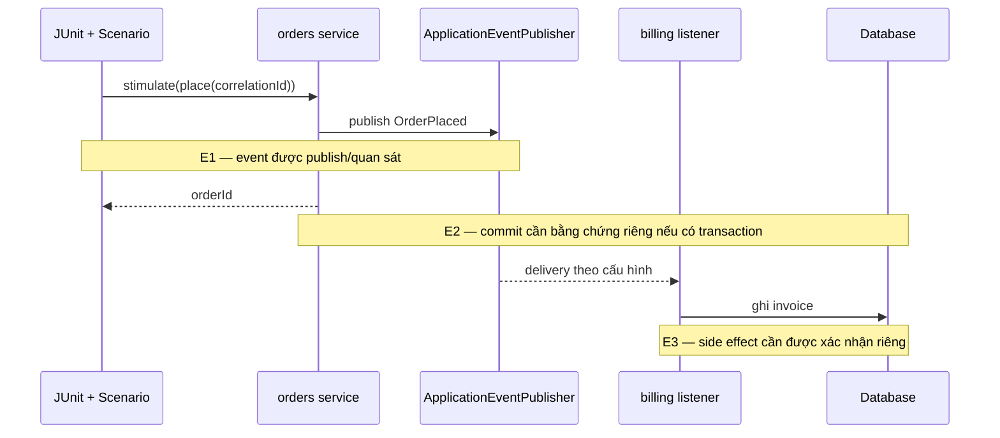

# Chọn Scenario cho event-driven behavior

Một pull request sửa luồng đặt hàng trong module `orders`. Service trả về `orderId` đúng, nhưng nhóm cần kiểm tra thêm: **khi có một yêu cầu hợp lệ, hệ thống có phát `OrderPlaced` với đúng payload và đúng yêu cầu đó không?** Chỉ assert giá trị trả về chưa đủ. Viết `Thread.sleep(1000)` rồi đọc log `"event published"` cũng không phải cách kiểm chứng có thể tin cậy.

Với một bài kiểm thử Spring Modulith, **`Scenario`** giúp diễn đạt đúng chuỗi **stimulus → event được chờ → điều kiện khớp → assertion**:

```java
scenario.stimulate(() -> orders.place("SKU-101", 2, correlationId))
        .andWaitForEventOfType(OrderPlaced.class)
        .matching(event -> correlationId.equals(event.correlationId()))
        .toArriveAndVerify(event ->
                assertThat(event.quantity()).isEqualTo(2));
```

Đây không chỉ là “cách viết cho đẹp”. DSL làm rõ **loại sự kiện cần quan sát** và **sự kiện thuộc stimulus nào**, thay vì để test phụ thuộc vào thời điểm log, lịch chạy thread hay việc event khác cùng loại xuất hiện.

Bài thuộc chương **Chọn chiến lược** của lộ trình **SPRING_MODULITH_VERIFICATION_TESTING**. Nội dung tập trung vào **khi nào chọn `Scenario` cho event-driven behavior**, cách viết Java/JUnit có assertion thực, cách tránh PASS giả với correlation ID, những trường hợp phải dùng `ApplicationEvents`, kiểm thử trạng thái sau commit hoặc `@SpringBootTest` thay thế/bổ sung, và cách đưa những contract này vào quality gate CI.

> **Quy tắc quyết định:** Nếu acceptance criterion có dạng **“khi kích hoạt X, một event loại Y thỏa điều kiện P phải xuất hiện”**, hãy cân nhắc `Scenario`. Nếu cần đếm **chính xác số event**, kiểm tra **không phát event**, kiểm chứng **listener đã ghi database**, hoặc khẳng định **transaction đã commit**, chọn hoặc bổ sung phép kiểm tra phù hợp; chỉ chờ một event không chứng minh được những điều ấy.

## 1. Nhận diện đúng trường hợp nên dùng `Scenario`

`Scenario` có giá trị nhất khi ta muốn xác nhận một **contract theo diễn biến** thay vì chỉ một lời gọi trực tiếp. Tuy vậy, không phải mọi test có event đều cần DSL chờ.

| Câu khẳng định | Lựa chọn ưu tiên | Lý do |
| --- | --- | --- |
| “Lời gọi `place` trả đúng UUID” | JUnit/AssertJ thông thường | Đây là contract kết quả trực tiếp |
| “Sau khi đặt đơn, `OrderPlaced` đúng ID/payload xuất hiện” | **`Scenario`** | Stimulus và event đến được nối thành một kịch bản |
| “Trong một stimulus đồng bộ, phát đúng một `OrderPlaced`” | `@RecordApplicationEvents` + `ApplicationEvents` | Cần **cardinality**, không chỉ sự tồn tại |
| “Đầu vào xấu không phát event” | Exception assertion + `ApplicationEvents` | Không nên chờ event **không tồn tại** cho đến timeout |
| “Một listener thuộc module khác ghi hóa đơn sau commit” | Integration test + trạng thái DB/Awaitility | Event publish khác consumer side effect |
| “Module `billing` không import `orders.internal`” | `ApplicationModules.verify()` | Đây là dependency rule tĩnh |
| “Publication trong registry đã completed” | Test registry/backend tương ứng | `Scenario` thấy event không phải registry completion |
| “Event đến từ Kafka/Rabbit thật với ack/retry đúng” | Integration test với broker | In-process Spring event không phải external transport |
| “Hệ thống giữ p95 thời gian tạo hóa đơn” | Load test/observability phù hợp | Một test event không đại diện latency production |

### Một tiêu chí lựa chọn có thể dùng khi review

Một bài test `Scenario` nên trả lời được đủ bốn câu:

1. **Stimulus:** lời gọi hoặc hành động nào bắt đầu kịch bản?
2. **Event:** class/loại sự kiện nghiệp vụ nào phải được quan sát?
3. **Correlation:** thuộc tính nào chứng minh event đến từ **chính stimulus đó**?
4. **Verification:** payload hoặc trạng thái nghiệp vụ cụ thể phải thỏa điều kiện nào?

Nếu chưa có câu trả lời cho (3), test `andWaitForEventOfType(OrderPlaced.class)` có thể nhận nhầm event của luồng khác. Nếu câu trả lời cho (4) chỉ là `event != null`, assertion còn quá yếu.

**Không chọn `Scenario` vì service đơn thuần có annotation Spring.** Với logic thuần không cần event, JUnit unit test thường rõ và rẻ hơn. Ngược lại, một producer/module contract dùng event thật là trường hợp thích hợp để chọn `@ApplicationModuleTest` và `Scenario`.

## 2. Hiểu DSL và ranh giới bằng chứng của từng bước

Mẫu làm việc quen thuộc của Spring Modulith:

```java
scenario
    .stimulate(() -> service.triggerBusinessAction())
    .andWaitForEventOfType(BusinessEvent.class)
    .matching(event -> matchesThisRequest(event))
    .toArriveAndVerify(event -> verifyBusinessPayload(event));
```

Đây là **mẫu biểu đạt**, không phải file Java tự biên dịch: `service`, `BusinessEvent` và các helper đại diện cho mã ứng dụng. Ví dụ hoàn chỉnh hơn ở phần 4 dùng những kiểu cụ thể.

| Thành phần DSL | Vai trò | Cần tránh |
| --- | --- | --- |
| `stimulate(...)` | Thực thi hành động kích hoạt được test | Đặt stimulus ngoài kịch bản rồi chờ không rõ phạm vi |
| `andWaitForEventOfType(E.class)` | Chọn loại event cần quan sát | Nhầm event producer với side effect consumer |
| `matching(Predicate<E>)` | Loại event không thuộc yêu cầu đang test | Chỉ lọc theo type khi nhiều luồng cùng phát |
| `toArriveAndVerify(Consumer<E>)` | Xác nhận payload của event đến | Chỉ kiểm tra non-null, bỏ qua invariant nghiệp vụ |
| Cấu hình timeout/chờ của framework | Tránh chờ vô hạn khi điều kiện không đến | Biến timeout CI thành “SLO production” |

`Scenario` là **công cụ kiểm thử**, không phải API gửi event của ứng dụng production. `Scenario.stimulate(...)` gọi vào **code ứng dụng**; để phát sự kiện, code ấy vẫn dùng các cơ chế runtime như `ApplicationEventPublisher`.

### Ba thứ khác nhau: event, listener, commit



**Nhìn thấy E1 không có nghĩa E2 hoặc E3 đã xảy ra.** Event được publish trong transaction trước khi commit vẫn có thể được recorder quan sát; consumer `AFTER_COMMIT` có thể chưa chạy. Một test `Scenario` chờ event thuộc producer không phải bằng chứng rằng listener đã tạo hóa đơn.

Cũng không được suy từ **một event đến** rằng producer **chỉ phát đúng một lần**. Bài test phải chọn đúng invariant: `Scenario` xác nhận có một event phù hợp, còn **cardinality/idempotency** cần kiểm tra riêng.

## 3. Mô hình ví dụ: event contract của module `orders`

Để tập trung vào `Scenario`, ta bắt đầu bằng một module `orders` có state **in-memory**, phát một event khi lời gọi hợp lệ. Đây là mẫu dành cho **contract E1**; transaction/database thật sẽ được tách ở phần 7.

```text
com.example.shop
├── ShopApplication.java
├── orders/                                  ← application module orders
│   ├── OrderService.java
│   ├── OrderQueries.java
│   ├── events/
│   │   ├── package-info.java              ← @NamedInterface("events")
│   │   └── OrderPlaced.java
│   └── internal/
│       └── InMemoryOrderLedger.java       ← state chỉ trong JVM
└── billing/                                 ← module nhận event trong biến thể
    ├── package-info.java
    └── internal/
        └── OrderPlacedListener.java
```

Lớp Spring Boot làm gốc nhận diện application modules:

```java
// src/main/java/com/example/shop/ShopApplication.java
package com.example.shop;

import org.springframework.boot.SpringApplication;
import org.springframework.boot.autoconfigure.SpringBootApplication;

@SpringBootApplication
public class ShopApplication {

    public static void main(String[] args) {
        SpringApplication.run(ShopApplication.class, args);
    }
}
```

### 3.1. Công bố hợp đồng event mà module khác được dùng

File `orders/events/package-info.java`:

```java
/**
 * Hợp đồng sự kiện công khai của module orders.
 * Không xuất repository/entity/implementation nội bộ.
 */
@org.springframework.modulith.NamedInterface("events")
package com.example.shop.orders.events;
```

File `orders/events/OrderPlaced.java`:

```java
package com.example.shop.orders.events;

import java.util.Objects;
import java.util.UUID;

public record OrderPlaced(
        UUID orderId,
        UUID correlationId,
        String sku,
        int quantity
) {
    public OrderPlaced {
        Objects.requireNonNull(orderId, "orderId");
        Objects.requireNonNull(correlationId, "correlationId");
        Objects.requireNonNull(sku, "sku");

        if (sku.isBlank() || quantity <= 0) {
            throw new IllegalArgumentException(
                    "Invalid OrderPlaced payload"
            );
        }
    }
}
```

`orderId` định danh đơn, còn `correlationId` nối **stimulus → event → side effect/log**. Không dùng `sku` để phân biệt stimulus: hai người có thể đặt cùng SKU và lượng hàng.

### 3.2. API đọc trạng thái nội bộ cho phép kiểm chứng thêm

```java
// orders/OrderQueries.java
package com.example.shop.orders;

import java.util.UUID;

public interface OrderQueries {
    boolean exists(UUID orderId, UUID correlationId);
}
```

```java
// orders/internal/InMemoryOrderLedger.java
package com.example.shop.orders.internal;

import com.example.shop.orders.OrderQueries;
import java.util.UUID;
import java.util.concurrent.ConcurrentHashMap;
import java.util.concurrent.ConcurrentMap;
import org.springframework.stereotype.Component;

@Component
public class InMemoryOrderLedger implements OrderQueries {

    private final ConcurrentMap<UUID, UUID> orders =
            new ConcurrentHashMap<>();

    public void record(UUID orderId, UUID correlationId) {
        orders.put(orderId, correlationId);
    }

    @Override
    public boolean exists(UUID orderId, UUID correlationId) {
        return correlationId.equals(orders.get(orderId));
    }
}
```

Class implementation `public` ở đây cho phép service trong **cùng module** thuộc package khác sử dụng; về kiến trúc nó vẫn nằm ở subpackage `orders.internal`, không mặc nhiên trở thành API của module khác. Ledger chỉ tồn tại trong JVM, **không chứng minh commit/persistence sau restart**.

### 3.3. Producer phát event

```java
// orders/OrderService.java
package com.example.shop.orders;

import com.example.shop.orders.events.OrderPlaced;
import com.example.shop.orders.internal.InMemoryOrderLedger;
import java.util.Objects;
import java.util.UUID;
import org.springframework.context.ApplicationEventPublisher;
import org.springframework.stereotype.Service;

@Service
public class OrderService {

    private final InMemoryOrderLedger ledger;
    private final ApplicationEventPublisher publisher;

    public OrderService(
            InMemoryOrderLedger ledger,
            ApplicationEventPublisher publisher) {
        this.ledger = ledger;
        this.publisher = publisher;
    }

    public UUID place(
            String sku, int quantity, UUID correlationId) {
        Objects.requireNonNull(correlationId, "correlationId");

        if (sku == null || sku.isBlank() || quantity <= 0) {
            throw new IllegalArgumentException(
                    "Invalid order request"
            );
        }

        UUID orderId = UUID.randomUUID();
        ledger.record(orderId, correlationId);

        publisher.publishEvent(new OrderPlaced(
                orderId, correlationId, sku, quantity
        ));

        return orderId;
    }
}
```

**Điều cần giới hạn:** code không có transaction và mỗi lần gọi hợp lệ có thể tạo một đơn mới, kể cả khi client tái gửi cùng `correlationId`. Nó không tuyên bố idempotency của order creation. Test `Scenario` ở phần 4 chỉ khẳng định **event được phát với payload đúng và gắn đúng stimulus**.

Khi dự án thật cần persistence, phải thay ledger in-memory bằng repository và thiết kế transaction; khi đó các phép kiểm tra commit và listener sau commit **không thể suy ra** từ test baseline này.

## 4. Viết JUnit `@ApplicationModuleTest` với `Scenario`

Đặt test tại package `com.example.shop.orders` để Spring Modulith xác định module mục tiêu. `@ApplicationModuleTest` phù hợp vì ta chỉ muốn kiểm tra **publisher behavior của orders**.

```java
// src/test/java/com/example/shop/orders/OrdersScenarioTest.java
package com.example.shop.orders;

import com.example.shop.orders.events.OrderPlaced;
import java.util.UUID;
import java.util.concurrent.atomic.AtomicReference;
import org.junit.jupiter.api.Test;
import org.springframework.beans.factory.annotation.Autowired;
import org.springframework.modulith.test.ApplicationModuleTest;
import org.springframework.modulith.test.ApplicationModuleTest.BootstrapMode;
import org.springframework.modulith.test.Scenario;
import org.springframework.test.context.event.ApplicationEvents;
import org.springframework.test.context.event.RecordApplicationEvents;

import static org.assertj.core.api.Assertions.assertThat;
import static org.assertj.core.api.Assertions.assertThatThrownBy;

@ApplicationModuleTest(mode = BootstrapMode.STANDALONE)
@RecordApplicationEvents
class OrdersScenarioTest {

    @Autowired
    OrderService orders;

    @Autowired
    OrderQueries queries;

    @Autowired
    ApplicationEvents events;

    @Test
    void waitsForTheEventFromThisOrder(Scenario scenario) {
        UUID correlationId = UUID.randomUUID();
        AtomicReference<UUID> createdId =
                new AtomicReference<>();

        scenario.stimulate(() -> {
                    UUID id = orders.place(
                            "SKU-101", 2, correlationId);
                    createdId.set(id);
                })
                .andWaitForEventOfType(OrderPlaced.class)
                .matching(event ->
                        correlationId.equals(event.correlationId()))
                .toArriveAndVerify(event -> {
                    assertThat(event.orderId())
                            .isEqualTo(createdId.get());
                    assertThat(event.sku())
                            .isEqualTo("SKU-101");
                    assertThat(event.quantity()).isEqualTo(2);
                    assertThat(queries.exists(
                            event.orderId(),
                            event.correlationId()))
                            .isTrue();
                });
    }

    @Test
    void rejectsInvalidInputWithoutPublishingEvent() {
        UUID correlationId = UUID.randomUUID();

        assertThatThrownBy(() ->
                orders.place(" ", 0, correlationId))
                .isInstanceOf(IllegalArgumentException.class);

        assertThat(events.stream(OrderPlaced.class)
                .filter(event ->
                        correlationId.equals(event.correlationId()))
                .count()).isZero();
    }

    @Test
    void recordsOneEventFromOneSynchronousStimulus() {
        UUID correlationId = UUID.randomUUID();

        UUID orderId = orders.place(
                "SKU-202", 1, correlationId);

        var matching = events.stream(OrderPlaced.class)
                .filter(event ->
                        correlationId.equals(event.correlationId()))
                .toList();

        assertThat(matching).hasSize(1);
        assertThat(matching.get(0).orderId())
                .isEqualTo(orderId);
    }
}
```

### Đọc kết quả đúng theo từng test

**`waitsForTheEventFromThisOrder`:** `Scenario` kích hoạt service, chờ một `OrderPlaced` có **đúng correlation ID**, xác minh `orderId`, SKU, số lượng và state in-memory tại thời điểm callback. `AtomicReference` chỉ dùng để giữ `orderId` trả từ stimulus để so với event; nó **không** phải cơ chế đồng bộ nghiệp vụ.

**`rejectsInvalidInputWithoutPublishingEvent`:** một negative-path test, dùng exception assertion và `ApplicationEvents` ngay sau lời gọi sai. Không dùng `Scenario` để chờ một event mà ta **kỳ vọng không đến**: chờ timeout không phải cách hiệu quả để chứng minh validation.

**`recordsOneEventFromOneSynchronousStimulus`:** kiểm tra **số event mà recorder quan sát trong method test**. Việc test thấy đúng một event cho một stimulus đồng bộ không tương đương cam kết **exactly-once delivery** ở production khi có retry, listener lỗi hoặc broker.

### Điều kiện để ví dụ hoạt động

- Project dùng phiên bản Spring Boot/Spring Modulith tương thích, có `spring-modulith-starter-test`, JUnit 5 và AssertJ.
- `ShopApplication` nằm ở package gốc, Spring có thể tạo bean của `orders`.
- Không có các listener phụ ngoài module cần được bootstrap để xác nhận **E1**.
- Mỗi test có `correlationId` riêng; ledger in-memory có thể tồn tại qua test methods nếu Spring Test cache context.
- Đoạn code không có transaction/DB, do đó không có nghĩa “đã commit”.

Trong Spring Modulith, `Scenario` được sử dụng trong module tests và có thể được cung cấp vào test method như một tham số; các tùy chọn DSL/timeout cụ thể cần đối chiếu với **phiên bản dependency thực tế**.

## 5. Cách tránh PASS giả khi chờ event

### 5.1. Đừng chỉ kiểm tra event type

Phản ví dụ:

```java
scenario.stimulate(() ->
            orders.place("SKU-101", 2, correlationId))
        .andWaitForEventOfType(OrderPlaced.class)
        .toArriveAndVerify(event ->
                assertThat(event).isNotNull());
```

Nếu ứng dụng/test context có nhiều `OrderPlaced`, test chỉ biết **đã thấy một event đúng loại**. Nó không đủ bảo vệ điều kiện “event thuộc thao tác vừa thực hiện”.

Cách vững hơn:

```java
scenario.stimulate(() ->
            orders.place("SKU-101", 2, correlationId))
        .andWaitForEventOfType(OrderPlaced.class)
        .matching(event ->
                correlationId.equals(event.correlationId()))
        .toArriveAndVerify(event -> {
            assertThat(event.sku()).isEqualTo("SKU-101");
            assertThat(event.quantity()).isEqualTo(2);
        });
```

**Chọn predicate bằng ID được ứng dụng thiết kế**, không dùng câu log, thread name, timestamp hay tổng số event. Thậm chí lọc mỗi `orderId` cũng cần biết ID trước hay có thể nắm ID từ stimulus; khi cần, giữ ID trong `AtomicReference` hoặc một test fixture rõ ràng.

### 5.2. `Scenario` thấy một event không chứng minh “đúng một”

Một implementation sai có thể làm:

```java
publisher.publishEvent(event);
publisher.publishEvent(event); // Bug: phát trùng.
```

`Scenario` có thể hoàn thành ngay khi quan sát **event đầu tiên phù hợp**, và vẫn PASS mặc dù có event thứ hai. Nếu contract là **một publish cho một stimulus**, dùng recorder hoặc test double được kiểm soát để kiểm tra cardinality trong phạm vi đồng bộ; nếu contract là “consumer không tạo side effect trùng khi event được giao lại”, dùng **idempotency integration test**.

**Chú ý về bất đồng bộ:** một lần đếm `ApplicationEvents` ngay sau stimulus cũng chỉ phản ánh **các event recorder đã thấy tới thời điểm đó**. Nó không tự chứng minh một publisher async không thể phát thêm event về sau. Cần thiết kế điểm kết thúc/handoff phù hợp để kiểm tra “không có duplicate” theo đúng phạm vi.

### 5.3. Predicate cũng là mã test cần kiểm tra

Ví dụ sai:

```java
.matching(event ->
        event.correlationId() != null)
```

Điều kiện luôn đúng với record đã validate non-null, nhưng không chứng minh event thuộc đúng yêu cầu. Predicate tốt phải so với **giá trị expected từ test**:

```java
.matching(event ->
        correlationId.equals(event.correlationId()))
```

Nếu correlation ID được sinh lại trong predicate mỗi lần gọi, test không bao giờ khớp. Nếu dùng một UUID cố định cho mọi test, nhiều stimulus có thể giao thoa. Dùng ID riêng và truyền xuyên suốt payload.

### 5.4. Test âm nên đo điều có thể quan sát, không “sự im lặng mãi mãi”

Với input không hợp lệ:

```java
assertThatThrownBy(() ->
        orders.place("", -1, correlationId))
        .isInstanceOf(IllegalArgumentException.class);
```

Sau đó kiểm tra **không có event của stimulus ấy trong phạm vi recorder của test**. Đây là một assertion hữu ích cho producer đồng bộ; nó không chứng minh mọi hệ thống phân tán sẽ không bao giờ phát event đó trong tương lai. Khi cần chứng minh rollback, hãy bổ sung transaction/DB integration test (phần 7).

## 6. Phạm vi module quyết định `Scenario` thật sự quan sát cái gì

`@ApplicationModuleTest` cho phép chọn bootstrap scope:

| Bootstrap mode | Application modules được nạp | Tình huống `Scenario` phù hợp |
| --- | --- | --- |
| `STANDALONE` | Module đang test | Chờ event do producer thuộc chính module phát |
| `DIRECT_DEPENDENCIES` | Module + dependency trực tiếp | Chờ event trong tương tác với dependency thực |
| `ALL_DEPENDENCIES` | Module + dependency bắc cầu | Khi một chuỗi dependency sâu tham gia contract cần kiểm tra |

Một nhầm lẫn phổ biến: **consumer không mặc nhiên là dependency của producer**. Trong ví dụ `billing` lắng nghe sự kiện do `orders` phát:

```java
// orders/events/package-info.java
@org.springframework.modulith.NamedInterface("events")
package com.example.shop.orders.events;
```

```java
// billing/package-info.java
@org.springframework.modulith.ApplicationModule(
    allowedDependencies = "orders::events"
)
package com.example.shop.billing;
```

Dòng nghiệp vụ là `orders → billing`; **dependency Java** là `billing → orders::events` do listener import `OrderPlaced`. Chạy `OrdersScenarioTest` với `STANDALONE` **không cần** tạo bean của `billing` để chờ sự kiện producer. Ngay cả `ALL_DEPENDENCIES` cho module `orders` cũng không đồng nghĩa tự thêm `billing`, vì billing **phụ thuộc orders**, không phải chiều ngược lại.

### Quyết định phạm vi theo claim

| Claim | Phạm vi |
| --- | --- |
| `orders` phát đúng `OrderPlaced` | `@ApplicationModuleTest(STANDALONE)` + `Scenario` |
| `orders` cần collaborator `catalog` thật khi tạo event | `DIRECT_DEPENDENCIES` nếu catalog là dependency trực tiếp |
| `billing` xử lý `OrderPlaced` đúng nếu được kích hoạt | Module test `billing` có stimulus/listener phù hợp |
| `orders` commit rồi `billing` ghi hóa đơn | `@SpringBootTest` + DB/consumer integration |
| `billing` chỉ được import `orders::events` | `ApplicationModules.verify()` |

**Không nới `allowedDependencies` hoặc chuyển module thành open chỉ để làm `Scenario` thấy nhiều bean.** Đây là quyết định kiến trúc khác với nhu cầu bootstrap test. Nếu thiếu bean, xem test double, scope và ý nghĩa luồng cần kiểm chứng.

## 7. `Scenario` và transaction: phân biệt publication, commit, listener, registry

Bản in-memory ở phần 3 không có transaction. Trong ứng dụng thật, producer có thể lưu order bằng JDBC/JPA và phát event **bên trong phương thức `@Transactional`**:

```java
// BIẾN THỂ THAY THẾ cho phần triển khai OrderService,
// chỉ khi dự án đã có JdbcTemplate/schema và transaction manager.
// Đây là phần thân phương thức trong @Service dùng Spring proxy.

@Transactional
public UUID place(
        String sku, int quantity, UUID correlationId) {
    validate(sku, quantity, correlationId);

    UUID orderId = UUID.randomUUID();

    jdbc.update(
        "insert into shop_orders "
      + "(order_id, correlation_id, sku, quantity) "
      + "values (?, ?, ?, ?)",
        orderId.toString(),
        correlationId.toString(),
        sku,
        quantity
    );

    publisher.publishEvent(new OrderPlaced(
            orderId, correlationId, sku, quantity
    ));

    return orderId;
}
```

Đoạn này **không tự biên dịch như một file độc lập**: nó đại diện cho biến thể của producer đã bổ sung `JdbcTemplate jdbc`, imports, `validate(...)` và cấu hình transaction. Không chạy song song hai implementation baseline và JDBC rồi suy test đang dùng implementation nào. Mục đích là nhận diện **mốc phát event so với commit**.

Một listener khác module có thể dùng:

```java
// billing/internal/OrderPlacedListener.java — biến thể integration
package com.example.shop.billing.internal;

import com.example.shop.orders.events.OrderPlaced;
import org.springframework.jdbc.core.JdbcTemplate;
import org.springframework.modulith.events.ApplicationModuleListener;
import org.springframework.stereotype.Component;

@Component
public class OrderPlacedListener {

    private final JdbcTemplate jdbc;

    public OrderPlacedListener(JdbcTemplate jdbc) {
        this.jdbc = jdbc;
    }

    @ApplicationModuleListener
    public void on(OrderPlaced event) {
        jdbc.update(
            "insert into billing_invoices "
          + "(order_id, correlation_id) values (?, ?)",
            event.orderId().toString(),
            event.correlationId().toString()
        );
    }
}
```

`@ApplicationModuleListener` biểu thị cách listener của Spring Modulith xử lý application event theo semantics transactional/async mà annotation và version thư viện hỗ trợ. Với producer transaction hợp lệ, consumer thường bắt đầu **sau khi producer commit**. Đừng áp giả định này cho một publisher không có transaction: listener `AFTER_COMMIT` có thể không được kích hoạt theo điều kiện mong muốn khi không tồn tại transaction thích hợp.

### Bảng phân biệt E1–E4

| Mốc | Claim | Công cụ kiểm chứng phù hợp |
| --- | --- | --- |
| **E1 — Published** | Event `OrderPlaced` đúng payload được publish | **`Scenario`** hoặc `ApplicationEvents` |
| **E2 — Commit** | Order record đã commit | Truy vấn DB/transaction test sau commit |
| **E3 — Listener processed** | Billing đã tạo invoice đúng order | Integration test + Awaitility/DB state |
| **E4 — Registry completed** | Publication của target listener đã được đánh dấu hoàn tất | API/backend Event Publication Registry tương thích |

**Một event đi tới `Scenario` không chứng minh E2, E3, E4.** Spring Test `ApplicationEvents` là recorder event, khác với **Event Publication Registry** của Spring Modulith. Registry cần cơ chế lưu và cấu hình listener/backend phù hợp; không đoán tên bảng, schema hoặc API của mọi phiên bản.

### Ví dụ JUnit E3: chọn tích hợp thay vì chỉ chờ E1

Với **biến thể JDBC đã hoàn chỉnh** (bảng `shop_orders`, `billing_invoices`, producer transactional, listener được bootstrap, datasource và Awaitility), một test có thể viết:

```java
// src/test/java/com/example/shop/OrderBillingFlowTest.java
package com.example.shop;

import com.example.shop.orders.OrderService;
import java.time.Duration;
import java.util.UUID;
import org.junit.jupiter.api.Test;
import org.springframework.beans.factory.annotation.Autowired;
import org.springframework.boot.test.context.SpringBootTest;
import org.springframework.jdbc.core.JdbcTemplate;

import static org.assertj.core.api.Assertions.assertThat;
import static org.awaitility.Awaitility.await;

@SpringBootTest
class OrderBillingFlowTest {

    @Autowired
    OrderService orders;

    @Autowired
    JdbcTemplate jdbc;

    @Test
    void recordsInvoiceAfterCommittedOrder() {
        UUID correlationId = UUID.randomUUID();
        UUID orderId = orders.place(
                "SKU-101", 2, correlationId);

        Integer ordersCommitted = jdbc.queryForObject(
            "select count(*) from shop_orders "
          + "where order_id = ? and correlation_id = ?",
            Integer.class,
            orderId.toString(),
            correlationId.toString()
        );
        assertThat(ordersCommitted).isEqualTo(1);

        await()
            .pollInterval(Duration.ofMillis(100))
            .atMost(Duration.ofSeconds(10))
            .untilAsserted(() -> {
                Integer invoiceCount = jdbc.queryForObject(
                    "select count(*) from billing_invoices "
                  + "where order_id = ? and correlation_id = ?",
                    Integer.class,
                    orderId.toString(),
                    correlationId.toString()
                );
                assertThat(invoiceCount).isEqualTo(1);
            });
    }
}
```

Test này **không phải một `Scenario` test**: nó được đặt cạnh để làm rõ **lúc nào phải chuyển phương tiện**. `Scenario` bảo vệ contract “event xuất hiện” ở producer; integration test xác nhận **side effect của consumer** khi cả hai module và database được khởi tạo.

Không gắn `@Transactional` lên test E3 theo thói quen: một transaction do Spring Test quản lý có thể rollback và khiến listener `AFTER_COMMIT` không chạy trước khi test chờ xong. Gọi producer qua Spring proxy để transaction nghiệp vụ commit thật, hoặc dùng `TestTransaction`/`TransactionTemplate` nếu chủ động kiểm soát ranh giới.

## 8. Chờ có timeout nhưng không biến test thành flaky

`Scenario` có cơ chế chờ để test không phải dựa vào `Thread.sleep(...)` cố định. Tuy nhiên, **cấu hình timeout không sửa được một event chưa bao giờ được phát hoặc predicate luôn sai**.

### Những nguyên nhân timeout thường gặp

| Hiện tượng | Khả năng đầu tiên cần kiểm tra |
| --- | --- |
| Stimulus ném exception trước `publishEvent` | Validation/DB/business branch không đi tới publisher |
| Event type đúng nhưng predicate không match | `correlationId`/`orderId` sai hoặc mapping khác expected |
| Test được đặt sai package/module | `@ApplicationModuleTest` bootstrap khác module mong muốn |
| Consumer không được bootstrap | Đang dùng producer `STANDALONE` nhưng đợi side effect consumer |
| Listener cần AFTER_COMMIT | Transaction chưa commit, test có rollback hoặc producer không transaction |
| Event đến từ thread khác nhưng recorder không thấy | Kiểm tra cơ chế event recorder/context propagation/phiên bản |
| Runner CI quá tải hoặc DB connection chậm | Tài nguyên, executor, SQL/connection pool |
| Code chỉ log `"published"` nhưng không gọi publisher | Logging không thay được event contract |

Cách xử lý có thứ tự:

1. **Đọc lỗi stimulus**: service có trả hoặc ném exception không?
2. **Kiểm tra loại event**: class có đúng package/phiên bản và được publish không?
3. **In ID để chẩn đoán**, nhưng giữ assertion trên event payload thay vì chuỗi log.
4. **Kiểm tra predicate**: so đúng `correlationId` tạo ở test, không sinh lại trong callback.
5. **Kiểm tra transaction/consumer scope** nếu yêu cầu liên quan AFTER_COMMIT.
6. **Thu thông tin hạ tầng** (executor, DB, thread dump nếu cần) khi thực sự có dấu hiệu kẹt.
7. **Sửa nguyên nhân và đo lại**, không chỉ tăng timeout.

### Timeout là giới hạn an toàn của test, không phải SLO

Một bài test “PASS trong 8 giây” chỉ xác nhận điều kiện **đến trước deadline trong môi trường test hiện tại**. Nó không chứng minh service production mất 8 giây, listener chạy 8 giây hay mọi request sản xuất đáp ứng ngưỡng đó.

Tương tự, với `Awaitility` chờ database, khoảng thời gian quan sát còn gồm **polling interval**. Nó không phải duration chính xác của listener. Dùng Micrometer/structured tracing nếu cần phân tích latency production.

### Cẩn thận về các phiên bản DSL

`Scenario` cung cấp những phương thức chờ event phổ biến như `andWaitForEventOfType`, `matching` và `toArriveAndVerify`, nhưng **API cấu hình timeout, state-change condition và số overload** có thể khác giữa các phiên bản. Không copy một property `spring.modulith.test...` hoặc method timeout không được project hỗ trợ chỉ vì thấy trên blog. Hãy kiểm tra Javadoc/reference tương ứng với Spring Modulith version đã khóa trong build.

## 9. CI quality gate: chia kiểm thử event contract và integration

Một flow event-driven có thể cần nhiều gate độc lập:

| Gate | Assertion chính | Vì sao không thay bằng `Scenario`? |
| --- | --- | --- |
| **Architecture** | `ApplicationModules.of(ShopApplication.class).verify()` | Chặn phụ thuộc tĩnh trái phép |
| **Producer contract** | **`@ApplicationModuleTest` + `Scenario`** | Đúng lựa chọn cho event thuộc stimulus |
| **Cardinality/negative path** | `ApplicationEvents` hoặc test double cùng negative assertions | `Scenario` chờ một event không chứng minh exact count/absence |
| **Consumer module** | Logic/side effect của listener trong scope riêng | E1 không chứng minh consumer đúng |
| **DB/cross-module integration** | Committed rows + Awaitility, đúng khóa | Kiểm tra E2/E3 |
| **Publication lifecycle** | Registry pending/completed/recovery nếu được cấu hình | Là một trạng thái lưu trữ khác recorder |
| **Performance/operations** | Metrics/histogram/trace theo tải và cửa sổ | Không kết luận production SLO từ một JUnit run |

### Một architecture test ngắn chạy song song

```java
package com.example.shop;

import org.junit.jupiter.api.Test;
import org.springframework.modulith.core.ApplicationModules;

class ModulithArchitectureTest {

    @Test
    void dependencyRulesAreNotBroken() {
        ApplicationModules.of(ShopApplication.class).verify();
    }
}
```

Ngay cả khi `OrdersScenarioTest` PASS, module `billing` vẫn có thể import trực tiếp kiểu `orders.internal` ở một nhánh khác. `verify()` kiểm chứng **ranh giới tĩnh**; không phụ thuộc việc nhánh sai có được thực thi trong test event hay không.

### GitHub Actions minh họa

```yaml
name: Modulith event behavior gate

on:
  pull_request:

jobs:
  event-contracts:
    runs-on: ubuntu-latest
    permissions:
      contents: read

    steps:
      - uses: actions/checkout@v4

      - uses: actions/setup-java@v4
        with:
          distribution: temurin
          java-version: '21'

      - uses: gradle/actions/setup-gradle@v4

      - name: Architecture and module event tests
        run: bash ./gradlew --no-daemon test

      # Chỉ dùng khi project đã cấu hình task và DB test:
      # - name: Transactional cross-module integration
      #   run: bash ./gradlew --no-daemon integrationTest

      - name: Keep JUnit reports
        if: always()
        uses: actions/upload-artifact@v4
        with:
          name: modulith-event-test-reports
          path: |
            **/build/test-results/**/*.xml
            **/build/reports/tests/**
          if-no-files-found: warn
```

Workflow này chỉ là **ví dụ**, không phải output đã chạy. Nó cần Gradle wrapper, task `test` với JUnit 5, dependency Spring Boot/Modulith tương thích và test infrastructure thích hợp. Nếu integration tests được tách vào `integrationTest`, CI phải chạy task đó và cung cấp database/container; `test` không tự bao phủ mọi suite.

Muốn **chặn merge**, phải cấu hình branch protection/ruleset yêu cầu job `event-contracts` thành công. Upload report với `if: always()` chỉ giữ bằng chứng lỗi, không biến job FAIL thành PASS.

### Lưu thông tin chẩn đoán, không assert format log

Khi Scenario timeout, nên giữ exception gốc, test name, correlation ID, thời điểm stimulus và nếu cần log của publisher/transaction. Đừng thay assertion event bằng `assertThat(output).contains("OrderPlaced")`; câu log có thể thay đổi hoặc xuất hiện **trước** khi event thật được publish.

## 10. Bài thực hành, mutation và checklist lựa chọn `Scenario`

### Tình huống

Đội phát triển có `OrderService.place(...)` và một consumer `billing`. Một developer đề xuất viết một test `@SpringBootTest` duy nhất, sleep 5 giây rồi kiểm tra trong console có `"Invoice created"`. Reviewer yêu cầu tách **contract producer** và **flow tích hợp**, đồng thời giữ test nhanh và giải thích đúng phạm vi bằng chứng.

### Nhiệm vụ

1. **Định nghĩa claim E1**: “Một lệnh đặt đơn hợp lệ phải phát `OrderPlaced` có đúng `correlationId`, `orderId`, SKU và quantity.”
2. Tạo package `com.example.shop.orders`, sự kiện ở `orders.events` và `@NamedInterface("events")`.
3. Viết `OrderService.place` và ledger in-memory theo phần 3; không giả định đã có DB commit.
4. Tạo `OrdersScenarioTest` với `@ApplicationModuleTest(STANDALONE)`, nhận `Scenario` làm tham số test method.
5. Dùng `stimulate(...)` gọi service và `andWaitForEventOfType(OrderPlaced.class)` với predicate `matching(...)` theo correlation ID.
6. Trong `toArriveAndVerify(...)`, assert `orderId` trả về, SKU, quantity, correlation ID và trạng thái đọc qua `OrderQueries`.
7. Thêm test âm cho quantity không hợp lệ; assert exception và không có event tương ứng qua `ApplicationEvents`.
8. Thêm test một stimulus đồng bộ phát đúng một event; dùng recorder để kiểm tra `hasSize(1)` **trong phạm vi test**, không tuyên bố exactly-once trong production.
9. **Mutation A — bỏ publish:** xóa `publisher.publishEvent(...)` tạm thời. Kỳ vọng `Scenario` không thấy event và test FAIL.
10. **Mutation B — sai correlation ID:** truyền UUID mới vào `OrderPlaced`. Kỳ vọng predicate không khớp và test FAIL.
11. **Mutation C — publish hai lần:** gửi cùng event hai lần. Kỳ vọng test `Scenario` **có thể vẫn PASS**, nhưng test đếm event phải FAIL — chứng minh hai bài kiểm tra hai invariant khác nhau.
12. **Mutation D — lỗi state:** bỏ `ledger.record(...)` nhưng vẫn publish. Test chỉ chờ event có thể PASS; assertion `OrderQueries.exists(...)` phải FAIL.
13. Tạo biến thể producer transactional có DB, cùng listener `@ApplicationModuleListener` ở `billing`; viết **integration test** xác nhận order commit và invoice đúng ID bằng Awaitility.
14. Tạo `ModulithArchitectureTest` gọi `verify()`, thử cho billing import một kiểu public thuộc `orders.internal` để chứng minh architecture gate FAIL độc lập.
15. Đưa các suite vào CI, kiểm tra JUnit report và required status check; hoàn nguyên toàn bộ mutation trước khi merge.

### Ma trận nghiệm thu

| Thay đổi có chủ đích | `Scenario` chờ E1 | Recorder/cardinality | State/integration | `verify()` |
| --- | --- | --- | --- | --- |
| Baseline đúng | PASS | PASS | State in-memory PASS | PASS nếu graph đúng |
| Không publish `OrderPlaced` | **FAIL/timeout** | FAIL vì 0 event | State có thể đúng | Có thể PASS |
| Event có `correlationId` sai | **FAIL/timeout** | FAIL nếu lọc ID | State có thể đúng | Có thể PASS |
| Publish cùng event hai lần | **Có thể PASS** | **FAIL** nếu đếm đúng | Consumer có thể bị ảnh hưởng | Có thể PASS |
| Không ghi ledger nhưng vẫn publish | Có thể PASS nếu chỉ assert event | Có thể PASS | **FAIL** nếu assert state | Có thể PASS |
| Input xấu nhưng vẫn publish | Phụ thuộc stimulus | **FAIL** negative path | Có thể sai state | Có thể PASS |
| Consumer khác module bị tắt | E1 có thể PASS | E1 có thể PASS | **FAIL** integration E3 | Có thể PASS |
| Module khác import `orders.internal` | E1 có thể PASS | E1 có thể PASS | Có thể PASS | **FAIL** |

Đây là **kết quả kỳ vọng để thực hành**, không phải kết quả JUnit đã chạy trong workspace.

### Checklist trước khi chọn `Scenario`

- [ ] Claim có dạng **stimulus → event cần xuất hiện**, không chỉ một lời gọi trả dữ liệu.
- [ ] Event type và **correlation ID** được xác định trong hợp đồng ứng dụng.
- [ ] `toArriveAndVerify(...)` assert **payload nghiệp vụ**, không chỉ kiểm tra non-null.
- [ ] Test được đặt đúng package/module và `BootstrapMode` phản ánh scope cần kiểm tra.
- [ ] Event không đến sẽ khiến test **FAIL**, không bị bắt exception rồi chỉ ghi log.
- [ ] Nếu cần **đúng một** hoặc **không event**, có test cardinality/negative riêng.
- [ ] Nếu cần **commit, side effect, idempotency hoặc registry completed**, có integration/DB/registry test riêng.
- [ ] Không dùng `Thread.sleep`, text log hoặc thứ tự thread như bằng chứng chính.
- [ ] Thời gian chờ hữu hạn; khi timeout, có đủ correlation ID và root cause để điều tra.
- [ ] CI chạy đúng suite, required check được cấu hình và các mutation thử nghiệm đã được hoàn nguyên.

### Ghi nhớ

**Chọn `Scenario` khi điều cần bảo vệ là một hành vi theo sự kiện: stimulus X phải dẫn tới event Y thỏa điều kiện P.** Viết test trong `@ApplicationModuleTest`, dùng `stimulate`, `andWaitForEventOfType`, `matching` theo correlation ID và `toArriveAndVerify` trên payload thật. Không diễn giải “thấy event” thành “commit đã thành công”, “listener đã hoàn tất” hay “chỉ phát đúng một lần”. Kết hợp `ApplicationEvents` khi cần cardinality/negative path, integration test và Awaitility khi cần side effect của module khác, Event Publication Registry khi cần kiểm tra completion/recovery, và `ApplicationModules.verify()` cho luật kiến trúc. Mỗi gate trong CI nên **chứng minh đúng một hợp đồng đã nêu rõ**.

### Tài liệu tham khảo

- [Spring Modulith — Integration Testing Application Modules](https://docs.spring.io/spring-modulith/reference/testing.html)
- [Spring Modulith — Application Events](https://docs.spring.io/spring-modulith/reference/events.html)
- [Spring Modulith — Verifying Application Module Structure](https://docs.spring.io/spring-modulith/reference/verification.html)
- [Spring Framework — TestContext Framework](https://docs.spring.io/spring-framework/reference/testing/testcontext-framework.html)
- [Spring Framework — Transaction-bound Events](https://docs.spring.io/spring-framework/reference/data-access/transaction/event.html)
