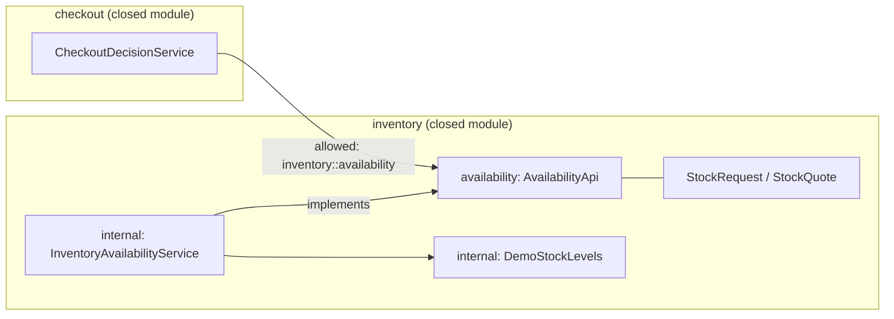

# Chọn contract test cho public module API

Một nhóm sửa module `inventory` trong ứng dụng Spring Modulith. Interface `AvailabilityApi` vẫn tồn tại, `ApplicationModules.verify()` vẫn PASS, nhưng sau refactor, phương thức kiểm tra hàng tồn từ chối yêu cầu **bằng đúng số lượng đang có**. Module `checkout` không còn cho khách hoàn tất đơn dù dependency graph hoàn toàn hợp lệ.

Đây là hồi quy của **public module API contract**: không chỉ chữ ký Java, mà còn là **ngữ nghĩa mà module tiêu thụ được quyền dựa vào**. Một test chỉ xác nhận Spring tạo được bean hoặc service không ném exception không đủ bảo vệ hợp đồng đó. Ngược lại, một test chỉ dùng mock `AvailabilityApi` có thể bảo vệ logic của checkout, nhưng không chứng minh **implementation thật của inventory** còn thực hiện đúng lời hứa.

Với chủ đề **“Chọn contract test cho public module API”** thuộc chương **Chọn chiến lược** của **SPRING_MODULITH_VERIFICATION_TESTING**, chúng ta sẽ thiết kế một giao diện công khai qua `@NamedInterface`, viết contract test **từ phía provider**, kiểm tra cách **consumer** sử dụng implementation thật, tách **hành vi API** khỏi **luật kiến trúc**, rồi chọn phạm vi kiểm thử và quality gate CI phù hợp. Trọng tâm là những trường hợp một thay đổi có thể **biên dịch thành công nhưng phá hành vi người dùng API đang trông đợi**.

> **Quy tắc lựa chọn:** Dùng **contract test** khi câu khẳng định là **“mọi implementation được cung cấp qua public module API phải giữ những đầu vào, đầu ra và semantics đã cam kết”**. Dùng `ApplicationModules.verify()` để xác nhận **module nào được phép tham chiếu API nào**. Nếu contract còn bao gồm commit database, giao event hoặc tác dụng phụ xuyên module, cần test tích hợp cho các mốc đó — một test facade đơn giản không thể chứng minh tất cả.

## 1. Khi nào nên chọn contract test cho public module API?

Trong một modular monolith, “public module API” là phần module **chủ động công bố** cho các application module khác sử dụng. Nó có thể là các lớp ở package gốc (API mặc định), một **named interface**, một facade/service, query API hoặc event contract. Điều được kiểm tra ở đây là **khả năng sử dụng và semantics của hợp đồng**, không nhất thiết là HTTP API hay một service chạy trên mạng.

Hãy đối chiếu mục tiêu trước khi chọn công cụ:

| Claim trong pull request | Nguồn bằng chứng chính | Vì sao |
| --- | --- | --- |
| `checkout` chỉ dùng `inventory::availability` | `ApplicationModules.verify()` | Luật về phụ thuộc tĩnh và API được công bố |
| `AvailabilityApi.check` trả đúng quyết định khi tồn kho **bằng** nhu cầu | **Provider contract test** | Rule giá trị biên của public API |
| SKU không tồn tại được biểu diễn bằng tồn kho `0` | **Provider contract test** | Semantics mà consumer dựa vào |
| Input `quantity <= 0` bị từ chối theo kiểu lỗi đã cam kết | **Provider contract test** | Quy tắc validation công khai |
| `checkout` vẫn phối hợp với implementation `inventory` thật | **Consumer integration/contract test** | Bắt lỗi wiring và tương thích hành vi thực |
| `checkout` xử lý đúng khi inventory báo thiếu hàng | Consumer unit test với fake **hoặc** module integration | Kiểm tra logic consumer; fake không chứng minh provider |
| Event `StockReserved` được publish đúng payload | Event contract test bằng `ApplicationEvents` / `Scenario` | API event có semantics riêng |
| Reservation commit thật trong database | Module/DB integration test sau commit | Phép đo persistence, không phải chỉ DTO |
| Không còn event publication pending | Registry/backend test khi được cấu hình | Trạng thái bền vững khác với lời gọi facade |
| Binary Java API tương thích với artifact phiên bản trước | Binary-compatibility check chuyên biệt | Test source trong cùng một build không tự phát hiện mọi breakage binary |

Một contract test tốt nên có **tên claim**, **fixture/tình huống**, **assertion công khai** và **thay đổi sai khiến nó FAIL**. Nếu method test chỉ gọi `assertThat(api).isNotNull()`, nó là smoke/wiring test, chưa bảo vệ semantics.

### Contract test khác unit test implementation ở đâu?

Giả sử inventory dùng `HashMap` hôm nay và JPA repository ngày mai. Contract test nên tiếp tục gọi:

```java
StockQuote result = api.check(
        new StockRequest("SKU-101", 5));
```

Nó **không** nên yêu cầu internal service có method tên `findStockBySku()`, repository dùng một câu SQL cụ thể hoặc cache có bao nhiêu phần tử. Những chi tiết có thể đổi mà **ngữ nghĩa công bố** vẫn giữ nguyên.

Điều này không có nghĩa không bao giờ kiểm thử internal code; chỉ là **contract suite có mục tiêu khác**: bảo vệ điều mà consumer được phép thấy, qua cùng public API consumer sẽ sử dụng.

## 2. Viết hợp đồng bằng bảng ví dụ và invariants trước khi viết Java

Ví dụ, nhóm thiết kế `inventory::availability` với API **chỉ đọc tồn kho**, phục vụ quyết định có thể xử lý yêu cầu tại thời điểm kiểm tra. Chúng ta **chủ động chọn** semantics cho bài:

- Đầu vào là `StockRequest(sku, requested)` với SKU không rỗng và `requested > 0`.
- Đầu ra là `StockQuote(sku, requested, available, canFulfill)`.
- `canFulfill` đúng khi `available >= requested`, bao gồm **biên bằng nhau**.
- SKU chưa biết trả `available = 0` và `canFulfill = false`.
- Đầu vào không hợp lệ bị từ chối bằng `IllegalArgumentException`.
- Phép đọc không giữ hàng, không thay đổi tồn kho và **không cam kết checkout sẽ thành công dưới cạnh tranh**.

Một **bảng contract** dùng làm đặc tả test:

| Input / điều kiện | Kết quả được cam kết | Điều đang bảo vệ |
| --- | --- | --- |
| `SKU-101` có 5, yêu cầu 3 | Quote: `available=5`, `canFulfill=true` | Nhánh còn hàng |
| `SKU-101` có 5, yêu cầu **5** | Quote: `canFulfill=true` | Boundary `>=` thay vì `>` |
| `SKU-101` có 5, yêu cầu 6 | Quote: `canFulfill=false` | Không chấp nhận vượt tồn |
| SKU chưa biết, yêu cầu 1 | Quote: `available=0`, `canFulfill=false` | Quy ước unknown SKU |
| SKU trắng hoặc null | `IllegalArgumentException` | Input validation |
| `requested=0` hoặc âm | `IllegalArgumentException` | Đơn vị số lượng hợp lệ |
| `check(null)` | `IllegalArgumentException` | Quy tắc null input của API |
| Gọi cùng request hai lần với snapshot không đổi | Hai quote bằng nhau | Tính chất read-only/deterministic của fixture |

**Điều quan trọng:** quy ước “SKU không tồn tại → available=0” là **lựa chọn API của ví dụ**, không phải luật chung của quản lý kho. Một hệ thống khác có thể trả `UNKNOWN_PRODUCT` hoặc exception có kiểu. Contract test phải bảo vệ **quy tắc thực sự được công bố**, không suy diễn chuẩn chung cho mọi doanh nghiệp.

### Tiêu chí để contract sống được qua refactor

Một contract ổn định thường xác định:

1. **Kiểu public** mà consumer được dùng.
2. **Giới hạn đầu vào** và chuẩn lỗi.
3. **Ý nghĩa từng trường kết quả**, kể cả trường hợp biên.
4. **Trạng thái hay tác dụng phụ** nếu API là command.
5. **Thời điểm quan sát và transaction** nếu API bất đồng bộ hoặc truy cập database.
6. **Những điều không được hứa**, ví dụ quote tồn kho không phải lệnh giữ hàng.

Nếu không ghi mục (6), consumer có thể hiểu lầm một API đọc trạng thái là một API đảm bảo khả dụng tại thời điểm checkout. Khi đó hai nhóm có thể viết test “đúng” theo hai cách hiểu khác nhau.

## 3. Công bố hợp đồng bằng named interface thay vì làm public cả module

Mô hình có hai application module:

```text
com.example.shop
├── ShopApplication.java
├── inventory/                                ← module cung cấp API
│   ├── availability/
│   │   ├── package-info.java                ← @NamedInterface("availability")
│   │   ├── AvailabilityApi.java
│   │   ├── StockRequest.java
│   │   └── StockQuote.java
│   └── internal/
│       ├── DemoStockLevels.java             ← dữ liệu demo
│       └── InventoryAvailabilityService.java
└── checkout/                                 ← module tiêu thụ
    ├── package-info.java                    ← inventory::availability
    ├── CheckoutDecision.java
    └── CheckoutDecisionService.java
```



Đồ thị trên thể hiện **phụ thuộc mã Java**: checkout chỉ biết contract `AvailabilityApi` và DTO thuộc named interface. Nó không import `DemoStockLevels` hoặc `InventoryAvailabilityService`. Đây là cách tổ chức có chủ đích, không đơn thuần là dấu `public` của Java.

Lớp Spring Boot gốc:

```java
// src/main/java/com/example/shop/ShopApplication.java
package com.example.shop;

import org.springframework.boot.SpringApplication;
import org.springframework.boot.autoconfigure.SpringBootApplication;

@SpringBootApplication
public class ShopApplication {

    public static void main(String[] args) {
        SpringApplication.run(ShopApplication.class, args);
    }
}
```

File `inventory/availability/package-info.java`:

```java
/**
 * API đọc khả dụng của tồn kho cho các application module khác.
 * Không đưa entity, repository hoặc implementation ra giao diện này.
 */
@org.springframework.modulith.NamedInterface("availability")
package com.example.shop.inventory.availability;
```

File `checkout/package-info.java`:

```java
@org.springframework.modulith.ApplicationModule(
    allowedDependencies = "inventory::availability"
)
package com.example.shop.checkout;
```

**Ý nghĩa của `allowedDependencies`:** ngay cả khi inventory có một API mặc định tại root package, checkout **chỉ được phụ thuộc** vào named interface `inventory::availability` theo hợp đồng đã chọn. Muốn checkout dùng phần API khác, đội phải **review và cấp quyền cụ thể** thay vì tự động nới toàn bộ module.

### Định nghĩa kiểu input và output trong chính API công bố

```java
// inventory/availability/StockRequest.java
package com.example.shop.inventory.availability;

public record StockRequest(
        String sku,
        int requested
) {
    public StockRequest {
        if (sku == null || sku.isBlank() || requested <= 0) {
            throw new IllegalArgumentException(
                    "Invalid stock request"
            );
        }
    }
}
```

```java
// inventory/availability/StockQuote.java
package com.example.shop.inventory.availability;

public record StockQuote(
        String sku,
        int requested,
        int available,
        boolean canFulfill
) {}
```

```java
// inventory/availability/AvailabilityApi.java
package com.example.shop.inventory.availability;

public interface AvailabilityApi {

    StockQuote check(StockRequest request);
}
```

Không có chữ ký nào của public API trên trả về `inventory.internal.StockEntity` hoặc nhận một repository nội bộ làm tham số. **API contract dùng các kiểu mà consumer được phép import**, và record giữ kết quả tường minh thay vì trả một boolean khó giải thích.

Một lưu ý thiết kế: record `StockQuote` ở ví dụ là immutable về các trường thành phần và phù hợp cho dữ liệu đơn giản. Khi thay đổi record components hoặc canonical constructor, cần review **source/binary compatibility** với consumer, không chỉ business test.

## 4. Implementation làm nền cho provider contract test

Để ví dụ tập trung vào **API behavior**, module inventory dùng một nguồn dữ liệu cố định trong JVM. Đây là fixture minh họa cho học tập, **không phải repository tồn kho production**.

```java
// inventory/internal/DemoStockLevels.java
package com.example.shop.inventory.internal;

import java.util.Map;
import org.springframework.stereotype.Component;

@Component
public class DemoStockLevels {

    private final Map<String, Integer> levels = Map.of(
            "SKU-101", 5,
            "SKU-EMPTY", 0
    );

    public int available(String sku) {
        return levels.getOrDefault(sku, 0);
    }
}
```

Provider thực thi contract qua interface công khai:

```java
// inventory/internal/InventoryAvailabilityService.java
package com.example.shop.inventory.internal;

import com.example.shop.inventory.availability.AvailabilityApi;
import com.example.shop.inventory.availability.StockQuote;
import com.example.shop.inventory.availability.StockRequest;
import org.springframework.stereotype.Service;

@Service
public class InventoryAvailabilityService
        implements AvailabilityApi {

    private final DemoStockLevels levels;

    public InventoryAvailabilityService(DemoStockLevels levels) {
        this.levels = levels;
    }

    @Override
    public StockQuote check(StockRequest request) {
        if (request == null) {
            throw new IllegalArgumentException(
                    "Stock request must not be null"
            );
        }

        int available = levels.available(request.sku());

        return new StockQuote(
                request.sku(),
                request.requested(),
                available,
                available >= request.requested()
        );
    }
}
```

Đây là **provider implementation**. Bên ngoài module chỉ biết `AvailabilityApi`; dù các class internal là `public` theo Java để dùng thuận tiện trong Spring, chúng vẫn nằm ngoài named interface `availability`.

**Hợp đồng đã chọn được hiện thực hóa trực tiếp:** ở biên bằng nhau, `5 >= 5` là true; SKU không biết có `available=0`; `null request` bị từ chối. Test không phải nhìn vào `DemoStockLevels.levels` hoặc tên class implementation để kiểm chứng.

### Thay `DemoStockLevels` bằng JPA thì sao?

Trong ứng dụng thật, module inventory có thể dùng `StockRepository`, cache hoặc service tồn kho riêng. Khi đổi implementation, giữ public API và điều kiện nghiệp vụ tương tự, **contract test về response/validation vẫn có giá trị**. Nhưng fixture phải được chuẩn bị qua test datasource, migration hoặc test fixture interface **nằm trong test scope**; không nên thêm setter debug vào public API production chỉ vì test cần seed database.

Nếu API yêu cầu dữ liệu đọc được sau commit, test provider có thể vẫn chạy bằng `@ApplicationModuleTest` nhưng cần database và transaction phù hợp. **Không suy luận tính nhất quán transaction production** từ dữ liệu `Map.of` của ví dụ.

## 5. Provider contract test: chạy qua public API thật trong module test

Đây là bài test **trọng tâm**. Nó được đặt ở package `com.example.shop.inventory` để chọn đúng application module, dùng `@ApplicationModuleTest(STANDALONE)` và **chỉ inject `AvailabilityApi`** — không inject implementation internal.

```java
// src/test/java/com/example/shop/inventory/
// InventoryAvailabilityContractTest.java
package com.example.shop.inventory;

import com.example.shop.inventory.availability.AvailabilityApi;
import com.example.shop.inventory.availability.StockQuote;
import com.example.shop.inventory.availability.StockRequest;
import org.junit.jupiter.api.Test;
import org.springframework.beans.factory.annotation.Autowired;
import org.springframework.modulith.test.ApplicationModuleTest;
import org.springframework.modulith.test.ApplicationModuleTest.BootstrapMode;

import static org.assertj.core.api.Assertions.assertThat;
import static org.assertj.core.api.Assertions.assertThatThrownBy;

@ApplicationModuleTest(mode = BootstrapMode.STANDALONE)
class InventoryAvailabilityContractTest {

    @Autowired
    AvailabilityApi api;

    @Test
    void acceptsRequestAtExactStockBoundary() {
        StockQuote quote = api.check(
                new StockRequest("SKU-101", 5)
        );

        assertThat(quote).isEqualTo(new StockQuote(
                "SKU-101", 5, 5, true
        ));
    }

    @Test
    void rejectsRequestExceedingAvailableStock() {
        StockQuote quote = api.check(
                new StockRequest("SKU-101", 6)
        );

        assertThat(quote).isEqualTo(new StockQuote(
                "SKU-101", 6, 5, false
        ));
    }

    @Test
    void acceptsPositiveRequestBelowStock() {
        StockQuote quote = api.check(
                new StockRequest("SKU-101", 3)
        );

        assertThat(quote.sku()).isEqualTo("SKU-101");
        assertThat(quote.requested()).isEqualTo(3);
        assertThat(quote.available()).isEqualTo(5);
        assertThat(quote.canFulfill()).isTrue();
    }

    @Test
    void unknownSkuReturnsUnavailableQuote() {
        StockQuote quote = api.check(
                new StockRequest("SKU-UNKNOWN", 1)
        );

        assertThat(quote).isEqualTo(new StockQuote(
                "SKU-UNKNOWN", 1, 0, false
        ));
    }

    @Test
    void invalidRequestsUseDocumentedExceptionType() {
        assertThatThrownBy(() ->
                new StockRequest(" ", 1))
                .isInstanceOf(IllegalArgumentException.class);

        assertThatThrownBy(() ->
                new StockRequest("SKU-101", 0))
                .isInstanceOf(IllegalArgumentException.class);

        assertThatThrownBy(() ->
                new StockRequest(null, 1))
                .isInstanceOf(IllegalArgumentException.class);

        assertThatThrownBy(() -> api.check(null))
                .isInstanceOf(IllegalArgumentException.class);
    }

    @Test
    void repeatedReadOfUnchangedFixtureIsStable() {
        StockRequest request = new StockRequest(
                "SKU-101", 4
        );

        StockQuote first = api.check(request);
        StockQuote second = api.check(request);

        assertThat(second).isEqualTo(first);
        assertThat(second.canFulfill()).isTrue();
    }
}
```

### Bài test này kiểm tra đúng điều gì?

- Bean thực thi `AvailabilityApi` **được đăng ký trong module inventory** và inject được bằng interface.
- Với một tập dữ liệu chủ động, **mọi rule đã công bố ở phần 2** đều có assertion.
- Tình huống **bằng đúng tồn kho** phân biệt `>=` với `>`.
- Consumer có thể dựa vào `StockQuote` đã mô tả, không cần tìm một dòng log.
- Input lỗi được từ chối bằng **kiểu exception được tài liệu hóa**, không phụ thuộc thông điệp tiếng Anh có thể thay đổi.

### Giới hạn phải ghi rõ

**Thứ nhất**, `@ApplicationModuleTest` có thể khởi tạo Spring Boot/test infrastructure ngoài module tùy cấu hình, nhưng **phạm vi application modules** vẫn được giới hạn. Một test PASS không có nghĩa mọi collaborator ở production đều có sẵn.

**Thứ hai**, đây là contract của **provider chạy với DemoStockLevels**. Nó không chứng minh query SQL, transaction isolation hoặc tích hợp với warehouse thực. Khi storage thay đổi, vẫn dùng cùng ý nghĩa contract nhưng phải thay fixture/hạ tầng test cho đúng backend.

**Thứ ba**, `repeatedReadOfUnchangedFixtureIsStable` chỉ bảo vệ **fixture không thay đổi giữa hai lời gọi**, không cam kết tồn kho thật không thay đổi khi có checkout song song. API đọc khả dụng **không phải cơ chế giữ hàng**.

### Vì sao không assert logger hay implementation class?

Những cách sau là sai mục tiêu:

```java
// Yếu: chỉ biết có một bean.
assertThat(api).isNotNull();

// Giòn: bắt consumer phụ thuộc tên implementation.
assertThat(api.getClass().getSimpleName())
        .contains("InventoryAvailabilityService");

// Sai nguồn bằng chứng: log có thể xuất hiện trước kết quả thật.
assertThat(capturedOutput).contains("Stock available");
```

Contract test phải thất bại khi **public semantics sai**, nhưng tiếp tục PASS khi nhóm đổi cache, repository, logger hoặc tên implementation mà vẫn giữ lời hứa.

## 6. Consumer-driven contract: kiểm tra checkout với provider thật

Provider contract bảo vệ những lời hứa tổng quát của `AvailabilityApi`. Bước kế tiếp kiểm tra **đường sử dụng quan trọng mà checkout đang phụ thuộc**. Nó tránh một tình trạng thường gặp: mỗi nhóm test riêng với fake của mình, nhưng tích hợp thật lại sai.

Consumer chỉ import kiểu trong named interface:

```java
// checkout/CheckoutDecision.java
package com.example.shop.checkout;

public record CheckoutDecision(
        String sku,
        int requested,
        boolean accepted
) {}
```

```java
// checkout/CheckoutDecisionService.java
package com.example.shop.checkout;

import com.example.shop.inventory.availability.AvailabilityApi;
import com.example.shop.inventory.availability.StockQuote;
import com.example.shop.inventory.availability.StockRequest;
import org.springframework.stereotype.Service;

@Service
public class CheckoutDecisionService {

    private final AvailabilityApi availability;

    public CheckoutDecisionService(AvailabilityApi availability) {
        this.availability = availability;
    }

    public CheckoutDecision decide(String sku, int quantity) {
        StockQuote quote = availability.check(
                new StockRequest(sku, quantity)
        );

        return new CheckoutDecision(
                quote.sku(),
                quote.requested(),
                quote.canFulfill()
        );
    }
}
```

Đây là facade hành vi của checkout. Nó **không giữ hàng** và không tạo thanh toán; nó chỉ chuyển kết quả contract availability thành quyết định xét đơn. Không nên mở rộng kết luận của test sang thanh toán hoặc transaction đặt hàng.

### JUnit với `DIRECT_DEPENDENCIES`

Test đặt trong package `com.example.shop.checkout`:

```java
// src/test/java/com/example/shop/checkout/
// CheckoutAvailabilityIntegrationTest.java
package com.example.shop.checkout;

import org.junit.jupiter.api.Test;
import org.springframework.beans.factory.annotation.Autowired;
import org.springframework.modulith.test.ApplicationModuleTest;
import org.springframework.modulith.test.ApplicationModuleTest.BootstrapMode;

import static org.assertj.core.api.Assertions.assertThat;
import static org.assertj.core.api.Assertions.assertThatThrownBy;

@ApplicationModuleTest(
        mode = BootstrapMode.DIRECT_DEPENDENCIES
)
class CheckoutAvailabilityIntegrationTest {

    @Autowired
    CheckoutDecisionService checkout;

    @Test
    void acceptsExactStockThroughRealProvider() {
        CheckoutDecision decision = checkout.decide(
                "SKU-101", 5
        );

        assertThat(decision).isEqualTo(
                new CheckoutDecision("SKU-101", 5, true)
        );
    }

    @Test
    void refusesInsufficientStockThroughRealProvider() {
        CheckoutDecision decision = checkout.decide(
                "SKU-101", 6
        );

        assertThat(decision).isEqualTo(
                new CheckoutDecision("SKU-101", 6, false)
        );
    }

    @Test
    void rejectsBadQuantityAtPublicBoundary() {
        assertThatThrownBy(() ->
                checkout.decide("SKU-101", -1))
                .isInstanceOf(IllegalArgumentException.class);
    }
}
```

**Vì sao `DIRECT_DEPENDENCIES`?** Checkout phụ thuộc trực tiếp vào `inventory::availability`. Test bootstrap **checkout và dependency inventory thực**, inject `InventoryAvailabilityService` qua `AvailabilityApi` và chứng minh integration của consumer với provider không bị sai lệch.

Test này là **consumer-driven integration check** cho những điều checkout trông đợi ở public API. Nó không buộc checkout biết class nội bộ inventory và không dùng mock để thay chính provider đang kiểm tra.

### Khi consumer unit test với fake vẫn hữu ích

Nếu cần test **nhiều nhánh riêng của checkout**, có thể tạo fake `AvailabilityApi` trả một `StockQuote` theo kịch bản để unit test nhanh:

```java
AvailabilityApi fake = request -> new StockQuote(
        request.sku(), request.requested(), 0, false
);
```

Fake giúp trả lời câu hỏi “checkout làm gì khi provider nói hết hàng?”. Nhưng **nó không chứng minh provider thật trả đúng** khi tồn kho bằng nhu cầu hoặc SKU không tồn tại. Hãy giữ **provider contract tests** và ít nhất một **consumer integration test** ở CI để ngăn hai module drift về semantics.

Trong hệ thống nhiều consumer, có thể gom các ví dụ contract quan trọng thành một **bộ test dùng chung** (ví dụ JUnit interface với default test methods hoặc test fixture module) để mỗi implementation/provider được kiểm chứng nhất quán. Chỉ chia sẻ **nghĩa của hợp đồng**, không chia sẻ internal repository hoặc ép các provider có cùng cấu trúc lưu trữ.

## 7. Dùng negative mutations để chứng minh contract suite có sức bảo vệ

Một contract test PASS trên baseline chưa đủ. Hãy cố ý làm sai một quy tắc, chạy test phù hợp rồi **hoàn nguyên**. Đây là cách kiểm chứng rằng câu chữ của contract đã thực sự trở thành assertion.

| Mutation có kiểm soát | Kỳ vọng provider contract | Kỳ vọng consumer integration | Điều được chứng minh |
| --- | --- | --- | --- |
| Đổi `available >= requested` thành `available > requested` | **FAIL** tại quantity = 5 | **FAIL** tại quantity = 5 | Test có boundary value |
| Luôn trả `canFulfill = true` | **FAIL** khi yêu cầu 6/unknown SKU | **FAIL** khi yêu cầu 6 | Có negative branch |
| SKU unknown bị ném exception thay vì quote `0` | **FAIL** | Chỉ FAIL nếu consumer test case đó | Semantics unknown được bảo vệ |
| Bỏ check `request == null` | **FAIL** theo exception type (NPE thay IAE) | Có thể không ảnh hưởng | Contract lỗi có type ổn định |
| Đổi tên internal implementation | **PASS** nếu API behavior giữ nguyên | **PASS** | Test không khóa internals |
| Thay `DemoStockLevels` bằng JPA có cùng fixture/kết quả | **PASS** khi test hạ tầng phù hợp | **PASS** | Contract tồn tại độc lập storage |
| Checkout import trực tiếp `inventory.internal.DemoStockLevels` | Provider test có thể PASS | Có thể PASS nếu vẫn đúng data | **Architecture gate** phải chặn |
| Bỏ `@NamedInterface("availability")` | Có thể vẫn compile trong module | Context/hợp đồng model có thể lỗi | Named interface là architectural API |
| Thay kiểu trả về `StockQuote` | Test/source consumer có thể **không compile** | Có thể không compile | Compiler cũng là một gate |
| Chỉ đổi format log hoặc thông điệp `INFO` | **PASS** | **PASS** | Log không phải contract ở đây |

Bảng nêu **kỳ vọng để thực hành**, không phải báo cáo đã chạy test trong workspace.

### Mutation đúng mục tiêu phải có thể chạy

Nếu thử làm sai architecture bằng class `package-private` thuộc internal, Java có thể không compile và verifier không có cơ hội đánh giá. Để cô lập luật của Modulith, dùng một kiểu `public` nằm trong `inventory.internal` rồi cho checkout tham chiếu thật qua field/chữ ký. Java có thể compile, nhưng `ApplicationModules.verify()` phải FAIL nếu rule closed-module/named-interface áp dụng.

Ngược lại, khi phá **ngữ nghĩa** bằng `>=` thành `>`, không cần sửa package/metadata; module graph không thay đổi, vì vậy `verify()` **có thể vẫn PASS**. Đó chính là lý do cần contract test riêng.

### Không coi test đếm phương thức là contract

Một test dùng Mockito `verify(availability).check(...)` chỉ chứng minh **consumer gọi dependency**, không xác nhận **provider thực trả dữ liệu đúng**. Nó có thể hữu ích cho interaction unit test khi thật sự muốn bảo vệ một tương tác, nhưng không thay cho **provider semantics contract**.

## 8. Giữ hợp đồng ổn định khi thay đổi public Java types

Public module API trong cùng một repository vẫn là API: thay đổi nó có thể gây lỗi compile hoặc hồi quy semantics ở module tiêu thụ. Contract test nên được review cùng những thay đổi này.

### 8.1. Source compatibility và behavioral compatibility khác nhau

| Thay đổi | Lỗi compile có bắt được không? | Có cần contract test/review? |
| --- | --- | --- |
| Đổi tên `AvailabilityApi.check` | Consumer source thường không compile | Có, vì caller phải được chuyển đổi có chủ đích |
| Đổi kiểu tham số `StockRequest` | Source consumer có thể không compile | Có, xem nghĩa input và migration |
| Thêm component vào Java record `StockQuote` | Callers dùng constructor cũ có thể không compile; binary shape thay đổi | Có, đặc biệt consumers dựng record trực tiếp |
| Giữ chữ ký nhưng đổi `>=` thành `>` | **Không nhất thiết** | **Bắt buộc**, đây là behavior break |
| Giữ signature nhưng unknown SKU bắt đầu ném exception | **Không** | Có, vì caller có thể chưa xử lý lỗi mới |
| Đổi internal repository hoặc JPA entity | Thường không làm consumer compile lỗi | Contract vẫn phải PASS; test DB riêng khi cần |
| Bổ sung default method vào interface | Có thể source compatible tùy thiết kế | Có, xem semantics mới và versioning |
| Chuyển API từ đồng bộ sang async | Consumer có thể không compile hoặc semantics timing thay đổi | Có, phải thiết kế contract chờ/timeouts |

Với **Java record**, đổi record components không chỉ là thêm một field “vô hại”: canonical constructor, equality, accessor và đôi khi các thư viện serialization cũng có thể bị ảnh hưởng. Tránh thêm thuộc tính vào public record mà không xem consumer đang khởi tạo hoặc lưu/serialize kiểu đó ra sao.

### 8.2. Test của cùng một build chưa đủ cho binary compatibility

Trong modular monolith cùng một repo, compiler sẽ bắt nhiều thay đổi chữ ký khi checkout và inventory cùng được biên dịch. Nhưng nếu module API còn được **xuất thành thư viện/binary** cho hệ thống khác, một build mới thành công **không chứng minh binary cũ vẫn chạy được**.

Khi có external consumers, bổ sung kiểm tra compatibility artifact (ví dụ Revapi hoặc japicmp theo toolchain), version policy, contract suite giữa phiên bản và migration plan. Không coi `ApplicationModules.verify()` là công cụ kiểm chứng binary ABI.

### 8.3. Không để internal types lọt vào public signatures

Phản ví dụ về thiết kế:

```java
// KHÔNG NÊN: public module API trả một kiểu internal.
public interface LeakyAvailabilityApi {
    com.example.shop.inventory.internal.StockRow check(String sku);
}
```

Đoạn này chỉ minh họa **rủi ro API leakage** và giả định `StockRow` có visibility Java cho phép tham chiếu; nó **không phải class đã được triển khai** trong ví dụ. Consumer muốn dùng return type sẽ phải biết chi tiết internal, làm tăng coupling.

Sửa bằng DTO công bố như `StockQuote`. `ApplicationModules.verify()` bảo vệ **dependency từ consumer sang package không công bố**; nó không phải một bảo đảm tuyệt đối tự động phát hiện **mọi kiểu internal ẩn trong mọi chữ ký public chưa được consumer sử dụng**. Với API leakage quan trọng, cần code review và có thể thêm ArchUnit/reflection rule kiểm tra public signatures, kể cả generic type arguments, theo policy của tổ chức.

**Contract behavior và module API surface là hai mặt cùng cần bảo vệ:** suite JUnit xác nhận API **làm đúng**, còn module verifier và API review kiểm soát **ai được dùng gì**.

## 9. Kết hợp contract test với kiến trúc, event và database một cách có mục tiêu

Không nên biến provider contract test thành một `@SpringBootTest` chạy toàn ứng dụng khi claim chỉ là `AvailabilityApi.check` trả kết quả đúng. Nhưng khi public module API có side effect hoặc event, phạm vi phải mở rộng theo **lời hứa đã công bố**.

### 9.1. Architecture gate cho quyền sử dụng API

Một JUnit test tĩnh chạy bên cạnh provider/consumer tests:

```java
// src/test/java/com/example/shop/ModulithArchitectureTest.java
package com.example.shop;

import org.junit.jupiter.api.Test;
import org.springframework.modulith.core.ApplicationModules;

class ModulithArchitectureTest {

    @Test
    void consumersOnlyUsePublishedModuleApis() {
        ApplicationModules.of(ShopApplication.class).verify();
    }
}
```

Test này bảo vệ quan hệ `checkout → inventory::availability`, nhưng **không xác nhận** stock 5 có cho phép request 5. Provider contract suite làm việc đó. Nếu architecture test PASS nhưng contract FAIL, phải sửa semantics provider; không giải quyết bằng cách nới `allowedDependencies`.

### 9.2. API command có transaction phải test trạng thái sau commit

Nếu API công khai chuyển thành `reserve(ReserveCommand)` và cam kết giữ hàng bền vững, cần assert:

- Command validation và kết quả trả về theo contract.
- Repository/DB state **sau commit** và việc rollback khi lỗi.
- Concurrency và unique/optimistic locking nếu nhiều request có thể tranh cùng tồn kho.
- Idempotency nếu client có thể retry cùng operation key.

Một test chỉ mock repository và assert returned DTO **không chứng minh commit**. Có thể dùng `@ApplicationModuleTest` với test DB thật trong phạm vi module provider hoặc `@SpringBootTest` nếu side effect trải qua nhiều module.

### 9.3. API công bố event cần event contract riêng

Nếu inventory hoặc checkout publish event, chọn `@RecordApplicationEvents` / `ApplicationEvents` hoặc `Scenario` theo claim, lọc bằng `correlationId`/aggregate ID để tránh nhận nhầm event khác. Hãy phân biệt:

| Mốc | Assertion phù hợp |
| --- | --- |
| Event đúng loại và payload đã publish | `ApplicationEvents` hoặc `Scenario` |
| Producer transaction đã commit | DB/transaction test |
| Consumer module khác xử lý thành công | Integration test + trạng thái consumer |
| Publication được registry đánh dấu completed | Registry/backend test tương ứng |

**Chỉ thấy event không chứng minh consumer đã cập nhật DB.** Event Publication Registry (nếu dùng) có lifecycle riêng và cần backend phù hợp; đừng suy registry completed từ test recorder.

### 9.4. Đừng lẫn “contract test” với HTTP API contract

`AvailabilityApi` ở đây là **Java API trong modular monolith**. Nếu sản phẩm còn có HTTP endpoint, OpenAPI schema và consumer REST, cần test HTTP contract ở boundary tương ứng (status, media type, JSON fields, error code). Không tự mặc định contract test Java đã bao phủ serialization, authentication hoặc wire compatibility.

## 10. Đưa public module contract vào CI quality gate

Một PR đổi inventory có thể phá **semantics** mà không thay dependency graph. Vì vậy CI tối thiểu cần **hai loại gate**, và có thể cần thêm test consumer:

| Gate | Bài kiểm tra | Hồi quy bị chặn |
| --- | --- | --- |
| **Structural** | `ModulithArchitectureTest` | Import trái named interface, vòng phụ thuộc, allowedDependencies sai |
| **Provider contract** | `InventoryAvailabilityContractTest` | Sai boundary/validation/quote của public API |
| **Consumer integration** | `CheckoutAvailabilityIntegrationTest` | Checkout không còn phối hợp với implementation thật |
| **Persistence/event integration** (nếu có) | DB/Event tests trong suite riêng | Commit, listener, retry, side effect |
| **Compatibility** (nếu API được publish binary) | Build/ABI compatibility check | Binary contract bị phá |
| **Diagnostic artifacts** | JUnit reports, stack trace | Hỗ trợ điều tra, không thay assertions |

Lệnh Gradle/JUnit 5:

```bash
# Chạy riêng provider contract trong lúc sửa inventory:
./gradlew test --tests 'com.example.shop.inventory.InventoryAvailabilityContractTest'

# Kiểm tra consumer cùng implementation thật:
./gradlew test --tests 'com.example.shop.checkout.CheckoutAvailabilityIntegrationTest'

# Chạy architecture và các suite trong task test:
./gradlew test
```

Các lệnh trên **giả định** dự án dùng Gradle wrapper, JUnit 5 và đã cấu hình test discovery. Nếu integration tests đặt trong Gradle `integrationTest` hoặc Maven Failsafe, `test` không tự chạy các suite đó.

### Workflow GitHub Actions minh họa

```yaml
name: Modulith public API contract gate

on:
  pull_request:

jobs:
  verify-public-module-api:
    runs-on: ubuntu-latest
    permissions:
      contents: read

    steps:
      - uses: actions/checkout@v4

      - uses: actions/setup-java@v4
        with:
          distribution: temurin
          java-version: '21'

      - uses: gradle/actions/setup-gradle@v4

      - name: Architecture and public module API contracts
        run: bash ./gradlew --no-daemon test

      # Bật nếu repository định nghĩa integrationTest và DB test:
      # - name: Persistence and event integration
      #   run: bash ./gradlew --no-daemon integrationTest

      - name: Preserve JUnit evidence
        if: always()
        uses: actions/upload-artifact@v4
        with:
          name: module-public-api-contract-reports
          path: |
            **/build/test-results/**/*.xml
            **/build/reports/tests/**
          if-no-files-found: warn
```

**Đây là YAML minh họa**, chưa được thực thi trong repository bài học. Nó yêu cầu Gradle wrapper, JDK, Spring Boot/Spring Modulith dependencies tương thích và test source sets phù hợp. Muốn chặn merge, repository phải cấu hình **branch protection/ruleset yêu cầu job `verify-public-module-api` thành công**.

`if: always()` chỉ giữ reports khi bài test FAIL; nó **không chuyển FAIL thành PASS**. Không bỏ `InventoryAvailabilityContractTest` khỏi test suite, bỏ test bằng filter hoặc bắt exception rồi chỉ ghi warning.

### Khi một gate FAIL, đọc lỗi theo đúng loại

- **Compile FAIL:** chữ ký API, access modifier hoặc dependency bị thay đổi; kiểm tra consumer source và API contract.
- **Architecture FAIL:** checkout đang dùng một kiểu/package không công bố hoặc quan hệ không được cho phép; sửa ranh giới.
- **Provider contract FAIL:** input/output/validation sai; đối chiếu bảng contract ở phần 2.
- **Consumer integration FAIL:** bean thật không bootstrap, wiring sai hoặc semantics giữa hai module lệch nhau.
- **DB/event test FAIL:** transaction, listener, persistence, retry hoặc fixture cần điều tra; đừng nới architecture rules để chữa hành vi.

Log giúp tìm nguyên nhân, nhưng **JUnit assertions, compiler exit status và CI required checks** mới quyết định kết quả gate.

## 11. Bài thực hành ngắn và checklist lựa chọn

### Bối cảnh

Module `inventory` đã có API `AvailabilityApi.check`. Trong một PR, developer đổi cách tính `canFulfill` và muốn đưa `DemoStockLevels` ra package công khai để checkout đọc nhanh hơn. Reviewer cần chứng minh (a) behavior của public API không hồi quy và (b) module tiêu thụ không vượt qua boundary đã công bố.

### Bài tập

1. **Định nghĩa contract** theo phần 2: ba nhánh còn hàng/thiếu hàng/unknown SKU, biên bằng nhau và invalid request.
2. Tạo `inventory.availability`, `@NamedInterface("availability")`, `AvailabilityApi`, `StockRequest`, `StockQuote`.
3. Giữ `InventoryAvailabilityService` và `DemoStockLevels` trong `inventory.internal`. Consumer không import internal.
4. Viết `InventoryAvailabilityContractTest` với `@ApplicationModuleTest(STANDALONE)` và **chỉ inject interface `AvailabilityApi`**.
5. Assert đầy đủ quote ở quantity 3, **5**, 6, unknown SKU; test invalid/`null` request qua exception type.
6. Viết `CheckoutDecisionService` dùng public API và `CheckoutAvailabilityIntegrationTest` với `DIRECT_DEPENDENCIES`; so sánh kết quả thật ở quantity 5/6.
7. **Mutation A:** đổi `>=` thành `>`. Provider contract và consumer integration phải **FAIL ở biên bằng nhau**, trong khi architecture test có thể PASS.
8. **Mutation B:** unknown SKU bắt đầu ném exception. Provider contract unknown SKU phải FAIL; ghi nhận đây là thay đổi semantics chứ không chỉ refactor.
9. **Mutation C:** checkout dùng field kiểu `inventory.internal.DemoStockLevels`. Java có thể compile, nhưng `ApplicationModules.verify()` phải FAIL do vi phạm named interface.
10. **Mutation D:** đổi tên implementation internal nhưng giữ API/behavior. Contract tests **vẫn PASS**, chứng minh chúng không khóa chi tiết implementation.
11. Kiểm tra diff của `package-info.java` và public Java records. Đừng làm rộng `allowedDependencies` hoặc API để né lỗi khi chưa có quyết định thiết kế.
12. Chạy Gradle/JUnit suites trong CI, xem JUnit XML để chắc test thực sự được thực thi, rồi **hoàn nguyên mọi mutation** trước khi merge.

### Ma trận kết quả kỳ vọng

| Thay đổi | Provider contract | Consumer integration | Architecture gate |
| --- | --- | --- | --- |
| Baseline hợp lệ | PASS | PASS | PASS |
| Đổi `>=` thành `>` | **FAIL** ở stock=5/request=5 | **FAIL** ở boundary | Có thể PASS |
| Unknown SKU không còn trả quote 0 | **FAIL** | Có thể PASS nếu không test unknown | Có thể PASS |
| Provider trả `canFulfill=true` mọi trường hợp | **FAIL** khi thiếu hàng | **FAIL** ở request 6 | Có thể PASS |
| Đổi tên implementation internal | PASS | PASS | PASS nếu graph giữ nguyên |
| Checkout import `inventory.internal` | Có thể PASS | Có thể PASS | **FAIL** |
| Xóa `@NamedInterface("availability")` | Module test có thể vẫn chạy | Model/dependency config không còn như cũ | **FAIL/lỗi model** |
| Public API đổi signature | Có thể không compile | Có thể không compile | Không cần đợi runtime mới phát hiện |

Bảng trên là **kỳ vọng thiết kế của bài tập**, không phải kết quả đã chạy trên workspace.

### Checklist review public module API contract

- [ ] Public module API được **công bố có chủ đích**, dùng default API hoặc `@NamedInterface` phù hợp.
- [ ] DTO/exception trong chữ ký public không làm lộ entity/repository/internal types.
- [ ] Contract mô tả **giá trị biên, lỗi, unknown input và semantics kết quả** thay vì chỉ có happy path.
- [ ] Provider contract test inject/call **giao diện công khai**, không phụ thuộc tên implementation.
- [ ] Test có ít nhất một case **khi biên bằng nhau** hoặc trường hợp phân biệt rõ hai implementation khả dĩ.
- [ ] Consumer integration test dùng **provider thật** ở luồng quan trọng; fake chỉ để cô lập logic consumer.
- [ ] `ApplicationModules.verify()` chạy riêng để chặn dependency trái phép vào internal.
- [ ] Nếu contract cam kết database/event/transaction, có test tích hợp cho **mốc tương ứng**.
- [ ] Thay đổi public record/chữ ký và binary compatibility được review theo cách phân phối module.
- [ ] CI phát hiện và chạy đủ suite, báo lỗi thật, giữ JUnit reports, không chỉ grep log.
- [ ] Các mutation thực hành đã được hoàn nguyên; những giả định chưa kiểm tra được nêu rõ.

### Ghi nhớ

**Chọn contract test khi điều bạn muốn bảo vệ là lời hứa của một public module API đối với consumer**: loại đầu vào, dữ liệu đầu ra, lỗi và ngữ nghĩa ở các trường hợp biên. Với Spring Modulith, đặt API vào package công bố hoặc `@NamedInterface`, kiểm tra provider thật bằng `@ApplicationModuleTest` và assert qua interface; dùng `DIRECT_DEPENDENCIES` để kiểm chứng luồng consumer với provider thật khi cần. Duy trì **`ApplicationModules.verify()`** như một gate cấu trúc độc lập — một dependency graph hợp lệ không chứng minh API trả kết quả đúng, và một contract test PASS không cho phép consumer import internals. Khi API có event/persistence, mở rộng bằng những integration tests tương ứng. Trong CI, mỗi claim phải có **phép kiểm tra có thể FAIL khi contract bị phá**.

### Tài liệu tham khảo

- [Spring Modulith Reference — Application Modules](https://docs.spring.io/spring-modulith/reference/fundamentals.html)
- [Spring Modulith Reference — Verifying Application Module Structure](https://docs.spring.io/spring-modulith/reference/verification.html)
- [Spring Modulith Reference — Integration Testing Application Modules](https://docs.spring.io/spring-modulith/reference/testing.html)
- [Spring Modulith Reference — Application Events](https://docs.spring.io/spring-modulith/reference/events.html)
- [Spring Framework Reference — Testing](https://docs.spring.io/spring-framework/reference/testing.html)
- [JUnit 5 User Guide — Writing Tests](https://junit.org/junit5/docs/current/user-guide/)
