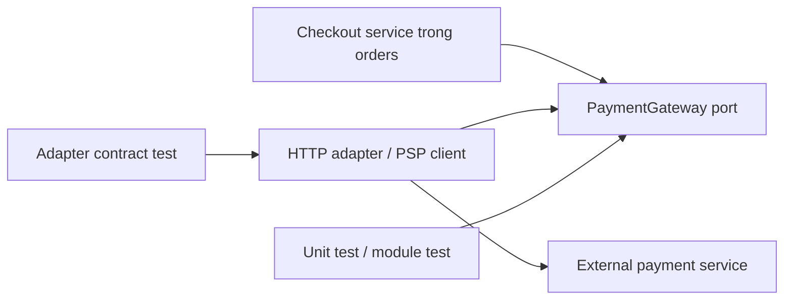
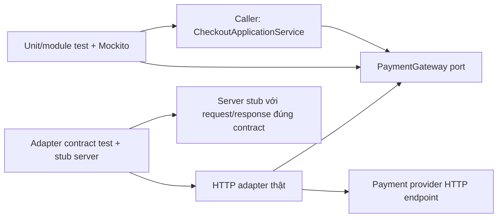

# Chọn mock khi boundary đã đủ rõ

## 1. Quyết định mock bằng câu hỏi: lỗi ở bên nào của boundary?

Khi kiểm thử Spring Modulith, **chọn mock khi bài test cần kiểm chứng cách một module sử dụng một hợp đồng đã xác định rõ, chứ không cần tái hiện hành vi triển khai của dependency nằm ngoài hợp đồng đó**.

Giả sử module `orders` cần gửi yêu cầu thu tiền đến một payment service bên ngoài. Use case có trách nhiệm:

1. Xác nhận order đang chờ thanh toán.
2. Gọi cổng `PaymentGateway.capture(...)` với đúng `orderId`, `amount` và khóa idempotency.
3. Nếu gateway từ chối hoặc lỗi, không ghi nhận thanh toán thành công.
4. Nếu gateway trả kết quả thành công, cập nhật order và công bố `OrderPaid` theo hợp đồng.

Trong một bài **unit test orchestration** của use case, ta cần điều khiển gateway trả thành công hay lỗi, đồng thời xem service có gọi port đúng và giữ invariant không. Khi đó **mock gateway hợp lý**: test không cần một PSP thực, TLS, network hoặc database của PSP.

Nhưng nếu câu hỏi là “HTTP adapter thực sự gửi đúng JSON/header, xử lý timeout hoặc mapping lỗi 409 ra sao?”, mock **ngay tại** interface `PaymentGateway` không thể phát hiện lỗi trong HTTP adapter. Khi đó phải kiểm tra adapter bằng một HTTP stub server hoặc service test thực, tùy hợp đồng cần chứng minh.

| Câu hỏi test cần trả lời | Boundary đã đủ rõ? | Lựa chọn chính |
| --- | --- | --- |
| Service có gọi `capture(orderId, amount, key)` đúng một lần khi order hợp lệ? | Có: input/output và error contract của port đã rõ | Mockito mock `PaymentGateway` |
| Service có giữ order chưa thanh toán nếu gateway báo lỗi? | Có: failure contract đã rõ | Mockito mock port; assert state/invariant |
| Module có thực sự phát `OrderPaid` trong Spring context? | Không nên thay event bus bằng mock nếu đây là mục tiêu | `@ApplicationModuleTest` + `PublishedEvents` |
| Listener xử lý `PaymentCaptured` rồi commit DB? | Boundary event/state phải được thực thi thật | `@ApplicationModuleTest` + `Scenario` + repository/query thật |
| HTTP client có serialize đúng payload, header, status và retry? | Mock port sẽ bỏ qua adapter | HTTP stub server/adapter contract test |
| PostgreSQL có unique constraint và transaction isolation đúng? | Mock repository không tái hiện DB | Testcontainers PostgreSQL |
| Kafka/RabbitMQ có routing, group/ack và retry đúng? | Mock sender không tái hiện broker | Broker integration test |
| Dependency là một module nội bộ có API/event công khai? | Có thể mock **chỉ khi** test cô lập caller theo contract | Cân nhắc module test và integration test xác nhận contract |

**Nguyên tắc tối thiểu:** mock ở **điểm kết thúc trách nhiệm của test**. Không mock chính behavior, transaction, event dispatch hay persistence mà test tuyên bố đang kiểm chứng.

Chủ đề nằm trong chương **Chọn chiến lược** của học phần `SPRING_MODULITH_VERIFICATION_TESTING`. Học phần dùng `ApplicationModules` để bảo vệ ranh giới kiến trúc, `@ApplicationModuleTest` để kiểm tra hành vi module, event và database, kết hợp quality gate CI nhằm ngăn phụ thuộc sai và hồi quy. Mock là một lựa chọn trong chiến lược đó, không phải cách thay thế toàn bộ các phép kiểm khác.

## 2. Làm boundary đủ rõ trước khi tạo mock

Một interface chưa tự động là một boundary tốt. Boundary đủ rõ phải nêu **ý nghĩa input**, **output**, **failure** và **ownership**.

Ví dụ module `orders` sở hữu một port gửi yêu cầu thu tiền:

```java
// File: com/example/shop/orders/spi/PaymentGateway.java
package com.example.shop.orders.spi;

import java.math.BigDecimal;
import java.util.UUID;

public interface PaymentGateway {

    CaptureReceipt capture(
            UUID orderId,
            BigDecimal amount,
            String idempotencyKey);
}
```

```java
// File: com/example/shop/orders/spi/CaptureReceipt.java
package com.example.shop.orders.spi;

public record CaptureReceipt(String providerReference) {}
```

Hợp đồng cần được diễn đạt đủ cụ thể:

- `orderId` xác định một order thuộc yêu cầu hiện tại.
- `amount` là số tiền theo currency/unit được quy ước; ví dụ này bỏ qua currency để tập trung vào chiến lược mock. Production nên mô hình hóa currency rõ ràng.
- `idempotencyKey` phải ổn định khi **retry cùng logical request**, nhưng độc lập giữa các yêu cầu nghiệp vụ khác nhau.
- `CaptureReceipt.providerReference` là mã tham chiếu đã được PSP xác nhận, không phải chứng nhận local DB đã commit.
- Một exception thuộc contract cho biết gateway không xác nhận thành công; với lỗi timeout không rõ kết quả tại PSP, domain còn cần trạng thái “chưa xác định/reconcile”, không nên tự suy “chưa trừ tiền”.

Nếu contract chỉ ghi “gọi API thanh toán và trả Boolean”, mock `true`/`false` rất dễ cho test xanh nhưng không phản ánh retry, duplicate, timeout hay provider reference. Cần làm rõ hợp đồng **trước** khi thiết kế test doubles.

### 2.1. Đặt port ở đúng phía của kiến trúc Modulith

`PaymentGateway` là port do use case `orders` cần. Adapter triển khai giao tiếp với PSP có thể ở một package infrastructure thuộc module sở hữu hoặc một module được phân tách hợp lệ. Test của `orders` nên biết **interface**, không import class HTTP client hoặc repository private của module khác.

Đây là hướng phụ thuộc mong muốn:



Sơ đồ diễn đạt hướng phụ thuộc về type/contract. Trong runtime, adapter được dependency injection nối vào port; khi test cô lập use case, Mockito thay adapter.

**Không** tạo một port giả chỉ để test một method private đang nằm trong cùng module rồi gọi đó là architectural boundary. Với logic domain nội bộ, thông thường nên gọi method thật để phép kiểm có giá trị.

### 2.2. Ví dụ service cần kiểm chứng

```java
// File: com/example/shop/orders/OrderStore.java
package com.example.shop.orders;

import java.util.UUID;

public interface OrderStore {
    boolean awaitingPayment(UUID orderId);
    void markPaid(UUID orderId, String providerReference);
}
```

```java
// File: com/example/shop/orders/events/OrderPaid.java
package com.example.shop.orders.events;

import java.math.BigDecimal;
import java.util.UUID;

public record OrderPaid(
        UUID eventId,
        UUID orderId,
        String providerReference,
        BigDecimal amount) {}
```

```java
// File: com/example/shop/orders/CheckoutApplicationService.java
package com.example.shop.orders;

import java.math.BigDecimal;
import java.util.UUID;

import com.example.shop.orders.events.OrderPaid;
import com.example.shop.orders.spi.CaptureReceipt;
import com.example.shop.orders.spi.PaymentGateway;

import org.springframework.context.ApplicationEventPublisher;
import org.springframework.stereotype.Service;
import org.springframework.transaction.annotation.Transactional;

@Service
public class CheckoutApplicationService {

    private final OrderStore orders;
    private final PaymentGateway gateway;
    private final ApplicationEventPublisher events;

    public CheckoutApplicationService(
            OrderStore orders,
            PaymentGateway gateway,
            ApplicationEventPublisher events) {
        this.orders = orders;
        this.gateway = gateway;
        this.events = events;
    }

    @Transactional
    public void capture(
            UUID orderId,
            BigDecimal amount,
            String idempotencyKey) {

        if (amount == null || amount.signum() <= 0) {
            throw new IllegalArgumentException("Amount must be positive");
        }

        if (!orders.awaitingPayment(orderId)) {
            throw new IllegalStateException("Order is not awaiting payment");
        }

        CaptureReceipt receipt =
                gateway.capture(orderId, amount, idempotencyKey);

        orders.markPaid(orderId, receipt.providerReference());

        events.publishEvent(new OrderPaid(
                UUID.randomUUID(),
                orderId,
                receipt.providerReference(),
                amount));
    }
}
```

Đây là **service mẫu dành để học cách chọn test level**. Nó chưa phải kiến trúc payment production hoàn chỉnh. Đặc biệt, network call bên trong DB transaction có thể giữ lock lâu; nếu PSP thu tiền thành công nhưng DB commit thất bại, một transaction JDBC **không thể** rollback PSP. Ứng dụng thật cần idempotency/reconciliation, transaction boundaries, outbox hoặc workflow phù hợp. Mock giúp kiểm tra một số nhánh orchestration, **không chứng minh an toàn thanh toán end-to-end**.

Các kiểu `public` trong ví dụ cần được đặt vào file Java riêng như chú thích. Dự án thực tế phải có implementation `OrderStore` và cấu hình Spring tương ứng.

## 3. Unit test Mockito: mock đúng gateway, đo được outcome của service

Một unit test không cần khởi động Spring context khi mục tiêu chỉ là service xử lý phản hồi của port. Mockito Jupiter extension tạo mock, còn `CheckoutApplicationService` được khởi tạo bằng constructor thật.

### 3.1. Gateway thành công: kiểm tra argument và event payload

```java
package com.example.shop.orders;

import static org.assertj.core.api.Assertions.assertThat;
import static org.mockito.Mockito.*;

import java.math.BigDecimal;
import java.util.UUID;

import com.example.shop.orders.events.OrderPaid;
import com.example.shop.orders.spi.CaptureReceipt;
import com.example.shop.orders.spi.PaymentGateway;

import org.junit.jupiter.api.BeforeEach;
import org.junit.jupiter.api.Test;
import org.junit.jupiter.api.extension.ExtendWith;
import org.mockito.ArgumentCaptor;
import org.mockito.Mock;
import org.mockito.junit.jupiter.MockitoExtension;
import org.springframework.context.ApplicationEventPublisher;

@ExtendWith(MockitoExtension.class)
class CheckoutApplicationServiceTest {

    @Mock OrderStore orders;
    @Mock PaymentGateway gateway;
    @Mock ApplicationEventPublisher events;

    CheckoutApplicationService service;

    @BeforeEach
    void setUp() {
        service = new CheckoutApplicationService(
                orders, gateway, events);
    }

    @Test
    void capturesOnlyForTheCurrentOrderAndPublishesContract() {
        UUID orderId = UUID.randomUUID();
        BigDecimal amount = new BigDecimal("125000.00");
        String requestKey = "capture-" + UUID.randomUUID();

        when(orders.awaitingPayment(orderId)).thenReturn(true);
        when(gateway.capture(orderId, amount, requestKey))
                .thenReturn(new CaptureReceipt("psp-ref-123"));

        service.capture(orderId, amount, requestKey);

        verify(orders).awaitingPayment(orderId);
        verify(gateway, times(1))
                .capture(orderId, amount, requestKey);
        verify(orders).markPaid(orderId, "psp-ref-123");

        ArgumentCaptor<OrderPaid> published =
                ArgumentCaptor.forClass(OrderPaid.class);

        // OrderPaid là Java record, không kế thừa ApplicationEvent:
        // overload publishEvent(Object) được gọi.
        verify(events).publishEvent(published.capture());

        OrderPaid event = published.getValue();
        assertThat(event.eventId()).isNotNull();
        assertThat(event.orderId()).isEqualTo(orderId);
        assertThat(event.providerReference())
                .isEqualTo("psp-ref-123");
        assertThat(event.amount())
                .isEqualByComparingTo(amount);
    }
}
```

**Test này đo được:** service gửi đúng arguments tới boundary, ghi nhận provider reference được gateway trả về, và yêu cầu publish `OrderPaid` có payload đúng. Nó không cần network hoặc DB thật.

**Test này không đo được:** DB transaction đã commit; listener thật đã nhận event; Event Publication Registry đã ghi/completed publication; HTTP adapter chuyển đúng request. Mock `ApplicationEventPublisher` ở **unit test orchestration** là hợp lý, vì mục tiêu đang là *ý định publish* của service. Ở module test có mục tiêu kiểm tra event dispatch thực, không mock publisher.

### 3.2. Gateway lỗi: không ghi nhận thanh toán thành công

```java
@Test
void doesNotMarkPaidOrPublishWhenGatewayFails() {
    UUID orderId = UUID.randomUUID();
    BigDecimal amount = new BigDecimal("125000.00");
    String key = "capture-" + UUID.randomUUID();

    when(orders.awaitingPayment(orderId)).thenReturn(true);
    when(gateway.capture(orderId, amount, key))
            .thenThrow(new IllegalStateException("PSP unavailable"));

    assertThatThrownBy(() -> service.capture(orderId, amount, key))
            .isInstanceOf(IllegalStateException.class)
            .hasMessageContaining("PSP unavailable");

    verify(orders, never())
            .markPaid(any(UUID.class), anyString());
    verifyNoInteractions(events);
}
```

Đoạn test này đặt **trong class `CheckoutApplicationServiceTest`** ở trên và cần thêm import `assertThatThrownBy` từ AssertJ. `IllegalStateException` là ngoại lệ minh họa, không phải contract lỗi PSP được khuyến nghị. Với code thực, cần phân loại timeout/decline/unknown outcome thay vì “mọi exception đều nghĩa là không có charge”.

Ở đây, mock bảo đảm test kích hoạt **đúng nhánh lỗi** mà không cần phá external service để giả lập mạng lỗi.

### 3.3. Tiền đề sai: gateway không được gọi

```java
@Test
void rejectsOrderThatIsNotAwaitingPayment() {
    UUID orderId = UUID.randomUUID();
    BigDecimal amount = new BigDecimal("125000.00");
    String key = "capture-" + UUID.randomUUID();

    when(orders.awaitingPayment(orderId)).thenReturn(false);

    assertThatThrownBy(() -> service.capture(orderId, amount, key))
            .isInstanceOf(IllegalStateException.class)
            .hasMessageContaining("not awaiting");

    verifyNoInteractions(gateway);
    verifyNoInteractions(events);
    verify(orders, never())
            .markPaid(any(UUID.class), anyString());
}
```

Một test như vậy có thể giúp bảo vệ ranh giới “không gọi dependency ngoài khi domain precondition chưa đạt”. Tuy nhiên, **không nên mock mọi object** chỉ vì Mockito có thể mock: `Money`, `OrderStatus` hoặc các domain value objects nên được dùng thật để kiểm tra rule của domain.

### 3.4. Tránh assertion quá phụ thuộc implementation

`verify(gateway, times(1))` có giá trị khi “một logical request không gửi hai lần” là hợp đồng của use case. Nhưng `verifyNoMoreInteractions(orders, gateway, events)` ở mọi bài test có thể làm test đỏ chỉ vì service thêm một query hợp lệ hoặc một log/metrics call. Chỉ xác minh **interaction mang ý nghĩa hợp đồng**; ưu tiên state và event payload hơn thứ tự các method helper.

## 4. `@ApplicationModuleTest`: mock external port, giữ service, database và event thật

Unit test ở mục 3 mock cả `OrderStore` và event publisher để kiểm tra orchestration. Đến **module test**, nếu mục tiêu là chứng minh module `orders` đã cập nhật trạng thái và phát Spring event, ta **giữ các thành phần ấy thật**; chỉ thay `PaymentGateway` là dependency bên ngoài.

Với Spring Framework 6.2+ (thường đi cùng Spring Boot 3.4+), `@MockitoBean` có thể tạo hoặc thay bean trong Spring TestContext:

```java
package com.example.shop.orders;

import static org.assertj.core.api.Assertions.assertThat;
import static org.mockito.Mockito.*;

import java.math.BigDecimal;
import java.util.UUID;

import com.example.shop.orders.events.OrderPaid;
import com.example.shop.orders.spi.CaptureReceipt;
import com.example.shop.orders.spi.PaymentGateway;

import org.junit.jupiter.api.Test;
import org.springframework.beans.factory.annotation.Autowired;
import org.springframework.modulith.test.ApplicationModuleTest;
import org.springframework.modulith.test.PublishedEvents;
import org.springframework.test.context.bean.override.mockito.MockitoBean;

@ApplicationModuleTest
class CheckoutModuleWithGatewayMockTests {

    @MockitoBean PaymentGateway gateway;

    @Autowired CheckoutApplicationService checkout;
    @Autowired OrderFixture fixture;
    @Autowired OrderQueries queries;

    @Test
    void persistsOrderAndPublishesEventForGatewayReceipt(
            PublishedEvents publishedEvents) {

        BigDecimal amount = new BigDecimal("125000.00");
        UUID orderId = fixture.awaitingPaymentAndCommit(amount);
        String key = "capture-" + UUID.randomUUID();
        String reference = "psp-" + UUID.randomUUID();

        assertThat(queries.paymentOf(orderId).orElseThrow().paid())
                .isFalse();

        when(gateway.capture(orderId, amount, key))
                .thenReturn(new CaptureReceipt(reference));

        checkout.capture(orderId, amount, key);

        OrderPaymentView result =
                queries.paymentOf(orderId).orElseThrow();

        assertThat(result.paid()).isTrue();
        assertThat(result.providerReference())
                .isEqualTo(reference);

        assertThat(publishedEvents.ofType(OrderPaid.class)
                .matching(OrderPaid::orderId, orderId))
                .isNotEmpty();

        verify(gateway).capture(orderId, amount, key);
    }
}
```

Trong ví dụ này, dự án cần có những **test-support và API tự định nghĩa**:

```java
// File: com/example/shop/orders/OrderPaymentView.java
package com.example.shop.orders;

import java.util.UUID;

public record OrderPaymentView(
        UUID orderId, boolean paid, String providerReference) {}
```

```java
// File: com/example/shop/orders/OrderQueries.java
package com.example.shop.orders;

import java.util.Optional;
import java.util.UUID;

public interface OrderQueries {
    Optional<OrderPaymentView> paymentOf(UUID orderId);
}
```

```java
// Test-support trong package com.example.shop.orders.
package com.example.shop.orders;

import java.math.BigDecimal;
import java.util.UUID;

interface OrderFixture {
    UUID awaitingPaymentAndCommit(BigDecimal amount);
}
```

**Các yêu cầu để test hoạt động đúng:**

1. Class test nằm trong module `orders` để `@ApplicationModuleTest` nhận đúng module.
2. Có implementation `OrderStore`, `OrderQueries`, `OrderFixture`, schema/database và transaction manager trong test context.
3. `awaitingPaymentAndCommit(...)` thật sự commit baseline trước khi service/reader ở transaction khác cần nó; `saveAndFlush()` chưa đồng nghĩa commit.
4. `@MockitoBean` chỉ thay port external `PaymentGateway`; không làm `CheckoutApplicationService` trở thành mock.
5. Nếu có nhiều bean cùng type, chỉ rõ tên/qualifier; nếu mục tiêu là **bắt buộc replace** một bean thực có sẵn, có thể cân nhắc `@MockitoBean(enforceOverride = true)` theo phiên bản framework. Mặc định, annotation có thể **tạo** mock bean khi context chưa có bean đó.
6. Mã mẫu không tự có cấu hình để listener `AFTER_COMMIT` chạy; test chỉ chứng minh state và publication **theo hành vi producer đang được cấu hình**.
7. Fixture đã commit hoặc có cleanup theo ID/namespace; không dùng `deleteAll()` trên DB dùng chung.

**Với Spring Boot/Spring Framework đời cũ hơn**, có thể gặp Boot `@MockBean` thay vì Framework `@MockitoBean`. `@MockBean` bị deprecated từ Boot 3.4; phải chọn annotation theo stack đang dùng, không copy cả hai vào cùng một test.

### 4.1. Vì sao `PublishedEvents` tốt hơn mock event publisher ở đây?

`PublishedEvents` của Spring Modulith giúp test quan sát **event thật được publish trong test context**. Nếu bạn khai báo `@MockitoBean ApplicationEventPublisher`, test có thể chỉ xác minh mock được gọi nhưng chính cơ chế event publication bạn muốn kiểm tra đã bị thay thế.

Khi mục tiêu là **đầu ra producer**, test nên quan sát đúng event type và correlation ID; khi mục tiêu là **consumer sau event**, dùng `Scenario` và state assertion ở module consumer. Một test producer có event `OrderPaid` không chứng minh listener subscriber đã commit.

### 4.2. Giữ mock ở ranh giới hẹp còn giúp architecture rõ

Nếu `orders` có public contract event, package `orders.events` có thể được công bố bằng named interface cho module khác:

```java
// File: com/example/shop/orders/events/package-info.java
@org.springframework.modulith.NamedInterface("events")
package com.example.shop.orders.events;
```

Module `notifications` nếu chỉ cần biết `OrderPaid` nên phụ thuộc named interface, không import `orders.internal.OrderRepository`. Mock gateway bên ngoài **không** miễn kiểm tra dependency graph; `ApplicationModules.verify()` vẫn phải chạy.

## 5. Event consumer: mock dịch vụ ngoài, **không** mock đường event nội bộ

Nếu muốn test một consumer của Spring application event, hãy để Spring dispatch event thật. Chỉ mock một external port mà listener phụ thuộc, ví dụ `FraudScreening` (nếu contract đồng ý/trừ chối rõ).

Giả định module `orders` nhận event công khai từ `payments.events`:

```java
// File: com/example/shop/payments/events/PaymentCaptured.java
package com.example.shop.payments.events;

import java.math.BigDecimal;
import java.util.UUID;

public record PaymentCaptured(
        UUID eventId,
        UUID orderId,
        String providerReference,
        BigDecimal amount) {}
```

Port của module consumer:

```java
// File: com/example/shop/orders/spi/FraudScreening.java
package com.example.shop.orders.spi;

import java.math.BigDecimal;
import java.util.UUID;

public interface FraudScreening {
    boolean allow(UUID orderId, BigDecimal amount);
}
```

Test ví dụ:

```java
package com.example.shop.orders;

import static org.assertj.core.api.Assertions.assertThat;
import static org.mockito.Mockito.*;

import java.math.BigDecimal;
import java.time.Duration;
import java.util.UUID;

import com.example.shop.orders.spi.FraudScreening;
import com.example.shop.payments.events.PaymentCaptured;

import org.junit.jupiter.api.Test;
import org.springframework.beans.factory.annotation.Autowired;
import org.springframework.modulith.test.ApplicationModuleTest;
import org.springframework.modulith.test.Scenario;
import org.springframework.test.context.bean.override.mockito.MockitoBean;

@ApplicationModuleTest
class PaymentCapturedConsumerTests {

    @MockitoBean FraudScreening screening;

    @Autowired OrderFixture fixture;
    @Autowired OrderQueries queries;

    @Test
    void listenerUpdatesCurrentOrderAfterApprovedEvent(
            Scenario scenario) {

        BigDecimal amount = new BigDecimal("125000.00");
        UUID orderId = fixture.awaitingPaymentAndCommit(amount);
        UUID eventId = UUID.randomUUID();
        String reference = "provider-" + UUID.randomUUID();

        when(screening.allow(orderId, amount)).thenReturn(true);

        assertThat(queries.paymentOf(orderId).orElseThrow().paid())
                .isFalse();

        scenario.publish(new PaymentCaptured(
                        eventId, orderId, reference, amount))
                .andWaitAtMost(Duration.ofSeconds(8))
                .forStateChange(
                        () -> queries.paymentOf(orderId),
                        view -> view.filter(v ->
                                v.paid()
                                && reference.equals(
                                        v.providerReference()))
                                .isPresent())
                .andVerify(view -> {
                    OrderPaymentView paid = view.orElseThrow();

                    assertThat(paid.orderId()).isEqualTo(orderId);
                    assertThat(paid.providerReference())
                            .isEqualTo(reference);
                });

        verify(screening).allow(orderId, amount);
    }
}
```

Test này **chỉ là khung tích hợp có điều kiện**: module `orders` phải có listener thực sự nhận `PaymentCaptured`, gọi `FraudScreening.allow(...)` trước khi cập nhật order và commit trong transaction phù hợp; `OrderQueries` phải nhìn thấy state mới. Nếu handler dùng `@TransactionalEventListener(AFTER_COMMIT)`, đường publish phải có transaction commit. Tên class, port, fixture và query là **code ứng dụng minh họa**, không phải API Spring Modulith tự sinh.

**Nâng cấp oracle khi nghiệp vụ yêu cầu:** read model nên chứa `processedEventId` và `amount` để predicate/assertion khớp **chính `eventId` của scenario**, không chỉ provider reference. Trong ví dụ hiện tại, `reference` được tạo mới cho mỗi test, nên giảm nguy cơ pass giả; production-grade integration test vẫn nên xác nhận toàn bộ correlation/invariant theo contract.

### 5.1. Tại sao không mock `ApplicationEventPublisher` hoặc listener?

Nếu mock publisher, `Scenario.publish(...)` không còn bảo đảm listener thực thi thật. Nếu mock chính listener, bạn chỉ đo được việc method được gọi, không phát hiện transaction visibility, retry, DB state hoặc event mapping sai.

Mock **external port** cho phép điều khiển một điều kiện đầu vào; phần Spring Modulith cần chứng minh—event dispatch, listener orchestration và public state—vẫn là code thật.

### 5.2. Assertion âm cần tín hiệu hoàn tất

Muốn kiểm tra “fraud bị từ chối nên không có `OrderPaid`/không ghi DB” thì không đủ để đọc database **ngay sau publish** và thấy chưa cập nhật: listener có thể chưa chạy.

Cần chờ event attempt đã kết thúc hoặc một terminal state như `REJECTED` trước khi khẳng định “không có payment side effect”. Mockito `verify(screening, never())` ngay sau publish cũng dễ pass giả nếu listener đang ở queue. Chọn completion signal đúng contract, không thay bằng `Thread.sleep(...)`.

## 6. Mock, stub, fake hay spy: chọn đối tượng để làm bằng chứng

Các khái niệm dễ bị trộn lẫn. Mockito mock có thể vừa cung cấp stubbed answers vừa hỗ trợ interaction verification; quyết định nên dựa vào **thứ gì test muốn quan sát**.

| Kỹ thuật | Thích hợp khi | Không phù hợp khi |
| --- | --- | --- |
| **Mockito mock** | Cần điều khiển success/failure của external port và verify lời gọi quan trọng | Cần kiểm chứng implementation thật của external adapter |
| **Simple stub** | Input→output tĩnh, không cần verify call count | Muốn phát hiện số lần gọi, thứ tự, idempotency key |
| **In-memory fake** | Cần stateful behavior đơn giản của test-owned dependency | DB constraint/locking hay event durability phụ thuộc engine thật |
| **Spy** | Cần quan sát một implementation thật mà vẫn cho chạy qua | Có side effect ngoài ý muốn hoặc cần stub có risk gọi real method |
| **Real adapter + stub server** | Cần HTTP method/header/body/error mapping của client | Cần hành vi production server ngoài hợp đồng stub |
| **Testcontainers** | Cần SQL dialect, broker semantics, networked dependency thật | Domain rule thuần hoặc port interaction đã đủ bằng chứng |

### 6.1. Dùng mock theo contract, không theo implementation detail

Tốt:

```java
verify(gateway).capture(orderId, amount, requestKey);
verify(orders).markPaid(orderId, providerReference);
```

Vì đây là hai trách nhiệm có ý nghĩa. Kém bền vững:

```java
verify(orderHelper, times(3)).normalizeOrderId(any());
verify(logger, times(2)).debug(anyString());
```

Nếu test không quan tâm nội bộ normalize/logging, những verify này khóa chặt implementation và có thể làm refactor hợp lệ thất bại.

### 6.2. Không để Mockito default return value tự quyết định nghiệp vụ

Một mock chưa stub có thể trả `null`, `false`, 0 hoặc empty collection theo return type/chế độ Mockito. Nếu `screening.allow(...)` trả `false` mặc định, một test nhánh fraud rejection có thể xanh mà **không chứng minh stub thật sự đã được cấu hình**.

Làm rõ:

- Stub **đúng arguments** rồi verify lời gọi.
- Nếu dùng matchers, tránh `any()` quá rộng khiến test không phát hiện order/correlation ID sai.
- Với response value quan trọng, assert state/event có provider reference đúng.
- Không dùng `lenient()` rộng rãi để che những stub không được dùng; Mockito strict stubbing có thể giúp phát hiện test setup vô hiệu.

### 6.3. Với stateful domain, fake có thể dễ hiểu hơn mock chuỗi dài

Nếu test một workflow nhiều bước, một `InMemoryOrderStore` tạo mới cho **mỗi test method** có thể cho thấy state transition rõ hơn hàng chục `when(...).thenReturn(...)`. Nhưng fake không được tự nhận là kiểm chứng DB transaction/constraint. Cần có adapter integration tests khi những semantics đó ảnh hưởng correctness.

## 7. Hai bẫy lớn: async và transaction

Boundary mock có thể làm test ổn định hơn vì external call trả ngay. Tuy nhiên **mock phản hồi tức thì không tái hiện latency/retry/unknown outcome của dependency thật**.

### 7.1. Không dùng `verify(..., timeout(...))` thay cho business completion

Mockito hỗ trợ đợi invocation:

```java
verify(screening, timeout(2000)).allow(orderId, amount);
```

Đoạn này chỉ chứng minh Mockito quan sát được một lời gọi trong giới hạn thời gian; **không** chứng minh listener đã commit transaction, broker đã ack, registry publication đã completed hoặc tất cả callbacks đã kết thúc.

Nếu test cần state sau event, dùng `Scenario` chờ public read model. Nếu cần xác minh hoàn tất **lần retry thứ hai** hoặc không có side effect trùng, chờ terminal/completion signal của đúng logical event attempt trước khi assert. Không dùng một sleep cố định.

### 7.2. Mock gateway không sửa lỗi transaction boundary

Trong service ví dụ, `@Transactional` có thể rollback DB write khi local exception; nhưng external PSP đã nhận tiền sẽ **không rollback cùng JDBC**. Unit test chỉ có mock không đủ chứng minh distributed transaction hay idempotency.

Nếu listener dùng `@TransactionalEventListener(AFTER_COMMIT)`, một test method `@Transactional` mặc định rollback cũng có thể ngăn listener chạy. Lúc đó tăng `verify(timeout(...))` không sửa nguyên nhân: phải kiểm tra transaction của publisher/fixture và commit thực.

### 7.3. Mock bean và Spring TestContext cache

`@MockitoBean` thay bean trong test context. Các test có cấu hình tương đương có thể reuse `ApplicationContext`, còn mock được quản lý/reset theo cơ chế Spring TestContext của phiên bản framework. Nhưng cần tránh:

- Hai test concurrent cùng **re-stub** một mock bean trong shared context.
- Listener async của test A còn gọi mock khi test B đã reset/stub lại.
- Một static recorder hoặc fake singleton giữ event từ test trước.
- Gắn `@DirtiesContext` tràn lan chỉ để che callback/fixture chưa dọn.

Ưu tiên dữ liệu và correlation ID theo scenario, chờ quiescence trước teardown; chọn separate context hoặc serialized execution khi mock có mutable contract không thể dùng chung an toàn.

### 7.4. Đừng mock chính cơ chế Spring bạn muốn học

Đối với `SPRING_MODULITH_VERIFICATION_TESTING`:

- Cần kiểm chứng dependency graph? Dùng `ApplicationModules.verify()`, không mock class/module graph.
- Cần kiểm chứng Spring event dispatch? Dùng event thật, `PublishedEvents` hoặc `Scenario`.
- Cần kiểm chứng durable Event Publication Registry? Dùng provider/DB integration test; một mock registry không chứng minh persistence/resubmission.
- Cần kiểm chứng DB constraint? Dùng DB thật (ví dụ Testcontainers) với migration thật.
- Cần kiểm chứng PSP error branch của module? Mock external payment port theo contract.

## 8. Mock đủ cho caller, nhưng cần contract test cho adapter

Khi unit/module tests mock `PaymentGateway`, bạn đang giả định adapter ngoài sẽ tôn trọng port contract. Nếu production adapter đổi JSON field hoặc xử lý HTTP 409 sai, tất cả các bài test dùng mock vẫn có thể PASS.

Vì thế một chiến lược đầy đủ có **hai hướng kiểm chứng**:



### 8.1. Tách bài test caller và adapter

**Caller test** (mock port):

- Đầu vào: order ID, amount, idempotency key.
- Thao tác: trả `CaptureReceipt` hoặc lỗi có chủ đích.
- Assertion: service gọi port đúng, cập nhật domain và phát event đúng.

**Adapter contract test** (real HTTP adapter, stub server):

- Đầu vào: application gateway port và endpoint do stub server cung cấp.
- Thao tác: HTTP request thật từ adapter.
- Assertion: method, path, JSON body, content type, auth header/test token, idempotency header, timeout/error translation và response parsing.
- Không cần PSP production thật; stub server có thể là WireMock hoặc mock HTTP server với request verification.

**Dependency-integration test** (nếu hành vi thật quan trọng):

- Dùng sandbox của provider theo chính sách hoặc container tương thích khi có thể.
- Kiểm tra behavior chỉ tái hiện được bằng dependency thực (routing, persistence, protocol negotiation, transaction).
- Chạy ở job/suite riêng; không sử dụng tài khoản hoặc dữ liệu thanh toán production.

### 8.2. Những sai lệch contract mock che được

| Mock caller PASS, nhưng production lỗi | Vì sao mock không bắt được? | Test bổ sung |
| --- | --- | --- |
| HTTP adapter gửi `Idempotency-Key` sai | Mock không biết headers | HTTP adapter contract test |
| JSON amount dùng float thay decimal/string theo contract | Mock nhận `BigDecimal`, không serialize | Serialization/HTTP test |
| API trả 409 duplicate nhưng adapter coi là 500 | Mock không chạy status translation | Stub server 409 scenario |
| Timeout nhưng PSP đã thu tiền | Mock exception không mô phỏng unknown outcome | Idempotency/reconciliation workflow tests |
| Unique index DB không được migrate | Mock repository không chạy SQL | PostgreSQL/Testcontainers |
| Kafka consumer group sai, event không tới listener | Mock event sender không có broker | Kafka integration test |
| `@TransactionalEventListener` bị bỏ qua do rollback | Mock publisher ghi nhận call nhưng không có commit | Spring module/integration test |

**Kết luận từ đây:** một mock chỉ đủ nếu test không đưa ra tuyên bố vượt khỏi hợp đồng mock. Một adapter contract test bù khoảng trống “mock đúng mà adapter sai”.

## 9. Kiến trúc Modulith và CI: đặt mock đúng mức trong quality gate

Một chiến lược cho `SPRING_MODULITH_VERIFICATION_TESTING` nên có nhiều lớp, nhưng không nên gộp tất cả thành một test Spring Boot lớn.

| Lớp kiểm tra | SUT thật | Dependency được mock | Kết luận hợp lệ |
| --- | --- | --- | --- |
| **Unit service** | `CheckoutApplicationService` | `PaymentGateway`, `OrderStore`, event publisher | Branching, port arguments, publish intent |
| **Module producer** | Service + store/transaction + Spring publisher | External `PaymentGateway` | Business state + event được publish |
| **Module consumer** | Listener + state/query + Spring dispatch | External `FraudScreening` | Đúng state sau xử lý event |
| **Adapter contract** | HTTP adapter, serializer/error mapper | Server endpoint được stub | Wire protocol và mapping |
| **DB integration** | Repository/transaction/constraints | Không mock DB behavior cần chứng minh | SQL/transaction correctness |
| **Broker integration** | Producer/consumer adapter + broker | Không mock routing/ack cần chứng minh | Transport/retry correctness |
| **Architecture verification** | Module graph `ApplicationModules` | Không có | Public dependencies và cycles hợp lệ |

### 9.1. Giữ ranh giới module

Nếu `notifications` phụ thuộc event `OrderPaid` công khai của `orders`:

```java
// File: com/example/shop/orders/events/package-info.java
@org.springframework.modulith.NamedInterface("events")
package com.example.shop.orders.events;
```

```java
// File: com/example/shop/notifications/package-info.java
@org.springframework.modulith.ApplicationModule(
        allowedDependencies = "orders::events")
package com.example.shop.notifications;
```

Mã trên là ví dụ: tên module/named interface phải khớp layout thật. Không dùng Mockito để che việc module `notifications` import `orders.internal.OrderRepository`; đó là vấn đề kiến trúc, không phải dependency cần mock.

```java
import org.junit.jupiter.api.Test;
import org.springframework.modulith.core.ApplicationModules;

class ModulithArchitectureTests {

    @Test
    void respectsAllowedDependencies() {
        ApplicationModules.of(ShopApplication.class).verify();
    }
}
```

`ShopApplication` là class Spring Boot ứng dụng ví dụ. `ApplicationModules.verify()` kiểm tra ranh giới/cycle và quy tắc đã cấu hình; không chứng minh wire protocol hoặc business event đã commit.

### 9.2. CI nên chặn loại lỗi nào?

1. **Architecture gate:** `ApplicationModules.verify()` chặn dependency không hợp lệ.
2. **Unit mocks:** kiểm tra input/output/failure contract ở external ports, chạy nhanh.
3. **Module tests:** `@ApplicationModuleTest`, `PublishedEvents`, `Scenario` và state assertion; chỉ mock dependency ngoài scope.
4. **Adapter contract tests:** HTTP/JSON/status mapping với stub server.
5. **Selected integration tests:** PostgreSQL/broker khi giả sẽ bỏ sót engine/protocol semantics.
6. **Failure path:** test rejection/timeout/unknown outcome, rollback và idempotency theo contract.
7. **Isolation:** fixture theo event/aggregate ID, cleanup an toàn, không rò mock state qua tests.
8. **Async:** bounded wait và terminal signal; không coi interaction verify là business completion.
9. **Mutation check:** sửa thử một field quan trọng hoặc làm adapter sai trong nhánh học tập; test đúng tầng phải đỏ.
10. **Report:** khi fail, log test/module/event ID và thông tin giả; không log credentials/PSP data nhạy cảm.

**CI xanh của một mock-only suite không phải bằng chứng production integrations hoạt động.** Ngược lại, chạy toàn bộ môi trường thật ở mọi unit test không tạo thêm nhiều giá trị nếu mục tiêu chỉ là branching theo một port đã ổn định.

## 10. Checklist, bài tập tự kiểm tra và tài liệu

### 10.1. Checklist quyết định mock

- [ ] Tôi có thể nêu rõ boundary thuộc **module/external dependency nào** và ai sở hữu contract?
- [ ] Port có input/output/failure semantics đủ rõ, bao gồm correlation/idempotency khi cần?
- [ ] Test cần kiểm tra **caller behavior**, không phải SQL/HTTP/broker implementation của dependency?
- [ ] Mock chỉ nằm ở boundary, không thay service/domain rule hoặc listener chính đang kiểm thử?
- [ ] Tôi có ít nhất một assertion về **business outcome**, không chỉ `verify(...)`?
- [ ] Arguments quan trọng như `orderId`, `amount` và `idempotencyKey` được xác minh chính xác?
- [ ] Stub phản hồi success/failure có chủ đích, không phụ thuộc default Mockito return?
- [ ] Tôi phân biệt “publisher được gọi” với “Spring event được dispatch” và “consumer đã commit”?
- [ ] Nếu dùng `@MockitoBean`, đã đối chiếu version Spring Boot/Framework và bean replacement scope?
- [ ] Test không re-stub mock dùng chung khi async worker của test khác còn chạy?
- [ ] Những lỗi HTTP serialization/status/retry có adapter contract test riêng?
- [ ] Những lỗi DB constraint/locking hay broker ack/offset có integration test phù hợp?
- [ ] Fixture/transaction có commit thật khi `Scenario` cần state từ listener thread khác?
- [ ] Mock không che dependency vào package `internal` của module khác; architecture test vẫn chạy?
- [ ] CI failure/report phân biệt mock unit/module PASS với adapter/integration chưa chạy?

### 10.2. Bài tập thực hành

**Bài A — Chọn boundary đúng:** đưa ra hai phương án mock `CheckoutApplicationService` hoặc `PaymentGateway` trong test use case checkout. Giải thích vì sao phải giữ service thật và mock gateway nếu mục tiêu là kiểm tra order state/orchestration.

**Bài B — Mock success/failure:** triển khai ba unit tests của mục 3: gateway trả receipt, gateway ném exception, order không đủ điều kiện. Thay một argument `idempotencyKey` trong service ở nhánh học tập; test đúng phải FAIL.

**Bài C — Contract đủ rõ hay chưa:** đổi return type port thành `boolean`; liệt kê các thông tin bị mất: provider reference, unknown outcome, retry semantics. Bổ sung contract thích hợp trước khi mở rộng mock tests.

**Bài D — Module test:** giữ `CheckoutApplicationService`, `OrderStore`, Spring publisher thật; dùng `@MockitoBean PaymentGateway`. Kiểm tra DB state qua `OrderQueries` và event `OrderPaid` qua `PublishedEvents`. Chỉ rõ phần nào vẫn chưa được kiểm chứng.

**Bài E — Consumer event:** chạy `Scenario.publish(PaymentCaptured)` với `FraudScreening` mock. Sau khi thấy state `PAID`, thêm `processedEventId` vào read model để assertion không thể pass bằng event khác.

**Bài F — Adapter contract:** dùng HTTP stub server, cho adapter gửi sai tên header idempotency; chứng minh Mockito caller test vẫn xanh nhưng adapter contract test đỏ. Hoàn nguyên adapter.

**Bài G — Transaction:** test một publisher có `@TransactionalEventListener(AFTER_COMMIT)`; cho publisher transaction rollback. Giải thích vì sao `verify(mockPublisher)` không chứng minh listener đã chạy.

**Bài H — Dependency thật:** thay mock repository bằng PostgreSQL Testcontainers cho bài kiểm tra unique constraint; giải thích vì sao chỉ Mockito `when(...).thenThrow(...)` không chứng minh migration thật.

**Bài I — Async và isolation:** để listener xử lý trễ sau test A, rồi test B re-stub một mock bean trong cùng context. Chỉ ra race, thiết kế terminal signal/ownership trước teardown.

**Bài J — Module boundaries và CI:** tạo import trái `orders::events` trên nhánh học tập, chạy `ApplicationModules.verify()` rồi hoàn nguyên. Thêm một adapter contract test vào CI; không đánh đồng nó với unit test mock.

### 10.3. Tự kiểm tra nhanh (có đáp án)

1. **Test service xử lý “gateway từ chối” có cần PSP thật?** Không, nếu failure contract của gateway đã rõ và test đang kiểm tra phản ứng của service; cần contract test riêng cho adapter mapping lỗi.
2. **Mock `ApplicationEventPublisher` có đủ để chứng minh listener Spring chạy?** Không. Nó chỉ ghi nhận ý định gọi ở unit test; dùng `PublishedEvents` hoặc `Scenario` và state assertion tùy mục tiêu.
3. **Một bài `@MockitoBean PaymentGateway` + `@ApplicationModuleTest` có chứng minh HTTP headers đúng?** Không; HTTP adapter không chạy khi bị thay bởi mock.
4. **`verify(gateway, times(1))` có chứng minh DB commit?** Không; phải quan sát state đã commit bằng public query API/transaction mới.
5. **Mock repository và stub duplicate exception có kiểm chứng unique index PostgreSQL tồn tại?** Không; cần migration và PostgreSQL integration test.
6. **Nếu mock không được stub nhưng trả `false`, test rejection xanh có đủ đáng tin không?** Chưa; cần explicit stubbing, verify arguments và assert invariant/terminal outcome.
7. **Spring Modulith architecture test có thể bị thay bằng mock test không?** Không; `ApplicationModules.verify()` kiểm tra graph/rules, Mockito kiểm tra behavior của dependency theo contract.
8. **Khi nào dùng real RabbitMQ/Kafka?** Khi mục tiêu là routing/consumer groups/ack/retry/offset/serialization trên transport thật, không chỉ caller gọi send port.

### 10.4. Tài liệu tham khảo

- [Spring Modulith — Testing Application Modules](https://docs.spring.io/spring-modulith/reference/testing.html): `@ApplicationModuleTest`, `PublishedEvents` và `Scenario`.
- [Spring Modulith — Verifying Application Module Structure](https://docs.spring.io/spring-modulith/reference/verification.html): `ApplicationModules.verify()` và allowed dependencies.
- [Spring Modulith — Working with Application Events](https://docs.spring.io/spring-modulith/reference/events.html): event listener và Event Publication Registry.
- [Spring Framework — MockitoBean and MockitoSpyBean](https://docs.spring.io/spring-framework/reference/testing/annotations/integration-spring/annotation-mockitobean.html): bean override trong Spring TestContext.
- [Spring Framework — Context Caching](https://docs.spring.io/spring-framework/reference/testing/testcontext-framework/ctx-management/caching.html): tái sử dụng context và test configuration.
- [Mockito — JUnit Jupiter](https://javadoc.io/doc/org.mockito/mockito-junit-jupiter/latest/index.html): `MockitoExtension`.
- [Mockito — Core API](https://javadoc.io/doc/org.mockito/mockito-core/latest/org.mockito/org/mockito/Mockito.html): stubbing, verify, argument captors.
- [Spring Boot — Testing](https://docs.spring.io/spring-boot/reference/testing/index.html): test slices và Boot test infrastructure.
- [Testcontainers for Java](https://java.testcontainers.org/): dependency thật khi SQL/broker semantics là trọng tâm.

**Quy tắc cuối cùng:** **mock khi bạn đã biết chính xác hợp đồng tại boundary và đang kiểm tra trách nhiệm của caller.** Muốn chứng minh implementation bên ngoài hợp đồng—HTTP, transaction, database, broker hay event listener—phải để phần đó chạy thật trong loại test phù hợp.
