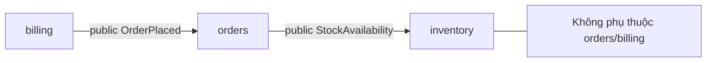
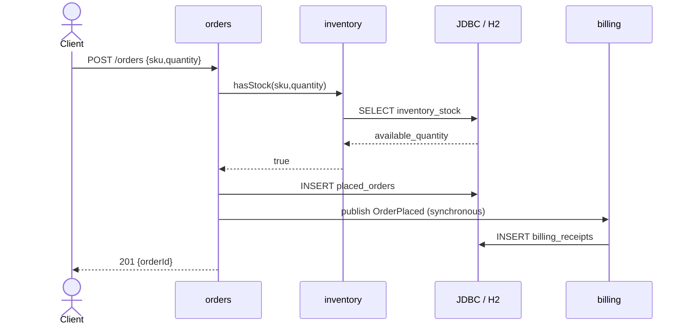
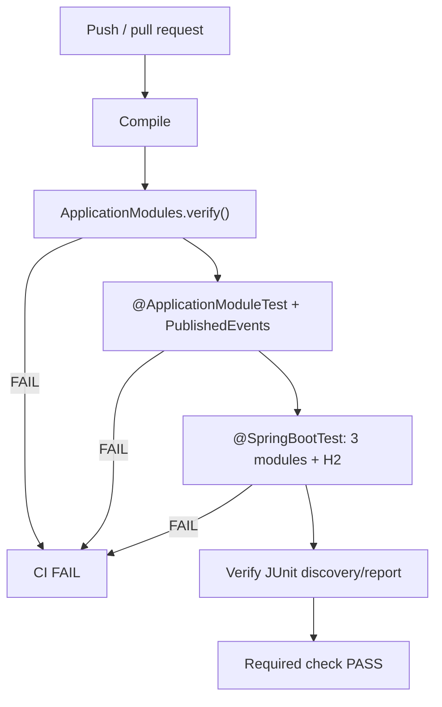

# Khởi tạo ứng dụng Spring Modulith nhỏ có ba module

> **Chương:** Dự án thực hành  
> **Module học:** `SPRING_MODULITH_VERIFICATION_TESTING` — xây dựng và kiểm chứng ranh giới kiến trúc bằng `ApplicationModules`, quy tắc phụ thuộc module, `@ApplicationModuleTest`, sự kiện, cơ sở dữ liệu, kiểm thử tích hợp và CI quality gate để ngăn phụ thuộc sai, hồi quy.

## 1. Đề bài, kiến trúc đích và tiêu chí hoàn thành

Xây dựng một ứng dụng Spring Boot **chạy được** tên `shop`, tổ chức thành **ba application modules** do Spring Modulith phát hiện qua ba package con trực tiếp:

| Module | Chịu trách nhiệm | Công bố cho module khác | Không được làm |
| --- | --- | --- | --- |
| `inventory` | Tra cứu số lượng tồn kho mẫu | `inventory.StockAvailability` | Không lộ JDBC repository nội bộ |
| `orders` | Nhận yêu cầu đặt đơn, kiểm hàng, lưu đơn, phát `OrderPlaced` | `orders.PlaceOrderCommand`, `orders.OrderManagement`, `orders.OrderPlaced` | Không gọi `inventory.internal` hoặc ghi bảng của `billing` |
| `billing` | Nhận `OrderPlaced`, tạo receipt/bản ghi tính tiền mẫu | Chưa cần công bố API khác | Không đọc `orders.internal` để lấy aggregate |

Các phụ thuộc có hướng rõ ràng:



Không có `inventory → orders`, `orders → billing` hoặc chu trình. Sự kiện giúp `orders` **không cần biết consumer** `billing`, dù `billing` phải biết kiểu event công bố từ `orders`.

**Kết quả nghiệm thu tối thiểu:**

1. `POST /orders` với `SKU-001` và `quantity=2` trả HTTP `201`, ghi một row `placed_orders` và một row `billing_receipts`.
2. `POST /orders` với `SKU-OUT` (hết hàng) trả HTTP `409`, không lưu order và không có billing receipt.
3. `ApplicationModules.of(ShopApplication.class).verify()` **PASS** với cấu trúc đúng, **FAIL** nếu thêm phụ thuộc production trái boundary.
4. `@ApplicationModuleTest` của `orders` chỉ dựng module đang kiểm và một stub cho public `StockAvailability`, rồi dùng `PublishedEvents` kiểm `OrderPlaced`.
5. `@SpringBootTest` kiểm phối hợp cả ba modules, JDBC và synchronous event listener.
6. Build chạy JUnit và trả exit code khác 0 khi một required test thất bại.

**Phạm vi có chủ đích:** Đây là dự án khởi tạo, chưa giải quyết reservation đồng thời, idempotency, durable outbox, broker retry hoặc security production. Phần mở rộng ở cuối chỉ rõ khi nào thêm các bảo đảm đó, để tránh đánh đồng “demo chạy” với “hệ thống exactly-once”.

## 2. Tạo project Maven và bố cục package

### 2.1. Công cụ và phiên bản mẫu

- JDK **21**.
- Maven Wrapper (`mvnw` / `mvnw.cmd`) từ Spring Initializr hoặc project tạo sẵn.
- Spring Boot **3.5.0** và Spring Modulith **1.4.0** là **cặp phiên bản minh họa** cùng thế hệ; khi triển khai project mới, chọn patch hiện được hỗ trợ/tương thích theo BOM và kiểm dependency resolution của môi trường thực.
- Spring Web, Spring JDBC, H2, Spring Modulith starter core/test, Spring Boot starter test.

Các snippet dùng **Java 21**, JUnit Jupiter, AssertJ và JDBC. H2 chỉ là database **nhúng cho thực hành**, không được xem là bằng chứng hành vi locking/SQL tương đương PostgreSQL production.

### 2.2. `pom.xml` tối thiểu

```xml
<?xml version="1.0" encoding="UTF-8"?>
<project xmlns="http://maven.apache.org/POM/4.0.0"
         xmlns:xsi="http://www.w3.org/2001/XMLSchema-instance"
         xsi:schemaLocation="http://maven.apache.org/POM/4.0.0
                             https://maven.apache.org/xsd/maven-4.0.0.xsd">
    <modelVersion>4.0.0</modelVersion>

    <parent>
        <groupId>org.springframework.boot</groupId>
        <artifactId>spring-boot-starter-parent</artifactId>
        <version>3.5.0</version>
        <relativePath/>
    </parent>

    <groupId>com.example</groupId>
    <artifactId>shop-modulith</artifactId>
    <version>0.0.1-SNAPSHOT</version>
    <name>shop-modulith</name>

    <properties>
        <java.version>21</java.version>
        <spring-modulith.version>1.4.0</spring-modulith.version>
    </properties>

    <dependencyManagement>
        <dependencies>
            <dependency>
                <groupId>org.springframework.modulith</groupId>
                <artifactId>spring-modulith-bom</artifactId>
                <version>${spring-modulith.version}</version>
                <type>pom</type>
                <scope>import</scope>
            </dependency>
        </dependencies>
    </dependencyManagement>

    <dependencies>
        <dependency>
            <groupId>org.springframework.boot</groupId>
            <artifactId>spring-boot-starter-web</artifactId>
        </dependency>
        <dependency>
            <groupId>org.springframework.boot</groupId>
            <artifactId>spring-boot-starter-jdbc</artifactId>
        </dependency>
        <dependency>
            <groupId>com.h2database</groupId>
            <artifactId>h2</artifactId>
            <scope>runtime</scope>
        </dependency>
        <dependency>
            <groupId>org.springframework.modulith</groupId>
            <artifactId>spring-modulith-starter-core</artifactId>
        </dependency>
        <dependency>
            <groupId>org.springframework.boot</groupId>
            <artifactId>spring-boot-starter-test</artifactId>
            <scope>test</scope>
        </dependency>
        <dependency>
            <groupId>org.springframework.modulith</groupId>
            <artifactId>spring-modulith-starter-test</artifactId>
            <scope>test</scope>
        </dependency>
    </dependencies>

    <build>
        <plugins>
            <plugin>
                <groupId>org.springframework.boot</groupId>
                <artifactId>spring-boot-maven-plugin</artifactId>
            </plugin>
        </plugins>
    </build>
</project>
```

**Lưu ý version:** Đây là mốc để tái hiện cấu trúc bài, không khẳng định là phiên bản mới nhất. Khi tạo project thật, dùng bản vá còn được hỗ trợ và BOM tương thích. Không tự phối Spring Boot mới với Spring Modulith cũ chỉ vì Maven resolve được dependencies.

### 2.3. Bố cục file đích

```text
shop-modulith/
├── pom.xml
└── src/
    ├── main/
    │   ├── java/com/example/shop/
    │   │   ├── ShopApplication.java
    │   │   ├── inventory/
    │   │   │   ├── StockAvailability.java
    │   │   │   └── internal/JdbcStockAvailability.java
    │   │   ├── orders/
    │   │   │   ├── PlaceOrderCommand.java
    │   │   │   ├── OrderPlaced.java
    │   │   │   ├── OutOfStockException.java
    │   │   │   ├── OrderManagement.java
    │   │   │   ├── OrderController.java
    │   │   │   └── internal/JdbcOrderRepository.java
    │   │   └── billing/
    │   │       └── internal/BillingEventListener.java
    │   └── resources/
    │       ├── application.yml
    │       ├── schema.sql
    │       └── data.sql
    └── test/java/com/example/shop/
        ├── ModuleArchitectureTest.java
        ├── ShopFlowIntegrationTest.java
        └── orders/OrdersModuleTest.java
```

Đặt `ShopApplication` ở root package `com.example.shop`; ba package `inventory`, `orders`, `billing` nằm **ngang cấp** ngay dưới nó. Đừng vô tình đặt các module dưới `com.example.shop.config` hoặc `com.example.shop.app.modules` rồi giả định Spring Modulith sẽ tự nhận diện y hệt sơ đồ.

### 2.4. Entry point

`src/main/java/com/example/shop/ShopApplication.java`:

```java
package com.example.shop;

import org.springframework.boot.SpringApplication;
import org.springframework.boot.autoconfigure.SpringBootApplication;

@SpringBootApplication
public class ShopApplication {

    public static void main(String[] args) {
        SpringApplication.run(ShopApplication.class, args);
    }
}
```

Spring Boot component scan từ `com.example.shop` nên tìm thấy beans ở cả ba modules. Spring Modulith phân tích các package con trực tiếp thành các application modules theo cấu hình mặc định. **Component scanning và architectural verification là hai cơ chế khác nhau**: chạy ứng dụng được không có nghĩa mọi module dependency đều hợp lệ.

## 3. Cấu hình H2 và dữ liệu seed nhỏ, có ownership

### 3.1. `application.yml`

```yaml
spring:
  application:
    name: shop-modulith
  datasource:
    generate-unique-name: true
  sql:
    init:
      mode: always
```

Đây là **cấu hình local/demo**; không dùng trực tiếp với DB production. Với H2 trên classpath và không đặt JDBC URL thủ công, Spring Boot chọn embedded database; `generate-unique-name: true` tách tên database theo application context, tránh hai test contexts khác nhau cùng khởi tạo lại một database tên cố định. Boot chạy `schema.sql` trước `data.sql`. **Trong cùng một context được cache**, các test methods vẫn có thể thấy dữ liệu của nhau nếu không cleanup.

### 3.2. `schema.sql`

```sql
-- Sở hữu: inventory
CREATE TABLE inventory_stock (
    sku VARCHAR(64) PRIMARY KEY,
    available_quantity INTEGER NOT NULL
        CHECK (available_quantity >= 0)
);

-- Sở hữu: orders
CREATE TABLE placed_orders (
    id UUID PRIMARY KEY,
    sku VARCHAR(64) NOT NULL,
    quantity INTEGER NOT NULL CHECK (quantity > 0)
);

-- Sở hữu: billing
CREATE TABLE billing_receipts (
    event_id UUID PRIMARY KEY,
    order_id UUID NOT NULL,
    quantity INTEGER NOT NULL CHECK (quantity > 0)
);
```

Schema chỉ gồm ba bảng — **mỗi module sở hữu một bảng**. `billing_receipts.order_id` là ID tham chiếu theo event contract, không phải lời mời để `billing` truy cập `orders.internal.JdbcOrderRepository`. Trong ứng dụng thật, mỗi module nên sở hữu migration/schema tương ứng; dùng Flyway/Liquibase, DB engine production và quy ước migration rõ thay vì phụ thuộc vào `schema.sql` cho mọi môi trường.

### 3.3. `data.sql`

```sql
INSERT INTO inventory_stock (sku, available_quantity)
VALUES ('SKU-001', 10);

INSERT INTO inventory_stock (sku, available_quantity)
VALUES ('SKU-OUT', 0);
```

**Hai SKU là đủ cho demo:** một positive control và một negative control. Không seed customer/payment/shipping graph vì yêu cầu hiện tại không dùng chúng. Seed cố định ở đây chỉ phục vụ ứng dụng local, trong integration tests cần dùng order IDs riêng và cleanup đúng rows.

### 3.4. Ranh giới transaction cần giữ khi đọc ví dụ

Đặt đơn thành công sẽ làm hai thao tác JDBC trong **cùng transaction service**:

```text
OrderManagement.place(command)  @Transactional
  ├── inventory.StockAvailability.hasStock(...)  [read]
  ├── orders JdbcOrderRepository.save(...)       [write]
  └── ApplicationEventPublisher.publishEvent(...)
         └── billing @EventListener(...)         [write, synchronous]
COMMIT
```

Đây là **event synchronous** để khởi tạo dễ kiểm. Nếu `billing` ném runtime exception trong listener, transaction DB hiện tại có thể rollback. Điều đó cũng cho thấy các module đang **coupled về transaction và latency**: bài mở rộng sau sẽ chuyển sang sau-commit/async publication có cơ chế bền vững. Không tuyên bố demo đã đạt at-least-once/exactly-once hay bảo vệ khi broker crash.

## 4. Module `inventory`: public port, private JDBC adapter

### 4.1. Public API chỉ trả kết quả tra cứu

`src/main/java/com/example/shop/inventory/StockAvailability.java`:

```java
package com.example.shop.inventory;

public interface StockAvailability {

    boolean hasStock(String sku, int quantity);
}
```

`orders` chỉ cần biết **còn đủ số lượng hay không**. Không truyền `InventoryEntity`, `InventoryJdbcRepository` hoặc `DataSource` ra ngoài module.

### 4.2. Implementation nằm trong `internal`

`src/main/java/com/example/shop/inventory/internal/JdbcStockAvailability.java`:

```java
package com.example.shop.inventory.internal;

import java.util.List;
import org.springframework.jdbc.core.JdbcTemplate;
import org.springframework.stereotype.Repository;
import com.example.shop.inventory.StockAvailability;

@Repository
public class JdbcStockAvailability implements StockAvailability {

    private final JdbcTemplate jdbc;

    public JdbcStockAvailability(JdbcTemplate jdbc) {
        this.jdbc = jdbc;
    }

    @Override
    public boolean hasStock(String sku, int quantity) {
        if (sku == null || sku.isBlank() || quantity <= 0) {
            return false;
        }

        List<Integer> quantities = jdbc.query(
                "SELECT available_quantity FROM inventory_stock "
                    + "WHERE sku = ?",
                (rs, rowNum) -> rs.getInt("available_quantity"),
                sku
        );

        return !quantities.isEmpty()
                && quantities.get(0) >= quantity;
    }
}
```

Với `SKU-001`, module trả `true` khi quantity ≤ 10; với `SKU-OUT` hoặc SKU không tồn tại, trả `false`. Không cần mock JPA entity hoặc tạo một inventory graph ở module `orders`.

**Giới hạn nghiệp vụ:** Tra cứu tồn kho không đồng nghĩa **giữ chỗ/trừ tồn kho**. Hai requests đồng thời có thể cùng đọc số lượng 10. Đây là giới hạn cố ý của MVP; nếu học tiếp concurrency, thêm `reserve`/optimistic locking tại module `inventory` và integration tests phù hợp.

### 4.3. Bài kiểm ranh giới đầu tiên

Trong service `orders` sẽ chỉ được:

```java
import com.example.shop.inventory.StockAvailability;
```

Không dùng:

```java
// Anti-pattern: production code orders truy cập API nội bộ.
import com.example.shop.inventory.internal.JdbcStockAvailability;
```

Java có thể biên dịch vì `JdbcStockAvailability` là `public`, nhưng **Spring Modulith architecture verification** cần chặn dependency tới internal package theo cấu hình module mặc định. Đây là một phép thử có chủ đích ở mục 8.

## 5. Module `orders`: public command, transaction và REST endpoint

### 5.1. Command được validate ở ranh giới

`src/main/java/com/example/shop/orders/PlaceOrderCommand.java`:

```java
package com.example.shop.orders;

import java.util.UUID;

public record PlaceOrderCommand(
        UUID orderId, String sku, int quantity
) {
    public PlaceOrderCommand {
        if (orderId == null || sku == null || sku.isBlank()
                || quantity <= 0) {
            throw new IllegalArgumentException("INVALID_ORDER_INPUT");
        }
    }
}
```

`orderId` do ứng dụng cấp một lần cho mỗi yêu cầu mới. Demo chưa hỗ trợ client-supplied idempotency key; vì vậy retry cùng HTTP request sau response timeout **có thể tạo một order mới**. Phần mở rộng sẽ bổ sung request identity khi giải bài toán retry thực tế.

### 5.2. Event công bố qua public package

`src/main/java/com/example/shop/orders/OrderPlaced.java`:

```java
package com.example.shop.orders;

import java.util.UUID;

public record OrderPlaced(
        UUID eventId,
        UUID orderId,
        String sku,
        int quantity
) {}
```

`OrderPlaced` nằm ở package gốc `orders`, nên có thể được module `billing` sử dụng như một contract công bố khi Spring Modulith áp dụng mô hình public package mặc định. Event ID được tách khỏi order ID, tạo nền tảng cho bài dedup/retry sau này.

Không tự công bố `JdbcOrderRepository` hoặc một JPA entity chứa toàn bộ bảng internal vào event, vì nó sẽ làm `billing` lệ thuộc chi tiết persistence của `orders`.

### 5.3. Lỗi nghiệp vụ có tên

`src/main/java/com/example/shop/orders/OutOfStockException.java`:

```java
package com.example.shop.orders;

public class OutOfStockException extends RuntimeException {

    public OutOfStockException() {
        super("OUT_OF_STOCK");
    }
}
```

Đây là ngoại lệ ứng dụng trong public API để controller có thể đổi thành HTTP `409`. Không nên dùng `RuntimeException("something failed")` không rõ nghĩa cho một nhánh nghiệp vụ cần kiểm thử.

### 5.4. JDBC repository thuộc `orders.internal`

`src/main/java/com/example/shop/orders/internal/JdbcOrderRepository.java`:

```java
package com.example.shop.orders.internal;

import java.util.UUID;
import org.springframework.jdbc.core.JdbcTemplate;
import org.springframework.stereotype.Repository;

@Repository
public class JdbcOrderRepository {

    private final JdbcTemplate jdbc;

    public JdbcOrderRepository(JdbcTemplate jdbc) {
        this.jdbc = jdbc;
    }

    public void save(UUID id, String sku, int quantity) {
        jdbc.update(
            "INSERT INTO placed_orders (id, sku, quantity) "
                + "VALUES (?, ?, ?)",
            id, sku, quantity
        );
    }
}
```

`OrderManagement` là một phần của module `orders` nên được phép gọi repository nội bộ của **chính module đó**. `billing` không được import trực tiếp repository để tìm order.

### 5.5. Application service ghi đơn rồi publish event

`src/main/java/com/example/shop/orders/OrderManagement.java`:

```java
package com.example.shop.orders;

import java.util.UUID;
import org.springframework.context.ApplicationEventPublisher;
import org.springframework.stereotype.Service;
import org.springframework.transaction.annotation.Transactional;
import com.example.shop.inventory.StockAvailability;
import com.example.shop.orders.internal.JdbcOrderRepository;

@Service
public class OrderManagement {

    private final StockAvailability stock;
    private final JdbcOrderRepository orders;
    private final ApplicationEventPublisher events;

    public OrderManagement(
            StockAvailability stock,
            JdbcOrderRepository orders,
            ApplicationEventPublisher events) {
        this.stock = stock;
        this.orders = orders;
        this.events = events;
    }

    @Transactional
    public OrderPlaced place(PlaceOrderCommand command) {
        if (!stock.hasStock(command.sku(), command.quantity())) {
            throw new OutOfStockException();
        }

        orders.save(
                command.orderId(),
                command.sku(),
                command.quantity()
        );

        OrderPlaced placed = new OrderPlaced(
                UUID.randomUUID(),
                command.orderId(),
                command.sku(),
                command.quantity()
        );
        events.publishEvent(placed);
        return placed;
    }
}
```

Ranh giới module được giữ trong **imports**: `orders` chỉ biết `inventory.StockAvailability`, không biết implementation. `OrderManagement` không biết `billing` có listener hay không; đây là lợi ích chính của event publication trong mini project.

Về transaction, khi service được gọi qua Spring-managed bean/proxy, `@Transactional` bao quanh JDBC insert và event publication synchronous. Nếu một listener synchronous ghi DB cùng DataSource, các thao tác có thể cùng tham gia transaction. **Không** tự suy rằng bất kỳ external HTTP call, mail hay broker publish đều được rollback theo DB.

### 5.6. REST controller chỉ chuyển HTTP thành public command

`src/main/java/com/example/shop/orders/OrderController.java`:

```java
package com.example.shop.orders;

import java.util.Map;
import java.util.UUID;
import org.springframework.http.HttpStatus;
import org.springframework.http.ResponseEntity;
import org.springframework.web.bind.annotation.ExceptionHandler;
import org.springframework.web.bind.annotation.PostMapping;
import org.springframework.web.bind.annotation.RequestBody;
import org.springframework.web.bind.annotation.RequestMapping;
import org.springframework.web.bind.annotation.ResponseStatus;
import org.springframework.web.bind.annotation.RestController;

@RestController
@RequestMapping("/orders")
public class OrderController {

    private final OrderManagement orders;

    public OrderController(OrderManagement orders) {
        this.orders = orders;
    }

    public record CreateOrderRequest(String sku, int quantity) {}

    public record CreateOrderResponse(UUID orderId) {}

    @PostMapping
    @ResponseStatus(HttpStatus.CREATED)
    public CreateOrderResponse create(
            @RequestBody CreateOrderRequest request) {
        PlaceOrderCommand command = new PlaceOrderCommand(
                UUID.randomUUID(), request.sku(), request.quantity());
        OrderPlaced placed = orders.place(command);
        return new CreateOrderResponse(placed.orderId());
    }

    @ExceptionHandler(OutOfStockException.class)
    public ResponseEntity<Map<String, String>> outOfStock() {
        return ResponseEntity.status(HttpStatus.CONFLICT)
                .body(Map.of("code", "OUT_OF_STOCK"));
    }

    @ExceptionHandler(IllegalArgumentException.class)
    public ResponseEntity<Map<String, String>> invalidInput() {
        return ResponseEntity.badRequest()
                .body(Map.of("code", "INVALID_ORDER_INPUT"));
    }
}
```

HTTP response chỉ trả `orderId`, **không** expose trực tiếp internal JDBC row hay event envelope ra client. Đây là bước nhỏ nhưng rõ ràng để phân biệt **HTTP DTO**, **application command** và **domain event**, dù cả ba có thể có một số fields giống nhau.

## 6. Module `billing`: nhận sự kiện mà không gọi nội bộ `orders`

### 6.1. Listener synchronous đơn giản để quan sát luồng

`src/main/java/com/example/shop/billing/internal/BillingEventListener.java`:

```java
package com.example.shop.billing.internal;

import org.springframework.context.event.EventListener;
import org.springframework.jdbc.core.JdbcTemplate;
import org.springframework.stereotype.Component;
import com.example.shop.orders.OrderPlaced;

@Component
public class BillingEventListener {

    private final JdbcTemplate jdbc;

    public BillingEventListener(JdbcTemplate jdbc) {
        this.jdbc = jdbc;
    }

    @EventListener
    public void on(OrderPlaced event) {
        jdbc.update(
            "INSERT INTO billing_receipts "
                + "(event_id, order_id, quantity) VALUES (?, ?, ?)",
            event.eventId(),
            event.orderId(),
            event.quantity()
        );
    }
}
```

**Điểm cần quan sát:** `billing` import `orders.OrderPlaced` — public event contract — chứ không import `orders.internal.JdbcOrderRepository`. `orders` không có import ngược về `billing`; như vậy không tạo module cycle.

### 6.2. Chính xác demo đã chứng minh điều gì?

| Đã có trong MVP | Chưa có trong MVP |
| --- | --- |
| Producer phát `OrderPlaced` qua `ApplicationEventPublisher` | Durable event publication/outbox |
| Listener `@EventListener` được Spring gọi synchronous | Async processing / after-commit listener |
| Billing ghi row có `eventId` để quan sát | Replay/idempotency khi cùng event được giao lại |
| JDBC cùng DataSource có thể tham gia service transaction | Distributed transaction với external service |
| Public event contract giữa hai modules | Authorization, privacy policy, consumer schema versioning |

Vì bảng `billing_receipts.event_id` có primary key, một event ID được gửi lại có thể gặp duplicate-key exception. **Đó chưa phải xử lý duplicate an toàn**: muốn idempotent consumer, cần receipt + business effect trong một transaction, kiểm payload conflict và chính sách retry. Bài này chỉ khởi tạo ba modules và bảo vệ ranh giới, không tuyên bố hoàn tất các bài toán độ tin cậy.

### 6.3. Sơ đồ gọi thực tế



Trình tự này quan sát được khi dùng `@EventListener` synchronous; khi thay bằng `@ApplicationModuleListener` hoặc broker listener bất đồng bộ, thứ tự commit/callback và cách test phải thay đổi. Không sửa annotation một cách máy móc rồi giữ các assertions “billing row có ngay sau HTTP 201” nếu listener trở thành eventual.

## 7. Chạy ứng dụng và kiểm tra bằng HTTP

### 7.1. Boot project

Tại thư mục `shop-modulith` (đã tạo Maven Wrapper):

```bash
# Linux/macOS:
./mvnw spring-boot:run

# Windows PowerShell dùng wrapper tương đương:
# .\mvnw.cmd spring-boot:run
```

Nếu Spring context không khởi động, xem root cause trước: thiếu JDBC/H2 dependency, SQL schema sai, trùng bean name, version BOM không tương thích hoặc package không nằm dưới `com.example.shop`. Đừng thêm dữ liệu fixture vô tội vạ để “chữa” lỗi dependency injection.

### 7.2. Happy path

```bash
curl -i -X POST http://localhost:8080/orders \
  -H 'Content-Type: application/json' \
  -d '{"sku":"SKU-001","quantity":2}'
```

Kết quả kỳ vọng có HTTP `201 Created` và JSON chứa một `orderId` do server cấp:

```json
{
  "orderId": "11111111-1111-1111-1111-111111111111"
}
```

UUID ở trên chỉ minh họa **định dạng**, không phải ID cố định mà server thực sự trả. Với `OrderManagement` của ví dụ, thành công tạo:

```text
placed_orders:
  id=<orderId vừa trả>, sku=SKU-001, quantity=2

billing_receipts:
  event_id=<UUID riêng của OrderPlaced>
  order_id=<cùng orderId>, quantity=2
```

Không tạo sẵn `billing_receipts` bằng SQL seed cho happy-path test: nếu seed kết quả trước khi gọi service, test có thể PASS dù listener production không làm gì.

### 7.3. Không đủ hàng

```bash
curl -i -X POST http://localhost:8080/orders \
  -H 'Content-Type: application/json' \
  -d '{"sku":"SKU-OUT","quantity":1}'
```

Kỳ vọng HTTP `409 Conflict`:

```json
{
  "code": "OUT_OF_STOCK"
}
```

Vì validation chưa bị lỗi và `StockAvailability.hasStock` trả `false`, `OrderManagement.place` ném `OutOfStockException` **trước** JDBC insert và event publication.

### 7.4. Input không hợp lệ

```bash
curl -i -X POST http://localhost:8080/orders \
  -H 'Content-Type: application/json' \
  -d '{"sku":"SKU-001","quantity":0}'
```

Kỳ vọng HTTP `400 Bad Request` với `{"code":"INVALID_ORDER_INPUT"}`. Đây là validation của `PlaceOrderCommand`, không phải “hết hàng”. Không dùng cùng một fixture lỗi cho cả hai nhánh rồi coi chúng tương đương.

### 7.5. Một bảng smoke-test có thể copy vào pull request

| Request | HTTP | Order row | Billing receipt |
| --- | --- | --- | --- |
| `SKU-001`, qty 2 | 201 | +1 | +1 |
| `SKU-OUT`, qty 1 | 409 | +0 | +0 |
| `SKU-001`, qty 0 | 400 | +0 | +0 |
| SKU không tồn tại, qty 1 | 409 | +0 | +0 |

Mỗi request happy-path tạo order ID mới; vì demo chưa dùng idempotency, gọi lại cùng HTTP JSON sẽ tạo đơn mới nếu đủ tồn kho. Test không được gắn nhãn “retry an toàn” cho behavior ấy.

## 8. Kiểm ranh giới bằng `ApplicationModules.verify()`

Ứng dụng chạy được và HTTP trả đúng chưa chứng minh module architecture được bảo vệ. Một dependency tới `inventory.internal` vẫn có thể compile nếu Java class ở package đó là `public`.

### 8.1. Structural JUnit test độc lập với database data

`src/test/java/com/example/shop/ModuleArchitectureTest.java`:

```java
package com.example.shop;

import org.junit.jupiter.api.Test;
import org.springframework.modulith.core.ApplicationModules;

class ModuleArchitectureTest {

    @Test
    void verifiesTheThreeModuleBoundaries() {
        ApplicationModules.of(ShopApplication.class).verify();
    }
}
```

Không cần seed `inventory_stock`, `placed_orders` hay `billing_receipts` cho test này. `ApplicationModules.of(...)` phân tích cấu trúc ứng dụng và `verify()` kiểm các điều kiện kiến trúc được framework áp dụng như module boundary/cycles/dependencies.

**Cách đọc kết quả:**

- PASS: Không phát hiện vi phạm theo những quy tắc Spring Modulith đang kiểm. Nó **không** chứng minh transaction, JSON payload, event delivery hoặc security đúng.
- FAIL: Đọc đường phụ thuộc giữa modules và kiểu Java gây vi phạm; sửa import/architecture, không tắt `verify()`.

### 8.2. Negative probe để chắc chắn gate có tác dụng

Trên nhánh thử **không merge**, thêm một kiểu Java production trong package `orders` có field tham chiếu trực tiếp tới **internal implementation** của `inventory`:

```java
// Chỉ dùng tạm để chứng minh architectural test FAIL.
package com.example.shop.orders;

import com.example.shop.inventory.internal.JdbcStockAvailability;

class IntentionallyBadDependency {
    private JdbcStockAvailability forbidden;
}
```

Do `JdbcStockAvailability` là `public` nên Java có thể compile, nhưng quan hệ bytecode `orders → inventory.internal` vi phạm public API boundary mặc định và `ModuleArchitectureTest` phải FAIL. Sau khi xác nhận, **xóa kiểu thử nghiệm** và trở lại phụ thuộc `StockAvailability` công bố.

**Đừng chỉ thêm một `import` không sử dụng**: compiler có thể loại nó khỏi bytecode, khiến phép kiểm kiến trúc không có dependency thực để phát hiện. Dùng một field/constructor/method reference thật như ví dụ rồi khôi phục.

### 8.3. Thêm quy tắc phụ thuộc khi dự án lớn hơn

Khi cần chặt hơn, có thể cấu hình `@ApplicationModule(allowedDependencies = ...)` trong `package-info.java` hoặc `@NamedInterface` cho package công bố. Nhưng không cần thêm các annotation ấy ngay để có ba modules mặc định. Chỉ đưa vào sau khi đã biết chính xác module nào được phép phụ thuộc module nào.

Một phép kiểm đúng cho bài hiện tại là:

```text
Allowed:
  orders   -> inventory (public StockAvailability)
  billing  -> orders    (public OrderPlaced)

Disallowed:
  orders   -> billing
  inventory-> orders
  billing  -> orders.internal.*
  orders   -> inventory.internal.*
```

### 8.4. Không dùng database integration test thay structural test

Một `@SpringBootTest` có thể PASS dù `orders` trực tiếp inject `JdbcStockAvailability` từ `inventory.internal`: functional result vẫn đúng nhưng kiến trúc bị chọc thủng. Structural gate và behavioral gate **bảo vệ những lỗi khác nhau**, cần cả hai trong CI.

## 9. `@ApplicationModuleTest` và integration tests trên ba modules

### 9.1. Test riêng module `orders`, stub public API từ `inventory`

`@ApplicationModuleTest` mặc định bootstrap module đang kiểm theo phạm vi standalone, nên production bean `inventory.internal.JdbcStockAvailability` có thể không được nạp. Đưa vào test một `StockAvailability` stub **qua public interface**.

`src/test/java/com/example/shop/orders/OrdersModuleTest.java`:

```java
package com.example.shop.orders;

import static org.assertj.core.api.Assertions.assertThat;

import java.util.UUID;
import org.junit.jupiter.api.Test;
import org.springframework.beans.factory.annotation.Autowired;
import org.springframework.boot.test.context.TestConfiguration;
import org.springframework.context.annotation.Bean;
import org.springframework.context.annotation.Import;
import org.springframework.jdbc.core.JdbcTemplate;
import org.springframework.modulith.test.ApplicationModuleTest;
import org.springframework.modulith.test.PublishedEvents;
import com.example.shop.inventory.StockAvailability;

@ApplicationModuleTest
@Import(OrdersModuleTest.InventoryStub.class)
class OrdersModuleTest {

    @TestConfiguration(proxyBeanMethods = false)
    static class InventoryStub {

        @Bean
        StockAvailability availableStockForOrdersTest() {
            return (sku, quantity) -> true;
        }
    }

    @Autowired
    OrderManagement management;

    @Autowired
    JdbcTemplate jdbc;

    @Test
    void publishesThePublicEventContract(PublishedEvents published) {
        UUID orderId = UUID.randomUUID();
        PlaceOrderCommand command =
                new PlaceOrderCommand(orderId, "SKU-001", 2);

        try {
            OrderPlaced result = management.place(command);

            assertThat(result.orderId()).isEqualTo(orderId);
            assertThat(result.sku()).isEqualTo("SKU-001");
            assertThat(result.quantity()).isEqualTo(2);

            assertThat(published.ofType(OrderPlaced.class))
                    .anySatisfy(event -> {
                        assertThat(event.orderId()).isEqualTo(orderId);
                        assertThat(event.eventId())
                                .isEqualTo(result.eventId());
                        assertThat(event.quantity()).isEqualTo(2);
                    });

            Integer orderRows = jdbc.queryForObject(
                    "SELECT COUNT(*) FROM placed_orders WHERE id = ?",
                    Integer.class, orderId);
            assertThat(orderRows).isEqualTo(1);
        } finally {
            jdbc.update("DELETE FROM placed_orders WHERE id = ?", orderId);
        }
    }
}
```

**Ba điều đang được kiểm:** Public `OrderManagement` xử lý command; JDBC repository lưu row; Spring `PublishedEvents` nhận event mang cùng order ID/event ID. Test này không cần seed billing receipt vì `billing` không thuộc standalone module context.

**Các lưu ý để không hiểu sai:**

- Vì orders vẫn có JDBC repository, **H2 và `schema.sql`** vẫn cần cho test module này. `@ApplicationModuleTest` không có nghĩa “không dùng DB” khi module production dùng DB.
- Nếu bạn cấu hình module bootstrap mode khác, test bean có thể xung đột với production `StockAvailability`; giữ mode độc lập hoặc dùng test replacement phù hợp.
- `anySatisfy` chỉ chứng minh **có** event phù hợp, chưa chứng minh **đúng một** event. Khi cần kiểm số lượng tuyệt đối, thêm assertion đếm phù hợp API `PublishedEvents` của Spring Modulith version hiện tại.
- Lời gọi `management.place` đi qua Spring-managed bean/proxy. Không thêm `@Transactional` cho test method theo quán tính nếu đang muốn quan sát commit của service.

### 9.2. Integration test ba modules + JDBC + listener thật

`src/test/java/com/example/shop/ShopFlowIntegrationTest.java`:

```java
package com.example.shop;

import static org.junit.jupiter.api.Assertions.*;

import java.util.UUID;
import org.junit.jupiter.api.Test;
import org.springframework.beans.factory.annotation.Autowired;
import org.springframework.boot.test.context.SpringBootTest;
import org.springframework.jdbc.core.JdbcTemplate;
import com.example.shop.orders.OrderManagement;
import com.example.shop.orders.OutOfStockException;
import com.example.shop.orders.PlaceOrderCommand;

@SpringBootTest
class ShopFlowIntegrationTest {

    @Autowired
    OrderManagement management;

    @Autowired
    JdbcTemplate jdbc;

    private int countOrders(UUID orderId) {
        return jdbc.queryForObject(
            "SELECT COUNT(*) FROM placed_orders WHERE id = ?",
            Integer.class, orderId);
    }

    private int countReceipts(UUID orderId) {
        return jdbc.queryForObject(
            "SELECT COUNT(*) FROM billing_receipts WHERE order_id = ?",
            Integer.class, orderId);
    }

    @Test
    void placesOrderAndCreatesBillingReceipt() {
        UUID orderId = UUID.randomUUID();
        PlaceOrderCommand command =
                new PlaceOrderCommand(orderId, "SKU-001", 2);

        try {
            var placed = management.place(command);

            assertEquals(orderId, placed.orderId());
            assertEquals(1, countOrders(orderId));
            assertEquals(1, countReceipts(orderId));
        } finally {
            jdbc.update(
                "DELETE FROM billing_receipts WHERE order_id = ?", orderId);
            jdbc.update(
                "DELETE FROM placed_orders WHERE id = ?", orderId);
        }
    }

    @Test
    void outOfStockHasNeitherOrderNorBillingEffect() {
        UUID orderId = UUID.randomUUID();
        PlaceOrderCommand command =
                new PlaceOrderCommand(orderId, "SKU-OUT", 1);

        assertThrows(OutOfStockException.class,
                () -> management.place(command));

        assertEquals(0, countOrders(orderId));
        assertEquals(0, countReceipts(orderId));
    }
}
```

**Vì sao test integration này khác module test?**

- Spring Boot khởi tạo **cả ba modules**.
- `inventory.internal.JdbcStockAvailability` được sử dụng thật từ seeded `inventory_stock`.
- `billing.internal.BillingEventListener` thật nhận event synchronous.
- Hai hàng ghi `placed_orders` và `billing_receipts` được quan sát sau service call/transaction.

Test method **không** gắn `@Transactional`; nếu đặt transaction ngoài, thời điểm commit và các assertions ở cùng connection có thể khác với production. Hai tests dùng UUID riêng nên có thể chạy trong cùng H2 instance mà không đụng order IDs; nếu project chạy parallel, cần xem thêm schema lifecycle và shared seed.

### 9.3. Các bằng chứng không được đánh đồng

| Test | Chứng minh được | Không chứng minh |
| --- | --- | --- |
| `ModuleArchitectureTest` | Boundary/module dependency tĩnh | Business flow, SQL, event commit |
| `OrdersModuleTest` | Module orders + JDBC + published event contract | Billing listener full-context chạy |
| `ShopFlowIntegrationTest` | Đồng bộ ba module qua một call và synchronous listener | Broker delivery, async retry, durability khi crash |
| HTTP smoke test | REST/controller/error mapping | Kiến trúc không có import internal |

Đây là lý do bài thực hành yêu cầu **cả structural test, module test và full integration test** thay vì chỉ một `@SpringBootTest` lớn.

## 10. Quality gate trong CI và cách chẩn đoán một build đỏ

### 10.1. Chạy cả ba nhóm test

Với Maven Wrapper và các class có tên kết thúc bằng `Test` như ví dụ:

```bash
# Structural gate: nhanh, không cần chạy toàn bộ application context.
./mvnw -B -Dtest=ModuleArchitectureTest test

# Full JUnit tests + packaging/lifecycle đã cấu hình:
./mvnw -B verify
```

Ở Windows PowerShell, đổi `./mvnw` thành `.\mvnw.cmd`. Nếu chưa có Maven Wrapper, tạo project qua Spring Initializr có wrapper hoặc dùng Maven được cài sẵn phù hợp version dự án.

**Đọc test report**, không chỉ nhìn `BUILD SUCCESS`:

| Test | Kết quả phải thấy | Lỗi cần bắt |
| --- | --- | --- |
| `ModuleArchitectureTest` | Executed, PASS | Dependency tới `internal`/chu trình module |
| `OrdersModuleTest` | Executed, PASS | Public event mapping hoặc module wiring sai |
| `ShopFlowIntegrationTest` | Hai tests executed, PASS | Stock false vẫn save; billing listener không ghi |

Maven Surefire thường ghi report ở `target/surefire-reports`. Với ba class kết thúc bằng `Test`, default Surefire naming thông thường có thể tìm chúng; vẫn phải kiểm report, test count và cấu hình thực tế. Nếu về sau đặt tên integration test là `*IT`, cần cấu hình Maven Failsafe/lifecycle hoặc job riêng; `mvn verify` không tự đảm bảo mọi `*IT` được chạy.

### 10.2. Workflow CI mẫu (GitHub Actions)

`.github/workflows/modulith-gate.yml` trong **project thực hành bạn tạo**, không phải file mà worker của bài học này tự sinh:

```yaml
name: modulith-gate

on:
  push:
  pull_request:

jobs:
  verify:
    runs-on: ubuntu-latest
    steps:
      - uses: actions/checkout@v4
      - uses: actions/setup-java@v4
        with:
          distribution: temurin
          java-version: "21"
          cache: maven
      - name: Compile, architecture, module and integration tests
        run: ./mvnw -B verify
```

Workflow minh họa dùng JDK 21 và Maven Wrapper đã commit với project. Trong tổ chức thật, pin action revisions theo security policy và cấu hình branch protection để **`modulith-gate / verify` là required check**. Nếu Maven không được chạy do thiếu executable permission cho wrapper trên Linux, sửa quyền thực thi trong project, không bỏ qua job.

Không dùng `-DskipTests`, `mvn ... || true` hay CI `continue-on-error: true` để giữ trạng thái xanh khi test lỗi. Một gate kiến trúc bị skip sẽ không thể ngăn ranh giới bị phá khi merge.

### 10.3. Sơ đồ quality gate



### 10.4. Bảng lỗi thực tế trong buổi khởi tạo

| Triệu chứng | Nguyên nhân đáng kiểm đầu tiên | Cách xử lý |
| --- | --- | --- |
| Không có bean `StockAvailability` ở module test | `orders` test standalone loại bean `inventory.internal` | Import test stub qua public interface |
| Full app có hai beans `StockAvailability` | Test config bị scan vào runtime hoặc chồng collaborator | Giữ `@TestConfiguration` trong test scope; xem context/import |
| `JdbcTemplate` không khởi tạo | Thiếu Spring JDBC/H2 DataSource | Kiểm dependencies và embedded DB configuration |
| `Table "PLACED_ORDERS" not found` | `schema.sql` chưa được chạy ở test context | Kiểm `spring.sql.init.mode`, file path và DataSource |
| `Table already exists` ở context thứ hai | Hai contexts dùng chung H2 database tên cố định | Dùng unique database name per context; không chia sẻ JDBC URL ngoài ý muốn |
| HTTP 409 cho `SKU-001` | Seed/StockAvailability mapping không đúng | Kiểm `data.sql` và query `inventory_stock` |
| HTTP 500 thay vì 409 | Exception handler không bắt đúng `OutOfStockException` | Kiểm service throw và controller advice |
| Billing row không có nhưng order row có | Listener chưa được scan, dùng async/after-commit không chờ hoặc lỗi event | Kiểm `@EventListener`, component scan, transaction lifecycle |
| Module test PASS nhưng full integration FAIL | Stub của module test che lỗi bean/DB thật | Sửa full-context wiring, không biến integration thành toàn mock |
| `verify()` FAIL khi code vẫn compile | Module import sai public/internal hoặc cycle | Xem dependency path, sửa qua public API |
| CI xanh dù không chạy JUnit | Test discovery/task bị skip | Đọc Surefire XML; tạo required check thật |

### 10.5. Negative probes bảo vệ cả architecture lẫn behavior

Trên branch tạm, thực hiện từng thí nghiệm và **hoàn nguyên**:

1. Thêm field reference thật từ `orders` tới `inventory.internal.JdbcStockAvailability`: **structural test FAIL**.
2. Trong `OrderManagement.place` bỏ lệnh `events.publishEvent(placed)`: **OrdersModuleTest FAIL** vì thiếu `PublishedEvents`.
3. Trong `BillingEventListener` bỏ `jdbc.update(...)`: **ShopFlowIntegrationTest FAIL** vì không có receipt.
4. Trong `JdbcStockAvailability` luôn trả `true`: integration negative case `SKU-OUT` **FAIL**.

Nếu một mutation không khiến test dự kiến đỏ, cần điều tra test đang kiểm nhầm đối tượng, dữ liệu seed không chạm nhánh cần kiểm, hay job thực tế không chạy test. **Không merge** code mutation.

## 11. Bài tập mở rộng, checklist bàn giao và tự kiểm tra

### 11.1. Thực hành theo bốn chặng

**Chặng A — Khởi tạo skeleton:** Tạo Maven project, root `ShopApplication` và đúng ba package `inventory`, `orders`, `billing`. Thêm dependencies Modulith/JDBC/H2/test. Chạy `ModuleArchitectureTest` từ sớm để xác nhận module model có thể phân tích.

**Chặng B — Chạy use case đầu tiên:** Viết `StockAvailability` public và implementation `inventory.internal`; `OrderManagement` dùng public API, lưu `placed_orders`, publish `OrderPlaced`. Thêm `BillingEventListener` chỉ nhận event public. Dùng đúng hai inventory seeds, thử HTTP 201/409/400.

**Chặng C — Kiểm chứng ở đúng tầng:** Viết architectural test, module event test có stub `StockAvailability`, integration test full context kiểm billing receipt. Mỗi test có một lý do tồn tại, không seed dữ liệu thừa và không kéo repository internal của module khác vào fixture.

**Chặng D — Cố ý làm sai và sửa:** Tạo dependency internal, bỏ publish, bỏ billing write. Với từng lỗi, dự đoán test nào FAIL; kiểm báo cáo thật, rồi hoàn nguyên. Chạy `mvn verify` như required check trước merge.

### 11.2. Checklist nghiệm thu project ba module

- [ ] Có đúng ba application module packages trực tiếp: `inventory`, `orders`, `billing`.
- [ ] `ShopApplication` ở root package, Spring Boot component scan thấy toàn bộ beans.
- [ ] `pom.xml` dùng Spring Boot và Spring Modulith BOM tương thích; Java version thống nhất.
- [ ] `inventory.StockAvailability` là public port; JDBC implementation nằm trong `inventory.internal`.
- [ ] `orders.OrderManagement` chỉ import public `StockAvailability`, không dùng `inventory.internal`.
- [ ] `orders` lưu `placed_orders` qua repository thuộc chính module.
- [ ] `OrderPlaced` là public event contract; `billing` không đọc `orders.internal`.
- [ ] `billing` có listener thật và tạo `billing_receipts` từ event.
- [ ] `schema.sql`/`data.sql` phục vụ local demo, không bị sử dụng nhầm làm migration production.
- [ ] HTTP happy path trả `201`, hết hàng `409`, input không hợp lệ `400`.
- [ ] `ModuleArchitectureTest` chạy `ApplicationModules.verify()` và PASS với source đúng.
- [ ] Negative architectural probe với **dependency được dùng thật** khiến `verify()` FAIL.
- [ ] `@ApplicationModuleTest` boot module `orders`, stub dependency external qua public interface.
- [ ] `PublishedEvents` thấy `OrderPlaced` được publish từ service thật và có đúng order identity/payload.
- [ ] `@SpringBootTest` kiểm positive và negative path qua inventory/DB/billing.
- [ ] Tests dùng UUID riêng theo scenario; cleanup không xóa rows của test khác.
- [ ] Maven `verify` report các test đã thực thi; CI required check phản ánh failure.
- [ ] Giới hạn synchronous listener, H2 demo, stock non-reservation và thiếu retry/idempotency được ghi rõ.

### 11.3. Hướng mở rộng có thứ tự sau khi MVP PASS

| Bước tiếp | Thay đổi nhỏ nhất | Kiểm chứng bổ sung |
| --- | --- | --- |
| **Inventory reservation** | Thêm `reserve` với transaction/locking | Hai requests đồng thời không oversell |
| **Durable event** | Dùng Spring Modulith publication support/outbox theo phiên bản chọn | Event không mất khi transaction/relay lỗi |
| **Async listener** | Chuyển theo semantics after-commit, ví dụ cơ chế `@ApplicationModuleListener` khi phù hợp | Đợi effect theo ID/timeout, không assert tức thì |
| **Idempotent billing** | Receipt theo consumer+event ID và unique constraint | Redelivery cùng event không ghi effect hai lần |
| **Production database** | Thay H2 bằng PostgreSQL/Testcontainers + Flyway | Migration, transaction, constraint và isolation |
| **Observability & security** | Log metadata tối thiểu, auth/validation/metrics | Không lộ dữ liệu contact/token qua event/log |

Đừng đưa tất cả mở rộng vào bài khởi tạo khiến người học mất điểm kiểm ban đầu. Chỉ chuyển bước khi **ba tests tối thiểu đã PASS** và các giới hạn của bước trước được hiểu.

### 11.4. Câu hỏi tự kiểm tra

1. Vì sao đặt `ShopApplication` trong `com.example.shop` lại ảnh hưởng khả năng nhận diện ba modules?
2. Trong sơ đồ dependency, vì sao `billing → orders` hợp lệ khi chỉ tham chiếu public `OrderPlaced`, còn `orders → billing` tạo nguy cơ cycle?
3. Java compile PASS có chứng minh một import `inventory.internal` là hợp lệ theo Spring Modulith không?
4. Khi chỉ có `@ApplicationModuleTest` của `orders`, tại sao cần một `StockAvailability` test stub?
5. Tại sao stub phải triển khai **public interface** thay vì inject `inventory.internal.JdbcStockAvailability`?
6. `PublishedEvents` chứng minh được điều gì về `OrderPlaced`? Có chứng minh billing row đã commit không?
7. Vì sao `ShopFlowIntegrationTest` phải quan sát cả `placed_orders` và `billing_receipts`?
8. Với `@EventListener` synchronous, listener failure có thể ảnh hưởng transaction nguồn thế nào?
9. Điều gì sẽ thay đổi trong test khi thay `@EventListener` bằng listener after-commit/async?
10. Tại sao demo `StockAvailability.hasStock` chưa giải quyết được overselling?
11. Vì sao bảng `billing_receipts.event_id` có primary key chưa đủ chứng minh idempotent redelivery?
12. Nếu CI trả `BUILD SUCCESS` nhưng `OrdersModuleTest` không có trong report, bạn có coi quality gate đã bảo vệ event contract không?

### 11.5. Kết quả cần nộp khi hoàn thành dự án

Bộ sản phẩm thực hành của người học gồm: sơ đồ module dependency; source code Maven/Java/SQL/YAML theo cấu trúc; ba nhóm JUnit tests; ảnh/chụp nội dung HTTP `201`/`409` hoặc console test logs đã khử dữ liệu nhạy cảm; Surefire report xác nhận tests executed; và biên bản ngắn cho hai negative probes (một architectural, một behavioral) đã FAIL đúng lý do trên branch thử.

**Ghi nhớ:** Khởi tạo ứng dụng Spring Modulith **ba module** không chỉ là tạo ba package. Cần public API đúng hướng (`orders → inventory`, `billing → orders` qua event), dữ liệu từng module có ownership rõ, flow chạy được và **ba lớp kiểm chứng**: `ApplicationModules.verify()` cho kiến trúc, `@ApplicationModuleTest`/`PublishedEvents` cho hành vi module, `@SpringBootTest` cho tích hợp JDBC/sự kiện. Khi CI thật sự chạy cả ba, dự án có một nền tảng nhỏ, dễ mở rộng và có khả năng phát hiện hồi quy từ sớm.
