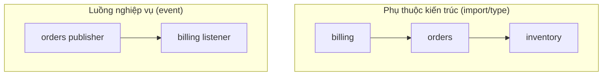
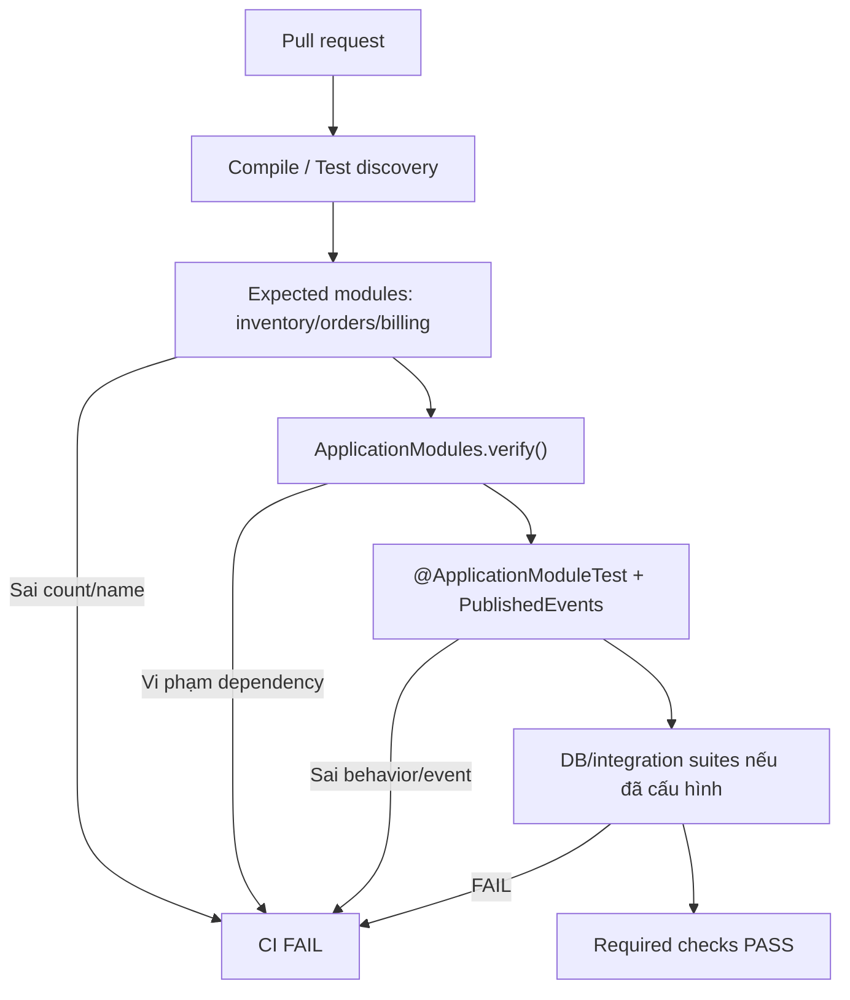

# Khám phá mô hình bằng ApplicationModules

> **Chương:** Dự án thực hành  
> **Module học:** `SPRING_MODULITH_VERIFICATION_TESTING` — kiểm chứng ranh giới kiến trúc Spring Modulith bằng `ApplicationModules` và các quy tắc phụ thuộc giữa module; kết hợp `@ApplicationModuleTest`, kiểm thử sự kiện, database/integration và CI quality gate để phát hiện phụ thuộc sai, hồi quy.

## 1. Mục tiêu thực hành và mô hình mong đợi

Bạn nhận một ứng dụng Spring Boot nhỏ có ba khu vực nghiệp vụ: `inventory` (kiểm hàng), `orders` (nhận và đặt đơn) và `billing` (tiếp nhận sự kiện đặt đơn). Công việc của bài **không phải viết lại toàn bộ chức năng bán hàng** mà là dùng `ApplicationModules` để trả lời bằng bằng chứng:

1. Spring Modulith đang nhận diện **bao nhiêu application modules**?
2. Tên và package gốc của từng module có đúng `inventory`, `orders`, `billing` không?
3. Module nào đang **phụ thuộc tĩnh** vào module nào; sự kiện chạy từ đâu tới đâu?
4. Kiểu nào là **public API** của module và kiểu nào thuộc `internal`?
5. Khi một import vi phạm ranh giới, `verify()` có làm JUnit và CI đỏ không?
6. Khi kiến trúc PASS, liệu module event test có thật sự chứng minh hành vi được công bố không?

**Mô hình đích**:


Đây là **hướng phụ thuộc kiểu Java**, không phải sơ đồ luồng nghiệp vụ. Ở runtime, `orders` **phát** sự kiện và `billing` **nhận**; vì vậy luồng thông tin là `orders → billing`, trong khi phụ thuộc tĩnh do import `OrderPlaced` là `billing → orders`. Nhầm hai mũi tên này thường dẫn đến kết luận sai rằng hệ thống có chu trình.

### Bằng chứng phải nộp

| Bằng chứng | Điều cần nhìn thấy |
| --- | --- |
| Output duyệt `ApplicationModules` | Ba module, đúng tên và public packages |
| JUnit kiểm số module | Có đúng ba module, không lẫn package thứ tư |
| JUnit `verify()` | PASS với thiết kế đúng |
| Negative probe | Một dependency vào `internal` làm `verify()` FAIL |
| `@ApplicationModuleTest` | Service phát `OrderPlaced` với ID/payload đúng |
| CI test report | Các bài kiểm được thực thi, lỗi làm build FAIL |

Giới hạn phạm vi: `ApplicationModules` là **mô hình kiến trúc tĩnh**; một kết quả PASS không thay thế test SQL, transaction, listener retry hoặc delivery semantics. Những phần đó được nhắc đến đúng chỗ để người học biết dùng công cụ kiểm nào, không mở rộng thành một dự án tính tiền hoàn chỉnh.

## 2. Chuẩn bị ba module có dependency đủ rõ để khám phá

Khởi đầu từ một project Spring Boot có JDK 21, Spring Modulith core và test support phù hợp với phiên bản Spring Boot được chọn. Phải có JUnit Jupiter/AssertJ qua test starter; các examples sau giả định bạn đã cấu hình Maven Wrapper `./mvnw` hoặc task Gradle `test` với JUnit Platform.

Đặt lớp khởi động tại **package gốc** `com.example.shop`. Bố cục tối thiểu:

```text
src/main/java/com/example/shop/
├── ShopApplication.java
├── inventory/
│   ├── StockAvailability.java
│   └── internal/
│       └── FixedStockAvailability.java
├── orders/
│   ├── PlaceOrderCommand.java
│   ├── OrderPlaced.java
│   └── OrderManagement.java
└── billing/
    └── internal/
        └── BillingEventListener.java

src/test/java/com/example/shop/
├── ModuleDiscoveryTest.java
├── ModuleArchitectureTest.java
└── orders/
    └── OrdersModuleEventTest.java
```

`src/main/java/com/example/shop/ShopApplication.java`:

```java
package com.example.shop;

import org.springframework.boot.SpringApplication;
import org.springframework.boot.autoconfigure.SpringBootApplication;

@SpringBootApplication
public class ShopApplication {

    public static void main(String[] args) {
        SpringApplication.run(ShopApplication.class, args);
    }
}
```

Theo cách nhận diện module mặc định, các package con trực tiếp của package chứa `ShopApplication` là ứng viên application module. Vì thế `com.example.shop.inventory`, `com.example.shop.orders`, `com.example.shop.billing` là **ba module**, còn `inventory.internal` là phần nằm **bên trong module inventory**, không phải một application module thứ tư.

### 2.1. Module `inventory`: chỉ công bố một port

`src/main/java/com/example/shop/inventory/StockAvailability.java`:

```java
package com.example.shop.inventory;

public interface StockAvailability {

    boolean hasStock(String sku, int quantity);
}
```

`src/main/java/com/example/shop/inventory/internal/FixedStockAvailability.java`:

```java
package com.example.shop.inventory.internal;

import org.springframework.stereotype.Component;
import com.example.shop.inventory.StockAvailability;

@Component
public class FixedStockAvailability implements StockAvailability {

    @Override
    public boolean hasStock(String sku, int quantity) {
        return "SKU-001".equals(sku)
                && quantity > 0
                && quantity <= 10;
    }
}
```

Implementation là `public` theo Java để negative probe về sau có thể tham chiếu. Nhưng `public class` **không đồng nghĩa kiểu đó thuộc public API của Spring Modulith module**; package `inventory.internal` không tự trở thành API công bố.

### 2.2. Module `orders`: dùng port public và phát event public

`src/main/java/com/example/shop/orders/PlaceOrderCommand.java`:

```java
package com.example.shop.orders;

import java.util.UUID;

public record PlaceOrderCommand(
        UUID orderId,
        String sku,
        int quantity
) {
    public PlaceOrderCommand {
        if (orderId == null || sku == null || sku.isBlank()
                || quantity <= 0) {
            throw new IllegalArgumentException("INVALID_ORDER");
        }
    }
}
```

`src/main/java/com/example/shop/orders/OrderPlaced.java`:

```java
package com.example.shop.orders;

import java.util.UUID;

public record OrderPlaced(
        UUID eventId,
        UUID orderId,
        String sku,
        int quantity
) {}
```

`src/main/java/com/example/shop/orders/OrderManagement.java`:

```java
package com.example.shop.orders;

import java.util.UUID;
import org.springframework.context.ApplicationEventPublisher;
import org.springframework.stereotype.Service;
import com.example.shop.inventory.StockAvailability;

@Service
public class OrderManagement {

    private final StockAvailability stock;
    private final ApplicationEventPublisher events;

    public OrderManagement(
            StockAvailability stock,
            ApplicationEventPublisher events) {
        this.stock = stock;
        this.events = events;
    }

    public OrderPlaced place(PlaceOrderCommand command) {
        if (!stock.hasStock(command.sku(), command.quantity())) {
            throw new IllegalStateException("OUT_OF_STOCK");
        }

        OrderPlaced placed = new OrderPlaced(
                UUID.randomUUID(),
                command.orderId(),
                command.sku(),
                command.quantity()
        );
        events.publishEvent(placed);
        return placed;
    }
}
```

Chỉ có **một phụ thuộc cross-module** trong `orders`: `StockAvailability` ở package root của `inventory`. Ở thời điểm khám phá model, service này không cần database hoặc transaction; chúng không làm rõ thêm câu hỏi cấu trúc cần trả lời. Nó có thể được mở rộng sau để ghi đơn và kiểm transaction.

### 2.3. Module `billing`: chỉ import event contract

`src/main/java/com/example/shop/billing/internal/BillingEventListener.java`:

```java
package com.example.shop.billing.internal;

import org.slf4j.Logger;
import org.slf4j.LoggerFactory;
import org.springframework.context.event.EventListener;
import org.springframework.stereotype.Component;
import com.example.shop.orders.OrderPlaced;

@Component
public class BillingEventListener {

    private static final Logger log =
            LoggerFactory.getLogger(BillingEventListener.class);

    @EventListener
    public void on(OrderPlaced event) {
        // Chỉ demo một consumer của public event contract.
        // Chưa tạo billing entry hay receipt trong database.
        log.debug("Received order event={}, order={}",
                event.eventId(), event.orderId());
    }
}
```

Module `billing` phụ thuộc tĩnh vào `orders` vì tham chiếu `orders.OrderPlaced`. `orders` **không** import `billing.internal.BillingEventListener` mà publish qua `ApplicationEventPublisher` của Spring. Vì vậy không hình thành chu trình giữa hai modules.

**Giới hạn rõ ràng:** Listener ghi log là một ví dụ **đủ để tạo dependency và quan sát mô hình**, không chứng minh đơn đã tính tiền, event delivery exactly-once, JDBC commit hay idempotency. Nếu mục tiêu tiếp theo là billing behavior, hãy thêm port/storage/transaction và kiểm bằng integration test riêng.

## 3. Gọi `ApplicationModules.of(...)` để duyệt mô hình

Không cần khởi động server, tạo schema hay insert order để khám phá mô hình từ cấu trúc Java. Entry point quan trọng:

```java
ApplicationModules modules =
        ApplicationModules.of(ShopApplication.class);
```

`ApplicationModules` mô hình hóa những application modules mà Spring Modulith phát hiện từ application root. Khởi tạo nó không đồng nghĩa thực thi các business services. Cần dùng nó sớm để quan sát **thực tế framework nhìn thấy**, thay vì tin sơ đồ package do mình tự vẽ.

### 3.1. Một JUnit test in model để kiểm bằng mắt

`src/test/java/com/example/shop/ModuleDiscoveryTest.java`:

```java
package com.example.shop;

import org.junit.jupiter.api.Test;
import org.springframework.modulith.core.ApplicationModules;

class ModuleDiscoveryTest {

    @Test
    void printsTheApplicationModuleModel() {
        ApplicationModules modules =
                ApplicationModules.of(ShopApplication.class);

        modules.forEach(System.out::println);
    }
}
```

Trong test report/console sẽ có phần mô tả từng module. Format chi tiết phụ thuộc phiên bản Spring Modulith; đây là **output để khám phá**, không phải một file text snapshot mà test nên so từng ký tự. Người học cần ghi nhận:

- Có đúng `inventory`, `orders`, `billing` không?
- Mỗi module tương ứng package gốc nào?
- Các kiểu API và quan hệ phụ thuộc có khớp imports production không?
- Có xuất hiện module thứ tư, ví dụ `config`, `common`, `shared`, vì đặt package sai vị trí không?

**Chú ý:** Test chỉ in model là một “đèn soi”, **không phải assertion bảo vệ CI**. Dù model nhận diện sai hoặc có phụ thuộc cấm, test trên vẫn có thể PASS nếu chỉ in output. Bước tiếp theo sẽ chuyển quan sát thành kiểm chứng có assertion.

### 3.2. Không sử dụng `@SpringBootTest` chỉ để liệt kê module

`ApplicationModules.of(ShopApplication.class)` không cần Spring Boot application context chạy toàn bộ. Gắn `@SpringBootTest` vào test discovery sẽ khiến database, broker hoặc web infrastructure khởi động không cần thiết, làm người học khó biết lỗi đến từ **mô hình kiến trúc** hay **wiring runtime**.

Về sau mới dùng `@ApplicationModuleTest` để chạy hành vi trong phạm vi một module; nó là **một công cụ khác** với `ApplicationModules`.

## 4. Chuyển quan sát thành test xác nhận đúng ba modules

Output con người đọc rất hữu ích ở vòng đầu, nhưng quality gate cần **assertions rõ ràng**. Một bất biến quan trọng của mini project là: ứng dụng phải được nhận diện thành **đúng ba modules** theo ý đồ nghiệp vụ.

Thêm vào `ModuleDiscoveryTest` hoặc viết một test class độc lập:

```java
package com.example.shop;

import static org.junit.jupiter.api.Assertions.assertEquals;
import static org.junit.jupiter.api.Assertions.assertFalse;
import static org.junit.jupiter.api.Assertions.assertTrue;

import java.util.concurrent.atomic.AtomicInteger;
import org.junit.jupiter.api.Test;
import org.springframework.modulith.core.ApplicationModules;

class ThreeModulesModelTest {

    @Test
    void discoversTheExpectedBusinessModules() {
        ApplicationModules modules =
                ApplicationModules.of(ShopApplication.class);

        assertTrue(modules.getModuleByName("inventory").isPresent());
        assertTrue(modules.getModuleByName("orders").isPresent());
        assertTrue(modules.getModuleByName("billing").isPresent());
        assertFalse(modules.getModuleByName("payments").isPresent());

        AtomicInteger count = new AtomicInteger();
        modules.forEach(module -> count.incrementAndGet());
        assertEquals(3, count.get(), "Expected exactly three modules");
    }
}
```

Test dùng API truy xuất theo tên và lặp `ApplicationModules`. Nếu codebase thêm một package nghiệp vụ mới trực tiếp dưới `com.example.shop`, assertion count sẽ báo thay đổi mô hình dù `verify()` tự nó có thể vẫn PASS. Đó là lợi ích của việc **tách “mô hình mong đợi” khỏi “mô hình không vi phạm quy tắc”**.

### 4.1. Vì sao kiểm cả tên và số lượng?

| Assertion | Bắt được gì? | Chưa bắt được gì? |
| --- | --- | --- |
| `getModuleByName("orders").isPresent()` | Module `orders` không bị mất/đổi tên | Có thể vẫn có module thứ tư ngoài ý muốn |
| Ba tên đều có | Các module kỳ vọng được phát hiện | Không kiểm chỉ có ba module |
| `count == 3` | Không xuất hiện module thứ tư | Không kiểm tên hoặc dependency đúng |
| `verify()` | Không có vi phạm theo rules của Modulith | Không buộc có đúng ba modules |

Với ứng dụng sẽ mở rộng sang module thứ tư trong tương lai, đừng giữ assertion `count==3` vô thời hạn. Khi **quyết định kiến trúc được review** thay đổi, cập nhật expected model cùng PR; không tự xóa test count chỉ vì muốn build xanh.

### 4.2. Không kiểm model qua chuỗi `toString()`

Tránh:

```java
// Fragile: phụ thuộc format output của một phiên bản thư viện.
assertTrue(modules.toString().contains("orders"));
```

Kiểm qua API được công bố của `ApplicationModules` và các phương thức truy vấn trên đối tượng là bền vững hơn việc “grep” nội dung console. `toString()` nên dành cho điều tra thủ công, không dùng làm source of truth của kiến trúc.

## 5. Đọc public API, internal packages và hướng dependency

Sau khi biết mô hình có ba modules, hãy mở rộng việc khám phá từ câu hỏi “có module nào” sang câu hỏi “mỗi module **cho phép phần còn lại nhìn thấy gì**”. Đây là phần quan trọng nhất để phát hiện nguy cơ coupling trước khi có hồi quy runtime.

### 5.1. Root package khác nested package

Theo mô hình public interface mặc định:

```text
inventory/
  StockAvailability.java            <- API công bố ở module root
  internal/
    FixedStockAvailability.java     <- implementation nội bộ

orders/
  PlaceOrderCommand.java            <- API ở module root
  OrderManagement.java              <- API ở module root
  OrderPlaced.java                  <- event contract công bố

billing/
  internal/
    BillingEventListener.java       <- listener nội bộ
```

Một Java class `public` trong `inventory.internal` vẫn không phải **public Spring Modulith module API** theo ranh giới package mặc định. Nói cách khác, `public` là quyền nhìn thấy ở ngôn ngữ Java; module API là quyền phụ thuộc được mô hình kiến trúc cho phép.

### 5.2. Lập bảng dependency từ source đang có

| Module nguồn | Loại được tham chiếu | Module đích | Đánh giá |
| --- | --- | --- | --- |
| `orders` | `inventory.StockAvailability` | `inventory` | Public API: hợp lệ |
| `billing` | `orders.OrderPlaced` | `orders` | Public event: hợp lệ |
| `inventory` | Không cần type của module khác | — | Độc lập |
| `orders` | `inventory.internal.FixedStockAvailability` | `inventory` | **Sai**: internal API |
| `billing` | `orders.internal.JdbcOrderRepository` nếu có | `orders` | **Sai**: internal API |
| `inventory` | `orders.OrderPlaced` | `orders` | Thêm vòng phụ thuộc `inventory ↔ orders` |

Đọc module output từ `modules.forEach(System.out::println)` và đối chiếu bảng này với imports/type usages thực sự. Nếu model không phản ánh dự đoán, đừng ngay lập tức thêm `allowedDependencies` hay package annotations để “làm đẹp” kết quả; xác định đúng chỗ đặt type trước.

### 5.3. Static dependency không phải event processing order

Đây là hai sơ đồ khác nhau:



Sự kiện làm `orders` không cần import `billing`, qua đó giữ dependency graph một chiều. Nhưng `billing` vẫn import `OrderPlaced` từ `orders`, nên module model có quyền ghi nhận `billing → orders`. Nếu vẽ chung hai loại mũi tên, người học dễ tưởng đây là một cycle.

### 5.4. Khi cần API trong nested package: `@NamedInterface`

Giả sử dự án muốn tách các sự kiện khỏi các command trong `orders`:

```text
orders/
  OrderManagement.java
  PlaceOrderCommand.java
  events/
    package-info.java
    OrderPlaced.java
  internal/
    ...
```

Nếu `OrderPlaced` **được chuyển** sang `com.example.shop.orders.events`, package này là nested package; cần khai báo named interface nếu muốn consumer module khác phụ thuộc nó theo quy tắc:

`src/main/java/com/example/shop/orders/events/package-info.java`:

```java
@org.springframework.modulith.NamedInterface("events")
package com.example.shop.orders.events;
```

Ví dụ giới hạn `billing` chỉ được phụ thuộc vào named interface đó:

`src/main/java/com/example/shop/billing/package-info.java`:

```java
@org.springframework.modulith.ApplicationModule(
        allowedDependencies = "orders::events")
package com.example.shop.billing;
```

**Đây là phương án tái cấu trúc thay thế**, không phải code cần thêm song song vào skeleton ở mục 2. Nếu áp dụng, phải:

1. Chuyển `OrderPlaced` vào đúng package `orders.events`.
2. Sửa imports ở `OrderManagement` và `BillingEventListener` theo package mới.
3. Kiểm model và `verify()` lại để xác nhận `orders::events` là API công bố được phép.
4. Kiểm `billing` không đồng thời dùng kiểu root `orders.OrderManagement` hoặc `orders.internal` trái policy.

Một named interface **không phải cách hợp thức hóa một repository nội bộ** cho module khác chỉ vì muốn tránh thêm API đúng nghĩa.

### 5.5. Kiểm tên modules khi áp dụng package annotations

Sau khi đổi package hay thêm `@NamedInterface`, chạy lại `ModuleDiscoveryTest` và `ThreeModulesModelTest`. Tổng số **application modules vẫn là ba** nếu chỉ tạo `orders.events` dưới `orders`. Named interface là **một bề mặt API thuộc module orders**, không tự nhiên là application module thứ tư.

Nếu từ output thấy một module `events` riêng biệt, nhiều khả năng bạn đặt nó ở `com.example.shop.events` thay vì `com.example.shop.orders.events`, hoặc đã cấu hình module detection theo cách khác dự kiến.

## 6. Chạy `verify()` và chứng minh nó phát hiện vi phạm

Quan sát model là bước đầu; `ApplicationModules.verify()` mới kiểm kiến trúc theo những quy tắc mà Spring Modulith nhận diện.

### 6.1. Architectural JUnit test

`src/test/java/com/example/shop/ModuleArchitectureTest.java`:

```java
package com.example.shop;

import org.junit.jupiter.api.Test;
import org.springframework.modulith.core.ApplicationModules;

class ModuleArchitectureTest {

    @Test
    void moduleBoundariesAreValid() {
        ApplicationModules.of(ShopApplication.class).verify();
    }
}
```

Test này **không cần khởi động Spring context, H2 hoặc broker**. Nó phù hợp để chạy sớm trong CI, vì lỗi import sai là lỗi kiến trúc, không phải lỗi cấu hình SQL.

Nếu test FAIL, đừng làm cho nó xanh bằng cách bỏ `verify()`, đặt `@Disabled` hoặc công bố toàn bộ package `internal`. Cần đọc quan hệ phụ thuộc báo lỗi và sửa producer/consumer để đi qua public API hoặc tái thiết kế boundary một cách có chủ đích.

### 6.2. Negative probe A: Java compile được nhưng vi phạm module API

Chỉ trên **nhánh thử**, tạo type production dưới package `orders`:

```java
package com.example.shop.orders;

import com.example.shop.inventory.internal.FixedStockAvailability;

// Chỉ là thử nghiệm, PHẢI gỡ khỏi source sau khi kiểm.
class WrongCrossModuleReference {

    private FixedStockAvailability forbiddenImplementation;
}
```

Ở đây field có **kiểu Java thực sự** thuộc `inventory.internal`. `FixedStockAvailability` là `public class` nên Java có thể compile, nhưng Spring Modulith cần phát hiện dependency tới package không được công bố và làm `ModuleArchitectureTest` FAIL.

Chỉ thêm dòng import không được sử dụng là phép thử yếu: Java compiler có thể không giữ nó thành một dependency ở bytecode. Một field/constructor/return type reference như ví dụ tạo ra dấu vết phụ thuộc rõ ràng để structural verification phân tích.

Khôi phục bằng cách **xóa class thử nghiệm** và để `orders` tiếp tục inject `inventory.StockAvailability`.

### 6.3. Negative probe B: cố tình tạo cycle

Một sai lệch khác là cho `inventory` tham chiếu `orders.OrderPlaced`. Tại thời điểm đó:

```text
orders    --> inventory (StockAvailability)
inventory --> orders    (OrderPlaced)
```

Hai module phụ thuộc lẫn nhau thành cycle. Một field hoặc method parameter thật sử dụng `orders.OrderPlaced` trong production class của `inventory` có thể tạo ra điều kiện để `verify()` báo lỗi cycle. Sau khi xác nhận, **gỡ dependency**. Không dùng event loại `OrderPlaced` làm API của `inventory` vì vòng phụ thuộc đó còn cho thấy mô hình trách nhiệm chưa đúng.

### 6.4. Xác định bằng chứng PASS và FAIL

| Trạng thái code | `ThreeModulesModelTest` | `ModuleArchitectureTest` |
| --- | --- | --- |
| Ba modules hợp lệ | PASS | PASS |
| Thêm `orders → inventory.internal` | Có thể vẫn PASS (vẫn ba module) | **FAIL** |
| Tạo cycle `inventory ↔ orders` | Có thể vẫn PASS | **FAIL** |
| Thêm package `com.example.shop.reports` được nhận là module mới | **FAIL** (thành bốn module) | Có thể PASS nếu không vi phạm rules |

Hai tests bổ sung nhau: **mô hình có đúng phạm vi định trước không** và **những quan hệ bên trong mô hình đó có hợp lệ không**.

### 6.5. Điều `verify()` chưa chứng minh

Không suy những điều dưới đây từ architectural PASS:

- Service đặt hàng thật sự kiểm tồn kho đúng.
- `billing` đã nhận event hoặc ghi bút toán.
- Event được gửi **chính xác một lần** hoặc còn sau crash.
- Database migration và transaction rollback đúng.
- REST API trả HTTP status chính xác.
- Thông tin nhạy cảm không xuất hiện trong event/log.

Với các yêu cầu runtime, cần unit/module/event/DB/integration tests tương ứng. Bước tiếp theo minh họa cách đối chiếu model đã khám phá với **một hành vi module có thể quan sát**.

## 7. Đối chiếu mô hình với `@ApplicationModuleTest` và `PublishedEvents`

Mô hình `ApplicationModules` cho biết `orders` được phép phụ thuộc vào `inventory.StockAvailability` và công bố `OrderPlaced`. Một module test sẽ xác minh ứng dụng **thực sự dùng public port và phát đúng event contract**, thay vì chỉ có cấu trúc packages đẹp trên giấy.

### 7.1. Chỉ boot module `orders` với collaborator tối thiểu

`src/test/java/com/example/shop/orders/OrdersModuleEventTest.java`:

```java
package com.example.shop.orders;

import static org.assertj.core.api.Assertions.assertThat;

import java.util.UUID;
import org.junit.jupiter.api.Test;
import org.springframework.beans.factory.annotation.Autowired;
import org.springframework.boot.test.context.TestConfiguration;
import org.springframework.context.annotation.Bean;
import org.springframework.context.annotation.Import;
import org.springframework.modulith.test.ApplicationModuleTest;
import org.springframework.modulith.test.PublishedEvents;
import com.example.shop.inventory.StockAvailability;

@ApplicationModuleTest
@Import(OrdersModuleEventTest.StockStub.class)
class OrdersModuleEventTest {

    @TestConfiguration(proxyBeanMethods = false)
    static class StockStub {

        @Bean
        StockAvailability stockAvailableForModuleTest() {
            // Chỉ là contract stub, không import inventory.internal.
            return (sku, quantity) -> true;
        }
    }

    @Autowired
    OrderManagement orders;

    @Test
    void publishesEventWithOriginalOrderIdentity(
            PublishedEvents published) {
        UUID orderId = UUID.randomUUID();
        PlaceOrderCommand command =
                new PlaceOrderCommand(orderId, "SKU-001", 2);

        OrderPlaced result = orders.place(command);

        assertThat(result.orderId()).isEqualTo(orderId);
        assertThat(result.sku()).isEqualTo("SKU-001");
        assertThat(result.quantity()).isEqualTo(2);

        assertThat(published.ofType(OrderPlaced.class))
                .anySatisfy(event -> {
                    assertThat(event.eventId())
                            .isEqualTo(result.eventId());
                    assertThat(event.orderId()).isEqualTo(orderId);
                    assertThat(event.sku()).isEqualTo("SKU-001");
                    assertThat(event.quantity()).isEqualTo(2);
                });
    }
}
```

**Vì sao có test stub?** `@ApplicationModuleTest` với bootstrap mặc định hướng tới phạm vi module `orders`, nên không nhất thiết có implementation `inventory.internal.FixedStockAvailability` trong context. Test cung cấp `StockAvailability` **qua public interface**, giữ nguyên ranh giới trong thiết kế production.

Nếu test đổi bootstrap mode hoặc framework version khiến implementation từ module khác cũng được nạp, có thể xảy ra hai beans cùng type; khi đó điều chỉnh bootstrap scope hoặc dùng cơ chế test bean replacement phù hợp. Không chữa bằng cách inject trực tiếp `FixedStockAvailability` vào service `orders`.

### 7.2. Assertions đủ để bắt lỗi nào?

| Thay đổi cố ý trong code production | Kết quả mong đợi |
| --- | --- |
| Không gọi `publishEvent(...)` | `OrdersModuleEventTest` FAIL |
| Publish event có `orderId` sai | `OrdersModuleEventTest` FAIL |
| Publish event có `sku`/`quantity` sai | `OrdersModuleEventTest` FAIL |
| Import `inventory.internal.FixedStockAvailability` trong `orders` | `ModuleArchitectureTest` FAIL |
| `billing` không tạo business effect | Test này vẫn có thể PASS; cần billing/integration test |

`PublishedEvents.ofType(...).anySatisfy(...)` chứng minh **có ít nhất một event phù hợp**, không chứng minh đúng một lần publish hoặc consumer đã commit. Nếu yêu cầu đúng số lượng, dùng thêm assertion cardinality thích hợp với API `PublishedEvents` của phiên bản đã chọn.

### 7.3. Đừng lẫn mục đích của hai annotation

- `@ApplicationModuleTest`: khởi động và kiểm **hành vi module** trong Spring context có phạm vi.
- `ApplicationModules.of(...).verify()`: dựng và kiểm **mô hình kiến trúc** từ Java types/dependencies, không cần chạy Spring context.
- `@SpringBootTest`: tích hợp nhiều modules và runtime infrastructure, hữu ích khi kiểm transaction/DB/event listener thật.

Không viết `@ApplicationModuleTest` chỉ để gọi `ApplicationModules.of(...)`; làm vậy tăng chi phí boot mà không thêm bằng chứng về boundary. Ngược lại, chỉ gọi `verify()` không chứng minh service thực sự phát event.

### 7.4. Khi module service chuyển sang dùng database

Giả sử `orders` về sau lưu `placed_orders` trước khi publish event. Khi đó module test ở trên cần DataSource/migrations hoặc một test collaborator thay cho storage port. Đặt ranh giới rõ:

```text
Architectural:
  ApplicationModules.verify()       -> Không cần database

Module behavior:
  @ApplicationModuleTest            -> Cần đúng collaborators
  PublishedEvents                   -> Quan sát event được publish

Database integration:
  Gọi service thật qua Spring proxy
  Query persisted rows theo scenario ID
  Kiểm transaction/constraints/cleanup
```

Không giả định `PublishedEvents` tự xác nhận DB transaction đã commit hoặc event listener bất đồng bộ đã hoàn thành. Khi dùng event sau commit, việc test transaction bị rollback mặc định có thể làm listener không chạy; cần thiết kế test theo đúng lifecycle.

## 8. Điều tra khi mô hình khác sơ đồ thiết kế

Một lỗi thực tế thường gặp trong buổi khởi tạo là `ModuleDiscoveryTest` in ra **bốn modules** thay vì ba, hoặc `orders` không xuất hiện dù service vẫn boot.

### 8.1. Package dư thừa ở cùng cấp

Thí nghiệm trên nhánh thử:

```text
com.example.shop/
  ShopApplication.java
  inventory/
  orders/
  billing/
  reports/              <-- package con trực tiếp mới
    ReportDefinition.java
```

Với default module detection phù hợp, một package con trực tiếp có Java types của production có thể được nhận diện thành application module mới. Khi đó:

- `ThreeModulesModelTest` nên FAIL vì tổng số modules không còn bằng 3.
- `ModuleArchitectureTest` **có thể vẫn PASS** nếu `reports` là module hợp lệ, không vi phạm dependencies.

Đây không phải lỗi `ApplicationModules`: mô hình đã làm lộ việc cấu trúc package **không còn khớp quyết định kiến trúc “chỉ ba module”**. Nếu `reports` là module nghiệp vụ thật, cập nhật thiết kế/test theo quyết định được review. Nếu chỉ là code hỗ trợ, chuyển nó đến vị trí thích hợp hoặc cấu hình detection rõ ràng theo hướng dẫn dự án.

### 8.2. Internal package không thành module riêng

`inventory.internal` chứa implementation của `inventory`. Việc thêm thêm lớp `inventory.internal.OtherStockAdapter` không nên tự biến thành module `internal` thứ tư trong mô hình mặc định. Nếu output có module `internal` lạ, hãy kiểm root package và vị trí thật của lớp.

### 8.3. Không tự suy từ việc bean có hay không

Một `@Component` có thể nằm trong package Spring Boot scan được nhưng không nằm trong module bạn nghĩ. Ngược lại, `ApplicationModules` có thể nhận diện một module chứa **kiểu Java không phải Spring bean** (record, interface, DTO). Vì thế:

- Component scan trả lời “Spring tìm thấy bean nào?”.
- ApplicationModules discovery trả lời “Application module có những package/type nào?”.
- `verify()` trả lời “Các dependency/module rules có bị vi phạm không?”.

Không dùng kết quả `@Autowired` thành công làm bằng chứng duy nhất rằng public API boundary đã được giữ.

### 8.4. Các nguyên nhân cần kiểm khi test model FAIL

| Dấu hiệu | Đường điều tra |
| --- | --- |
| Không thấy `orders` | `ShopApplication` có ở đúng root? `orders` có production classes trong base package? |
| Thấy `config` thành module | Có đặt `com.example.shop.config` trực tiếp cạnh ba module không? |
| `inventory.internal` bị module khác dùng | Xem type-level reference thực trong production Java code |
| Thêm named interface nhưng vẫn FAIL | `package-info.java` đã ở đúng package? Consumer import kiểu nào? |
| Thêm `allowedDependencies` rồi FAIL nhiều hơn | Có ràng buộc hẹp hơn các dependencies hợp lệ hiện tại không? |
| Cycle `orders ↔ inventory` | Kiểm cả phụ thuộc ngược, không chỉ nơi compile error |
| `verify()` PASS nhưng behavior sai | Chạy `@ApplicationModuleTest` và integration tests đúng tầng |
| Module count khác giữa environments | Kiểm classpath, phiên bản plugin, source sets và root/configuration thống nhất |

### 8.5. Một quy trình gỡ lỗi ngắn và có thể lặp

1. Ghi lại **mô hình kỳ vọng**: ba package, hai dependency directions.
2. Chạy `ModuleDiscoveryTest`, xem output có đúng ba modules không.
3. Chạy `ThreeModulesModelTest` để xác nhận expected names/count.
4. Chạy `ModuleArchitectureTest`, đọc dependency path nếu FAIL.
5. Xác định **file Java cụ thể** tạo ra reference không hợp lệ.
6. Sửa qua API public hoặc tái thiết kế module boundary.
7. Chạy lại model tests trước khi chạy test runtime để tiết kiệm thời gian.
8. Sau khi structure PASS, chạy `OrdersModuleEventTest` và suite tích hợp liên quan.

Đừng xóa một test mô hình chỉ vì project đổi architecture. Nếu thay đổi được chấp thuận, hãy cập nhật sơ đồ, chính sách và assertions **cùng một pull request**, để lần sau không phải đoán vì sao mô hình khác.

## 9. Đưa khám phá và kiểm chứng mô hình vào CI quality gate

Một mô hình chỉ được in trên máy cá nhân là bằng chứng dùng để thảo luận. Để ngăn import sai trong pull request, ít nhất `ThreeModulesModelTest` và `ModuleArchitectureTest` phải được **phát hiện và chạy trong CI**. `OrdersModuleEventTest` là cổng bảo vệ bổ sung cho event contract.

### 9.1. Các dependencies test cần có

Với project Spring Boot/Maven đang dùng, cần Spring Modulith core ở runtime/classpath và Spring Modulith test support cùng JUnit Jupiter ở test scope. Ví dụ các artifact IDs:

```xml
<!-- Quản lý version Spring Modulith qua BOM tương thích Boot. -->
<dependency>
    <groupId>org.springframework.modulith</groupId>
    <artifactId>spring-modulith-starter-core</artifactId>
</dependency>

<dependency>
    <groupId>org.springframework.modulith</groupId>
    <artifactId>spring-modulith-starter-test</artifactId>
    <scope>test</scope>
</dependency>

<dependency>
    <groupId>org.springframework.boot</groupId>
    <artifactId>spring-boot-starter-test</artifactId>
    <scope>test</scope>
</dependency>
```

Đây là **đoạn phụ thuộc cần kiểm**, không phải một `pom.xml` hoàn chỉnh. Project phải có parent/BOM tương thích và plugin/test engine phù hợp. Không tự gắn version riêng cho mỗi dependency Modulith khi đã dùng BOM.

### 9.2. Chạy tập trung rồi chạy toàn bộ

Maven Wrapper:

```bash
# Khám phá model + kiểm ranh giới, không cần boot runtime.
./mvnw -B -Dtest=ThreeModulesModelTest,ModuleArchitectureTest test

# Chạy bộ kiểm chuẩn của project.
./mvnw -B verify
```

Nếu dùng Gradle với task `test` cấu hình `useJUnitPlatform()`:

```bash
./gradlew test --tests 'com.example.shop.ThreeModulesModelTest'
./gradlew test --tests 'com.example.shop.ModuleArchitectureTest'
./gradlew check
```

Đây là **hai phương án theo build tool**, không yêu cầu chạy cả hai. Maven `verify` chỉ chạy integration tests `*IT` nếu Failsafe/lifecycle tương ứng được cấu hình; Gradle `check` chỉ chạy custom `integrationTest` task nếu được nối vào graph. Dù chọn tool nào, hãy xác nhận test report có các tên class mong đợi.

### 9.3. Workflow mẫu cho một pull request

Nếu project dùng GitHub Actions và đã có Maven Wrapper:

```yaml
name: spring-modulith-architecture

on:
  pull_request:
  push:

jobs:
  verification:
    runs-on: ubuntu-latest
    steps:
      - uses: actions/checkout@v4
      - uses: actions/setup-java@v4
        with:
          distribution: temurin
          java-version: "21"
          cache: maven
      - name: Verify architecture and module behavior
        run: ./mvnw -B verify
```

Trong môi trường thực, ghim action revision theo chính sách an ninh của tổ chức, chọn JDK theo project và đặt job `verification` thành **required check** ở branch protection/ruleset. Không dùng `continue-on-error: true` để làm một job kiến trúc thất bại thành advisory nhưng vẫn cho merge.

### 9.4. Đọc test report, không chỉ `BUILD SUCCESS`

| Test class | Bằng chứng cần thấy |
| --- | --- |
| `ModuleDiscoveryTest` | Có thể có console output mô tả mô hình |
| `ThreeModulesModelTest` | Test được thực thi và xác nhận đúng ba module |
| `ModuleArchitectureTest` | `verify()` thực thi, không skipped |
| `OrdersModuleEventTest` | Module context chạy, event của service được quan sát |
| Integration tests khác nếu có | Không bỏ qua nhóm DB/listener do naming/task sai |

Với Maven, xem `target/surefire-reports` và `target/failsafe-reports` nếu cấu hình Failsafe. Với Gradle, xem `build/test-results/<task>` và `build/reports/tests/<task>` theo subproject. **JUnit class tồn tại trong source chưa đủ**: khi plugin không khám phá test, CI có thể xanh mà chưa kiểm boundary.

### 9.5. Negative probe trong CI nên được thực hiện thế nào?

Không commit lớp `WrongCrossModuleReference` để làm branch chính luôn đỏ. Thực hành trên **branch tạm**:

1. Thêm type reference trái boundary.
2. Chạy `ModuleArchitectureTest`.
3. Xác nhận test FAIL với dependency liên quan `orders → inventory.internal`.
4. Gỡ type vi phạm, chạy lại `verify()` và full test suite.
5. Lưu **mô tả kết quả**, không lưu artifact chứa code cố ý sai vào branch chuẩn.

Kết quả cần báo cáo là “gate phát hiện lỗi” chứ không chỉ “sau khi sửa thì build xanh”. Cách này kiểm được công cụ `ApplicationModules` thật sự có tác dụng thay vì chỉ được thêm làm hình thức.

### 9.6. Pipeline hai lớp và giới hạn bằng chứng



Module model gate không thay thế runtime tests. Nó đặc biệt có giá trị vì một lỗi kiến trúc có thể **không làm biên dịch hoặc HTTP test thất bại ngay**, nhưng dần khiến việc refactor, test isolation và module ownership khó kiểm soát.

## 10. Bài tập ngắn: đọc, làm sai có kiểm soát, sửa mô hình

### Bài A — Xác định mô hình mà không chạy server

**Given:** Cấu trúc `com.example.shop` từ mục 2.

**Thao tác:**

1. Chạy `ModuleDiscoveryTest` để in mô hình.
2. Liệt kê chính xác ba module IDs và package root.
3. Vẽ hướng phụ thuộc tĩnh `billing → orders → inventory`.
4. Viết một câu phân biệt dependency direction với event flow.

**Expected:** Mô hình có ba application modules; event flow `orders → billing` không phải dependency tĩnh ngược lại.

### Bài B — Biến discovery thành assertion có sức bảo vệ

**Thao tác:** Chạy `ThreeModulesModelTest`. Tạo tạm package `com.example.shop.reports` có một production Java class đơn giản, chạy test lại.

**Expected:** Trong cấu hình discovery mặc định, test count dự kiến FAIL nếu package đó được nhận thành module thứ tư. Nếu không đổi kết quả, xem root package và module detection configuration, không tự coi test đã thành công.

**Câu hỏi:** Tại sao `verify()` có thể PASS dù `ThreeModulesModelTest` FAIL?

### Bài C — Một dependency xuyên module sai

**Thao tác:** Thêm `WrongCrossModuleReference` ở mục 6 tham chiếu `inventory.internal.FixedStockAvailability`, chạy `ModuleArchitectureTest` rồi gỡ.

**Expected:** Java có thể compile, nhưng structural verification phát hiện non-exposed internal dependency. Sau khi gỡ, test PASS.

**Câu hỏi:** Nếu bạn chỉ thêm một `import` không được dùng, phép thử có còn đáng tin không?

### Bài D — Tách model verification khỏi behavior verification

**Thao tác:** Chạy `OrdersModuleEventTest` với stub `StockAvailability`. Tạm bỏ `events.publishEvent(placed)` khỏi `OrderManagement`.

**Expected:**

- `ThreeModulesModelTest` có thể vẫn PASS.
- `ModuleArchitectureTest` có thể vẫn PASS.
- `OrdersModuleEventTest` phải FAIL vì thiếu event đúng theo hợp đồng.

Khôi phục publication. Ghi lại lý do hai loại test có kết quả khác nhau.

### Bài E — Named interface dành riêng cho event

**Thao tác:** Chuyển `OrderPlaced` vào `orders.events`, thêm `@NamedInterface("events")`, cập nhật `billing` cho phép phụ thuộc `orders::events`, sửa imports rồi chạy lại tests.

**Expected:** Số application modules vẫn là ba, `billing` chỉ tham chiếu public named event interface, structural `verify()` PASS và module event test vẫn quan sát được event đúng.

**Gợi ý:** Nếu chỉ thêm `@NamedInterface` mà không di chuyển event hoặc cập nhật imports, bạn chưa thực sự thử cấu trúc mới.

### Bài F — CI phát hiện lỗi thay vì chỉ chạy xanh

**Thao tác:** Chạy Maven `verify` hoặc Gradle `check` theo project. Kiểm tên và số test được thực thi trong report. Lặp lại negative probe của bài C ở branch tạm.

**Expected:** Job required check thất bại khi `ModuleArchitectureTest` FAIL; sau khi khôi phục code, full suite xanh.

### Bảng tiêu chí nộp bài

| Sản phẩm | Tiêu chí chấp nhận |
| --- | --- |
| Sơ đồ modules | Tách mũi tên dependency và mũi tên event runtime |
| Output discovery | Đúng ba module IDs và base packages |
| JUnit model assertion | Kiểm tên và số lượng, không grep output |
| Architectural verification | PASS với code đúng; FAIL với internal dependency |
| Event module test | Gọi service thật, có `PublishedEvents` với payload đúng |
| CI report | Thấy các test bắt buộc thực thi và báo lỗi nonzero |

## 11. Checklist nghiệm thu và câu hỏi tự kiểm tra

### Checklist kiến trúc và nội dung khám phá

- [ ] `ShopApplication` nằm ở root package `com.example.shop`, không ở package con của một module.
- [ ] `inventory`, `orders`, `billing` là ba **package con trực tiếp** như ý đồ.
- [ ] `ApplicationModules.of(ShopApplication.class)` được dùng để duyệt mô hình, không cần boot toàn bộ runtime.
- [ ] `ModuleDiscoveryTest` giúp đọc model nhưng không được coi là quality gate duy nhất.
- [ ] `ThreeModulesModelTest` xác nhận **cả tên và số module**, không phụ thuộc format `toString()`.
- [ ] `orders` chỉ phụ thuộc `inventory.StockAvailability` công bố, không import `inventory.internal`.
- [ ] `billing` chỉ import public `orders.OrderPlaced` hoặc một named event interface đã công bố.
- [ ] Hướng phụ thuộc tĩnh **không** bị nhầm với hướng thông tin event runtime.
- [ ] Package `internal` không được mở quyền cho module khác chỉ để compiler/test chạy.
- [ ] Khi cần nested public API, `@NamedInterface` và `allowedDependencies` thể hiện đúng policy.
- [ ] `ApplicationModules.verify()` được chạy trong JUnit và FAIL khi tham chiếu internal package hoặc tạo cycle.
- [ ] Negative probe dùng **type reference thực**, không chỉ import bị bỏ khỏi bytecode.
- [ ] `@ApplicationModuleTest` gọi `OrderManagement` thật, collaborator từ module khác dùng public stub.
- [ ] `PublishedEvents` được dùng để kiểm event được publish, không suy ra exactly-once hoặc DB commit.
- [ ] Khi thay đổi cấu trúc có chủ đích, cập nhật expected model cùng review, không tắt test.
- [ ] CI test report xác nhận discovery, architecture và module event tests đều được chạy.
- [ ] Build/job không dùng skip tests hoặc nuốt exit code; quality gate là required check.

### Câu hỏi tự kiểm tra

1. `ApplicationModules.of(ShopApplication.class)` khác việc chạy `SpringApplication.run(...)` ở điểm nào?
2. Tại sao `inventory.internal` là một phần của `inventory` chứ không mặc nhiên là module thứ tư?
3. Một lớp `public` nằm ở `inventory.internal` có phải public API của Spring Modulith module không?
4. Vì sao sơ đồ dependency là `billing → orders` dù event chạy từ `orders` tới `billing`?
5. `modules.forEach(System.out::println)` giúp điều tra gì, và vì sao tự nó chưa đủ làm CI gate?
6. Hai assertions “có module orders” và “có đúng ba modules” khác nhau ở điểm nào?
7. Vì sao `verify()` có thể PASS khi package `reports` được thêm thành module thứ tư?
8. `@NamedInterface("events")` phục vụ vấn đề gì khi `OrderPlaced` chuyển sang `orders.events`?
9. Vì sao import một type từ `inventory.internal` có thể compile nhưng `verify()` vẫn FAIL?
10. Vì sao chỉ thêm import không sử dụng là negative probe yếu?
11. Tại sao `@ApplicationModuleTest` của `orders` có thể cần stub `StockAvailability`?
12. `PublishedEvents` chứng minh điều gì, và cần công cụ nào để kiểm DB transaction hoặc listener async?
13. Nếu một test PASS ở máy cá nhân nhưng không xuất hiện trong CI report, gate đã hoàn thành chưa?
14. Khi mô hình mong đợi đổi từ ba thành bốn modules, bạn phải cập nhật những tài liệu và assertions nào?

**Ghi nhớ:** Khám phá mô hình bằng `ApplicationModules` là biến cấu trúc package và Java type dependencies thành **một mô hình có thể quan sát, đối chiếu và kiểm chứng**. Dùng `ApplicationModules.of(...)` để thấy modules thực tế; xác nhận IDs/count để giữ sơ đồ mong đợi; dùng `verify()` bắt phụ thuộc vào `internal` và chu trình; sau đó dùng `@ApplicationModuleTest`, `PublishedEvents` và integration tests cho hành vi runtime. Khi các phép kiểm thật sự được CI chạy và phản ánh failure, mỗi thay đổi làm lệch ranh giới module đều có cơ hội bị phát hiện trước khi merge.
