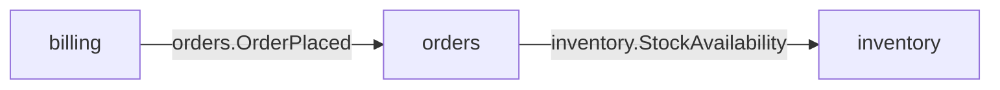
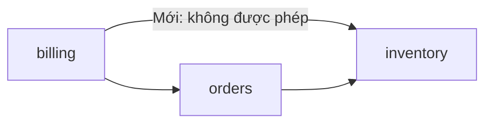
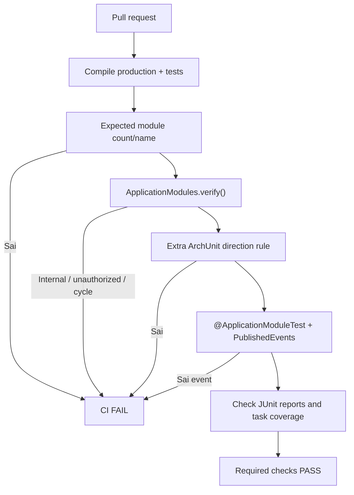

# Viết test kiểm tra dependency và cycle

> **Chương:** Dự án thực hành  
> **Phạm vi:** `SPRING_MODULITH_VERIFICATION_TESTING` — kiểm chứng ranh giới kiến trúc Spring Modulith bằng `ApplicationModules` và quy tắc phụ thuộc giữa module; kết hợp `@ApplicationModuleTest`, kiểm thử sự kiện, cơ sở dữ liệu/tích hợp và CI quality gate để ngăn phụ thuộc sai và hồi quy.

## 1. Đề bài: ba module đúng nhưng chỉ một dependency sai đã làm lệch kiến trúc

Giữ một ứng dụng Spring Boot có ba package nghiệp vụ trực tiếp dưới `com.example.shop`:

| Module | Nhiệm vụ | Có thể sử dụng API của | Không được phụ thuộc |
| --- | --- | --- | --- |
| `inventory` | Cung cấp kết quả tra cứu tồn kho | Không module nghiệp vụ nào khác | `orders`, `billing` |
| `orders` | Kiểm tồn kho, nhận lệnh, công bố `OrderPlaced` | `inventory` qua API public | `billing` hoặc `inventory.internal` |
| `billing` | Nhận `OrderPlaced` để xử lý nghiệp vụ sau đơn hàng | `orders` qua event contract public | `inventory` trực tiếp, `orders.internal` |

Mô hình dependency tĩnh mong muốn:



Mục tiêu là viết **các test tự động** chứng minh đồng thời ba bất biến:

1. **Không có chu trình module**: `orders → inventory → orders` hoặc `orders → billing → orders` phải thất bại.
2. **Không phụ thuộc vào package nội bộ**: kiểu `public` của Java nhưng nằm trong `inventory.internal` vẫn không được module `orders` sử dụng.
3. **Không có dependency trực tiếp ngoài whitelist**: `billing → inventory` là một dependency **không tạo chu trình** trong sơ đồ trên nhưng vẫn sai chính sách; chỉ kiểm cycle là không đủ.

**Kết quả nghiệm thu:**

- JUnit chạy `ApplicationModules.of(ShopApplication.class).verify()` và PASS với source đúng.
- Có quy tắc `allowedDependencies` để chặn direct imports ngoài dự kiến, cộng thêm một rule rõ cho module cần **không có outgoing dependencies**.
- Thử cố ý đưa dependency sai vào source trên nhánh tạm: test phải FAIL; khôi phục source thì PASS.
- Các test được phát hiện trong Maven/Gradle/CI, không `@Disabled` hoặc nuốt exit code.

**Phân biệt ngay:** Phụ thuộc *tĩnh* do Java type reference là `billing → orders` vì listener dùng `OrderPlaced`. Sự kiện ở *runtime* đi từ publisher `orders` tới consumer `billing`. Không vẽ hai mũi tên thành một chu trình nếu chỉ có event dispatch qua Spring.

## 2. Tạo code tối thiểu có đúng hướng phụ thuộc để làm đối tượng test

Các ví dụ sau đủ cho một bài structural verification; không tạo DB schema, HTTP controller, payment gateway hoặc broker chỉ để kiểm Java dependencies.

### 2.1. Bố cục cần quan sát

```text
src/main/java/com/example/shop/
├── ShopApplication.java
├── inventory/
│   ├── StockAvailability.java
│   └── internal/FixedStockAvailability.java
├── orders/
│   ├── package-info.java
│   ├── PlaceOrderCommand.java
│   ├── OrderPlaced.java
│   └── OrderManagement.java
└── billing/
    ├── package-info.java
    └── internal/OrderPlacedListener.java

src/test/java/com/example/shop/
├── ModuleArchitectureTest.java
├── DependencyDirectionTest.java
└── orders/OrderModuleEventTest.java
```

`src/main/java/com/example/shop/ShopApplication.java`:

```java
package com.example.shop;

import org.springframework.boot.SpringApplication;
import org.springframework.boot.autoconfigure.SpringBootApplication;

@SpringBootApplication
public class ShopApplication {

    public static void main(String[] args) {
        SpringApplication.run(ShopApplication.class, args);
    }
}
```

Khi dùng module detection mặc định, ba package con trực tiếp `inventory`, `orders`, `billing` là ba application modules. Package `inventory.internal` là phần nội bộ của `inventory`, **không phải** module thứ tư.

### 2.2. Public port và implementation nội bộ của inventory

`src/main/java/com/example/shop/inventory/StockAvailability.java`:

```java
package com.example.shop.inventory;

public interface StockAvailability {

    boolean hasStock(String sku, int quantity);
}
```

`src/main/java/com/example/shop/inventory/internal/FixedStockAvailability.java`:

```java
package com.example.shop.inventory.internal;

import org.springframework.stereotype.Component;
import com.example.shop.inventory.StockAvailability;

@Component
public class FixedStockAvailability implements StockAvailability {

    @Override
    public boolean hasStock(String sku, int quantity) {
        return "SKU-001".equals(sku)
                && quantity > 0
                && quantity <= 10;
    }
}
```

`FixedStockAvailability` là `public` để Java code ở package khác **có thể** tham chiếu khi thử sai. Nhưng module `inventory` chỉ công bố `StockAvailability` ở package gốc. Chính sự khác biệt giữa khả năng compile và module API làm phép thử phụ thuộc nội bộ trở nên hữu ích.

### 2.3. Orders chỉ sử dụng public port

`src/main/java/com/example/shop/orders/PlaceOrderCommand.java`:

```java
package com.example.shop.orders;

import java.util.UUID;

public record PlaceOrderCommand(
        UUID orderId, String sku, int quantity
) {
    public PlaceOrderCommand {
        if (orderId == null || sku == null || sku.isBlank()
                || quantity <= 0) {
            throw new IllegalArgumentException("INVALID_ORDER");
        }
    }
}
```

`src/main/java/com/example/shop/orders/OrderPlaced.java`:

```java
package com.example.shop.orders;

import java.util.UUID;

public record OrderPlaced(
        UUID eventId, UUID orderId, String sku, int quantity
) {}
```

`src/main/java/com/example/shop/orders/OrderManagement.java`:

```java
package com.example.shop.orders;

import java.util.UUID;
import org.springframework.context.ApplicationEventPublisher;
import org.springframework.stereotype.Service;
import com.example.shop.inventory.StockAvailability;

@Service
public class OrderManagement {

    private final StockAvailability stock;
    private final ApplicationEventPublisher events;

    public OrderManagement(
            StockAvailability stock,
            ApplicationEventPublisher events) {
        this.stock = stock;
        this.events = events;
    }

    public OrderPlaced place(PlaceOrderCommand command) {
        if (!stock.hasStock(command.sku(), command.quantity())) {
            throw new IllegalStateException("OUT_OF_STOCK");
        }
        OrderPlaced event = new OrderPlaced(
                UUID.randomUUID(),
                command.orderId(),
                command.sku(),
                command.quantity());
        events.publishEvent(event);
        return event;
    }
}
```

Trong production code này, `orders` **chỉ import** `inventory.StockAvailability`; không có import tới `inventory.internal` hoặc `billing`.

### 2.4. Billing chỉ biết event được công bố

`src/main/java/com/example/shop/billing/internal/OrderPlacedListener.java`:

```java
package com.example.shop.billing.internal;

import org.springframework.context.event.EventListener;
import org.springframework.stereotype.Component;
import com.example.shop.orders.OrderPlaced;

@Component
public class OrderPlacedListener {

    @EventListener
    public void on(OrderPlaced event) {
        // Chỉ minh họa consumer dependency.
        // Việc ghi bút toán cần integration test riêng.
    }
}
```

Sự hiện diện của `OrderPlaced` trong chữ ký method tạo một **type dependency** thực từ `billing` tới `orders`. Không cần có một lời gọi trực tiếp từ `orders` tới `billing` để listener nhận sự kiện; Spring dispatch dựa trên event.

### 2.5. Bất biến đầu vào của bài thực hành

```text
Model:
  inventory: public StockAvailability, internal FixedStockAvailability
  orders:    public PlaceOrderCommand, OrderPlaced, OrderManagement
  billing:   internal OrderPlacedListener, uses orders.OrderPlaced

Expected direct dependencies:
  inventory -> none
  orders    -> inventory (public)
  billing   -> orders (public)
```

Đừng làm test architecture dựa trên mock/execution result của `OrderManagement.place`. Điều đó sẽ bỏ sót một import sai nằm ở type không chạy trong happy path.

## 3. Test lõi bằng `ApplicationModules.verify()`

`ApplicationModules` dựng mô hình ứng dụng từ types/packages. `verify()` kiểm các điều kiện kiến trúc mà Spring Modulith cung cấp, gồm module cycles và tham chiếu tới API không được công bố.

`src/test/java/com/example/shop/ModuleArchitectureTest.java`:

```java
package com.example.shop;

import static org.junit.jupiter.api.Assertions.assertEquals;
import static org.junit.jupiter.api.Assertions.assertTrue;

import java.util.concurrent.atomic.AtomicInteger;
import org.junit.jupiter.api.Test;
import org.springframework.modulith.core.ApplicationModules;

class ModuleArchitectureTest {

    @Test
    void expectedThreeModulesArePresent() {
        ApplicationModules modules =
                ApplicationModules.of(ShopApplication.class);

        assertTrue(modules.getModuleByName("inventory").isPresent());
        assertTrue(modules.getModuleByName("orders").isPresent());
        assertTrue(modules.getModuleByName("billing").isPresent());

        AtomicInteger count = new AtomicInteger();
        modules.forEach(module -> count.incrementAndGet());
        assertEquals(3, count.get());
    }

    @Test
    void dependenciesAndCyclesRemainValid() {
        ApplicationModules.of(ShopApplication.class).verify();
    }
}
```

**Vì sao hai tests?** `verify()` có thể PASS khi một module mới `reports` được thêm với các dependencies hợp lệ; test số lượng bắt thay đổi ngoài mô hình ba-module mà nhóm đang thực hành. Ngược lại, đủ ba modules không chứng minh các quan hệ bên trong chúng hợp lệ.

### 3.1. Test không cần application context

Không thêm `@SpringBootTest`, `@Transactional`, SQL seed hoặc `@DirtiesContext` vào structural test. Nó kiểm **kiến trúc từ Java classes**, không cần gọi event listener hay database.

Khi test bị FAIL:

- Nếu số module không đúng: kiểm root package `ShopApplication`, package con trực tiếp và cấu hình module detection.
- Nếu `verify()` FAIL: đọc dependency path/type gây vi phạm trước khi sửa code. Đừng tự đoán rằng cứ xóa một import không sử dụng là đã giải quyết.

### 3.2. Điều PASS không có nghĩa

Một structural PASS **không** chứng minh inventory có hàng, billing được ghi, event đúng payload hay HTTP trả mã đúng. Đó là những assertions thuộc module behavior, database và integration test; chúng cần quality gates riêng.

### 3.3. Đọc output để biết lỗi nào bị bắt

Thông báo lỗi kiến trúc có thể gồm module nguồn, module đích, package/class tạo dependency hoặc chuỗi cycle. Format tùy phiên bản thư viện; **không parse stack trace theo fixed line number** hoặc so chính xác từng ký tự message.

Khi debug, ghi nhận tối thiểu: tên test, nguồn → đích, kiểu tham chiếu, quy tắc bị vi phạm, sửa đổi đã được review. Không chèn đường stack trace nguyên văn vào một assertion dễ hỏng sau nâng cấp framework.

## 4. Chặn dependency sai dù **không** tạo cycle bằng `allowedDependencies`

Chỉ phát hiện cycle là không đủ cho kiến trúc có whitelist. Giả sử lập trình viên cho `billing` import `inventory.StockAvailability` để tự hỏi tồn kho. Đồ thị sau vẫn **không có chu trình**:



Nếu chỉ kiểm “acyclic”, thay đổi này có thể bị bỏ sót. Vì `billing` chỉ được phép phụ thuộc `orders`, hãy mã hóa quyết định kiến trúc thành **chính sách module**.

### 4.1. Giới hạn dependencies của `orders`

`src/main/java/com/example/shop/orders/package-info.java`:

```java
@org.springframework.modulith.ApplicationModule(
        allowedDependencies = "inventory")
package com.example.shop.orders;
```

Ý nghĩa: `orders` chỉ được phụ thuộc những application module phù hợp với whitelist — ở đây là `inventory` — ngoài dependencies không phải application modules như Spring/JDK. Quy tắc này **không** buộc `orders` thực sự phải tham chiếu `inventory`; nó cấm các module targets khác nếu có tham chiếu.

### 4.2. Giới hạn dependencies của `billing`

`src/main/java/com/example/shop/billing/package-info.java`:

```java
@org.springframework.modulith.ApplicationModule(
        allowedDependencies = "orders")
package com.example.shop.billing;
```

`billing` chỉ cần public `OrderPlaced` của `orders`, nên không cho phép direct dependency tới `inventory`.

**Quan trọng:** Đừng xem annotation `@ApplicationModule(allowedDependencies = {})` là một cách chắc chắn để diễn đạt “cấm mọi module dependency”: mảng mặc định rỗng mang ý nghĩa không giới hạn whitelist theo cơ chế annotation thông dụng. Với module `inventory` cần **không phụ thuộc `orders` hoặc `billing`**, ta sẽ thêm một quy tắc test tường minh ở mục 7.

### 4.3. JUnit vẫn chỉ cần gọi `verify()`

Hai annotation trên là **quy tắc cấu hình**, không tự biến thành một job CI riêng. `ModuleArchitectureTest.dependenciesAndCyclesRemainValid()` ở mục 3 gọi:

```java
ApplicationModules.of(ShopApplication.class).verify();
```

Đó là điểm thực thi. Nếu thiếu hoặc skip test, whitelist sẽ không được kiểm như một quality gate bắt buộc.

### 4.4. Negative probe: vi phạm whitelist nhưng không tạo cycle

Trên **nhánh thử**, tạo class production thuộc `billing`:

```java
package com.example.shop.billing.internal;

import com.example.shop.inventory.StockAvailability;

// Chỉ dùng để chứng minh test bắt lỗi. Phải xóa sau thử nghiệm.
class IntentionallyForbiddenBillingDependency {

    private StockAvailability stock; // Reference thực trong bytecode.
}
```

Dự đoán:

| Kiểm tra | Kết quả |
| --- | --- |
| Java compile | Có thể PASS vì interface `StockAvailability` là `public` |
| Cycle detection đơn thuần | Không có cycle mới do cạnh `billing → inventory` |
| `ApplicationModules.verify()` với whitelist `billing` | **FAIL** vì direct dependency không được phép |
| Unit test đặt hàng không liên quan | Có thể PASS; không có nghĩa kiến trúc đúng |

Sau khi xác nhận `ModuleArchitectureTest` chuyển đỏ, xóa class tạm và chạy lại để test xanh. Không “sửa” bằng cách thêm `inventory` vào whitelist `billing` nếu nghiệp vụ chưa có quyết định thiết kế cho phép dependency này.

### 4.5. Whitelist không thay public API rules

Ngay cả khi `orders` được phép phụ thuộc module `inventory`, nó vẫn không mặc nhiên được tham chiếu **mọi class trong `inventory.internal`**. Có hai điều kiện độc lập:

1. **Module target hợp lệ:** `orders → inventory` được whitelist.
2. **API target hợp lệ:** kiểu được dùng thuộc public interface của `inventory`, không phải internal implementation.

Test nội bộ ở mục tiếp theo sẽ chứng minh điều kiện thứ hai.

## 5. Test vi phạm public API: Java `public` không phải module public

Một lỗi kiến trúc thường xảy ra khi developer đang “fix nhanh” test: thay vì inject `StockAvailability`, họ import trực tiếp `FixedStockAvailability` vì test muốn điều khiển số lượng hàng.

### 5.1. Negative probe dùng type reference thật

Tạo tạm một class trong production `orders`:

```java
package com.example.shop.orders;

import com.example.shop.inventory.internal.FixedStockAvailability;

// CHỈ TRÊN BRANCH THỬ, không merge.
class AccidentalInternalCoupling {

    private FixedStockAvailability concreteStock;
}
```

Do `FixedStockAvailability` là một Java `public class`, source có thể compile. Tuy nhiên, nó thuộc `inventory.internal`, không nằm ở public API của application module `inventory`; `verify()` phải FAIL với module boundary violation (thông báo chi tiết phụ thuộc phiên bản).

### 5.2. Tại sao không chỉ thêm import?

```java
// Không đủ chắc chắn để làm negative probe:
import com.example.shop.inventory.internal.FixedStockAvailability;

class ImportOnlyButUnused {}
```

Compiler có thể không ghi một import không được sử dụng thành dependency trong bytecode. Structural tools có thể phân tích reference đã biên dịch, nên nên dùng **field type, method signature, constructor parameter hoặc call thật**. Sau khi test FAIL đúng nguyên nhân, **xóa** code cố ý sai.

### 5.3. Đọc kết quả đỏ đúng cách

Nếu `verify()` báo lỗi nhưng không phải `inventory.internal` như mong đợi:

- Kiểm có thử nghiệm cycle hoặc dependency khác còn tồn tại trong source không.
- Kiểm đã compile source mới trước khi chạy test chưa.
- Xem target type có thật nằm dưới `com.example.shop.inventory.internal` không.
- Kiểm package detection/named interface config có khác mô hình ví dụ không.
- Không dùng `@NamedInterface` để công bố nguyên package `internal` chỉ nhằm tránh FAIL.

Một lần FAIL vì thiếu H2 hoặc một Spring bean **không** chứng minh dependency test bắt được lỗi kiến trúc. Với `ModuleArchitectureTest` thuần, cần nhìn thấy nguyên nhân liên quan cấu trúc module và type dependency.

### 5.4. Tái thiết kế đúng

Production `orders` chỉ nên dùng:

```java
import com.example.shop.inventory.StockAvailability;
```

Nếu test `orders` cần kiểm nhánh “hết hàng”, tạo test stub triển khai **public interface**. Nếu thật sự cần một API mới từ inventory, đề xuất API công bố có tên và trách nhiệm rõ, được architecture review, thay vì cho phép cross-module truy cập adapter/repository nội bộ.

### 5.5. Khi public API được đặt ở package con

Nếu event `OrderPlaced` sau này chuyển từ `orders` sang `orders.events`, package con không mặc nhiên là public API của module. Một lựa chọn là:

```java
// File: com/example/shop/orders/events/package-info.java
@org.springframework.modulith.NamedInterface("events")
package com.example.shop.orders.events;
```

Sau khi **thực sự chuyển class và sửa imports**, whitelist của `billing` có thể thu hẹp thành:

```java
// File: com/example/shop/billing/package-info.java
@org.springframework.modulith.ApplicationModule(
        allowedDependencies = "orders::events")
package com.example.shop.billing;
```

Đây là **phương án thay thế** cho source ở mục 2, không phải đoạn cần dán đồng thời với code cũ. Một named interface không được dùng để che lấp dependency cycle hoặc mở quyền tùy tiện cho package `internal`.

## 6. Test cycle: hai hướng tham chiếu thành một chu trình thật

Với source hợp lệ ở mục 2:

```text
orders  --> inventory (StockAvailability)
billing --> orders    (OrderPlaced)
```

Hãy tạo cycle bằng cách **cho inventory tham chiếu ngược lại orders**. Khi đó có hai cạnh:

```text
orders    --> inventory
inventory --> orders
```

### 6.1. Negative probe có thể compile

Chỉ trên nhánh thử, thêm file:

`src/main/java/com/example/shop/inventory/internal/IllegalOrdersReference.java`:

```java
package com.example.shop.inventory.internal;

import com.example.shop.orders.OrderPlaced;

// Chỉ là thí nghiệm, không để lại trong production code.
class IllegalOrdersReference {

    private OrderPlaced orderPlaced;
}
```

`OrderPlaced` thuộc public API của `orders` nên code Java có thể compile. Nhưng module `orders` đã phụ thuộc `inventory` qua `StockAvailability`; thêm `inventory → orders` tạo **chu trình module**. `ModuleArchitectureTest.dependenciesAndCyclesRemainValid()` phải FAIL.

### 6.2. Vì sao phép thử này khác phép thử internal API?

| Vi phạm | Điều sai | Cơ chế muốn kiểm |
| --- | --- | --- |
| `orders → inventory.internal` | Truy cập API không công bố | Public API boundary |
| `billing → inventory` | Ngoài whitelist, nhưng không cycle | `allowedDependencies` |
| `inventory → orders` | Hai module phụ thuộc vòng | Cycle detection |

Có thể một phép thử làm nhiều rule cùng FAIL; kết quả JUnit đỏ không bắt buộc chỉ có một dòng lỗi. Vì bài này muốn hiểu từng quy tắc, **chỉ bật một probe tại mỗi lần chạy**, đọc lỗi, rồi hoàn nguyên trước probe tiếp theo.

### 6.3. Cycle “ba cạnh” cần phân biệt với workflow event

Nếu thêm `orders → billing` (ví dụ service inject listener của `billing`), đang có `billing → orders` do event listener dùng `OrderPlaced`. Đây cũng là cycle. Nhưng **không** có cycle khi `orders` chỉ gọi `ApplicationEventPublisher.publishEvent(event)`: không có type reference của `orders` tới `billing`.

Trong một hệ thống dùng event adapter, phân biệt:

- **Static architecture:** source/compiled types, được `verify()` kiểm.
- **Runtime execution path:** các listeners được Spring chọn khi nhận event.
- **Business dependency:** module cần thông tin từ module khác theo contract.

Một event flow hai chiều vẫn có thể là thiết kế kém nếu tạo coupling nghiệp vụ, nhưng **không thể kết luận cycle tĩnh** chỉ bằng việc nhìn arrows của workflow.

### 6.4. Không viết test “mong verify ném lỗi” trong branch chuẩn

Một anti-pattern nguy hiểm:

```java
@Test
void architectureTestAcceptsBrokenSource() {
    // Sai: test này PASS khi kiến trúc BỊ VI PHẠM.
    assertThrows(RuntimeException.class,
            () -> ApplicationModules.of(ShopApplication.class).verify());
}
```

Đây là **pseudocode anti-pattern**; không nên dùng để bảo vệ ứng dụng. Test architecture chuẩn phải yêu cầu `verify()` chạy **không phát sinh violation**. Để thử detector, ta tạo thay đổi có chủ đích ở branch tạm, quan sát test chuẩn **FAIL**, sau đó xóa thay đổi và yêu cầu test PASS.

### 6.5. Xác nhận cả trường hợp bình thường

Sau khi bỏ `IllegalOrdersReference`:

1. Compile lại production classes.
2. Chạy `ModuleArchitectureTest`.
3. Xác nhận đúng ba module và `verify()` PASS.
4. Kiểm source không còn type reference tạm vào `orders` trong `inventory`.
5. Chỉ merge branch khi cả architectural và behavioral gates liên quan PASS.

**Không sửa test thành `assertDoesNotThrow(...verify)` chỉ để “tăng độ mạnh”**: gọi `verify()` trực tiếp trong JUnit đã khiến test FAIL khi violation phát sinh. Dùng thêm assertion nếu nó truyền đạt một mục tiêu cụ thể khác, không vì trang trí.

## 7. Khi cần khóa chặt hướng dependency: bổ sung ArchUnit cho `inventory`

Whitelist của `orders`/`billing` đã chặn các direct dependencies không mong muốn. Còn `inventory` là module nền tảng: theo bài toán, nó **không được phụ thuộc** `orders` hoặc `billing`.

Không giả định một `@ApplicationModule(allowedDependencies = {})` rỗng sẽ thực thi đúng chính sách “không outgoing dependencies”. Hãy viết một **rule tường minh**. Spring Modulith sử dụng kiến trúc dựa trên Java packages/dependencies, và có thể phối hợp với ArchUnit để kiểm thêm quy tắc tổ chức.

### 7.1. Test ArchUnit chặn mọi reference từ `inventory` sang hai module khác

Khi project có dependency test `com.tngtech.archunit:archunit-junit5` (chọn version tương thích với Spring Boot/Modulith/BOM hiện hành), tạo:

`src/test/java/com/example/shop/DependencyDirectionTest.java`:

```java
package com.example.shop;

import static com.tngtech.archunit.lang.syntax.ArchRuleDefinition.noClasses;

import com.tngtech.archunit.core.domain.JavaClasses;
import com.tngtech.archunit.core.importer.ClassFileImporter;
import org.junit.jupiter.api.Test;

class DependencyDirectionTest {

    private final JavaClasses classes =
            new ClassFileImporter()
                    .importPackages("com.example.shop");

    @Test
    void inventoryDoesNotKnowOrdersOrBilling() {
        noClasses()
            .that().resideInAPackage("com.example.shop.inventory..")
            .should().dependOnClassesThat()
            .resideInAnyPackage(
                    "com.example.shop.orders..",
                    "com.example.shop.billing..")
            .check(classes);
    }
}
```

Rule này phân tích Java class dependencies trong đúng package, không gọi inventory service và không cần Spring context. Với `IllegalOrdersReference` ở mục 6, test trên phải FAIL vì kiểu `OrderPlaced` xuất hiện trong một class của `inventory`.

**Phân biệt:** Đây là một **quy tắc tổ chức bổ sung**, không phải yêu cầu mọi ứng dụng Spring Modulith đều phải dùng ArchUnit trực tiếp. Nếu chính sách không cấm tuyệt đối `inventory → billing` thì không nên copy rule máy móc; sửa whitelist theo ranh giới nghiệp vụ đã được review.

### 7.2. Test cycle tường minh bằng ArchUnit slices (tùy chọn)

`ApplicationModules.verify()` đã kiểm cycle trong mô hình Spring Modulith. Nếu muốn một report riêng về cycle trên package cấp 1, có thể bổ sung trong `DependencyDirectionTest`:

```java
// Import thêm:
// import static com.tngtech.archunit.library.dependencies.SlicesRuleDefinition.slices;

@Test
void businessModulePackagesHaveNoCycles() {
    slices()
        .matching("com.example.shop.(*)..")
        .should().beFreeOfCycles()
        .check(classes);
}
```

Method này là **đoạn bổ sung** trong class đã có `classes`, không phải file độc lập. Pattern lấy segment ngay dưới `com.example.shop` làm một slice, nhằm nhận diện cycle ở cấp module/package tương ứng với mô hình hiện tại.

Giới hạn cần nhớ: ArchUnit slice rule làm việc trên **package pattern**, còn `ApplicationModules.verify()` làm việc trên **model modules/public interfaces** của Spring Modulith. Hai công cụ có thể khác nhau ở module detection, package filters hay loại dependencies được tính. Không dùng ArchUnit slices làm căn cứ duy nhất về named interfaces/`allowedDependencies`.

### 7.3. Tách hai loại chính sách

| Chính sách | Công cụ chính | Phép thử |
| --- | --- | --- |
| Không có cycle theo Spring Modulith module model | `ApplicationModules.verify()` | Thêm `inventory → orders` |
| Không truy cập API nội bộ của module khác | `ApplicationModules.verify()` | `orders → inventory.internal` |
| Chỉ cho phép `orders → inventory` và `billing → orders` | `@ApplicationModule(allowedDependencies=...)` + `verify()` | `billing → inventory` |
| `inventory` không phụ thuộc vào `orders`/`billing` kể cả khi không tạo cycle | ArchUnit `noClasses()...dependOnClassesThat()` | `inventory → billing` trong một thiết kế không có cạnh tạo cycle |
| Không có cycle theo package segments | ArchUnit slices (tùy chọn) | Hai package tham chiếu lẫn nhau |

### 7.4. Một negative probe không tạo cycle để test riêng ArchUnit

Trong graph ban đầu `billing → orders → inventory`, thêm `inventory → billing` sẽ tạo chu trình ba module. Vì vậy phép thử ấy **đồng thời** vi phạm direction và cycle; không thể dùng nó để nói rằng rule inventory bảo vệ một trường hợp acyclic độc lập.

Để phân biệt công cụ, hãy kiểm một trường hợp **acyclic** đã có ở mục 4: `billing → inventory`. `allowedDependencies` phải FAIL dù cycle detector không phản ứng. Còn ArchUnit inventory-direction rule nên được kiểm riêng bằng probe `inventory → orders` hoặc `inventory → billing`, chấp nhận chúng cũng có thể tạo cycle trong graph ba module hiện tại.

**Đừng cố tạo test luôn xanh để chứng minh rule sẽ FAIL.** Cách chứng minh là chạy chính test architecture/direction đã viết, làm source sai trên nhánh thử, thấy nó đỏ và khôi phục.

### 7.5. Chi phí và chọn test

Nếu project chỉ cần ràng buộc ranh giới mặc định, `ApplicationModules.verify()` thường đủ làm structural baseline. Chỉ thêm ArchUnit tường minh khi có một **bất biến cụ thể mà module model/allowedDependencies chưa biểu đạt đủ**. Một test có 20 rules chung chung và trùng nhau có thể làm output dài mà không dễ chẩn đoán hơn.

## 8. Đối chiếu với `@ApplicationModuleTest`, không nhầm architectural với behavioral test

`ApplicationModules.verify()` bảo vệ static dependencies. Nhưng nếu `OrderManagement.place` bỏ `events.publishEvent(...)`, không có cross-module dependency sai và structural test vẫn có thể PASS. Vì vậy bài thực hành cần **một behavioral cross-check** nhỏ.

### 8.1. Module test chỉ cung cấp public port stub

`src/test/java/com/example/shop/orders/OrderModuleEventTest.java`:

```java
package com.example.shop.orders;

import static org.assertj.core.api.Assertions.assertThat;

import java.util.UUID;
import org.junit.jupiter.api.Test;
import org.springframework.beans.factory.annotation.Autowired;
import org.springframework.boot.test.context.TestConfiguration;
import org.springframework.context.annotation.Bean;
import org.springframework.context.annotation.Import;
import org.springframework.modulith.test.ApplicationModuleTest;
import org.springframework.modulith.test.PublishedEvents;
import com.example.shop.inventory.StockAvailability;

@ApplicationModuleTest
@Import(OrderModuleEventTest.StockStub.class)
class OrderModuleEventTest {

    @TestConfiguration(proxyBeanMethods = false)
    static class StockStub {

        @Bean
        StockAvailability availableStockForTest() {
            return (sku, quantity) -> true;
        }
    }

    @Autowired
    OrderManagement orders;

    @Test
    void publishesEventUsingOnlyPublicInventoryContract(
            PublishedEvents published) {
        UUID id = UUID.randomUUID();
        PlaceOrderCommand command =
                new PlaceOrderCommand(id, "SKU-001", 2);

        OrderPlaced result = orders.place(command);

        assertThat(result.orderId()).isEqualTo(id);
        assertThat(result.sku()).isEqualTo("SKU-001");
        assertThat(result.quantity()).isEqualTo(2);
        assertThat(published.ofType(OrderPlaced.class))
                .anySatisfy(observed -> {
                    assertThat(observed.orderId()).isEqualTo(id);
                    assertThat(observed.eventId())
                            .isEqualTo(result.eventId());
                    assertThat(observed.quantity()).isEqualTo(2);
                });
    }
}
```

Đây là **test module orders**, nên khi dùng bootstrap mode mặc định standalone, module khác không nhất thiết được nạp. Test dùng `StockAvailability` qua public interface, không inject `FixedStockAvailability` từ `inventory.internal`.

Tùy phiên bản Spring Boot/Modulith và bootstrap mode, có thể có test collaborator khác trong context cần được cấu hình. Nếu bật mode bao gồm dependent modules, tránh tạo hai candidates `StockAvailability`; dùng replacement/qualifier được framework phiên bản đó hỗ trợ. Không thay production service thành phụ thuộc concrete internal implementation chỉ để test boot.

### 8.2. Bằng chứng của test module

| Assertion | Lỗi có thể bắt | Không chứng minh |
| --- | --- | --- |
| Return `OrderPlaced` mang đúng order ID/quantity | Service tạo event sai dữ liệu | DB đã commit |
| `PublishedEvents` chứa event tương ứng | Service không publish event | Exactly-once delivery |
| Test chỉ dùng `StockAvailability` public | Test setup không vượt module boundary | Production code toàn bộ đã sạch — phải chạy `verify()` |
| `@ApplicationModuleTest` boot được | Wiring module phạm vi test hợp lệ | Broker, callback async, retry |

Vì `anySatisfy` chỉ cần **ít nhất một** event phù hợp, nếu hợp đồng đòi hỏi đúng một event thì phải thêm assertion đếm theo API `PublishedEvents` của phiên bản chọn. Không coi việc test PASS là chứng minh listener `billing` đã xử lý bút toán.

### 8.3. Ba probes cho ba lớp kiểm

```text
Probe A: orders import inventory.internal.FixedStockAvailability
  Structural test: FAIL
  Module behavior: có thể vẫn PASS

Probe B: billing import inventory.StockAvailability
  Allowed-dependency test: FAIL (không cycle)
  Module behavior: có thể vẫn PASS

Probe C: xóa events.publishEvent(event) trong OrderManagement
  Structural test: có thể vẫn PASS
  @ApplicationModuleTest / PublishedEvents: FAIL
```

Mỗi probe có **một mục tiêu** và phải được hoàn nguyên. Việc kiểm ba lớp giúp tránh kết luận sai “các dependency đúng nên mọi hành vi đúng” hoặc “event đúng nên kiến trúc chắc chắn đúng”.

### 8.4. Khi thêm database và listener tích hợp

Nếu về sau `OrderManagement` lưu order và `billing` ghi receipt vào DB, hãy thêm `@SpringBootTest` hoặc module integration test có DataSource/migrations đúng cùng test:

- Đọc trạng thái order/receipt theo scenario ID.
- Kiểm rollback khi một bước ghi thất bại.
- Kiểm duplicate event/redelivery và consumer idempotency khi triển khai.
- Phân biệt synchronous `@EventListener` với after-commit/async `@ApplicationModuleListener`; không assert effect có ngay khi contract đã eventual.

Nhưng **đừng nhét SQL fixtures vào `ModuleArchitectureTest`**. Nó không làm `verify()` kiểm dependencies tốt hơn.

## 9. CI quality gate: dependency và cycle tests phải được phát hiện tự động

Một test `verify()` tồn tại trong repository nhưng không được test runner khám phá vẫn không bảo vệ pull request. Với bài này, cần kiểm **test discovery + exit code + required CI status**.

### 9.1. Các dependency cần trong build

Project Spring Boot dùng JUnit Jupiter với `spring-boot-starter-test` và Spring Modulith test support. Các dependency cần có (đoạn XML đặt trong phần `dependencies` của `pom.xml`):

```xml
<dependency>
    <groupId>org.springframework.modulith</groupId>
    <artifactId>spring-modulith-starter-core</artifactId>
</dependency>

<dependency>
    <groupId>org.springframework.modulith</groupId>
    <artifactId>spring-modulith-starter-test</artifactId>
    <scope>test</scope>
</dependency>

<dependency>
    <groupId>org.springframework.boot</groupId>
    <artifactId>spring-boot-starter-test</artifactId>
    <scope>test</scope>
</dependency>
```

Chọn Spring Boot và Spring Modulith BOM **tương thích**, không tự pha trộn những phiên bản bất kỳ. Nếu dùng rule ArchUnit trực tiếp từ mục 7, cần khai báo một dependency test `com.tngtech.archunit:archunit-junit5` (kèm version do BOM/dependencyManagement quản lý hoặc version tương thích được dự án chọn). Không dựa vào dependency transitively có thể bị thay đổi mà không biết.

### 9.2. Chạy structural test trước

Maven Wrapper:

```bash
# Chạy đúng test lớp và kiểm Surefire report:
./mvnw -B -Dtest=ModuleArchitectureTest test

# Nếu đã bổ sung ArchUnit trực tiếp:
./mvnw -B -Dtest=ModuleArchitectureTest,DependencyDirectionTest test

# Chạy toàn bộ vòng đời có kiểm thử:
./mvnw -B verify
```

Gradle Wrapper với `useJUnitPlatform()`:

```bash
./gradlew test --tests 'com.example.shop.ModuleArchitectureTest'
./gradlew test --tests 'com.example.shop.DependencyDirectionTest'
./gradlew check
```

Đây là hai **phương án theo build tool**, không bắt người học chạy cả hai. Mốc quan trọng là kết quả test structure phải xuất hiện trong report và `verify()` thật sự được gọi.

Maven `verify` không mặc định chạy mọi integration test đặt theo convention `*IT` nếu chưa cấu hình Failsafe/lifecycle; Gradle `check` không tự nối một custom `integrationTest` task ngoài graph. Ở bài này, các class tên kết thúc bằng `Test` giúp nhóm structural/module được test task thông thường tìm thấy nếu JUnit Platform/Surefire cấu hình đúng.

### 9.3. Workflow GitHub Actions tối thiểu

Ví dụ một file CI trong **project người học**, không phải file được tạo trong nhiệm vụ viết tài liệu:

```yaml
name: modulith-boundaries

on:
  pull_request:
  push:

jobs:
  architecture:
    runs-on: ubuntu-latest
    steps:
      - uses: actions/checkout@v4
      - uses: actions/setup-java@v4
        with:
          distribution: temurin
          java-version: "21"
          cache: maven
      - name: Check module dependencies and cycles
        run: ./mvnw -B verify
```

Với production CI, pin action revisions theo security policy, chọn JDK theo project và đặt job `architecture` thành **required check**. Không cấu hình `continue-on-error: true` cho quality gate bắt buộc.

### 9.4. Ma trận gate quan trọng

| Gate | Vi phạm mục tiêu | Expected failure |
| --- | --- | --- |
| `ModuleArchitectureTest.expectedThreeModulesArePresent` | Thêm module ngoài ý đồ | Assertion count/name FAIL |
| `ModuleArchitectureTest.dependenciesAndCyclesRemainValid` | Dependency internal, whitelist, cycle | `verify()` FAIL |
| `DependencyDirectionTest.inventoryDoesNotKnowOrdersOrBilling` | Inventory tham chiếu module khác | ArchUnit FAIL |
| `OrderModuleEventTest` | Service bỏ publish hoặc sai payload | `PublishedEvents` assertion FAIL |
| Integration tests khi có DB/broker | Runtime effect/transaction sai | DB/event assertions FAIL |

Đọc `target/surefire-reports` (Maven) hoặc `build/test-results/<task>` và `build/reports/tests/<task>` (Gradle) để kiểm các test **được thực thi**, không bị skip. Một build “SUCCESS” nhưng không thấy `ModuleArchitectureTest` trong report có thể là build xanh giả do pattern test discovery sai.

### 9.5. Đừng biến lỗi architectural verification thành warning

Các cách làm mất gate:

```bash
# Anti-pattern; KHÔNG dùng làm required gate:
./mvnw verify -DskipTests
./mvnw test || true
./gradlew check -x test
```

`@Disabled`, Gradle `ignoreFailures`, shell nuốt exit code hoặc CI job advisory đều làm phép kiểm mất khả năng ngăn merge. Khi `verify()` FAIL, sửa dependency hoặc review kiến trúc. Không tạo một allowlist rộng hơn chỉ để xóa màu đỏ.

### 9.6. Luồng kiểm chứng



Nếu chưa thêm `DependencyDirectionTest` hay `OrderModuleEventTest` vào project, đừng biểu diễn các bước đó là “đã được CI chạy”. Bổ sung thực tế hoặc ghi rõ gate đang ở trạng thái chưa triển khai.

## 10. Đọc lỗi dependency/cycle theo bằng chứng thay vì đoán

Một lỗi `verify()` có thể chứa nhiều tầng thông tin: module source, module target, class gây reference, public interface và chu trình. Chẩn đoán nhanh nhất là **tìm cạnh dependency cụ thể** rồi đối chiếu policy của mục 1.

### 10.1. Bảng tra cứu

| Triệu chứng | Nguyên nhân có khả năng | Kiểm và sửa |
| --- | --- | --- |
| Java compile được nhưng `verify()` FAIL với `inventory.internal` | API internal bị module khác dùng | Đổi import sang `StockAvailability` public |
| `billing → inventory` gây `verify()` FAIL nhưng không có cycle | Whitelist `billing` chỉ cho `orders` | Bỏ dependency trực tiếp; không nới whitelist tùy tiện |
| `inventory → orders` và `orders → inventory` | Cycle hai module | Dời responsibility; đảo dependency qua public contract/port hợp lệ |
| `orders → billing` và `billing → orders` | Cycle do producer gọi concrete consumer | Publish event hoặc định nghĩa boundary lại |
| `@NamedInterface` thêm nhưng `verify()` vẫn FAIL | Package-info sai vị trí, import nhầm type, whitelist sai | Kiểm path và public API thực |
| `verify()` PASS nhưng test số module FAIL | Thêm module mới không vi phạm dependency rules | Review mô hình expected |
| `verify()` PASS nhưng order event test FAIL | Business publisher sai hoặc thiếu event | Sửa service, không sửa structural test |
| `@ApplicationModuleTest` không boot do thiếu bean | Standalone module không nạp dependent module | Cung cấp public interface stub |
| CI PASS nhưng structural test không xuất hiện | Surefire/Gradle task/discovery skip | Sửa task và required check |
| Output phụ thuộc khác local và CI | Classpath, module detection, JDK/BOM/build cache khác | Khóa môi trường, kiểm compiled classes/test reports |

### 10.2. Lấy một lỗi có đường tham chiếu thật

Khi negative probe `AccidentalInternalCoupling` gây FAIL, bản ghi điều tra nên thể hiện:

```text
Expected:
  orders -> inventory.StockAvailability (public)

Actual:
  orders.AccidentalInternalCoupling
    -> inventory.internal.FixedStockAvailability

Rule:
  A module must not depend on a non-exposed internal package
  of another module.

Action:
  Remove the concrete reference.
  Use the public StockAvailability port instead.
  Re-run verify() and module behavior test.
```

Không bắt buộc lỗi thực tế của Spring Modulith in y hệt định dạng trên. Đây là **cách diễn giải có cấu trúc** để reviewer hiểu nguồn vi phạm và sửa đúng tầng.

### 10.3. Phân biệt cycle do type với luồng event

Nếu người học nhìn thấy:

```text
OrderManagement.publishEvent(OrderPlaced)
BillingListener.on(OrderPlaced)
```

thì chưa có Java dependency `orders → billing`. Nếu kết quả `verify()` báo cycle, phải tìm một reference khác: ví dụ `OrderManagement` inject `BillingService`, return type từ `billing`, hoặc utility class của `orders` dùng type `billing.internal`. **Đừng xóa event vì nghĩ event tự tạo cycle**.

### 10.4. Nếu nhiều negative probes đang bật

Khi cùng lúc có `billing → inventory`, `orders → inventory.internal` và `inventory → orders`, một JUnit run có thể đưa ra nhiều errors hoặc nhiều cycle paths. Để học đúng:

1. Khôi phục baseline sạch.
2. Chỉ thêm **một** vi phạm.
3. Run structural test, ghi đường dependency và loại rule.
4. Xóa vi phạm, xác nhận PASS.
5. Chuyển sang probe kế tiếp.

Một lỗi unrelated như thiếu Maven dependency, syntax error hoặc Spring bean không boot **không phải** bằng chứng detector architecture hoạt động. Test phải FAIL **đúng nguyên nhân**.

## 11. Bài thực hành ngắn, checklist và tự đánh giá

### 11.1. Thực hành theo bốn lượt kiểm chứng

**Lượt A — Baseline hợp lệ.** Viết các lớp nhỏ ở mục 2, thêm `package-info.java` cho `orders` và `billing`, chạy hai JUnit methods trong `ModuleArchitectureTest`. Đảm bảo có đúng ba modules và `verify()` PASS.

**Lượt B — Dependency cấm nhưng không cycle.** Thêm `IntentionallyForbiddenBillingDependency` dùng `StockAvailability` trực tiếp trong `billing`. Chạy lại `ModuleArchitectureTest`. Expected: compile có thể PASS, verification FAIL vì `allowedDependencies="orders"`. Khôi phục.

**Lượt C — Internal API và cycle.** Từng lần một, thêm `AccidentalInternalCoupling` trong `orders` rồi `IllegalOrdersReference` trong `inventory`. Mỗi lần phải xác định đường dependency bị cấm/cycle và thấy test FAIL, sau đó xóa class thử.

**Lượt D — Cross-check behavior và CI.** Chạy `OrderModuleEventTest`; tạm bỏ `publishEvent(...)` để xác nhận event test FAIL trong khi structural test có thể PASS. Hoàn nguyên, chạy Maven `verify`/Gradle `check`, xem JUnit report và required check.

### 11.2. Bảng dữ liệu nghiệm thu

| Source state | Expected `verify()` | Expected additional rule/test |
| --- | --- | --- |
| `billing → orders → inventory`, API public | PASS | Inventory direction PASS |
| `billing → inventory` direct | FAIL theo whitelist | Cycle test đơn thuần có thể PASS |
| `orders → inventory.internal` | FAIL theo public API boundary | Behavior có thể PASS |
| `inventory → orders` | FAIL vì cycle | ArchUnit inventory direction FAIL |
| `orders` bỏ publish `OrderPlaced` | Có thể PASS | `PublishedEvents` test FAIL |
| Module `reports` mới không vi phạm dependency | Có thể PASS | Expected module count FAIL |

### 11.3. Checklist review trước khi merge

- [ ] Có đúng ba application module packages như bản thiết kế: `inventory`, `orders`, `billing`.
- [ ] `ApplicationModules.of(ShopApplication.class)` lấy đúng application root.
- [ ] JUnit kiểm tên/count modules để phát hiện thay đổi package ngoài kế hoạch.
- [ ] `ApplicationModules.verify()` chạy trực tiếp trong JUnit với source hợp lệ.
- [ ] `orders/package-info.java` chỉ cho phép dependency tới `inventory`.
- [ ] `billing/package-info.java` chỉ cho phép dependency tới `orders`.
- [ ] Có quy tắc tường minh nếu muốn `inventory` không được tham chiếu bất kỳ application module nào còn lại.
- [ ] Không dùng `@ApplicationModule(allowedDependencies = {})` rỗng rồi mặc định cho là “cấm mọi dependency”.
- [ ] `orders` không import `inventory.internal`; `billing` không import `orders.internal`.
- [ ] Public `OrderPlaced` hoặc named interface công bố được dùng thay concrete listener/repository.
- [ ] Đã thử ít nhất một dependency **acyclic nhưng bị cấm** và thấy `verify()` FAIL.
- [ ] Đã thử một reference vào package `internal` và thấy `verify()` FAIL.
- [ ] Đã thử một module cycle thật với field/method type reference và thấy `verify()` FAIL.
- [ ] Negative probes đã được **xóa** sau thử nghiệm; baseline test PASS trở lại.
- [ ] `@ApplicationModuleTest` dùng public stub và `PublishedEvents` để kiểm hành vi, không thay structural gate.
- [ ] Khi có DB/broker, integration tests kiểm transaction/event effects riêng.
- [ ] Maven/Gradle reports cho thấy tất cả tests được phát hiện, không skipped.
- [ ] CI quality gate là required check, không `ignoreFailures`, `-DskipTests` hoặc nuốt exit code.
- [ ] Khi kiến trúc thay đổi hợp lệ, có review và cập nhật policy/diagram/tests cùng PR.

### 11.4. Tự kiểm tra

1. Vì sao `billing → inventory` có thể sai policy dù không tạo cycle?
2. Tại sao Spring Modulith có thể chặn `orders → inventory.internal` dù Java vẫn compile?
3. `allowedDependencies` và public API exposure kiểm hai khía cạnh khác nhau nào?
4. Vì sao mảng `allowedDependencies` rỗng không nên được dùng để suy ra zero-dependency guarantee?
5. Làm thế nào tạo một module cycle từ dependency `orders → inventory`?
6. Tại sao thêm import không sử dụng là negative probe chưa đáng tin?
7. Vì sao test “`assertThrows(..., verify())`” không phù hợp làm required architecture gate?
8. Mũi tên `billing → orders` trong class graph khác gì event flow `orders → billing`?
9. Khi nào nên thêm ArchUnit rule cho `inventory` thay vì chỉ gọi `verify()`?
10. Nếu `verify()` PASS nhưng `PublishedEvents` test FAIL, kết luận chính xác là gì?
11. Nếu module thứ tư được thêm và hoàn toàn hợp lệ, `verify()` sẽ nhất thiết FAIL không?
12. Bạn cần kiểm gì trong Surefire/Gradle reports để chắc architectural test không bị skip?

**Ghi nhớ:** “Viết test kiểm tra dependency và cycle” phải bảo vệ **ba lớp khác nhau**: module API exposure, whitelist direct dependencies và cycle-free architecture. `ApplicationModules.verify()` là structural gate trung tâm; `@ApplicationModule(allowedDependencies=...)` giúp diễn đạt ràng buộc theo hướng; ArchUnit bổ sung rule tường minh khi cần cấm outgoing dependency; `@ApplicationModuleTest`/`PublishedEvents` kiểm runtime event behavior riêng. Chỉ coi bài thực hành hoàn thành khi đã làm source cố ý sai, thấy **đúng JUnit/CI gate chuyển đỏ**, hoàn nguyên và xác nhận baseline PASS.
