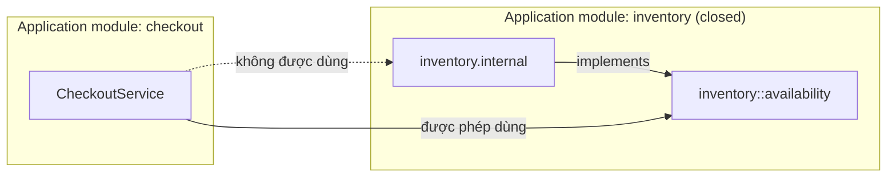

# Khai báo named interface cho public API

Trong dự án thực hành **Store Modular Monolith**, module `inventory` sở hữu dữ liệu tồn kho; module `checkout` chỉ cần hỏi *“có đủ hàng cho số lượng này không?”*. Một cách làm nhanh là cho `checkout` inject trực tiếp `inventory.internal.StockBook`. Java có thể cho phép nếu class là `public`, nhưng thiết kế sẽ buộc module checkout biết chi tiết lưu trữ của inventory. Khi inventory đổi sang JPA hoặc Redis, checkout cũng dễ bị kéo theo.

Nhiệm vụ của bài là **khai báo một named interface dành riêng cho public API**, không phải mở tất cả mã inventory. Học viên sẽ tạo `inventory::availability`, định nghĩa request/response có ngữ nghĩa rõ ràng, triển khai adapter nội bộ, cho checkout chỉ phụ thuộc vào giao diện được công bố, rồi **chứng minh bằng JUnit** rằng ranh giới và hợp đồng vẫn đúng sau khi refactor.

Bài thuộc chương **Dự án thực hành** của lộ trình **SPRING_MODULITH_VERIFICATION_TESTING**. Điểm nghiệm thu quan trọng là **kết quả có thể kiểm chứng**: source code biên dịch theo module model, `ApplicationModules.verify()` PASS trên thiết kế hợp lệ và FAIL khi cố ý dùng kiểu nội bộ, còn `@ApplicationModuleTest` phát hiện hồi quy hành vi trên public API.

> **Phạm vi:** Đây là một bài thiết kế và kiểm chứng **Java API trong Spring Modulith**, không phải tạo HTTP REST endpoint. Ví dụ dùng tồn kho cố định trong JVM để tập trung vào `@NamedInterface`; khi chuyển sang database hoặc event-driven flow, cần bài test tích hợp riêng theo contract tương ứng.

## 1. Chốt yêu cầu và tiêu chí nghiệm thu trước khi tạo package

Giả định nghiệp vụ của dự án: nhân viên checkout cần kiểm tra số lượng có thể đáp ứng của một SKU, nhưng không được chỉnh tồn kho hoặc đọc trực tiếp storage của inventory.

Ta chọn hai **application module**:

- **`inventory`**: sở hữu dữ liệu và thuật toán xác định khả dụng; công bố duy nhất một nhóm kiểu cho mục đích tra cứu là `inventory::availability`.
- **`checkout`**: nhận yêu cầu từ use case và dùng `AvailabilityQuery`; không tham chiếu entity, repository, cache hay adapter nội bộ của inventory.

### Tiêu chí phải có bằng chứng

| Mã | Tiêu chí | Cách kiểm chứng |
| --- | --- | --- |
| **A1** | `inventory.availability` được công bố với tên `availability` | `package-info.java` + module model/architecture test |
| **A2** | `checkout` chỉ phụ thuộc `inventory::availability` | `allowedDependencies` + `ApplicationModules.verify()` |
| **A3** | Class ở `inventory.internal` không được checkout sử dụng | Mutation public-internal làm architecture test FAIL |
| **C1** | API nhận SKU và số lượng hợp lệ, trả đủ dữ liệu để checkout quyết định | Provider contract test qua `AvailabilityQuery` |
| **C2** | Đủ hàng **kể cả khi số lượng yêu cầu bằng tồn** | Boundary JUnit: available = requested |
| **C3** | SKU không tồn tại và input lỗi có hành vi xác định | Negative contract tests |
| **I1** | Checkout gọi được provider thật mà không import implementation | `@ApplicationModuleTest(DIRECT_DEPENDENCIES)` |
| **CI1** | Vi phạm A2/A3 hoặc C2/C3 làm CI đỏ | Test discovery + required status check |

**Định nghĩa contract cho dự án:** `SKU-101` có 5 sản phẩm, `SKU-EMPTY` có 0; SKU khác được coi có 0. `requested` phải lớn hơn 0, SKU không null/rỗng; đầu vào sai ném `IllegalArgumentException`. Kết quả `fulfillable = (available >= requested)`. Đây là **quy ước của bài tập**, không phải quy tắc chung cho mọi hệ thống tồn kho.

**Không cam kết ngoài phạm vi:** lệnh tra cứu không giữ hàng, không giảm stock, không tạo order, không bảo đảm stock không bị thay đổi bởi giao dịch khác. Điều này giúp các assertion có ý nghĩa chính xác.

## 2. Tạo project và bố cục package thể hiện đúng ranh giới

Trong dự án Spring Boot sử dụng Java 17+ (ví dụ dùng Java 21), đặt lớp ứng dụng ở package **cha** của các application module:

```text
src/main/java/com/example/store/
├── StoreApplication.java
├── inventory/                              # application module inventory
│   ├── availability/
│   │   ├── package-info.java              # @NamedInterface("availability")
│   │   ├── AvailabilityQuery.java         # public contract
│   │   ├── AvailabilityRequest.java       # public input
│   │   └── AvailabilityQuote.java         # public output
│   └── internal/
│       ├── FixedStockBook.java            # state/adapter nội bộ
│       └── AvailabilityAdapter.java       # implements public contract
└── checkout/                               # application module checkout
    ├── package-info.java                  # allowedDependencies
    ├── CheckoutDecision.java
    └── CheckoutService.java

src/test/java/com/example/store/
├── ModulithArchitectureTest.java
├── inventory/AvailabilityContractTest.java
└── checkout/CheckoutInventoryIntegrationTest.java
```

Với quy ước phát hiện module theo các package con trực tiếp của Spring Boot root, `inventory` và `checkout` là hai application module. Nếu một project đã cấu hình custom module detection, **phải đối chiếu mô hình được phát hiện với hai module mong muốn** trước khi tin vào kết quả `verify()`.

Lớp root:

```java
// src/main/java/com/example/store/StoreApplication.java
package com.example.store;

import org.springframework.boot.SpringApplication;
import org.springframework.boot.autoconfigure.SpringBootApplication;

@SpringBootApplication
public class StoreApplication {

    public static void main(String[] args) {
        SpringApplication.run(StoreApplication.class, args);
    }
}
```

### Phụ thuộc cần thiết

Đây là **đoạn trích `dependencies`**, giả định build đã quản lý phiên bản Spring Boot và Spring Modulith tương thích qua plugin/BOM, có cấu hình JUnit Platform:

```groovy
dependencies {
    implementation 'org.springframework.boot:spring-boot-starter'
    implementation 'org.springframework.modulith:spring-modulith-starter-core'

    testImplementation 'org.springframework.boot:spring-boot-starter-test'
    testImplementation 'org.springframework.modulith:spring-modulith-starter-test'
}
```

Không cần H2, Testcontainers, JPA hay external broker để kiểm tra **named interface của một read-only API**. Thêm database chỉ có giá trị nếu bài tập mở rộng sang truy vấn repository/migration thật. Đừng dùng việc bootstrap database làm điều kiện “phải có” cho một luật phụ thuộc tĩnh.

## 3. Khai báo `@NamedInterface` và định nghĩa toàn bộ public contract

**Đây là bước trung tâm của dự án.** Đặt annotation **trên package** chứa các kiểu muốn xuất, trong đúng file `inventory/availability/package-info.java`:

```java
/**
 * Public contract của inventory dành cho tra cứu khả dụng.
 *
 * Chỉ công bố AvailabilityQuery và các kiểu request/response.
 * Không công bố cách lưu trữ, repository hoặc cache.
 */
@org.springframework.modulith.NamedInterface("availability")
package com.example.store.inventory.availability;
```

Giá trị `"availability"` là **tên named interface**. Kết hợp với tên application module `inventory`, consumer sẽ dùng định danh **`inventory::availability`** trong quy tắc phụ thuộc. Đây không phải tên class, URL hay chuỗi import trong Java.

### Input: một DTO thuộc chính package được công bố

```java
// inventory/availability/AvailabilityRequest.java
package com.example.store.inventory.availability;

public record AvailabilityRequest(
        String sku,
        int requested
) {
    public AvailabilityRequest {
        if (sku == null || sku.isBlank()) {
            throw new IllegalArgumentException(
                    "SKU must not be blank"
            );
        }
        if (requested <= 0) {
            throw new IllegalArgumentException(
                    "Requested quantity must be positive"
            );
        }
    }
}
```

Dùng record giúp request bất biến về các thành phần đã khai báo và ràng buộc input ngay khi tạo. `requested` là số lượng đơn vị, không phải giá tiền hoặc thời gian. Quy tắc này cũng có nghĩa **client không thể truyền quantity=0 rồi mong service xử lý tiếp**.

### Output: expose dữ liệu cần thiết, không expose implementation

```java
// inventory/availability/AvailabilityQuote.java
package com.example.store.inventory.availability;

public record AvailabilityQuote(
        String sku,
        int requested,
        int available,
        boolean fulfillable
) {}
```

### Interface công khai

```java
// inventory/availability/AvailabilityQuery.java
package com.example.store.inventory.availability;

public interface AvailabilityQuery {

    AvailabilityQuote quote(AvailabilityRequest request);
}
```

Đánh giá ba chữ ký trên:

- Các kiểu `AvailabilityRequest`, `AvailabilityQuote`, `AvailabilityQuery` đều thuộc **named interface được công bố**.
- Không tham số, kiểu trả về hoặc exception public nào buộc checkout import `inventory.internal`.
- Kết quả chứa `available` để checkout có thể giải thích quyết định, thay vì chỉ trả một boolean thiếu ngữ cảnh.

**Không có quy tắc “mọi class `public` đều là public module API”.** Java `public` cho phép truy cập ở mức ngôn ngữ; Spring Modulith còn có ranh giới **closed module** và phần API **được công bố**. Một `public class` ở `inventory.internal` vẫn là chi tiết module không nên để checkout sử dụng.

### Vì sao phải để các DTO cùng named interface?

Phản ví dụ dễ mắc: đặt `AvailabilityQuery` trong `inventory.availability` nhưng cho method trả về `inventory.internal.StockRecord`. Khi consumer gọi API, kiểu internal rò vào chữ ký và làm mất mục đích công bố giao diện hẹp. **Contract phải khép kín về những kiểu consumer cần biết**; với generic types, nên kiểm tra cả generic type arguments và exception types, không chỉ tên interface.

## 4. Triển khai trong `internal` mà không mở rộng public API

Giờ tạo implementation thực. Dữ liệu cố định làm ví dụ có thể đọc và kiểm thử nhanh; internal code có thể thay bằng JPA mà không cần đổi contract.

```java
// inventory/internal/FixedStockBook.java
package com.example.store.inventory.internal;

import java.util.Map;
import org.springframework.stereotype.Component;

@Component
class FixedStockBook {

    private final Map<String, Integer> available = Map.of(
            "SKU-101", 5,
            "SKU-EMPTY", 0
    );

    int unitsFor(String sku) {
        return available.getOrDefault(sku, 0);
    }
}
```

Class và method đều có thể **package-private** vì adapter gọi nó trong cùng package `inventory.internal`. Đây là cách giảm diện tích API Java ngay từ đầu, ngoài luật module của Spring Modulith.

```java
// inventory/internal/AvailabilityAdapter.java
package com.example.store.inventory.internal;

import com.example.store.inventory.availability.AvailabilityQuery;
import com.example.store.inventory.availability.AvailabilityQuote;
import com.example.store.inventory.availability.AvailabilityRequest;
import org.springframework.stereotype.Service;

@Service
class AvailabilityAdapter implements AvailabilityQuery {

    private final FixedStockBook stockBook;

    AvailabilityAdapter(FixedStockBook stockBook) {
        this.stockBook = stockBook;
    }

    @Override
    public AvailabilityQuote quote(AvailabilityRequest request) {
        if (request == null) {
            throw new IllegalArgumentException(
                    "Availability request must not be null"
            );
        }

        int available = stockBook.unitsFor(request.sku());

        return new AvailabilityQuote(
                request.sku(),
                request.requested(),
                available,
                available >= request.requested()
        );
    }
}
```

**Mục tiêu của bước này:** Spring cung cấp một bean triển khai `AvailabilityQuery`, nhưng consumer **inject interface**, không inject `AvailabilityAdapter`. Việc class implementation package-private là hợp lệ trong cấu hình component scanning phù hợp; test provider sẽ xác nhận Spring thực sự bootstrap được interface.

### Kiểm chứng bằng bảng dữ liệu

| Request | `available` | `fulfillable` |
| --- | ---: | --- |
| `("SKU-101", 3)` | 5 | `true` |
| `("SKU-101", 5)` | 5 | `true` |
| `("SKU-101", 6)` | 5 | `false` |
| `("SKU-EMPTY", 1)` | 0 | `false` |
| `("SKU-UNKNOWN", 1)` | 0 | `false` |

Biên `requested == available` phải **được chấp nhận**; mutation từ `>=` sang `>` sẽ làm test contract FAIL. Đổi cách lưu dữ liệu mà giữ bảng contract như cũ **không nên** làm test công khai thất bại.

## 5. Khai báo consumer chỉ được dùng `inventory::availability`

Đặt `checkout/package-info.java`:

```java
@org.springframework.modulith.ApplicationModule(
    allowedDependencies = "inventory::availability"
)
package com.example.store.checkout;
```

Đây là một **policy có thể kiểm chứng**: checkout được phép tham chiếu các kiểu thuộc nhóm `availability` của inventory, nhưng không tự do dùng các package khác của inventory.

API kết quả của checkout:

```java
// checkout/CheckoutDecision.java
package com.example.store.checkout;

public record CheckoutDecision(
        String sku,
        int requested,
        boolean accepted
) {}
```

Consumer service:

```java
// checkout/CheckoutService.java
package com.example.store.checkout;

import com.example.store.inventory.availability.AvailabilityQuery;
import com.example.store.inventory.availability.AvailabilityRequest;
import com.example.store.inventory.availability.AvailabilityQuote;
import org.springframework.stereotype.Service;

@Service
public class CheckoutService {

    private final AvailabilityQuery inventory;

    public CheckoutService(AvailabilityQuery inventory) {
        this.inventory = inventory;
    }

    public CheckoutDecision evaluate(String sku, int requested) {
        AvailabilityQuote quote = inventory.quote(
                new AvailabilityRequest(sku, requested)
        );

        return new CheckoutDecision(
                quote.sku(),
                quote.requested(),
                quote.fulfillable()
        );
    }
}
```

Ở đây checkout **không import** `FixedStockBook` hoặc `AvailabilityAdapter`. Nếu inventory đổi implementation, source của checkout vẫn dùng **hợp đồng ổn định**.

### Phân biệt hai chiều phụ thuộc



Dù có nhiều package trong inventory, **đơn vị quyết định kiến trúc** vẫn là application module. `inventory::availability` biểu diễn **một tập API được công bố** bên trong module ấy; nó không tạo ra một application module hoàn toàn mới.

**Đừng chỉ sửa `allowedDependencies` sau khi import trái phép xuất hiện.** Nếu checkout thực sự cần chức năng mới, thảo luận để mở một named interface hẹp hoặc bổ sung method vào contract hiện hữu có chủ đích, kèm behavioral contract test và review tương thích.

## 6. Architecture JUnit: chứng minh ranh giới được verifier chấp nhận

Tạo test ở package gốc của ứng dụng:

```java
// src/test/java/com/example/store/ModulithArchitectureTest.java
package com.example.store;

import org.junit.jupiter.api.Test;
import org.springframework.modulith.core.ApplicationModules;

class ModulithArchitectureTest {

    @Test
    void moduleDependenciesRespectPublishedInterfaces() {
        ApplicationModules.of(StoreApplication.class).verify();
    }
}
```

Test này **không cần `@SpringBootTest`** và không cần database. Nó chỉ kiểm tra mô hình module và các luật mà Spring Modulith hỗ trợ, như phụ thuộc vòng, truy cập phần không công bố của closed module và `allowedDependencies`.

### Kết quả PASS cho phép kết luận gì?

- Các dependency tĩnh được bộ phân tích nhìn thấy tuân thủ rules trên **những module được mô hình phát hiện**.
- `checkout` tham chiếu `inventory.availability` là quan hệ hợp lệ theo metadata.
- Không có vi phạm khác được `verify()` hỗ trợ trong mô hình hiện tại.

**Không suy ra:** stock lookup tính đúng, Spring bean thực tế được tạo, transaction commit hay sự kiện đã tới consumer. Những kết luận ấy cần test hành vi tương ứng.

### Một phép kiểm tra không nên nhầm với verifier

```java
ApplicationModules modules =
        ApplicationModules.of(StoreApplication.class);

// Dùng khi cần đọc/điều tra mô hình:
System.out.println(modules);

// Điều kiện làm JUnit FAIL nếu architecture vi phạm:
modules.verify();
```

`toString()` là mô tả hỗ trợ chẩn đoán; **đừng snapshot nguyên văn** output để thay `verify()`. Thêm một dòng log “modules OK” cũng không phải assertion.

### Bằng chứng kiểm thử cần lưu

Khi chạy JUnit qua Gradle/Maven, hãy xác nhận **`ModulithArchitectureTest` thực sự được runner phát hiện** trong test report. Nếu class không được chạy do filter, annotation thiếu hoặc task bị skip, CI xanh không đồng nghĩa luật đã được kiểm chứng.

## 7. Provider contract test và consumer module test: chứng minh API dùng được

Một tên named interface đúng không bảo đảm implementation trả kết quả đúng. Vì vậy, bài thực hành cần **hai lớp bằng chứng hành vi**, song song với `verify()`.

### 7.1. Provider test chạy qua interface đã công bố

```java
// src/test/java/com/example/store/inventory/
// AvailabilityContractTest.java
package com.example.store.inventory;

import com.example.store.inventory.availability.AvailabilityQuery;
import com.example.store.inventory.availability.AvailabilityRequest;
import com.example.store.inventory.availability.AvailabilityQuote;
import org.junit.jupiter.api.Test;
import org.springframework.beans.factory.annotation.Autowired;
import org.springframework.modulith.test.ApplicationModuleTest;
import org.springframework.modulith.test.ApplicationModuleTest.BootstrapMode;

import static org.assertj.core.api.Assertions.assertThat;
import static org.assertj.core.api.Assertions.assertThatThrownBy;

@ApplicationModuleTest(mode = BootstrapMode.STANDALONE)
class AvailabilityContractTest {

    @Autowired
    AvailabilityQuery availability;

    @Test
    void exactStockBoundaryIsFulfillable() {
        AvailabilityQuote result = availability.quote(
                new AvailabilityRequest("SKU-101", 5)
        );

        assertThat(result).isEqualTo(new AvailabilityQuote(
                "SKU-101", 5, 5, true
        ));
    }

    @Test
    void shortageDoesNotFulfillRequest() {
        AvailabilityQuote result = availability.quote(
                new AvailabilityRequest("SKU-101", 6)
        );

        assertThat(result).isEqualTo(new AvailabilityQuote(
                "SKU-101", 6, 5, false
        ));
    }

    @Test
    void unknownSkuIsUnavailable() {
        AvailabilityQuote result = availability.quote(
                new AvailabilityRequest("SKU-UNKNOWN", 1)
        );

        assertThat(result.available()).isZero();
        assertThat(result.fulfillable()).isFalse();
    }

    @Test
    void invalidInputIsRejectedByPublicContract() {
        assertThatThrownBy(() ->
                new AvailabilityRequest("", 1))
                .isInstanceOf(IllegalArgumentException.class);

        assertThatThrownBy(() ->
                new AvailabilityRequest("SKU-101", 0))
                .isInstanceOf(IllegalArgumentException.class);

        assertThatThrownBy(() -> availability.quote(null))
                .isInstanceOf(IllegalArgumentException.class);
    }
}
```

**Vì sao inject `AvailabilityQuery` thay vì `AvailabilityAdapter`?** Test phải bảo vệ lời hứa mà consumer nhìn thấy. Khi adapter nội bộ đổi từ map sang JPA, contract test vẫn có thể giữ nguyên, chỉ fixture/hạ tầng phải được cấu hình phù hợp.

**Vì sao test biên bằng nhau?** Nếu implementation bị đổi từ `available >= requested` thành `available > requested`, nhiều happy-path vẫn PASS; riêng case `5 == 5` sẽ FAIL và chỉ đúng hồi quy của contract.

### 7.2. Consumer test dùng inventory thật, không dùng fake thay provider

```java
// src/test/java/com/example/store/checkout/
// CheckoutInventoryIntegrationTest.java
package com.example.store.checkout;

import org.junit.jupiter.api.Test;
import org.springframework.beans.factory.annotation.Autowired;
import org.springframework.modulith.test.ApplicationModuleTest;
import org.springframework.modulith.test.ApplicationModuleTest.BootstrapMode;

import static org.assertj.core.api.Assertions.assertThat;

@ApplicationModuleTest(
        mode = BootstrapMode.DIRECT_DEPENDENCIES
)
class CheckoutInventoryIntegrationTest {

    @Autowired
    CheckoutService checkout;

    @Test
    void checkoutConsumesThePublishedApi() {
        assertThat(checkout.evaluate("SKU-101", 5))
                .isEqualTo(new CheckoutDecision(
                        "SKU-101", 5, true
                ));

        assertThat(checkout.evaluate("SKU-101", 6))
                .isEqualTo(new CheckoutDecision(
                        "SKU-101", 6, false
                ));
    }
}
```

`DIRECT_DEPENDENCIES` khởi tạo checkout **và module inventory mà checkout phụ thuộc trực tiếp**, nhờ đó test dùng implementation inventory thật qua named interface. Nếu dùng `STANDALONE` cho checkout, thường phải cung cấp `AvailabilityQuery` test double; khi đó test có thể kiểm tra logic checkout nhưng **không chứng minh integration với provider thật**.

Một consumer test khác dùng fake là hợp lý nếu cần cô lập nhiều nhánh của checkout, nhưng **fake không thay cho provider contract**. Cặp test trên làm rõ hai nguồn bằng chứng: provider thực hiện đúng API, consumer sử dụng được API trong Spring context.

## 8. Thực hiện phép thử âm để chứng minh named interface được bảo vệ

Đây là phần quan trọng nhất của *practice project*: tạo mutation, chạy test phù hợp, ghi kết quả kỳ vọng rồi **hoàn nguyên**. Test chỉ PASS trên baseline chưa đủ chứng minh gate sẽ bắt được lỗi.

### Mutation A — `public` nhưng nằm trong `inventory.internal`

Tạm tạo kiểu Java `public`:

```java
// inventory/internal/InternalStockState.java — chỉ để thử vi phạm
package com.example.store.inventory.internal;

public class InternalStockState {

    public int debugCount() {
        return 999;
    }
}
```

Trong checkout, thêm một dependency **thực sự**:

```java
// checkout/IllegalInventoryAccess.java — KHÔNG GIỮ LẠI
package com.example.store.checkout;

import com.example.store.inventory.internal.InternalStockState;

class IllegalInventoryAccess {

    private final InternalStockState internal;

    IllegalInventoryAccess(InternalStockState internal) {
        this.internal = internal;
    }

    int read() {
        return internal.debugCount();
    }
}
```

**Kỳ vọng:** Java có thể compile vì kiểu `InternalStockState` là `public`. Nhưng `ApplicationModules.verify()` phải **FAIL** do checkout đã dùng phần inventory **không được công bố** và không nằm trong `inventory::availability`. Provider behavior test vẫn có thể PASS vì không gọi class sai.

Nếu chỉ viết một dòng `import` không dùng, compiler có thể không giữ dependency trong bytecode. Vì vậy mutation dùng **field và method thật**. Nếu để `InternalStockState` package-private, compiler chặn trước khi tới verifier; đó là một phép thử khác, không cô lập được ranh giới Modulith.

### Mutation B — kiểu thuộc API mặc định nhưng không nằm trong quyền checkout

Giả sử inventory có `public class InventoryAdmin` tại package gốc `com.example.store.inventory`. Kiểu ở root có thể thuộc **default API** của inventory, nhưng checkout chỉ được cấp **`inventory::availability`**. Cho checkout giữ một field kiểu `InventoryAdmin` rồi chạy `verify()`: kỳ vọng **FAIL theo `allowedDependencies`**.

Thử nghiệm này phân biệt hai tầng:

| Tầng | Câu hỏi |
| --- | --- |
| API được công bố | Class nằm trong default API/named interface hay thuộc internal? |
| Quyền dependency của checkout | Consumer này có được dùng **phần API đó** hay không? |

Một kiểu có thể vượt qua tầng thứ nhất nhưng vẫn vi phạm tầng thứ hai. Không nên xóa `allowedDependencies` để “cho qua” nếu policy thiết kế là chỉ dùng availability.

### Mutation C — xóa `@NamedInterface`

Xóa annotation ở `inventory/availability/package-info.java` nhưng **giữ nguyên** `allowedDependencies = "inventory::availability"` và imports từ checkout. Khi đó mô hình không còn named interface `availability` đã khai báo; verifier hoặc quá trình xây dựng module model phải báo trạng thái không tương thích với baseline. Thông điệp/lỗi chính xác phụ thuộc phiên bản Spring Modulith, **không nên assert nguyên văn**.

### Mutation D — làm sai ngữ nghĩa API

Đổi trong `AvailabilityAdapter.quote(...)`:

```java
// Mutation cố ý SAI ở boundary:
available > request.requested()
```

thay cho `available >= request.requested()`. Architecture gate có thể vẫn PASS vì dependency graph không đổi, nhưng `AvailabilityContractTest.exactStockBoundaryIsFulfillable` và `CheckoutInventoryIntegrationTest` phải FAIL.

**Bốn phép thử chứng minh hai loại bảo vệ khác nhau:** A/B/C xác nhận **named interface và quyền phụ thuộc** được kiểm tra, D xác nhận **hợp đồng sử dụng API** được bảo vệ.

### Ma trận kỳ vọng

| Thay đổi | Compile | `verify()` | Provider contract | Consumer integration |
| --- | --- | --- | --- | --- |
| Baseline đúng | PASS | PASS | PASS | PASS |
| Checkout dùng public class ở `inventory.internal` | Có thể PASS | **FAIL** | Có thể PASS | Có thể PASS |
| Checkout dùng default API ngoài quyền cấp | PASS | **FAIL** | Có thể PASS | Có thể PASS |
| Xóa `@NamedInterface("availability")` | Java có thể compile | **FAIL/lỗi module model** | Có thể PASS | Có thể bị ảnh hưởng |
| Đổi `>=` thành `>` | PASS | Có thể PASS | **FAIL** ở 5/5 | **FAIL** ở 5/5 |
| Chỉ đổi tên implementation internal | PASS | PASS nếu graph giữ nguyên | PASS | PASS |
| Đưa entity nội bộ vào chữ ký API | Có thể compile | Phụ thuộc loại dependency mà model nhận diện | Cần signature/API review thêm | Có thể ảnh hưởng compile |

Các ô trên là **kết quả mong đợi theo thiết kế**, không phải thông báo đã chạy Gradle trên workspace. Không giữ mutation sau khi thử; lưu bằng chứng đỏ → xanh theo đúng test.

## 9. Giữ named interface có giá trị khi public API thay đổi

Khai báo `@NamedInterface` không nên trở thành thao tác “đánh dấu mọi package dùng được”. Một public API tốt có **chủ sở hữu rõ**, **semantics ổn định** và **bề mặt hẹp**.

### Các thay đổi cần review như thay đổi contract

| Thay đổi | Ảnh hưởng có thể xảy ra | Việc kiểm chứng |
| --- | --- | --- |
| Đổi `@NamedInterface("availability")` thành `"stock"` | Consumer `allowedDependencies` mất định danh cũ | Cập nhật có chủ đích, chạy `verify()` |
| Di chuyển `AvailabilityQuote` sang package internal | Consumer phải import kiểu không công bố | Compilation/architecture + API review |
| Thay chữ ký `quote(AvailabilityRequest)` | Consumer có thể không compile | Build + contract/integration tests |
| Giữ chữ ký nhưng đổi quy tắc `>=` thành `>` | Consumer compile nhưng sai semantics | Provider/consumer contract tests |
| Thêm `StockEntity` nội bộ vào kiểu trả về | Rò chi tiết persistence sang public API | Kiểm tra signature/generic type arguments |
| Đổi map nội bộ thành JPA | Có thể giữ nguyên public contract | Contract test với fixture/schema phù hợp |
| Thêm public API mặc định ở root inventory | Có thể mở bề mặt dùng chung | Review, kiểm tra `allowedDependencies` |
| Chuyển inventory sang module open | Có thể làm mất giới hạn internal exposure | Cần quyết định kiến trúc rõ ràng |

**Lưu ý tương thích:** Java record public không phải chi tiết không đáng kể. Đổi components của `AvailabilityQuote` ảnh hưởng canonical constructor, accessor, equality và có thể serialization. Khi consumer build cùng repo, compiler bắt được nhiều lỗi signature; nếu public API còn được phát hành như binary/library, cần kiểm tra ABI và versioning riêng — `verify()` không phải công cụ binary compatibility.

### Tránh lạm dụng named interface

- Không đánh dấu toàn bộ `inventory.internal` là named interface chỉ để checkout import repository.
- Không đưa entity JPA hoặc `JdbcTemplate` ra public signature để người dùng API tiện truy vấn.
- Không tạo nhiều named interface trùng ý nghĩa chỉ để hợp thức hóa dependency đã phát sinh.
- Không cho phép `inventory::*` hoặc làm module open theo thói quen; hãy cấp quyền cụ thể theo chính sách và cú pháp framework được phiên bản hỗ trợ.
- Không coi `public` của Java và **public module API** là hai khái niệm giống nhau.

Nếu sau này module cần công bố **events** cho module khác, có thể tạo **named interface thứ hai** như `inventory::events` ở package riêng. Khi đó event types/payload và consumer permissions phải được review/test riêng; không cần trộn event contract vào `availability` chỉ vì cả hai đều là “public”.

### Ranh giới giữa structural và behavioral QA

`ApplicationModules.verify()` xem xét đồ thị dependency được nhận diện; nó **không bảo đảm mọi chữ ký public đều sạch khỏi mọi kiểu internal chưa có consumer sử dụng**. Với policy nghiêm ngặt về API leakage, có thể bổ sung kiểm tra public method signatures bằng ArchUnit hoặc rule riêng; giữ contract JUnit để bảo vệ ngữ nghĩa. Không diễn giải quá mức một architecture PASS thành “mọi thiết kế API đều hoàn hảo”.

## 10. Chạy nghiệm thu, CI quality gate và bài tập mở rộng

### 10.1. Chạy test trong dự án

Với Gradle và JUnit Platform đã được cấu hình:

```bash
# Kiểm tra module boundaries:
./gradlew test --tests 'com.example.store.ModulithArchitectureTest'

# Kiểm tra API do inventory cung cấp:
./gradlew test --tests 'com.example.store.inventory.AvailabilityContractTest'

# Kiểm tra consumer dùng provider thật:
./gradlew test --tests 'com.example.store.checkout.CheckoutInventoryIntegrationTest'

# Chạy toàn bộ suite thuộc task test:
./gradlew test
```

Với Maven/Surefire được cấu hình tương ứng:

```bash
mvn -B test
```

**Đây là các lệnh hướng dẫn thực hành, không phải lệnh đã thực thi trong nhiệm vụ soạn tài liệu.** Nếu dự án có `integrationTest` task/source set riêng, phải gọi đúng task và có database/container thích hợp; `test` không tự bao gồm mọi suite.

### 10.2. Quality gate GitHub Actions

```yaml
name: Inventory named-interface verification

on:
  pull_request:

jobs:
  modulith-public-api:
    runs-on: ubuntu-latest
    permissions:
      contents: read

    steps:
      - uses: actions/checkout@v4

      - uses: actions/setup-java@v4
        with:
          distribution: temurin
          java-version: '21'

      - uses: gradle/actions/setup-gradle@v4

      - name: Architecture and public API contracts
        run: bash ./gradlew --no-daemon test

      - name: Preserve test results
        if: always()
        uses: actions/upload-artifact@v4
        with:
          name: named-interface-reports
          path: |
            **/build/test-results/**/*.xml
            **/build/reports/tests/**
          if-no-files-found: warn
```

Workflow chỉ là ví dụ; muốn dùng phải có wrapper, Java tương thích và dependency/test task phù hợp. Để **chặn merge**, cần cấu hình branch protection/ruleset bắt buộc job `modulith-public-api` PASS. `if: always()` chỉ lưu report ngay cả khi test đỏ, **không biến FAIL thành PASS**.

### 10.3. Bài tập mở rộng ngắn

Giữ nguyên `AvailabilityQuery` rồi thực hiện:

1. Thêm `StockQuote.explanationCode` **có chủ đích** nếu nhóm cần phân biệt `INSUFFICIENT` và `UNKNOWN`; cập nhật public contract, các constructor call và tests. Thảo luận tại sao đổi Java record components ảnh hưởng consumer.
2. Chuyển `FixedStockBook` sang một implementation đọc database test (JPA/JDBC) nhưng **không sửa imports của checkout**. Giữ các behavior assertions và bổ sung test migration/transaction khi cần.
3. Tạo mutation `checkout → inventory.internal`, chứng minh architecture gate đỏ; hoàn nguyên.
4. Tạo mutation `available > requested`, chứng minh contract gate đỏ; hoàn nguyên.
5. Đề xuất named interface khác `inventory::events` nếu có event nghiệp vụ cần công bố. Nêu rõ consumer nào được phép sử dụng, và test event payload bằng `ApplicationEvents` hoặc `Scenario` khi code thật sự phát event.

### 10.4. Checklist bàn giao bài thực hành

- [ ] `inventory/availability/package-info.java` khai báo đúng `@NamedInterface("availability")`.
- [ ] `AvailabilityQuery` cùng request/quote DTO thuộc package được công bố; không tham chiếu kiểu internal trong chữ ký.
- [ ] `FixedStockBook` và `AvailabilityAdapter` ở `inventory.internal`; checkout chỉ inject interface.
- [ ] `checkout/package-info.java` giới hạn `allowedDependencies = "inventory::availability"`.
- [ ] `ModulithArchitectureTest` gọi `ApplicationModules.of(StoreApplication.class).verify()` và **được runner phát hiện**.
- [ ] `AvailabilityContractTest` kiểm tra biên `5 == 5`, thiếu hàng, SKU chưa biết và input sai.
- [ ] `CheckoutInventoryIntegrationTest` chạy với `DIRECT_DEPENDENCIES` và provider thật.
- [ ] Mutation import internal làm architecture test **FAIL**; mutation so sánh sai làm contract test **FAIL**.
- [ ] Toàn bộ mutation đã hoàn nguyên; build và các test bắt buộc PASS.
- [ ] CI chạy đủ suite, giữ JUnit reports và có required status check.
- [ ] Nhóm ghi rõ phần **chưa kiểm tra**: transaction database, concurrency, event delivery và SLO (không được suy từ bài này).

### Kết luận

**Một named interface có giá trị khi public API được công bố hẹp, có luật consumer rõ ràng và có test chứng minh ranh giới thực sự được bảo vệ.** Trong dự án này, `@NamedInterface("availability")` định nghĩa phần inventory được xuất; `allowedDependencies = "inventory::availability"` giới hạn checkout; `ApplicationModules.verify()` ngăn đường vòng vào internal; và `@ApplicationModuleTest` kiểm tra contract qua interface thật. Chỉ khi cả **architecture gate** và **behavior contract gate** cùng hoạt động, việc di chuyển implementation hoặc refactor package mới ít có nguy cơ phá modularity mà không ai phát hiện.

### Tài liệu tham khảo

- [Spring Modulith Reference — Application Modules](https://docs.spring.io/spring-modulith/reference/fundamentals.html)
- [Spring Modulith Reference — Verifying Application Module Structure](https://docs.spring.io/spring-modulith/reference/verification.html)
- [Spring Modulith Reference — Integration Testing Application Modules](https://docs.spring.io/spring-modulith/reference/testing.html)
- [Spring Modulith Reference — Working with Application Events](https://docs.spring.io/spring-modulith/reference/events.html)
- [Spring Framework Reference — Testing](https://docs.spring.io/spring-framework/reference/testing.html)
