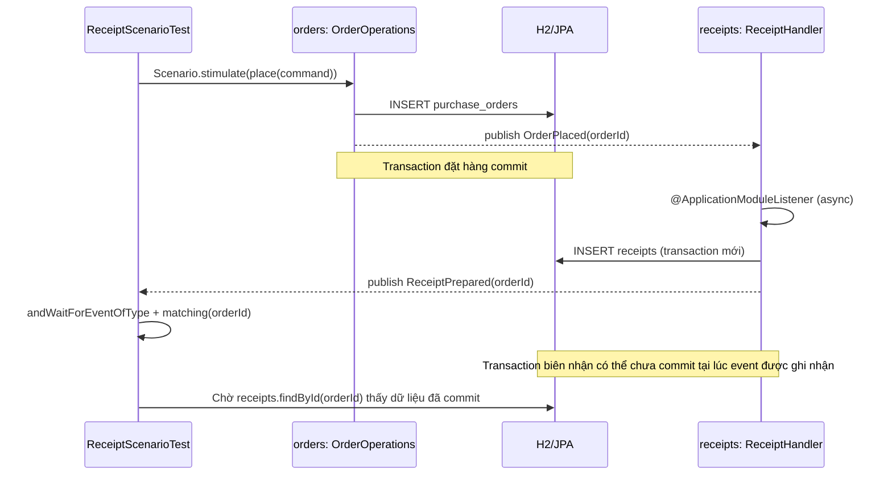

# Dự án thực hành: Viết scenario kích hoạt command và chờ event

> **Spring Modulith Verification & Testing** — bài thực hành của chương **Dự án thực hành**. Trọng tâm là dùng `Scenario` của Spring Modulith để gọi một command thật, chờ event bất đồng bộ từ module khác, đối chiếu correlation ID, trạng thái JPA và ranh giới kiến trúc. Ví dụ là một project độc lập, có thể dựng và chạy bằng Gradle.

## 1. Đề bài, sản phẩm bàn giao và tiêu chí đạt

Trong ứng dụng bán hàng, module `orders` nhận command **đặt hàng**, ghi đơn vào database và phát `OrderPlaced`. Module `receipts` lắng nghe event này sau khi giao dịch đặt hàng commit, tạo bản ghi biên nhận và phát `ReceiptPrepared`. Bạn phải viết một **scenario test kích hoạt command** rồi **chờ chính event biên nhận của đơn đó** tới trước khi kết luận test thành công.

Mục tiêu gắn với kỹ năng kiểm chứng kiến trúc ứng dụng Spring Modulith: dùng `ApplicationModules` kiểm tra phụ thuộc module, `@ApplicationModuleTest` khởi tạo đúng tập module, `Scenario` kiểm thử tích hợp bất đồng bộ, kiểm tra dữ liệu và đưa các test vào quality gate CI để chặn hồi quy.

**Definition of Done**:

1. `ApplicationModules.of(ShopApplication.class).verify()` không phát hiện vòng phụ thuộc hoặc truy cập type nội bộ của module khác.
2. Test nằm trong module `receipts`, dùng `@ApplicationModuleTest(mode = DIRECT_DEPENDENCIES)` để nạp `receipts` và `orders`.
3. `scenario.stimulate(...)` gọi `OrderOperations.place(...)` thực; không thay command bằng cách trực tiếp publish event từ test.
4. `Scenario` chờ `ReceiptPrepared` khớp **orderId** của command; timeout là hữu hạn, không dùng `Thread.sleep`.
5. Event mang đúng ID và mã biên nhận; repository đã đọc được bản ghi biên nhận **sau commit**.
6. Command không hợp lệ không phát `OrderPlaced`/`ReceiptPrepared`, không tạo bản ghi; CI chạy kiến trúc và scenario test.

## 2. Sơ đồ tương tác và hai ranh giới transaction



`orders` không import code từ `receipts`. `receipts` chỉ import **public event** `orders.OrderPlaced`, đây là hướng phụ thuộc hợp lệ: `receipts → orders`. Test đặt trong `receipts` để Spring Modulith bootstrap module này cùng module mà nó trực tiếp phụ thuộc (`orders`).

**Điểm dễ mắc lỗi:** `@ApplicationModuleListener` tương đương một listener xử lý sau commit, bất đồng bộ và dùng transaction mới. `Scenario.stimulate(...)` cũng kích hoạt stimulus trong transaction riêng để transactional listener có thể hoạt động. Vì vậy các bản ghi do command tạo ra **không tự rollback theo transaction của test**; phải dọn fixture chủ động. Hơn nữa, nhìn thấy `ReceiptPrepared` không tự chứng minh transaction ghi biên nhận của listener đã commit — cần assertion chờ trạng thái database riêng.

## 3. Khởi tạo project và dependency kiểm thử

Ví dụ nhất quán trên **Java 21, Spring Boot 3.5.x, Spring Modulith 1.4.x, JUnit Jupiter, AssertJ, Awaitility, Spring Data JPA và H2**. `spring-modulith-starter-test` cung cấp API `Scenario` và `@ApplicationModuleTest`. Với Spring Boot 4.x / Modulith 2.x, kiểm tra lại ma trận tương thích và BOM trước khi áp dụng nguyên mẫu.

`build.gradle`:

```groovy
plugins {
    id 'java'
    id 'org.springframework.boot' version '3.5.6'
    id 'io.spring.dependency-management' version '1.1.7'
}

group = 'dev.example'
version = '0.0.1-SNAPSHOT'

java {
    toolchain { languageVersion = JavaLanguageVersion.of(21) }
}

repositories { mavenCentral() }

dependencyManagement {
    imports {
        mavenBom 'org.springframework.modulith:spring-modulith-bom:1.4.14'
    }
}

dependencies {
    implementation 'org.springframework.boot:spring-boot-starter-data-jpa'
    implementation 'org.springframework.modulith:spring-modulith-starter-core'
    runtimeOnly 'com.h2database:h2'

    testImplementation 'org.springframework.boot:spring-boot-starter-test'
    testImplementation 'org.springframework.modulith:spring-modulith-starter-test'
}

tasks.named('test') { useJUnitPlatform() }
```

`src/test/resources/application.properties`:

```properties
spring.datasource.url=jdbc:h2:mem:scenario-orders;DB_CLOSE_DELAY=-1
spring.datasource.driver-class-name=org.h2.Driver
spring.jpa.hibernate.ddl-auto=create-drop
spring.jpa.open-in-view=false
logging.level.org.springframework.modulith=DEBUG
```

H2 và `ddl-auto=create-drop` phục vụ demo/test; với database production, bổ sung migration và Testcontainers để kiểm tra constraint, dialect và isolation tương ứng. Ví dụ dưới đây giữ logic business đơn giản để làm rõ **command → commit → event → listener → event → assertion**.

## 4. Tổ chức package và định nghĩa public contract

```text
src/
├── main/java/dev/example/shop/
│   ├── ShopApplication.java
│   ├── orders/
│   │   ├── PlaceOrder.java
│   │   ├── OrderOperations.java
│   │   ├── OrderPlaced.java
│   │   └── internal/
│   │       ├── OrderEntity.java
│   │       ├── OrderRepository.java
│   │       └── DefaultOrderOperations.java
│   └── receipts/
│       ├── package-info.java
│       ├── ReceiptPrepared.java
│       └── internal/
│           ├── ReceiptEntity.java
│           ├── ReceiptRepository.java
│           └── ReceiptHandler.java
├── test/java/dev/example/shop/
│   ├── ArchitectureVerificationTest.java
│   └── receipts/internal/ReceiptScenarioTest.java
└── test/resources/application.properties
```

`ShopApplication.java` đặt ở package cha của hai module. `@EnableAsync` làm rõ việc thực thi `@Async` của listener:

```java
package dev.example.shop;

import org.springframework.boot.SpringApplication;
import org.springframework.boot.autoconfigure.SpringBootApplication;
import org.springframework.scheduling.annotation.EnableAsync;

@EnableAsync
@SpringBootApplication
public class ShopApplication {
    public static void main(String[] args) {
        SpringApplication.run(ShopApplication.class, args);
    }
}
```

Ba public type ở package gốc `orders` là hợp đồng giữa các module (mỗi đoạn nằm trong file cùng tên):

```java
// orders/PlaceOrder.java
package dev.example.shop.orders;

import java.util.UUID;

public record PlaceOrder(UUID orderId, String sku, int quantity) {}
```

```java
// orders/OrderOperations.java
package dev.example.shop.orders;

import java.util.UUID;

public interface OrderOperations {
    UUID place(PlaceOrder command);
}
```

```java
// orders/OrderPlaced.java
package dev.example.shop.orders;

import java.util.UUID;

public record OrderPlaced(UUID orderId, String sku, int quantity) {}
```

Client cấp `orderId` bằng `UUID.randomUUID()` để test có **correlation ID** xác định trước khi kích hoạt command. Production có thể dùng ID sinh tại backend và correlation ID riêng, nhưng quy tắc quan trọng vẫn là: event phải mang khóa liên kết đủ để phân biệt các lần thực thi song song.

`receipts/package-info.java` cho phép module `receipts` phụ thuộc public API của `orders`:

```java
@org.springframework.modulith.ApplicationModule(allowedDependencies = "orders")
package dev.example.shop.receipts;
```

Không import `orders.internal` vào `receipts`; dù một class nội bộ được khai báo `public`, Spring Modulith vẫn coi nó là type **không thuộc API công khai** của module nếu nằm ngoài package gốc hoặc named interface.

## 5. Hiện thực command trong module `orders`

`orders/internal/OrderEntity.java`:

```java
package dev.example.shop.orders.internal;

import jakarta.persistence.Column;
import jakarta.persistence.Entity;
import jakarta.persistence.Id;
import jakarta.persistence.Table;
import java.util.UUID;

@Entity
@Table(name = "purchase_orders")
class OrderEntity {
    @Id
    private UUID id;

    @Column(nullable = false)
    private String sku;

    @Column(nullable = false)
    private int quantity;

    protected OrderEntity() {} // JPA

    OrderEntity(UUID id, String sku, int quantity) {
        this.id = id;
        this.sku = sku;
        this.quantity = quantity;
    }
}
```

`orders/internal/OrderRepository.java`:

```java
package dev.example.shop.orders.internal;

import org.springframework.data.jpa.repository.JpaRepository;
import java.util.UUID;

interface OrderRepository extends JpaRepository<OrderEntity, UUID> {}
```

`orders/internal/DefaultOrderOperations.java`:

```java
package dev.example.shop.orders.internal;

import dev.example.shop.orders.OrderOperations;
import dev.example.shop.orders.OrderPlaced;
import dev.example.shop.orders.PlaceOrder;
import org.springframework.context.ApplicationEventPublisher;
import org.springframework.stereotype.Service;
import org.springframework.transaction.annotation.Transactional;
import java.util.UUID;

@Service
class DefaultOrderOperations implements OrderOperations {
    private final OrderRepository repository;
    private final ApplicationEventPublisher events;

    DefaultOrderOperations(OrderRepository repository,
                           ApplicationEventPublisher events) {
        this.repository = repository;
        this.events = events;
    }

    @Override
    @Transactional
    public UUID place(PlaceOrder command) {
        if (command == null || command.orderId() == null
                || command.sku() == null || command.sku().isBlank()
                || command.quantity() <= 0) {
            throw new IllegalArgumentException("INVALID_ORDER");
        }

        repository.save(new OrderEntity(
                command.orderId(), command.sku(), command.quantity()));

        events.publishEvent(new OrderPlaced(
                command.orderId(), command.sku(), command.quantity()));
        return command.orderId();
    }
}
```

Order được ghi và event `OrderPlaced` được publish trong cùng transaction đặt hàng. `@TransactionalEventListener` tại module nhận sẽ chỉ xử lý **sau khi transaction nguồn commit thành công**. Nếu command bị từ chối trước `save` và `publish`, không có dữ liệu/event để listener xử lý.

## 6. Hiện thực listener bất đồng bộ ở `receipts`

Public event `receipts/ReceiptPrepared.java`:

```java
package dev.example.shop.receipts;

import java.util.UUID;

public record ReceiptPrepared(UUID orderId, String code) {}
```

`receipts/internal/ReceiptEntity.java`:

```java
package dev.example.shop.receipts.internal;

import jakarta.persistence.Column;
import jakarta.persistence.Entity;
import jakarta.persistence.Id;
import jakarta.persistence.Table;
import java.util.UUID;

@Entity
@Table(name = "receipts")
class ReceiptEntity {
    @Id
    private UUID orderId;

    @Column(nullable = false)
    private String code;

    protected ReceiptEntity() {} // JPA

    ReceiptEntity(UUID orderId, String code) {
        this.orderId = orderId;
        this.code = code;
    }

    String code() { return code; }
}
```

`receipts/internal/ReceiptRepository.java`:

```java
package dev.example.shop.receipts.internal;

import org.springframework.data.jpa.repository.JpaRepository;
import java.util.UUID;

interface ReceiptRepository extends JpaRepository<ReceiptEntity, UUID> {}
```

`receipts/internal/ReceiptHandler.java`:

```java
package dev.example.shop.receipts.internal;

import dev.example.shop.orders.OrderPlaced;
import dev.example.shop.receipts.ReceiptPrepared;
import org.springframework.context.ApplicationEventPublisher;
import org.springframework.modulith.events.ApplicationModuleListener;
import org.springframework.stereotype.Component;

@Component
class ReceiptHandler {
    private final ReceiptRepository repository;
    private final ApplicationEventPublisher events;

    ReceiptHandler(ReceiptRepository repository,
                   ApplicationEventPublisher events) {
        this.repository = repository;
        this.events = events;
    }

    @ApplicationModuleListener
    void on(OrderPlaced event) {
        // Minh họa tránh lặp trong xử lý tuần tự; PK orderId là hàng rào DB.
        if (repository.existsById(event.orderId())) {
            return;
        }

        String code = "RCPT-" + event.orderId();
        repository.save(new ReceiptEntity(event.orderId(), code));
        events.publishEvent(new ReceiptPrepared(event.orderId(), code));
    }
}
```

`@ApplicationModuleListener` kết hợp xử lý **sau commit**, `@Async` và một transaction mới (`REQUIRES_NEW`); vì vậy hai module không cần gọi trực tiếp implementation của nhau. `existsById` chỉ minh họa xử lý lặp đơn giản; trong production cần thêm bảo đảm idempotency khi xử lý song song, unique constraint, retry và **event publication registry** để tránh mất sự kiện nếu listener gặp lỗi. Việc `ReceiptPrepared` đã được phát có thể xảy ra trước khi transaction của `ReceiptHandler` commit xong — scenario bên dưới xử lý đúng điểm này.

## 7. Viết cổng kiểm chứng ranh giới module

`src/test/java/dev/example/shop/ArchitectureVerificationTest.java`:

```java
package dev.example.shop;

import org.junit.jupiter.api.Test;
import org.springframework.modulith.core.ApplicationModules;

class ArchitectureVerificationTest {
    @Test
    void verifiesModuleArchitecture() {
        ApplicationModules.of(ShopApplication.class).verify();
    }
}
```

Trong ví dụ, `receipts.internal.ReceiptHandler` chỉ import event `orders.OrderPlaced` từ package gốc của module nguồn; `receipts` cho phép phụ thuộc `orders`, còn `orders` không biết về `receipts`. Để quan sát cổng đỏ, tạm tạo một type `public` trong `orders.internal`, cho `ReceiptHandler` tham chiếu type đó, hoặc tạo vòng phụ thuộc `orders → receipts → orders`, rồi chạy riêng test kiến trúc; sau đó **hoàn nguyên** sửa đổi gây lỗi. Cổng kiểm chứng cấu trúc không phụ thuộc vào việc scenario test có chạy xanh hay không.

## 8. Viết scenario command → event có tương quan ID

Đặt test tại `src/test/java/dev/example/shop/receipts/internal/ReceiptScenarioTest.java`. Annotation ở **module nhận** nên `DIRECT_DEPENDENCIES` nạp cả `receipts` và `orders`; `STANDALONE` chỉ nạp `receipts`, thiếu `OrderOperations`. `Scenario` được Spring Modulith truyền vào tham số phương thức test.

```java
package dev.example.shop.receipts.internal;

import dev.example.shop.orders.OrderOperations;
import dev.example.shop.orders.OrderPlaced;
import dev.example.shop.orders.PlaceOrder;
import dev.example.shop.receipts.ReceiptPrepared;
import org.junit.jupiter.api.AfterEach;
import org.junit.jupiter.api.Test;
import org.springframework.beans.factory.annotation.Autowired;
import org.springframework.jdbc.core.JdbcTemplate;
import org.springframework.modulith.test.ApplicationModuleTest;
import org.springframework.modulith.test.PublishedEvents;
import org.springframework.modulith.test.Scenario;

import java.time.Duration;
import java.util.UUID;
import java.util.function.Supplier;

import static org.assertj.core.api.Assertions.assertThat;
import static org.assertj.core.api.Assertions.assertThatThrownBy;
import static org.awaitility.Awaitility.await;

@ApplicationModuleTest(
    mode = ApplicationModuleTest.BootstrapMode.DIRECT_DEPENDENCIES
)
class ReceiptScenarioTest {
    @Autowired OrderOperations orders;
    @Autowired ReceiptRepository receipts;
    @Autowired JdbcTemplate jdbc;

    @AfterEach
    void cleanCommittedRows() {
        // Scenario tạo transaction thật: @Transactional trên test không đủ để rollback.
        jdbc.update("delete from receipts");
        jdbc.update("delete from purchase_orders");
    }

    @Test
    void commandProducesMatchingReceiptEvent(Scenario scenario) {
        UUID orderId = UUID.randomUUID();
        PlaceOrder command = new PlaceOrder(orderId, "BOOK-01", 2);
        Supplier<UUID> invokeCommand = () -> orders.place(command);

        scenario.stimulate(invokeCommand)
                .andWaitAtMost(Duration.ofSeconds(5))
                .forEventOfType(ReceiptPrepared.class)
                .matching(event -> event.orderId().equals(orderId))
                .toArriveAndVerify((event, returnedOrderId) -> {
                    assertThat(returnedOrderId).isEqualTo(orderId);
                    assertThat(event.orderId()).isEqualTo(orderId);
                    assertThat(event.code()).isEqualTo("RCPT-" + orderId);

                    // Event có thể được publish trước commit của listener.
                    await().atMost(Duration.ofSeconds(5))
                            .untilAsserted(() ->
                                    assertThat(receipts.findById(orderId))
                                            .isPresent()
                                            .get()
                                            .satisfies(saved ->
                                                    assertThat(saved.code())
                                                            .isEqualTo(event.code())));
                });
    }

    @Test
    void invalidCommandProducesNoEvents(PublishedEvents published) {
        assertThatThrownBy(() -> orders.place(
                new PlaceOrder(UUID.randomUUID(), "", 0)))
                .isInstanceOf(IllegalArgumentException.class)
                .hasMessage("INVALID_ORDER");

        assertThat(published.ofType(OrderPlaced.class)).isEmpty();
        assertThat(published.ofType(ReceiptPrepared.class)).isEmpty();
        assertThat(receipts.count()).isZero();
        assertThat(jdbc.queryForObject(
                "select count(*) from purchase_orders", Long.class)).isZero();
    }
}
```

**Đọc scenario theo đúng trình tự:**

| Bước | API | Bất biến được kiểm tra |
| --- | --- | --- |
| 1. Kích hoạt | `stimulate(Supplier<UUID>)` | Gọi **command thật** và giữ kết quả trả về để so sánh |
| 2. Giới hạn | `andWaitAtMost(Duration.ofSeconds(5))` | Có timeout rõ ràng, test không chờ vô hạn |
| 3. Xác định event | `forEventOfType(ReceiptPrepared.class)` | Chờ kết quả cuối luồng, không chỉ sự kiện `OrderPlaced` ban đầu |
| 4. Tương quan | `matching(event -> event.orderId().equals(orderId))` | Không ăn nhầm event của request khác |
| 5. Xác minh | `toArriveAndVerify((event, returnedId) -> ...)` | Đúng ID, mã biên nhận và kết quả command |
| 6. Kiểm tra DB | `await().untilAsserted(...)` | Biên nhận đã nhìn thấy qua repository sau khi listener commit |

`PublishedEvents` hợp lý cho kiểm tra **event đã publish** của nhánh âm. `Scenario` phù hợp hơn khi kết quả được xử lý bất đồng bộ và cần chờ một **điều kiện hoàn tất**. Tránh `Thread.sleep(2000)` vì thời gian cố định vừa chậm vừa vẫn có thể khiến test chập chờn khi CI tải cao.

## 9. Thử nghiệm lỗi, timeout và biến thể chờ state change

Thực hiện thí nghiệm trên **một bản sửa tạm**, rồi hoàn nguyên:

1. Tại `ReceiptHandler`, tạm bỏ `events.publishEvent(new ReceiptPrepared(...))`; case tích cực phải **timeout**, dù vẫn có thể có bản ghi `receipts`. Điều này chứng minh test thật sự đợi event cuối luồng.
2. Khôi phục event, nhưng gán `orderId` sai trong `ReceiptPrepared`; predicate `.matching(...)` không chấp nhận event sai, test timeout. Nhờ correlation ID, event khác cùng kiểu không tạo ra false positive.
3. Tạm đổi code biên nhận thành giá trị khác; event đúng ID đến nhưng assertion `code` đỏ ngay tại `toArriveAndVerify`.
4. Tạm bỏ `@ApplicationModuleListener` hoặc cấu hình sai bootstrap mode; listener không xử lý và scenario đỏ, cho thấy việc mở rộng phạm vi module phải có chủ đích.

Khi nhu cầu chính là **đợi database đổi trạng thái** thay vì event, dùng phương án `andWaitForStateChange` trong **một test riêng**, không gọi lại cùng command/ID trong case đã tạo đơn:

```java
UUID orderId = UUID.randomUUID();
Supplier<UUID> invoke = () -> orders.place(new PlaceOrder(orderId, "NOTE-02", 1));

scenario.stimulate(invoke)
        .andWaitAtMost(Duration.ofSeconds(5))
        .forStateChange(() -> receipts.findById(orderId))
        .andVerify(found -> assertThat(found).isPresent());
```

`Optional.empty()` chưa phải trạng thái kết thúc, `Optional` có dữ liệu là trạng thái đạt; không cần `Thread.sleep`. Lựa chọn này kiểm tra kết quả database nhưng **không chứng minh đã publish `ReceiptPrepared`**; muốn cả hai thì giữ scenario chờ event và assertion repository như mục 8.

### Phân biệt ba kiểu thất bại

| Hiện tượng | Chẩn đoán | Cách xử lý |
| --- | --- | --- |
| Context không khởi tạo, thiếu `OrderOperations` | Test `receipts` ở chế độ `STANDALONE` nhưng cần command trong `orders` | Dùng `DIRECT_DEPENDENCIES` với đúng chiều phụ thuộc; không dùng `@SpringBootTest` để che ranh giới |
| Scenario timeout sau 5 giây | Event không phát, listener không được đăng ký/chạy, predicate ID sai hoặc async xử lý quá chậm | Xem log của cả hai module; kiểm tra transaction commit, annotation và ID; chỉ tăng timeout sau khi đã xác định nguyên nhân |
| Event đúng nhưng DB assertion thất bại | Event phát trước commit; transaction listener rollback; kết quả lưu khác kỳ vọng | Chờ state change sau commit, kiểm tra constraint và lỗi transaction listener; không suy ra database đã commit từ việc event xuất hiện |

## 10. Chạy kiểm thử và đặt quality gate CI

Ở thư mục **project demo** đã tạo đầy đủ các file Java và Gradle Wrapper:

```bash
./gradlew test --tests '*ArchitectureVerificationTest'
./gradlew test --tests '*ReceiptScenarioTest'
./gradlew clean test
```

Trên Windows dùng `./gradlew.bat`. Vì bài demo có asynchronous listener và test dùng dữ liệu JPA thực, để fixture được kiểm soát nên **không bật parallel test execution** khi chưa có cơ chế tách database/correlation đầy đủ. Sau khi test chạy xanh tại máy local, đưa lệnh `clean test` vào workflow trong project:

```yaml
# .github/workflows/modulith-test.yml (trong project demo)
name: spring-modulith-quality-gate
on: [push, pull_request]

jobs:
  verify:
    runs-on: ubuntu-latest
    steps:
      - uses: actions/checkout@v4
      - uses: actions/setup-java@v4
        with:
          distribution: temurin
          java-version: '21'
          cache: gradle
      - run: ./gradlew clean test --no-daemon
```

Quality gate giữ đồng thời hai lớp bảo vệ: `ApplicationModules.verify()` ngăn vòng phụ thuộc / sử dụng nội bộ sai, `ReceiptScenarioTest` ngăn hồi quy command → event → listener → database. Với nghiệp vụ quan trọng, bổ sung test database thật bằng Testcontainers, kiểm thử idempotency/retry, và event publication registry để quản lý việc giao lại event khi xử lý lỗi. **Không diễn giải test scenario xanh thành bảo đảm gửi event ra message broker** nếu demo chỉ sử dụng application events trong một process.

## 11. Checklist tự chấm và mở rộng bài tập

- [ ] Dựng đúng cấu trúc `orders` và `receipts`; `receipts` chỉ phụ thuộc API `orders.OrderPlaced`.
- [ ] `ArchitectureVerificationTest` chạy xanh; khi tạm dùng `orders.internal` thì verification đỏ và đã hoàn nguyên.
- [ ] Test nằm trong `receipts.internal`, bootstrap bằng `DIRECT_DEPENDENCIES`, inject được `OrderOperations` thật.
- [ ] `Scenario.stimulate` gọi `place(PlaceOrder)` và giữ ID command trả về.
- [ ] `Scenario` đợi đúng `ReceiptPrepared` với ID từng lần chạy, có timeout hữu hạn.
- [ ] Assert event có `orderId`/`code` đúng; repository trả về biên nhận với cùng mã sau commit.
- [ ] Command invalid trả `INVALID_ORDER`, không publish event và không sinh bản ghi.
- [ ] Thí nghiệm tắt emit event khiến scenario timeout; sửa event ID sai làm matcher không đạt; đã hoàn nguyên mã nguồn.
- [ ] Dữ liệu test được dọn chủ động sau scenario, không giả định transaction test rollback được stimulus.
- [ ] `./gradlew clean test` và CI quality gate có exit code 0 trong project demo.

**Bài tập mở rộng:** thêm lỗi giả lập trong listener để quan sát retry/idempotency; cho chạy hai command song song với hai `orderId` khác nhau nhằm xác nhận predicate lọc đúng; hoặc chuyển module `receipts` sang lắng nghe qua broker thật và thiết kế thêm một test tích hợp broker/Testcontainers tương ứng. Giữ một mục tiêu kiểm chứng cụ thể cho mỗi test để khi lỗi có thể xác định khâu gây ra.

**Đối chiếu API chính thức:** [Spring Modulith 1.4 — Integration Testing Application Modules](https://docs.spring.io/spring-modulith/reference/1.4/testing.html), [Scenario 1.4 Javadoc](https://docs.spring.io/spring-modulith/docs/1.4.x/api/org/springframework/modulith/test/Scenario.html), [Scenario.When 1.4 Javadoc](https://docs.spring.io/spring-modulith/docs/1.4.x/api/org/springframework/modulith/test/Scenario.When.html), [Spring Modulith — Working with Application Events](https://docs.spring.io/spring-modulith/reference/1.4/events.html).
