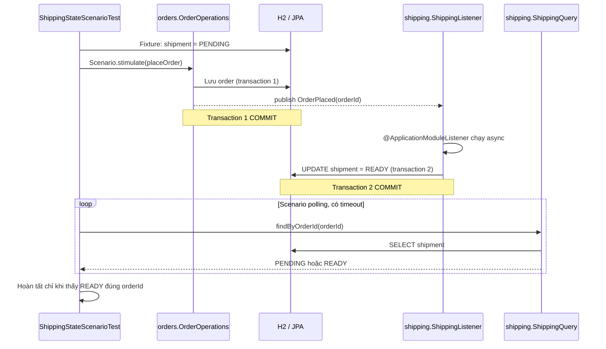

# Dự án thực hành: Kiểm tra state change sau listener bất đồng bộ

> **Phạm vi:** `SPRING_MODULITH_VERIFICATION_TESTING` — rèn kỹ năng kiểm chứng ranh giới kiến trúc bằng `ApplicationModules`, kiểm thử module với `@ApplicationModuleTest`, sự kiện, JPA và luồng tích hợp trong CI. Bài thuộc chương **Dự án thực hành**, tập trung vào **trạng thái đã thay đổi sau khi listener bất đồng bộ hoàn tất**.

## 1. Đề bài, đầu ra và tiêu chí nghiệm thu

Xây một ứng dụng Spring Modulith gồm hai module `orders` (tạo đơn) và `shipping` (chuẩn bị giao hàng). Khi người dùng đặt đơn, `orders` lưu đơn trong transaction và phát `OrderPlaced`. Một `@ApplicationModuleListener` trong `shipping` nhận sự kiện **sau commit**, chạy bất đồng bộ trong transaction mới rồi chuyển bản ghi giao hàng từ `PENDING` sang `READY`.

Viết JUnit integration test dùng `Scenario` để **kích hoạt command đặt hàng**, **thăm dò dữ liệu JPA tới khi trạng thái thành `READY`**, rồi khẳng định kết quả và `orderId` tương ứng. Bài phải làm rõ tại sao chỉ kiểm tra event đã publish hoặc dùng `Thread.sleep` là chưa đủ để chứng minh trạng thái sau commit.

**Kết quả bắt buộc:**

1. `ApplicationModules.of(ShopApplication.class).verify()` chạy xanh, bảo đảm `shipping` chỉ phụ thuộc vào public API của `orders`.
2. Test của module `shipping` dùng `@ApplicationModuleTest(mode = DIRECT_DEPENDENCIES)`, nạp `shipping` và `orders` thật cùng JPA/H2.
3. Trước command, fixture trong `shipping` có `ShipmentStatus.PENDING`; sau khi listener xử lý, truy vấn đọc được `ShipmentStatus.READY`.
4. `Scenario.stimulate(...)` gọi command thật; `andWaitForStateChange(...)` với predicate chỉ chấp nhận trạng thái `READY` của **đúng `orderId`**.
5. Test hết hạn chờ hữu hạn nếu listener bị vô hiệu hóa hoặc không lưu được thay đổi; không dùng sleep tùy ý.
6. Command không hợp lệ không tạo đơn và không làm trạng thái giao hàng đổi sang `READY`; CI chạy cả kiểm chứng kiến trúc và scenario.

## 2. Hiểu rõ điều cần chờ: event khác với state sau commit



`OrderPlaced` cho biết command đã phát sự kiện; nó **không bảo đảm** listener đã chạy, ghi dữ liệu thành công hay commit. Với `@ApplicationModuleListener`, callback là một `@TransactionalEventListener` sau commit, thực thi `@Async` và `@Transactional(propagation = REQUIRES_NEW)`. Do đó, sau khi command trả về, thread kiểm thử có thể vẫn nhìn thấy `PENDING` trong nhiều lần đọc.

API `Scenario` giải quyết việc đồng bộ test với kết quả bất đồng bộ: `andWaitForStateChange(Supplier)` thăm dò một phép đọc; kết quả mặc định được xem là hoàn tất khi khác `null`, với `Optional` là có giá trị và với `boolean` là `true`. **Bài này phải dùng predicate** vì một `Optional<ShipmentView>` có trạng thái `PENDING` vốn đã có giá trị: nếu bỏ predicate, test có thể thành công **trước khi listener thay đổi bất cứ thứ gì**.

## 3. Bootstrap dự án và cấu hình kiểm thử

Dùng một cặp phiên bản tham khảo tương thích: **Java 21, Spring Boot 3.5.x và Spring Modulith 1.4.x**. Project dưới đây dùng Spring Data JPA, H2, JUnit 5 và Spring Modulith Test. Nếu dự án thực dùng Boot 4.x, chọn dòng Modulith 2.x tương ứng rồi xác minh lại API/BOM; không phối trộn tùy ý các major version.

`build.gradle` (Gradle Groovy DSL):

```groovy
plugins {
    id 'java'
    id 'org.springframework.boot' version '3.5.6'
    id 'io.spring.dependency-management' version '1.1.7'
}

group = 'dev.example'
version = '0.0.1-SNAPSHOT'

java {
    toolchain { languageVersion = JavaLanguageVersion.of(21) }
}

repositories { mavenCentral() }

dependencyManagement {
    imports {
        mavenBom 'org.springframework.modulith:spring-modulith-bom:1.4.14'
    }
}

dependencies {
    implementation 'org.springframework.boot:spring-boot-starter-data-jpa'
    implementation 'org.springframework.modulith:spring-modulith-starter-core'
    implementation 'org.springframework.modulith:spring-modulith-events-api'
    runtimeOnly 'com.h2database:h2'

    testImplementation 'org.springframework.boot:spring-boot-starter-test'
    testImplementation 'org.springframework.modulith:spring-modulith-starter-test'
}

tasks.named('test') { useJUnitPlatform() }
```

`src/test/resources/application.properties`:

```properties
spring.datasource.url=jdbc:h2:mem:shipping-state;DB_CLOSE_DELAY=-1
spring.datasource.driver-class-name=org.h2.Driver
spring.jpa.hibernate.ddl-auto=create-drop
spring.jpa.open-in-view=false
logging.level.org.springframework.modulith=DEBUG
```

`create-drop` và H2 dùng để làm bài thực hành; khi cần kiểm tra cú pháp SQL, constraint hoặc isolation cụ thể của database production, bổ sung Testcontainers PostgreSQL/MySQL và migration tương ứng. Mỗi test dùng UUID mới, dữ liệu commit được dọn chủ động vì `Scenario` khởi chạy command trong transaction thực.

## 4. Cấu trúc module và API công khai

```text
src/
├── main/java/dev/example/shop/
│   ├── ShopApplication.java
│   ├── orders/
│   │   ├── PlaceOrder.java
│   │   ├── OrderOperations.java
│   │   ├── OrderPlaced.java
│   │   └── internal/
│   │       ├── OrderEntity.java
│   │       ├── OrderRepository.java
│   │       └── DefaultOrderOperations.java
│   └── shipping/
│       ├── package-info.java
│       ├── ShippingStatus.java
│       ├── ShipmentView.java
│       ├── ShippingQuery.java
│       └── internal/
│           ├── ShipmentEntity.java
│           ├── ShipmentRepository.java
│           ├── DefaultShippingQuery.java
│           └── ShippingListener.java
├── test/java/dev/example/shop/
│   ├── ArchitectureVerificationTest.java
│   └── shipping/internal/ShippingStateScenarioTest.java
└── test/resources/application.properties
```

`ShopApplication.java` nằm ở package cha của hai module; `@EnableAsync` kích hoạt hạ tầng xử lý phương thức bất đồng bộ trong cả ứng dụng và integration test:

```java
package dev.example.shop;

import org.springframework.boot.SpringApplication;
import org.springframework.boot.autoconfigure.SpringBootApplication;
import org.springframework.scheduling.annotation.EnableAsync;

@EnableAsync
@SpringBootApplication
public class ShopApplication {
    public static void main(String[] args) {
        SpringApplication.run(ShopApplication.class, args);
    }
}
```

`shipping/package-info.java` khai báo hướng phụ thuộc được phép:

```java
@org.springframework.modulith.ApplicationModule(allowedDependencies = "orders")
package dev.example.shop.shipping;
```

Quy tắc phân lớp: `orders` công bố command/event trong package gốc; `shipping` chỉ import các public type đó. Những class dưới `orders.internal` là chi tiết triển khai, không được module khác truy cập. `shipping` cung cấp `ShippingQuery` ở package gốc để test và module khác có thể đọc trạng thái qua hợp đồng ổn định, thay vì phụ thuộc vào JPA repository nội bộ.

## 5. Module `orders`: command, transaction và sự kiện

Tạo ba public type trong các file tương ứng ở `orders`:

```java
// orders/PlaceOrder.java
package dev.example.shop.orders;

import java.util.UUID;

public record PlaceOrder(UUID orderId, String sku, int quantity) {}
```

```java
// orders/OrderOperations.java
package dev.example.shop.orders;

import java.util.UUID;

public interface OrderOperations {
    UUID place(PlaceOrder command);
}
```

```java
// orders/OrderPlaced.java
package dev.example.shop.orders;

import java.util.UUID;

public record OrderPlaced(UUID orderId, String sku, int quantity) {}
```

`orders/internal/OrderEntity.java`:

```java
package dev.example.shop.orders.internal;

import jakarta.persistence.Column;
import jakarta.persistence.Entity;
import jakarta.persistence.Id;
import jakarta.persistence.Table;
import java.util.UUID;

@Entity
@Table(name = "purchase_orders")
class OrderEntity {
    @Id
    private UUID id;

    @Column(nullable = false)
    private String sku;

    @Column(nullable = false)
    private int quantity;

    protected OrderEntity() {} // JPA

    OrderEntity(UUID id, String sku, int quantity) {
        this.id = id;
        this.sku = sku;
        this.quantity = quantity;
    }
}
```

`orders/internal/OrderRepository.java`:

```java
package dev.example.shop.orders.internal;

import java.util.UUID;
import org.springframework.data.jpa.repository.JpaRepository;

interface OrderRepository extends JpaRepository<OrderEntity, UUID> {}
```

`orders/internal/DefaultOrderOperations.java`:

```java
package dev.example.shop.orders.internal;

import dev.example.shop.orders.OrderOperations;
import dev.example.shop.orders.OrderPlaced;
import dev.example.shop.orders.PlaceOrder;
import java.util.UUID;
import org.springframework.context.ApplicationEventPublisher;
import org.springframework.stereotype.Service;
import org.springframework.transaction.annotation.Transactional;

@Service
class DefaultOrderOperations implements OrderOperations {
    private final OrderRepository repository;
    private final ApplicationEventPublisher events;

    DefaultOrderOperations(OrderRepository repository, ApplicationEventPublisher events) {
        this.repository = repository;
        this.events = events;
    }

    @Override
    @Transactional
    public UUID place(PlaceOrder command) {
        if (command == null || command.orderId() == null
                || command.sku() == null || command.sku().isBlank()
                || command.quantity() <= 0) {
            throw new IllegalArgumentException("INVALID_ORDER");
        }

        repository.save(new OrderEntity(
                command.orderId(), command.sku(), command.quantity()));
        events.publishEvent(new OrderPlaced(
                command.orderId(), command.sku(), command.quantity()));
        return command.orderId();
    }
}
```

`orderId` được tạo trước khi kích hoạt command để truy vấn **đúng bản ghi** trong mọi lần polling. Việc `OrderPlaced` được publish trong transaction không có nghĩa listener đã hoàn tất; transactional listener chỉ được kích hoạt khi transaction nguồn commit. Nếu transaction đặt hàng rollback, side effect ở `shipping` không được khởi chạy theo đường giao event này.

## 6. Module `shipping`: trạng thái JPA và listener async

Ba public type ở package gốc (mỗi đoạn tạo thành một file):

```java
// shipping/ShippingStatus.java
package dev.example.shop.shipping;

public enum ShippingStatus { PENDING, READY }
```

```java
// shipping/ShipmentView.java
package dev.example.shop.shipping;

import java.util.UUID;

public record ShipmentView(UUID orderId, ShippingStatus status) {}
```

```java
// shipping/ShippingQuery.java
package dev.example.shop.shipping;

import java.util.Optional;
import java.util.UUID;

public interface ShippingQuery {
    Optional<ShipmentView> findByOrderId(UUID orderId);
}
```

`shipping/internal/ShipmentEntity.java`:

```java
package dev.example.shop.shipping.internal;

import dev.example.shop.shipping.ShipmentView;
import dev.example.shop.shipping.ShippingStatus;
import jakarta.persistence.Column;
import jakarta.persistence.Entity;
import jakarta.persistence.EnumType;
import jakarta.persistence.Enumerated;
import jakarta.persistence.Id;
import jakarta.persistence.Table;
import java.util.UUID;

@Entity
@Table(name = "shipment_tasks")
class ShipmentEntity {
    @Id
    private UUID orderId;

    @Enumerated(EnumType.STRING)
    @Column(nullable = false)
    private ShippingStatus status;

    protected ShipmentEntity() {} // JPA

    ShipmentEntity(UUID orderId, ShippingStatus status) {
        this.orderId = orderId;
        this.status = status;
    }

    void markReady() { this.status = ShippingStatus.READY; }

    ShipmentView toView() { return new ShipmentView(orderId, status); }
}
```

`shipping/internal/ShipmentRepository.java`:

```java
package dev.example.shop.shipping.internal;

import java.util.UUID;
import org.springframework.data.jpa.repository.JpaRepository;

interface ShipmentRepository extends JpaRepository<ShipmentEntity, UUID> {}
```

`shipping/internal/DefaultShippingQuery.java`:

```java
package dev.example.shop.shipping.internal;

import dev.example.shop.shipping.ShipmentView;
import dev.example.shop.shipping.ShippingQuery;
import java.util.Optional;
import java.util.UUID;
import org.springframework.stereotype.Service;
import org.springframework.transaction.annotation.Transactional;

@Service
class DefaultShippingQuery implements ShippingQuery {
    private final ShipmentRepository repository;

    DefaultShippingQuery(ShipmentRepository repository) {
        this.repository = repository;
    }

    @Override
    @Transactional(readOnly = true)
    public Optional<ShipmentView> findByOrderId(UUID orderId) {
        return repository.findById(orderId).map(ShipmentEntity::toView);
    }
}
```

`shipping/internal/ShippingListener.java`:

```java
package dev.example.shop.shipping.internal;

import dev.example.shop.orders.OrderPlaced;
import dev.example.shop.shipping.ShippingStatus;
import org.springframework.modulith.events.ApplicationModuleListener;
import org.springframework.stereotype.Component;

@Component
class ShippingListener {
    private final ShipmentRepository repository;

    ShippingListener(ShipmentRepository repository) {
        this.repository = repository;
    }

    @ApplicationModuleListener
    void on(OrderPlaced event) {
        // Nếu đã có PENDING, đổi sang READY; nếu chưa có, tạo bản ghi READY.
        ShipmentEntity shipment = repository.findById(event.orderId())
                .orElseGet(() -> new ShipmentEntity(
                        event.orderId(), ShippingStatus.PENDING));

        shipment.markReady();
        repository.save(shipment);
    }
}
```

Trong bài kiểm thử chính, ta cố ý tạo `PENDING` trước khi gửi command để thấy rõ **chuyển trạng thái**, thay vì chỉ thấy một bản ghi mới xuất hiện. Listener dùng transaction mới và JPA dirty checking/save; test không phải biết khi nào thread bất đồng bộ bắt đầu hay kết thúc, chỉ quan tâm **trạng thái đã commit và đọc lại được**. Đoạn xử lý upsert minh họa tối thiểu, chưa chống hai listener đồng thời cùng tạo record; hệ thống thực cần idempotency, unique key, locking/retry và event publication registry phù hợp.

## 7. Kiểm tra ranh giới kiến trúc trước khi chạy scenario

`src/test/java/dev/example/shop/ArchitectureVerificationTest.java`:

```java
package dev.example.shop;

import org.junit.jupiter.api.Test;
import org.springframework.modulith.core.ApplicationModules;

class ArchitectureVerificationTest {
    @Test
    void modulesRespectBoundaries() {
        ApplicationModules.of(ShopApplication.class).verify();
    }
}
```

Hướng phụ thuộc hợp lệ của project là `shipping → orders`: `ShippingListener` chỉ import `orders.OrderPlaced` từ API công khai và `orders` không import implementation `shipping`. `verify()` phát hiện chu trình module, phụ thuộc không được phép theo `allowedDependencies`, và việc dùng API nội bộ từ module khác.

**Thí nghiệm kiến trúc có kiểm soát:** tạo tạm một type `public` dưới `orders.internal`, cho `ShippingListener` import trực tiếp type đó, sau đó chạy `ArchitectureVerificationTest`. Bài kiểm chứng phải chuyển sang đỏ; hoàn nguyên thay đổi để trở lại thiết kế đúng. Không sửa `allowedDependencies` chỉ để hợp thức hóa truy cập nội bộ và không vô hiệu hóa bước verify trong CI.

## 8. JUnit scenario: chờ chính trạng thái `READY` sau commit

Đặt test tại `src/test/java/dev/example/shop/shipping/internal/ShippingStateScenarioTest.java`, tức package của **module nhận event**. `DIRECT_DEPENDENCIES` nạp cả `shipping` và `orders` (module phụ thuộc trực tiếp), còn `STANDALONE` chỉ có `shipping` nên không inject được `OrderOperations` thật. Dùng `Scenario` làm tham số phương thức JUnit.

```java
package dev.example.shop.shipping.internal;

import dev.example.shop.orders.OrderOperations;
import dev.example.shop.orders.OrderPlaced;
import dev.example.shop.orders.PlaceOrder;
import dev.example.shop.shipping.ShipmentView;
import dev.example.shop.shipping.ShippingQuery;
import dev.example.shop.shipping.ShippingStatus;
import java.time.Duration;
import java.util.UUID;
import java.util.function.Supplier;
import org.junit.jupiter.api.AfterEach;
import org.junit.jupiter.api.Test;
import org.springframework.beans.factory.annotation.Autowired;
import org.springframework.jdbc.core.JdbcTemplate;
import org.springframework.modulith.test.ApplicationModuleTest;
import org.springframework.modulith.test.PublishedEvents;
import org.springframework.modulith.test.Scenario;

import static org.assertj.core.api.Assertions.assertThat;
import static org.assertj.core.api.Assertions.assertThatThrownBy;

@ApplicationModuleTest(
    mode = ApplicationModuleTest.BootstrapMode.DIRECT_DEPENDENCIES
)
class ShippingStateScenarioTest {
    @Autowired OrderOperations orders;
    @Autowired ShippingQuery shipping;
    @Autowired ShipmentRepository shipments;
    @Autowired JdbcTemplate jdbc;

    @AfterEach
    void cleanCommittedData() {
        // Stimulus/listener commit bằng transaction riêng; phải dọn DB thật.
        jdbc.update("delete from shipment_tasks");
        jdbc.update("delete from purchase_orders");
    }

    @Test
    void waitsForReadyStateAfterAsyncListener(Scenario scenario) {
        UUID orderId = UUID.randomUUID();
        shipments.saveAndFlush(new ShipmentEntity(orderId, ShippingStatus.PENDING));
        assertThat(shipping.findByOrderId(orderId))
                .map(ShipmentView::status).contains(ShippingStatus.PENDING);

        PlaceOrder command = new PlaceOrder(orderId, "BOOK-01", 2);
        Supplier<UUID> invokeCommand = () -> orders.place(command);

        scenario.stimulate(invokeCommand)
                .andWaitAtMost(Duration.ofSeconds(5))
                .forStateChange(
                        () -> shipping.findByOrderId(orderId),
                        found -> found.map(ShipmentView::status)
                                .filter(status -> status == ShippingStatus.READY)
                                .isPresent())
                .andVerify((found, returnedId) -> {
                    assertThat(returnedId).isEqualTo(orderId);
                    assertThat(found).isPresent().get().satisfies(view -> {
                        assertThat(view.orderId()).isEqualTo(orderId);
                        assertThat(view.status()).isEqualTo(ShippingStatus.READY);
                    });
                });
    }

    @Test
    void invalidCommandDoesNotUpdateShipment(PublishedEvents published) {
        UUID orderId = UUID.randomUUID();
        shipments.saveAndFlush(new ShipmentEntity(orderId, ShippingStatus.PENDING));

        assertThatThrownBy(() -> orders.place(new PlaceOrder(orderId, "", 0)))
                .isInstanceOf(IllegalArgumentException.class)
                .hasMessage("INVALID_ORDER");

        assertThat(shipping.findByOrderId(orderId))
                .map(ShipmentView::status).contains(ShippingStatus.PENDING);
        assertThat(published.ofType(OrderPlaced.class)).isEmpty();
        assertThat(jdbc.queryForObject(
                "select count(*) from purchase_orders", Long.class)).isZero();
    }
}
```

**Giải thích từng assertion:**

| Mốc kiểm tra | Mục đích | Lỗi bị phát hiện |
| --- | --- | --- |
| `saveAndFlush(PENDING)` rồi đọc lại | Fixture tồn tại trong DB trước command | Test không có trạng thái ban đầu rõ ràng |
| `stimulate(() -> orders.place(...))` | Dùng command production và giữ `returnedId` | Test chỉ phát event giả, bỏ qua logic lưu đơn |
| `andWaitAtMost(5s)` | Đợi hữu hạn | Listener treo hoặc không xử lý sẽ làm test thất bại rõ ràng |
| `forStateChange(supplier, predicate)` | Poll `shipping.findByOrderId(orderId)` tới `READY` | Trả `PENDING` sớm hoặc ăn nhầm bản ghi của đơn khác |
| `andVerify((found, returnedId) -> ...)` | So khớp trạng thái quan sát với command đã gọi | Trạng thái hoặc correlation ID sai |
| Nhánh invalid và `PublishedEvents` | Không update DB, không publish `OrderPlaced` | Side effect xảy ra trước validation hoặc phát event sai |

Không thêm `@Transactional` trên lớp test để mặc định tin rằng cả lệnh `stimulate` và listener sẽ rollback: chúng chạy trong các transaction khác, nên test có `@AfterEach` dọn bảng theo đúng thứ tự. Không chạy các test dùng chung DB này song song nếu chưa cô lập dữ liệu/fixture và transaction của từng ca.

## 9. So sánh điều kiện chờ và cố tình tạo test đỏ

`Scenario` chấp nhận mặc định một `Optional` có giá trị; vì fixture đã ở `PENDING`, cách sau là **bẫy false positive**:

```java
// SAI cho yêu cầu PENDING -> READY: Optional đã present từ trước stimulus.
Supplier<UUID> invokeCommand = () -> orders.place(command);
scenario.stimulate(invokeCommand)
        .andWaitForStateChange(() -> shipping.findByOrderId(orderId))
        .andVerify(found -> assertThat(found).isPresent());
```

Điều kiện đúng kiểm tra **giá trị trạng thái mong đợi**:

```java
// ĐÚNG: chỉ kết thúc khi truy vấn đọc được READY của orderId tương ứng.
Supplier<UUID> invokeCommand = () -> orders.place(command);
scenario.stimulate(invokeCommand)
        .andWaitAtMost(Duration.ofSeconds(5))
        .forStateChange(
                () -> shipping.findByOrderId(orderId),
                found -> found.map(ShipmentView::status)
                        .filter(s -> s == ShippingStatus.READY).isPresent())
        .andVerify(found ->
                assertThat(found).map(ShipmentView::status)
                        .contains(ShippingStatus.READY));
```

Đoạn đúng là **biến thể minh họa** của test tích cực mục 8, không đặt thêm vào cùng phương thức và kích hoạt lại command với cùng ID. Với `boolean`, `true` là trạng thái hoàn tất mặc định; với số nguyên hoặc DTO không-null, cần predicate để tránh điều kiện mặc định quá rộng. Dữ liệu trả về nên là snapshot/DTO tạo mới ở mỗi lần đọc, tránh trả về một object mutable còn nằm trong persistence context cũ khiến phép so sánh state thiếu tin cậy.

**Thí nghiệm fault injection** (chỉ sửa tạm rồi hoàn nguyên):

1. Bỏ `shipment.markReady()` trong `ShippingListener`: test tích cực phải timeout vì DB vẫn `PENDING`.
2. Gán `ShippingStatus.PENDING` thay vì `READY`: event vẫn được xử lý nhưng predicate không đạt; test vẫn timeout.
3. Cho listener `throw new IllegalStateException("SIMULATED_FAILURE")` trước `repository.save`: transaction listener rollback; test chờ state thất bại.
4. Đổi từ `DIRECT_DEPENDENCIES` sang `STANDALONE`: context không có `OrderOperations`; lỗi này khác timeout do event không được xử lý.
5. Trong test sai ở đầu mục, thử bỏ `markReady()`: nó **có thể vẫn xanh**, chứng minh cần predicate rõ ràng.

Khi test timeout, đọc log async/transaction và dữ liệu trong DB; không tăng timeout tùy tiện để che lỗi. Nếu xử lý thực tế cần nhiều giây, cho timeout theo SLA hợp lý và dùng metrics để phân biệt hạ tầng chậm với lỗi nghiệp vụ. Kiểm tra trạng thái sau commit mới trả lời đúng câu hỏi đề bài.

## 10. Chạy local và đưa vào quality gate CI

Tại project demo đã tạo các file Java và Gradle Wrapper:

```bash
./gradlew test --tests '*ArchitectureVerificationTest'
./gradlew test --tests '*ShippingStateScenarioTest'
./gradlew clean test
```

Trên Windows PowerShell, dùng `./gradlew.bat` với cùng tham số. File CI của **project demo** (`.github/workflows/modulith-quality-gate.yml`):

```yaml
name: modulith-quality-gate
on: [push, pull_request]

jobs:
  verify:
    runs-on: ubuntu-latest
    steps:
      - uses: actions/checkout@v4
      - uses: actions/setup-java@v4
        with:
          distribution: temurin
          java-version: '21'
          cache: gradle
      - run: ./gradlew clean test --no-daemon
```

CI phải đỏ nếu xuất hiện dependency sai, listener không thực thi, transaction bị rollback, state không chuyển `READY` hoặc command invalid vẫn tạo side effect. Thêm Testcontainers tương ứng database đích nếu muốn kiểm thử chuẩn hóa transaction/constraint sát production. Với message broker hoặc event publication registry thực, bổ sung các test có lỗi/tự gửi lại; **test trong một process** ở đây chỉ chứng minh kết quả nhận event và đọc state qua database sau commit, không tự đảm bảo delivery xuyên tiến trình hay exactly-once.

## 11. Checklist tự kiểm tra và hướng mở rộng

- [ ] `orders` và `shipping` là hai application module; chỉ `shipping` phụ thuộc public API của `orders`.
- [ ] `ArchitectureVerificationTest` chạy xanh, test đỏ khi truy cập class nội bộ module khác, sau đó hoàn nguyên.
- [ ] Có fixture `ShipmentEntity(PENDING)` cho đúng UUID; trước command truy vấn trả `PENDING`.
- [ ] `ShippingListener` có `@ApplicationModuleListener` từ `org.springframework.modulith.events` và `@EnableAsync` được bật.
- [ ] `ShippingStateScenarioTest` nằm trong `shipping.internal` và dùng `DIRECT_DEPENDENCIES` để nạp `OrderOperations` thật.
- [ ] Scenario gọi command thật qua `stimulate`, có `andWaitAtMost`, dùng `forStateChange` với predicate `READY`.
- [ ] `andVerify` đối chiếu đúng trạng thái, ID và kết quả command.
- [ ] Command không hợp lệ không phát `OrderPlaced`, không tạo `purchase_orders` và giữ shipment ở `PENDING`.
- [ ] Khi vô hiệu hóa bước update trong listener, test state phải timeout thay vì xanh; đã khôi phục code.
- [ ] Có cleanup sau các transaction đã commit và không bật chạy test song song dùng chung fixture.
- [ ] `./gradlew clean test` xanh và CI thực hiện cùng các kiểm chứng trên.

**Bài tập nâng cao:** chuyển `PENDING → RESERVED → READY` thành state machine có version lạc quan (`@Version`); viết thêm predicate chờ `READY` theo `orderId` đồng thời đo số lần xử lý listener; thử replay cùng event để kiểm tra idempotency. Giữ tách biệt giữa *kiểm chứng đã publish event* và *kiểm chứng đã commit state* khi đánh giá từng ca kiểm thử.

**Tài liệu tham khảo:** [Spring Modulith 1.4 — Integration Testing Application Modules](https://docs.spring.io/spring-modulith/reference/1.4/testing.html), [Scenario.When JavaDoc 1.4.x](https://docs.spring.io/spring-modulith/docs/1.4.x/api/org/springframework/modulith/test/Scenario.When.html), [StateChangeResult JavaDoc 1.4.x](https://docs.spring.io/spring-modulith/docs/1.4.x/api/org/springframework/modulith/test/Scenario.When.StateChangeResult.html), [Working with Application Events](https://docs.spring.io/spring-modulith/reference/1.4/events.html).
