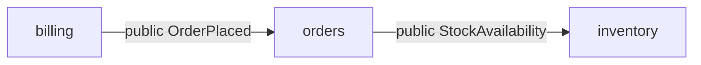
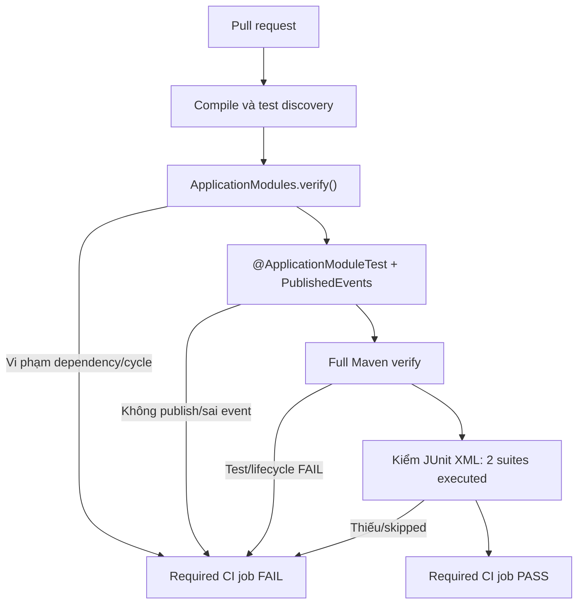

# Đưa verify và module test vào CI

> **Chương:** Dự án thực hành  
> **Module học:** `SPRING_MODULITH_VERIFICATION_TESTING` — kiểm chứng ranh giới kiến trúc Spring Modulith bằng `ApplicationModules`, quy tắc phụ thuộc module; thực hành `@ApplicationModuleTest`, sự kiện, database/tích hợp và quality gate trong CI để chặn phụ thuộc sai, hồi quy.

## 1. Đề bài: một pull request sai kiến trúc hoặc sai event phải bị chặn

Ứng dụng `shop` có ba module: `inventory` công bố API tra tồn kho, `orders` sử dụng API đó để đặt hàng và publish `OrderPlaced`, `billing` là consumer của sự kiện. Nhóm có hai JUnit tests chạy được trên laptop nhưng chưa đưa vào pipeline. Một pull request có thể vô tình import `inventory.internal` vào `orders`, hoặc xóa câu lệnh publish event, mà CI vẫn báo thành công vì chỉ chạy compile.

**Mục tiêu bài thực hành:** biến hai phép kiểm độc lập thành **required CI gate**:

1. **Structural verification:** `ApplicationModules.of(ShopApplication.class).verify()` phải FAIL khi vi phạm module boundaries, chu trình hoặc ràng buộc dependencies.
2. **Module behavior:** `@ApplicationModuleTest` gọi service thật, `PublishedEvents` kiểm `OrderPlaced` được publish với payload đúng. Phép kiểm phải FAIL khi code bỏ publish hoặc map event sai.

| Thay đổi trong PR | Compile | Verify kiến trúc | Module event test | Kết luận CI |
| --- | --- | --- | --- | --- |
| Đổi tên biến local, không đổi contract | PASS | PASS | PASS | Có thể merge sau các checks khác |
| `orders` tham chiếu `inventory.internal` | Có thể PASS | **FAIL** | Có thể PASS | **Chặn merge** |
| Thêm `inventory → orders`, tạo cycle | Có thể PASS | **FAIL** | Không liên quan | **Chặn merge** |
| `OrderManagement` bỏ publish event | PASS | Có thể PASS | **FAIL** | **Chặn merge** |
| Publish `OrderPlaced` sai `orderId` | PASS | Có thể PASS | **FAIL** | **Chặn merge** |
| Runner không chạy JUnit tests | PASS | Không thực thi | Không thực thi | **Chặn merge vì gate thiếu bằng chứng** |

**Bằng chứng hoàn thành** không phải chỉ một dòng `BUILD SUCCESS`. Người học cần nộp: mã hai JUnit tests, lệnh chạy tương ứng, CI workflow, báo cáo số tests đã được thực thi, một negative architecture probe và một negative event probe khiến **chính job required** chuyển đỏ.

**Giới hạn:** Bài này triển khai CI verification, không xây lại đầy đủ hệ thống bán hàng. Ví dụ module behavior không cần database để tránh lặp bài Testcontainers; nếu module production có persistence thì bổ sung database integration suite ở đúng job, không coi event test là bằng chứng DB đã commit.

## 2. Bố cục source nhỏ để cả hai gate có đối tượng kiểm

Giữ entry point `ShopApplication` tại `com.example.shop`, các package con trực tiếp là các application modules:

```text
src/main/java/com/example/shop/
├── ShopApplication.java
├── inventory/
│   ├── StockAvailability.java
│   └── internal/FixedStockAvailability.java
├── orders/
│   ├── package-info.java
│   ├── PlaceOrderCommand.java
│   ├── OrderPlaced.java
│   └── OrderManagement.java
└── billing/
    ├── package-info.java
    └── internal/OrderPlacedListener.java

src/test/java/com/example/shop/
├── ModuleArchitectureTest.java
└── orders/OrdersModuleEventTest.java
```

Sơ đồ phụ thuộc **tĩnh**:



Khi `orders` phát event, dữ liệu đi từ `orders` đến `billing` ở runtime; nhưng Java type dependency vẫn là `billing → orders` do consumer import `OrderPlaced`. Không lẫn **hướng event flow** với **hướng dependency** khi giải thích lỗi `verify()`.

### 2.1. Root application và public inventory contract

`src/main/java/com/example/shop/ShopApplication.java`:

```java
package com.example.shop;

import org.springframework.boot.SpringApplication;
import org.springframework.boot.autoconfigure.SpringBootApplication;

@SpringBootApplication
public class ShopApplication {

    public static void main(String[] args) {
        SpringApplication.run(ShopApplication.class, args);
    }
}
```

`src/main/java/com/example/shop/inventory/StockAvailability.java`:

```java
package com.example.shop.inventory;

public interface StockAvailability {
    boolean hasStock(String sku, int quantity);
}
```

`src/main/java/com/example/shop/inventory/internal/FixedStockAvailability.java`:

```java
package com.example.shop.inventory.internal;

import com.example.shop.inventory.StockAvailability;
import org.springframework.stereotype.Component;

@Component
public class FixedStockAvailability implements StockAvailability {

    @Override
    public boolean hasStock(String sku, int quantity) {
        return "SKU-001".equals(sku)
                && quantity > 0 && quantity <= 10;
    }
}
```

`StockAvailability` nằm ở package root `inventory` và là public module API. `FixedStockAvailability` là `public class` theo Java, nhưng vì ở `inventory.internal` nên module khác **không nên tham chiếu nó**. Sự phân biệt này cần được structural gate bảo vệ.

### 2.2. Orders command, event và service

`src/main/java/com/example/shop/orders/PlaceOrderCommand.java`:

```java
package com.example.shop.orders;

import java.util.UUID;

public record PlaceOrderCommand(
        UUID orderId, String sku, int quantity
) {
    public PlaceOrderCommand {
        if (orderId == null || sku == null || sku.isBlank()
                || quantity <= 0) {
            throw new IllegalArgumentException("INVALID_ORDER");
        }
    }
}
```

`src/main/java/com/example/shop/orders/OrderPlaced.java`:

```java
package com.example.shop.orders;

import java.util.UUID;

public record OrderPlaced(
        UUID eventId, UUID orderId, String sku, int quantity
) {}
```

`src/main/java/com/example/shop/orders/OrderManagement.java`:

```java
package com.example.shop.orders;

import java.util.UUID;
import com.example.shop.inventory.StockAvailability;
import org.springframework.context.ApplicationEventPublisher;
import org.springframework.stereotype.Service;

@Service
public class OrderManagement {

    private final StockAvailability stock;
    private final ApplicationEventPublisher publisher;

    public OrderManagement(
            StockAvailability stock,
            ApplicationEventPublisher publisher) {
        this.stock = stock;
        this.publisher = publisher;
    }

    public OrderPlaced place(PlaceOrderCommand command) {
        if (!stock.hasStock(command.sku(), command.quantity())) {
            throw new IllegalStateException("OUT_OF_STOCK");
        }

        OrderPlaced event = new OrderPlaced(
                UUID.randomUUID(), command.orderId(),
                command.sku(), command.quantity());
        publisher.publishEvent(event);
        return event;
    }
}
```

Ở demo này, `OrderManagement` không ghi database. Nhờ vậy `OrdersModuleEventTest` chỉ kiểm event behavior — không cần H2, Docker hoặc SQL fixture. Nếu dự án thực có JDBC repository trong module `orders`, phải cấu hình database test phù hợp khi boot module scope, không bỏ qua production collaborator để được xanh.

### 2.3. Billing consumer và whitelist module dependencies

`src/main/java/com/example/shop/billing/internal/OrderPlacedListener.java`:

```java
package com.example.shop.billing.internal;

import com.example.shop.orders.OrderPlaced;
import org.springframework.context.event.EventListener;
import org.springframework.stereotype.Component;

@Component
public class OrderPlacedListener {

    @EventListener
    public void on(OrderPlaced event) {
        // Demo consumer type dependency, chưa có DB side effect.
    }
}
```

Để structural gate chặn cả một dependency **không tạo cycle** như `billing → inventory`, đặt chính sách whitelist:

`src/main/java/com/example/shop/orders/package-info.java`:

```java
@org.springframework.modulith.ApplicationModule(
        allowedDependencies = "inventory")
package com.example.shop.orders;
```

`src/main/java/com/example/shop/billing/package-info.java`:

```java
@org.springframework.modulith.ApplicationModule(
        allowedDependencies = "orders")
package com.example.shop.billing;
```

Như vậy `orders` chỉ được phụ thuộc API công bố của `inventory`; `billing` chỉ được phụ thuộc API công bố của `orders`. Hãy giữ package `internal` thật sự không được công bố — không mở `@NamedInterface` toàn bộ `internal` chỉ để tránh architectural test FAIL.

## 3. JUnit kiến trúc: `verify()` phải fail build khi source lệch boundary

`src/test/java/com/example/shop/ModuleArchitectureTest.java`:

```java
package com.example.shop;

import static org.junit.jupiter.api.Assertions.assertEquals;
import static org.junit.jupiter.api.Assertions.assertTrue;

import java.util.concurrent.atomic.AtomicInteger;
import org.junit.jupiter.api.Test;
import org.springframework.modulith.core.ApplicationModules;

class ModuleArchitectureTest {

    @Test
    void expectedThreeModulesAreDiscovered() {
        ApplicationModules modules =
                ApplicationModules.of(ShopApplication.class);

        assertTrue(modules.getModuleByName("inventory").isPresent());
        assertTrue(modules.getModuleByName("orders").isPresent());
        assertTrue(modules.getModuleByName("billing").isPresent());

        AtomicInteger count = new AtomicInteger();
        modules.forEach(module -> count.incrementAndGet());
        assertEquals(3, count.get());
    }

    @Test
    void architecturalDependenciesAreValid() {
        ApplicationModules.of(ShopApplication.class).verify();
    }
}
```

**Hai bất biến khác nhau:**

- `expectedThreeModulesAreDiscovered` kiểm mô hình kỳ vọng: có đúng ba modules; nếu xuất hiện module `reports` ngoài kế hoạch, đây là thay đổi cần review dù dependencies vẫn hợp lệ.
- `architecturalDependenciesAreValid` chạy `verify()`: kiểm chu trình, API exposure và whitelist `allowedDependencies` theo cấu hình. Một import sang `inventory.internal` hoặc một cạnh `billing → inventory` phải khiến test FAIL.

Không cần `@SpringBootTest`, database hay container cho test cấu trúc. Nó phân tích bytecode/package/module model, nên chạy nhanh và báo lỗi sát nguyên nhân.

**Không viết `assertThrows(...verify())` trong test chính.** Required gate mong source **không** vi phạm, vì vậy gọi `verify()` trực tiếp trong JUnit. Khi muốn chứng minh detector hoạt động, thay đổi source trên nhánh thử và yêu cầu test chuẩn chuyển đỏ, rồi hoàn nguyên.

### 3.1. Một lỗi CI phải mang đúng nguyên nhân

Ví dụ sau Java vẫn có thể compile:

```java
// Chỉ dùng làm negative probe rồi xóa.
package com.example.shop.orders;

import com.example.shop.inventory.internal.FixedStockAvailability;

class ForbiddenInventoryImplementation {
    private FixedStockAvailability implementation;
}
```

Field type tạo dependency thật tới `inventory.internal`, không chỉ là import không dùng. `ModuleArchitectureTest.architecturalDependenciesAreValid` phải FAIL với violation tương ứng. Nếu job chỉ fail do syntax error hoặc thiếu dependency, điều đó **không** chứng minh architectural gate có tác dụng.

## 4. JUnit module: `@ApplicationModuleTest` và `PublishedEvents` bảo vệ hợp đồng event

Một PR có thể giữ tất cả dependencies đúng nhưng xóa `publisher.publishEvent(event)` hoặc thay `event.orderId` bằng UUID khác. Khi đó `ApplicationModules.verify()` vẫn có thể PASS. **Module event test** cần đặt một yêu cầu runtime cụ thể: khi còn đủ tồn kho, service thực sự phát `OrderPlaced` với ID, SKU và quantity của request; khi hết hàng, service không phát event.

### 4.1. Boot đúng module, stub đúng public API

`src/test/java/com/example/shop/orders/OrdersModuleEventTest.java`:

```java
package com.example.shop.orders;

import static org.assertj.core.api.Assertions.assertThat;
import static org.junit.jupiter.api.Assertions.assertThrows;

import java.util.UUID;
import com.example.shop.inventory.StockAvailability;
import org.junit.jupiter.api.Test;
import org.springframework.beans.factory.annotation.Autowired;
import org.springframework.boot.test.context.TestConfiguration;
import org.springframework.context.annotation.Bean;
import org.springframework.context.annotation.Import;
import org.springframework.modulith.test.ApplicationModuleTest;
import org.springframework.modulith.test.PublishedEvents;

@ApplicationModuleTest
@Import(OrdersModuleEventTest.InventoryStub.class)
class OrdersModuleEventTest {

    @TestConfiguration(proxyBeanMethods = false)
    static class InventoryStub {

        @Bean
        StockAvailability stockForOrdersModuleTest() {
            return (sku, quantity) ->
                    "SKU-001".equals(sku) && quantity <= 10;
        }
    }

    @Autowired
    OrderManagement orders;

    @Test
    void publishesExpectedOrderPlaced(PublishedEvents published) {
        UUID orderId = UUID.randomUUID();
        PlaceOrderCommand command =
                new PlaceOrderCommand(orderId, "SKU-001", 2);

        OrderPlaced returned = orders.place(command);

        assertThat(returned.orderId()).isEqualTo(orderId);
        assertThat(returned.sku()).isEqualTo("SKU-001");
        assertThat(returned.quantity()).isEqualTo(2);
        assertThat(returned.eventId()).isNotNull();

        assertThat(published.ofType(OrderPlaced.class))
                .anySatisfy(event -> {
                    assertThat(event.eventId())
                            .isEqualTo(returned.eventId());
                    assertThat(event.orderId()).isEqualTo(orderId);
                    assertThat(event.sku()).isEqualTo("SKU-001");
                    assertThat(event.quantity()).isEqualTo(2);
                });
    }

    @Test
    void outOfStockPublishesNoOrderPlaced(
            PublishedEvents published) {
        UUID orderId = UUID.randomUUID();
        PlaceOrderCommand command =
                new PlaceOrderCommand(orderId, "SKU-OUT", 1);

        IllegalStateException failure = assertThrows(
                IllegalStateException.class,
                () -> orders.place(command));

        assertThat(failure.getMessage())
                .isEqualTo("OUT_OF_STOCK");
        assertThat(published.ofType(OrderPlaced.class)).isEmpty();
    }
}
```

**Bằng chứng kiểm được:**

- `orders` production service chạy trong module context của Spring, không phải object fixture tự tạo.
- Stub bên ngoài module được cung cấp qua **public `inventory.StockAvailability`**, không import `inventory.internal.FixedStockAvailability`.
- `PublishedEvents` quan sát event được Spring publish từ service thật.
- Test thứ hai bảo vệ việc **không phát event trên đường lỗi**, điều kiện thường bị bỏ quên khi chỉ kiểm happy path.

### 4.2. Không để CI xanh dù test chỉ assert fixture do chính nó tạo

Anti-pattern:

```java
@Test
void weakEventTest() {
    OrderPlaced expected = new OrderPlaced(
            UUID.randomUUID(), UUID.randomUUID(), "SKU-001", 2);
    assertThat(expected.sku()).isEqualTo("SKU-001");
}
```

Test này có thể PASS ngay cả khi production không bao giờ publish. `OrdersModuleEventTest` phải gọi `orders.place(command)` và assert trên `PublishedEvents`, không chỉ xây một record mới rồi tự so với chính nó.

### 4.3. Quy mô assertion hợp lý

`anySatisfy(...)` chứng minh **ít nhất một** event khớp; nó chưa chứng minh **chính xác một** event. Nếu business contract quy định không được phát duplicate, bổ sung assertion số event phù hợp API `PublishedEvents` của Spring Modulith version đang dùng hoặc một recorder đếm sự kiện độc lập.

Trong ví dụ ở trên, `PublishedEvents` được cấp cho từng test method; không dùng một `static List<OrderPlaced>` chung làm recorder, tránh test order dependence khi CI chạy suite song song.

### 4.4. Nếu module service có database

Khi `OrderManagement` về sau có `JdbcOrderRepository` và transaction:

- `@ApplicationModuleTest` có thể cần DataSource/Flyway/Testcontainers để boot production repository của module.
- `PublishedEvents` vẫn chỉ chứng minh event **được publish**, không chứng minh database đã commit hoặc consumer `billing` đã xử lý.
- Đưa một database integration test đúng engine vào CI; không thay repository bằng no-op rồi tuyên bố SQL đã được kiểm.
- Nếu listener chạy after-commit/async, phải viết test theo transaction lifecycle và chờ effect có điều kiện, không `Thread.sleep(...)` tùy tiện.

**Chốt phạm vi:** `ModuleArchitectureTest` kiểm static boundaries; `OrdersModuleEventTest` kiểm runtime event behavior trong module; database/integration tests là lớp tiếp theo khi use case thực sự có DB.

## 5. Maven Surefire: làm sao để cả hai test thật sự được khám phá?

### 5.1. Đặt test ở `src/test/java` với tên nhận diện được

```text
src/test/java/
  com/example/shop/ModuleArchitectureTest.java
  com/example/shop/orders/OrdersModuleEventTest.java
```

Với Maven Surefire/JUnit Platform thông thường, các tên `*Test` này được phát hiện. Một file `OrdersModuleEventSpec.java` có thể không được Surefire chọn nếu không cấu hình convention; không dựa vào việc nó **biên dịch** để suy rằng đã chạy.

Trong `pom.xml`, phải có Spring Modulith core/test và Boot JUnit dependencies dưới BOM tương thích. Ví dụ phần dependencies liên quan:

```xml
<!-- Dependencies fragment, chưa phải toàn bộ pom.xml -->
<dependency>
    <groupId>org.springframework.modulith</groupId>
    <artifactId>spring-modulith-starter-core</artifactId>
</dependency>
<dependency>
    <groupId>org.springframework.modulith</groupId>
    <artifactId>spring-modulith-starter-test</artifactId>
    <scope>test</scope>
</dependency>
<dependency>
    <groupId>org.springframework.boot</groupId>
    <artifactId>spring-boot-starter-test</artifactId>
    <scope>test</scope>
</dependency>
```

Chọn các phiên bản Spring Boot, Modulith và Surefire **tương thích theo BOM/plugin management**, không hardcode ngẫu nhiên một artifact version chỉ để hết lỗi dependency resolution.

### 5.2. Không chấp nhận project không có test mà vẫn báo xanh

Nếu đang dùng Spring Boot parent quản lý Surefire, có thể bật kiểm tra tối thiểu:

```xml
<build>
    <plugins>
        <plugin>
            <groupId>org.apache.maven.plugins</groupId>
            <artifactId>maven-surefire-plugin</artifactId>
            <configuration>
                <failIfNoTests>true</failIfNoTests>
            </configuration>
        </plugin>
    </plugins>
</build>
```

Đây là **một đoạn cấu hình bổ sung**; ghép vào `<build><plugins>` hiện có, không tạo hai block `<build>` cạnh nhau. `failIfNoTests` kiểm tình huống không có test trong module Maven; nó **không** tự chứng minh hai class cụ thể đã chạy. Bước kiểm JUnit XML ở mục 7 sẽ làm chốt thứ hai.

### 5.3. Chạy một test, hai test và toàn suite

```bash
# Chạy structural verification trước để báo lỗi architecture rõ.
./mvnw -B -ntp -Dtest=ModuleArchitectureTest test

# Chạy module behavior, gồm cả nhánh thành công và hết hàng.
./mvnw -B -ntp -Dtest=OrdersModuleEventTest test

# Chạy mọi test được nối vào lifecycle và các verify goals.
./mvnw -B -ntp verify
```

Sau từng lệnh, xem report Surefire trong `target/surefire-reports`. `-Dtest=...` yêu cầu test cụ thể; khi class không tồn tại hoặc không được tìm thấy, command phải trả lỗi theo cấu hình Surefire thông thường. Không thêm `-Dsurefire.failIfNoSpecifiedTests=false` để bỏ qua lỗi đó.

### 5.4. Đừng bỏ sót các integration test đặt tên `*IT`

Maven `verify` không tự động chạy mọi class tên `*IT` nếu Failsafe không được cấu hình chạy trong các phases thích hợp. Khi dự án có PostgreSQL/Testcontainers integration tests, chọn một convention rõ:

- Hoặc đặt trong `src/test/java` với tên `*Test` để Surefire chạy qua task đang dùng.
- Hoặc dùng `*IT` + Maven Failsafe `integration-test`/`verify` executions, đồng thời buộc CI kiểm reports của nhóm đó.

Không “đẩy” database test sang task khác rồi quên nối nó vào required CI gate. Đối với hai class chính của bài, chỉ cần Surefire/JUnit Platform như trên.

## 6. Gradle tương đương: dùng `check` đúng task graph, không chỉ chạy compile

Nếu dự án dùng Gradle thay Maven, chọn **một** pipeline phù hợp. Với Java/Spring Boot Gradle project có test dependencies, cấu hình JUnit Platform:

```groovy
// build.gradle, ghép vào cấu hình build hiện có.
tasks.withType(Test).configureEach {
    useJUnitPlatform()
}
```

Với Java plugin, task `check` thông thường phụ thuộc task `test`. Có thể chạy các phép kiểm theo thứ tự:

```bash
./gradlew --no-daemon test --tests 'com.example.shop.ModuleArchitectureTest'
./gradlew --no-daemon test --tests 'com.example.shop.orders.OrdersModuleEventTest'
./gradlew --no-daemon check
```

**Hai sai sót cần tránh:**

1. Chạy `./gradlew classes` hoặc `./gradlew assemble` rồi xem đó là architectural gate. Các task build artifacts này không thay thế JUnit test execution.
2. Tạo custom `integrationTest` task nhưng không nối `check.dependsOn(integrationTest)` hoặc không thêm một CI required job tương ứng. Khi đó `check` xanh không bảo đảm integration tests đã chạy.

Nếu cấu hình task riêng cho architecture/module tests, cần đặt `testClassesDirs`, `classpath`, `useJUnitPlatform()` và filter đúng, rồi nối vào `check`; kiểm report mỗi task. Không cần tách task chỉ để tăng số jobs CI nếu bộ test nhỏ, bởi `test` mặc định đã chạy hai lớp.

## 7. GitHub Actions: hai test trở thành một required quality gate

Một workflow tốt cho bài này phải có cả **đường chạy** và **đường thất bại**:



### 7.1. Workflow hoàn chỉnh cho Maven project một module

Trong **project người học**, tạo `.github/workflows/modulith-gate.yml`:

```yaml
name: modulith-gate

on:
  pull_request:
  push:
    branches: [main]

permissions:
  contents: read

jobs:
  verify:
    runs-on: ubuntu-latest
    timeout-minutes: 25
    steps:
      - name: Check out source
        uses: actions/checkout@v4

      - name: Configure JDK 21
        uses: actions/setup-java@v4
        with:
          distribution: temurin
          java-version: "21"
          cache: maven

      - name: Verify module boundaries
        run: ./mvnw -B -ntp -Dtest=ModuleArchitectureTest test

      - name: Verify module event contract
        run: ./mvnw -B -ntp -Dtest=OrdersModuleEventTest test

      - name: Run full build verification
        run: ./mvnw -B -ntp verify

      - name: Assert required test suites actually ran
        shell: bash
        run: |
          set -eu
          for suite in \
            com.example.shop.ModuleArchitectureTest \
            com.example.shop.orders.OrdersModuleEventTest; do
            report="target/surefire-reports/TEST-$suite.xml"
            if [ ! -s "$report" ]; then
              echo "::error::Missing JUnit report $report"
              exit 1
            fi
            if ! grep -Eq 'tests="[1-9][0-9]*"' "$report"; then
              echo "::error::No executed tests in $report"
              exit 1
            fi
            for field in failures errors skipped; do
              if ! grep -q "$field=\"0\"" "$report"; then
                echo "::error::Unexpected $field in $report"
                exit 1
              fi
            done
          done
```

**Những điều workflow này làm rõ:**

1. Hai JUnit classes có **bước chạy riêng**, nên lỗi architectural không lẫn với lỗi event behavior.
2. `./mvnw verify` chạy full test lifecycle theo cấu hình POM, không chỉ hai test được liệt kê.
3. Bước cuối yêu cầu JUnit XML của **từng class bắt buộc** phải tồn tại, chứa số tests khác 0, không có failures/errors/skipped.
4. Mỗi `run` trả exit code không 0 sẽ làm job FAIL; không dùng `continue-on-error` hoặc `|| true`.

Ví dụ dùng format XML phổ biến của Maven Surefire, nơi root test suite có attributes `tests`, `failures`, `errors`, `skipped`. Nếu version Surefire/reporter xuất format khác, sửa đoạn kiểm bằng XML parser và xác nhận bằng một report thực — **không bỏ kiểm suite presence**. Với multi-module Maven build, đổi report path sang submodule chứa tests; không suy mọi XML nằm ở `target/` root.

### 7.2. Vì sao không dùng một bước `mvn package -DskipTests`?

`compile` và `package` có thể thành công ngay cả khi code:

- Tham chiếu kiểu `public` nằm ở `inventory.internal`.
- Có cycle ở application module level.
- Không còn `publisher.publishEvent(event)`.

Vì Java compiler không thể thay thế Spring Modulith verification/behavior assertions, job CI phải thực thi JUnit tests thật. Không lách required check bằng cách chạy lệnh `-DskipTests` hoặc `-x test`.

### 7.3. Cấu hình nhánh bảo vệ

Trong branch protection/ruleset, đặt status check **`modulith-gate / verify`** (tên hiển thị thực tế của workflow/job theo repository) làm *required* trước khi merge. Không chỉ thêm file YAML rồi giả định mọi PR đã bị chặn: người có quyền merge có thể vượt qua nếu policy chưa yêu cầu check.

Khi tổ chức có queue/merge groups, bổ sung triggers tương ứng để required status luôn được sinh cho commit đang merge; không cấu hình required check chỉ hoạt động ở một số nhánh rồi bỏ sót PR khác.

### 7.4. Chọn phiên bản GitHub Actions và môi trường runner

Các phiên bản actions ở trên là ví dụ dễ đọc; trong hệ thống có security policy, pin action tới revision được phép và cập nhật theo tổ chức. Runner phải có Java 21 và khả năng chạy Maven Wrapper. Nếu `./mvnw` không có executable bit trên Linux, sửa quyền trong repository **một lần** rồi commit, không đổi workflow thành bỏ bước test.

Nếu module test vẫn còn gọi database/broker thật, runner cũng phải có infrastructure tương ứng. Trong mini project hiện tại, module event test dùng stub `StockAvailability` và không đòi Docker.

### 7.5. Test reports là artifacts có thể chứa dữ liệu nhạy cảm

JUnit XML có thể chứa exception message, assertion diff và captured logs. Chỉ dùng synthetic fixtures, không in token/PII thật vào failure messages. Nếu cần upload XML làm artifacts cho review, kiểm quyền truy cập, retention và dữ liệu cần redaction; không tự động upload toàn bộ `target/` rồi mặc định mọi thứ an toàn.

## 8. Negative probes: chứng minh CI **đỏ đúng lý do**

Không chỉ chụp màn hình job xanh. Trên **nhánh tạm**, thực hiện ba phép thử dưới đây, mỗi lần chỉ thay đổi một điều và khôi phục ngay sau khi xem kết quả.

### 8.1. Probe A — truy cập `inventory.internal`

Tạo class `ForbiddenInventoryImplementation` đã minh họa ở mục 3 trong production `orders`. Chạy:

```bash
./mvnw -B -ntp -Dtest=ModuleArchitectureTest test
```

**Kỳ vọng:** Java compile có thể PASS, `architecturalDependenciesAreValid` FAIL do reference `orders → inventory.internal.FixedStockAvailability`. Trên pull request, bước `Verify module boundaries` phải chuyển đỏ và chặn toàn job.

Đừng thêm chỉ một `import` không được sử dụng: compiler có thể không giữ nó như một bytecode dependency. Dùng field type/reference thật.

### 8.2. Probe B — dependency ngoài whitelist nhưng không có cycle

Tạo tạm một class trong `billing.internal` tham chiếu `inventory.StockAvailability`:

```java
package com.example.shop.billing.internal;

import com.example.shop.inventory.StockAvailability;

class ForbiddenDirectInventoryQuery {
    private StockAvailability stock;
}
```

`billing → inventory` không tự tạo chu trình trong đồ thị `billing → orders → inventory`, nhưng `billing/package-info.java` chỉ cho phép `orders`. `verify()` phải FAIL theo whitelist. Nếu test vẫn PASS, kiểm annotation `allowedDependencies` có được đặt đúng package-info và source class có nằm trong module dự kiến không.

### 8.3. Probe C — bỏ publication dù kiến trúc vẫn đúng

Trong `OrderManagement.place`, tạm bỏ:

```java
publisher.publishEvent(event);
```

**Kỳ vọng:** `ModuleArchitectureTest` vẫn có thể PASS, bởi static dependency graph không đổi. `OrdersModuleEventTest.publishesExpectedOrderPlaced` phải FAIL vì `PublishedEvents` không quan sát event cần thiết. Job `Verify module event contract` chuyển đỏ.

Một biến thể khác: tạo event với `UUID.randomUUID()` mới ở vị trí `orderId`. `PublishedEvents` có thể vẫn thấy `OrderPlaced`, nhưng field assertions sẽ FAIL. Vì vậy test không chỉ kiểm “có event” mà còn kiểm **payload**.

### 8.4. Đọc negative probe theo ma trận

| Source state | Structural test | Module behavior test | CI required job |
| --- | --- | --- | --- |
| Code đúng | PASS | PASS | PASS nếu full suite cũng xanh |
| `orders → inventory.internal` | **FAIL** | Có thể PASS | **FAIL** |
| `billing → inventory` ngoài whitelist | **FAIL** | Có thể PASS | **FAIL** |
| Bỏ publish event | Có thể PASS | **FAIL** | **FAIL** |
| Không khám phá hai class test | Không có bằng chứng | Không có bằng chứng | **FAIL** ở lệnh chọn test/report check |

**Điều kiện nghiệm thu của probe:** phải biết test nào FAIL, vì sao, exit code của CI là nonzero và code vi phạm đã được hoàn nguyên. Một lỗi không liên quan (ví dụ thiếu Maven dependency hoặc sai syntax Java) không chứng minh gate architectural/event hoạt động.

### 8.5. Không thay test chuẩn để mong nó PASS khi source sai

Không sửa `ModuleArchitectureTest` thành `assertThrows(...verify())` hoặc sửa `OrdersModuleEventTest` thành `assertThat(published...).isEmpty()` trên nhánh chính chỉ để âm tính “đã chạy thành công”. Trong quality gate thực, **source sai phải khiến test chuẩn FAIL**. Negative probe dùng branch hoặc commit tạm rồi revert, không đổi định nghĩa đúng–sai của test.

## 9. Khi có database/integration tests: nối chúng vào CI mà không che hai gate chính

Ứng dụng thực tế có thể thêm `orders.internal.JdbcOrderStore`, bảng `placed_orders`, `billing_receipts` và after-commit event handlers. Hai test ở mục 3–4 vẫn cần giữ, nhưng chúng **không** chứng minh transaction/SQL đầy đủ.

### 9.1. Ba tầng CI phải được đặt tên rõ

| Tầng | Test đại diện | Runtime cần | Rủi ro bị phát hiện |
| --- | --- | --- | --- |
| Structural | `ModuleArchitectureTest` | Không cần Spring context/DB | Module cycles, non-public API, whitelist |
| Module | `OrdersModuleEventTest` | Module context + public port stub | Thiếu/sai `OrderPlaced` |
| Database/integration | `ShopDatabasePostgresTest` nếu dự án đã có | PostgreSQL Testcontainers/Flyway | SQL, constraints, rollback, listener side effect |

Không đưa `PostgresTestConfig` vào structural test. Nó chỉ làm test chậm và biến lỗi Docker thành nhiễu khi kiểm module boundary.

### 9.2. Nếu dùng Maven Failsafe cho `*IT`

Khi chuyển DB tests sang `*IT`, phải cấu hình Failsafe chạy `integration-test`/`verify` và đọc `target/failsafe-reports`. Dùng `./mvnw verify` **chỉ sau khi** task graph đã được xác nhận có chạy DB integration tests; test class nằm trong source chưa đủ.

Với Gradle, nếu có `integrationTest` task riêng:

```groovy
// Ghép khi project đã khai báo task integrationTest.
tasks.named('check') {
    dependsOn tasks.named('integrationTest')
}
```

Đoạn trên không tự tạo task `integrationTest`. Nếu chưa có task, thiết lập source set, JUnit Platform, test runtime classpath và report trước; hoặc giữ DB tests trong task `test` tiêu chuẩn.

### 9.3. CI với Testcontainers

Runner cho integration tests cần Docker hoặc container runtime được hỗ trợ, quyền pull PostgreSQL image và cấu hình `@ServiceConnection`/DataSource trỏ vào container. Thiếu container runtime phải làm DB required gate **FAIL rõ ràng**, không tự chuyển về H2 mà vẫn gắn nhãn PostgreSQL integration PASS.

Không xóa trách nhiệm đó bằng cách mock tất cả repositories trong `@SpringBootTest`, rồi tuyên bố SQL/commit đã được kiểm. Nếu test cần database thật, giữ một suite riêng có report và status bắt buộc.

### 9.4. CI song song và dữ liệu kiểm thử

Test execution order trên CI không phải hợp đồng. Mỗi scenario dùng ID riêng, không chia sẻ mutable static fixture, tránh cleanup `DELETE` toàn bảng giữa các tests song song. Với `@ApplicationModuleTest`, Spring context cache và singleton test stubs có thể được tái sử dụng; ưu tiên stateless stub như `InventoryStub` trong bài.

Khi event processing bất đồng bộ, thay assertion “receipt có ngay” bằng chờ một điều kiện cụ thể theo `eventId` với timeout và cleanup, không ngủ cố định `Thread.sleep(2000)` rồi suy từ timing.

**Kết luận phạm vi:** CI chỉ có ý nghĩa khi phân biệt tên và bằng chứng của từng gate. `verify()`, `PublishedEvents` và DB integration là ba lớp bổ sung nhau, không có lớp nào thay thế hoàn toàn hai lớp còn lại.

## 10. Chẩn đoán CI đỏ, CI xanh giả và khác biệt local–runner

Khi CI lỗi, hãy phân loại **mục nào thực thi và thất bại**, không sửa dữ liệu hoặc nới kiến trúc theo phản xạ. Một lỗi từ `verify()` có hướng xử lý khác hẳn lỗi Spring module context không tìm thấy bean hoặc report không có test.

### 10.1. Bảng điều tra theo nơi lỗi xuất hiện

| Bước | Triệu chứng | Kiểm trước | Hướng sửa đúng |
| --- | --- | --- | --- |
| Compile | `cannot find symbol` với `OrderPlaced` | Package/public API đã đổi? | Sửa đúng imports, không mở `internal` |
| Structural | Violation `orders → inventory.internal` | Class nào giữ reference thực? | Dùng public `StockAvailability` |
| Structural | Cycle `orders ↔ billing` | `orders` có inject concrete consumer? | Loại dependency ngược, dùng event contract |
| Structural | `billing → inventory` ngoài whitelist | `billing/package-info.java` | Bỏ direct dependency, không mở rộng allowedDependencies tùy tiện |
| Model count | Xuất hiện module thứ tư | Có package con trực tiếp ngoài thiết kế? | Review mô hình, cập nhật policy nếu thay đổi hợp lệ |
| Module bootstrap | `No qualifying bean of type StockAvailability` | Standalone scope không load `inventory` | Import test stub qua public interface |
| Module bootstrap | Có hai bean `StockAvailability` | Đang boot dependent modules + test stub? | Điều chỉnh bootstrap/replacement theo version |
| Event test | Không có `OrderPlaced` | `publishEvent` có được gọi? | Sửa production event path, không assert fixture tự tạo |
| Event test | `orderId`/quantity sai | Service map từ command thế nào? | Sửa mapping, giữ independent expected values |
| Maven runner | `No tests were executed` | Class tên `*Test`? JUnit/Surefire discovery? | Sửa naming, plugin config, source set |
| Gradle runner | Task `NO-SOURCE`/`SKIPPED` | `check` có nối `test`/custom task? | Sửa task graph/filters |
| GHA runner | `./mvnw: Permission denied` | Wrapper executable bit trên Linux? | Commit quyền execute, không skip command |
| XML gate | Không có `TEST-...xml` | Test class đã chạy? Report path đúng? | Sửa report path sau khi xác minh executed tests |
| Testcontainers | Không tìm được Docker | Runner có container runtime? | Cấp runtime hoặc dùng runner phù hợp; không H2 fallback |

### 10.2. Ưu tiên tìm “lỗi đầu tiên đúng tầng”

Một workflow có ba bước riêng giúp xác định tầng lỗi:

```text
Verify module boundaries          FAIL
Verify module event contract      NOT RUN
Run full build verification       NOT RUN

=> Bắt đầu từ ApplicationModules.verify().

Verify module boundaries          PASS
Verify module event contract      FAIL
Run full build verification       NOT RUN

=> Bắt đầu từ @ApplicationModuleTest,
   StockAvailability stub và PublishedEvents assertions.

Verify module boundaries          PASS
Verify module event contract      PASS
Run full build verification       FAIL

=> Kiểm các tests/lifecycle khác trong build,
   có thể là database/integration hoặc packaging.
```

Nếu bước report check FAIL nhưng ba bước trước đều PASS, có thể đang dùng path/file naming XML khác hoặc reporter không xuất thuộc tính như giả định. Cần xem **tên file report thực sự được sinh**, số test và số skipped; sửa kiểm chứng để phản ánh đúng format, không tắt report presence check.

### 10.3. CI xanh giả có thể đến từ đâu?

Các lỗi thường khiến một repository “có test” nhưng pipeline không kiểm:

- CI chỉ chạy `compile`/`assemble`; không có test runner.
- Maven có `-DskipTests` hoặc Surefire `<skipTests>true</skipTests>` trong active profile.
- Gradle `-x test` hoặc task `test.enabled = false`.
- Một test bị `@Disabled`, bị exclude theo filter/tag hoặc không có trong source set của job.
- Custom `integrationTest` task không nằm dưới `check`.
- CI dùng `continue-on-error: true` hoặc shell `|| true` nên exit code đỏ không chặn merge.
- Có JUnit XML cũ trong artifact/cache và script kiểm file tồn tại thay vì run mới.
- Branch protection không buộc job kiểm tra kiến trúc là required.

Trong workflow đề xuất, checkout sạch và **chạy riêng từng class** trước khi đọc report giúp giảm nguy cơ “sáng tạo cảm giác xanh” từ một suite bị bỏ sót. Khi project chia thành nhiều Maven modules, dùng paths tương ứng với modules; đừng để script trỏ nhầm report của module khác.

### 10.4. Lỗi môi trường không phải lý do bỏ gate

Nếu local PASS nhưng CI FAIL do Java version khác, Maven plugin drift, container registry hoặc khác biệt timezone, cần **khóa/chỉnh môi trường** thay vì disable test. Với architecture tests, kiểm JDK, compiled classes và BOM/Modulith versions; với module tests, kiểm Spring test configuration và bean scope. Với database tests, kiểm PostgreSQL image/driver/migrations và Docker runtime.

Test có fixed Clock/test-local IDs, không phụ thuộc thứ tự và không gọi external services thật sẽ dễ tái lập hơn khi chạy song song. Dữ liệu nhạy cảm và secrets thật không nên xuất hiện trong fixtures hoặc CI failure logs.

### 10.5. Khi nào thay đổi policy thay vì sửa import?

Một architectural test đỏ **có thể** phản ánh quyết định thiết kế mới hợp lệ, ví dụ team đã review bổ sung module `reports` hoặc thêm một public named interface. Khi đó cập nhật diagram, package-info policy và expected modules **cùng PR**. Nhưng không được mở `allowedDependencies` thành không giới hạn chỉ vì một unit test đang cần repository nội bộ; hãy tạo/đi qua API chính thức.

## 11. Bài thực hành cuối, checklist CI và câu hỏi tự kiểm tra

### Bài A — Xác nhận baseline

1. Bố trí source theo ba module ở mục 2.
2. Viết `ModuleArchitectureTest` với hai JUnit methods: kiểm đúng ba modules và chạy `verify()`.
3. Viết `OrdersModuleEventTest` với `@ApplicationModuleTest` và `PublishedEvents`, một happy case và một out-of-stock case.
4. Chạy lần lượt từng test class bằng Maven `-Dtest=...` hoặc Gradle `--tests`.
5. Ghi lại số tests thực thi và vị trí report XML.

**Kết quả mong đợi:** Bốn JUnit methods của hai classes có tên rõ đều PASS; architectural test không cần Spring context/database.

### Bài B — Bật CI required gate

1. Thêm workflow `modulith-gate.yml` ở mục 7 vào project Maven.
2. Giữ ba bước riêng: `Verify module boundaries`, `Verify module event contract`, `Run full build verification`.
3. Thêm bước xác nhận Surefire XML của hai test classes, bảo đảm tests count lớn hơn 0 và không skipped.
4. Mở pull request và xác nhận job `verify` chạy trên commit của PR.
5. Đặt `modulith-gate / verify` thành required check theo chính sách repository.

**Kết quả mong đợi:** Không thể merge PR khi job required chưa chạy hoặc FAIL, ngay cả khi compile thành công.

### Bài C — Cố ý vi phạm kiến trúc

1. Trên branch tạm, thêm field kiểu `inventory.internal.FixedStockAvailability` trong production `orders`.
2. Push hoặc chạy CI tương đương.
3. Xác nhận `ModuleArchitectureTest` FAIL đúng nguyên nhân package nội bộ.
4. Hoàn nguyên source, chạy lại và xác nhận PASS.
5. Lặp nếu cần với `billing → inventory` để kiểm whitelist mà **không tạo cycle**.

**Kết quả mong đợi:** Có bằng chứng **structural job đỏ** trước khi source được khôi phục.

### Bài D — Cố ý làm mất event

1. Trên branch tạm khác, bỏ `publisher.publishEvent(event)` trong `OrderManagement`.
2. Xác nhận `verify()` vẫn có thể PASS nhưng `OrdersModuleEventTest` FAIL.
3. Khôi phục publication, xác nhận cả hai gate PASS.
4. Thử thay `orderId` trong event bằng UUID khác để xác nhận payload assertions cũng bắt lỗi.

**Kết quả mong đợi:** Có bằng chứng **module behavior job đỏ**, không chỉ dependency gate.

### Bài E — Kiểm full workflow không bỏ sót test

1. Chạy `./mvnw -B -ntp verify` hoặc `./gradlew check` trong project thật.
2. Xem số tests executed, số skipped và XML report paths.
3. Nếu có `*IT`/Testcontainers tests, xác nhận tasks tương ứng nằm trong required pipeline.
4. Xem security của build logs và reports trước khi tải/đính kèm artifacts.
5. Ghi lại tên required check và cách sửa khi job không phát hiện test.

**Kết quả mong đợi:** Báo cáo đầy đủ gồm structural, module và những integration tests đã được project yêu cầu; không có lỗi bị nuốt bởi runner.

### Checklist nghiệm thu

**Test và contract**

- [ ] `ModuleArchitectureTest` gọi `ApplicationModules.of(ShopApplication.class).verify()` trực tiếp.
- [ ] Quy tắc `allowedDependencies` thể hiện đúng giới hạn `orders → inventory`, `billing → orders`.
- [ ] Test cũng kiểm expected modules/count nếu project cần bảo vệ mô hình ba module.
- [ ] `OrdersModuleEventTest` thật sự gọi `OrderManagement.place(...)`.
- [ ] Stub tồn kho dùng public `StockAvailability`, không import `inventory.internal`.
- [ ] `PublishedEvents` kiểm ID, SKU, quantity; negative path không publish event.
- [ ] Các JUnit methods không bị `@Disabled` hoặc che lỗi bằng assertion tự tạo fixture.

**CI và build**

- [ ] Maven Surefire/JUnit Platform hoặc Gradle `useJUnitPlatform()` được cấu hình.
- [ ] Hai test classes được runner phát hiện, có số tests executed lớn hơn 0.
- [ ] Workflow chạy structural test, module event test và full lifecycle/test task.
- [ ] Reports xác minh không có failures/errors/skipped cho hai suites bắt buộc.
- [ ] Build failures trả exit code nonzero và làm required status đỏ.
- [ ] Branch protection/ruleset yêu cầu job `verify` PASS trước khi merge.
- [ ] Không có `-DskipTests`, `-x test`, `ignoreFailures`, `|| true` hoặc `continue-on-error` làm mất gate.
- [ ] Nếu có DB integration tests, chúng được nối vào required workflow riêng hoặc full `verify`/`check`.
- [ ] CI reports/logs không phát tán dữ liệu nhạy cảm từ fixtures.

**Negative probes**

- [ ] Import internal type có **field/method reference thật** khiến structural test FAIL.
- [ ] Phụ thuộc ngoài whitelist nhưng không cycle khiến `verify()` FAIL.
- [ ] Bỏ publish event hoặc map sai payload khiến module test FAIL.
- [ ] Sau mỗi probe, source đã hoàn nguyên và full required gate PASS.
- [ ] Có bằng chứng lỗi đúng nguyên nhân, không chỉ chụp dòng `BUILD FAILURE` chung chung.

### Tự kiểm tra

1. Vì sao `verify()` PASS vẫn không chứng minh `OrderPlaced` được publish?
2. Vì sao `OrdersModuleEventTest` PASS không chứng minh module boundaries đúng?
3. CI chỉ chạy `mvn compile` thì có thể bỏ lọt hai lỗi nào của bài?
4. Điều gì khiến `billing → inventory` bị cấm dù không có module cycle?
5. Vì sao `@ApplicationModuleTest` của `orders` cần stub `StockAvailability` theo standalone scope?
6. `PublishedEvents.ofType(...).anySatisfy(...)` chứng minh ít nhất một event hay đúng một event?
7. Khi đổi tên test class thành `*Spec`, Surefire có nhất thiết chạy nó không?
8. `failIfNoTests=true` đã đủ chứng minh **hai lớp cụ thể** đều được chạy chưa?
9. Bước kiểm `TEST-...xml` bổ sung bằng chứng gì so với chỉ nhìn `BUILD SUCCESS`?
10. Khi dự án thêm Testcontainers integration test, cần xem lại cấu hình runner và task graph nào?
11. Tại sao không nên nuốt exit code của `mvn verify` trong CI?
12. Bạn sẽ làm negative probe nào để chứng minh architecture job đỏ, và probe nào để chứng minh module event job đỏ?

**Ghi nhớ:** Đưa `verify()` và module test vào CI là tạo **hai quality gates độc lập nhưng cùng bắt buộc**: `ApplicationModules.verify()` ngăn dependency/cycle sai; `@ApplicationModuleTest` với `PublishedEvents` ngăn hồi quy event behavior. Chỉ khi runner thật sự phát hiện, thực thi, ghi report và truyền lỗi thành required status — đồng thời negative probes chứng minh hai gate có thể chuyển đỏ — thì pull request mới được bảo vệ, thay vì chỉ có các file JUnit đẹp trong repository.
