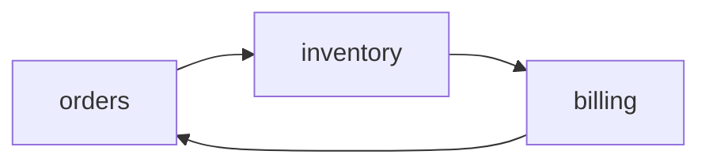

# Tạo `ApplicationModules` từ package gốc

## Mục tiêu học tập

Sau bài này, bạn có thể:

- Xác định đúng **package gốc** để Spring Modulith nhận diện các application module.
- Tổ chức package để các ranh giới module được nhận diện như mong muốn.
- Tạo mô hình `ApplicationModules` bằng `ApplicationModules.of(...)`, duyệt danh sách module và chạy `verify()`.
- Đưa bước xác minh kiến trúc vào kiểm thử tự động để phát hiện phụ thuộc vòng hoặc truy cập trái phép vào phần nội bộ của module.

Đây là bước nền trong việc **kiểm chứng kiến trúc Spring Modulith**. Muốn kiểm tra quy tắc phụ thuộc giữa các module, trước hết cần dựng đúng mô hình module từ cấu trúc mã nguồn. Một mô hình sai điểm xuất phát có thể khiến bài kiểm tra bỏ sót module hoặc gộp nhiều phần nghiệp vụ thành một module.

## 1. `ApplicationModules` là gì?

`org.springframework.modulith.core.ApplicationModules` là mô hình mô tả các **application module** mà Spring Modulith phát hiện trong một ứng dụng. Mô hình này được dựng bằng cách phân tích các package và kiểu Java trong phạm vi ứng dụng, sau đó có thể dùng để:

| Nhu cầu | Cách dùng |
| --- | --- |
| Nhận diện các module theo cấu trúc package | `ApplicationModules.of(ShopApplication.class)` |
| Quan sát module đã được phát hiện | Duyệt `ApplicationModules` và in thông tin từng module |
| Kiểm tra ranh giới và phụ thuộc | `modules.verify()` |
| Tạo quality gate trong quy trình build/CI | Gọi `verify()` trong bài kiểm thử JUnit |

Hãy phân biệt hai khái niệm:

- **Package gốc của ứng dụng**: package làm điểm bắt đầu để Spring Modulith tìm các module, ví dụ `com.example.shop`.
- **Package gốc của một module**: package đại diện cho một module nghiệp vụ, ví dụ `com.example.shop.orders`. Các kiểu nằm ngay trong package này thường tạo thành giao diện công khai mặc định của module; các kiểu trong package con như `orders.internal` là phần cài đặt nội bộ, trừ khi được khai báo xuất ra theo cơ chế được hỗ trợ.

Đối tượng `ApplicationModules` là một *mô hình kiến trúc*, không phải một `ApplicationContext` đang chạy và cũng không tự khởi động cơ sở dữ liệu, broker hay HTTP server.

## 2. Bắt đầu từ cấu trúc package

Xét ứng dụng bán hàng với lớp Spring Boot chính:

```java
// src/main/java/com/example/shop/ShopApplication.java
package com.example.shop;

import org.springframework.boot.SpringApplication;
import org.springframework.boot.autoconfigure.SpringBootApplication;

@SpringBootApplication
public class ShopApplication {

    public static void main(String[] args) {
        SpringApplication.run(ShopApplication.class, args);
    }
}
```

Một cấu trúc package phù hợp:

```text
src/main/java/
└── com/example/shop/               <- package gốc của ứng dụng
    ├── ShopApplication.java
    ├── orders/                      <- module orders
    │   ├── OrderManagement.java    <- API mặc định của orders
    │   ├── OrderPlaced.java
    │   └── internal/
    │       ├── OrderService.java
    │       └── OrderRepository.java
    ├── inventory/                   <- module inventory
    │   ├── InventoryManagement.java <- API mặc định của inventory
    │   └── internal/
    │       └── StockRepository.java
    └── billing/                     <- module billing
        ├── BillingManagement.java  <- API mặc định của billing
        └── internal/
            └── InvoiceRepository.java
```

Theo cách phát hiện mặc định thường dùng của Spring Modulith, **các package con trực tiếp** của package ứng dụng là các module: `orders`, `inventory`, `billing`. Package `orders.internal` thuộc về `orders`, không trở thành một module độc lập.

<svg xmlns="http://www.w3.org/2000/svg" viewBox="0 0 780 260" role="img" aria-label="Sơ đồ package ứng dụng với ba application module">
  <rect x="10" y="10" width="760" height="240" rx="16" fill="#f8fafc" stroke="#64748b" stroke-width="2"/>
  <text x="30" y="43" font-family="Arial, sans-serif" font-size="20" font-weight="700" fill="#0f172a">com.example.shop</text>
  <text x="30" y="65" font-family="Arial, sans-serif" font-size="13" fill="#475569">ShopApplication — điểm khởi tạo ApplicationModules</text>
  <g font-family="Arial, sans-serif">
    <rect x="28" y="89" width="221" height="142" rx="11" fill="#dbeafe" stroke="#2563eb"/>
    <text x="45" y="116" font-size="19" font-weight="700" fill="#1e3a8a">orders</text>
    <text x="45" y="143" font-size="14" fill="#1e40af">OrderManagement</text>
    <rect x="45" y="159" width="187" height="56" rx="7" fill="#eff6ff" stroke="#93c5fd"/>
    <text x="58" y="181" font-size="13" fill="#1e40af">internal/</text>
    <text x="58" y="201" font-size="12" fill="#334155">OrderRepository...</text>
    <rect x="279" y="89" width="221" height="142" rx="11" fill="#dcfce7" stroke="#16a34a"/>
    <text x="296" y="116" font-size="19" font-weight="700" fill="#166534">inventory</text>
    <text x="296" y="143" font-size="14" fill="#166534">InventoryManagement</text>
    <rect x="296" y="159" width="187" height="56" rx="7" fill="#f0fdf4" stroke="#86efac"/>
    <text x="309" y="181" font-size="13" fill="#166534">internal/</text>
    <text x="309" y="201" font-size="12" fill="#334155">StockRepository...</text>
    <rect x="530" y="89" width="221" height="142" rx="11" fill="#fef3c7" stroke="#d97706"/>
    <text x="547" y="116" font-size="19" font-weight="700" fill="#92400e">billing</text>
    <text x="547" y="143" font-size="14" fill="#92400e">BillingManagement</text>
    <rect x="547" y="159" width="187" height="56" rx="7" fill="#fffbeb" stroke="#fcd34d"/>
    <text x="560" y="181" font-size="13" fill="#92400e">internal/</text>
    <text x="560" y="201" font-size="12" fill="#334155">InvoiceRepository...</text>
  </g>
</svg>

**Điểm quan trọng:** Tên module được suy ra từ quy tắc phát hiện module và cấu trúc package. Nếu đặt toàn bộ `orders`, `inventory`, `billing` bên trong `com.example.shop.business`, thì với cấu hình phát hiện mặc định, `business` có thể được xem là **một module**, không phải ba module ngang hàng. Ngược lại, một package phụ trợ nằm trực tiếp dưới `com.example.shop` cũng có thể bị nhận diện thành module riêng. Vì vậy nên thiết kế cây package theo ranh giới nghiệp vụ trước khi kiểm chứng.

## 3. Khởi tạo `ApplicationModules` từ lớp ở package gốc

Sau khi thêm các phụ thuộc Spring Modulith phù hợp với phiên bản dự án (đặc biệt `spring-modulith-starter-test` ở phạm vi test để dùng các công cụ kiểm thử), có thể viết bài kiểm thử JUnit 5:

```java
// src/test/java/com/example/shop/ArchitectureVerificationTests.java
package com.example.shop;

import org.junit.jupiter.api.Test;
import org.springframework.modulith.core.ApplicationModules;

class ArchitectureVerificationTests {

    @Test
    void detectApplicationModules() {
        ApplicationModules modules =
                ApplicationModules.of(ShopApplication.class);

        modules.forEach(System.out::println);
    }
}
```

Ở đây:

1. `ShopApplication.class` nằm trong `com.example.shop`, nên Spring Modulith lấy package đó làm điểm xuất phát để phân tích.
2. `ApplicationModules.of(...)` tạo mô hình các module mà cơ chế phát hiện tìm thấy.
3. `forEach(...)` giúp quan sát kết quả thực tế trước khi áp ràng buộc. Nội dung định dạng khi in có thể khác giữa các phiên bản.

Kiểm thử trên chủ yếu kiểm tra việc **phát hiện và hiển thị** mô hình; nó chưa trở thành một quality gate kiến trúc cho đến khi gọi `verify()`.

### Vì sao nên dùng lớp ở đúng package gốc?

Ví dụ, nếu truyền một lớp thuộc `com.example.shop.orders` thay cho `ShopApplication.class`, phạm vi phân tích có thể bị thu hẹp vào `orders`. Khi đó `inventory` và `billing` ở cùng cấp sẽ không nằm trong mô hình mong đợi. Lỗi chọn package gốc có thể khiến `verify()` chạy thành công vì nó chỉ thấy một phần hệ thống.

Nên dùng lớp ứng dụng ở package gốc và đặt bài kiểm thử gần đó để người đọc dễ xác định phạm vi. Với dự án có nhiều ứng dụng hoặc nhiều package gốc, phải xác định rõ phạm vi định kiểm chứng và dùng API/cấu hình hỗ trợ của phiên bản Spring Modulith đang chạy.

## 4. Biến mô hình module thành bài kiểm thử kiến trúc

Gọi `verify()` ngay sau khi tạo mô hình:

```java
package com.example.shop;

import org.junit.jupiter.api.Test;
import org.springframework.modulith.core.ApplicationModules;

class ArchitectureVerificationTests {

    @Test
    void shouldRespectModuleBoundaries() {
        ApplicationModules modules =
                ApplicationModules.of(ShopApplication.class);

        modules.verify();
    }
}
```

Không cần chú thích `@SpringBootTest` cho bài kiểm thử thuần này: mục đích là phân tích cấu trúc mã nguồn, không phải dựng Spring context để thử hành vi runtime.

Các phép xác minh kiến trúc cốt lõi bao gồm:

- **Không có vòng phụ thuộc giữa các module**: chẳng hạn `orders → inventory → billing → orders`.
- **Không truy cập API nội bộ của module khác**: ví dụ mã trong `orders` tham chiếu trực tiếp `inventory.internal.StockRepository`.
- **Tuân thủ phụ thuộc được khai báo rõ ràng**, nếu dùng cấu hình như `@ApplicationModule(allowedDependencies = ...)`.

Khi phát hiện vi phạm, `verify()` làm bài kiểm thử thất bại và báo thông tin để lần theo quan hệ phụ thuộc. Quy tắc và thông điệp cụ thể có thể thay đổi theo phiên bản thư viện cũng như những cơ chế xác minh được bật.

### Ví dụ: tham chiếu sai ranh giới

Giả sử `orders` truy cập thẳng repository nội bộ của `inventory`:

```java
// com.example.shop.orders.internal.OrderService
package com.example.shop.orders.internal;

import com.example.shop.inventory.internal.StockRepository;

class OrderService {
    private final StockRepository stockRepository;

    OrderService(StockRepository stockRepository) {
        this.stockRepository = stockRepository;
    }
}
```

Ngay cả khi `StockRepository` được khai báo `public` để Java có thể biên dịch, nó vẫn nằm trong package nội bộ của application module `inventory`. Kiểm chứng kiến trúc sẽ phát hiện việc `orders` phụ thuộc vào phần cài đặt mà `inventory` không công bố như một API module.

Cách sửa là cung cấp hợp đồng ở package gốc của module `inventory`:

```java
// com.example.shop.inventory.InventoryManagement
package com.example.shop.inventory;

public interface InventoryManagement {
    boolean hasStock(String productCode, int quantity);
}
```

```java
// com.example.shop.orders.internal.OrderService
package com.example.shop.orders.internal;

import com.example.shop.inventory.InventoryManagement;

class OrderService {
    private final InventoryManagement inventory;

    OrderService(InventoryManagement inventory) {
        this.inventory = inventory;
    }

    boolean canPlaceOrder(String productCode, int quantity) {
        return inventory.hasStock(productCode, quantity);
    }
}
```

Triển khai `InventoryManagement` có thể đặt bên trong `inventory.internal` và do Spring quản lý. Mã bên `orders` lúc này chỉ biết đến hợp đồng công khai của `inventory`; thay đổi repository hoặc cách lưu trữ của `inventory` không buộc `orders` phụ thuộc vào chi tiết cài đặt.

### Ví dụ: phụ thuộc vòng



Nếu các phụ thuộc tĩnh tạo thành vòng như trên, `modules.verify()` sẽ báo vi phạm. Có thể xử lý bằng cách xem lại trách nhiệm của từng module, chuyển hợp đồng về nơi sở hữu phù hợp hoặc dùng sự kiện nghiệp vụ để giảm phụ thuộc trực tiếp khi phù hợp. Chỉ đổi tên package sẽ không giải quyết được vòng phụ thuộc trong thiết kế.

## 5. Kiểm soát chính xác hơn bằng quy tắc phụ thuộc

Ngoài việc phát hiện ranh giới mặc định, có thể khai báo rõ module nào được phép phụ thuộc trực tiếp. Ví dụ module `orders` được phép phụ thuộc vào `inventory`:

```java
// src/main/java/com/example/shop/orders/package-info.java
@org.springframework.modulith.ApplicationModule(
        allowedDependencies = "inventory"
)
package com.example.shop.orders;
```

Khi đó nếu `orders` tạo thêm phụ thuộc sang `billing` không nằm trong danh sách cho phép, bước xác minh kiến trúc sẽ phát hiện. Danh sách `allowedDependencies` là ràng buộc thiết kế nên cần phản ánh giao tiếp nghiệp vụ thực tế; không nên thêm tùy tiện mọi tên module chỉ để làm bài kiểm thử xanh.

Một số ứng dụng còn dùng *named interface* để xuất những package con được chỉ định. Đó là lựa chọn có chủ đích: không nên mặc định coi mọi kiểu `public` trong mọi package con là API mà module khác có thể dùng.

## 6. Đưa kiểm chứng vào CI

Đặt `ArchitectureVerificationTests` trong `src/test/java` và để bộ chạy kiểm thử JUnit của dự án thực thi nó cùng các test khác. Khi thay đổi mã tạo ra phụ thuộc sai, bài test thất bại, kéo theo tác vụ kiểm thử của build/CI thất bại.

Ví dụ với Gradle:

```bash
./gradlew test
```

Với Maven:

```bash
./mvnw test
```

Các lệnh trên chỉ có ý nghĩa khi dự án đã cấu hình đúng JUnit 5, Spring Modulith và plugin chạy test. Có thể chạy riêng lớp `ArchitectureVerificationTests` để điều tra, nhưng quality gate CI nên bao gồm bài test này trong bộ kiểm thử bắt buộc.

Một chuỗi kiểm thử thường có ba lớp:

| Lớp kiểm chứng | Công cụ điển hình | Câu hỏi cần trả lời |
| --- | --- | --- |
| Kiến trúc tĩnh | `ApplicationModules.of(...).verify()` | Các module có vi phạm ranh giới hoặc vòng phụ thuộc không? |
| Tích hợp trong phạm vi module | `@ApplicationModuleTest` | Một module hoạt động đúng khi Spring tạo context theo phạm vi kiểm thử không? |
| Hành vi tích hợp thực | Test với sự kiện, database, broker hoặc HTTP khi cần | Hệ thống có trao đổi dữ liệu và xử lý luồng nghiệp vụ đúng lúc chạy không? |

`ApplicationModules.verify()` **không chứng minh** giao dịch cơ sở dữ liệu, publish/consume sự kiện hoặc kết nối hệ thống ngoài vận hành chính xác. Những khía cạnh đó cần kiểm thử hành vi riêng.

## 7. Các lỗi thường gặp khi dựng mô hình module

| Hiện tượng | Nguyên nhân có thể | Cách xử lý |
| --- | --- | --- |
| Chỉ nhìn thấy một module lớn | Các phần nghiệp vụ nằm trong package con của cùng một package cấp một | Điều chỉnh cây package hoặc cấu hình cơ chế phát hiện module theo nhu cầu |
| Thiếu `inventory` hoặc `billing` | Điểm bắt đầu của `ApplicationModules.of(...)` đặt quá sâu | Truyền lớp thuộc package gốc đúng phạm vi ứng dụng |
| Xuất hiện module không mong muốn | Một package kỹ thuật được đặt cùng cấp các package module nghiệp vụ | Xem lại cấu trúc package hoặc chính sách phát hiện module |
| Java biên dịch được nhưng `verify()` thất bại | Module dùng kiểu `public` thuộc package nội bộ của module khác | Dùng API tại package gốc module hoặc named interface được công bố rõ |
| `verify()` báo chu trình | Các module tham chiếu tĩnh lẫn nhau tạo thành vòng | Chỉnh lại ranh giới trách nhiệm và chiều phụ thuộc |
| Kiểm thử kiến trúc xanh nhưng tích hợp runtime vẫn lỗi | Kiểm tra kiến trúc tĩnh không chạy database, broker hay luồng nghiệp vụ | Bổ sung `@ApplicationModuleTest` và integration test phù hợp |

### Checklist trước khi kết luận kiến trúc hợp lệ

1. `ShopApplication.class` thực sự nằm trong package gốc của phạm vi cần kiểm chứng.
2. Danh sách module in ra khớp với các ranh giới nghiệp vụ dự kiến.
3. API dùng xuyên module được đặt ở bề mặt công khai chủ đích; chi tiết cài đặt được giữ bên trong module.
4. `modules.verify()` chạy trong một bài test bắt buộc của CI.
5. Các ràng buộc đặc thù như `allowedDependencies` đã được khai báo nếu thiết kế cần kiểm soát chặt chiều phụ thuộc.

## 8. Bài thực hành

**Bối cảnh:** Ứng dụng `com.example.shop` có ba module `orders`, `inventory` và `billing`. Nhóm phát triển muốn ngăn tình trạng `orders` gọi repository của `inventory` trực tiếp.

**Yêu cầu:**

1. Tạo cấu trúc package đúng ví dụ ở mục 2.
2. Viết `ArchitectureVerificationTests` dùng `ApplicationModules.of(ShopApplication.class)`, in danh sách module và gọi `verify()`.
3. Chủ động tạo một tham chiếu từ `orders.internal` tới `inventory.internal` (chỉ trong nhánh thử nghiệm), chạy test và đọc lỗi.
4. Thay tham chiếu đó bằng một giao diện công khai như `InventoryManagement` tại package `inventory`, chạy lại test.
5. Bổ sung `allowedDependencies = "inventory"` cho `orders` nếu phù hợp với mô hình nghiệp vụ, rồi thử thêm một phụ thuộc sang `billing` để quan sát quy tắc được thực thi.

**Kết quả mong đợi:** Trước khi sửa, kiểm thử kiến trúc báo vi phạm ranh giới; sau khi `orders` chỉ dùng API được phép và không có các vi phạm khác, `verify()` hoàn thành thành công. Bạn phải giải thích được tại sao chỉ một thay đổi đường import có thể phá vỡ thiết kế module dù dự án vẫn biên dịch.

## Tổng kết

`ApplicationModules.of(ShopApplication.class)` là điểm vào gọn nhất để Spring Modulith dựng mô hình module từ package gốc của ứng dụng. Muốn phép kiểm chứng có giá trị, phải chọn đúng package xuất phát, kiểm tra danh sách module được nhận diện, giữ rõ API và nội bộ của mỗi module, sau đó gọi `verify()` trong kiểm thử JUnit và CI. Đây là nền tảng để mở rộng sang kiểm thử `@ApplicationModuleTest`, sự kiện và tích hợp database ở các bài tiếp theo.
