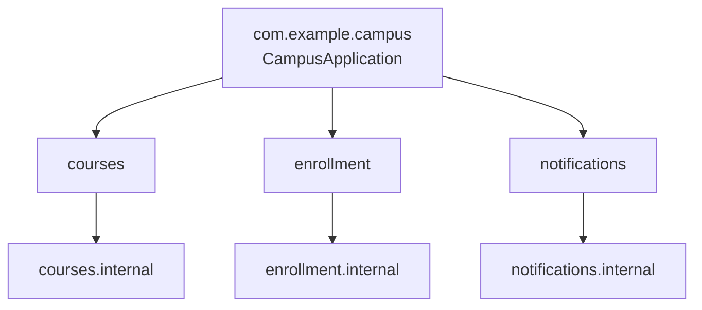
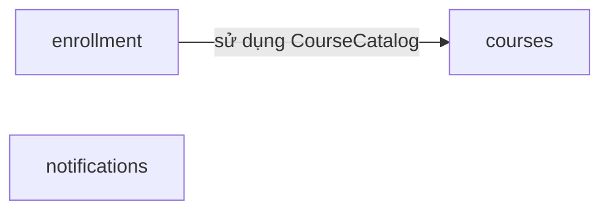

# Khám phá module bằng `ApplicationModules.of`

## Mục tiêu học tập

Sau bài học, bạn có thể:

1. Dùng `ApplicationModules.of(...)` để tạo mô hình các application module trong một ứng dụng Spring Modulith.
2. Liệt kê module đã phát hiện, đọc định danh, tên hiển thị, package nền và phụ thuộc trực tiếp.
3. Tra cứu module theo **tên**, **kiểu Java** hoặc **package** để xác định chính xác thành phần đang thuộc ranh giới nào.
4. Phân biệt việc **khám phá cấu trúc** với việc **xác minh ranh giới kiến trúc** bằng `verify()`.
5. Viết kiểm thử JUnit để phát hiện sớm sai lệch trong cấu trúc module và tích hợp vào quality gate của CI.

Bài này thuộc phần **ApplicationModules** của lộ trình **SPRING_MODULITH_VERIFICATION_TESTING**. Trong một hệ thống có nhiều phần nghiệp vụ, việc mô hình hóa và quan sát các module là tiền đề để kiểm tra quy tắc phụ thuộc, sau đó mới đi sâu vào `@ApplicationModuleTest`, sự kiện và kiểm thử tích hợp.

## 1. Khám phá module nghĩa là gì?

Spring Modulith sử dụng cách tổ chức package và metadata cấu hình để xác định các **application module** của ứng dụng. Lớp `org.springframework.modulith.core.ApplicationModules` cung cấp giao diện lập trình để khám phá cấu trúc đó.

```java
ApplicationModules modules = ApplicationModules.of(CampusApplication.class);
```

Lệnh trên yêu cầu Spring Modulith phân tích các kiểu Java trong phạm vi ứng dụng và dựng một mô hình gồm các module và quan hệ giữa chúng. Nó **không khởi động ứng dụng Spring Boot**, không mở kết nối database và không gửi sự kiện.

Ba câu hỏi cần trả lời khi khám phá:

| Câu hỏi | Thao tác tương ứng |
| --- | --- |
| Ứng dụng có những module nào? | Duyệt `ApplicationModules` bằng `forEach` hoặc `stream()` |
| Một lớp hoặc package thuộc module nào? | `getModuleByType(...)` và `getModuleForPackage(...)` |
| Module phụ thuộc vào những module nào? | Lấy một `ApplicationModule`, rồi đọc `getDirectDependencies(modules)` |

Kết quả khám phá phản ánh **cấu trúc mã nguồn đã biên dịch trong classpath**. Nó không bảo đảm mọi quy tắc kiến trúc đều đúng: muốn phát hiện vi phạm, cần bước `verify()` riêng.

## 2. Ví dụ xuyên suốt: nền tảng quản lý khóa học

Giả sử dự án có package gốc `com.example.campus` và ba nhóm nghiệp vụ:

```text
src/main/java/com/example/campus/
├── CampusApplication.java
├── courses/
│   ├── CourseCatalog.java
│   └── internal/
│       ├── CourseService.java
│       └── CourseRepository.java
├── enrollment/
│   ├── EnrollmentManagement.java
│   └── internal/
│       └── EnrollmentService.java
└── notifications/
    ├── NotificationManagement.java
    └── internal/
        └── EmailNotificationService.java
```

`CampusApplication` nằm ở package gốc:

```java
package com.example.campus;

import org.springframework.boot.SpringApplication;
import org.springframework.boot.autoconfigure.SpringBootApplication;

@SpringBootApplication
public class CampusApplication {

    public static void main(String[] args) {
        SpringApplication.run(CampusApplication.class, args);
    }
}
```

Với cơ chế phát hiện module mặc định, các package con trực tiếp `courses`, `enrollment` và `notifications` được xem là ba module. Package `courses.internal` là phần nội bộ của `courses`, không phải một module ngang cấp.



Những kiểu đặt trực tiếp trong package module như `CourseCatalog` thường thuộc API công khai mặc định; các kiểu trong `internal` là chi tiết cài đặt. Nếu muốn đưa một package con ra giao diện công khai, dự án phải cấu hình *named interface* có chủ đích.

**Lưu ý:** Giữ phần nghiệp vụ ở các package cấp một theo cấu trúc này. Nếu đặt cả ba dưới `com.example.campus.business` thì cơ chế phát hiện mặc định có thể nhận diện `business` thành một module lớn; nếu chọn lớp đầu vào nằm sâu trong `courses` thì phạm vi khám phá có thể bị thu hẹp.

## 3. Tạo mô hình bằng `ApplicationModules.of(...)`

### Cách 1: Đi từ lớp ứng dụng

Đây là cách thường dùng trong bài kiểm thử kiến trúc:

```java
package com.example.campus;

import org.junit.jupiter.api.Test;
import org.springframework.modulith.core.ApplicationModules;

class ModuleDiscoveryTests {

    @Test
    void listModules() {
        ApplicationModules modules =
                ApplicationModules.of(CampusApplication.class);

        modules.forEach(System.out::println);
    }
}
```

Spring Modulith xác định điểm bắt đầu từ package của `CampusApplication`. Khi lớp này mang metadata cấu hình modulith tương ứng, cách khởi tạo bằng `Class` còn cho phép thư viện xem xét cấu hình đó.

Kết quả `System.out::println` thường biểu diễn thông tin như định danh module, package, các interface được công bố và phụ thuộc. **Định dạng `toString()` là chi tiết thư viện**; không nên viết kiểm thử so khớp toàn bộ chuỗi đầu ra.

### Cách 2: Đi từ tên package

Khi không muốn tham chiếu trực tiếp đến lớp ứng dụng, có thể dùng:

```java
ApplicationModules modules =
        ApplicationModules.of("com.example.campus");
```

Phiên bản `of(String)` lấy một tên package để bắt đầu khám phá. Hai cách có thể cho kết quả tương đương trong cấu hình mặc định, nhưng **không nên mặc định coi chúng tương đương trong mọi dự án**: cách dùng lớp ứng dụng có thể đọc cấu hình modulith đặt trên lớp đó.

**Khuyến nghị thực hành:** Trong cùng một bộ kiểm thử kiến trúc, chọn một điểm vào nhất quán và luôn kiểm tra danh sách module thực tế trước khi đưa ra kết luận.

## 4. Duyệt danh sách module và đọc metadata

`ApplicationModules` hỗ trợ `Iterable<ApplicationModule>` và có phương thức `stream()`. Một ví dụ JUnit để in thông tin cốt lõi:

```java
package com.example.campus;

import org.junit.jupiter.api.Test;
import org.springframework.modulith.core.ApplicationModules;

class ModuleDiscoveryTests {

    @Test
    void printModuleInventory() {
        ApplicationModules modules =
                ApplicationModules.of(CampusApplication.class);

        modules.forEach(module -> {
            System.out.println("ID: " + module.getIdentifier());
            System.out.println("Display name: " + module.getDisplayName());
            System.out.println("Base package: " + module.getBasePackage());
            System.out.println("---");
        });
    }
}
```

Ở ví dụ này:

- `getIdentifier()`: định danh logic của module, dùng cho tra cứu và quan hệ giữa các module.
- `getDisplayName()`: tên hiển thị, có thể được tùy chỉnh qua cấu hình module.
- `getBasePackage()`: package nền mà module sở hữu.

`getIdentifier()` có từ **Spring Modulith 1.3**; nếu dự án dùng bản cũ hơn, cần đối chiếu API theo phiên bản thay vì chép nguyên ví dụ. Không nên sử dụng tên hiển thị thay cho định danh trong các lời gọi tra cứu.

Có thể dùng `stream()` để lấy một danh sách định danh ổn định hơn chuỗi `toString()`:

```java
import java.util.List;
import org.springframework.modulith.core.ApplicationModules;

ApplicationModules modules =
        ApplicationModules.of(CampusApplication.class);

List<String> moduleIds = modules.stream()
        .map(module -> module.getIdentifier().toString())
        .sorted()
        .toList();

System.out.println(moduleIds);
```

Ví dụ với cây package đang xét, danh sách dự kiến là `[courses, enrollment, notifications]` khi dự án không có tùy chỉnh cách phát hiện hoặc đổi định danh.

## 5. Tra cứu một module cụ thể

Trong dự án lớn, chỉ in tất cả các module chưa đủ. API tra cứu giúp lần ngược một kiểu hoặc package về ranh giới nghiệp vụ chứa nó.

### Tra cứu theo tên logic

```java
ApplicationModules modules =
        ApplicationModules.of(CampusApplication.class);

var enrollment = modules.getModuleByName("enrollment")
        .orElseThrow(() ->
                new IllegalStateException("Không tìm thấy module enrollment"));

System.out.println(enrollment.getBasePackage());
```

`getModuleByName(String)` trả về `Optional<ApplicationModule>`. Tên truyền vào phải là định danh logic mà Spring Modulith đã nhận diện, không nhất thiết trùng với `getDisplayName()`. Vì thế `orElseThrow` hữu ích cho kiểm thử yêu cầu module đó bắt buộc phải có.

### Tra cứu theo kiểu Java

Giả sử `CourseCatalog` là một interface công khai nằm trực tiếp trong `com.example.campus.courses`:

```java
package com.example.campus.courses;

public interface CourseCatalog {
    boolean exists(String courseCode);
}
```

Có thể tìm module sở hữu interface này:

```java
import com.example.campus.courses.CourseCatalog;

var owner = modules.getModuleByType(CourseCatalog.class)
        .orElseThrow();

System.out.println(owner.getIdentifier()); // courses
```

Tra cứu theo kiểu trả lời câu hỏi: “**Class/interface này đang được Spring Modulith gán cho module nào?**”. Nó phù hợp khi refactor code hoặc điều tra vì sao một phụ thuộc bị xem là đi qua ranh giới module.

### Tra cứu theo package

```java
var owner = modules.getModuleForPackage(
        "com.example.campus.enrollment.internal"
).orElseThrow();

System.out.println(owner.getIdentifier()); // enrollment
```

Package `enrollment.internal` nằm bên trong `enrollment`, vì vậy kết quả mong đợi là module `enrollment`, không phải một module `internal` mới.

| API | Đầu vào | Kết quả |
| --- | --- | --- |
| `getModuleByName("courses")` | Định danh logic của module | `Optional<ApplicationModule>` |
| `getModuleByType(CourseCatalog.class)` | Kiểu Java cụ thể | Module đang sở hữu kiểu đó, nếu được phát hiện |
| `getModuleForPackage("com.example.campus.enrollment.internal")` | Tên package | Module chứa package đó, nếu thuộc phạm vi mô hình |
| `stream()` / `forEach(...)` | Không cần khóa tra cứu | Duyệt tất cả module đã phát hiện |

Nếu một phương thức trả `Optional.empty()`, đừng tự suy ngay rằng mã nguồn không tồn tại. Hãy kiểm tra lớp đã được biên dịch chưa, có nằm trong phạm vi package đang phân tích không và cấu hình phát hiện module có loại trừ hoặc thay đổi ranh giới không.

## 6. Quan sát quan hệ phụ thuộc giữa các module

Giả sử `enrollment.internal.EnrollmentService` sử dụng `courses.CourseCatalog`. Khi đó mã của module `enrollment` có một **phụ thuộc tĩnh** vào API của `courses`.

```java
package com.example.campus.enrollment.internal;

import com.example.campus.courses.CourseCatalog;

class EnrollmentService {

    private final CourseCatalog courseCatalog;

    EnrollmentService(CourseCatalog courseCatalog) {
        this.courseCatalog = courseCatalog;
    }

    boolean canEnroll(String courseCode) {
        return courseCatalog.exists(courseCode);
    }
}
```

Sau khi `ApplicationModules.of(...)` phân tích mã, có thể đọc phụ thuộc trực tiếp của `enrollment`:

```java
ApplicationModules modules =
        ApplicationModules.of(CampusApplication.class);

var enrollment = modules.getModuleByName("enrollment")
        .orElseThrow();

System.out.println(enrollment.getDirectDependencies(modules));
```

Trong phiên bản Spring Modulith có API `getDirectDependencies(...)`, kết quả mô tả các phụ thuộc được phát hiện từ `enrollment` tới module khác, trong đó có `courses` nếu tồn tại tham chiếu nói trên. Không nên dựa vào định dạng chuỗi của đối tượng trả về để thực hiện so sánh tự động.



Cần phân biệt:

- **Phụ thuộc trực tiếp:** mã trong module A tham chiếu đến kiểu ở module B.
- **Phụ thuộc gián tiếp:** A phụ thuộc vào B, còn B phụ thuộc vào C, nên có đường đi A → B → C dù A không nhất thiết tham chiếu trực tiếp tới C.
- **Tương tác runtime:** hai module trao đổi qua sự kiện hoặc cơ chế tích hợp khi chạy. Việc quan sát phụ thuộc tĩnh không chứng minh luồng tương tác runtime hoạt động đúng.

Mỗi mũi tên trong sơ đồ phụ thuộc giúp đánh giá chiều giao tiếp nghiệp vụ. Khi module `enrollment` bắt đầu import `courses.internal.CourseRepository`, mũi tên vẫn chỉ đến `courses`, nhưng quan hệ này đã đi vào **phần nội bộ**, nên cần được phát hiện ở bước xác minh kiến trúc.

## 7. Chuyển kết quả khám phá thành kiểm thử có thể lặp lại

Việc in danh sách module giúp quan sát thủ công; một kiểm thử có assertion rõ ràng sẽ phát hiện khi refactor vô tình làm đổi cấu trúc.

```java
package com.example.campus;

import static org.junit.jupiter.api.Assertions.assertEquals;
import static org.junit.jupiter.api.Assertions.assertTrue;

import java.util.Set;
import java.util.stream.Collectors;

import org.junit.jupiter.api.Test;
import org.springframework.modulith.core.ApplicationModules;

class ModuleInventoryTests {

    @Test
    void discoverExpectedModules() {
        ApplicationModules modules =
                ApplicationModules.of(CampusApplication.class);

        Set<String> moduleIds = modules.stream()
                .map(module -> module.getIdentifier().toString())
                .collect(Collectors.toSet());

        assertEquals(
                Set.of("courses", "enrollment", "notifications"),
                moduleIds
        );

        assertTrue(modules.getModuleByName("courses").isPresent());
    }
}
```

Trong ví dụ, bộ test yêu cầu ứng dụng hiện có **đúng ba module**. Assertion đó hữu ích khi ranh giới module là một hợp đồng kiến trúc được nhóm chấp thuận. Nếu dự án thường xuyên thêm module mới, có thể chỉ assert những module bắt buộc và kiểm tra điều kiện phù hợp, tránh tạo kiểm thử quá cứng nhắc.

### Đưa kiểm tra ranh giới vào cùng quality gate

```java
package com.example.campus;

import org.junit.jupiter.api.Test;
import org.springframework.modulith.core.ApplicationModules;

class ModuleArchitectureTests {

    @Test
    void moduleDependenciesMustBeValid() {
        ApplicationModules.of(CampusApplication.class).verify();
    }
}
```

`verify()` kiểm tra các quy tắc như phụ thuộc vòng, truy cập từ module này sang kiểu nội bộ của module khác và các hạn chế `allowedDependencies` đã được khai báo. Nếu vi phạm được tìm thấy, bài test thất bại. Đây là bước **kiểm chứng**, còn `of(...)`, `stream()` và các phương thức `getModule...` trong các mục trước chủ yếu là bước **khám phá**.

Không cần `@SpringBootTest` để chạy bài kiểm thử cấu trúc trên. Nó không thay thế cho `@ApplicationModuleTest` (kiểm thử Spring context theo phạm vi module), kiểm thử sự kiện, tích hợp database hay kiểm thử đầu cuối.

Với dự án đã cấu hình phụ thuộc kiểm thử JUnit và Spring Modulith, có thể cho CI chạy lệnh:

```bash
./gradlew test
```

hoặc với Maven:

```bash
./mvnw test
```

Không có lệnh nào cần chạy khi chỉ đọc bài này; chúng là hướng dẫn để người học thực hành trong dự án đã thiết lập môi trường.

## 8. Chẩn đoán khi kết quả khám phá không như kỳ vọng

| Hiện tượng | Nguyên nhân thường gặp | Cách kiểm tra |
| --- | --- | --- |
| Thiếu module `notifications` | Package nằm ngoài phạm vi được phân tích hoặc cách tổ chức không đúng cấp | Kiểm tra package gốc, vị trí lớp truyền vào `of(...)` và cấu hình phát hiện |
| Chỉ có một module `business` | `courses`, `enrollment`, `notifications` nằm sâu dưới `business` | Kiểm tra cách ánh xạ package cấp một sang module |
| `getModuleByName("Courses")` trả rỗng | Dùng sai định danh hoặc nhầm với tên hiển thị | In `getIdentifier()` để xác định tên logic thực tế |
| Không tìm được module của một class | Kiểu nằm ngoài vùng quét, chưa có trong classpath hoặc bị loại trừ | Đối chiếu đường dẫn package và phạm vi nhập class |
| Test inventory đột nhiên thất bại sau refactor | Một package bị chuyển sang cấp khác, tạo/xóa module | In lại danh sách ID và xem thay đổi cây package |
| Inventory đúng nhưng `verify()` báo lỗi | Các module tồn tại đúng tên nhưng có phụ thuộc sai | Đọc quan hệ phụ thuộc và các import đi vào `internal` |
| `verify()` xanh nhưng xử lý sự kiện vẫn sai | Kiểm tra kiến trúc tĩnh không xác nhận runtime | Bổ sung `@ApplicationModuleTest` và test tích hợp phù hợp |

**Thực hành tốt:** Tách bước in/khám phá mô hình khỏi bước assert và `verify()` khi cần chẩn đoán. Chỉ đưa assertion tên module vào CI nếu cấu trúc module là yêu cầu có chủ ý của kiến trúc; nếu không, ưu tiên kiểm tra các ràng buộc có ý nghĩa nghiệp vụ.

## 9. Bài thực hành

**Bối cảnh:** Bạn đang đưa quality gate kiến trúc vào ứng dụng quản lý khóa học. Nhóm muốn bảo đảm `courses`, `enrollment`, `notifications` được nhận diện đúng và giảm nguy cơ truy cập nhầm phần nội bộ.

**Nhiệm vụ:**

1. Tạo ba package module đúng như cây thư mục ở mục 2, mỗi module có ít nhất một kiểu Java.
2. Viết `ModuleDiscoveryTests` sử dụng `ApplicationModules.of(CampusApplication.class)`; in ID, tên hiển thị, package nền của từng module.
3. Tra cứu `courses` bằng `getModuleByName` và `CourseCatalog.class` bằng `getModuleByType`; xác nhận hai cách trỏ đến cùng module.
4. Tra cứu `com.example.campus.enrollment.internal` bằng `getModuleForPackage`; giải thích vì sao kết quả không phải một module riêng.
5. Thêm một tham chiếu từ `EnrollmentService` tới `CourseCatalog`, quan sát phụ thuộc bằng `getDirectDependencies(modules)`.
6. Viết một bài test `verify()`. Trong nhánh thực hành, thử thay tham chiếu bằng một kiểu thuộc `courses.internal`, đọc vi phạm rồi sửa bằng API công khai.
7. Bổ sung test vào lệnh kiểm thử của dự án và kiểm tra trạng thái build khi có vi phạm.

**Tiêu chí hoàn thành:**

- Giải thích được hai cách khởi tạo `ApplicationModules.of(Class)` và `ApplicationModules.of(String)`.
- Tìm được module sở hữu một kiểu hoặc package cụ thể.
- Phân biệt được định danh module, tên hiển thị, package nền và phụ thuộc trực tiếp.
- Biết **inventory test** kiểm tra kết quả khám phá, còn **architecture test** với `verify()` kiểm tra các ràng buộc kiến trúc.

## 10. Câu hỏi tự kiểm tra

1. Vì sao không nên chọn một lớp trong `courses.internal` làm đầu vào mặc định cho `ApplicationModules.of(...)` khi muốn khám phá toàn bộ ứng dụng?
2. Khi `getModuleByType(CourseCatalog.class)` trả về `courses`, thông tin đó có xác nhận `enrollment` được phép truy cập mọi kiểu trong `courses.internal` không? Vì sao?
3. Khác biệt giữa tên hiển thị từ `getDisplayName()` và định danh logic từ `getIdentifier()` có tác động gì đến `getModuleByName(...)`?
4. Một bài kiểm thử chỉ gọi `modules.forEach(System.out::println)` có bắt buộc thất bại khi xuất hiện phụ thuộc vòng không?
5. Vì sao kiểm thử kiến trúc bằng `verify()` vẫn cần được bổ sung bằng `@ApplicationModuleTest` và test database/sự kiện khi hệ thống phát triển?

## Tóm tắt

`ApplicationModules.of(...)` là điểm khởi đầu để **khám phá** bản đồ module mà Spring Modulith nhận diện từ mã nguồn. Dùng `forEach` hoặc `stream()` để lập inventory; dùng `getModuleByName`, `getModuleByType`, `getModuleForPackage` để tìm nơi sở hữu từng thành phần; dùng `getDirectDependencies(modules)` để xem quan hệ trực tiếp. Sau khi xác nhận mô hình khám phá đúng với thiết kế, gọi `verify()` trong JUnit/CI để ngăn các phụ thuộc sai và hồi quy về ranh giới kiến trúc.

### Tài liệu tham khảo

- [Spring Modulith — ApplicationModules API](https://docs.spring.io/spring-modulith/docs/current/api/org/springframework/modulith/core/ApplicationModules.html)
- [Spring Modulith — ApplicationModule API](https://docs.spring.io/spring-modulith/docs/current/api/org/springframework/modulith/core/ApplicationModule.html)
- [Spring Modulith — Verifying Application Module Structure](https://docs.spring.io/spring-modulith/reference/verification.html)
