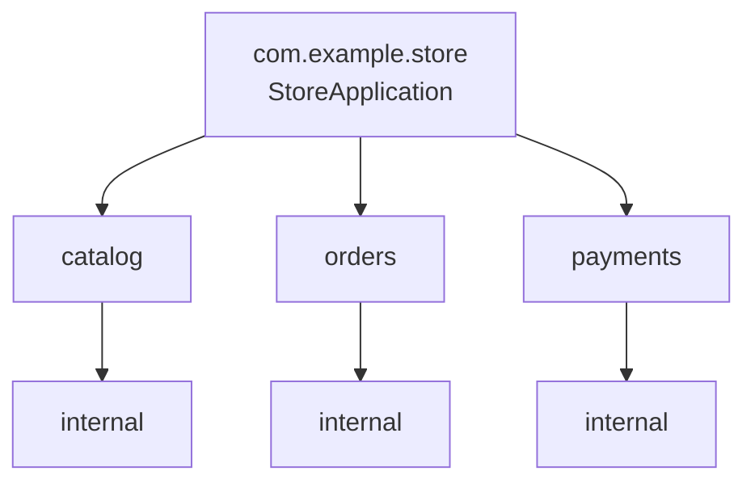

# Liệt kê module được phát hiện

## Mục tiêu học tập

Sau bài học, bạn có thể:

- Sử dụng `ApplicationModules` để lấy **danh sách application module thực tế** mà Spring Modulith phát hiện.
- In thông tin quan trọng của từng module: định danh, tên hiển thị và package nền.
- Sắp xếp danh sách theo thứ tự ổn định, giúp đọc log và so sánh kết quả giữa các lần chạy.
- Viết kiểm thử JUnit xác nhận những module quan trọng vẫn tồn tại, đồng thời phát hiện module thừa hoặc thiếu khi thay đổi cấu trúc package.
- Phân biệt kiểm tra **danh sách module** với kiểm tra **quy tắc phụ thuộc** bằng `verify()`, cũng như kiểm thử runtime bằng `@ApplicationModuleTest`.

Trong lộ trình **SPRING_MODULITH_VERIFICATION_TESTING**, kiểm tra danh sách module là bước quan sát đầu tiên trước khi áp dụng quy tắc ranh giới kiến trúc. Một bài test `verify()` có thể cho kết quả thành công nhưng vẫn không phản ánh đầy đủ thiết kế mong muốn nếu điểm quét chỉ nhìn thấy một phần ứng dụng. Vì vậy, cần biết chính xác mô hình đã nhận diện những module nào.

## 1. Bối cảnh: kỳ vọng và kết quả khám phá

Giả sử một ứng dụng bán hàng có package gốc `com.example.store`, gồm ba phần nghiệp vụ:

```text
src/main/java/com/example/store/
├── StoreApplication.java
├── catalog/
│   ├── ProductCatalog.java
│   └── internal/
│       └── ProductRepository.java
├── orders/
│   ├── OrderManagement.java
│   └── internal/
│       └── OrderService.java
└── payments/
    ├── PaymentManagement.java
    └── internal/
        └── PaymentService.java
```

Với cách phát hiện module mặc định của Spring Modulith, các package con **trực tiếp** của package ứng dụng thường tạo thành module:

| Package nền | Module mong đợi | Package nội bộ đi kèm |
| --- | --- | --- |
| `com.example.store.catalog` | `catalog` | `catalog.internal` |
| `com.example.store.orders` | `orders` | `orders.internal` |
| `com.example.store.payments` | `payments` | `payments.internal` |

Package `orders.internal` không tự động trở thành module thứ tư. Nó thuộc về module `orders`.



Đây là **kỳ vọng thiết kế**. Kết quả Spring Modulith nhận diện có thể khác nếu package được tổ chức theo cách khác hoặc dự án tùy chỉnh chiến lược phát hiện module. Bài học tập trung vào cách đối chiếu hai kết quả đó.

## 2. Tạo `ApplicationModules` và liệt kê tất cả module

Đặt lớp ứng dụng chính trong package gốc:

```java
// src/main/java/com/example/store/StoreApplication.java
package com.example.store;

import org.springframework.boot.SpringApplication;
import org.springframework.boot.autoconfigure.SpringBootApplication;

@SpringBootApplication
public class StoreApplication {

    public static void main(String[] args) {
        SpringApplication.run(StoreApplication.class, args);
    }
}
```

Trong mã kiểm thử, tạo mô hình từ lớp đó:

```java
// src/test/java/com/example/store/ModuleInventoryTests.java
package com.example.store;

import org.junit.jupiter.api.Test;
import org.springframework.modulith.core.ApplicationModules;

class ModuleInventoryTests {

    @Test
    void listDiscoveredModules() {
        ApplicationModules modules =
                ApplicationModules.of(StoreApplication.class);

        modules.forEach(System.out::println);
    }
}
```

`ApplicationModules.of(StoreApplication.class)` phân tích các kiểu và package thuộc phạm vi ứng dụng rồi xây dựng mô hình module. Nó không cần khởi động `ApplicationContext` để liệt kê module; bài test trên không cần `@SpringBootTest`.

`forEach(System.out::println)` hữu ích để quan sát nhanh khi phát triển, nhưng chuỗi hiển thị có thể dài và định dạng có thể thay đổi giữa các phiên bản Spring Modulith. Không nên dùng cả chuỗi `toString()` làm dữ liệu so sánh trong bài test.

### Liệt kê bằng `stream()`

Để lấy một danh sách tên ngắn gọn:

```java
ApplicationModules modules =
        ApplicationModules.of(StoreApplication.class);

modules.stream()
        .map(module -> module.getIdentifier().toString())
        .forEach(System.out::println);
```

Đầu ra minh họa, **không cam kết thứ tự mặc định**:

```text
catalog
orders
payments
```

`getIdentifier()` trả về định danh logic của module. Việc chuyển sang `String` ở ví dụ này giúp hiển thị và so sánh các định danh; không nên suy ra tên module chỉ bằng cách cắt chuỗi package từ kết quả `toString()` của toàn bộ `ApplicationModule`.

## 3. Tạo danh sách ổn định để đọc log

Khi xuất inventory trong CI, thứ tự không ổn định sẽ làm log khó so sánh. Có thể sắp xếp theo định danh trước khi in:

```java
package com.example.store;

import java.util.Comparator;
import org.junit.jupiter.api.Test;
import org.springframework.modulith.core.ApplicationModules;

class ModuleInventoryTests {

    @Test
    void printSortedModuleInventory() {
        ApplicationModules modules =
                ApplicationModules.of(StoreApplication.class);

        modules.stream()
                .sorted(Comparator.comparing(
                        module -> module.getIdentifier().toString()))
                .forEach(module -> System.out.printf(
                        "id=%s | display=%s | package=%s%n",
                        module.getIdentifier(),
                        module.getDisplayName(),
                        module.getBasePackage()
                ));
    }
}
```

Đầu ra minh họa với cấu trúc mặc định:

```text
id=catalog  | display=Catalog  | package=com.example.store.catalog
id=orders   | display=Orders   | package=com.example.store.orders
id=payments | display=Payments | package=com.example.store.payments
```

Các tên hiển thị ở trên chỉ nhằm minh họa. Giá trị thực của `getDisplayName()` có thể được cấu hình khác đi; hãy lấy thông tin từ mô hình thay vì cố định nội dung log theo giả định.

| Trường | Ý nghĩa | Cách dùng phù hợp |
| --- | --- | --- |
| `getIdentifier()` | Định danh module do cơ chế phát hiện xác định | Khóa logic để liệt kê, tra cứu và so sánh |
| `getDisplayName()` | Tên hiển thị, có thể được tùy chỉnh | Báo cáo dễ đọc cho người phát triển |
| `getBasePackage()` | Package nền của module | Xác định ranh giới mã nguồn đang được quét |

Nếu chỉ cần danh sách định danh trong pipeline:

```java
import java.util.List;

List<String> ids = ApplicationModules.of(StoreApplication.class)
        .stream()
        .map(module -> module.getIdentifier().toString())
        .sorted()
        .toList();

System.out.println(ids);
```

Đầu ra mong đợi của ví dụ là `[catalog, orders, payments]`. Phương thức `Stream.toList()` yêu cầu Java 16 trở lên; với dự án Java cũ hơn, dùng `collect(Collectors.toList())` nếu phiên bản Spring Modulith tương ứng hỗ trợ môi trường đó.

## 4. Đếm module và kiểm tra sự hiện diện

Từ `stream()`, có thể lấy số module và kiểm tra từng định danh:

```java
ApplicationModules modules =
        ApplicationModules.of(StoreApplication.class);

long count = modules.stream().count();
boolean hasOrders = modules.stream()
        .anyMatch(module ->
                module.getIdentifier().toString().equals("orders"));

System.out.println("Module count: " + count);
System.out.println("orders detected: " + hasOrders);
```

Trong ví dụ, mong đợi `count == 3` và `hasOrders == true`.

Tuy nhiên, **chỉ kiểm tra số lượng là chưa đủ**. Ba module `catalog`, `orders`, `payments` và ba module `catalog`, `orders`, `shared` đều có số lượng bằng 3. Nếu cần bảo đảm danh sách chính xác, hãy so sánh theo tập hợp định danh.

### Kiểm thử danh sách đầy đủ

```java
package com.example.store;

import static org.junit.jupiter.api.Assertions.assertEquals;

import java.util.Set;
import java.util.stream.Collectors;

import org.junit.jupiter.api.Test;
import org.springframework.modulith.core.ApplicationModules;

class ModuleInventoryContractTests {

    @Test
    void discoverExactlyTheExpectedModules() {
        ApplicationModules modules =
                ApplicationModules.of(StoreApplication.class);

        Set<String> discovered = modules.stream()
                .map(module -> module.getIdentifier().toString())
                .collect(Collectors.toSet());

        Set<String> expected = Set.of("catalog", "orders", "payments");

        assertEquals(expected, discovered);
    }
}
```

So sánh bằng `Set` bỏ qua thứ tự duyệt. Test sẽ thất bại nếu `payments` biến mất hoặc nếu xuất hiện module ngoài danh sách, chẳng hạn `common`.

**Khi nào dùng bài test nghiêm ngặt này?** Khi nhóm coi danh sách application module là một hợp đồng kiến trúc đã thống nhất. Khi ứng dụng chủ động thường xuyên thêm module, nên cập nhật danh sách mong đợi cùng với thay đổi thiết kế, hoặc dùng kiểm tra mềm hơn bên dưới.

### Kiểm thử những module bắt buộc

```java
package com.example.store;

import static org.junit.jupiter.api.Assertions.assertTrue;

import java.util.Set;
import java.util.stream.Collectors;

import org.junit.jupiter.api.Test;
import org.springframework.modulith.core.ApplicationModules;

class RequiredModuleTests {

    @Test
    void criticalModulesMustExist() {
        Set<String> discovered = ApplicationModules
                .of(StoreApplication.class)
                .stream()
                .map(module -> module.getIdentifier().toString())
                .collect(Collectors.toSet());

        assertTrue(discovered.containsAll(
                Set.of("catalog", "orders", "payments")));
    }
}
```

Bài test này vẫn thất bại khi thiếu module bắt buộc nhưng cho phép bổ sung những module hợp lệ khác. Chọn một trong hai mức ràng buộc theo ý nghĩa kiến trúc, thay vì cố định số lượng vì tiện kiểm thử.

## 5. Điều tra khi danh sách có module thừa hoặc thiếu

### Tình huống A: Xuất hiện module `shared`

Nhóm thêm package:

```text
com/example/store/
├── catalog/
├── orders/
├── payments/
└── shared/
    └── Money.java
```

Theo cơ chế phát hiện mặc định, `shared` có thể bị nhận diện thành module thứ tư vì nó nằm trực tiếp dưới package ứng dụng. Đây không nhất thiết là lỗi của Spring Modulith. Nó cho thấy thiết kế package hiện tại đang thể hiện `shared` như một ranh giới module.

Hướng xử lý phụ thuộc mục tiêu kiến trúc: coi `shared` là module có trách nhiệm rõ ràng, chuyển kiểu dùng chung đến nơi sở hữu phù hợp, hoặc cấu hình cơ chế phát hiện theo thiết kế. Tránh chuyển hoặc loại trừ package một cách tùy tiện chỉ để số lượng module khớp test.

### Tình huống B: Ba phần nghiệp vụ bị gộp thành một

```text
com/example/store/
└── business/
    ├── catalog/
    ├── orders/
    └── payments/
```

Với phát hiện mặc định theo package con trực tiếp, kết quả có thể chỉ có một module `business`. Kể cả khi mã nguồn vẫn có ba thư mục nghiệp vụ, Spring Modulith chưa chắc coi chúng là ba application module ngang hàng.

Hãy đối chiếu **package nền** được in ra với cây package thực tế, sau đó chọn cách tổ chức hoặc cấu hình phát hiện phù hợp.

### Tình huống C: Điểm bắt đầu sai

```java
// Không phù hợp để quét toàn bộ ứng dụng store:
ApplicationModules modules =
        ApplicationModules.of(com.example.store.orders.internal.OrderService.class);
```

Lớp đầu vào nằm quá sâu có thể khiến phạm vi khám phá thu hẹp vào package `orders.internal`, khiến các module khác không xuất hiện. Với mục tiêu kiểm thử toàn ứng dụng, hãy chọn lớp ở package gốc:

```java
ApplicationModules modules =
        ApplicationModules.of(StoreApplication.class);
```

Cách phát hiện module cũng có thể chịu ảnh hưởng của annotation hoặc cấu hình dự án. Vì vậy, khi kết quả khác kỳ vọng, kiểm tra cả điểm vào, cây package và cấu hình thay vì chỉ kiểm tra số dòng log.

### Bảng chẩn đoán nhanh

| Dấu hiệu từ inventory | Cần kiểm tra | Ý nghĩa |
| --- | --- | --- |
| Thiếu hẳn `payments` | Package có nằm trong phạm vi quét không? | Phạm vi mô hình có thể sai hoặc package đã di chuyển |
| Có `business` nhưng không có `catalog`/`orders`/`payments` | Ba phần nghiệp vụ có nằm dưới một package cấp một? | Ranh giới đang bị gộp |
| Có thêm `shared`/`config` | Package đó có nằm trực tiếp dưới package ứng dụng? | Có thể xuất hiện ranh giới module ngoài dự kiến |
| Số module đúng nhưng tên khác | Có module bị đổi định danh hoặc bị thay thế? | Chỉ đếm số lượng sẽ bỏ sót thay đổi |
| Thứ tự log thay đổi | Có sắp xếp theo định danh trước khi xuất chưa? | Thứ tự duyệt không nên là hợp đồng kiểm thử |
| Inventory đúng nhưng kiểm thử kiến trúc lỗi | Có vòng phụ thuộc, truy cập nội bộ hoặc quy tắc `allowedDependencies` không? | Cần kiểm tra các cạnh phụ thuộc giữa module |

## 6. Inventory có giới hạn gì?

**Liệt kê module** trả lời câu hỏi: “Spring Modulith hiện đang nhìn thấy những ranh giới nào?”. Nó không tự trả lời: “Những ranh giới đó đã được sử dụng đúng chưa?”.

Ví dụ, `orders` có thể import trực tiếp một repository nằm trong `catalog.internal`. Danh sách module vẫn có đủ `catalog`, `orders`, `payments`; chỉ kiểm tra inventory sẽ không bắt được việc truy cập phần cài đặt nội bộ.

Để kiểm tra ranh giới và quy tắc phụ thuộc, bổ sung bài test:

```java
package com.example.store;

import org.junit.jupiter.api.Test;
import org.springframework.modulith.core.ApplicationModules;

class ArchitectureVerificationTests {

    @Test
    void moduleBoundariesMustBeValid() {
        ApplicationModules.of(StoreApplication.class).verify();
    }
}
```

Khi chạy `verify()`, Spring Modulith xác minh các nguyên tắc kiến trúc như phụ thuộc vòng và tham chiếu trái phép vào kiểu nội bộ của module khác, cùng với các quy tắc khai báo phụ thuộc nếu được cấu hình. Đây là **kiểm tra cấu trúc tĩnh**.

Các kiểm thử sau giải quyết câu hỏi khác:

| Bước kiểm thử | Mục tiêu |
| --- | --- |
| Inventory `stream()` / `forEach()` | Thấy danh sách module đã phát hiện |
| Assertion tập module | Bảo vệ danh sách hoặc sự hiện diện của các module bắt buộc |
| `ApplicationModules.verify()` | Bắt vi phạm ranh giới, phụ thuộc sai và vòng phụ thuộc |
| `@ApplicationModuleTest` | Kiểm thử hành vi một module trong Spring test context có phạm vi thích hợp |
| Kiểm thử sự kiện, database và tích hợp | Xác nhận các luồng nghiệp vụ và tài nguyên runtime hoạt động đúng |

Lập inventory là một bước nền hữu ích cho quality gate, nhưng tự nó không xác minh database, publish/consume sự kiện hay giao tiếp với hệ thống ngoài.

## 7. Đưa inventory test vào CI

Đặt các bài kiểm thử ở `src/test/java` để bộ chạy test của dự án tự phát hiện. Một quality gate tối thiểu có thể có **hai bài kiểm thử độc lập**:

1. `ModuleInventoryContractTests`: xác nhận các module cần thiết được phát hiện.
2. `ArchitectureVerificationTests`: gọi `verify()` để kiểm tra phụ thuộc kiến trúc.

Chạy bằng công cụ build đã được cấu hình Spring Modulith và JUnit 5:

```bash
./gradlew test
```

Hoặc với Maven Wrapper:

```bash
./mvnw test
```

Trong CI, để bước kiểm thử thất bại khiến pipeline thất bại. Khi tạo module mới có chủ ý, cập nhật inventory test trong cùng thay đổi mã và giải thích ranh giới mới trong quá trình review.

**Không dùng snapshot chuỗi `System.out::println` để làm quality gate**: chỉ nên assert dữ liệu có ý nghĩa như tập định danh module. Log được sắp xếp chỉ phục vụ chẩn đoán.

## 8. Thực hành: phát hiện thay đổi ranh giới

**Bối cảnh:** Nhóm đang chuyển một ứng dụng bán hàng đơn khối sang kiến trúc Spring Modulith. Kiến trúc đã thống nhất gồm `catalog`, `orders`, `payments`.

**Yêu cầu thực hiện:**

1. Tạo cây package như mục 1 và lớp `StoreApplication` trong `com.example.store`.
2. Viết test in danh sách module bằng `forEach(System.out::println)`.
3. Thay bằng cách in `id`, `displayName`, `basePackage` theo thứ tự `id` tăng dần.
4. Viết test so sánh `Set.of("catalog", "orders", "payments")` với tập module phát hiện.
5. Thêm package `com.example.store.shared` chứa một kiểu Java; xem inventory và lý giải vì sao assertion chính xác có thể thất bại.
6. Thử chuyển `orders` và `payments` xuống dưới `business`; ghi nhận sự thay đổi số lượng/định danh module.
7. Khôi phục thiết kế ba module và thêm bài test gọi `verify()` vào bộ test CI.

**Tiêu chí đạt:**

- In được module inventory rõ ràng và có thứ tự ổn định.
- Giải thích được vì sao package con trực tiếp và package `internal` có vai trò khác nhau.
- Phân biệt được kiểm tra **đúng số lượng**, **đúng tập định danh** và **đủ module bắt buộc**.
- Mô tả được vì sao inventory test không thay thế `verify()` hoặc `@ApplicationModuleTest`.

## Câu hỏi tự kiểm tra

1. Ứng dụng có ba module nhưng test chỉ assert `stream().count() == 3`. Tại sao test có thể bỏ sót lỗi về ranh giới?
2. Việc sắp xếp `getIdentifier().toString()` trước khi in cải thiện khả năng theo dõi thay đổi như thế nào?
3. Tại sao `catalog.internal` không được dự kiến xuất hiện như một module ngang hàng với `catalog`?
4. Nếu inventory liệt kê đúng tất cả các module nhưng `verify()` thất bại, cần kiểm tra nhóm vấn đề nào?
5. Khi thêm một module hợp lệ mới, nên cập nhật kiểm thử so sánh toàn bộ tập định danh hay chuyển sang kiểm tra những module bắt buộc? Dựa vào nguyên tắc thiết kế nào để quyết định?

## Tóm tắt

Sau khi tạo `ApplicationModules` bằng `of(StoreApplication.class)`, dùng `forEach` để quan sát nhanh hoặc `stream()` để tạo danh sách định danh, sắp xếp và kiểm thử bằng assertion. Một inventory tốt thể hiện **Spring Modulith đã nhận diện module nào, tại package nào** và giúp nhận ra sai lệch khi tái cấu trúc mã nguồn. Kết hợp inventory với `verify()` trong CI sẽ tăng độ tin cậy của kiểm chứng ranh giới; còn `@ApplicationModuleTest`, test sự kiện và test database tiếp tục bảo vệ hành vi runtime.
