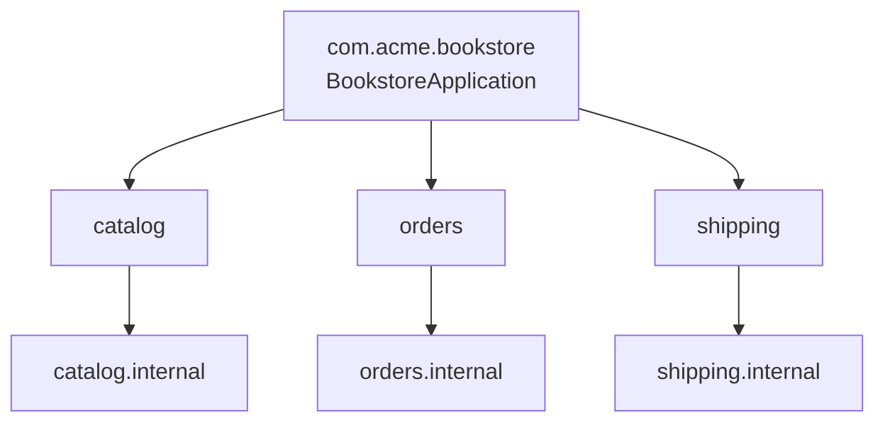

# Đọc tên và base package của module

## Mục tiêu học tập

Sau bài này, bạn có thể:

- Dùng `ApplicationModules` để lấy từng `ApplicationModule` đã phát hiện trong ứng dụng Spring Modulith.
- Phân biệt **định danh logic** (`getIdentifier()`), **tên hiển thị** (`getDisplayName()`) và **package nền** (`getBasePackage()`).
- Đọc tên package đầy đủ bằng `getBasePackage().getName()` để ghi log, kiểm tra và đối chiếu ranh giới mã nguồn.
- Tùy chỉnh tên hiển thị bằng `@ApplicationModule(displayName = ...)` mà không làm thay đổi package nền.
- Viết kiểm thử JUnit bảo vệ metadata module và đưa kiểm tra này vào quality gate CI.

Trong lộ trình **SPRING_MODULITH_VERIFICATION_TESTING**, việc đọc đúng metadata của module là cơ sở để xác định ranh giới kiến trúc trước khi chạy `verify()` và kiểm thử hành vi với `@ApplicationModuleTest`. Cùng một module có thể mang ba dạng thông tin khác nhau: tên dùng để định danh, tên dành cho con người và địa chỉ package trong mã nguồn.

## 1. Ba thông tin không nên nhầm lẫn

Xét một module quản lý đơn hàng:

| Thông tin | API | Ví dụ | Mục đích |
| --- | --- | --- | --- |
| Định danh logic | `module.getIdentifier()` | `orders` | Nhận diện module trong mô hình, dùng khi tra cứu và khai báo phụ thuộc |
| Tên hiển thị | `module.getDisplayName()` | `Quản lý đơn hàng` | Diễn giải cho người đọc, tài liệu hoặc báo cáo |
| Package nền | `module.getBasePackage().getName()` | `com.acme.bookstore.orders` | Xác định phạm vi package mà module sở hữu |

Ba giá trị này **có liên quan nhưng không đồng nhất**. Tên hiển thị có thể đổi cho dễ đọc mà package nền không đổi; package nền là tên đầy đủ theo quy tắc đặt package của Java; định danh logic phục vụ việc gọi tên một module theo cách Spring Modulith nhận diện.

Ví dụ, dòng báo cáo:

```text
ID: orders
Tên hiển thị: Quản lý đơn hàng
Base package: com.acme.bookstore.orders
```

đều mô tả **cùng một module**, không phải ba module khác nhau.

## 2. Ví dụ xuyên suốt: ứng dụng Bookstore

Giả sử ứng dụng có package gốc `com.acme.bookstore`:

```text
src/main/java/com/acme/bookstore/
├── BookstoreApplication.java
├── catalog/
│   ├── BookCatalog.java
│   └── internal/
│       └── CatalogRepository.java
├── orders/
│   ├── OrderManagement.java
│   ├── package-info.java
│   └── internal/
│       └── OrderService.java
└── shipping/
    ├── ShippingManagement.java
    └── internal/
        └── DeliveryService.java
```

Lớp ứng dụng:

```java
// src/main/java/com/acme/bookstore/BookstoreApplication.java
package com.acme.bookstore;

import org.springframework.boot.SpringApplication;
import org.springframework.boot.autoconfigure.SpringBootApplication;

@SpringBootApplication
public class BookstoreApplication {

    public static void main(String[] args) {
        SpringApplication.run(BookstoreApplication.class, args);
    }
}
```

Với cơ chế phát hiện mặc định của Spring Modulith, các package con trực tiếp `catalog`, `orders`, `shipping` tạo thành ba application module. Các package `catalog.internal` và `orders.internal` nằm **bên trong** module tương ứng.



Nếu dùng chiến lược phát hiện khác, kết quả có thể thay đổi. Vì vậy, luôn kiểm tra metadata thực tế bằng `ApplicationModules` thay vì suy đoán chỉ từ tên thư mục.

## 3. Lấy `ApplicationModules` để đọc metadata

Một bài kiểm thử JUnit 5 tối thiểu:

```java
// src/test/java/com/acme/bookstore/ModuleMetadataTests.java
package com.acme.bookstore;

import org.junit.jupiter.api.Test;
import org.springframework.modulith.core.ApplicationModules;

class ModuleMetadataTests {

    @Test
    void printModules() {
        ApplicationModules modules =
                ApplicationModules.of(BookstoreApplication.class);

        modules.forEach(module -> {
            System.out.println("ID: " + module.getIdentifier());
            System.out.println("Display: " + module.getDisplayName());
            System.out.println("Base package: "
                    + module.getBasePackage().getName());
            System.out.println("---");
        });
    }
}
```

Ở đây:

1. `ApplicationModules.of(BookstoreApplication.class)` tạo mô hình module từ package của lớp ứng dụng.
2. `modules.forEach(...)` duyệt các `ApplicationModule` đã phát hiện.
3. Mỗi module cung cấp thông tin logic, hiển thị và package nền.

Đây là **kiểm tra cấu trúc tĩnh**; không cần `@SpringBootTest`, kết nối cơ sở dữ liệu, HTTP server hay message broker chỉ để đọc metadata.

Lưu ý phiên bản: `getIdentifier()` có từ Spring Modulith **1.3**. Với các phiên bản cũ hơn, cần đối chiếu Javadoc của đúng phiên bản dự án thay vì sao chép nguyên ví dụ. Nội dung bài dùng API Spring Modulith hiện hành.

## 4. Đọc tên logic của module: `getIdentifier()`

`getIdentifier()` trả về một `ApplicationModuleIdentifier`, không phải một `String`. Khi in trực tiếp, `toString()` thường biểu diễn giá trị định danh:

```java
ApplicationModules modules =
        ApplicationModules.of(BookstoreApplication.class);

modules.stream()
        .map(module -> module.getIdentifier().toString())
        .sorted()
        .forEach(System.out::println);
```

Danh sách dự kiến với cấu hình mặc định:

```text
catalog
orders
shipping
```

Trong ứng dụng được cấu hình theo cách khác, định danh có thể không đơn giản là đoạn package cuối. Vì thế **không nên tự cắt chuỗi** `com.acme.bookstore.orders` để suy ra ID hoặc giả định mọi cấu hình đều dùng ID ngắn `orders`.

Nếu cần tìm lại module từ định danh:

```java
var orders = modules.getModuleByName("orders")
        .orElseThrow(() ->
                new IllegalStateException("Không tìm thấy module orders"));

System.out.println(orders.getIdentifier());
```

`getModuleByName("orders")` dùng định danh logic thực tế, **không dùng tên hiển thị**. Nếu ID thay đổi do cấu hình phát hiện module, hãy đọc danh sách ID trước rồi cập nhật khóa tra cứu tương ứng.

## 5. Đọc tên hiển thị: `getDisplayName()`

Tên hiển thị được sử dụng khi cần mô tả module theo ngôn ngữ tự nhiên. Không nên coi đây là khóa logic hoặc cố định cách Spring Modulith sinh tên mặc định, vì tên hiển thị có thể được tùy chỉnh.

Trong ví dụ, khai báo tên hiển thị cho `orders` tại **package nền của module**:

```java
// src/main/java/com/acme/bookstore/orders/package-info.java
@org.springframework.modulith.ApplicationModule(
        displayName = "Quản lý đơn hàng"
)
package com.acme.bookstore.orders;
```

Sau đó đọc:

```java
ApplicationModules modules =
        ApplicationModules.of(BookstoreApplication.class);

var orders = modules.getModuleByName("orders").orElseThrow();

System.out.println(orders.getIdentifier().toString());
System.out.println(orders.getDisplayName());
System.out.println(orders.getBasePackage().getName());
```

Kết quả mong đợi, nếu không có cấu hình thay đổi định danh hoặc package:

```text
orders
Quản lý đơn hàng
com.acme.bookstore.orders
```

Chỉ có **tên hiển thị** được thay đổi bằng `displayName`. Package Java vẫn là `com.acme.bookstore.orders` và ID logic mặc định vẫn là `orders`.

Nếu thêm module `shipping` hoặc sửa hiển thị của module `catalog`, hãy đọc kết quả thay vì đoán việc viết hoa hoặc chuyển đổi tên có dấu. Một báo cáo ổn định nên phân biệt dữ liệu dùng để máy so sánh (ID, package) với dữ liệu dùng để hiển thị (display name).

### Khi nào đặt tên hiển thị tùy chỉnh?

- Module có tên kỹ thuật ngắn, ví dụ `orders`, nhưng cần tên rõ nghĩa trong tài liệu cho nhóm nghiệp vụ.
- Mã nguồn dùng package tiếng Anh nhưng báo cáo kiến trúc dùng tiếng Việt.
- Hai module có tên tương đối gần nhau và cần cách diễn giải khác biệt.

Không nên đổi tên hiển thị để **che** ranh giới chưa tốt. Ví dụ, package `common` mang quá nhiều trách nhiệm thì đặt display name thật đẹp vẫn không giải quyết được vấn đề kiến trúc.

## 6. Đọc base package: `getBasePackage().getName()`

`module.getBasePackage()` trả về đối tượng **`org.springframework.modulith.core.JavaPackage`**, không phải chuỗi. Để lấy tên package Java đầy đủ, gọi tiếp `getName()`:

```java
ApplicationModules modules =
        ApplicationModules.of(BookstoreApplication.class);

var orders = modules.getModuleByName("orders").orElseThrow();

String basePackage = orders.getBasePackage().getName();

System.out.println(basePackage);
// com.acme.bookstore.orders
```

Đối tượng `JavaPackage` còn có `getLocalName()`, trả về **đoạn cuối** của tên package:

```java
String fullName = orders.getBasePackage().getName();
String localName = orders.getBasePackage().getLocalName();

System.out.println(fullName);  // com.acme.bookstore.orders
System.out.println(localName); // orders
```

Trong cấu trúc này, local name tình cờ giống ID logic. Đây không phải hợp đồng bắt buộc giữa `getIdentifier()` và `getLocalName()`, nhất là trong dự án có tùy chỉnh phát hiện hoặc tên module đầy đủ.

**Base package không phải đường dẫn file hệ điều hành.** Giá trị `com.acme.bookstore.orders` là tên package Java; ở dự án Maven hoặc Gradle tiêu chuẩn, mã nguồn có thể được bố trí trong `src/main/java/com/acme/bookstore/orders`, nhưng nguồn được biên dịch, mã tạo ra hoặc các module nhiều source set có thể được tổ chức khác.

### Base package xác định ranh giới gì?

Trong cách tổ chức module mặc định:

- Các kiểu công khai nằm **trực tiếp** trong `com.acme.bookstore.orders` tạo nên giao diện công khai mặc định của module `orders`.
- Các kiểu thuộc `com.acme.bookstore.orders.internal` vẫn nằm trong module `orders`, nhưng là phần nội bộ theo quy tắc encapsulation mặc định.
- Module khác không mặc nhiên được phép phụ thuộc vào `orders.internal` chỉ vì Java cho phép import một kiểu được khai báo `public`.

Có thể dùng **named interface** hoặc cấu hình module mở để điều chỉnh bề mặt công khai trong những trường hợp có chủ đích. Tuy nhiên, tên của base package vẫn biểu diễn vị trí nền của module; việc công bố thêm API không biến package con thành một module ngang hàng.

## 7. Xuất bảng metadata dễ kiểm tra

Log `System.out::println` nguyên một đối tượng `ApplicationModule` có thể khó đọc và không ổn định. Với báo cáo kiến trúc, nên chọn ba trường rõ ràng và **sắp xếp theo ID**:

```java
package com.acme.bookstore;

import java.util.Comparator;

import org.junit.jupiter.api.Test;
import org.springframework.modulith.core.ApplicationModules;

class ModuleReportTests {

    @Test
    void printMetadataTable() {
        ApplicationModules modules =
                ApplicationModules.of(BookstoreApplication.class);

        System.out.println("ID | Display name | Base package");
        modules.stream()
                .sorted(Comparator.comparing(
                        module -> module.getIdentifier().toString()))
                .forEach(module ->
                        System.out.printf("%s | %s | %s%n",
                                module.getIdentifier(),
                                module.getDisplayName(),
                                module.getBasePackage().getName()));
    }
}
```

Đầu ra minh họa (tên hiển thị mặc định của các module khác có thể khác):

```text
ID       | Display name    | Base package
catalog  | Catalog         | com.acme.bookstore.catalog
orders   | Quản lý đơn hàng| com.acme.bookstore.orders
shipping | Shipping        | com.acme.bookstore.shipping
```

Sắp xếp theo ID giúp dễ đối chiếu hai lần chạy và giảm nhiễu khi xem log CI. Đừng kiểm thử bằng cách so sánh cả khối văn bản xuất từ console: một thay đổi định dạng không liên quan kiến trúc có thể làm test thất bại.

## 8. Viết kiểm thử metadata để ngăn hồi quy

Giả sử nhóm đã thống nhất ba module và package nền của chúng. Một bài kiểm thử JUnit có thể xác minh toàn bộ phép ánh xạ **ID → base package**:

```java
package com.acme.bookstore;

import static org.junit.jupiter.api.Assertions.assertEquals;

import java.util.Map;
import java.util.stream.Collectors;

import org.junit.jupiter.api.Test;
import org.springframework.modulith.core.ApplicationModules;

class ModuleMetadataContractTests {

    @Test
    void moduleIdsMustMapToExpectedPackages() {
        ApplicationModules modules =
                ApplicationModules.of(BookstoreApplication.class);

        Map<String, String> actual = modules.stream()
                .collect(Collectors.toMap(
                        module -> module.getIdentifier().toString(),
                        module -> module.getBasePackage().getName()
                ));

        Map<String, String> expected = Map.of(
                "catalog", "com.acme.bookstore.catalog",
                "orders", "com.acme.bookstore.orders",
                "shipping", "com.acme.bookstore.shipping"
        );

        assertEquals(expected, actual);
    }
}
```

Bài test này phát hiện **thiếu module**, **thừa module** hoặc **module bị chuyển package nền**. Nó không phụ thuộc thứ tự duyệt vì so sánh `Map`.

Với module có tên hiển thị là hợp đồng báo cáo, có thể kiểm tra thêm:

```java
import static org.junit.jupiter.api.Assertions.assertEquals;

// Trong một phương thức @Test, sau khi khởi tạo "modules":
var orders = modules.getModuleByName("orders").orElseThrow();

assertEquals("Quản lý đơn hàng", orders.getDisplayName());
assertEquals("com.acme.bookstore.orders",
        orders.getBasePackage().getName());
```

Chỉ assert display name khi nhóm **có chủ ý** yêu cầu chuỗi đó. Nếu ứng dụng thay đổi ngôn ngữ của tên hiển thị thường xuyên, giữ assertion cứng cho ID/base package là đủ để bảo vệ ranh giới.

### Bài test metadata bổ sung được gì cho `verify()`?

`verify()` kiểm tra các vi phạm kiến trúc trong mô hình đã được nhận diện, chẳng hạn phụ thuộc vòng hoặc truy cập trái phép vào phần nội bộ. Nó **không tự biết** nhóm phát triển mong muốn chính xác ba module `catalog`, `orders`, `shipping`.

Nếu một refactor vô tình gộp `orders` và `shipping` vào một module `business`, việc kiểm tra quan hệ phụ thuộc trên mô hình mới có thể không báo lỗi theo đúng kỳ vọng kiến trúc ban đầu. Bài test metadata phát hiện thay đổi cấu trúc này.

Cách ghép hai lớp kiểm tra:

```java
package com.acme.bookstore;

import org.junit.jupiter.api.Test;
import org.springframework.modulith.core.ApplicationModules;

class ModuleArchitectureTests {

    @Test
    void dependenciesRespectModuleBoundaries() {
        ApplicationModules.of(BookstoreApplication.class).verify();
    }
}
```

Khi đưa cả `ModuleMetadataContractTests` và `ModuleArchitectureTests` vào CI, ta vừa kiểm tra **mô hình được phát hiện có đúng phạm vi**, vừa kiểm tra **phụ thuộc giữa các module đã phát hiện có hợp lệ**.

## 9. Lỗi thường gặp khi đọc metadata

| Hiện tượng | Nguyên nhân có thể | Hướng xử lý |
| --- | --- | --- |
| `getDisplayName()` khác tên package cuối | Tên hiển thị đã được tùy chỉnh hoặc được thư viện diễn giải | Đọc `getIdentifier()` nếu cần khóa logic; đọc `getBasePackage().getName()` nếu cần package |
| Tra cứu bằng `getModuleByName("Quản lý đơn hàng")` không thấy | Dùng display name thay cho ID | Tra cứu bằng định danh logic, thường là `orders` trong ví dụ |
| Báo cáo chỉ in `orders` mà thiếu package đầy đủ | Sử dụng `getLocalName()` hoặc tự cắt chuỗi package | Dùng `getBasePackage().getName()` |
| Base package không khớp thiết kế | Package bị di chuyển hoặc chiến lược phát hiện module đổi | Đối chiếu package gốc và cấu hình phát hiện |
| Xuất hiện module `common` ngoài dự kiến | Có package `common` trực tiếp dưới package gốc | Xem lại trách nhiệm và vị trí package đó |
| `verify()` xanh dù danh sách module bị gộp | Mô hình đã phát hiện không khớp tập module mong đợi | Thêm test assertion ánh xạ ID → package |
| Code dùng `getIdentifier()` không biên dịch | Phiên bản Spring Modulith quá cũ | Tra Javadoc phiên bản đang dùng; nâng cấp nếu phù hợp |

Một số dự án cấu hình phát hiện **chỉ các package được đánh dấu tường minh** hoặc bổ sung package gốc khác. Trong những trường hợp đó, không nên suy luận module chỉ từ thư mục dưới `@SpringBootApplication`: dữ liệu lấy từ `ApplicationModules` mới phản ánh mô hình Spring Modulith đang sử dụng.

## 10. Bài thực hành

**Bối cảnh:** Một nhóm đang xây dựng quality gate kiến trúc cho hệ thống Bookstore. Họ muốn biết rõ mỗi module được nhận diện bằng ID gì, hiển thị ra sao và sở hữu package nào.

**Yêu cầu:**

1. Tạo `BookstoreApplication` và các package `catalog`, `orders`, `shipping` theo ví dụ ở mục 2.
2. Trong `ModuleMetadataTests`, dùng `ApplicationModules.of(BookstoreApplication.class)` để in ID, display name và base package đầy đủ cho từng module.
3. Thêm `package-info.java` vào `orders` với `displayName = "Quản lý đơn hàng"`; quan sát trường nào đổi và trường nào giữ nguyên.
4. So sánh kết quả `getBasePackage().getName()` với `getBasePackage().getLocalName()`; giải thích khác biệt.
5. Viết `ModuleMetadataContractTests` so sánh tập ánh xạ ID → base package như mục 8.
6. Tạm chuyển `shipping` xuống `business.shipping`, chạy test và đọc sự khác biệt về ID/package; sau đó khôi phục thiết kế.
7. Chạy bổ sung bài test `ApplicationModules.of(...).verify()` để phân biệt thất bại do **metadata sai** với thất bại do **phụ thuộc sai**.

**Tiêu chí hoàn thành:** Bạn có thể giải thích vì sao `orders`, `Quản lý đơn hàng` và `com.acme.bookstore.orders` cùng mô tả một module; đọc đúng kiểu và giá trị của ba API; viết được kiểm thử phát hiện thay đổi package nền ngoài ý muốn.

## 11. Câu hỏi tự kiểm tra

1. Vì sao `getBasePackage()` không thể coi như một `String` thuần?
2. Khi đổi `displayName` ở `package-info.java`, ID logic và package nền có bắt buộc đổi theo không?
3. Vì sao code tra cứu module nên dùng `getIdentifier()` thay vì `getDisplayName()`?
4. `getLocalName()` và `getName()` của `JavaPackage` khác nhau thế nào?
5. Một module được đổi từ `com.acme.bookstore.orders` sang `com.acme.bookstore.sales.orders` nhưng các phụ thuộc vẫn hợp lệ. Kiểm thử nào có thể giúp phát hiện thay đổi ranh giới ngoài ý muốn?
6. Tại sao test metadata và `verify()` vẫn cần thêm `@ApplicationModuleTest` hoặc integration test khi có luồng sự kiện và database?

## Tổng kết

`ApplicationModule` cung cấp ba thông tin quan trọng: **`getIdentifier()`** để nhận diện module, **`getDisplayName()`** để hiển thị và **`getBasePackage().getName()`** để biết tên package Java đầy đủ của module. Những giá trị này trả lời ba câu hỏi khác nhau; dùng đúng từng giá trị giúp tránh lỗi tra cứu và giả định sai ranh giới. Đưa assertion ánh xạ ID → package vào CI cùng `verify()` để phát hiện cả thay đổi cấu trúc module ngoài dự kiến lẫn phụ thuộc kiến trúc không hợp lệ; `@ApplicationModuleTest` và các bài kiểm thử tích hợp tiếp tục bảo vệ hành vi runtime.

### Tài liệu tham khảo

- [Spring Modulith — ApplicationModule API](https://docs.spring.io/spring-modulith/docs/current/api/org/springframework/modulith/core/ApplicationModule.html)
- [Spring Modulith — JavaPackage API](https://docs.spring.io/spring-modulith/docs/current/api/org/springframework/modulith/core/JavaPackage.html)
- [Spring Modulith — Fundamentals](https://docs.spring.io/spring-modulith/reference/fundamentals.html)
