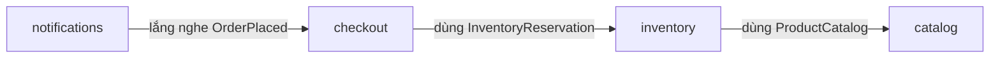
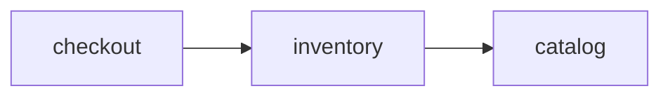

# Đọc dependency giữa các ApplicationModule

## Mục tiêu học tập

Sau bài học, bạn có thể:

- Giải thích ý nghĩa và **chiều của một dependency** giữa hai application module trong Spring Modulith.
- Lấy các phụ thuộc **trực tiếp** và **bắc cầu** từ một `ApplicationModule` bằng `getDirectDependencies(...)` và `getAllDependencies(...)`.
- Dùng `ApplicationModuleDependencies` để xem danh sách module đích, kiểm tra sự tồn tại của một phụ thuộc và truy ngược đến kiểu Java tạo ra phụ thuộc đó.
- Phân loại phụ thuộc theo `DependencyType`, nhận diện trường hợp gọi service, tham chiếu entity và lắng nghe sự kiện.
- Kết hợp báo cáo phụ thuộc với `ApplicationModules.verify()`, quy tắc `allowedDependencies` và kiểm thử JUnit trong CI để ngăn vi phạm ranh giới hoặc hồi quy kiến trúc.

Bài học thuộc chương **ApplicationModules** của `SPRING_MODULITH_VERIFICATION_TESTING`. Kết quả đọc dependency là **mô hình phụ thuộc tĩnh** được phát hiện từ mã nguồn. Nó giúp hiểu chiều liên kết và khoanh vùng vấn đề kiến trúc, nhưng không tự xác nhận việc truyền sự kiện, truy cập cơ sở dữ liệu hay tích hợp với hệ thống ngoài khi ứng dụng đang chạy.

## 1. Dependency giữa hai module nghĩa là gì?

Giả sử module `checkout` sử dụng một interface `InventoryReservation` được công bố bởi module `inventory`:

```java
// com.example.store.checkout.internal.CheckoutService
package com.example.store.checkout.internal;

import com.example.store.inventory.InventoryReservation;

class CheckoutService {
    private final InventoryReservation inventory;

    CheckoutService(InventoryReservation inventory) {
        this.inventory = inventory;
    }
}
```

Spring Modulith có thể nhận diện **`checkout → inventory`**, vì kiểu thuộc `checkout` tham chiếu đến kiểu do `inventory` sở hữu. Mũi tên có nghĩa:

> **Module nguồn** cần biết một kiểu/hợp đồng của **module đích**.

Đừng đọc ngược mũi tên. Nếu `checkout` gọi API của `inventory`, điều đó không có nghĩa `inventory` phụ thuộc vào `checkout`.

| Thuật ngữ | Ý nghĩa | Ví dụ |
| --- | --- | --- |
| Module nguồn (*source*) | Module chứa kiểu tạo ra tham chiếu | `checkout` |
| Module đích (*target*) | Module sở hữu kiểu bị tham chiếu | `inventory` |
| Phụ thuộc trực tiếp | Có tham chiếu từ kiểu trong nguồn sang kiểu trong đích | `CheckoutService → InventoryReservation` |
| Phụ thuộc bắc cầu | Đích lại phụ thuộc module thứ ba; có đường đi qua nhiều module | `checkout → inventory → catalog` |

Một module có thể có **nhiều tham chiếu Java** tới cùng một module đích. Vì thế cần phân biệt số lượng *cạnh phụ thuộc ở mức Java* với số lượng *module đích duy nhất*.

## 2. Ví dụ xuyên suốt: hệ thống bán hàng

Xét ứng dụng `com.example.store`:

```text
src/main/java/com/example/store/
├── StoreApplication.java
├── catalog/
│   ├── ProductCatalog.java
│   └── internal/
├── inventory/
│   ├── InventoryReservation.java
│   └── internal/
│       └── InventoryService.java
├── checkout/
│   ├── OrderPlaced.java
│   └── internal/
│       └── CheckoutService.java
└── notifications/
    └── internal/
        └── OrderNotificationListener.java
```

Theo quy ước phát hiện mặc định, `catalog`, `inventory`, `checkout` và `notifications` là các application module ngang hàng. Trong ví dụ:

- `checkout` cần interface `InventoryReservation` của `inventory`.
- `inventory` cần interface `ProductCatalog` của `catalog`.
- `notifications` lắng nghe sự kiện `OrderPlaced` do `checkout` công bố.



**Đọc sơ đồ:** `checkout` có phụ thuộc trực tiếp vào `inventory` và đường phụ thuộc bắc cầu tới `catalog`. `notifications` phụ thuộc vào **kiểu sự kiện** `OrderPlaced` của `checkout`. Đó không có nghĩa `checkout` phải import hoặc gọi `notifications`.

### Tạo lớp ứng dụng làm điểm quét

```java
// src/main/java/com/example/store/StoreApplication.java
package com.example.store;

import org.springframework.boot.SpringApplication;
import org.springframework.boot.autoconfigure.SpringBootApplication;

@SpringBootApplication
public class StoreApplication {

    public static void main(String[] args) {
        SpringApplication.run(StoreApplication.class, args);
    }
}
```

Với lớp ở package gốc `com.example.store`, có thể tạo mô hình kiến trúc:

```java
import org.springframework.modulith.core.ApplicationModules;

ApplicationModules modules =
        ApplicationModules.of(StoreApplication.class);
```

Việc đọc `ApplicationModules` không cần khởi động Spring context. Khi chạy mã trong test JUnit, không cần gắn `@SpringBootTest` chỉ để truy vấn dependency.

## 3. Tạo vài dependency có chủ đích

### Từ `checkout` sang `inventory`

```java
// com.example.store.inventory.InventoryReservation
package com.example.store.inventory;

public interface InventoryReservation {
    boolean reserve(String productId, int quantity);
}
```

```java
// com.example.store.checkout.internal.CheckoutService
package com.example.store.checkout.internal;

import com.example.store.inventory.InventoryReservation;
import org.springframework.stereotype.Service;

@Service
class CheckoutService {

    private final InventoryReservation inventory;

    CheckoutService(InventoryReservation inventory) {
        this.inventory = inventory;
    }

    boolean checkout(String productId, int quantity) {
        return inventory.reserve(productId, quantity);
    }
}
```

Đây là phụ thuộc thông qua API công khai của module `inventory`. Một triển khai của interface có thể nằm trong `inventory.internal`; `checkout` không cần biết tên triển khai hoặc repository.

### Từ `inventory` sang `catalog`

```java
// com.example.store.catalog.ProductCatalog
package com.example.store.catalog;

public interface ProductCatalog {
    boolean exists(String productId);
}
```

```java
// com.example.store.inventory.internal.InventoryService
package com.example.store.inventory.internal;

import com.example.store.catalog.ProductCatalog;
import org.springframework.stereotype.Service;

@Service
class InventoryService {

    private final ProductCatalog catalog;

    InventoryService(ProductCatalog catalog) {
        this.catalog = catalog;
    }

    boolean productExists(String productId) {
        return catalog.exists(productId);
    }
}
```

Tham chiếu trên tạo `inventory → catalog`. Vì vậy có đường đi `checkout → inventory → catalog`, dù mã của `checkout` **không import** `ProductCatalog`.

### Từ `notifications` sang `checkout` thông qua sự kiện

```java
// com.example.store.checkout.OrderPlaced
package com.example.store.checkout;

public record OrderPlaced(String orderId) {}
```

```java
// com.example.store.notifications.internal.OrderNotificationListener
package com.example.store.notifications.internal;

import com.example.store.checkout.OrderPlaced;
import org.springframework.context.event.EventListener;
import org.springframework.stereotype.Component;

@Component
class OrderNotificationListener {

    @EventListener
    void on(OrderPlaced event) {
        System.out.println("New order: " + event.orderId());
    }
}
```

Đối tượng sự kiện được khai báo trong `checkout`, còn listener thuộc `notifications`. Vì listener tham chiếu kiểu `OrderPlaced`, mũi tên kiến trúc là **`notifications → checkout`**. Việc sự kiện được phát hoặc listener có chạy thành công hay không phải kiểm tra bằng bài test hành vi riêng.

## 4. Đọc các module đích phụ thuộc trực tiếp

API chính của bài học:

```java
ApplicationModules modules =
        ApplicationModules.of(StoreApplication.class);

var checkout = modules.getModuleByName("checkout").orElseThrow();

var direct = checkout.getDirectDependencies(modules);
```

`getDirectDependencies(modules)` trả về `ApplicationModuleDependencies`, **không phải** một `List<String>`. Tập hợp này mô tả các phụ thuộc thực tế được phát hiện từ các kiểu trong `checkout` tới kiểu của module khác.

Để chỉ lấy **module đích duy nhất**, dùng `uniqueModules()`:

```java
checkout.getDirectDependencies(modules)
        .uniqueModules()
        .map(module -> module.getIdentifier().toString())
        .sorted()
        .forEach(System.out::println);
```

Đầu ra mong đợi của kịch bản chỉ có một quan hệ từ `checkout`:

```text
inventory
```

Trong ứng dụng thực, kết quả phụ thuộc mã đã được biên dịch, phạm vi module và loại tham chiếu mà thư viện phát hiện. Nếu có thêm tham chiếu từ `checkout` tới module khác, danh sách sẽ rộng hơn.

### Liệt kê bảng phụ thuộc trực tiếp của toàn ứng dụng

```java
package com.example.store;

import java.util.Comparator;
import java.util.List;

import org.junit.jupiter.api.Test;
import org.springframework.modulith.core.ApplicationModules;

class DependencyInventoryTests {

    @Test
    void printDirectModuleDependencies() {
        ApplicationModules modules =
                ApplicationModules.of(StoreApplication.class);

        modules.stream()
                .sorted(Comparator.comparing(
                        module -> module.getIdentifier().toString()))
                .forEach(source -> {
                    List<String> targets = source
                            .getDirectDependencies(modules)
                            .uniqueModules()
                            .map(target -> target.getIdentifier().toString())
                            .sorted()
                            .toList();

                    System.out.printf("%s -> %s%n",
                            source.getIdentifier(), targets);
                });
    }
}
```

Kết quả minh họa:

```text
catalog -> []
checkout -> [inventory]
inventory -> [catalog]
notifications -> [checkout]
```

Đây là **bảng các cạnh trực tiếp**, tương đương sơ đồ ở mục 2. `catalog -> []` có nghĩa là mô hình hiện không thấy phụ thuộc từ `catalog` sang module khác trong phạm vi đang xét; nó không khẳng định `catalog` không gọi bất kỳ thư viện ngoài nào.

> Không nên kiểm thử bằng cách so sánh nguyên chuỗi `toString()` của `ApplicationModuleDependencies`. Dùng các phương thức API để lấy ID hoặc thông tin kiểu, rồi sắp xếp khi cần một báo cáo ổn định.

## 5. Đọc phụ thuộc bắc cầu

Trong chuỗi:



`checkout → inventory` là phụ thuộc **trực tiếp**. `checkout → catalog` là quan hệ **bắc cầu** qua `inventory`; nó không nhất thiết được biểu diễn bằng một câu lệnh `import` trong package `checkout`.

So sánh hai API:

```java
var checkout = modules.getModuleByName("checkout").orElseThrow();

var direct = checkout.getDirectDependencies(modules);
var all = checkout.getAllDependencies(modules);

System.out.println("Direct:");
direct.uniqueModules()
        .map(module -> module.getIdentifier().toString())
        .sorted()
        .forEach(System.out::println);

System.out.println("All (including transitive):");
all.uniqueModules()
        .map(module -> module.getIdentifier().toString())
        .sorted()
        .forEach(System.out::println);
```

Với các tham chiếu ở mục 3, kết quả minh họa là:

```text
Direct:
inventory
All (including transitive):
catalog
inventory
```

| Nhu cầu | API | Ý nghĩa |
| --- | --- | --- |
| Xem các module có tham chiếu trực tiếp từ nguồn | `getDirectDependencies(modules)` | Những cạnh xuất phát trực tiếp từ module nguồn |
| Xem toàn bộ module có thể đi tới theo các cạnh | `getAllDependencies(modules)` | Bao gồm module đích trực tiếp và bắc cầu |
| Chỉ xem một bước hoặc toàn bộ đường phụ thuộc theo độ sâu | `getDependencies(modules, DependencyDepth.IMMEDIATE/ALL, ...)` | Kiểm soát độ sâu truy vấn |

Các API trên có từ những phiên bản Spring Modulith có mô hình `ApplicationModuleDependencies` tương ứng; cần dùng Javadoc đúng phiên bản của dự án. Với **Spring Modulith 1.3 trở lên**, ưu tiên `getDirectDependencies` và `getAllDependencies` thay cho overload `getDependencies(modules, DependencyType...)` đã bị deprecate.

**Lưu ý:** Phụ thuộc bắc cầu dùng cho việc hiểu đường đi kiến trúc. Không thể chỉ dựa vào `getAllDependencies()` để khẳng định module nguồn có import kiểu của tất cả module được liệt kê. Muốn xác định lỗi ở cạnh nào, hãy quay lại các phụ thuộc trực tiếp và thông tin kiểu nguồn/đích.

## 6. Đọc từng cạnh cụ thể: lớp nào phụ thuộc lớp nào?

`ApplicationModuleDependencies.stream()` trả về luồng các `ApplicationModuleDependency`. Mỗi phần tử cung cấp:

- `getSourceType()`: kiểu Java trong module nguồn đang tạo phụ thuộc.
- `getTargetType()`: kiểu Java bị tham chiếu.
- `getTargetModule()`: application module sở hữu kiểu đích.
- `getDependencyType()`: loại phụ thuộc theo phân loại của Spring Modulith.

Đoạn test sau in từng cạnh một cách rõ ràng:

```java
package com.example.store;

import org.junit.jupiter.api.Test;
import org.springframework.modulith.core.ApplicationModules;

class DetailedDependencyTests {

    @Test
    void printCheckoutDependencyDetails() {
        ApplicationModules modules =
                ApplicationModules.of(StoreApplication.class);

        var checkout = modules.getModuleByName("checkout").orElseThrow();

        checkout.getDirectDependencies(modules)
                .stream()
                .forEach(dependency -> {
                    System.out.printf(
                            "%s -> %s | module=%s | type=%s%n",
                            dependency.getSourceType().getName(),
                            dependency.getTargetType().getName(),
                            dependency.getTargetModule().getIdentifier(),
                            dependency.getDependencyType()
                    );
                });
    }
}
```

Một dòng kết quả có thể tương tự:

```text
com.example.store.checkout.internal.CheckoutService -> com.example.store.inventory.InventoryReservation | module=inventory | type=USES_COMPONENT
```

Đây là **minh họa**, không phải chuỗi đầu ra cố định. Tùy cấu trúc mã và cách ArchUnit thu thập tham chiếu, có thể có nhiều dòng tới một kiểu/module hoặc các loại quan hệ khác nhau. Phân tích thông tin `sourceType`/`targetType` giúp tìm ra vị trí mã cần sửa nhanh hơn việc chỉ nhìn tên module.

### Kiểm tra nhanh một phụ thuộc có tồn tại không

```java
var direct = checkout.getDirectDependencies(modules);

boolean needsInventory = direct.containsModuleNamed("inventory");
boolean needsCatalogDirectly = direct.containsModuleNamed("catalog");

System.out.println(needsInventory);      // true trong ví dụ
System.out.println(needsCatalogDirectly); // false trong ví dụ
```

`containsModuleNamed(...)` kiểm tra một module đích có trong tập phụ thuộc hay không. Hãy gọi trên `direct` khi muốn hỏi về **phụ thuộc trực tiếp**; nếu gọi trên `checkout.getAllDependencies(modules)`, `catalog` có thể xuất hiện do đường bắc cầu.

## 7. Lọc dependency theo `DependencyType`

Spring Modulith phân biệt các loại tham chiếu để phục vụ quan sát và kiểm thử module:

| `DependencyType` | Ý nghĩa | Ví dụ điển hình |
| --- | --- | --- |
| `USES_COMPONENT` | Module nguồn sử dụng component/bean của module đích; module đích có thể cần được khởi tạo cùng nguồn | Constructor injection `InventoryReservation` |
| `ENTITY` | Module nguồn tham chiếu một entity được sở hữu bởi module khác | Sử dụng kiểu entity của module ngoài |
| `EVENT_LISTENER` | Module nguồn lắng nghe sự kiện do module đích công bố | `notifications` có `@EventListener` nhận `OrderPlaced` |
| `DEFAULT` | Tham chiếu khác, không thuộc các nhóm đặc thù trên | Một số quan hệ kiểu Java thuần |

Ví dụ chỉ lấy các phụ thuộc trực tiếp thuộc nhóm sử dụng component:

```java
import org.springframework.modulith.core.DependencyType;

var checkout = modules.getModuleByName("checkout").orElseThrow();

checkout.getDirectDependencies(modules, DependencyType.USES_COMPONENT)
        .uniqueModules()
        .map(module -> module.getIdentifier().toString())
        .forEach(System.out::println);
```

Hoặc lấy toàn bộ cạnh trước rồi lọc:

```java
var allDirect = checkout.getDirectDependencies(modules);

allDirect.withType(DependencyType.USES_COMPONENT)
        .stream()
        .forEach(dependency ->
                System.out.println(dependency.getTargetType().getName()));
```

Với listener sự kiện:

```java
var notifications =
        modules.getModuleByName("notifications").orElseThrow();

notifications.getDirectDependencies(
                modules, DependencyType.EVENT_LISTENER)
        .uniqueModules()
        .map(module -> module.getIdentifier().toString())
        .forEach(System.out::println);
```

Trong kịch bản sự kiện được nhận diện như ví dụ ở mục 3, kết quả mong đợi có `checkout`. Nếu kết quả rỗng, cần kiểm tra kiểu sự kiện có nằm trong một module được phát hiện hay không, listener có được nhận diện theo cấu hình Spring/Modulith đang dùng hay không, và classpath test đã chứa các kiểu cần phân tích chưa.

**Không đồng nhất tất cả dependency với yêu cầu khởi tạo Spring context.** Quan hệ `EVENT_LISTENER` khác quan hệ component: listener biết kiểu sự kiện ở module đích, nhưng việc chỉ lắng nghe sự kiện không nhất thiết buộc phải khởi động module phát ra sự kiện để test module listener. Vì vậy, khi thiết kế `@ApplicationModuleTest`, cần hiểu **loại phụ thuộc** bên cạnh **đích phụ thuộc**.

## 8. Dùng dependency để xác minh ranh giới

Đọc dependency giúp phát hiện vấn đề trước khi chạy xác minh. Ví dụ:

```java
// Sai về kiến trúc: checkout biết chi tiết nội bộ của inventory
package com.example.store.checkout.internal;

import com.example.store.inventory.internal.StockRepository;

class CheckoutService {
    private final StockRepository repository;

    CheckoutService(StockRepository repository) {
        this.repository = repository;
    }
}
```

Ngay cả khi `StockRepository` được khai báo `public` để Java biên dịch, nó vẫn nằm trong package nội bộ của module `inventory`. Quan hệ `checkout → inventory` vẫn tồn tại, nhưng kiểu đích không thuộc API mà module đó công bố.

Cách sửa là cho `checkout` phụ thuộc vào `InventoryReservation` trong package nền `com.example.store.inventory`, còn repository vẫn nằm trong `inventory.internal`.

`ApplicationModules.verify()` có thể bắt những vi phạm sau:

1. **Phụ thuộc vòng**: chẳng hạn `checkout → inventory → catalog → checkout`.
2. **Truy cập kiểu nội bộ của module khác** khi module đó không công bố bề mặt truy cập tương ứng.
3. **Phụ thuộc ngoài danh sách cho phép** nếu `@ApplicationModule(allowedDependencies = ...)` đã được cấu hình.

Viết test:

```java
package com.example.store;

import org.junit.jupiter.api.Test;
import org.springframework.modulith.core.ApplicationModules;

class ModuleArchitectureTests {

    @Test
    void moduleDependenciesMustBeValid() {
        ApplicationModules.of(StoreApplication.class).verify();
    }
}
```

Vòng phụ thuộc sẽ làm kiểm thử thất bại cho dù mỗi cạnh riêng lẻ đều dùng API công khai. Đây là lý do cần xem cả **toàn bộ đồ thị**, không chỉ một quan hệ từ một module nguồn.

### Khai báo rõ những module được phép dùng

Trong ví dụ, nếu `checkout` chỉ được phép phụ thuộc vào `inventory`, có thể thêm tại package nền của `checkout`:

```java
// com.example.store.checkout.package-info
@org.springframework.modulith.ApplicationModule(
        allowedDependencies = "inventory"
)
package com.example.store.checkout;
```

Khi mã `checkout` vô tình thêm phụ thuộc tới `catalog` hoặc `notifications`, bước `verify()` sẽ phát hiện một quan hệ không thuộc danh sách cho phép. Một danh sách `allowedDependencies` không cấp quyền truy cập trực tiếp vào package nội bộ của module khác; các quy tắc công bố API vẫn áp dụng.

Nếu dependency được cấu hình qua *named interface* hay module mở, cách xác minh bề mặt công khai có thể khác. Hãy đọc quy tắc thực tế của dự án và dùng Javadoc phù hợp với phiên bản Spring Modulith.

## 9. Viết kiểm thử để chặn dependency ngoài dự kiến

Đôi khi `verify()` chưa đủ chặt với yêu cầu riêng của nhóm: một phụ thuộc mới **hợp lệ theo quy tắc mặc định** vẫn có thể vi phạm hướng thiết kế mong muốn. Có thể tạo test kiểm tra các module đích trực tiếp của `checkout`:

```java
package com.example.store;

import static org.junit.jupiter.api.Assertions.assertEquals;
import static org.junit.jupiter.api.Assertions.assertTrue;

import java.util.Set;
import java.util.stream.Collectors;

import org.junit.jupiter.api.Test;
import org.springframework.modulith.core.ApplicationModules;

class ModuleDependencyContractTests {

    @Test
    void checkoutDependsDirectlyOnlyOnInventory() {
        ApplicationModules modules =
                ApplicationModules.of(StoreApplication.class);

        var checkout = modules.getModuleByName("checkout").orElseThrow();

        Set<String> directTargets = checkout
                .getDirectDependencies(modules)
                .uniqueModules()
                .map(module -> module.getIdentifier().toString())
                .collect(Collectors.toSet());

        assertEquals(Set.of("inventory"), directTargets);
    }

    @Test
    void catalogIsReachableTransitivelyFromCheckout() {
        ApplicationModules modules =
                ApplicationModules.of(StoreApplication.class);

        var checkout = modules.getModuleByName("checkout").orElseThrow();

        assertTrue(checkout.getAllDependencies(modules)
                .containsModuleNamed("catalog"));
    }
}
```

Test đầu xác nhận danh sách **đích trực tiếp** (không nhầm với phụ thuộc bắc cầu). Test thứ hai mô tả một đường đi trong kiến trúc mẫu; chỉ giữ nó nếu đường `checkout → inventory → catalog` là ràng buộc đã thống nhất, không chỉ là chi tiết triển khai tạm thời.

Để tránh khóa chặt kiến trúc quá mức, có thể chỉ kiểm tra những quy tắc thật sự bắt buộc, ví dụ `checkout` không được phụ thuộc trực tiếp vào `notifications`:

```java
import static org.junit.jupiter.api.Assertions.assertFalse;

assertFalse(checkout.getDirectDependencies(modules)
        .containsModuleNamed("notifications"));
```

Việc kết hợp assertion theo đồ thị và `verify()` sẽ giúp phát hiện cả **hồi quy hướng phụ thuộc** lẫn **vi phạm kiến trúc mặc định**.

## 10. Đưa kiểm chứng dependency vào CI

Tổ chức hai bài test bổ sung cho nhau:

| Bài test | Câu hỏi được kiểm tra | Khi nào cần cập nhật? |
| --- | --- | --- |
| `ModuleDependencyContractTests` | Module đang phụ thuộc trực tiếp và bắc cầu vào đúng đối tượng thiết kế không? | Khi nhóm phê duyệt đổi chiều hoặc thêm/bớt quan hệ |
| `ModuleArchitectureTests` | Đồ thị có phụ thuộc vòng, truy cập sai API hoặc vi phạm `allowedDependencies` không? | Thường không cần sửa nếu mã nguồn được sửa cho hợp lệ |

Chạy trong pipeline kiểm thử Java hiện có:

```bash
./gradlew test
```

Hoặc với Maven Wrapper:

```bash
./mvnw test
```

Các lệnh này giả định dự án đã thiết lập Spring Modulith, JUnit 5 và tác vụ chạy test tương ứng. Khi vi phạm làm một trong hai bài test thất bại, CI phải báo thất bại để code review có cơ hội điều chỉnh trước khi tích hợp thay đổi.

**Ranh giới của kiểm thử tĩnh:** Dù đồ thị dependency hợp lệ, ứng dụng vẫn có thể lỗi khi kết nối database, xử lý giao dịch, phát sự kiện hoặc gọi API ngoài. Sử dụng `@ApplicationModuleTest` và các bài test tích hợp sự kiện/database cho những hành vi đó. Việc đọc `DependencyType.EVENT_LISTENER` không thay thế kiểm thử một sự kiện thực sự được phát và tiêu thụ thành công.

## 11. Lỗi thường gặp và cách chẩn đoán

| Hiện tượng | Nguyên nhân khả dĩ | Hướng kiểm tra |
| --- | --- | --- |
| `getDirectDependencies` rỗng dù mong đợi có liên kết | Lớp chưa được biên dịch/không nằm trong phạm vi quét, hoặc không có tham chiếu tĩnh sang kiểu ở module khác | Kiểm tra root package, package của kiểu Java và quan hệ trong code |
| Có hai hoặc nhiều dòng cùng module đích | Nhiều kiểu/quan hệ trong nguồn tham chiếu cùng module đích | Dùng `uniqueModules()` nếu cần báo cáo mức module |
| `getAllDependencies` có `catalog` nhưng direct không có | `catalog` đi qua module trung gian | Xem `inventory.getDirectDependencies(modules)` để lần theo đường đi |
| Đồ thị ngược với kỳ vọng | Đã đọc ngược chiều nguồn → đích, đặc biệt ở sự kiện | Xem `getSourceType()`, `getTargetType()`, `getTargetModule()` |
| `verify()` báo truy cập nội bộ | Module nguồn import kiểu từ package con `internal` của module khác | Chuyển sang API tại package gốc hoặc named interface được công bố |
| `verify()` báo cycle | Chuỗi module phụ thuộc quay về module ban đầu | Vẽ lại đồ thị, điều chỉnh trách nhiệm/chiều gọi; cân nhắc sự kiện khi phù hợp |
| Phụ thuộc bị xem là không được phép | `allowedDependencies` của module không bao gồm module đích | Kiểm tra hợp đồng kiến trúc, sửa code hoặc cập nhật ràng buộc nếu được phê duyệt |
| Đồ thị đúng nhưng integration test lỗi | Phân tích dependency tĩnh không chạy cơ sở dữ liệu/broker | Bổ sung kiểm thử runtime theo phạm vi cần thiết |

### Ba bước khi điều tra một cạnh lạ

1. **Xác định cạnh:** in `module ID nguồn → module ID đích` từ `getDirectDependencies(modules).uniqueModules()`.
2. **Tìm kiểu tạo cạnh:** duyệt `.stream()` và đọc `getSourceType().getName()`, `getTargetType().getName()`.
3. **Đối chiếu hợp đồng module:** kiểm tra kiểu đích là API công khai hay phần nội bộ, xem có quan hệ vòng hoặc quy tắc `allowedDependencies` áp dụng không; sau đó chạy lại `verify()`.

## 12. Bài thực hành

**Bối cảnh:** Hệ thống bán hàng gồm `catalog`, `inventory`, `checkout`, `notifications`. Nhóm muốn ngăn `checkout` dùng `catalog` trực tiếp và bảo đảm `notifications` không bị `checkout` gọi ngược.

**Yêu cầu:**

1. Tạo cấu trúc package và các interface `ProductCatalog`, `InventoryReservation` như mục 2–3.
2. Viết `DependencyInventoryTests` in mọi cạnh trực tiếp ở mức module theo thứ tự tên tăng dần.
3. Dùng `getDirectDependencies(modules)` và `getAllDependencies(modules)` của `checkout` để giải thích khác biệt của hai tập kết quả.
4. Dùng `stream()` từ `ApplicationModuleDependencies` để in kiểu nguồn, kiểu đích, module đích và loại dependency.
5. Thêm listener của `OrderPlaced` trong `notifications`; giải thích vì sao chiều dependency là `notifications → checkout`.
6. Viết assertion `checkout` chỉ phụ thuộc trực tiếp vào `inventory`; thêm `verify()` vào test kiến trúc.
7. Cố ý thêm một import từ `checkout` vào `catalog.internal` trong nhánh thử nghiệm; chạy test, đọc lỗi rồi sửa bằng API công khai của module phù hợp.
8. Thử thêm cạnh tạo vòng, ví dụ `catalog → checkout`; quan sát kiểm thử phát hiện vòng, sau đó khôi phục mô hình hợp lệ.

**Tiêu chí hoàn thành:** Bạn phân biệt được *cạnh trực tiếp* và *đường bắc cầu*, lý giải được chiều dependency sự kiện, tìm được lớp nguồn/đích gây tham chiếu, và viết được quality gate cho các quy tắc kiến trúc quan trọng.

## 13. Câu hỏi tự kiểm tra

1. Tại sao `checkout.getAllDependencies(modules)` có thể chứa `catalog` dù `CheckoutService` không import lớp nào từ `catalog`?
2. `ApplicationModuleDependencies.uniqueModules()` giải quyết tình huống gì khi một module tham chiếu nhiều lớp của cùng module đích?
3. Trong mô hình có `notifications` lắng nghe sự kiện `OrderPlaced` từ `checkout`, mũi tên dependency nào được phát hiện?
4. Vì sao một kiểu Java `public` trong `inventory.internal` vẫn có thể làm `verify()` báo lỗi nếu `checkout` sử dụng?
5. Sự khác nhau giữa `getDirectDependencies(modules, DependencyType.USES_COMPONENT)` và `getDirectDependencies(modules).uniqueModules()` là gì?
6. Tại sao `ModuleDependencyContractTests` và `ApplicationModules.verify()` không thay thế được `@ApplicationModuleTest` hay test kết nối database?

## Tổng kết

Để đọc dependency giữa các `ApplicationModule`, hãy tạo mô hình `ApplicationModules`, lấy module nguồn bằng `getModuleByName(...)`, rồi gọi **`getDirectDependencies(modules)`** để đọc các cạnh thực tế. Dùng `uniqueModules()` khi cần một danh sách module đích, `stream()` để tìm kiểu Java tạo cạnh, `getAllDependencies(modules)` để quan sát phụ thuộc bắc cầu và `DependencyType` để hiểu vai trò của quan hệ. Sau khi hiểu đồ thị, tích hợp **`verify()`**, `allowedDependencies` và assertion JUnit vào CI để ngăn phụ thuộc sai và hồi quy. Các kiểm thử `@ApplicationModuleTest`, sự kiện và database tiếp tục kiểm tra hành vi khi ứng dụng chạy thực tế.

### Tài liệu tham khảo

- [Spring Modulith — ApplicationModule API](https://docs.spring.io/spring-modulith/docs/current/api/org/springframework/modulith/core/ApplicationModule.html)
- [Spring Modulith — ApplicationModuleDependencies API](https://docs.spring.io/spring-modulith/docs/current/api/org/springframework/modulith/core/ApplicationModuleDependencies.html)
- [Spring Modulith — ApplicationModuleDependency API](https://docs.spring.io/spring-modulith/docs/current/api/org/springframework/modulith/core/ApplicationModuleDependency.html)
- [Spring Modulith — DependencyType API](https://docs.spring.io/spring-modulith/docs/current/api/org/springframework/modulith/core/DependencyType.html)
- [Spring Modulith — Verifying Application Module Structure](https://docs.spring.io/spring-modulith/reference/verification.html)
