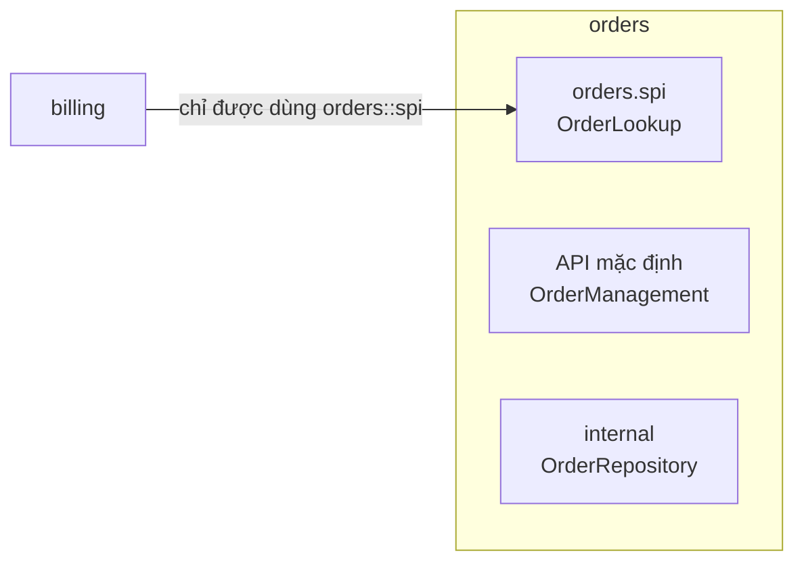

# Kiểm tra named interface trong mô hình

## Mục tiêu học tập

Sau bài học, bạn có thể:

1. Giải thích **named interface** là gì, tại sao Spring Modulith phân biệt API mặc định và API được xuất thêm từ các package con.
2. Khai báo một named interface với `@NamedInterface` trong `package-info.java`.
3. Đọc các named interface đã được phát hiện từ `ApplicationModule.getNamedInterfaces()`, tra cứu bằng tên và xác định kiểu Java nào được công bố.
4. Viết kiểm thử xác nhận một API có mặt trong named interface mong đợi, đồng thời phát hiện trường hợp vô tình xuất hoặc bỏ xuất API.
5. Liên hệ named interface với `@ApplicationModule(allowedDependencies = ...)` và `ApplicationModules.verify()` để bảo vệ ranh giới module trong CI.

Bài này thuộc chương **ApplicationModules** trong lộ trình **SPRING_MODULITH_VERIFICATION_TESTING**. Khi kiểm chứng kiến trúc Spring Modulith, biết một module tồn tại chưa đủ: còn phải biết **những kiểu nào của module được phép trở thành hợp đồng với module khác**. Named interface là công cụ mô tả và kiểm tra hợp đồng đó ở mức mã nguồn.

## 1. Vì sao cần named interface?

Xét hệ thống bán hàng có module `orders` và `billing`. Module `orders` chứa ba nhóm kiểu:

- `orders.OrderManagement`: API công khai ở package gốc của module.
- `orders.spi.OrderLookup`: hợp đồng tra cứu đơn hàng để một số module khác sử dụng.
- `orders.internal.OrderRepository`: chi tiết lưu trữ chỉ dành cho `orders`.

Theo cấu trúc module **đóng** mặc định, các kiểu công khai nằm trực tiếp trong package gốc (`orders`) tạo thành **API mặc định**. Các kiểu nằm trong package con (`orders.spi`, `orders.internal`) mặc định không được truy cập từ module khác, kể cả khi khai báo Java `public`.

Ta muốn cho `billing` sử dụng `OrderLookup` nhưng vẫn ngăn `billing` truy cập `OrderRepository`. Nếu chỉ đặt mọi interface vào package gốc, hợp đồng có thể trở nên quá rộng. Với `@NamedInterface("spi")`, ta công bố riêng nhóm hợp đồng trong package `orders.spi`.

| Phần mã nguồn | Vai trò | Module khác được truy cập theo cấu hình mặc định? |
| --- | --- | --- |
| `orders.OrderManagement` | API mặc định (unnamed interface) | Có, với kiểu công khai |
| `orders.spi.OrderLookup` chưa có annotation | Package con, nội bộ theo mặc định | Không |
| `orders.spi.OrderLookup` khi `orders.spi` có `@NamedInterface("spi")` | API bổ sung mang tên `spi` | Có, nếu không bị quy tắc dependency chặt hơn cấm |
| `orders.internal.OrderRepository` | Chi tiết cài đặt | Không |

**Named interface không nhất thiết là một Java `interface`.** Nó là một **nhóm kiểu được công bố** trong mô hình Spring Modulith: nhóm đó có thể chứa Java interface, class, record hoặc các kiểu phù hợp khác. Việc một kiểu được gắn `public` chỉ quyết định mức truy cập của Java, không tự biến kiểu đó thành API hợp lệ của application module.

## 2. Tổ chức mã nguồn mẫu

Ta dùng ứng dụng `com.example.shop` với hai module ngang hàng:

```text
src/main/java/com/example/shop/
├── ShopApplication.java
├── orders/                          <- module orders
│   ├── OrderManagement.java        <- API mặc định
│   ├── spi/
│   │   ├── package-info.java       <- @NamedInterface("spi")
│   │   └── OrderLookup.java        <- API bổ sung
│   └── internal/
│       ├── OrderRepository.java    <- nội bộ
│       └── InMemoryOrderLookup.java
└── billing/                         <- module billing
    ├── package-info.java           <- allowedDependencies
    └── internal/
        └── BillingService.java
```



Trong mô hình này, `orders.spi` **không trở thành application module mới**. Nó là một **named interface của module `orders`**, tức bề mặt API đã được công bố có tên. `orders.internal` vẫn là phần nội bộ và không thuộc `spi`.

Lớp ứng dụng nằm tại package gốc:

```java
// src/main/java/com/example/shop/ShopApplication.java
package com.example.shop;

import org.springframework.boot.SpringApplication;
import org.springframework.boot.autoconfigure.SpringBootApplication;

@SpringBootApplication
public class ShopApplication {

    public static void main(String[] args) {
        SpringApplication.run(ShopApplication.class, args);
    }
}
```

Với cách phát hiện module mặc định, Spring Modulith nhận diện `orders` và `billing` từ các package con trực tiếp của `com.example.shop`.

## 3. Công bố `orders.spi` bằng `@NamedInterface`

Đặt `package-info.java` **bên trong package cần công bố**, tức `com.example.shop.orders.spi`:

```java
// src/main/java/com/example/shop/orders/spi/package-info.java
@org.springframework.modulith.NamedInterface("spi")
package com.example.shop.orders.spi;
```

Khai báo một kiểu thuộc package này:

```java
// src/main/java/com/example/shop/orders/spi/OrderLookup.java
package com.example.shop.orders.spi;

public interface OrderLookup {
    boolean exists(String orderId);
}
```

Đồng thời, module vẫn có API mặc định tại package gốc:

```java
// src/main/java/com/example/shop/orders/OrderManagement.java
package com.example.shop.orders;

public interface OrderManagement {
    void placeOrder(String orderId);
}
```

Và phần cài đặt nội bộ:

```java
// src/main/java/com/example/shop/orders/internal/OrderRepository.java
package com.example.shop.orders.internal;

public interface OrderRepository {
    boolean contains(String orderId);
}
```

```java
// src/main/java/com/example/shop/orders/internal/InMemoryOrderLookup.java
package com.example.shop.orders.internal;

import com.example.shop.orders.spi.OrderLookup;
import org.springframework.stereotype.Service;

@Service
class InMemoryOrderLookup implements OrderLookup {

    @Override
    public boolean exists(String orderId) {
        // Chỉ là cách triển khai giả lập trong ví dụ.
        return orderId != null && !orderId.isBlank();
    }
}
```

`@NamedInterface("spi")` làm cho các kiểu thuộc package `orders.spi` tham gia vào named interface `spi` của `orders`. Annotation không tự khởi tạo bean hoặc triển khai `OrderLookup` thay cho Spring. Việc `InMemoryOrderLookup` có thể được injection khi chạy đến từ `@Service` và cơ chế Spring thông thường.

**Tại sao không đặt annotation trên `orders/package-info.java`?** Vì ta muốn công bố **một package con riêng**, không dùng annotation để gắn tên mới cho toàn bộ API mặc định. Vị trí `package-info.java` quyết định phạm vi nhóm kiểu được công bố.

## 4. Lấy named interfaces từ mô hình `ApplicationModules`

Đây là trọng tâm của bài. Ta không cần đọc file annotation thủ công trong bài test; `ApplicationModules` cung cấp mô hình đã được Spring Modulith phát hiện:

```java
import org.springframework.modulith.core.ApplicationModules;

ApplicationModules modules =
        ApplicationModules.of(ShopApplication.class);

var orders = modules.getModuleByName("orders").orElseThrow();
var interfaces = orders.getNamedInterfaces();
```

`getNamedInterfaces()` trả về **`org.springframework.modulith.core.NamedInterfaces`**, không phải một `List<String>`. Đối tượng này chứa cả API mặc định (*unnamed interface*) và các named interface được công bố tường minh.

Các API hữu ích:

| Đối tượng | API | Ý nghĩa |
| --- | --- | --- |
| `ApplicationModule` | `getNamedInterfaces()` | Lấy mô hình các giao diện được module công bố |
| `NamedInterfaces` | `hasExplicitInterfaces()` | Có ít nhất một named interface khai báo tường minh không? |
| `NamedInterfaces` | `getByName("spi")` | Tìm một named interface, nhận `Optional<NamedInterface>` |
| `NamedInterfaces` | `getUnnamedInterface()` | Lấy API mặc định tại package nền |
| `NamedInterfaces` | `stream()` | Duyệt các giao diện mà mô hình phát hiện |
| `NamedInterface` | `getName()` | Đọc tên giao diện |
| `NamedInterface` | `isNamed()` / `isUnnamed()` | Phân biệt API được đặt tên và API mặc định |
| `NamedInterface` | `contains(SomeType.class)` | Kiểm tra kiểu Java có thuộc giao diện này không |
| `NamedInterface` | `asJavaClasses()` | Liệt kê các kiểu ArchUnit nằm trong giao diện |

Trong Spring Modulith, **unnamed interface luôn là phần API mặc định** của module; `hasExplicitInterfaces()` là cách kiểm tra xem module có công bố thêm named interface ngoài phần đó hay không. Đừng dùng `hasExplicitInterfaces() == false` để kết luận module không có API.

### In danh sách giao diện của `orders`

```java
package com.example.shop;

import java.util.Comparator;
import org.junit.jupiter.api.Test;
import org.springframework.modulith.core.ApplicationModules;

class NamedInterfaceInspectionTests {

    @Test
    void printNamedInterfaces() {
        ApplicationModules modules =
                ApplicationModules.of(ShopApplication.class);

        var orders = modules.getModuleByName("orders").orElseThrow();

        System.out.println("module=" + orders.getIdentifier());
        System.out.println("hasExplicit="
                + orders.getNamedInterfaces().hasExplicitInterfaces());

        orders.getNamedInterfaces().stream()
                .sorted(Comparator.comparing(
                        namedInterface -> namedInterface.getName()))
                .forEach(namedInterface -> {
                    System.out.printf("name=%s | explicit=%s%n",
                            namedInterface.getName(),
                            namedInterface.isNamed());

                    namedInterface.asJavaClasses()
                            .map(type -> type.getName())
                            .sorted()
                            .forEach(name -> System.out.println("  " + name));
                });
    }
}
```

Trong mô hình ví dụ, danh sách có API mặc định chứa `OrderManagement` và named interface `spi` chứa `OrderLookup`. **Đừng cố định tên chuỗi hiển thị của unnamed interface** trong assertion; dùng `isUnnamed()` hoặc `getUnnamedInterface()` để kiểm tra một cách rõ nghĩa. Định dạng log cũng không phải hợp đồng của framework.

## 5. Kiểm tra named interface theo tên và kiểu

Khi nhóm thống nhất rằng `OrderLookup` là hợp đồng công khai của `orders::spi`, có thể biến điều đó thành assertion thay vì chỉ in log:

```java
package com.example.shop;

import static org.junit.jupiter.api.Assertions.assertFalse;
import static org.junit.jupiter.api.Assertions.assertTrue;

import com.example.shop.orders.OrderManagement;
import com.example.shop.orders.spi.OrderLookup;
import org.junit.jupiter.api.Test;
import org.springframework.modulith.core.ApplicationModules;

class NamedInterfaceContractTests {

    @Test
    void ordersMustExposeSpiAndKeepApisSeparate() {
        ApplicationModules modules =
                ApplicationModules.of(ShopApplication.class);

        var orders = modules.getModuleByName("orders").orElseThrow();
        var named = orders.getNamedInterfaces();

        assertTrue(named.hasExplicitInterfaces());

        var spi = named.getByName("spi").orElseThrow();
        assertTrue(spi.isNamed());
        assertTrue(spi.contains(OrderLookup.class));
        assertFalse(spi.contains(OrderManagement.class));

        var defaultApi = named.getUnnamedInterface();
        assertTrue(defaultApi.isUnnamed());
        assertTrue(defaultApi.contains(OrderManagement.class));
        assertFalse(defaultApi.contains(OrderLookup.class));
    }
}
```

Ý nghĩa từng điều kiện:

- `hasExplicitInterfaces()` xác nhận rằng `orders` có ít nhất một API được đặt tên rõ ràng.
- `getByName("spi").orElseThrow()` bảo vệ việc nhóm vẫn tồn tại, đúng tên.
- `spi.contains(OrderLookup.class)` bảo vệ rằng kiểu công khai đã được đặt đúng chỗ.
- `spi.contains(OrderManagement.class) == false` cho thấy API mặc định không vô tình được gom vào `spi`.
- Kiểm tra unnamed interface giúp phát hiện trường hợp refactor vô tình chuyển `OrderManagement` sang package khác.

Mô hình có thể thay đổi khi dự án cấu hình chiến lược khám phá named interface riêng. Các assertion trên dựa trên **thiết kế package mặc định của ví dụ**.

### Kiểm tra một kiểu nội bộ không bị công bố

Ta có thể bổ sung kiểm tra ở đúng lớp test trên:

```java
import com.example.shop.orders.internal.OrderRepository;

var spi = modules.getModuleByName("orders")
        .orElseThrow()
        .getNamedInterfaces()
        .getByName("spi")
        .orElseThrow();

assertFalse(spi.contains(OrderRepository.class));
```

Kiểm tra phủ định hữu ích khi nhóm muốn **bảo đảm một kiểu nội bộ cụ thể không trở thành API có tên** sau khi tái cấu trúc. Nếu một ngày `OrderRepository` bị chuyển vào `orders.spi`, bài test này sẽ thất bại và buộc người sửa giải thích lý do.

Lưu ý: ví dụ này tham chiếu `OrderRepository` từ **mã test kiểm tra kiến trúc**, không phải từ code nghiệp vụ `billing`. Không nên thêm dependency trực tiếp từ module `billing` tới repository chỉ để thực hiện assertion.

## 6. Phân biệt kiểm tra tồn tại và kiểm tra thành viên

Chỉ kiểm tra:

```java
assertTrue(orders.getNamedInterfaces()
        .getByName("spi").isPresent());
```

chứng minh named interface tên `spi` tồn tại. Nó **chưa chứng minh** nhóm chứa đúng các kiểu dự kiến.

Ngược lại:

```java
var spi = orders.getNamedInterfaces()
        .getByName("spi").orElseThrow();

assertTrue(spi.contains(OrderLookup.class));
```

chứng minh thêm rằng `OrderLookup` thuộc nhóm được công bố. Nếu cần kiểm tra toàn bộ tập kiểu, có thể thu thập tên:

```java
import java.util.Set;
import java.util.stream.Collectors;

Set<String> exposedTypes = spi.asJavaClasses()
        .map(type -> type.getName())
        .collect(Collectors.toSet());

System.out.println(exposedTypes);
```

`asJavaClasses()` cung cấp các kiểu theo mô hình ArchUnit mà Spring Modulith đã quét. So sánh **toàn bộ** tập kiểu chỉ thích hợp khi nội dung named interface là hợp đồng ổn định, bởi thêm một lớp API hợp lệ cũng sẽ làm assertion đó thay đổi. Trong nhiều dự án, kiểm tra các kiểu bắt buộc bằng `contains(...)` sẽ ít giòn hơn.

### Kiểm tra nhiều module cùng lúc

Nếu muốn có bảng tổng quan API đã công bố, có thể duyệt:

```java
ApplicationModules modules =
        ApplicationModules.of(ShopApplication.class);

modules.stream()
        .sorted(java.util.Comparator.comparing(
                module -> module.getIdentifier().toString()))
        .forEach(module -> {
            module.getNamedInterfaces().stream()
                    .filter(namedInterface -> namedInterface.isNamed())
                    .map(namedInterface -> namedInterface.getName())
                    .sorted()
                    .forEach(name -> System.out.printf("%s::%s%n",
                            module.getIdentifier(), name));
        });
```

Kết quả ví dụ có `orders::spi`. Từ `isNamed()` giúp bỏ qua unnamed interface và tập trung vào những API được công bố tường minh. Kết quả này đặc biệt hữu ích khi rà soát những package nào đang được phép trở thành hợp đồng liên module.

## 7. Liên hệ với `allowedDependencies`: `orders :: spi`

Named interface vừa mô tả **API được công bố** của module đích, vừa cho phép giới hạn **API mà module nguồn được phép dùng**. Giả sử `billing` chỉ được dùng `orders.spi`.

Đặt `package-info.java` trong package nền của module `billing`:

```java
// src/main/java/com/example/shop/billing/package-info.java
@org.springframework.modulith.ApplicationModule(
        allowedDependencies = "orders :: spi"
)
package com.example.shop.billing;
```

Sau đó mã `billing` chỉ dùng giao diện này:

```java
// src/main/java/com/example/shop/billing/internal/BillingService.java
package com.example.shop.billing.internal;

import com.example.shop.orders.spi.OrderLookup;
import org.springframework.stereotype.Service;

@Service
class BillingService {

    private final OrderLookup orders;

    BillingService(OrderLookup orders) {
        this.orders = orders;
    }

    boolean canIssueInvoice(String orderId) {
        return orders.exists(orderId);
    }
}
```

Chiều phụ thuộc tĩnh là **`billing → orders`**, cụ thể đến named interface `spi`. `billing` không có lý do phụ thuộc vào `orders.internal`, và khai báo `allowedDependencies` còn cố ý hạn chế việc `billing` dùng API mặc định `OrderManagement`.

Các cách khai báo dependency có ý nghĩa khác nhau:

| Giá trị `allowedDependencies` của `billing` | Phạm vi được phép dùng từ module `orders` |
| --- | --- |
| `"orders"` | API mặc định tại package nền `orders`; không mặc nhiên gồm `orders.spi` |
| `"orders :: spi"` | Chỉ named interface `spi`; không bao gồm `OrderManagement` tại package nền |
| `"orders :: *"` | Các named interface được khai báo tường minh của `orders`; không gồm API mặc định |
| `"orders :: **"` | API mặc định và tất cả named interface tường minh của `orders` |

**Không giá trị nào trong bảng tự cấp quyền truy cập `orders.internal`** của một module đóng. Nếu thiết kế chỉ cần `OrderLookup`, hãy khai báo cụ thể `"orders :: spi"` để quyền phụ thuộc hẹp, dễ kiểm chứng.

Tên `orders` trong khai báo là **định danh module**, còn `spi` là **tên named interface**. Đừng viết `"com.example.shop.orders.spi"` thay cho biểu thức `"orders :: spi"` trong `allowedDependencies`; đây là hai loại định danh khác nhau.

## 8. Kiểm chứng kiến trúc bằng `verify()`

Spring Modulith phân biệt **API có thể được công bố** với **dependency thực tế có phù hợp quy tắc không**. `getNamedInterfaces()` giúp quan sát hợp đồng; `verify()` xác minh sự tuân thủ của mã nguồn.

```java
// src/test/java/com/example/shop/ArchitectureVerificationTests.java
package com.example.shop;

import org.junit.jupiter.api.Test;
import org.springframework.modulith.core.ApplicationModules;

class ArchitectureVerificationTests {

    @Test
    void moduleBoundariesMustBeValid() {
        ApplicationModules.of(ShopApplication.class).verify();
    }
}
```

Với mô hình trên, `verify()` xác minh các quy tắc kiến trúc như:

1. Không có **phụ thuộc vòng** giữa các application module.
2. Không tham chiếu trái phép đến kiểu thuộc **package nội bộ** của một module đóng khác.
3. Tuân thủ các hạn chế `allowedDependencies`, bao gồm quyền dùng named interface cụ thể khi đã khai báo.

### Thử nghiệm vi phạm thứ nhất: truy cập API mặc định ngoài danh sách cho phép

Giả sử thêm vào `billing.internal.BillingService`:

```java
// Minh họa thay đổi làm sai hợp đồng billing -> orders::spi
import com.example.shop.orders.OrderManagement;
```

Nếu code `billing` thực sự sử dụng `OrderManagement`, quan hệ mới đi tới API mặc định `orders`, **không thuộc** `orders::spi`. Với `allowedDependencies = "orders :: spi"`, `verify()` phải báo vi phạm quy tắc dependency.

### Thử nghiệm vi phạm thứ hai: truy cập chi tiết nội bộ

```java
// Minh họa import sai ranh giới; không giữ trong code production
import com.example.shop.orders.internal.OrderRepository;
```

Nếu `billing` tham chiếu `OrderRepository` trong chữ ký trường/constructor hoặc lệnh gọi, Java có thể biên dịch vì kiểu này khai báo `public`; tuy nhiên đó vẫn là **kiểu nội bộ** của application module `orders`. Với module đóng thông thường, `verify()` phát hiện lỗi ranh giới.

Chỉ thêm một dòng import chưa được dùng có thể không tạo ra dependency trong bytecode; để thử nghiệm có ý nghĩa, phải **sử dụng kiểu đó trong mã**. Đây là điểm quan trọng khi giải thích vì sao một bài kiểm thử kiến trúc đôi khi không thất bại dù người học đã viết import sai nhưng chưa dùng.

### Thử nghiệm vi phạm thứ ba: quên annotation

Nếu xóa `@NamedInterface("spi")` khỏi `orders.spi/package-info.java`, module `orders` không còn công bố nhóm `spi` theo cấu hình mặc định. Từ đó:

- Test `getByName("spi").orElseThrow()` thất bại, báo hợp đồng API đã mất.
- Code `billing` tiếp tục dùng `OrderLookup` có thể bị `verify()` từ chối vì tham chiếu vào package con không được công bố.

Hai kiểu kiểm thử này bổ sung cho nhau: một bên **khóa chính xác mô hình API mong đợi**, bên kia **khóa cách các module sử dụng API**.

## 9. Kết hợp contract test và CI

Một bộ quality gate thiết thực cho bài này gồm:

```java
package com.example.shop;

import static org.junit.jupiter.api.Assertions.assertFalse;
import static org.junit.jupiter.api.Assertions.assertTrue;

import com.example.shop.orders.OrderManagement;
import com.example.shop.orders.spi.OrderLookup;
import org.junit.jupiter.api.Test;
import org.springframework.modulith.core.ApplicationModules;

class ModuleContractAndArchitectureTests {

    @Test
    void ordersPublishesOnlyIntendedInterfaces() {
        var modules = ApplicationModules.of(ShopApplication.class);
        var orders = modules.getModuleByName("orders").orElseThrow();
        var interfaces = orders.getNamedInterfaces();

        assertTrue(interfaces.hasExplicitInterfaces());

        var spi = interfaces.getByName("spi").orElseThrow();
        assertTrue(spi.contains(OrderLookup.class));
        assertFalse(spi.contains(OrderManagement.class));

        assertTrue(interfaces.getUnnamedInterface()
                .contains(OrderManagement.class));
    }

    @Test
    void moduleDependenciesAreValid() {
        ApplicationModules.of(ShopApplication.class).verify();
    }
}
```

Test thứ nhất bảo vệ **cấu trúc API xuất ra**. Test thứ hai bảo vệ **đồ thị phụ thuộc** giữa các module. Chúng là unit/architecture test trên mô hình tĩnh; không cần `@SpringBootTest` hoặc chạy database.

Trong dự án đã có JUnit và Spring Modulith test dependencies, chạy:

```bash
./gradlew test
```

Hoặc:

```bash
./mvnw test
```

Cho bộ kiểm thử này chạy trong bước kiểm tra bắt buộc của CI. Khi code review chấp thuận một API công khai mới, cập nhật test hợp đồng cùng thay đổi mã. Khi thay đổi bị từ chối, việc test thất bại là tín hiệu đúng: module đang xuất hoặc dùng API vượt ngoài hợp đồng đã thống nhất.

| Lớp kiểm thử | Bảo vệ điều gì? | Không bảo vệ điều gì? |
| --- | --- | --- |
| `getNamedInterfaces()` + assertion | Named interface và các kiểu cần có được phát hiện đúng | Không chứng minh luồng nghiệp vụ chạy đúng |
| `ApplicationModules.verify()` | Phụ thuộc vòng, truy cập nội bộ, `allowedDependencies` | Không khởi động Spring context hoặc database |
| `@ApplicationModuleTest` | Hành vi module trong Spring test context theo phạm vi mong muốn | Không thay thế toàn bộ kiểm thử tích hợp hệ thống |
| Test sự kiện, cơ sở dữ liệu, tích hợp | Publish/consume sự kiện, transaction và kết nối thực tế | Không thay thế việc khóa ranh giới kiến trúc tĩnh |

Named interface có thể chứa kiểu sự kiện được module khác lắng nghe. Việc một sự kiện nằm trong named interface đúng chỉ chứng minh **kiểu sự kiện đã được công bố**, không chứng minh sự kiện được phát đúng thời điểm, listener nhận được hoặc giao dịch database hoàn tất. Những việc đó phải kiểm tra bằng test runtime.

## 10. Những sai lầm thường gặp

| Hiện tượng | Nguyên nhân khả dĩ | Cách kiểm tra/sửa |
| --- | --- | --- |
| `getByName("spi")` trả rỗng | Annotation đặt nhầm package, đặt tên khác hoặc classpath không chứa `package-info.class` | Đọc đúng `orders.spi/package-info.java`, kiểm tra bước biên dịch và phạm vi quét |
| `hasExplicitInterfaces()` trả `false` | Chưa công bố named interface tường minh hoặc chiến lược phát hiện khác | Kiểm tra `@NamedInterface` và cấu hình module |
| `getUnnamedInterface()` vẫn tồn tại khi không có `spi` | Unnamed interface là API mặc định của module | Không coi nó là bằng chứng đã công bố `spi` |
| `spi.contains(OrderLookup.class)` trả `false` | Kiểu đã được di chuyển, không còn thuộc package/nhóm được gắn annotation | Kiểm tra package thực tế và annotation |
| `billing` dùng `OrderManagement` khiến `verify()` lỗi | `allowedDependencies = "orders :: spi"` không cho dùng API mặc định | Thay bằng API `spi` hoặc thay đổi hợp đồng theo quyết định thiết kế |
| Kiểu `public` trong `orders.internal` gây vi phạm | Java `public` không tương đương API module được công bố | Giữ mã ngoài module phụ thuộc vào API mặc định hoặc named interface phù hợp |
| Test API đúng nhưng `verify()` lỗi | Một module vẫn tham chiếu tới phần không được phép | Lần theo phụ thuộc nguồn → đích và đọc thông báo vi phạm |
| `verify()` xanh nhưng gọi dịch vụ runtime lỗi | Kiểm chứng tĩnh không chạy database/broker hoặc injection đầy đủ | Bổ sung `@ApplicationModuleTest` và integration test cần thiết |

**Đặc biệt với open module:** `@ApplicationModule(type = ApplicationModule.Type.OPEN)` có quy tắc công bố rộng hơn so với module đóng: các kiểu trong package con có thể tham gia API mặc định nếu không được gán riêng. Khi điều tra một named interface lạ, cần kiểm tra loại module trước khi áp kỳ vọng mặc định của bài. Với thiết kế mới, thường nên ưu tiên module đóng và xuất API có chủ đích.

## 11. Bài thực hành

**Bối cảnh:** Nhóm bán hàng muốn `billing` chỉ tra cứu trạng thái đơn hàng, không phụ thuộc vào cơ chế tạo đơn hay repository.

**Các bước thực hiện:**

1. Tạo `orders` và `billing` theo cây package ở mục 2.
2. Khai báo `OrderManagement` tại `orders`; `OrderLookup` tại `orders.spi`; `OrderRepository` tại `orders.internal`.
3. Thêm `@NamedInterface("spi")` trong `orders.spi/package-info.java`.
4. Dùng `ApplicationModules.of(ShopApplication.class)` và `orders.getNamedInterfaces()` để in các tên giao diện được nhận diện.
5. Viết assertion `hasExplicitInterfaces()`, `getByName("spi")`, `spi.contains(OrderLookup.class)` và `getUnnamedInterface().contains(OrderManagement.class)`.
6. Thêm `@ApplicationModule(allowedDependencies = "orders :: spi")` cho `billing`; tạo một service phụ thuộc vào `OrderLookup`.
7. Chạy `verify()`. Sau đó thử **sử dụng thực sự** `OrderManagement` hoặc `OrderRepository` từ `billing` trong nhánh thực hành, đọc lỗi và khôi phục mã hợp lệ.
8. Xóa annotation `@NamedInterface("spi")` tạm thời để quan sát sự thay đổi của mô hình, rồi khôi phục và chạy lại các test.

**Tiêu chí hoàn thành:** Bạn phân biệt được named interface với một Java interface đơn lẻ, biết kiểm tra đúng thành viên của `spi`, hiểu vì sao `orders :: spi` chỉ cho phép một bề mặt API hẹp và giải thích được các trường hợp `verify()` thành công hoặc thất bại.

## 12. Câu hỏi tự kiểm tra

1. Vì sao `orders.spi.OrderLookup` là một kiểu `public` nhưng chưa chắc được module `billing` dùng khi `orders.spi` chưa khai báo named interface?
2. `getNamedInterfaces().hasExplicitInterfaces()` trả `false` có nghĩa là module hoàn toàn không có API công khai hay không?
3. Khác biệt giữa `getByName("spi").isPresent()` và `getByName("spi").orElseThrow().contains(OrderLookup.class)` là gì?
4. Với `allowedDependencies = "orders :: spi"`, module `billing` có được dùng `orders.OrderManagement` không? Vì sao?
5. Sự khác biệt giữa `"orders :: *"` và `"orders :: **"` là gì?
6. Nếu test kiểm tra named interface thành công nhưng `verify()` thất bại, bạn sẽ kiểm tra bước nào tiếp theo?
7. Vì sao phải bổ sung `@ApplicationModuleTest` và test sự kiện/database dù mọi named interface và phụ thuộc tĩnh đều hợp lệ?

## Tổng kết

Muốn **kiểm tra named interface trong mô hình**, hãy lấy `ApplicationModule` từ `ApplicationModules`, gọi `getNamedInterfaces()`, dùng `getByName(...)`, `getUnnamedInterface()` và `contains(Type.class)` để xác nhận chính xác API đã công bố. `@NamedInterface` tạo bề mặt truy cập tường minh từ package con, trong khi `allowedDependencies = "module :: interface"` giới hạn module khác sử dụng bề mặt đó. Kết hợp các assertion mô hình với `ApplicationModules.verify()` trong CI để ngăn việc xuất API ngoài chủ đích và phụ thuộc sai. Các bài `@ApplicationModuleTest`, kiểm thử sự kiện và database tiếp tục bảo vệ hành vi khi ứng dụng thực sự chạy.

### Tài liệu tham khảo

- [Spring Modulith — Fundamentals: Named Interfaces](https://docs.spring.io/spring-modulith/reference/fundamentals.html#fundamentals.named-interfaces)
- [Spring Modulith — ApplicationModule API](https://docs.spring.io/spring-modulith/docs/current/api/org/springframework/modulith/core/ApplicationModule.html)
- [Spring Modulith — NamedInterfaces API](https://docs.spring.io/spring-modulith/docs/current/api/org/springframework/modulith/core/NamedInterfaces.html)
- [Spring Modulith — NamedInterface API](https://docs.spring.io/spring-modulith/docs/current/api/org/springframework/modulith/core/NamedInterface.html)
- [Spring Modulith — Verification](https://docs.spring.io/spring-modulith/reference/verification.html)
