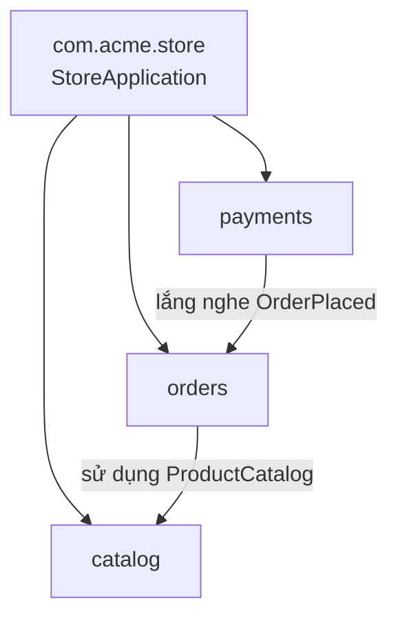

# In mô hình để quan sát cấu trúc

## Mục tiêu học tập

Sau bài học, bạn có thể:

1. Tạo mô hình `ApplicationModules` của ứng dụng và **in trực tiếp mô hình** bằng `System.out.println(modules)` để khảo sát cấu trúc.
2. Đọc các nhóm thông tin thường xuất hiện trong biểu diễn văn bản: tên module, base package, API được công bố, phụ thuộc trực tiếp và các Spring bean.
3. Chỉ in một `ApplicationModule` khi cần điều tra một phần nghiệp vụ cụ thể.
4. Tự tạo một **báo cáo có thứ tự ổn định** từ API của Spring Modulith để so sánh cấu trúc giữa các lần chạy.
5. Dùng kết quả quan sát để điều tra module bị thiếu, package bị gộp, phụ thuộc bất thường; sau đó chuyển các quy tắc quan trọng thành kiểm thử `verify()` và assertion trong CI.

Bài học thuộc chương **ApplicationModules** của lộ trình **SPRING_MODULITH_VERIFICATION_TESTING**. In mô hình là bước quan sát hữu ích khi bắt đầu kiểm chứng ranh giới kiến trúc; nó cho thấy **Spring Modulith đang hiểu mã nguồn của ứng dụng như thế nào**, trước khi dùng `@ApplicationModuleTest`, kiểm thử sự kiện hoặc kiểm thử tích hợp database.

## 1. Tại sao cần in mô hình?

Lập trình viên có thể nhìn cây thư mục rồi cho rằng `orders`, `catalog`, `payments` là ba module độc lập. Nhưng Spring Modulith nhận diện module theo **package gốc, chiến lược phát hiện và cấu hình ứng dụng**. Cây thư mục trong IDE không tự chứng minh rằng mô hình module đã khớp thiết kế.

Ví dụ, nếu tất cả nằm dưới `com.acme.store.business` thì cách phát hiện mặc định có thể xem `business` là một module lớn. Nếu tạo `ApplicationModules` từ lớp ở package quá sâu, kết quả có thể bỏ sót nhiều phần nghiệp vụ.

In mô hình giúp trả lời các câu hỏi thực tế:

| Câu hỏi | Thông tin nên quan sát |
| --- | --- |
| Spring Modulith đã tìm thấy những module nào? | Tên logic và danh sách module |
| Ranh giới của mỗi module bắt đầu tại đâu? | Base package |
| Module công bố API nào cho module khác? | Named interfaces và các kiểu công khai |
| Có mũi tên phụ thuộc ngoài dự kiến không? | Direct module dependencies |
| Kiểu nào được nhận diện là Spring bean? | Phần Spring beans trong mô hình |
| Tại sao module test chạy kèm nhiều bean? | Quan sát mô hình, sau đó xem chế độ `@ApplicationModuleTest` và quan hệ phụ thuộc |

**Phân biệt rõ:** In mô hình là một thao tác **quan sát**. Nó không tự kiểm chứng tính đúng đắn của từng dependency và không khởi chạy các luồng nghiệp vụ.

## 2. Tạo một ứng dụng mẫu có ranh giới rõ ràng

Xét ứng dụng bán hàng với package gốc `com.acme.store`:

```text
src/main/java/com/acme/store/
├── StoreApplication.java
├── catalog/
│   ├── ProductCatalog.java
│   └── internal/
│       └── ProductService.java
├── orders/
│   ├── OrderManagement.java
│   ├── OrderPlaced.java
│   └── internal/
│       └── OrderService.java
└── payments/
    ├── PaymentManagement.java
    └── internal/
        └── PaymentListener.java
```

Đặt lớp Spring Boot ở package gốc:

```java
// src/main/java/com/acme/store/StoreApplication.java
package com.acme.store;

import org.springframework.boot.SpringApplication;
import org.springframework.boot.autoconfigure.SpringBootApplication;

@SpringBootApplication
public class StoreApplication {

    public static void main(String[] args) {
        SpringApplication.run(StoreApplication.class, args);
    }
}
```

Mô hình mong đợi theo cách phát hiện mặc định:



Trong ví dụ, `orders.internal.OrderService` dùng API công khai `catalog.ProductCatalog`, còn `payments.internal.PaymentListener` lắng nghe `orders.OrderPlaced`. Do đó mũi tên phụ thuộc **mô hình tĩnh** là `orders → catalog` và `payments → orders`. Đây là một kiến trúc mẫu; kết quả thực tế chỉ xuất hiện nếu các kiểu Java tương ứng đã được khai báo và có tham chiếu trong mã.

Ví dụ một API ở package module đích:

```java
// src/main/java/com/acme/store/catalog/ProductCatalog.java
package com.acme.store.catalog;

public interface ProductCatalog {
    boolean exists(String productId);
}
```

Một service thuộc module `orders` tham chiếu kiểu trên:

```java
// src/main/java/com/acme/store/orders/internal/OrderService.java
package com.acme.store.orders.internal;

import com.acme.store.catalog.ProductCatalog;
import org.springframework.stereotype.Service;

@Service
class OrderService {

    private final ProductCatalog products;

    OrderService(ProductCatalog products) {
        this.products = products;
    }

    boolean accepts(String productId) {
        return products.exists(productId);
    }
}
```

Nếu muốn quan sát mũi tên `payments → orders` qua sự kiện, bổ sung:

```java
// src/main/java/com/acme/store/orders/OrderPlaced.java
package com.acme.store.orders;

public record OrderPlaced(String orderId) {}
```

```java
// src/main/java/com/acme/store/payments/internal/PaymentListener.java
package com.acme.store.payments.internal;

import com.acme.store.orders.OrderPlaced;
import org.springframework.context.event.EventListener;
import org.springframework.stereotype.Component;

@Component
class PaymentListener {

    @EventListener
    void on(OrderPlaced event) {
        System.out.println("Preparing payment for " + event.orderId());
    }
}
```

Hướng mũi tên được xác định từ **kiểu trong module nguồn** tới **kiểu được tham chiếu thuộc module đích**. Khi listener nằm trong `payments` và nhận `OrderPlaced` ở `orders`, `payments` là module có tham chiếu tĩnh tới `orders`. Việc sự kiện có thực sự được publish/consume đúng lúc chạy cần một bài test sự kiện riêng.

## 3. In toàn bộ `ApplicationModules` bằng `toString()`

Cách ngắn nhất để khảo sát mô hình:

```java
package com.acme.store;

import org.junit.jupiter.api.Test;
import org.springframework.modulith.core.ApplicationModules;

class ModuleStructurePrintTests {

    @Test
    void printApplicationModuleModel() {
        ApplicationModules modules =
                ApplicationModules.of(StoreApplication.class);

        System.out.println(modules);
    }
}
```

`System.out.println(modules)` gọi `modules.toString()`. Spring Modulith cung cấp biểu diễn văn bản của mô hình, giúp xem nhanh các thông tin quan trọng. Có thể viết tường minh:

```java
String modelText = modules.toString();
System.out.println(modelText);
```

**Không cần `@SpringBootTest`** cho bài kiểm thử này: `ApplicationModules.of(...)` phân tích cấu trúc code và tạo mô hình kiến trúc, không cần khởi động `ApplicationContext`. Bài test đọc thông tin từ những kiểu Java hiện diện trong classpath kiểm thử.

### Dạng kết quả thường thấy

Văn bản in ra có thể có nhiều khối, mỗi khối tương ứng một module. Minh họa rút gọn dưới đây mô tả các loại dữ liệu thường gặp, **không phải bản chụp nguyên văn cố định** của mọi phiên bản Spring Modulith:

```text
# Orders
> Logical name: orders
> Base package: com.acme.store.orders
> Named interfaces:
  + ... API mặc định ...
> Direct module dependencies:
  - catalog
> Spring beans:
  + ... OrderService ...

# Payments
> Logical name: payments
> Base package: com.acme.store.payments
> Named interfaces:
  + ... API mặc định ...
> Direct module dependencies:
  - orders
> Spring beans:
  + ... PaymentListener ...
```

Tên hiển thị, ký hiệu ở đầu dòng, thứ tự, cách rút gọn tên kiểu và mức chi tiết của `toString()` có thể khác nhau theo phiên bản hoặc cấu hình phát hiện module. Hãy đọc **ý nghĩa các phần**, không dùng cả chuỗi trên làm tiêu chuẩn bắt buộc trong test.

| Thành phần output | Cách hiểu |
| --- | --- |
| Tiêu đề module / logical name | Module nào đang được mô tả và tên logic để tra cứu |
| Base package | Package nền mà module sở hữu |
| Named interfaces | Các kiểu được công bố qua API mặc định hoặc named interface |
| Direct module dependencies | Các module khác mà mã của module hiện tại tham chiếu trực tiếp |
| Spring beans | Các kiểu/bean được nhận diện trong phạm vi module |

Một kiểu nằm trong phần `Spring beans` **không đồng nghĩa** đã được cho phép truy cập từ module khác. Quyền truy cập vẫn phải xem xét theo API mặc định, named interfaces và các quy tắc phụ thuộc.

## 4. In một `ApplicationModule` để điều tra tập trung

Khi ứng dụng có hàng chục module, in toàn bộ `ApplicationModules` sẽ tạo log dài. Có thể tra cứu module cần xem rồi chỉ in nó:

```java
package com.acme.store;

import org.junit.jupiter.api.Test;
import org.springframework.modulith.core.ApplicationModules;

class ModuleStructurePrintTests {

    @Test
    void printOrdersOnly() {
        ApplicationModules modules =
                ApplicationModules.of(StoreApplication.class);

        var orders = modules.getModuleByName("orders")
                .orElseThrow(() ->
                        new IllegalStateException("Missing module orders"));

        System.out.println(orders);
    }
}
```

`ApplicationModule.toString()` giúp quan sát một module cụ thể. Cách này phù hợp khi cần giải thích vì sao một package không được công bố, vì sao module xuất hiện dependency mới, hoặc vì sao kết quả thử nghiệm không giống sơ đồ thiết kế.

Nếu không tìm thấy `orders`, `orElseThrow()` làm bài test thất bại rõ ràng, có ích khi module đó là phần bắt buộc của kiến trúc. Khi điều tra thủ công, có thể in toàn bộ danh sách ID trước để kiểm tra định danh thực tế:

```java
modules.stream()
        .map(module -> module.getIdentifier().toString())
        .sorted()
        .forEach(System.out::println);
```

Đừng tra cứu bằng tên hiển thị nếu nó khác định danh logic. Trong một dự án có cấu hình tên module đầy đủ hoặc chiến lược phát hiện riêng, khóa tra cứu có thể không phải phần cuối của package.

## 5. Tạo báo cáo cấu trúc ngắn và có thứ tự ổn định

`toString()` được thiết kế để người đọc xem nhanh. Khi muốn một báo cáo nhất quán để lưu trong log CI hoặc so sánh hai lần chạy, có thể xây dựng chuỗi từ các trường API có ý nghĩa.

Ví dụ chỉ gồm ID, package và các đích phụ thuộc trực tiếp:

```java
package com.acme.store;

import java.util.Comparator;
import java.util.List;

import org.junit.jupiter.api.Test;
import org.springframework.modulith.core.ApplicationModules;

class ModuleStructureReportTests {

    @Test
    void printDeterministicStructureReport() {
        ApplicationModules modules =
                ApplicationModules.of(StoreApplication.class);

        modules.stream()
                .sorted(Comparator.comparing(
                        module -> module.getIdentifier().toString()))
                .forEach(module -> {
                    List<String> dependencies = module
                            .getDirectDependencies(modules)
                            .uniqueModules()
                            .map(target -> target.getIdentifier().toString())
                            .sorted()
                            .toList();

                    System.out.printf(
                            "id=%s | package=%s | direct=%s%n",
                            module.getIdentifier(),
                            module.getBasePackage().getName(),
                            dependencies);
                });
    }
}
```

Trong mô hình minh họa ở mục 2, báo cáo dự kiến:

```text
id=catalog  | package=com.acme.store.catalog  | direct=[]
id=orders   | package=com.acme.store.orders   | direct=[catalog]
id=payments | package=com.acme.store.payments | direct=[orders]
```

Các khoảng trắng được căn ở ví dụ chỉ nhằm dễ đọc, vì code `printf` không tự căn cột. Thứ tự được kiểm soát bằng hai bước `sorted()`: một lần với module nguồn và một lần với danh sách module đích.

`uniqueModules()` tránh in trùng tên module đích khi nhiều kiểu Java khác nhau cùng tham chiếu đến module đó. Nếu cần biết **chính xác class nào đã tạo một dependency**, phải duyệt từng `ApplicationModuleDependency` thay vì chỉ dùng danh sách đích duy nhất.

### Tạo bản tóm tắt chỉ chứa ID và base package

Khi cần output tối giản:

```java
ApplicationModules modules =
        ApplicationModules.of(StoreApplication.class);

modules.stream()
        .sorted(Comparator.comparing(
                module -> module.getIdentifier().toString()))
        .forEach(module -> System.out.printf(
                "%s => %s%n",
                module.getIdentifier(),
                module.getBasePackage().getName()));
```

Cách này hữu ích khi nghi ngờ nhiều phần nghiệp vụ đang bị gộp chung dưới cùng một package. Nó cũng tránh phụ thuộc vào cách `toString()` của framework định dạng dữ liệu.

## 6. Đọc kết quả để chẩn đoán thay đổi kiến trúc

### Trường hợp 1: Thiếu module `payments`

Nếu chỉ in thấy `catalog` và `orders`, cần kiểm tra:

- Lớp `StoreApplication` có nằm trong package gốc `com.acme.store` không?
- `payments` có thực sự nằm dưới vùng package được quét không?
- Các kiểu của `payments` có trong classpath đang chạy test không?
- Dự án có dùng chiến lược phát hiện module tùy chỉnh hoặc loại trừ package không?

Khi chưa giải quyết được phạm vi mô hình, một lần gọi `verify()` thành công vẫn có thể bỏ sót phần mã không nằm trong mô hình.

### Trường hợp 2: Chỉ xuất hiện module `business`

Nếu cấu trúc được đổi thành:

```text
com/acme/store/
└── business/
    ├── catalog/
    ├── orders/
    └── payments/
```

với phát hiện mặc định theo package con trực tiếp, Spring Modulith có thể nhận diện một module `business`. Log lúc này giúp phát hiện vấn đề: các package nghiệp vụ chỉ là package con **bên trong** `business` thay vì ba module ngang hàng.

Giải pháp phải phản ánh thiết kế mong muốn: điều chỉnh cấu trúc package hoặc cấu hình phát hiện module có chủ đích. Không nên sửa test chỉ để chấp nhận mô hình sai ranh giới.

### Trường hợp 3: Xuất hiện dependency ngược

Kỳ vọng thiết kế là `orders → catalog`, nhưng báo cáo lại có `catalog → orders`. Hãy kiểm tra mã trong `catalog` đang tham chiếu kiểu nào của `orders`, ví dụ qua trường, constructor, interface được triển khai hoặc chữ ký phương thức.

Một mũi tên trong báo cáo nói về **phụ thuộc tĩnh giữa các kiểu**. Nó không nhất thiết diễn tả chiều gọi nghiệp vụ khi runtime. Với sự kiện, module listener thường phụ thuộc tĩnh vào kiểu sự kiện của module phát, kể cả khi module phát không biết listener.

### Trường hợp 4: Có Spring bean ngoài dự kiến

Một bean thuộc package `orders.internal` được in trong module `orders` có thể hoàn toàn hợp lệ. Khi bean thuộc module khác xuất hiện trong `@ApplicationModuleTest`, cần xem thêm **chế độ bootstrap của test**, các module phụ thuộc và test configuration. Chỉ nhìn tên bean trong báo cáo kiến trúc chưa đủ để kết luận một bean đã được tạo trong Spring test context.

| Dấu hiệu | Điều cần xác nhận | Bước kế tiếp |
| --- | --- | --- |
| Thiếu tên module | Root package, classpath, cách phát hiện module | Chỉnh phạm vi quét rồi in lại |
| Một module lớn không như thiết kế | Các phần nghiệp vụ có bị đặt dưới một package cấp một? | Xem lại cây package |
| Module xuất hiện thêm ngoài dự kiến | Có package kỹ thuật mới nằm cùng cấp module nghiệp vụ? | Quyết định ranh giới cho package mới |
| Dependency lạ | Kiểu nguồn và kiểu đích thực tế | Kiểm tra import/tham chiếu và API công khai |
| Named interface thiếu | Vị trí `@NamedInterface`, kiểu được công bố | Kiểm tra annotation/package và `getNamedInterfaces()` |
| `verify()` thất bại | Vòng phụ thuộc, truy cập nội bộ, `allowedDependencies` | Đọc violation rồi sửa chiều phụ thuộc |

## 7. Bổ sung sơ đồ và tài liệu với `Documenter`

Khi mô hình lớn, văn bản `toString()` vẫn có ích nhưng khó thể hiện toàn bộ các mũi tên. Spring Modulith cung cấp `org.springframework.modulith.docs.Documenter` để sinh sơ đồ module và *Application Module Canvas*.

Với dependency `spring-modulith-docs` ở phạm vi kiểm thử, có thể viết:

```java
package com.acme.store;

import org.junit.jupiter.api.Test;
import org.springframework.modulith.core.ApplicationModules;
import org.springframework.modulith.docs.Documenter;

class ModuleDocumentationTests {

    @Test
    void generateArchitectureDocumentation() {
        ApplicationModules modules =
                ApplicationModules.of(StoreApplication.class);

        new Documenter(modules)
                .writeModulesAsPlantUml()
                .writeIndividualModulesAsPlantUml()
                .writeModuleCanvases();
    }
}
```

Các phương thức tạo những đầu ra phục vụ mục đích khác nhau:

| Phương thức | Kết quả |
| --- | --- |
| `writeModulesAsPlantUml()` | Sơ đồ tổng quan quan hệ giữa các module |
| `writeIndividualModulesAsPlantUml()` | Sơ đồ của từng module với các phụ thuộc liên quan |
| `writeModuleCanvases()` | Bảng mô tả thành phần nổi bật như Spring bean, aggregate root, sự kiện, cấu hình |

Theo cấu hình mặc định, các tài liệu sinh ra được đặt trong thư mục `spring-modulith-docs` dưới thư mục build của Maven/Gradle. Đây là **file sinh bởi test** để xem và đưa vào tài liệu kỹ thuật; không đồng nghĩa với việc hệ thống đã vượt qua mọi quy tắc kiến trúc.

Với bài toán đơn giản, `System.out.println(modules)` là đủ. Với hệ thống có nhiều module và dependency, sử dụng thêm `Documenter` giúp mọi người trong nhóm đọc sơ đồ dễ hơn. Lựa chọn phụ thuộc cách nhóm sử dụng tài liệu.

## 8. Từ quan sát sang quality gate

Một báo cáo đẹp chỉ mô tả hiện trạng. Muốn ngăn hồi quy, cần chuyển những kỳ vọng quan trọng thành **assertion** và chạy `verify()`.

Ví dụ, nhóm đã chốt ba module và muốn giữ nguyên danh sách:

```java
package com.acme.store;

import static org.junit.jupiter.api.Assertions.assertEquals;

import java.util.Set;
import java.util.stream.Collectors;

import org.junit.jupiter.api.Test;
import org.springframework.modulith.core.ApplicationModules;

class ModuleArchitectureContractTests {

    @Test
    void detectsExpectedModules() {
        ApplicationModules modules =
                ApplicationModules.of(StoreApplication.class);

        Set<String> detected = modules.stream()
                .map(module -> module.getIdentifier().toString())
                .collect(Collectors.toSet());

        assertEquals(Set.of("catalog", "orders", "payments"),
                detected);
    }

    @Test
    void boundariesAreValid() {
        ApplicationModules.of(StoreApplication.class).verify();
    }
}
```

Test thứ nhất xác minh **Spring Modulith nhìn thấy đúng danh sách module được thống nhất**; test thứ hai kiểm tra **quy tắc kiến trúc** như phụ thuộc vòng, truy cập phần nội bộ và các giới hạn `allowedDependencies` đã khai báo.

Trong CI, có thể chạy bộ kiểm thử JUnit qua công cụ build của dự án:

```bash
./gradlew test
```

hoặc:

```bash
./mvnw test
```

Với Gradle, nếu `System.out.println` trong test không hiện trên console, nguyên nhân có thể là test runner chỉ hiển thị output khi được cấu hình. Có thể bật tiêu chuẩn xuất log cho tác vụ test ở Gradle Groovy DSL:

```groovy
tasks.withType(Test).configureEach {
    testLogging {
        showStandardStreams = true
    }
}
```

Với Maven Surefire, log của test có thể nằm trong các báo cáo tại `target/surefire-reports`, tùy cấu hình chuyển hướng output. Đừng đánh giá `ApplicationModules.of(...)` là không tìm ra module chỉ vì console không in dòng nào khi runner đang giữ lại stdout.

**Không dùng chuỗi `toString()` làm snapshot assertion.** Việc thay đổi định dạng, thứ tự in hoặc cách viết tên kiểu theo phiên bản Spring Modulith có thể làm snapshot sai dù kiến trúc không đổi. Khi cần quality gate, so sánh **ID, base package hoặc tập phụ thuộc** được trích từ API rồi sắp xếp/chuẩn hóa.

### Bài test tĩnh và test runtime bảo vệ các lớp khác nhau

| Loại kiểm tra | Câu hỏi được trả lời |
| --- | --- |
| `System.out.println(modules)` | Mô hình hiện tại trông như thế nào? |
| Assertion inventory / metadata | Mô hình có đúng tập module và package đã thống nhất? |
| `ApplicationModules.verify()` | Phụ thuộc giữa các module có vi phạm quy tắc kiến trúc? |
| `@ApplicationModuleTest` | Một module vận hành thế nào trong Spring test context phù hợp? |
| Kiểm thử sự kiện/database/tích hợp | Publish/consume sự kiện, giao dịch và kết nối runtime có chạy đúng? |

Vì mô hình `ApplicationModules` là mô hình tĩnh, việc in ra có một event listener không chứng minh rằng listener được đăng ký trong runtime, nhận sự kiện thành công hoặc cập nhật database chính xác.

## 9. Bài thực hành

**Bối cảnh:** Nhóm đang thêm quality gate cho hệ thống `com.acme.store` gồm `catalog`, `orders`, `payments`. Sau một lần di chuyển package, nhóm không chắc Spring Modulith còn nhìn thấy ranh giới đúng hay không.

**Yêu cầu:**

1. Tạo các package và lớp `StoreApplication` ở mục 2; bảo đảm mỗi package nghiệp vụ có ít nhất một kiểu Java.
2. Viết test gọi `ApplicationModules.of(StoreApplication.class)` và `System.out.println(modules)`. Chỉ ra trong output ID module, base package, API được công bố, phụ thuộc và Spring bean.
3. Tạo `OrderService` tham chiếu `ProductCatalog`, đồng thời tạo listener trong `payments` nhận `OrderPlaced`. Quan sát hai cạnh `orders → catalog` và `payments → orders`.
4. Dùng `getModuleByName("orders")` để in riêng module `orders`; giải thích lợi ích khi debug một module lớn.
5. Viết báo cáo có thứ tự ổn định bằng `stream()`, `getIdentifier()`, `getBasePackage().getName()` và `getDirectDependencies(modules).uniqueModules()`.
6. Chuyển `catalog` và `orders` xuống dưới `business` trong một nhánh thử nghiệm; in lại mô hình và giải thích thay đổi ranh giới, sau đó khôi phục.
7. Thêm `ModuleArchitectureContractTests` với assertion tập module và `verify()`, chạy qua Maven hoặc Gradle.
8. Nếu có `spring-modulith-docs`, tạo sơ đồ qua `Documenter` và so sánh khả năng đọc của sơ đồ với log văn bản.

**Tiêu chí hoàn thành:** Bạn có thể nhận diện đúng các phần của output, chỉ ra khác biệt giữa cây package dự kiến và mô hình phát hiện, tự tạo báo cáo ổn định và giải thích vì sao phải dùng thêm assertion, `verify()`, `@ApplicationModuleTest` cùng kiểm thử sự kiện/database để có quality gate đầy đủ.

## 10. Câu hỏi tự kiểm tra

1. `System.out.println(modules)` gọi phương thức nào của `ApplicationModules`?
2. Vì sao không nên dùng toàn bộ kết quả `toString()` làm chuỗi snapshot bắt buộc trong CI?
3. Nếu output có `orders` nhưng không có `payments`, có thể kiểm tra những nguyên nhân nào trước khi kết luận module đã bị xóa?
4. Nếu `payments` lắng nghe `OrderPlaced` của `orders`, chiều phụ thuộc tĩnh nào được phát hiện?
5. Tại sao một Spring bean nằm trong phần `Spring beans` không mặc nhiên là API được module khác gọi?
6. Khi nào nên dùng `Documenter` bên cạnh log văn bản?
7. `verify()` thành công có đủ để kết luận sự kiện đã được giao nhận đúng và transaction database đã commit không? Vì sao?

## Tổng kết

Để **in mô hình và quan sát cấu trúc** Spring Modulith, tạo `ApplicationModules.of(StoreApplication.class)` và gọi `System.out.println(modules)`. Dùng `getModuleByName(...)` rồi in một `ApplicationModule` khi cần tập trung. Học cách đọc tên logic, base package, các giao diện công khai, phụ thuộc trực tiếp và Spring bean; sau đó dùng API để tạo báo cáo có thứ tự ổn định nếu cần so sánh giữa các lần chạy. Cuối cùng, chuyển những kỳ vọng quan trọng thành assertion và `verify()` trong CI, kết hợp `@ApplicationModuleTest` và kiểm thử sự kiện, cơ sở dữ liệu, tích hợp để bảo vệ cả **ranh giới kiến trúc** lẫn **hành vi runtime**.

### Tài liệu tham khảo

- [Spring Modulith — ApplicationModules API](https://docs.spring.io/spring-modulith/docs/current/api/org/springframework/modulith/core/ApplicationModules.html)
- [Spring Modulith — ApplicationModule API](https://docs.spring.io/spring-modulith/docs/current/api/org/springframework/modulith/core/ApplicationModule.html)
- [Spring Modulith — Documenting Application Modules](https://docs.spring.io/spring-modulith/reference/documentation.html)
- [Spring Modulith — Documenter API](https://docs.spring.io/spring-modulith/docs/current/api/org/springframework/modulith/docs/Documenter.html)
- [Spring Modulith — Verifying Application Module Structure](https://docs.spring.io/spring-modulith/reference/verification.html)
