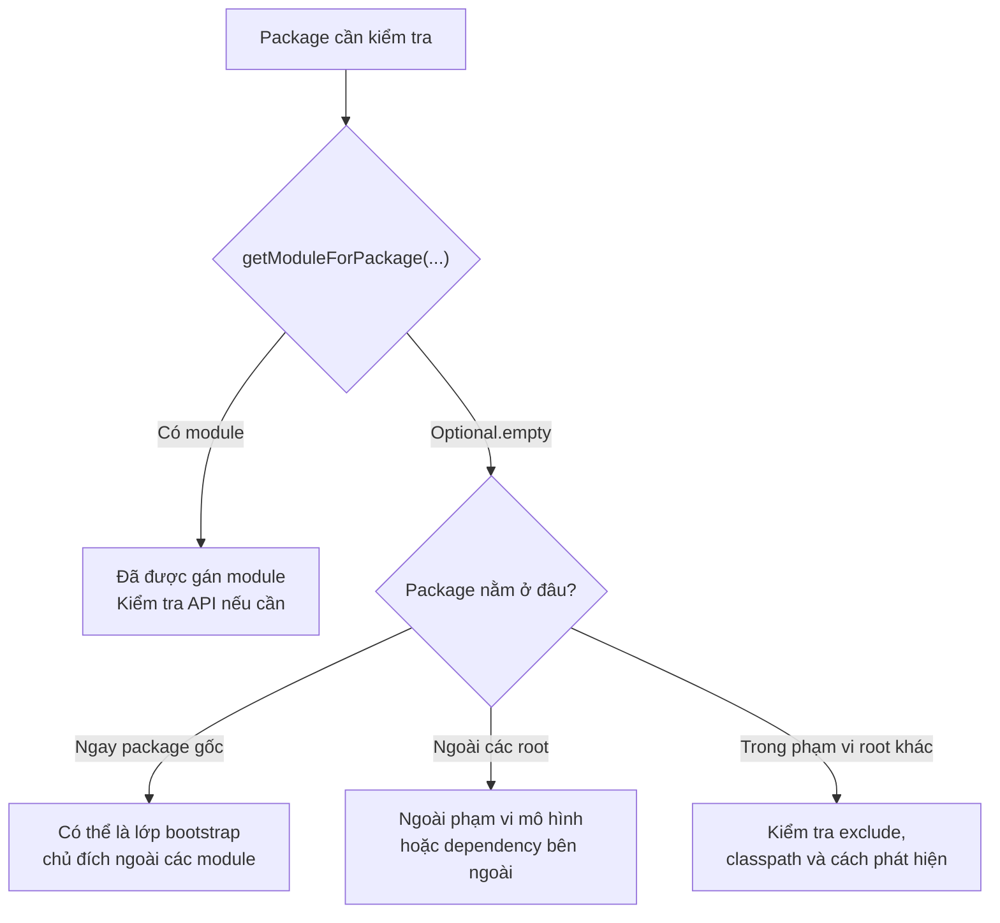

# Xác định package không thuộc module nào

## Mục tiêu học tập

Sau bài học, bạn có thể:

1. Dùng `ApplicationModules.getModuleForPackage(String)` để xác định một package Java có được gán cho application module nào không.
2. Giải thích chính xác kết quả `Optional.empty()` và phân biệt **package chưa được gán module** với **package ngoài phạm vi phân tích**.
3. Nhận biết trường hợp package gốc của ứng dụng và các lớp đặt trực tiếp tại package đó không thuộc application module nào theo cách phát hiện mặc định.
4. Kết hợp `getModuleByType(...)`, `getRootPackages()` và ArchUnit để khảo sát các kiểu/package không có module sở hữu.
5. Viết kiểm thử JUnit kiểm soát các ngoại lệ có chủ đích, đưa kiểm tra phạm vi kiến trúc vào CI cùng `ApplicationModules.verify()`.

Đây là bài thuộc chương **ApplicationModules** trong lộ trình **SPRING_MODULITH_VERIFICATION_TESTING**. Kiểm chứng ranh giới chỉ có ý nghĩa khi ta biết thành phần nào đã được gán cho module và thành phần nào **nằm ngoài mô hình module mong đợi**. Một package không có module sở hữu có thể là điều bình thường, nhưng cũng có thể phản ánh sai điểm quét, loại trừ nhầm hoặc một phần mã chưa được tổ chức theo ranh giới nghiệp vụ.

## 1. “Không thuộc module nào” nghĩa là gì?

`ApplicationModules` biểu diễn các application module mà Spring Modulith phát hiện từ mã nguồn và cấu hình. Một package Java **thuộc module** nếu mô hình hiện tại gán package đó vào ranh giới của một `ApplicationModule`.

Ví dụ với cấu trúc mặc định:

```text
com.acme.store                     <- package gốc ứng dụng
├── StoreApplication.java          <- đặt trực tiếp tại package gốc
├── orders/                         <- application module orders
│   ├── OrderManagement.java
│   └── internal/
│       └── OrderService.java       <- vẫn thuộc orders
├── inventory/                      <- application module inventory
│   ├── InventoryManagement.java
│   └── internal/
│       └── StockService.java       <- vẫn thuộc inventory
└── payments/                       <- application module payments
    └── PaymentManagement.java
```

Với cơ chế phát hiện mặc định, **các package con trực tiếp** của `com.acme.store` được nhận diện là application module. Package gốc `com.acme.store` là điểm bắt đầu khám phá và **không mặc định là module thứ tư**.

| Package | Kết quả mong đợi | Lý do |
| --- | --- | --- |
| `com.acme.store.orders` | `orders` | Base package của module |
| `com.acme.store.orders.internal` | `orders` | Package con nằm trong module `orders` |
| `com.acme.store.inventory.internal` | `inventory` | Package con nằm trong module `inventory` |
| `com.acme.store` | Không có module | Package gốc ứng dụng, theo cách phát hiện mặc định |
| `org.vendor.payment` | Không có module | Nằm ngoài package gốc được mô hình hóa |

**Quan trọng:** `orders.internal` **không phải package “vô chủ”**. Nó đã thuộc `orders`, dù kiểu ở đó là chi tiết nội bộ mà module khác thường không được phép sử dụng. “Có module sở hữu” và “được công bố như API” là **hai câu hỏi khác nhau**.

## 2. Chuẩn bị mô hình `ApplicationModules`

Lớp ứng dụng chính được đặt tại package gốc:

```java
// src/main/java/com/acme/store/StoreApplication.java
package com.acme.store;

import org.springframework.boot.SpringApplication;
import org.springframework.boot.autoconfigure.SpringBootApplication;

@SpringBootApplication
public class StoreApplication {

    public static void main(String[] args) {
        SpringApplication.run(StoreApplication.class, args);
    }
}
```

Trong bài kiểm thử kiến trúc, tạo mô hình từ lớp ứng dụng:

```java
package com.acme.store;

import org.junit.jupiter.api.Test;
import org.springframework.modulith.core.ApplicationModules;

class PackageOwnershipTests {

    @Test
    void inspectPackageOwnership() {
        ApplicationModules modules =
                ApplicationModules.of(StoreApplication.class);

        System.out.println(modules.getModuleForPackage(
                "com.acme.store.orders"));
    }
}
```

`ApplicationModules.of(StoreApplication.class)` phân tích mô hình dựa trên package và metadata của lớp đầu vào. Nó **không khởi động Spring Boot context** và không cần database chỉ để đọc ranh giới module; bài test này không cần `@SpringBootTest`.

Trước khi kết luận một package không có module, hãy xác minh rằng `StoreApplication` thực sự ở **package gốc muốn phân tích**. Nếu chọn nhầm lớp ở `com.acme.store.orders.internal`, phạm vi mô hình có thể không bao gồm các module ngang hàng.

## 3. API trọng tâm: `getModuleForPackage(String)`

Chữ ký phương thức:

```java
Optional<ApplicationModule> getModuleForPackage(String name)
```

Trong đó `name` là **tên package Java đầy đủ** (ví dụ `com.acme.store.orders.internal`), không phải đường dẫn `src/main/java/... `, tên module `orders` hoặc tên class `OrderService`.

Phương thức trả về `Optional<ApplicationModule>`:

- **`Optional.of(module)`**: mô hình đã xác định một module chứa package được hỏi.
- **`Optional.empty()`**: không tìm thấy module chứa package đó **trong mô hình đang xét**.

Ví dụ:

```java
ApplicationModules modules =
        ApplicationModules.of(StoreApplication.class);

var orders = modules.getModuleForPackage(
        "com.acme.store.orders");
var ordersInternal = modules.getModuleForPackage(
        "com.acme.store.orders.internal");
var applicationRoot = modules.getModuleForPackage(
        "com.acme.store");
var external = modules.getModuleForPackage(
        "org.vendor.payment");

System.out.println(orders.map(m -> m.getIdentifier().toString()));
System.out.println(ordersInternal.map(m -> m.getIdentifier().toString()));
System.out.println(applicationRoot.isEmpty());
System.out.println(external.isEmpty());
```

Trong cấu trúc mặc định của bài, kết quả mong đợi là:

```text
Optional[orders]
Optional[orders]
true
true
```

**Không diễn giải `Optional.empty()` thành “package Java không tồn tại”.** Nó chỉ nói rằng mô hình module không tìm thấy module sở hữu package được hỏi. Package có thể có lớp nằm trực tiếp trong root, ở ngoài phạm vi quét, bị loại trừ khỏi quá trình phân tích, hoặc không có kiểu nào trong classpath hiện tại.

### Dùng `ifPresentOrElse` để báo cáo rõ ràng

```java
String packageName = "com.acme.store.orders.internal";

modules.getModuleForPackage(packageName)
        .ifPresentOrElse(
                module -> System.out.printf(
                        "%s belongs to %s%n",
                        packageName, module.getIdentifier()),
                () -> System.out.printf(
                        "%s has no owner in this model%n",
                        packageName)
        );
```

Cách hiển thị này hữu ích khi đang điều tra nhiều package có khả năng sai ranh giới.

## 4. Tra cứu nhiều package cùng lúc

Muốn lập báo cáo nhanh cho một danh sách có chủ đích:

```java
package com.acme.store;

import java.util.List;

import org.junit.jupiter.api.Test;
import org.springframework.modulith.core.ApplicationModules;

class PackageOwnershipReportTests {

    @Test
    void printOwnershipForKnownPackages() {
        ApplicationModules modules =
                ApplicationModules.of(StoreApplication.class);

        List<String> candidates = List.of(
                "com.acme.store",
                "com.acme.store.orders",
                "com.acme.store.orders.internal",
                "com.acme.store.inventory.internal",
                "org.vendor.payment"
        );

        candidates.stream().sorted().forEach(packageName -> {
            String owner = modules.getModuleForPackage(packageName)
                    .map(module -> module.getIdentifier().toString())
                    .orElse("<không có module>");

            System.out.printf("%-42s -> %s%n", packageName, owner);
        });
    }
}
```

Đầu ra minh họa:

```text
com.acme.store                             -> <không có module>
com.acme.store.inventory.internal          -> inventory
com.acme.store.orders                      -> orders
com.acme.store.orders.internal             -> orders
org.vendor.payment                         -> <không có module>
```

Sắp xếp danh sách trước khi in giúp đầu ra ổn định giữa các lần chạy. Danh sách nhập là **những tên cần kiểm tra**; nó không đồng nghĩa với việc Spring Modulith đang cung cấp API liệt kê toàn bộ package Java tồn tại trong classpath.

## 5. Phân biệt ba tình huống quan trọng



### Tình huống A — Package gốc có lớp bootstrap

`com.acme.store.StoreApplication` đặt ngay tại `com.acme.store` để xác định package gốc cho Spring Boot và Spring Modulith. Với cấu trúc mặc định, `com.acme.store` không phải một application module; việc `getModuleForPackage("com.acme.store")` rỗng có thể là **đúng thiết kế**.

Lưu ý: không nên vì muốn mọi package có module mà chuyển `StoreApplication` xuống `orders`; như vậy có thể làm sai phạm vi quét và đưa bootstrap vào module nghiệp vụ không phù hợp.

### Tình huống B — Package nằm ngoài các root được phân tích

Ví dụ `org.vendor.payment` hoặc `com.acme.legacy` nằm ngoài `com.acme.store`. Nếu chỉ tạo `ApplicationModules.of(StoreApplication.class)`, những package này **không tự động trở thành module**. Một thư viện được tải vào classpath không đồng nghĩa nó được Spring Modulith quản lý như application module của hệ thống.

Nếu một phần nghiệp vụ do nhóm phát triển sở hữu thực sự cần được kiểm chứng, cân nhắc chuyển package vào vùng được quản lý hoặc cấu hình các root bổ sung theo khả năng của phiên bản Spring Modulith hiện tại. Không nên suy ra mã nguồn “an toàn” chỉ vì nó nằm ngoài phạm vi `verify()`.

### Tình huống C — Package có vẻ thuộc ứng dụng nhưng không tìm thấy module

Một lý do có thể là **quy tắc loại trừ**. Spring Modulith cho phép tạo mô hình với predicate để bỏ qua những kiểu/package nhất định:

```java
import com.tngtech.archunit.core.domain.JavaClass;
import org.springframework.modulith.core.ApplicationModules;

ApplicationModules filtered = ApplicationModules.of(
        StoreApplication.class,
        JavaClass.Predicates.resideInAPackage(
                "com.acme.store.generated..")
);
```

Ở đây `generated..` là ví dụ biểu thức ArchUnit bao gồm package `generated` và các package con. Nếu một nhóm kiểu đã bị loại khỏi mô hình, không nên cho rằng `getModuleForPackage(...)` sẽ ánh xạ chúng như khi quét không loại trừ. Hãy xem lại **predicate được áp dụng**, nội dung classpath và cấu hình phát hiện module.

Ngoài ra, dự án có thể tùy chỉnh chiến lược phát hiện module, dùng nested module, hoặc module mở. Vì vậy, đừng gán nhãn “vô chủ” dựa hoàn toàn vào số cấp package khi dự án có cấu hình nâng cao.

## 6. Kiểm tra theo kiểu Java bằng `getModuleByType(...)`

Khi biết một class cụ thể, tra cứu theo class thường chính xác hơn đoán tên package:

```java
package com.acme.store;

import static org.junit.jupiter.api.Assertions.assertTrue;

import org.junit.jupiter.api.Test;
import org.springframework.modulith.core.ApplicationModules;

class TypeOwnershipTests {

    @Test
    void applicationClassIsNotAModuleMemberByDefault() {
        ApplicationModules modules =
                ApplicationModules.of(StoreApplication.class);

        assertTrue(modules.getModuleByType(
                StoreApplication.class).isEmpty());
    }
}
```

Đây là ví dụ về **một kiểu Java cụ thể đặt tại package gốc**. Kết quả mong đợi `Optional.empty()` dựa vào cách phát hiện module mặc định của ứng dụng minh họa.

Với một class nội bộ:

```java
// Giả sử OrderService là public trong ví dụ để test có thể tham chiếu.
var owner = modules.getModuleByType(
        com.acme.store.orders.internal.OrderService.class);

System.out.println(owner.map(module ->
        module.getIdentifier().toString())); // Optional[orders]
```

Trong dự án thực, `OrderService` thường để package-private. Khi đó có thể kiểm tra bằng `getModuleByType(String)` với tên đầy đủ thay vì đổi visibility của class chỉ phục vụ test:

```java
var owner = modules.getModuleByType(
        "com.acme.store.orders.internal.OrderService");
```

`getModuleByType(...)` trả lời “**kiểu này thuộc module nào?**”, còn `getModuleForPackage(...)` trả lời “**package này được ánh xạ vào module nào?**”. Hai truy vấn liên quan nhau nhưng khác về cấp độ thông tin.

## 7. Xác định các package thật sự tồn tại trong classpath

`ApplicationModules.getModuleForPackage(...)` là thao tác tra cứu theo **một tên**. Để tìm *toàn bộ package có mã Java nhưng không có module sở hữu*, cần một danh sách package đầu vào từ các class đã biên dịch.

Có thể dùng **ArchUnit** (thư viện phân tích class mà Spring Modulith sử dụng) để quét các class của dự án:

```java
package com.acme.store;

import java.util.Set;
import java.util.TreeSet;

import com.tngtech.archunit.core.domain.JavaClass;
import com.tngtech.archunit.core.domain.JavaClasses;
import com.tngtech.archunit.core.importer.ClassFileImporter;
import com.tngtech.archunit.core.importer.ImportOption;
import org.junit.jupiter.api.Test;
import org.springframework.modulith.core.ApplicationModules;

class UnassignedPackageScanTests {

    @Test
    void printPackagesWithoutModuleOwner() {
        ApplicationModules modules =
                ApplicationModules.of(StoreApplication.class);

        JavaClasses imported = new ClassFileImporter()
                .withImportOption(
                        ImportOption.Predefined.DO_NOT_INCLUDE_TESTS)
                .importPackages("com.acme.store");

        Set<String> packageNames = new TreeSet<>();

        for (JavaClass type : imported) {
            packageNames.add(type.getPackageName());
        }

        packageNames.stream()
                .filter(packageName -> modules
                        .getModuleForPackage(packageName).isEmpty())
                .forEach(System.out::println);
    }
}
```

Với ứng dụng tối giản chỉ có `StoreApplication` ở package gốc và các kiểu khác nằm trong ba module, đầu ra mong đợi:

```text
com.acme.store
```

Đoạn code làm hai việc độc lập:

1. ArchUnit thu thập tên package của **các class thực sự được import từ classpath** thuộc `com.acme.store`.
2. Spring Modulith kiểm tra từng tên đó bằng `getModuleForPackage(...)`; các package không tìm thấy module được đưa vào danh sách rà soát.

Lưu ý giới hạn của phép quét:

- Thư mục trống, package chỉ có source chưa được biên dịch hoặc class nằm ngoài vùng `importPackages("com.acme.store")` sẽ không được đưa vào danh sách.
- Nếu Spring Modulith và ArchUnit sử dụng **các quy tắc import hoặc loại trừ khác nhau**, một package có thể bị đánh dấu khác dự kiến. Nên dùng phạm vi quét tương thích khi xây dựng quality gate.
- Danh sách trên bao gồm cả trường hợp **cố ý đặt class tại root**; muốn đánh dấu lỗi phải có chính sách rõ ràng về những ngoại lệ được phép.
- Trên ứng dụng có nhiều root, phải quét từng root phù hợp thay vì mặc định chỉ có `com.acme.store`.

**Không dùng `getModuleForPackage` làm công cụ xác nhận package tồn tại trên ổ đĩa.** Nó chỉ phản ánh sở hữu package trong mô hình đã dựng.

## 8. Phân loại “trong root” và “ngoài root”

Từ **Spring Modulith 1.4**, `ApplicationModules.getRootPackages()` cung cấp danh sách các package gốc mà mô hình sử dụng:

```java
ApplicationModules modules =
        ApplicationModules.of(StoreApplication.class);

modules.getRootPackages().stream()
        .map(root -> root.getName())
        .sorted()
        .forEach(System.out::println);
```

Trong ví dụ mặc định, tên root thường là `com.acme.store`. Không nên đồng nhất root với một `ApplicationModule`: root xác định **vùng ứng dụng được phân tích**; module là các đơn vị chức năng được nhận diện bên trong vùng đó.

Khi kiểm tra một danh sách package ứng viên, có thể phân loại theo tên root:

```java
package com.acme.store;

import java.util.List;
import org.junit.jupiter.api.Test;
import org.springframework.modulith.core.ApplicationModules;

class PackageScopeReportTests {

    @Test
    void distinguishRootFromExternalPackages() {
        ApplicationModules modules =
                ApplicationModules.of(StoreApplication.class);

        List<String> candidates = List.of(
                "com.acme.store",
                "com.acme.store.orders.internal",
                "org.vendor.payment"
        );

        for (String name : candidates) {
            var owner = modules.getModuleForPackage(name);

            boolean withinKnownRoot = modules.getRootPackages()
                    .stream()
                    .anyMatch(root -> name.equals(root.getName())
                            || name.startsWith(root.getName() + "."));

            String classification = owner.isPresent()
                    ? "THUOC_MODULE"
                    : withinKnownRoot
                            ? "TRONG_ROOT_NHUNG_CHUA_CO_MODULE"
                            : "NGOAI_ROOT";

            System.out.printf("%s: %s%n", name, classification);
        }
    }
}
```

Kết quả minh họa:

```text
com.acme.store: TRONG_ROOT_NHUNG_CHUA_CO_MODULE
com.acme.store.orders.internal: THUOC_MODULE
org.vendor.payment: NGOAI_ROOT
```

Đoạn so sánh `name.startsWith(root.getName() + ".")` dùng dấu chấm làm **ranh giới segment**; tránh nhầm `com.acme.storefront` với package con của `com.acme.store`.

Đây là **phân loại theo tên package**, không phải xác nhận package có class đang tồn tại. Với Spring Modulith trước 1.4, có thể dùng tên package gốc đã xác định tại cấu hình dự án, hoặc kiểm tra Javadoc theo phiên bản đang dùng.

**Không dùng `withinRootPackages(String)` để thay phép kiểm tra trên.** API đó nhận **tên class** và kiểm tra class nằm **trực tiếp** trong root (không bao gồm subpackage), nên không phải một phép kiểm tra tổng quát “package này thuộc mọi root hay không”.

## 9. Viết test phát hiện mã không được gán module ngoài dự kiến

Trong nhiều hệ thống, lớp bootstrap như `StoreApplication` được phép đứng ngoài module, nhưng các lớp nghiệp vụ mới nên nằm trong một application module có trách nhiệm rõ ràng.

Có thể khóa chính sách bằng một test cho toàn bộ class ở phạm vi ứng dụng:

```java
package com.acme.store;

import static org.junit.jupiter.api.Assertions.assertEquals;

import java.util.Set;
import java.util.TreeSet;

import com.tngtech.archunit.core.domain.JavaClass;
import com.tngtech.archunit.core.domain.JavaClasses;
import com.tngtech.archunit.core.importer.ClassFileImporter;
import com.tngtech.archunit.core.importer.ImportOption;
import org.junit.jupiter.api.Test;
import org.springframework.modulith.core.ApplicationModules;

class UnassignedTypeContractTests {

    @Test
    void onlyBootstrappingCodeMayRemainUnassigned() {
        ApplicationModules modules =
                ApplicationModules.of(StoreApplication.class);

        JavaClasses classes = new ClassFileImporter()
                .withImportOption(
                        ImportOption.Predefined.DO_NOT_INCLUDE_TESTS)
                .importPackages("com.acme.store");

        Set<String> unassignedTypes = new TreeSet<>();

        for (JavaClass type : classes) {
            if (modules.getModuleForPackage(
                    type.getPackageName()).isEmpty()) {
                unassignedTypes.add(type.getName());
            }
        }

        assertEquals(
                Set.of("com.acme.store.StoreApplication"),
                unassignedTypes);
    }
}
```

Trong ứng dụng mẫu tối giản, test trên xác nhận **chỉ lớp bootstrap** được phép không có module sở hữu. Nếu nhóm thêm `com.acme.store.LegacyOrderService` ngay vào root, test sẽ thất bại và yêu cầu quyết định xem class đó thuộc module nào.

Khi áp dụng cho hệ thống thực, **đừng sao chép nguyên tập cho phép** nếu root còn `package-info`, cấu hình bootstrapping hoặc kiểu hỗ trợ có chủ đích. Thống nhất và ghi rõ ngoại lệ nào được phép; chỉ tăng tập ngoại lệ sau khi hiểu trách nhiệm của từng class.

### Test xác nhận một package quan trọng thuộc đúng module

```java
package com.acme.store;

import static org.junit.jupiter.api.Assertions.assertEquals;
import static org.junit.jupiter.api.Assertions.assertTrue;

import org.junit.jupiter.api.Test;
import org.springframework.modulith.core.ApplicationModules;

class RequiredPackageOwnershipTests {

    @Test
    void criticalPackagesBelongToExpectedModules() {
        ApplicationModules modules =
                ApplicationModules.of(StoreApplication.class);

        String ordersOwner = modules
                .getModuleForPackage("com.acme.store.orders.internal")
                .orElseThrow()
                .getIdentifier()
                .toString();

        assertEquals("orders", ordersOwner);
        assertTrue(modules.getModuleForPackage(
                "com.acme.store").isEmpty());
    }
}
```

Test này ngăn một thay đổi package khiến `orders.internal` bị gán nhầm sang module khác, đồng thời ghi rõ kỳ vọng ứng dụng có package root nằm ngoài module. Chỉ thêm assertion nếu ranh giới đó thực sự là hợp đồng kiến trúc của nhóm.

## 10. Kết hợp kiểm tra sở hữu với `verify()` và CI

`ApplicationModules.verify()` kiểm tra các quy tắc giữa **những module đã được nhận diện**, như phụ thuộc vòng, truy cập trái phép vào phần nội bộ và giới hạn `allowedDependencies` được khai báo.

```java
package com.acme.store;

import org.junit.jupiter.api.Test;
import org.springframework.modulith.core.ApplicationModules;

class ArchitectureVerificationTests {

    @Test
    void moduleBoundariesRemainValid() {
        ApplicationModules.of(StoreApplication.class).verify();
    }
}
```

Nếu một lớp nghiệp vụ vô tình bị đặt ngoài mô hình module, việc chỉ chạy `verify()` có thể không phát hiện **vi phạm quy tắc riêng về vị trí lớp đó**. Do vậy, nên chạy đồng thời:

| Kiểm thử | Câu hỏi trả lời | Ví dụ vi phạm |
| --- | --- | --- |
| Tra cứu `getModuleForPackage(...)` | Package cụ thể thuộc module nào? | `orders.internal` không còn thuộc `orders` |
| Quét class + assertion ngoại lệ | Có lớp nào ngoài module mà nhóm không cho phép? | `LegacyOrderService` bị đặt trực tiếp ở root |
| `ApplicationModules.verify()` | Các phụ thuộc giữa module có hợp lệ? | `orders` truy cập `inventory.internal` hoặc tạo vòng |
| `@ApplicationModuleTest` | Module vận hành đúng trong Spring test context? | Bean hoặc wiring của module thất bại |
| Test sự kiện/database/tích hợp | Luồng nghiệp vụ runtime có đúng? | Sự kiện không được xử lý hoặc transaction lỗi |

Đưa các bài kiểm thử này vào `src/test/java`, cấu hình JUnit 5 và Spring Modulith phù hợp, rồi cho pipeline CI chạy:

```bash
./gradlew test
```

Hoặc:

```bash
./mvnw test
```

Với dự án có nhiều source set hoặc dùng generator, hãy bảo đảm phép quét ArchUnit và mô hình Spring Modulith nhìn vào **cùng nhóm class thích hợp**; tránh báo lỗi giả do test class hoặc code sinh ra chỉ xuất hiện trong một bên.

**Một class nằm ngoài module không tự động sai.** Tuy nhiên, nếu đó là nghiệp vụ mà nhóm muốn áp quy tắc kiến trúc, phải đưa nó vào một module được nhận diện hoặc có cơ chế kiểm soát bổ sung, thay vì ngầm giả định `verify()` bảo vệ mọi class có trên classpath.

## 11. Chẩn đoán sai lệch thường gặp

| Hiện tượng | Nguyên nhân có thể | Hướng xử lý |
| --- | --- | --- |
| `getModuleForPackage("com.acme.store")` rỗng | Root ứng dụng không phải module theo mặc định | Chấp nhận nếu chỉ chứa bootstrap hoặc đặt chính sách kiểm tra các kiểu tại root |
| `orders.internal` có chủ sở hữu `orders` | Package con thuộc module cha | Không coi đây là module riêng hoặc package vô chủ |
| Package nghiệp vụ mong đợi không có module | Điểm quét quá sâu, package ngoài vùng quét, exclusion hoặc custom detection | Kiểm tra lớp đầu vào, root package, classpath và cấu hình phát hiện |
| Một package bị nhận diện thành module không mong muốn | Package trực tiếp dưới root tạo module theo mặc định | Xem lại vị trí package và ranh giới nghiệp vụ |
| `getModuleByType(...)` rỗng dù class tồn tại ở root | Kiểu ở package root chưa được gán module | Xác định có chủ đích nằm ngoài module hay cần di chuyển |
| Quét ArchUnit không thấy package đang có trong IDE | Chưa biên dịch class hoặc importPackages không bao gồm vùng đó | Build đúng source set rồi kiểm tra classpath |
| Test “ngoài module” báo thêm loại class lạ | `package-info`, class sinh ra hoặc quy tắc import khác nhau | Xem tên class và điều chỉnh bộ lọc/ngoại lệ có lý do |
| `verify()` xanh nhưng một service ở root | `verify()` không kiểm tra chính sách “mọi nghiệp vụ phải thuộc module” | Thêm test hợp đồng về các class không có module sở hữu |

### Quy trình điều tra ngắn

1. **Tìm owner:** gọi `getModuleForPackage(packageName)` và ghi nhận ID hoặc `Optional.empty()`.
2. **Kiểm tra phạm vi:** xem package có thuộc root của mô hình không; kiểm tra cấu hình phát hiện, exclude và classpath.
3. **Kiểm tra class:** dùng `getModuleByType(...)` cho kiểu cụ thể hoặc quét class thực tế bằng ArchUnit.
4. **Đối chiếu thiết kế:** quyết định ngoại lệ là chủ đích hay package phải được đặt vào module.
5. **Khóa kết quả:** thêm assertion phù hợp, sau đó chạy `verify()` và các test runtime cần thiết.

## 12. Bài thực hành

**Bối cảnh:** Nhóm phát triển hệ thống bán hàng muốn bảo đảm code nghiệp vụ nằm trong `orders`, `inventory`, `payments`, chỉ cho phép lớp `StoreApplication` đứng ở package gốc.

**Nhiệm vụ:**

1. Tạo cấu trúc package ở mục 1 và đặt `StoreApplication` ngay tại `com.acme.store`.
2. Viết test tra cứu lần lượt `com.acme.store.orders`, `com.acme.store.orders.internal`, `com.acme.store` và `org.vendor.payment` bằng `getModuleForPackage(...)`.
3. Giải thích vì sao `orders.internal` được gán cho `orders` nhưng `com.acme.store` thường không được gán cho module nào.
4. Quét các class thực tế bằng ArchUnit, thu thập tập tên package và lọc ra những package mà `getModuleForPackage` trả `Optional.empty()`.
5. Dùng `getRootPackages()` nếu phiên bản Spring Modulith hỗ trợ, để phân biệt tên package nằm tại root với tên ngoài root.
6. Thêm `com.acme.store.LegacyOrderService` ngay vào root, chạy `UnassignedTypeContractTests`, đọc lỗi và chuyển class về module đúng; chạy lại test.
7. Thử dùng predicate loại trừ một package trong nhánh thực hành, quan sát tác động lên mô hình rồi khôi phục cấu hình.
8. Thêm `ArchitectureVerificationTests` gọi `verify()` vào quality gate CI; bổ sung `@ApplicationModuleTest` hoặc test database/sự kiện khi có hành vi runtime cần bảo vệ.

**Tiêu chí hoàn thành:** Bạn giải thích được `Optional.empty()` theo phạm vi mô hình, phân biệt package root với package ngoài root và package nội bộ có chủ sở hữu, tìm được những class chưa được gán module, đồng thời tạo assertion giúp CI phát hiện một class nghiệp vụ bị đặt sai vị trí.

## 13. Câu hỏi tự kiểm tra

1. `getModuleForPackage("com.acme.store.orders.internal")` có thể trả về module nào trong cấu trúc mặc định? Tại sao?
2. Vì sao `getModuleForPackage("com.acme.store")` có thể trả `Optional.empty()` dù package này có `StoreApplication`?
3. `Optional.empty()` có đủ để kết luận một package không tồn tại trong project không?
4. `getModuleByType(Class)` và `getModuleForPackage(String)` trả lời hai câu hỏi khác nhau như thế nào?
5. Vì sao không nên sử dụng `withinRootPackages(String)` để phân loại mọi package con thuộc vùng quét?
6. Khi nào một package có mã Java nhưng không có module được xem là ngoại lệ hợp lệ? Khi nào cần coi đó là rủi ro kiến trúc?
7. Tại sao một test quét class “không có owner” nên đi cùng `verify()`, `@ApplicationModuleTest` và integration test?

## Tổng kết

Muốn **xác định package không thuộc module nào**, hãy dùng `ApplicationModules.of(...)` để tạo mô hình và `getModuleForPackage(packageName)` để tra cứu. Kết quả `Optional.empty()` chỉ có nghĩa là **không tìm thấy module sở hữu package trong mô hình hiện tại**; cần tiếp tục phân biệt package gốc ứng dụng, package ngoài root, phạm vi quét/loại trừ và những kiểu chưa được biên dịch. Nếu cần tìm hàng loạt, lấy danh sách package từ classpath bằng ArchUnit rồi đối chiếu với mô hình; biến những ngoại lệ được phép thành assertion JUnit. Kết hợp kiểm tra sở hữu package với `verify()` trong CI và kiểm thử `@ApplicationModuleTest`, sự kiện, database để bảo vệ cả **cấu trúc kiến trúc** lẫn **hành vi tích hợp**.

### Tài liệu tham khảo

- [Spring Modulith — ApplicationModules API](https://docs.spring.io/spring-modulith/docs/current/api/org/springframework/modulith/core/ApplicationModules.html)
- [Spring Modulith — ApplicationModule API](https://docs.spring.io/spring-modulith/docs/current/api/org/springframework/modulith/core/ApplicationModule.html)
- [Spring Modulith — Fundamentals: Application Modules, Package Exclusions](https://docs.spring.io/spring-modulith/reference/fundamentals.html)
- [Spring Modulith — Verifying Application Module Structure](https://docs.spring.io/spring-modulith/reference/verification.html)
