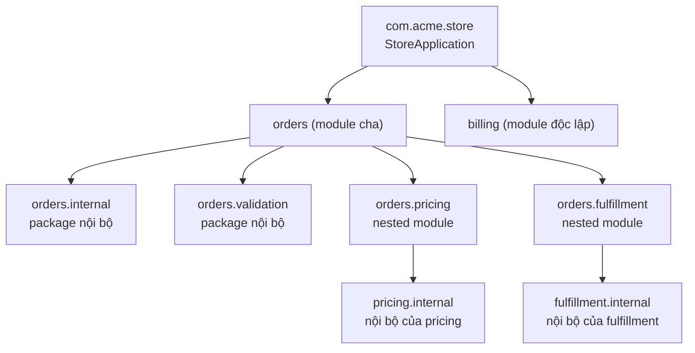
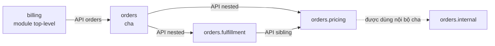

# Mô hình khi có package lồng nhau

## Mục tiêu học tập

Sau bài học, bạn có thể:

1. Phân biệt **package con thông thường**, **named interface** và **nested application module** trong Spring Modulith.
2. Dự đoán module sở hữu một kiểu Java hoặc package khi mã nguồn có nhiều tầng package.
3. Khai báo nested module tường minh bằng `@ApplicationModule` và khám phá mô hình qua `ApplicationModules.of(...)`.
4. Đọc quan hệ cha–con bằng `getParentOf(...)`, tra cứu theo kiểu/package, và kiểm tra danh sách nested module bằng API phù hợp phiên bản.
5. Kiểm chứng quy tắc truy cập giữa module cha, module con, module con cùng cấp và module ngoài bằng `verify()`; bảo vệ cấu trúc bằng assertion trong CI.

Trong lộ trình **SPRING_MODULITH_VERIFICATION_TESTING**, mô hình package nhiều tầng là chủ đề dễ gây hiểu sai khi xây dựng quality gate. Thấy một thư mục `orders.pricing` trong IDE **chưa đủ** để kết luận `pricing` là module độc lập. Bài này đi từ cấu trúc package, nhận diện mô hình thực tế rồi thử các quy tắc phụ thuộc; các bài `@ApplicationModuleTest`, kiểm thử sự kiện và database tiếp tục kiểm tra hành vi ở runtime.

## 1. Vì sao cùng một cây package có thể tạo mô hình khác nhau?

Spring Modulith phát hiện application module dựa trên **package gốc ứng dụng**, các package bên dưới và cấu hình phát hiện. Theo cơ chế mặc định, **mỗi package con trực tiếp** của package ứng dụng được xem là một application module.

Ví dụ:

```text
com.acme.store                      <- package gốc ứng dụng
├── StoreApplication.java
├── orders/                          <- module orders
│   ├── OrderManagement.java
│   ├── internal/
│   │   └── OrderCoordinator.java
│   ├── validation/
│   │   └── OrderValidator.java
│   └── pricing/
│       ├── PricingRules.java
│       └── internal/
│           └── PriceCalculator.java
└── billing/                         <- module billing
    └── BillingManagement.java
```

Nếu `orders.pricing` **chưa có khai báo module riêng**, mô hình mặc định chỉ gồm `orders` và `billing`. Các kiểu trong `orders.internal`, `orders.validation`, `orders.pricing` và `orders.pricing.internal` vẫn thuộc module `orders`.

| Vị trí class/package | Module sở hữu nếu không cấu hình thêm | Vai trò mặc định |
| --- | --- | --- |
| `com.acme.store.orders.OrderManagement` | `orders` | API ở package nền |
| `com.acme.store.orders.internal.OrderCoordinator` | `orders` | Chi tiết nội bộ |
| `com.acme.store.orders.validation.OrderValidator` | `orders` | Chi tiết nội bộ |
| `com.acme.store.orders.pricing.PricingRules` | `orders` | Chi tiết nội bộ vì nằm trong package con |
| `com.acme.store.orders.pricing.internal.PriceCalculator` | `orders` | Chi tiết nội bộ |
| `com.acme.store.billing.BillingManagement` | `billing` | API module `billing` |

Trong cấu trúc **module đóng** mặc định, code bên `billing` có thể phụ thuộc vào kiểu công khai tại `orders`, nhưng không mặc nhiên được tham chiếu các kiểu tại `orders.pricing` hoặc `orders.internal`, dù kiểu Java đó được khai báo `public`.

**Nguyên tắc:** Số tầng package Java và số tầng application module là hai đại lượng khác nhau. Spring Modulith không tự biến mọi package sâu thành module ngang hàng.

## 2. Ba khái niệm rất dễ nhầm

| Khái niệm | Cách hình thành | Thay đổi gì trong mô hình? |
| --- | --- | --- |
| **Package con thông thường** | Tạo `orders.internal` hoặc `orders.validation` | Thuộc module `orders`, không tạo module mới |
| **Named interface** | Gắn `@NamedInterface("spi")` trong `orders.spi/package-info.java` | Công bố một nhóm API của **module `orders`**, không tạo application module mới |
| **Nested application module** | Gắn `@ApplicationModule` tại `orders.pricing/package-info.java` | Tạo application module con có ranh giới và quan hệ phụ thuộc riêng |

Ví dụ named interface:

```java
// com/acme/store/orders/spi/package-info.java
@org.springframework.modulith.NamedInterface("spi")
package com.acme.store.orders.spi;
```

Ở đây `orders.spi` vẫn thuộc module `orders`. Nó chỉ là một API được công bố có tên; không được phép suy rằng tồn tại module riêng `orders.spi`.

Ví dụ nested module:

```java
// com/acme/store/orders/pricing/package-info.java
@org.springframework.modulith.ApplicationModule
package com.acme.store.orders.pricing;
```

Với khai báo trên, `orders.pricing` được nhận diện là **nested application module** của `orders` trong các phiên bản Spring Modulith hỗ trợ tính năng này (từ **1.3**).

## 3. Dựng ví dụ có hai nested module cùng cấp

Để thấy rõ quan hệ cha–con và sibling, ta xây dựng ứng dụng:

```text
src/main/java/com/acme/store/
├── StoreApplication.java
├── orders/                                <- module cha orders
│   ├── OrderManagement.java              <- API module cha
│   ├── internal/
│   │   └── OrderState.java               <- nội bộ module cha
│   ├── validation/
│   │   └── OrderValidator.java           <- nội bộ module cha
│   ├── pricing/                           <- nested module orders.pricing
│   │   ├── package-info.java             <- @ApplicationModule
│   │   ├── PricingRules.java             <- API của nested module pricing
│   │   └── internal/
│   │       └── DefaultPricingRules.java  <- nội bộ của pricing
│   └── fulfillment/                       <- nested module orders.fulfillment
│       ├── package-info.java             <- @ApplicationModule
│       ├── FulfillmentPolicy.java        <- API của fulfillment
│       └── internal/
│           └── FulfillmentService.java   <- nội bộ của fulfillment
└── billing/                               <- module top-level khác
    └── BillingManagement.java
```



Lớp ứng dụng làm điểm quét:

```java
// src/main/java/com/acme/store/StoreApplication.java
package com.acme.store;

import org.springframework.boot.SpringApplication;
import org.springframework.boot.autoconfigure.SpringBootApplication;

@SpringBootApplication
public class StoreApplication {

    public static void main(String[] args) {
        SpringApplication.run(StoreApplication.class, args);
    }
}
```

Khai báo hai nested module bằng **hai file package-info.java riêng**:

```java
// src/main/java/com/acme/store/orders/pricing/package-info.java
@org.springframework.modulith.ApplicationModule
package com.acme.store.orders.pricing;
```

```java
// src/main/java/com/acme/store/orders/fulfillment/package-info.java
@org.springframework.modulith.ApplicationModule
package com.acme.store.orders.fulfillment;
```

Tạo các hợp đồng công khai:

```java
// src/main/java/com/acme/store/orders/pricing/PricingRules.java
package com.acme.store.orders.pricing;

import java.math.BigDecimal;

public interface PricingRules {
    BigDecimal priceAfterDiscount(BigDecimal initialPrice);
}
```

```java
// src/main/java/com/acme/store/orders/fulfillment/FulfillmentPolicy.java
package com.acme.store.orders.fulfillment;

public interface FulfillmentPolicy {
    boolean canFulfill(String orderId);
}
```

```java
// src/main/java/com/acme/store/orders/OrderManagement.java
package com.acme.store.orders;

public interface OrderManagement {
    void placeOrder(String orderId);
}
```

Trong cấu trúc này, kiểu `PricingRules` là API của **nested module `orders.pricing`**. Một kiểu ở `orders.pricing.internal` thuộc **pricing**, không còn là phần nội bộ của module cha `orders`.

## 4. Khám phá kết quả bằng `ApplicationModules.of(...)`

Tạo bài kiểm thử JUnit 5 thuần kiến trúc:

```java
// src/test/java/com/acme/store/NestedModuleInspectionTests.java
package com.acme.store;

import org.junit.jupiter.api.Test;
import org.springframework.modulith.core.ApplicationModules;

class NestedModuleInspectionTests {

    @Test
    void printDetectedModuleModel() {
        ApplicationModules modules =
                ApplicationModules.of(StoreApplication.class);

        modules.forEach(System.out::println);
    }
}
```

`ApplicationModules.of(...)` phân tích mô hình module từ các class/package đã biên dịch; **không cần `@SpringBootTest`** và không tự khởi động database hay broker. `forEach(System.out::println)` giúp nhìn tên, package nền, API công khai và các phụ thuộc trong mô hình.

Với cây package mẫu và chiến lược phát hiện mặc định, các định danh logic dự kiến là:

```text
billing
orders
orders.fulfillment
orders.pricing
```

Danh sách trên đã được **sắp xếp để minh họa**; không nên giả định thứ tự duyệt mặc định của framework. Nested module có định danh biểu diễn nhánh bên dưới package gốc; nếu dự án tùy chỉnh chiến lược đặt tên/phát hiện, cần đọc ID thực tế thay vì cố định tên theo thư mục.

Để xuất một inventory ổn định:

```java
ApplicationModules modules =
        ApplicationModules.of(StoreApplication.class);

modules.stream()
        .map(module -> module.getIdentifier().toString())
        .sorted()
        .forEach(System.out::println);
```

**Chú ý:** Nếu bỏ `@ApplicationModule` trên `orders.pricing/package-info.java`, `pricing` có thể trở lại là một package con thông thường của `orders`. Đây là một thay đổi về **số lượng và ranh giới module** dù tên package Java của các class không đổi.

## 5. Xác định chính xác module sở hữu kiểu và package

Trong cây nhiều tầng, việc chỉ nhìn tiền tố package có thể gây nhầm lẫn. Hãy hỏi chính mô hình:

```java
ApplicationModules modules =
        ApplicationModules.of(StoreApplication.class);

var pricingOwner = modules.getModuleByType(
        com.acme.store.orders.pricing.PricingRules.class)
        .orElseThrow();

var fulfillmentOwner = modules.getModuleByType(
        com.acme.store.orders.fulfillment.FulfillmentPolicy.class)
        .orElseThrow();

System.out.println(pricingOwner.getIdentifier());
System.out.println(fulfillmentOwner.getIdentifier());
```

Trong ví dụ, kết quả lần lượt là `orders.pricing` và `orders.fulfillment`.

Tra cứu theo **tên package đầy đủ** cũng có ích:

```java
var packageOwner = modules.getModuleForPackage(
        "com.acme.store.orders.pricing.internal")
        .orElseThrow();

System.out.println(packageOwner.getIdentifier());
// orders.pricing
```

Trong khi đó:

```java
var validationOwner = modules.getModuleForPackage(
        "com.acme.store.orders.validation")
        .orElseThrow();

System.out.println(validationOwner.getIdentifier());
// orders
```

Hai package `orders.pricing.internal` và `orders.validation` đều **nằm dưới chuỗi `orders`**, nhưng module sở hữu khác nhau vì nhánh `pricing` đã được công bố là nested module.

| Kiểu/package được hỏi | Owner dự kiến khi có hai `@ApplicationModule` |
| --- | --- |
| `orders.OrderManagement` | `orders` |
| `orders.internal.OrderState` | `orders` |
| `orders.validation.OrderValidator` | `orders` |
| `orders.pricing.PricingRules` | `orders.pricing` |
| `orders.pricing.internal.DefaultPricingRules` | `orders.pricing` |
| `orders.fulfillment.FulfillmentPolicy` | `orders.fulfillment` |
| `billing.BillingManagement` | `billing` |

Khi đổi một package thành nested module, cần xem lại **module sở hữu các kiểu**, không chỉ tên module được in ra. Đó là nguyên nhân một số import trước đây hợp lệ giữa các class cùng module có thể trở thành phụ thuộc xuyên module và bị kiểm chứng chặt hơn.

## 6. Đọc quan hệ module cha–con bằng API

Khi đã nhận diện module `orders.pricing`, ta có thể hỏi module cha:

```java
ApplicationModules modules =
        ApplicationModules.of(StoreApplication.class);

var pricing = modules.getModuleByName("orders.pricing")
        .orElseThrow();

var parent = modules.getParentOf(pricing).orElseThrow();

System.out.println(parent.getIdentifier()); // orders
System.out.println(modules.hasParent(pricing)); // true
```

`getParentOf(ApplicationModule)` trả `Optional<ApplicationModule>`, còn `hasParent(...)` cho biết module có cha hay không. Các API này có từ **Spring Modulith 1.3**, phù hợp với tính năng nested module.

Để lấy **toàn bộ nested module bên dưới `orders`** trên phiên bản **Spring Modulith 1.4.2 trở lên**, dùng:

```java
import java.util.List;

var orders = modules.getModuleByName("orders").orElseThrow();

List<String> nestedIds = modules.getNestedModules(orders)
        .stream()
        .map(module -> module.getIdentifier().toString())
        .sorted()
        .toList();

System.out.println(nestedIds);
// [orders.fulfillment, orders.pricing]
```

`getNestedModules(orders)` trả về các module con, bao gồm những module ở cấp sâu hơn nếu mô hình có nhiều tầng nested. Đây là phương thức **công khai trên `ApplicationModules`**, khác với các phương thức xử lý nested module không công khai của `ApplicationModule` trên một số phiên bản.

Với Spring Modulith **1.3 đến trước 1.4.2**, có thể dùng `modules.stream()` kết hợp `modules.getParentOf(module)` để lập danh sách con trực tiếp mà không phụ thuộc vào `getNestedModules(...)`:

```java
var orders = modules.getModuleByName("orders").orElseThrow();

modules.stream()
        .filter(module -> modules.getParentOf(module)
                .filter(orders::equals)
                .isPresent())
        .map(module -> module.getIdentifier().toString())
        .sorted()
        .forEach(System.out::println);
```

**Phân biệt:** `getNestedModules(orders)` cho mọi module con ở các cấp; lọc `getParentOf(module).equals(orders)` chỉ cho **con trực tiếp**. Ở mô hình ví dụ hai cấp, cả hai cách đều có `pricing` và `fulfillment`; nếu sau này xuất hiện `orders.pricing.tax`, kết quả sẽ khác.

## 7. Quy tắc truy cập khi có nested module

Nested module không chỉ giúp phân nhóm package; nó tạo thêm ranh giới phụ thuộc cho `verify()`. Spring Modulith có những quy tắc đặc thù cho cây module:

- **Module cha** có thể sử dụng API mà nested module trực tiếp của nó công bố.
- **Module con** có thể sử dụng cả kiểu nội bộ của các module cha trong chuỗi chứa nó.
- **Nested module cùng cha** có thể dùng các kiểu mà sibling công bố như API, nhưng không được mặc nhiên truy cập phần nội bộ của sibling.
- **Module top-level bên ngoài cây cha** không mặc nhiên được truy cập trực tiếp kiểu của nested module.
- Nested module vẫn có thể sử dụng API được công bố bởi các module top-level khác theo các quy tắc phụ thuộc chung.

Đối chiếu một vài quan hệ:

| Mã nguồn → kiểu được tham chiếu | Kết quả mong đợi trong mô hình đóng | Giải thích |
| --- | --- | --- |
| `orders.internal` → `orders.pricing.PricingRules` | Hợp lệ | Module cha dùng API nested module |
| `orders.pricing.internal` → `orders.internal.OrderState` | Hợp lệ | Module con được truy cập nội bộ module cha |
| `orders.fulfillment.internal` → `orders.pricing.PricingRules` | Hợp lệ | Sibling dùng API công khai của sibling |
| `orders.fulfillment.internal` → `orders.pricing.internal.DefaultPricingRules` | Vi phạm | Sibling đi vào phần nội bộ của sibling |
| `billing` → `orders.OrderManagement` | Có thể hợp lệ | API công khai của module top-level `orders` |
| `billing` → `orders.pricing.PricingRules` | Vi phạm theo mặc định | Module ngoài cây cha truy cập trực tiếp nested module |

Những đánh giá “hợp lệ” giả định không có `allowedDependencies` hạn chế chặt hơn, không có chu trình phụ thuộc ngoài ý muốn và không dùng cấu hình module mở tùy chỉnh.



### Ví dụ 1: Nested module sử dụng nội bộ của cha

```java
// src/main/java/com/acme/store/orders/internal/OrderState.java
package com.acme.store.orders.internal;

public class OrderState {
    public boolean isActive(String orderId) {
        return orderId != null && !orderId.isBlank();
    }
}
```

```java
// src/main/java/com/acme/store/orders/pricing/internal/PricingContext.java
package com.acme.store.orders.pricing.internal;

import com.acme.store.orders.internal.OrderState;

class PricingContext {
    private final OrderState state;

    PricingContext(OrderState state) {
        this.state = state;
    }

    boolean canCalculate(String orderId) {
        return state.isActive(orderId);
    }
}
```

Java cần `OrderState` được `public` để package khác import được; Spring Modulith có cơ chế ranh giới riêng cho phép nested module truy cập nội bộ module cha. Tuy vậy, việc module con phụ thuộc quá sâu vào chi tiết cài đặt của cha có thể khiến refactor khó khăn; quyền được phép không có nghĩa là lúc nào cũng nên sử dụng.

### Ví dụ 2: Sibling dùng API của sibling

```java
// src/main/java/com/acme/store/orders/fulfillment/internal/FulfillmentService.java
package com.acme.store.orders.fulfillment.internal;

import com.acme.store.orders.pricing.PricingRules;

class FulfillmentService {
    private final PricingRules pricingRules;

    FulfillmentService(PricingRules pricingRules) {
        this.pricingRules = pricingRules;
    }
}
```

Quan hệ `orders.fulfillment → orders.pricing` sử dụng **API nằm trực tiếp ở package nền của nested module**. Nếu sửa `FulfillmentService` để import `orders.pricing.internal.DefaultPricingRules` và thực sự tham chiếu kiểu đó, `verify()` có thể báo vi phạm ranh giới.

### Ví dụ 3: Module ngoài cây truy cập nested module

```java
// MINH HỌA VI PHẠM, không giữ trong production
package com.acme.store.billing;

import com.acme.store.orders.pricing.PricingRules;

public class BillingCalculator {
    private final PricingRules pricingRules;

    public BillingCalculator(PricingRules pricingRules) {
        this.pricingRules = pricingRules;
    }
}
```

`billing` là module top-level bên ngoài cây `orders`. Dù `PricingRules` có modifier `public` và Java biên dịch được, Spring Modulith mặc định giới hạn việc truy cập nested module từ bên ngoài. Hợp đồng giữa `billing` và `orders` nên đi qua API module cha, ví dụ `orders.OrderManagement`, nếu đó là ranh giới nghiệp vụ mong muốn.

**Lưu ý về import:** Một dòng `import` không được sử dụng có thể không tạo dependency trong bytecode. Khi thử vi phạm kiến trúc, phải khai báo trường, constructor, phương thức hoặc lệnh gọi thực sự tham chiếu kiểu đó.

## 8. Đọc dependency để phát hiện ranh giới bị thay đổi

Sau khi tách `pricing` thành nested module, những mũi tên từng nằm **bên trong `orders`** có thể trở thành dependency giữa các module:

```java
ApplicationModules modules =
        ApplicationModules.of(StoreApplication.class);

var fulfillment = modules.getModuleByName("orders.fulfillment")
        .orElseThrow();

fulfillment.getDirectDependencies(modules)
        .uniqueModules()
        .map(module -> module.getIdentifier().toString())
        .sorted()
        .forEach(System.out::println);
```

Nếu `FulfillmentService` đang dùng `PricingRules`, tập đích có `orders.pricing`. Các kiểu phụ thuộc khác được mô hình phát hiện cũng có thể bổ sung thêm đích.

Khi cần lần ra **class nguồn và class đích**, duyệt `ApplicationModuleDependencies`:

```java
fulfillment.getDirectDependencies(modules)
        .stream()
        .forEach(dependency -> System.out.printf(
                "%s -> %s [%s]%n",
                dependency.getSourceType().getName(),
                dependency.getTargetType().getName(),
                dependency.getTargetModule().getIdentifier()));
```

Đừng dựa chỉ vào `import` của file đang mở: phụ thuộc có thể đến từ chữ ký phương thức, trường, constructor, annotation hoặc những tham chiếu kiểu khác mà công cụ phân tích mã phát hiện.

## 9. Biến kỳ vọng về cây module thành assertion JUnit

Một quality gate hữu ích cần xác nhận **module cha, module con và owner của kiểu/package**, không chỉ kiểm đếm số lượng module.

```java
package com.acme.store;

import static org.junit.jupiter.api.Assertions.assertEquals;
import static org.junit.jupiter.api.Assertions.assertFalse;
import static org.junit.jupiter.api.Assertions.assertTrue;

import com.acme.store.orders.pricing.PricingRules;
import com.acme.store.orders.fulfillment.FulfillmentPolicy;
import org.junit.jupiter.api.Test;
import org.springframework.modulith.core.ApplicationModules;

class NestedModuleContractTests {

    @Test
    void recognizesNestedModuleBoundaries() {
        ApplicationModules modules =
                ApplicationModules.of(StoreApplication.class);

        var orders = modules.getModuleByName("orders").orElseThrow();
        var pricing = modules.getModuleByType(PricingRules.class)
                .orElseThrow();
        var fulfillment = modules.getModuleByType(FulfillmentPolicy.class)
                .orElseThrow();

        assertEquals("orders.pricing",
                pricing.getIdentifier().toString());
        assertEquals("orders.fulfillment",
                fulfillment.getIdentifier().toString());

        assertEquals(orders, modules.getParentOf(pricing).orElseThrow());
        assertEquals(orders, modules.getParentOf(fulfillment).orElseThrow());
        assertFalse(modules.hasParent(orders));
        assertTrue(modules.hasParent(pricing));

        assertEquals("orders.pricing", modules
                .getModuleForPackage(
                        "com.acme.store.orders.pricing.internal")
                .orElseThrow()
                .getIdentifier()
                .toString());

        assertEquals("orders", modules
                .getModuleForPackage(
                        "com.acme.store.orders.validation")
                .orElseThrow()
                .getIdentifier()
                .toString());
    }
}
```

Test trên thể hiện các ràng buộc:

- `pricing` và `fulfillment` phải là **hai module con**, không được vô tình gộp lại với `orders`.
- Một kiểu thuộc `orders.pricing` phải do `orders.pricing` sở hữu, dù package có tiền tố `orders`.
- `orders.validation` vẫn là package nội bộ **không được tách module** nếu nhóm không có quyết định mới.

Nếu muốn bảo vệ danh sách module con đầy đủ, với **Spring Modulith 1.4.2+**:

```java
import static org.junit.jupiter.api.Assertions.assertEquals;
import java.util.Set;
import java.util.stream.Collectors;

var orders = modules.getModuleByName("orders").orElseThrow();

Set<String> children = modules.getNestedModules(orders)
        .stream()
        .map(module -> module.getIdentifier().toString())
        .collect(Collectors.toSet());

assertEquals(Set.of("orders.pricing", "orders.fulfillment"), children);
```

Chỉ dùng assertion **đúng toàn bộ tập con** khi đó là một hợp đồng kiến trúc cố định. Nếu đội dự kiến thường xuyên bổ sung nested module, có thể kiểm tra `containsAll` để bảo vệ những module bắt buộc mà vẫn cho phép mở rộng.

## 10. Kiểm chứng phụ thuộc với `verify()`

Sau khi khóa mô hình module, kiểm tra những dependency thực tế:

```java
package com.acme.store;

import org.junit.jupiter.api.Test;
import org.springframework.modulith.core.ApplicationModules;

class NestedModuleArchitectureTests {

    @Test
    void moduleBoundariesMustBeValid() {
        ApplicationModules.of(StoreApplication.class).verify();
    }
}
```

`verify()` kiểm tra các ràng buộc kiến trúc, trong đó có:

1. Không tạo **phụ thuộc vòng** ở cấp module.
2. Không truy cập trái phép vào API nội bộ của module khác; nested module có các ngoại lệ cha–con được framework hỗ trợ.
3. Tuân thủ `allowedDependencies` nếu module có khai báo giới hạn riêng.

Với nested module, một thử nghiệm hữu ích là cố ý tạo cạnh từ `orders.fulfillment.internal` sang `orders.pricing.internal`; sau đó chạy test và khôi phục bằng phụ thuộc vào `orders.pricing.PricingRules`. Một thử nghiệm khác là cho `billing` dùng `PricingRules` trực tiếp; so sánh thông báo vi phạm với chiều phụ thuộc từ API module cha.

**Cẩn thận với vòng phụ thuộc:** Hai nested module cùng cấp phụ thuộc ngược chiều nhau (`pricing → fulfillment` và `fulfillment → pricing`) có thể tạo chu trình bị từ chối. Nên tổ chức hợp đồng nghiệp vụ sao cho chiều phụ thuộc rõ ràng; việc cùng nằm dưới một module cha không tự hợp thức hóa vòng phụ thuộc.

## 11. Đưa kiểm tra package lồng nhau vào CI

Một pipeline bảo vệ tốt phần này nên có cả:

| Bài kiểm thử | Mục tiêu |
| --- | --- |
| **NestedModuleContractTests** | Kiểm tra ID, quan hệ cha–con và quyền sở hữu kiểu/package đã được thiết kế |
| **NestedModuleArchitectureTests** | Kiểm tra các phụ thuộc thực tế có vi phạm ranh giới hoặc chu trình không |
| **`@ApplicationModuleTest`** | Khi cần, kiểm thử Spring context và hành vi của module trong phạm vi đã chọn |
| **Test sự kiện, database và tích hợp** | Bảo vệ luồng runtime, transaction và kết nối hệ thống ngoài |

Với dự án đã cấu hình Spring Modulith và JUnit 5 trong Gradle:

```bash
./gradlew test
```

Hoặc Maven Wrapper:

```bash
./mvnw test
```

Trong CI, giữ hai test kiến trúc là bước bắt buộc trước khi tích hợp thay đổi. Khi tách một package con thành nested module có chủ đích, cập nhật test mô hình cùng thay đổi code; xem lại mọi dependency đã trở thành xuyên module và bổ sung test runtime cho những dịch vụ thực sự cần chạy.

Đặc biệt, `@ApplicationModuleTest` có cơ chế chọn phạm vi module cùng những phụ thuộc được bootstrap theo chế độ test. **Sơ đồ package và kết quả `verify()` không chứng minh các Spring bean trong module con được wiring đúng**, cũng không chứng minh sự kiện được giao hay transaction database đã commit. Việc kiểm tra này thuộc lớp test runtime riêng.

## 12. Lỗi thường gặp khi có package lồng nhau

| Hiện tượng | Nguyên nhân có thể | Cách xử lý |
| --- | --- | --- |
| `orders.pricing` không xuất hiện như module | Chưa gắn `@ApplicationModule` hoặc `package-info.java` chưa được biên dịch | Kiểm tra annotation, vị trí package và classpath |
| `orders.internal` được tưởng là module con | Nhầm package con thông thường với nested application module | Dùng `getModuleForPackage` và `getParentOf` để đọc mô hình thực |
| `billing` không được dùng `orders.pricing.PricingRules` | Module ngoài cây `orders` truy cập API nested module | Cung cấp hợp đồng ở API module cha nếu cần tương tác ngoài cây |
| Sibling dùng `pricing.internal` bị từ chối | Kiểu đích không nằm trong API được nested module công bố | Dùng `PricingRules` hoặc một named interface phù hợp |
| Mã trước đây hợp lệ nay bị `verify()` từ chối | Package đã tách thành module mới, chuyển tham chiếu nội bộ thành liên module | Rà soát chiều phụ thuộc và thiết kế lại API |
| `getModuleByName("pricing")` trả rỗng | Định danh nested module có thể gồm đường dẫn logic cha, ví dụ `orders.pricing` | In `getIdentifier()` và dùng ID thực tế |
| API `getNestedModules(module)` không tồn tại | Spring Modulith cũ hơn phiên bản cung cấp API này | Dùng `getParentOf` từ 1.3 hoặc nâng cấp phù hợp |
| Kiểm thử kiến trúc xanh nhưng Spring bean không tạo được | Xác minh cấu trúc tĩnh không khởi tạo runtime | Bổ sung `@ApplicationModuleTest` hoặc integration test |

Một nguyên nhân khác là dự án dùng `spring.modulith.detection-strategy=explicitly-annotated` hoặc custom detection strategy. Khi đó cách nhận diện **top-level module** có thể khác mặc định; không nên áp cứng mọi quy tắc “package con trực tiếp của ứng dụng = module” mà không xem cấu hình thực tế.

## 13. Bài thực hành

**Bối cảnh:** `orders` đang trở thành một module lớn. Nhóm quyết định tách `pricing` và `fulfillment` thành hai nested module, giữ `validation` và `internal` là các package nội bộ của `orders`.

**Nhiệm vụ:**

1. Tạo cây package ở mục 3, đặt `StoreApplication` trong `com.acme.store`.
2. Trước khi thêm annotation, in các module bằng `ApplicationModules.of(StoreApplication.class)`; ghi nhận ID và owner của `orders.pricing.PricingRules`.
3. Thêm `@ApplicationModule` vào `pricing/package-info.java` và `fulfillment/package-info.java`; in lại danh sách module, giải thích sự thay đổi.
4. Dùng `getModuleByType(PricingRules.class)`, `getModuleForPackage("com.acme.store.orders.pricing.internal")` và `getParentOf(...)` để xác nhận cây module cha–con.
5. Dùng `getModuleForPackage("com.acme.store.orders.validation")` để xác nhận đây vẫn là package nội bộ của module cha.
6. Viết `NestedModuleContractTests` và `NestedModuleArchitectureTests`; chạy cả hai trong lệnh test của dự án.
7. Thử để module `fulfillment` phụ thuộc vào `PricingRules` rồi vào kiểu `pricing.internal` (trên nhánh thực hành); so sánh `verify()` và sửa vi phạm.
8. Thử cho `billing` tham chiếu trực tiếp `PricingRules`; giải thích vì sao quyền truy cập API nested module khác quyền truy cập API của `orders`.
9. Khi bổ sung xử lý tính giá có database hoặc sự kiện, tạo thêm `@ApplicationModuleTest` và test tích hợp tương ứng; không dùng kết quả kiểm tra tĩnh để suy diễn hành vi runtime.

**Tiêu chí hoàn thành:** Bạn xác định được owner của mỗi package nhiều tầng, chỉ ra chính xác module cha và các nested module, giải thích được quy tắc truy cập cha–con/sibling/bên ngoài, và có test bảo vệ ranh giới sau khi refactor.

## 14. Câu hỏi tự kiểm tra

1. Nếu có `orders.internal.stock.StockService` nhưng không có `@ApplicationModule` ở bất kỳ package con nào, kiểu này thuộc module nào theo cấu hình mặc định?
2. Điểm khác nhau về mô hình giữa `@NamedInterface("spi")` và `@ApplicationModule` đặt trên một package con là gì?
3. Vì sao `getModuleForPackage("com.acme.store.orders.pricing.internal")` có thể trả về `orders.pricing`, còn `getModuleForPackage("com.acme.store.orders.validation")` trả về `orders`?
4. Nested module được phép truy cập kiểu nội bộ của module cha trong điều kiện nào?
5. Vì sao code `billing` có thể được dùng `orders.OrderManagement` nhưng mặc định không được gọi trực tiếp `orders.pricing.PricingRules`?
6. `getNestedModules(orders)` khác danh sách lọc bằng `getParentOf(module) == orders` thế nào khi cây nested có nhiều tầng?
7. Vì sao sau khi tách một package thành nested module cần chạy cả assertion cấu trúc và `verify()`, đồng thời vẫn cần test sự kiện/database khi có hành vi runtime?

## Tổng kết

**Package lồng nhau không tự động tạo nested application module.** Mặc định, các package con thuộc application module gần nhất; để tách một module con có ranh giới riêng từ Spring Modulith 1.3, khai báo `@ApplicationModule` tại package con mong muốn. Dùng `ApplicationModules.of(...)`, `getModuleByType(...)`, `getModuleForPackage(...)` và `getParentOf(...)` để đọc đúng chủ sở hữu và cây module; với phiên bản 1.4.2+, có thể dùng thêm `getNestedModules(...)`. Chạy `verify()` và assertion trong CI để ngăn truy cập sai hoặc hồi quy khi refactor, kết hợp `@ApplicationModuleTest` cùng kiểm thử sự kiện/database cho các hành vi khi chạy ứng dụng.

### Tài liệu tham khảo

- [Spring Modulith — Fundamentals: Nested Application Modules](https://docs.spring.io/spring-modulith/reference/fundamentals.html#fundamentals.nested-application-modules)
- [Spring Modulith — ApplicationModules API](https://docs.spring.io/spring-modulith/docs/current/api/org/springframework/modulith/core/ApplicationModules.html)
- [Spring Modulith — ApplicationModule API](https://docs.spring.io/spring-modulith/docs/current/api/org/springframework/modulith/core/ApplicationModule.html)
- [Spring Modulith — Verifying Application Module Structure](https://docs.spring.io/spring-modulith/reference/verification.html)
