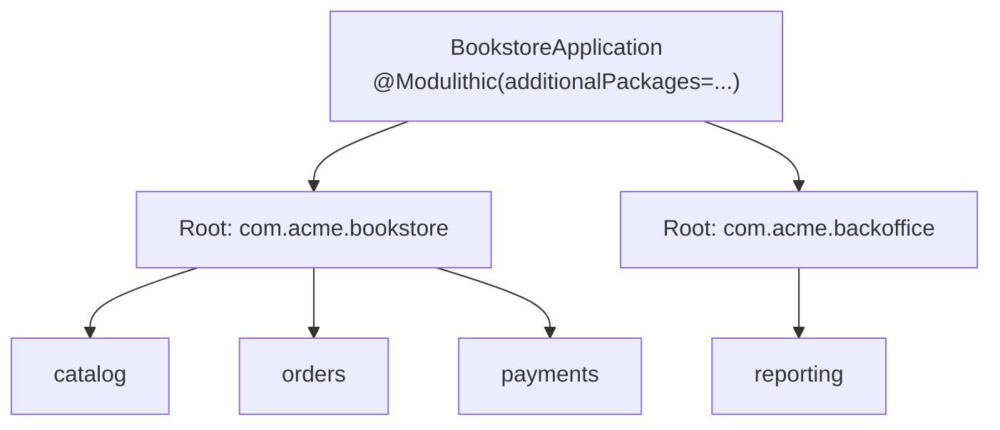

# Tùy chỉnh cách khởi tạo ApplicationModules

## Mục tiêu học tập

Sau bài học, bạn có thể:

1. Chọn đúng overload của `ApplicationModules.of(...)` khi bắt đầu từ **lớp ứng dụng**, **tên package**, **predicate loại trừ** hoặc **`ImportOption`**.
2. Giải thích vì sao `of(Application.class)` và `of("com.example.app")` có thể cho mô hình khác nhau nếu lớp ứng dụng mang metadata `@Modulithic`.
3. Sử dụng `@Modulithic(additionalPackages = ...)` để quét thêm package gốc và phân biệt việc này với thay đổi cách nhận diện module.
4. Chuyển sang chiến lược phát hiện `explicitly-annotated`, hoặc tự xây dựng `ApplicationModuleDetectionStrategy` khi cấu trúc mã nguồn không theo quy ước mặc định.
5. Kiểm tra các module đã phát hiện trước khi gọi `verify()`, biến cấu hình khởi tạo thành một phần của quality gate CI và biết giới hạn của kiểm chứng kiến trúc tĩnh.

Bài thuộc chương **ApplicationModules** trong lộ trình **SPRING_MODULITH_VERIFICATION_TESTING**. Spring Modulith chỉ kiểm chứng phụ thuộc trên các module mà mô hình đã phát hiện. Vì vậy, **điểm khởi tạo, phạm vi quét, các lớp bị loại trừ và chiến lược phát hiện** có ảnh hưởng trực tiếp đến giá trị của phép kiểm chứng ranh giới kiến trúc.

## 1. Vì sao cần tùy chỉnh cách khởi tạo?

Với một ứng dụng Spring Boot thông thường, điểm bắt đầu đơn giản nhất là:

```java
ApplicationModules modules =
        ApplicationModules.of(BookstoreApplication.class);
```

Theo cách phát hiện mặc định, Spring Modulith xem các package con trực tiếp của package chứa `BookstoreApplication` là application module. Cách này phù hợp khi các bounded context đã được tổ chức rõ ràng theo package.

Nhưng các dự án thực tế thường có những ngoại lệ:

- Một vài package như `generated` hoặc `db` chứa mã phụ trợ mà nhóm muốn loại khỏi phân tích kiến trúc.
- Ứng dụng có thêm vùng code nghiệp vụ ở package gốc **khác** với package của lớp Spring Boot chính.
- Chỉ các package được gắn `@ApplicationModule` mới cần được xem là module.
- Kiến trúc dùng quy ước riêng, ví dụ module chỉ nằm trong các package thỏa một danh sách tên do nhóm xác định.
- Cần điều chỉnh loại class được nhập vào quá trình phân tích nhưng không muốn thay đổi ranh giới module.

Mỗi tình huống nên dùng **đúng cơ chế**. Không nên tùy tiện loại trừ mã khỏi mô hình chỉ vì `verify()` đang phát hiện vi phạm: các phần bị bỏ qua sẽ không được xác minh đầy đủ.

## 2. Ví dụ xuyên suốt

Giả sử ứng dụng có cấu trúc:

```text
src/main/java/
└── com/acme/bookstore/
    ├── BookstoreApplication.java
    ├── catalog/
    │   ├── BookCatalog.java
    │   └── internal/
    │       └── BookRepository.java
    ├── orders/
    │   ├── OrderManagement.java
    │   └── internal/
    │       └── OrderService.java
    ├── payments/
    │   └── PaymentManagement.java
    └── generated/
        └── LegacyDatabaseMapping.java
```

`BookstoreApplication` nằm tại package gốc:

```java
// src/main/java/com/acme/bookstore/BookstoreApplication.java
package com.acme.bookstore;

import org.springframework.boot.SpringApplication;
import org.springframework.boot.autoconfigure.SpringBootApplication;

@SpringBootApplication
public class BookstoreApplication {

    public static void main(String[] args) {
        SpringApplication.run(BookstoreApplication.class, args);
    }
}
```

Nếu tất cả các package trên đều có class đã biên dịch và dự án dùng chiến lược mặc định, danh sách module có thể gồm:

```text
catalog
generated
orders
payments
```

Đây là kết quả của **quy tắc phát hiện**, không phải lời khẳng định `generated` là một ranh giới nghiệp vụ tốt. Tùy mục tiêu, nhóm cần quyết định giữ nó như một module, di chuyển mã đến nơi sở hữu phù hợp, hoặc loại trừ có lý do.

## 3. Các overload thường dùng của `ApplicationModules.of`

| Cách gọi | Đầu vào | Trường hợp phù hợp |
| --- | --- | --- |
| `of(BookstoreApplication.class)` | Lớp ứng dụng | Quét từ package của lớp; đọc metadata Modulith trên lớp |
| `of("com.acme.bookstore")` | Tên package Java | Khởi tạo từ package cụ thể, không cần tham chiếu lớp ứng dụng |
| `of(BookstoreApplication.class, ignored)` | Lớp + `DescribedPredicate` | Loại trừ những class/package có chủ đích |
| `of("com.acme.bookstore", ignored)` | Package + `DescribedPredicate` | Chọn package gốc và loại trừ kiểu cùng lúc |
| `of(BookstoreApplication.class, importOption)` | Lớp + `ImportOption` | Tùy chỉnh điều kiện nhập file class |
| `of("com.acme.bookstore", importOption)` | Package + `ImportOption` | Kết hợp tên package với chính sách import |

Trong API hiện hành, các overload dùng predicate nhận **`com.tngtech.archunit.base.DescribedPredicate`** đối với `JavaClass`. `ImportOption` là abstraction của **ArchUnit** dùng để quyết định file class nào được nhập. Đây là hai cơ chế khác nhau và không nên dùng thay thế một cách máy móc.

### Dùng lớp ứng dụng

```java
import org.springframework.modulith.core.ApplicationModules;

ApplicationModules modules =
        ApplicationModules.of(BookstoreApplication.class);
```

Spring Modulith lấy package của lớp `BookstoreApplication` làm điểm xuất phát và xem metadata cấu hình Modulith trên lớp đó nếu có.

### Dùng tên package

```java
import org.springframework.modulith.core.ApplicationModules;

ApplicationModules modules =
        ApplicationModules.of("com.acme.bookstore");
```

Đây là **tên package Java**, không phải đường dẫn `src/main/java/com/acme/bookstore`. Cách khởi tạo từ `String` phù hợp cho một phép khảo sát độc lập chỉ dựa trên package. Nó **không có lớp ứng dụng để đọc annotation `@Modulithic` nằm trên lớp đó**.

Hai cách có thể tạo cùng mô hình trong trường hợp mặc định; tuy nhiên không nên coi chúng luôn tương đương khi ứng dụng cấu hình thêm root hoặc metadata riêng.

## 4. Xác minh phạm vi ngay sau khi khởi tạo

Trước khi áp dụng quality gate, hãy **quan sát các module thực sự được phát hiện**:

```java
// src/test/java/com/acme/bookstore/ModuleInitializationTests.java
package com.acme.bookstore;

import org.junit.jupiter.api.Test;
import org.springframework.modulith.core.ApplicationModules;

class ModuleInitializationTests {

    @Test
    void showDiscoveredModules() {
        ApplicationModules modules =
                ApplicationModules.of(BookstoreApplication.class);

        modules.stream()
                .map(module -> module.getIdentifier().toString())
                .sorted()
                .forEach(System.out::println);
    }
}
```

Các API hữu ích khi đọc lại điểm khởi tạo:

- `modules.getSource()`: đối tượng nguồn dùng để tạo mô hình, thường là lớp ứng dụng hoặc tên package.
- `modules.stream()`: danh sách application module được phát hiện.
- `modules.getModuleByName(...)`: tra cứu module theo định danh.
- `modules.getModuleForPackage(...)`: xem package có được gán vào module nào.
- `modules.getRootPackages()`: danh sách package gốc mà mô hình sử dụng (**Spring Modulith 1.4+**).

Ví dụ:

```java
ApplicationModules modules =
        ApplicationModules.of(BookstoreApplication.class);

System.out.println("Source: " + modules.getSource());

modules.getRootPackages().stream()
        .map(root -> root.getName())
        .sorted()
        .forEach(root -> System.out.println("Root: " + root));
```

Nếu phiên bản dự án cũ hơn 1.4, hãy đọc tên package gốc từ cấu hình đầu vào thay vì sử dụng `getRootPackages()` chưa được hỗ trợ. **Root package không đồng nghĩa với module**: root xác định vùng code để phát hiện module, còn module là những đơn vị được nhận diện trong vùng đó.

## 5. Loại trừ một package bằng `DescribedPredicate`

Giả sử `com.acme.bookstore.generated` là vùng mã được sinh bởi một công cụ chuyển đổi dữ liệu, nhóm đã quyết định không đưa nó vào mô hình module nghiệp vụ.

Spring Modulith cho phép truyền predicate xác định những class **bị bỏ qua**:

```java
package com.acme.bookstore;

import com.tngtech.archunit.core.domain.JavaClass;
import org.junit.jupiter.api.Test;
import org.springframework.modulith.core.ApplicationModules;

class ExcludedPackageTests {

    @Test
    void ignoreGeneratedCode() {
        ApplicationModules modules = ApplicationModules.of(
                BookstoreApplication.class,
                JavaClass.Predicates.resideInAPackage(
                        "com.acme.bookstore.generated..")
        );

        modules.stream()
                .map(module -> module.getIdentifier().toString())
                .sorted()
                .forEach(System.out::println);
    }
}
```

Trong ArchUnit, biểu thức `com.acme.bookstore.generated..` khớp với package `generated` **và các package con**. Nếu tất cả kiểu trong nhánh đó bị loại khỏi tập class được phân tích, mô hình không còn khảo sát nội dung của chúng và thông thường không còn module `generated` như trước.

Phân biệt hai biểu thức:

| Biểu thức `resideInAPackage(...)` | Phạm vi áp dụng |
| --- | --- |
| `"com.acme.bookstore.generated"` | Chỉ các class ở **đúng package** đó |
| `"com.acme.bookstore.generated.."` | Class ở package đó **và mọi package con** |

Nếu chỉ loại các class trực tiếp ở `generated`, phần `generated.internal` vẫn có thể được phân tích. Luôn kiểm tra hiệu quả thực tế bằng cách in inventory và đọc các kiểu còn được gán cho module.

### Loại trừ khi khởi tạo từ package string

```java
ApplicationModules modules = ApplicationModules.of(
        "com.acme.bookstore",
        JavaClass.Predicates.resideInAPackage(
                "com.acme.bookstore.generated..")
);
```

Overload này đồng thời chỉ định điểm bắt đầu và điều kiện loại trừ, nhưng không đọc `@Modulithic` từ một lớp ứng dụng.

**Giới hạn quan trọng:** Loại trừ class có thể **che mất vi phạm phụ thuộc** trong phần mã đó. Với code nghiệp vụ do nhóm sở hữu, ưu tiên sửa ranh giới thực tế; chỉ loại trừ khi đã hiểu vì sao class được bỏ khỏi phạm vi kiểm chứng và có biện pháp kiểm thử phù hợp khác.

## 6. Tùy chỉnh nhập class bằng `ImportOption`

`ImportOption` của ArchUnit quyết định **nguồn class file nào** được phép đưa vào quá trình phân tích. Nó phù hợp khi muốn xác định chính sách nhập class ở mức test runner hoặc classpath.

Ví dụ:

```java
package com.acme.bookstore;

import com.tngtech.archunit.core.importer.ImportOption;
import org.junit.jupiter.api.Test;
import org.springframework.modulith.core.ApplicationModules;

class ModuleClassImportTests {

    @Test
    void inspectProductionClasses() {
        ApplicationModules modules = ApplicationModules.of(
                BookstoreApplication.class,
                ImportOption.Predefined.DO_NOT_INCLUDE_TESTS
        );

        modules.forEach(System.out::println);
    }
}
```

Các overload nhận `ImportOption` có từ **Spring Modulith 1.2**. Ví dụ này yêu cầu ArchUnit bỏ qua các class thuộc vị trí test theo `ImportOption` có sẵn. Nếu dự án dùng layout classpath không chuẩn, cần kiểm tra import option có phân biệt đúng mã production và test hay không.

### `DescribedPredicate` khác `ImportOption` thế nào?

| Tiêu chí | Predicate loại trừ | `ImportOption` |
| --- | --- | --- |
| Đầu vào tác động | Kiểu Java/`JavaClass` hoặc nhóm package | Vị trí file class được importer xử lý |
| Ví dụ | Bỏ `com.acme.bookstore.generated..` | Không nhập class từ đường dẫn test |
| Mục tiêu | Chỉ rõ phần mã bị bỏ qua trong mô hình | Chọn nguồn class được đưa vào phân tích |
| Rủi ro khi dùng sai | Bỏ sót phụ thuộc từ các class quan trọng | Bỏ sót một source set hoặc classpath cần kiểm chứng |

Trong đa số dự án theo quy ước chuẩn, bắt đầu bằng `of(BookstoreApplication.class)`. Chỉ thêm predicate hoặc import option khi có một yêu cầu phạm vi rõ ràng và có test xác nhận các module quan trọng vẫn được phát hiện.

## 7. Mở rộng các package gốc với `@Modulithic`

Giả sử ứng dụng chính nằm trong `com.acme.bookstore`, nhưng phần báo cáo vận hành nằm ở **một root khác**, `com.acme.backoffice`:

```text
src/main/java/
└── com/acme/
    ├── bookstore/
    │   ├── BookstoreApplication.java
    │   ├── catalog/
    │   ├── orders/
    │   └── payments/
    └── backoffice/
        └── reporting/
            └── RevenueReporting.java
```

Với `of(BookstoreApplication.class)` đơn thuần, `com.acme.backoffice` ở ngoài package gốc ban đầu. Có thể khai báo thêm root:

```java
// src/main/java/com/acme/bookstore/BookstoreApplication.java
package com.acme.bookstore;

import org.springframework.boot.autoconfigure.SpringBootApplication;
import org.springframework.modulith.Modulithic;

@Modulithic(
        systemName = "Bookstore",
        additionalPackages = "com.acme.backoffice"
)
@SpringBootApplication
public class BookstoreApplication {
}
```

Với metadata trên, Spring Modulith thực hiện phát hiện module cả bên dưới root bổ sung. Với cách phát hiện mặc định và các class có mặt trong classpath, `reporting` trở thành một application module được phát hiện từ `com.acme.backoffice.reporting`.



Hai điểm cần nhớ:

1. `additionalPackages` bổ sung **root để quét**, không có nghĩa toàn bộ `com.acme.backoffice` tự động là một module duy nhất.
2. Khởi tạo bằng **lớp** `ApplicationModules.of(BookstoreApplication.class)` cho phép Spring Modulith đọc metadata `@Modulithic`. Khởi tạo bằng **chuỗi** `ApplicationModules.of("com.acme.bookstore")` không có metadata lớp để biết `additionalPackages`.

**Phân biệt phạm vi mô hình và phạm vi Spring Boot quét bean:** `additionalPackages` điều chỉnh việc Spring Modulith nhận diện module; nó không tự bảo đảm Spring Boot tìm và khởi tạo các bean ở `com.acme.backoffice`. Nếu module `reporting` có bean cần chạy thực tế, hãy cấu hình component scanning hoặc import phù hợp trong ứng dụng và kiểm chứng bằng `@ApplicationModuleTest` hay integration test.

### Kiểm tra root và module bổ sung

```java
ApplicationModules modules =
        ApplicationModules.of(BookstoreApplication.class);

modules.getRootPackages().stream()
        .map(root -> root.getName())
        .sorted()
        .forEach(System.out::println);

modules.stream()
        .map(module -> module.getIdentifier().toString())
        .sorted()
        .forEach(System.out::println);
```

Kết quả dự kiến có hai root `com.acme.bookstore`, `com.acme.backoffice`; danh sách module gồm các phần nghiệp vụ ở cả hai vùng. Đây là ví dụ yêu cầu Spring Modulith **1.4+** nếu dùng `getRootPackages()`; việc khai báo `@Modulithic(additionalPackages = ...)` là cơ chế cấu hình riêng.

Ngoài `additionalPackages`, `@Modulithic` có:

- `systemName`: tên hệ thống dùng trong tài liệu/sơ đồ sinh ra.
- `sharedModules`: module được xem là shared trong ngữ cảnh kiểm thử module.

`systemName` **không đổi danh sách module**, còn `sharedModules` liên quan phạm vi bootstrap khi dùng `@ApplicationModuleTest`; đừng nhầm chúng với cơ chế quét root.

## 8. Đổi quy tắc phát hiện module: `explicitly-annotated`

Mặc định Spring Modulith nhận diện các package con trực tiếp của root là module. Một lựa chọn khác là **chỉ công nhận package được chú thích tường minh** với `@ApplicationModule` hoặc cơ chế annotation được hỗ trợ.

Thiết lập:

```properties
spring.modulith.detection-strategy=explicitly-annotated
```

Với cấu hình đó, thêm `package-info.java` tại các package nghiệp vụ cần trở thành module:

```java
// src/main/java/com/acme/bookstore/orders/package-info.java
@org.springframework.modulith.ApplicationModule
package com.acme.bookstore.orders;
```

```java
// src/main/java/com/acme/bookstore/catalog/package-info.java
@org.springframework.modulith.ApplicationModule
package com.acme.bookstore.catalog;
```

Nếu `payments` không mang annotation tương ứng, nó **không còn được tự động coi là module chỉ vì là package con trực tiếp**. Đừng vội cho rằng mọi lớp của `payments` đã được bảo vệ bởi `verify()`.

### Phân biệt thay đổi detection và thay đổi root

| Cơ chế | Điều gì thay đổi? | Câu hỏi cần xác minh |
| --- | --- | --- |
| `@Modulithic(additionalPackages = ...)` | Các vùng package gốc được phân tích | Có quét đủ tất cả vùng nghiệp vụ không? |
| `spring.modulith.detection-strategy=explicitly-annotated` | Cách chọn package **nào thành module** bên trong root | Những package bắt buộc đã có annotation chưa? |
| Predicate `ignored` trong `of(...)` | Những kiểu/package **bị bỏ khỏi phân tích** | Có vô tình loại code quan trọng không? |
| `ImportOption` | Class file nào được đưa vào bộ phân tích | Các source set phù hợp đã được nhập chưa? |

**Ví dụ lỗi thường gặp:** Bật `explicitly-annotated` rồi chỉ gắn annotation cho `orders`. Một bài test `verify()` có thể xanh dù `catalog` hoặc `payments` không xuất hiện như module mong đợi. Cần bổ sung assertion kiểm tra inventory để quality gate phát hiện ngay sai lệch này.

## 9. Xây dựng `ApplicationModuleDetectionStrategy` riêng

Khi dự án có quy ước đặc thù hơn cả phát hiện theo subpackage và annotated, Spring Modulith cho phép tự triển khai `ApplicationModuleDetectionStrategy`.

Ví dụ, nhóm có ba package được chọn làm ranh giới module: `catalog`, `orders`, `payments`. Các package kỹ thuật bên cạnh không được tự động chọn làm module:

```java
// src/test/java/com/acme/architecture/BusinessModulesOnly.java
package com.acme.architecture;

import java.util.Set;
import java.util.stream.Stream;
import org.springframework.modulith.core.ApplicationModuleDetectionStrategy;
import org.springframework.modulith.core.JavaPackage;

public class BusinessModulesOnly
        implements ApplicationModuleDetectionStrategy {

    private static final Set<String> MODULE_NAMES =
            Set.of("catalog", "orders", "payments");

    @Override
    public Stream<JavaPackage> getModuleBasePackages(
            JavaPackage rootPackage) {

        return rootPackage.getDirectSubPackages().stream()
                .filter(candidate ->
                        MODULE_NAMES.contains(candidate.getLocalName()));
    }
}
```

Đăng ký chiến lược qua cấu hình test:

```properties
# src/test/resources/application.properties
spring.modulith.detection-strategy=com.acme.architecture.BusinessModulesOnly
```

Phương thức `getModuleBasePackages(JavaPackage rootPackage)` nhận root đã được Spring Modulith xác định, sau đó trả về **`Stream<JavaPackage>`** chứa những package muốn coi là module. Ở ví dụ này, `JavaPackage.getDirectSubPackages()` trả về collection; lời gọi `.stream()` và `.filter(...)` lựa chọn đúng ba package mong đợi.

Chỉ dùng chiến lược riêng nếu quy tắc kiến trúc thực sự đòi hỏi. Một quy ước chọn module quá tùy tiện có thể khiến package nghiệp vụ mới **không được phát hiện**, làm các bài `verify()` bỏ sót phần mã cần bảo vệ.

Nếu chiến lược chỉ phục vụ kiểm thử kiến trúc và tạo tài liệu, có thể đặt implementation và cấu hình trong test sources. Nếu các thành phần Spring Modulith ở **runtime** cũng cần mô hình này (ví dụ ứng dụng khởi tạo module hoặc actuator/observability), phải đưa implementation, cấu hình và phụ thuộc `spring-modulith-core` vào phạm vi production phù hợp.

### Cách chọn giữa hai chiến lược

- Dùng `explicitly-annotated` khi mỗi module có thể được đánh dấu tại package một cách tự nhiên, dễ review.
- Dùng `ApplicationModuleDetectionStrategy` tự viết khi ranh giới được xác định bằng quy ước tồn tại sẵn mà không thuận tiện thay đổi từng package.

Trong cả hai trường hợp, **kiểm tra inventory luôn cần thiết**: tính đúng đắn của cấu hình phụ thuộc vào tập module được nhận diện thực tế.

## 10. Viết kiểm thử khóa phạm vi và phát hiện phụ thuộc sai

Đưa kỳ vọng về những module bắt buộc vào một JUnit test. Ví dụ dưới đây giả định cấu trúc **ba module** ban đầu và nhóm đã quyết định loại vùng `generated`:

```java
// src/test/java/com/acme/bookstore/ModuleBoundaryContractTests.java
package com.acme.bookstore;

import static org.junit.jupiter.api.Assertions.assertEquals;
import static org.junit.jupiter.api.Assertions.assertTrue;

import java.util.Set;
import java.util.stream.Collectors;

import com.tngtech.archunit.core.domain.JavaClass;
import org.junit.jupiter.api.Test;
import org.springframework.modulith.core.ApplicationModules;

class ModuleBoundaryContractTests {

    @Test
    void intendedModulesAreDetected() {
        ApplicationModules modules = ApplicationModules.of(
                BookstoreApplication.class,
                JavaClass.Predicates.resideInAPackage(
                        "com.acme.bookstore.generated..")
        );

        Set<String> ids = modules.stream()
                .map(module -> module.getIdentifier().toString())
                .collect(Collectors.toSet());

        assertEquals(Set.of("catalog", "orders", "payments"), ids);

        assertTrue(modules.getModuleByName("orders").isPresent());
    }

    @Test
    void moduleDependenciesRespectBoundaries() {
        ApplicationModules.of(
                BookstoreApplication.class,
                JavaClass.Predicates.resideInAPackage(
                        "com.acme.bookstore.generated..")
        ).verify();
    }
}
```

Với dự án dùng `@Modulithic(additionalPackages = ...)` hoặc một chiến lược chọn module khác, **phải sửa tập mong đợi theo thiết kế đã thống nhất**. Ví dụ trên chỉ phù hợp với ba module gốc đã cho.

Test thứ nhất và thứ hai bổ sung cho nhau:

| Test | Bảo vệ điều gì? | Nếu bỏ test này |
| --- | --- | --- |
| Assertion tập định danh | Mô hình phải chứa **đúng những module đã định** | Một package có thể bị bỏ qua mà không bị phát hiện |
| `verify()` | Phụ thuộc vòng, truy cập trái phép vào nội bộ, giới hạn `allowedDependencies` | Mô hình đúng số lượng nhưng code vẫn có thể phụ thuộc sai |

Nếu hệ thống thường xuyên thêm module mới hợp lệ, có thể dùng `ids.containsAll(requiredModules)` để chỉ khóa những module bắt buộc. Nếu danh sách module là hợp đồng kiến trúc chặt chẽ, so sánh toàn bộ tập sẽ phát hiện cả module ngoài dự kiến.

## 11. Chẩn đoán khi mô hình tùy chỉnh không như mong đợi

| Hiện tượng | Nguyên nhân có thể | Hướng xử lý |
| --- | --- | --- |
| `of(String)` thiếu module ở root bổ sung | Metadata `@Modulithic` nằm trên lớp ứng dụng | Dùng `of(Application.class)` hoặc cung cấp cấu hình khởi tạo phù hợp |
| Có module `generated` ngoài dự kiến | Package kỹ thuật nằm ngay dưới root mặc định | Xác nhận trách nhiệm, chỉnh package hoặc loại trừ có chủ đích |
| Package `generated.internal` vẫn xuất hiện | Predicate chỉ khớp `generated` mà không khớp package con | Dùng biểu thức có `..` khi muốn loại toàn nhánh |
| Bật `explicitly-annotated` và mất nhiều module | Các package module chưa có `@ApplicationModule` | Bổ sung annotation hoặc đổi lại chiến lược |
| `getRootPackages()` không biên dịch | Spring Modulith trước 1.4 | Xem Javadoc theo phiên bản hoặc đọc phạm vi từ cấu hình |
| Model thiếu class trong source set khác | Chính sách nhập class hoặc classpath test không bao gồm nó | Đối chiếu `ImportOption`, build và classpath |
| `verify()` xanh dù kiến trúc bị bỏ sót | Phạm vi quét, predicate hoặc chiến lược phát hiện quá hẹp | Thêm assertion inventory, điều chỉnh mô hình |
| Custom detection hoạt động ở test nhưng không ở runtime | Implementation/cấu hình chỉ có trong test sources | Nếu runtime cần mô hình, đưa chúng sang phạm vi production thích hợp |

### Quy trình chẩn đoán

1. In nguồn mô hình `getSource()`, và in root qua `getRootPackages()` nếu phiên bản hỗ trợ.
2. In danh sách `getIdentifier()` theo thứ tự tăng dần; đối chiếu với các module được kỳ vọng.
3. Kiểm tra `getModuleByName`, `getModuleForPackage` hoặc `getModuleByType` cho thành phần còn thiếu.
4. Kiểm tra overload `of(...)`, điều kiện `ignored`, `ImportOption`, metadata `@Modulithic` và `detection-strategy`.
5. Khi mô hình đã đúng phạm vi, chạy `verify()` và các test runtime cần thiết.

## 12. Đưa kiểm chứng vào CI và phân biệt các lớp test

Khi cấu hình Spring Modulith và JUnit 5 đã sẵn sàng, đặt `ModuleBoundaryContractTests` trong `src/test/java` và chạy bằng công cụ build của dự án.

Với Gradle:

```bash
./gradlew test
```

Với Maven:

```bash
./mvnw test
```

Trong CI, cả **inventory test** và **test `verify()`** phải là bước kiểm tra bắt buộc. Khi thay đổi cách khởi tạo có chủ đích, cập nhật đồng thời tập module mong đợi; khi có module bị loại ngoài ý muốn, pipeline cần thất bại để nhóm rà soát.

`ApplicationModules.of(...)` phân tích cấu trúc **tĩnh** và không tự khởi động database, broker hoặc Spring application context. Những câu hỏi liên quan đến runtime thuộc các bài kiểm thử khác:

| Công cụ | Phạm vi kiểm tra |
| --- | --- |
| `ApplicationModules.of(...)` + inventory assertion | Root, điều kiện loại trừ và chiến lược phát hiện tạo ra đúng mô hình chưa? |
| `ApplicationModules.verify()` | Các module được nhận diện có tuân thủ quy tắc ranh giới không? |
| `@ApplicationModuleTest` | Bean và hành vi trong Spring test context theo phạm vi module có đúng không? |
| Test sự kiện, database và tích hợp | Publish/consume sự kiện, transaction và hệ thống ngoài có hoạt động đúng không? |

Đặc biệt, `@Modulithic(sharedModules = ...)` liên quan đến phạm vi bootstrap của `@ApplicationModuleTest`, còn `additionalPackages` tác động đến mô hình root. Đó là hai loại cấu hình có mục đích khác nhau.

## 13. Bài thực hành

**Bối cảnh:** Ứng dụng Bookstore có `catalog`, `orders`, `payments` và package kỹ thuật `generated`. Nhóm muốn kiểm chứng đúng ranh giới nghiệp vụ và sau này đưa `reporting` từ package `com.acme.backoffice` vào mô hình.

**Nhiệm vụ:**

1. Tạo cây package ở mục 2 và `BookstoreApplication` trong `com.acme.bookstore`.
2. Dùng `ApplicationModules.of(BookstoreApplication.class)` để in tất cả module được phát hiện; ghi nhận xem `generated` có xuất hiện không.
3. Dùng predicate `JavaClass.Predicates.resideInAPackage("com.acme.bookstore.generated..")` để loại nhánh `generated`; in lại inventory và giải thích phần nào bị loại.
4. Thử `of("com.acme.bookstore")` và so sánh kết quả trong trường hợp chưa có `@Modulithic`.
5. Thêm `@Modulithic(additionalPackages = "com.acme.backoffice")` cùng package `backoffice.reporting`; so sánh kết quả của `of(Class)` với `of(String)` và kiểm tra root nếu phiên bản hỗ trợ.
6. Trên nhánh thực hành riêng, bật `spring.modulith.detection-strategy=explicitly-annotated`, chỉ gắn `@ApplicationModule` cho `catalog` và `orders`; ghi nhận vì sao module `payments` không còn được phát hiện.
7. Xây dựng `ModuleBoundaryContractTests` để khẳng định tập module mong đợi và gọi `verify()`. Với từng cách cấu hình, cập nhật assertion theo đúng mục tiêu rồi quan sát test khi một module bị thiếu.
8. Nếu có phần nghiệp vụ dùng sự kiện hoặc database, bổ sung `@ApplicationModuleTest` và integration test phù hợp, tránh dùng việc `verify()` xanh để suy ra mọi hành vi runtime đều đúng.

**Tiêu chí hoàn thành:** Bạn giải thích được sự khác biệt giữa thay đổi root, thay đổi detection strategy, predicate loại trừ và `ImportOption`; lựa chọn đúng overload `of(...)`; đồng thời có bộ test bảo vệ cả **phạm vi mô hình** và **quy tắc phụ thuộc**.

## 14. Câu hỏi tự kiểm tra

1. Khi nào nên dùng `ApplicationModules.of(BookstoreApplication.class)` thay vì `ApplicationModules.of("com.acme.bookstore")`?
2. `JavaClass.Predicates.resideInAPackage("com.acme.bookstore.generated")` khác biểu thức có `..` ở cuối thế nào?
3. Vì sao loại một package khỏi mô hình có thể khiến `verify()` cho kết quả xanh mà không chứng minh toàn bộ kiến trúc hợp lệ?
4. `@Modulithic(additionalPackages = ...)` mở rộng điều gì? Nó có tự biến package root bổ sung thành một module duy nhất không?
5. `spring.modulith.detection-strategy=explicitly-annotated` làm thay đổi root package hay quy tắc chọn module?
6. Lợi ích và rủi ro của `ApplicationModuleDetectionStrategy` tự viết là gì?
7. Vì sao cần kiểm tra tập định danh module trước khi chạy `verify()`?
8. Chọn test nào để phát hiện sai phạm về `@ApplicationModuleTest`, sự kiện hoặc database sau khi kiến trúc tĩnh đã vượt qua kiểm chứng?

## Tổng kết

**Tùy chỉnh cách khởi tạo `ApplicationModules` chính là quyết định phạm vi kiến trúc nào được đưa vào kiểm chứng.** Dùng `of(Class)` khi cần metadata trên lớp ứng dụng; dùng `of(String)` cho một package gốc cụ thể; thêm `DescribedPredicate` hoặc `ImportOption` khi có lý do giới hạn phần class được phân tích. `@Modulithic(additionalPackages = ...)` mở rộng root, còn `spring.modulith.detection-strategy` hoặc `ApplicationModuleDetectionStrategy` quyết định những package nào trở thành module. Luôn kiểm tra danh sách module thực tế, sau đó kết hợp assertion và `verify()` trong CI. Với hành vi runtime, tiếp tục dùng `@ApplicationModuleTest` cùng kiểm thử sự kiện, cơ sở dữ liệu và tích hợp.

### Tài liệu tham khảo

- [Spring Modulith — ApplicationModules API](https://docs.spring.io/spring-modulith/docs/current/api/org/springframework/modulith/core/ApplicationModules.html)
- [Spring Modulith — Fundamentals và tùy chỉnh module arrangement](https://docs.spring.io/spring-modulith/reference/fundamentals.html)
- [Spring Modulith — ApplicationModuleDetectionStrategy API](https://docs.spring.io/spring-modulith/docs/current/api/org/springframework/modulith/core/ApplicationModuleDetectionStrategy.html)
- [Spring Modulith — JavaPackage API](https://docs.spring.io/spring-modulith/docs/current/api/org/springframework/modulith/core/JavaPackage.html)
- [Spring Modulith — Verification](https://docs.spring.io/spring-modulith/reference/verification.html)
