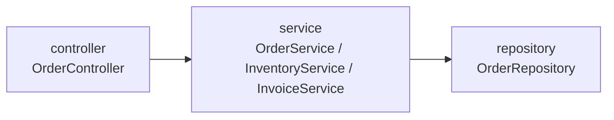
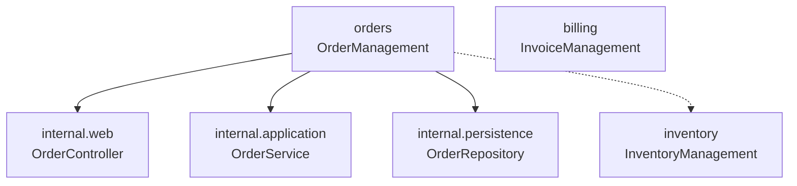
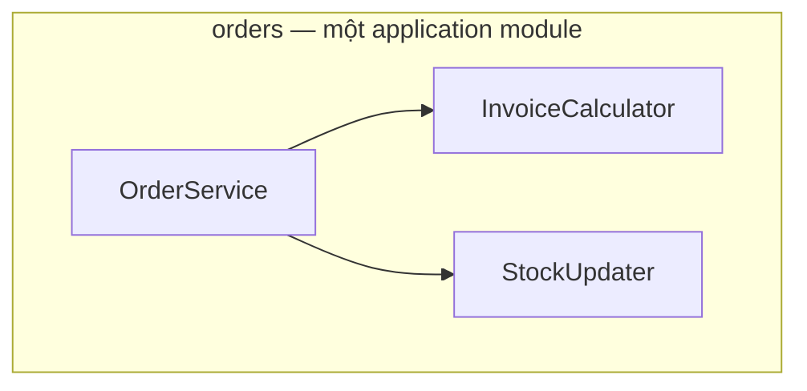

# Giới hạn suy luận khi package chứa nhiều vai trò

## Mục tiêu học tập

Sau bài học, bạn có thể:

1. Phân biệt **vai trò kỹ thuật** của lớp Java (controller, service, repository, event listener...) với **ranh giới nghiệp vụ** của một application module.
2. Giải thích Spring Modulith suy ra được gì từ package, annotation và quan hệ phụ thuộc, cũng như những điều **không thể tự suy ra** từ cấu trúc đó.
3. Đọc mô hình `ApplicationModules` khi một package chứa nhiều loại lớp hoặc nhiều chức năng nghiệp vụ.
4. Nhận diện nguy cơ vô tình mở rộng API module khi đặt nhiều kiểu `public` trực tiếp trong package nền.
5. Quyết định khi nào nên giữ các vai trò kỹ thuật trong cùng một module và khi nào cần tách thành những module nghiệp vụ riêng.
6. Tạo kiểm thử JUnit/CI để kiểm soát phần **có thể xác minh tự động**, đồng thời xác định những đánh giá kiến trúc phải thực hiện qua code review và kiểm thử hành vi.

Bài học thuộc chương **ApplicationModules** của `SPRING_MODULITH_VERIFICATION_TESTING`. Mục tiêu chung của học phần là rèn luyện cách kiểm chứng ranh giới kiến trúc bằng `ApplicationModules`, các quy tắc phụ thuộc, `@ApplicationModuleTest` và kiểm thử tích hợp. Riêng bài này làm rõ giới hạn quan trọng: **một mô hình package hợp lệ về kỹ thuật chưa chắc là một mô hình nghiệp vụ tốt**.

## 1. Application module không đồng nghĩa với một vai trò kỹ thuật

Trong ứng dụng Spring Boot, những tên lớp sau rất quen thuộc:

- `OrderController`: tiếp nhận yêu cầu HTTP.
- `OrderService`: điều phối xử lý nghiệp vụ.
- `OrderRepository`: truy cập và lưu trạng thái đơn hàng.
- `OrderPlacedListener`: phản ứng với một sự kiện.
- `Order`: entity hoặc mô hình miền.

Đó là **vai trò** của các kiểu Java trong triển khai. Chúng không tự động là năm application module khác nhau.

Trong Spring Modulith, một module thường đại diện cho một **khả năng hoặc trách nhiệm nghiệp vụ có ranh giới**, ví dụ `orders`, `inventory`, `billing`. Một module `orders` hoàn toàn có thể cần cả web adapter, domain service, persistence adapter và event publisher để thực hiện chức năng của mình.

| Câu hỏi | Cấp độ cần quan sát | Ví dụ |
| --- | --- | --- |
| Lớp làm việc gì? | Vai trò kỹ thuật | `OrderRepository` truy cập dữ liệu |
| Nhóm chức năng nào sở hữu lớp? | Application module | `orders` sở hữu `OrderRepository` |
| Module được phép công bố kiểu nào? | API module | `OrderManagement` trong package nền |
| Module khác đang tham chiếu vào đâu? | Dependency kiến trúc | `billing → orders` |
| Module có ôm quá nhiều nghiệp vụ không? | Thiết kế miền, cohesion | `orders` có cả tính thuế và quản lý kho? |

**Giới hạn cốt lõi:** Spring Modulith có thể phát hiện ranh giới được mô tả bằng package/annotation và kiểm tra một số ràng buộc giữa chúng. Nó **không đọc được ý định kinh doanh** để tự quyết định rằng `OrderService` và `InvoiceService` nhất thiết phải ở hai module khác nhau.

## 2. Hai cách tổ chức package có cùng các lớp nhưng khác mô hình

Giả sử một ứng dụng bán hàng có các lớp `OrderController`, `OrderService`, `OrderRepository`, `InventoryService`, `InvoiceService`.

### Cách A — Chia theo tầng kỹ thuật

```text
com.example.store/
├── StoreApplication.java
├── controller/
│   └── OrderController.java
├── service/
│   ├── OrderService.java
│   ├── InventoryService.java
│   └── InvoiceService.java
└── repository/
    └── OrderRepository.java
```

Theo cơ chế phát hiện mặc định từ `com.example.store`, Spring Modulith có thể nhận diện các module **`controller`**, **`service`**, **`repository`** vì chúng là package con trực tiếp của root.



Mô hình trên có thể hợp lệ về mặt cú pháp, nhưng ranh giới lại phản ánh **kỹ thuật** thay vì **trách nhiệm nghiệp vụ**. Một thay đổi nhỏ trong luồng đặt hàng thường cần sửa xuyên `controller`, `service`, `repository`. Module `service` còn gom nhiều chức năng khác nhau.

Điều đó không có nghĩa Spring Modulith tự động báo lỗi: nếu đồ thị phụ thuộc không có vòng, tuân thủ API được công bố và không có giới hạn `allowedDependencies` bị vi phạm, `verify()` vẫn có thể thành công.

### Cách B — Chia theo chức năng nghiệp vụ

```text
com.example.store/
├── StoreApplication.java
├── orders/
│   ├── OrderManagement.java
│   ├── OrderPlaced.java
│   └── internal/
│       ├── web/
│       │   └── OrderController.java
│       ├── application/
│       │   └── OrderService.java
│       └── persistence/
│           └── OrderRepository.java
├── inventory/
│   ├── InventoryManagement.java
│   └── internal/
│       └── InventoryService.java
└── billing/
    ├── InvoiceManagement.java
    └── internal/
        └── InvoiceService.java
```

Lúc này, cơ chế mặc định nhận diện các module **`orders`**, **`inventory`**, **`billing`**. Package `orders.internal.web`, `orders.internal.application` và `orders.internal.persistence` là những package con **bên trong cùng module `orders`**; chúng không tự động trở thành ba module.



Nhóm kỹ thuật vẫn có thể phân chia code theo các vai trò **bên trong** một module mà không tạo ra phụ thuộc xuyên module chỉ vì cần gọi một service từ controller.

### So sánh hai cách

| Tiêu chí | Theo tầng kỹ thuật | Theo trách nhiệm nghiệp vụ |
| --- | --- | --- |
| Package con trực tiếp của root | `controller`, `service`, `repository` | `orders`, `inventory`, `billing` |
| Ranh giới module mặc định | Theo vai trò lớp | Theo khả năng nghiệp vụ |
| Mỗi thay đổi nghiệp vụ | Dễ trải rộng qua nhiều module | Có thể tập trung trong module sở hữu |
| Package nội bộ | Dễ phân tán trách nhiệm | Có thể nhóm web, application, persistence dưới `internal` |
| Có được Spring Modulith tự chấm là “đúng nghiệp vụ”? | Không | Cũng không |

Chọn chia theo chức năng thường phù hợp với mục tiêu modular monolith, nhưng không thể kết luận mọi module “theo tính năng” đều tốt. Một module `orders` chứa cả khuyến mãi, kế toán và quản lý kho vẫn có nguy cơ ôm nhiều trách nhiệm dù cây package nhìn rất gọn.

## 3. Một package có nhiều vai trò không đồng nghĩa có nhiều module

Giả sử nhóm ban đầu đặt các lớp trực tiếp trong `com.example.store.orders`:

```text
orders/
├── OrderController.java
├── OrderService.java
├── OrderRepository.java
├── Order.java
└── OrderPlaced.java
```

Với quy tắc mặc định, mô hình vẫn có **một module `orders`**. Spring Modulith không tạo thêm module chỉ vì có `@RestController`, `@Service`, `@Repository` hoặc `@Entity`.

Tuy nhiên, cấu trúc này còn tiềm ẩn **rủi ro API**:

- Những kiểu `public` được đặt trực tiếp trong base package `orders` thường nằm trong **API mặc định** của module.
- Vì vậy một `public OrderRepository` ở `orders` có thể vô tình trở thành kiểu mà module khác được phép tham chiếu ở cấp kiến trúc.
- Đặt `OrderRepository` trong `orders.internal.persistence` giúp thể hiện rõ đây là chi tiết cài đặt, không phải hợp đồng liên module.

**Tách package nội bộ để giấu implementation khác với tách application module.** Mục tiêu thứ nhất là kiểm soát **bề mặt API**; mục tiêu thứ hai là tạo một **ranh giới sở hữu và phụ thuộc mới**.

### Ví dụ API công khai tối thiểu

```java
// src/main/java/com/example/store/orders/OrderManagement.java
package com.example.store.orders;

public interface OrderManagement {
    void place(String orderId);
}
```

```java
// src/main/java/com/example/store/orders/internal/application/OrderService.java
package com.example.store.orders.internal.application;

import com.example.store.orders.OrderManagement;
import org.springframework.stereotype.Service;

@Service
class OrderService implements OrderManagement {

    @Override
    public void place(String orderId) {
        if (orderId == null || orderId.isBlank()) {
            throw new IllegalArgumentException("orderId is required");
        }
        // Thực hiện nghiệp vụ và lưu trạng thái qua adapter nội bộ.
    }
}
```

```java
// src/main/java/com/example/store/orders/internal/web/OrderController.java
package com.example.store.orders.internal.web;

import com.example.store.orders.OrderManagement;
import org.springframework.web.bind.annotation.PathVariable;
import org.springframework.web.bind.annotation.PostMapping;
import org.springframework.web.bind.annotation.RestController;

@RestController
class OrderController {

    private final OrderManagement orders;

    OrderController(OrderManagement orders) {
        this.orders = orders;
    }

    @PostMapping("/orders/{id}")
    void place(@PathVariable String id) {
        orders.place(id);
    }
}
```

Ba kiểu thuộc cùng một module `orders` dù có vai trò khác nhau. Spring vẫn có thể quét `@Service` và `@RestController` trong các package con nếu cấu hình component scanning bao phủ chúng. Tên `internal` là **quy ước ranh giới kiến trúc**, không có nghĩa Spring Boot tự loại các bean này khỏi runtime.

## 4. Khám phá mô hình thực tế thay vì suy từ tên lớp

Tạo lớp ứng dụng ở package root:

```java
// src/main/java/com/example/store/StoreApplication.java
package com.example.store;

import org.springframework.boot.SpringApplication;
import org.springframework.boot.autoconfigure.SpringBootApplication;

@SpringBootApplication
public class StoreApplication {

    public static void main(String[] args) {
        SpringApplication.run(StoreApplication.class, args);
    }
}
```

Sau đó viết bài test thuần kiến trúc:

```java
// src/test/java/com/example/store/PackageRoleInspectionTests.java
package com.example.store;

import org.junit.jupiter.api.Test;
import org.springframework.modulith.core.ApplicationModules;

class PackageRoleInspectionTests {

    @Test
    void inspectOwnershipByPackage() {
        ApplicationModules modules =
                ApplicationModules.of(StoreApplication.class);

        String[] packages = {
                "com.example.store.orders",
                "com.example.store.orders.internal.web",
                "com.example.store.orders.internal.application",
                "com.example.store.orders.internal.persistence",
                "com.example.store.inventory.internal"
        };

        for (String packageName : packages) {
            String owner = modules.getModuleForPackage(packageName)
                    .map(module -> module.getIdentifier().toString())
                    .orElse("<không có module>");

            System.out.printf("%s -> %s%n", packageName, owner);
        }
    }
}
```

Kết quả mong đợi với cách phát hiện module mặc định:

```text
com.example.store.orders -> orders
com.example.store.orders.internal.web -> orders
com.example.store.orders.internal.application -> orders
com.example.store.orders.internal.persistence -> orders
com.example.store.inventory.internal -> inventory
```

`getModuleForPackage(...)` trả lời câu hỏi **“package này có module nào sở hữu trong mô hình?”**, không trả lời **“lớp bên trong đang làm đúng trách nhiệm nghiệp vụ chưa?”**.

Ngoài ra, API tra cứu theo package không phải công cụ kiểm tra sự tồn tại của thư mục hay file Java. Một tên package có thể ánh xạ vào module sở hữu về mặt cấu trúc ngay cả khi bạn chưa nhập được kiểu cụ thể mong muốn. Khi cần xác định lớp nào thật sự được quét, kiểm tra classpath và dùng `getModuleByType(...)` cho những kiểu có mặt.

### Đọc danh sách module thay vì nhìn thư mục

```java
ApplicationModules modules =
        ApplicationModules.of(StoreApplication.class);

modules.stream()
        .map(module -> module.getIdentifier().toString())
        .sorted()
        .forEach(System.out::println);
```

Với cây package theo nghiệp vụ:

```text
billing
inventory
orders
```

Không có module `web`, `application` hoặc `persistence` riêng, trừ khi dự án đã cấu hình cách phát hiện module hoặc khai báo nested module khác mặc định.

## 5. Những suy luận hợp lệ và những suy luận vượt quá dữ liệu

Khi đọc `ApplicationModules`, cần tách thông tin framework thực sự biết khỏi nhận định mang tính kiến trúc nghiệp vụ:

| Nhận định | Có thể kết luận từ mô hình tĩnh? | Giải thích |
| --- | --- | --- |
| `OrderService` thuộc `orders` theo package được gán | Có, nếu class nằm trong phạm vi mô hình | Có thể hỏi module sở hữu |
| `orders` phụ thuộc trực tiếp vào `inventory` | Có, khi có tham chiếu được phân tích | Đọc `getDirectDependencies(modules)` |
| Có phụ thuộc vòng giữa các module | Có thể kiểm tra | `verify()` phát hiện vòng theo quy tắc kiến trúc |
| Module truy cập kiểu nội bộ của module khác | Có thể kiểm tra | Phụ thuộc ngoài API công bố thường bị `verify()` từ chối |
| `OrderController` phải là module riêng vì có `@RestController` | Không | Annotation chỉ cho biết vai trò/framework, không định nghĩa module riêng |
| `orders` chỉ chịu đúng một trách nhiệm nghiệp vụ | Không | Cần hiểu use case, dữ liệu và ngữ cảnh miền |
| Repository đang lưu vào database đúng cách | Không | Cần kiểm thử database/integration |
| Sự kiện đã được publish, tiêu thụ và commit thành công | Không | Cần kiểm thử sự kiện và transaction |
| Thiết kế tránh được tất cả coupling có hại | Không | Coupling nội bộ, coupling qua dữ liệu hoặc thời gian có thể nằm ngoài ràng buộc tĩnh |

**Quy tắc diễn giải:** `verify()` thành công nghĩa là những **quy tắc framework đang kiểm tra trên phạm vi module đã nhận diện** không phát hiện vi phạm. Nó không có nghĩa kiến trúc đã đạt mức cohesion tối ưu, chia bounded context đúng hoặc không còn lỗi thiết kế.

## 6. Giới hạn quan trọng: phụ thuộc bên trong cùng module

Giả sử `OrderService` gọi `InvoiceCalculator` và `StockUpdater`, cả hai đều nằm trong `orders.internal`:

```text
orders/
├── OrderManagement.java
└── internal/
    ├── OrderService.java
    ├── InvoiceCalculator.java
    └── StockUpdater.java
```

Nếu tất cả thuộc module `orders`, các lời gọi giữa chúng là **phụ thuộc nội bộ cùng module**. Spring Modulith sẽ không tạo ba cạnh module `orders → invoice`, `orders → stock` hay `orders → order-service` chỉ vì có ba lớp.



Một nhóm phát triển có thể nhận ra tính hóa đơn và cập nhật tồn kho thuộc các trách nhiệm cần tách về `billing` và `inventory`. Nhưng **khi mọi mã còn nằm trong `orders`**, `verify()` không có ranh giới liên module để phát hiện sự pha trộn trách nhiệm này.

Đó là giới hạn suy luận quan trọng nhất của bài: **các quy tắc kiểm chứng theo module chỉ mạnh bằng chính những ranh giới mà nhóm đã khai báo**.

### Không phải mọi vai trò khác nhau đều cần tách

Ngược lại, `OrderController`, `OrderService` và `OrderRepository` cùng thuộc luồng đặt đơn hàng là điều hợp lý. Tách chúng thành ba application module chỉ vì khác vai trò kỹ thuật có thể làm tăng số lượng dependency, làm API phải công bố rộng hơn và khiến thay đổi nghiệp vụ xuyên nhiều module.

Nên hỏi: “**Những lớp này cùng thực hiện khả năng nghiệp vụ nào và cùng thay đổi vì lý do gì?**”, thay vì chỉ hỏi “**chúng có cùng hậu tố Service/Repository không?**”.

## 7. Package chứa nhiều vai trò còn có nguy cơ làm lộ API quá rộng

Một package gốc chứa nhiều lớp `public` có thể khiến API mặc định của module phình to:

```text
orders/
├── OrderManagement.java       <- API cần công bố
├── OrderRepository.java       <- không nên là API liên module
├── OrderController.java       <- HTTP adapter nội bộ
├── DefaultOrderService.java   <- triển khai nội bộ
└── OrderEntity.java           <- mô hình dữ liệu có thể cần ẩn
```

Trong Spring Modulith, các kiểu được công bố tại **base package** được xem là API mặc định của module, trong khi các package con thường được xem là nội bộ đối với module khác. Vì vậy nên chuyển các chi tiết kỹ thuật vào package con:

```text
orders/
├── OrderManagement.java
├── OrderPlaced.java
└── internal/
    ├── web/OrderController.java
    ├── application/DefaultOrderService.java
    ├── persistence/OrderRepository.java
    └── model/OrderEntity.java
```

Giải pháp này **không nhất thiết tăng số lượng module**. Nó chỉ thay đổi kiểu nào thuộc API mặc định so với implementation nội bộ.

### Named interface không phải module mới

Nếu có một nhóm kiểu cần công bố từ package con, có thể dùng `@NamedInterface`:

```java
// src/main/java/com/example/store/orders/query/package-info.java
@org.springframework.modulith.NamedInterface("query")
package com.example.store.orders.query;
```

```java
// src/main/java/com/example/store/orders/query/OrderLookup.java
package com.example.store.orders.query;

public interface OrderLookup {
    boolean exists(String orderId);
}
```

Lúc này `orders.query` là **named interface** của `orders`, không phải application module `query`. Nếu `billing` chỉ được phép dùng giao diện này, nhóm có thể thêm quy tắc:

```java
// src/main/java/com/example/store/billing/package-info.java
@org.springframework.modulith.ApplicationModule(
        allowedDependencies = "orders :: query"
)
package com.example.store.billing;
```

Quy tắc đó điều chỉnh **API mà `billing` được phép tham chiếu trong `orders`**; nó không chứng minh việc đặt `OrderLookup` đúng vị trí là lựa chọn nghiệp vụ tốt nhất. Việc chấp thuận hợp đồng API vẫn cần người thiết kế và code review.

### Nested module là quyết định khác

Nếu một nhóm chức năng con thực sự có ranh giới riêng, Spring Modulith hỗ trợ **nested application module** được khai báo tường minh bằng `@ApplicationModule` tại package con trên phiên bản phù hợp.

Việc đặt:

```java
// src/main/java/com/example/store/orders/pricing/package-info.java
@org.springframework.modulith.ApplicationModule
package com.example.store.orders.pricing;
```

có ý nghĩa khác với việc tạo `orders.internal.pricing` hoặc `orders.query` có `@NamedInterface`. Nested module tạo **ranh giới module riêng**; còn package nội bộ hoặc named interface chỉ tổ chức/công bố các kiểu của module hiện có. Chỉ chọn nested module khi thực sự muốn có ranh giới tương ứng với một trách nhiệm và quy tắc phụ thuộc cụ thể.

## 8. Đọc dependency mà không suy diễn quá mức

`ApplicationModule.getDirectDependencies(modules)` cho phép xem module hiện tại đang tham chiếu trực tiếp module nào:

```java
package com.example.store;

import org.junit.jupiter.api.Test;
import org.springframework.modulith.core.ApplicationModules;

class ModuleDependencyInspectionTests {

    @Test
    void printOrderModuleDependencies() {
        ApplicationModules modules =
                ApplicationModules.of(StoreApplication.class);

        var orders = modules.getModuleByName("orders").orElseThrow();

        orders.getDirectDependencies(modules)
                .uniqueModules()
                .map(module -> module.getIdentifier().toString())
                .sorted()
                .forEach(System.out::println);
    }
}
```

Nếu `OrderService` sử dụng `inventory.InventoryManagement`, một đích có thể là `inventory`. Tuy nhiên, từ danh sách đích này **không thể kết luận**:

- Các kiểu nội bộ của `orders` đã được phân tách trách nhiệm tốt hay chưa.
- Tồn tại đúng một lời gọi tới `inventory` (có thể có nhiều tham chiếu Java cho cùng module đích).
- Các service được Spring tạo bean đầy đủ hoặc phương thức tích hợp thực sự chạy thành công.
- Module có quá nhiều trách nhiệm hay không, nếu các trách nhiệm đó nằm hoàn toàn bên trong chính module.

Muốn biết class nào tạo cạnh, duyệt các `ApplicationModuleDependency` trực tiếp và đọc kiểu nguồn/đích; nhưng kể cả khi có thông tin đó, đánh giá **nên phụ thuộc hay không** vẫn cần hợp đồng kiến trúc đã thống nhất.

## 9. Khi nào nên giữ chung và khi nào nên tách?

Thay vì máy móc áp một quy tắc theo hậu tố lớp, hãy rà soát những dấu hiệu sau:

| Câu hỏi thiết kế | Nên cân nhắc **giữ trong cùng module** khi... | Nên cân nhắc **tách module** khi... |
| --- | --- | --- |
| Use case | Các lớp cùng thực hiện một khả năng nghiệp vụ | Có các khả năng độc lập với hợp đồng rõ ràng |
| Dữ liệu | Cùng chủ sở hữu dữ liệu và bất biến giao dịch | Từng vùng có chủ sở hữu dữ liệu/luật riêng |
| Nhịp thay đổi | Các lớp thường thay đổi cùng một lý do | Hai phần thay đổi độc lập, có vòng đời riêng |
| Giao tiếp | Các lời gọi nội bộ có tính triển khai | Có thể mô tả giao tiếp bằng API hoặc sự kiện |
| Phụ thuộc | Tách ra sẽ tạo nhiều cạnh và chu trình gượng ép | Tách ra làm chiều phụ thuộc rõ ràng hơn |
| Kiểm thử | Kiểm thử cùng phạm vi giúp dễ xác nhận hành vi | Một phần có thể được kiểm thử như một module độc lập |

Đây là **heuristic thiết kế**, không phải thuật toán tự động của Spring Modulith. Có những trường hợp khó phân định: một service có tên `PaymentService` có thể thực hiện một bước nhỏ của đơn hàng, hoặc có thể là điểm khởi đầu của một module thanh toán thật sự. Cần xem quy tắc nghiệp vụ và phạm vi dữ liệu, không chỉ tên class.

### Một quy trình refactor an toàn

1. **Lập inventory:** in các module mà `ApplicationModules.of(...)` nhận diện; xem package nào đang thuộc module nào.
2. **Liệt kê use case:** xác định luồng đặt hàng, quản lý kho, thanh toán, phát hóa đơn; tìm dữ liệu và invariant mỗi luồng sở hữu.
3. **Kiểm tra bề mặt API:** giữ hợp đồng công khai nhỏ; chuyển implementation từ base package vào `internal` khi phù hợp.
4. **Tách ranh giới có lý do:** chuyển phần nghiệp vụ độc lập sang module riêng hoặc nested module nếu cần; tránh tách đơn thuần theo hậu tố Controller/Service/Repository.
5. **Điều chỉnh giao tiếp:** thay import implementation nội bộ bằng API công khai hoặc sự kiện khi thích hợp.
6. **Chạy kiểm chứng:** cập nhật inventory test, gọi `verify()`, sau đó chạy `@ApplicationModuleTest` và integration test cho các luồng bị thay đổi.

Tách module có thể làm thay đổi ranh giới transaction và cách module trao đổi dữ liệu. Đừng tự động thay mọi lời gọi đồng bộ bằng sự kiện nếu use case cần kết quả ngay và tính nhất quán giao dịch chặt chẽ; đó là quyết định nghiệp vụ/runtime.

## 10. Viết quality gate cho những điều có thể kiểm tra tự động

Một quality gate tốt cần **không hứa quá phạm vi**. Ví dụ sau chỉ kiểm tra cấu trúc module và vị trí package theo thiết kế:

```java
// src/test/java/com/example/store/ModuleBoundaryContractTests.java
package com.example.store;

import static org.junit.jupiter.api.Assertions.assertEquals;

import java.util.Set;
import java.util.stream.Collectors;

import org.junit.jupiter.api.Test;
import org.springframework.modulith.core.ApplicationModules;

class ModuleBoundaryContractTests {

    @Test
    void applicationModulesMatchBusinessBoundaries() {
        ApplicationModules modules =
                ApplicationModules.of(StoreApplication.class);

        Set<String> names = modules.stream()
                .map(module -> module.getIdentifier().toString())
                .collect(Collectors.toSet());

        assertEquals(Set.of("orders", "inventory", "billing"), names);

        assertEquals("orders", modules
                .getModuleForPackage(
                        "com.example.store.orders.internal.web")
                .orElseThrow()
                .getIdentifier().toString());

        assertEquals("orders", modules
                .getModuleForPackage(
                        "com.example.store.orders.internal.persistence")
                .orElseThrow()
                .getIdentifier().toString());
    }

    @Test
    void crossModuleDependenciesRespectBoundaries() {
        ApplicationModules.of(StoreApplication.class).verify();
    }
}
```

Hai kiểm thử có hai nhiệm vụ khác nhau:

- **Inventory/ownership assertion:** Mô hình phải nhận đúng ba module nghiệp vụ và những package role-specific của `orders` phải thuộc `orders`.
- **`verify()`:** Những phụ thuộc giữa module đã nhận diện phải tuân thủ quy tắc, ví dụ không có vòng, không truy cập phần nội bộ không được công bố và tuân thủ `allowedDependencies`.

Kiểm thử trên **không thể xác nhận** rằng `OrderService` chỉ xử lý đặt hàng hoặc `InvoiceService` đã thật sự được thiết kế vào đúng bounded context. Đó là phần đánh giá dùng tài liệu miền, thiết kế use case, code review và kiểm thử nghiệp vụ.

### Khi nào assertion danh sách module trở nên quá cứng?

Nếu nhóm thường xuyên thêm module mới có chủ đích, so sánh chính xác `Set.of("orders", "inventory", "billing")` sẽ thất bại dù module mới hợp lệ. Khi đó có thể chỉ khẳng định các module **bắt buộc** hiện diện:

```java
import static org.junit.jupiter.api.Assertions.assertTrue;

Set<String> required = Set.of("orders", "inventory", "billing");
assertTrue(names.containsAll(required));
```

Chỉ dùng assertion thích hợp với **hợp đồng kiến trúc** mà nhóm đã phê duyệt; không cố biến mọi thay đổi cấu trúc thành lỗi CI.

## 11. Kết hợp kiểm thử tĩnh và runtime

`ApplicationModules.verify()` không khởi động ứng dụng Spring Boot, không chạy database và không kích hoạt luồng sự kiện. Vì thế cần phối hợp:

| Cấp kiểm thử | Câu hỏi | Công cụ |
| --- | --- | --- |
| Khám phá cấu trúc | Các module và package đang được nhận diện thế nào? | `ApplicationModules.of(...)` |
| Xác minh kiến trúc | Các cạnh phụ thuộc có vi phạm ranh giới? | `ApplicationModules.verify()` |
| Kiểm thử module runtime | Bean và hành vi của module có đúng trong Spring test context? | `@ApplicationModuleTest` |
| Kiểm thử sự kiện | Sự kiện đã được công bố, nhận và xử lý? | `@ApplicationModuleTest`, `PublishedEvents` và assertion phù hợp |
| Kiểm thử database | Lệnh lưu/truy vấn, transaction có đúng? | Test với database/test container phù hợp |
| Kiểm thử tích hợp | Các module và hệ thống ngoài phối hợp đúng? | Integration/end-to-end test |

Ví dụ, nếu `OrderService` gọi `OrderRepository` trong cùng module, `verify()` có thể không báo lỗi dù truy vấn SQL sai. Điều đó không phải lỗi của phép xác minh kiến trúc: kiểm thử database mới xác nhận hành vi lưu/truy vấn.

Tương tự, việc `OrderPlaced` được công bố trong package API không chứng minh listener thanh toán đã tiêu thụ sự kiện hoặc ghi giao dịch đúng. Phải kiểm thử khi Spring context và các phụ thuộc runtime có mặt.

### Tích hợp CI

Khi dự án đã cấu hình JUnit 5, Spring Modulith và công cụ build, chạy:

```bash
./gradlew test
```

Hoặc:

```bash
./mvnw test
```

Đặt inventory/ownership assertion và `verify()` trong bước test bắt buộc của CI. Với phần thay đổi liên quan database/sự kiện, chạy thêm nhóm integration tests tương ứng theo hạ tầng CI của dự án.

**Không nên dùng kết quả “CI xanh” để suy ra cohesion nghiệp vụ là tốt.** CI chỉ xác nhận những quy tắc và bài kiểm thử cụ thể đã được định nghĩa; code review vẫn phải xem sự phù hợp của trách nhiệm và cách tổ chức miền.

## 12. Các tình huống chẩn đoán thường gặp

| Hiện tượng | Điều có thể kết luận | Điều cần kiểm tra tiếp |
| --- | --- | --- |
| `orders.internal.web` và `orders.internal.persistence` cùng trả owner `orders` | Các package role-specific thuộc cùng module | Đây là lựa chọn chủ đích hay đang trộn nhiều bounded context? |
| `verify()` xanh dù `orders` chứa cả invoicing và stock updates | Không phát hiện vi phạm **giữa các module được nhận diện** | Xem lại dữ liệu, use case và trách nhiệm nghiệp vụ |
| `verify()` báo `billing` dùng `orders.internal.persistence` | Module khác truy cập implementation nội bộ | Thiết kế API công khai hoặc named interface phù hợp |
| `controller`, `service`, `repository` trở thành các module | Root package được tổ chức theo vai trò kỹ thuật | Có nên tổ chức theo feature/bounded context? |
| Một class `public` ở base package xuất hiện trong API module | Kiểu được đặt ở bề mặt API mặc định | Có thực sự muốn công bố kiểu đó không? |
| Thêm `orders.internal.pricing` nhưng không thấy module `pricing` | Package con thông thường vẫn thuộc `orders` | Có cần nested module rõ ràng hay chỉ là nhóm implementation? |
| Code chuyển sang module mới khiến `verify()` thất bại | Thay đổi ranh giới đã tạo phụ thuộc xuyên module | Xem lại chiều gọi, API, quyền sở hữu dữ liệu |
| Test cấu trúc xanh nhưng lỗi giao dịch hoặc event | Kiểm tra tĩnh không xác minh runtime | Bổ sung `@ApplicationModuleTest` và integration test |

### Ba câu hỏi trước khi kết luận một module bị thiết kế sai

1. **Dữ liệu:** Mã đang nằm trong những module nào theo `ApplicationModules`? Các dependency thực tế đi từ đâu đến đâu?
2. **Thiết kế:** Những lớp đó có cùng trách nhiệm nghiệp vụ và lý do thay đổi không? Module sở hữu dữ liệu nào?
3. **Kiểm chứng:** Quy tắc nào đã có thể viết thành assertion/`verify()`? Quy tắc nào phải kiểm tra qua hành vi, tài liệu miền hoặc code review?

Phân biệt ba câu hỏi giúp tránh một lỗi phổ biến: thấy nhiều tên lớp khác nhau trong cùng package rồi vội tách module mà không có bằng chứng về ranh giới nghiệp vụ.

## 13. Bài thực hành: phân biệt vai trò và ranh giới nghiệp vụ

**Bối cảnh:** Một đội đang chuyển từ package `controller`, `service`, `repository` sang `orders`, `inventory`, `billing`. Mỗi module mới vẫn có thể chứa nhiều vai trò triển khai.

**Nhiệm vụ:**

1. Tạo package `com.example.store` và `StoreApplication` ở package gốc.
2. Tổ chức các lớp `OrderController`, `OrderService`, `OrderRepository` dưới `orders.internal.web`, `orders.internal.application`, `orders.internal.persistence`.
3. Tạo `OrderManagement` ở package `orders`, `InventoryManagement` ở `inventory`, `InvoiceManagement` ở `billing`.
4. Dùng `ApplicationModules.of(StoreApplication.class)` để in inventory module và owner của ba package `orders.internal.*`.
5. Giải thích vì sao ba package đó **không** tạo ra ba application module.
6. Thử chuyển một `public OrderRepository` ra package gốc `orders`; xem ảnh hưởng đến bề mặt API mặc định, sau đó trả nó về `orders.internal.persistence`.
7. Viết `ModuleBoundaryContractTests` và test `verify()`. Cố ý tạo tham chiếu từ `billing` tới `orders.internal.persistence` ở nhánh thực hành rồi sửa bằng API được công bố.
8. Tạo thêm `InvoiceCalculator` và `StockUpdater` bên trong `orders.internal`. Chạy `verify()`, rồi thảo luận vì sao nó có thể **không phát hiện** sự pha trộn nghiệp vụ bên trong một module.
9. Dựa vào use case, dữ liệu và chiều phụ thuộc, đề xuất có nên chuyển hai trách nhiệm đó sang `billing` và `inventory` không. Khi thực hiện refactor, bổ sung test runtime cho sự kiện và database liên quan.

**Tiêu chí hoàn thành:**

- Đọc đúng owner của một package nhiều tầng, không nhầm tên role với tên module.
- Phân biệt tách implementation dưới `internal` với tách một application module mới.
- Giải thích được một giới hạn cụ thể của `verify()` khi có nhiều trách nhiệm bên trong cùng module.
- Viết được quality gate cho ranh giới kỹ thuật, đồng thời biết trường hợp nào cần code review và integration test.

## 14. Câu hỏi tự kiểm tra

1. Nếu `OrderController`, `OrderService` và `OrderRepository` cùng ở `orders`, Spring Modulith tự phát hiện bao nhiêu module chỉ từ ba vai trò lớp đó?
2. Vì sao tổ chức `controller`, `service`, `repository` trực tiếp dưới root có thể tạo các ranh giới module không phù hợp mục tiêu modular monolith?
3. Điều gì thay đổi khi di chuyển `public OrderRepository` từ base package `orders` vào `orders.internal.persistence`?
4. Nếu `orders` chứa cả tính hóa đơn và cập nhật kho, `verify()` có bắt buộc báo lỗi không? Tại sao?
5. `@NamedInterface` và `@ApplicationModule` trên package con giải quyết hai vấn đề khác nhau thế nào?
6. Một báo cáo `getDirectDependencies(modules)` có thể cho biết điều gì về `orders`, và không thể cho biết điều gì về cohesion bên trong module đó?
7. Sau khi tách một nghiệp vụ từ `orders` sang `billing`, cần những lớp kiểm thử nào để bảo vệ cả ranh giới và hành vi runtime?

## Tổng kết

**Một package chứa nhiều vai trò không mặc nhiên là lỗi, và nhiều vai trò cũng không mặc nhiên tạo nhiều application module.** Spring Modulith khám phá module dựa trên cấu trúc package/annotation và phân tích quan hệ kiểu Java. Nó có thể kiểm tra các ranh giới đã được khai báo, nhưng không thể tự xác định một nhóm lớp có cùng trách nhiệm nghiệp vụ hay không. Giữ các vai trò kỹ thuật có liên quan trong một module là hợp lý; tách module khi đã có lý do về use case, dữ liệu, quyền sở hữu và chiều phụ thuộc. Dùng `ApplicationModules`, assertion và `verify()` trong CI cho những ràng buộc kiểm tra được, kết hợp **code review, `@ApplicationModuleTest`, kiểm thử sự kiện, database và tích hợp** để đánh giá các khía cạnh còn lại.

### Tài liệu tham khảo

- [Spring Modulith — Fundamentals: Application Modules](https://docs.spring.io/spring-modulith/reference/fundamentals.html)
- [Spring Modulith — ApplicationModules API](https://docs.spring.io/spring-modulith/docs/current/api/org/springframework/modulith/core/ApplicationModules.html)
- [Spring Modulith — ApplicationModule API](https://docs.spring.io/spring-modulith/docs/current/api/org/springframework/modulith/core/ApplicationModule.html)
- [Spring Modulith — Verifying Application Module Structure](https://docs.spring.io/spring-modulith/reference/verification.html)
- [Spring Modulith — Testing Application Modules](https://docs.spring.io/spring-modulith/reference/testing.html)
