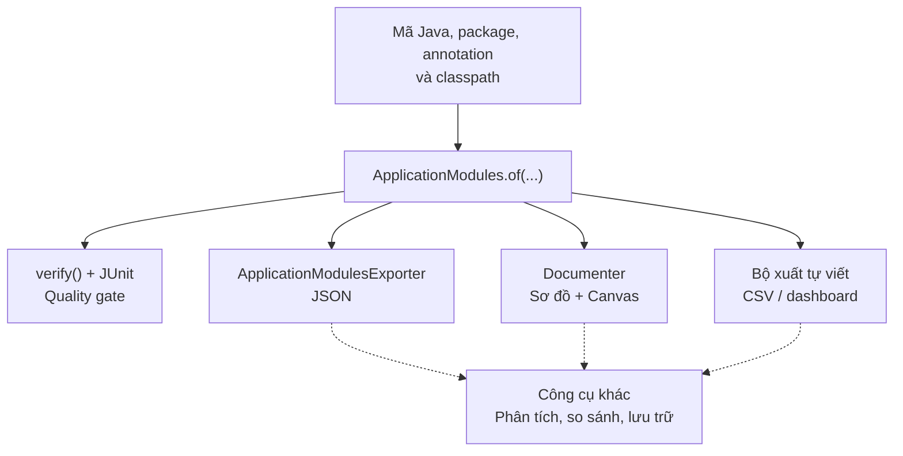
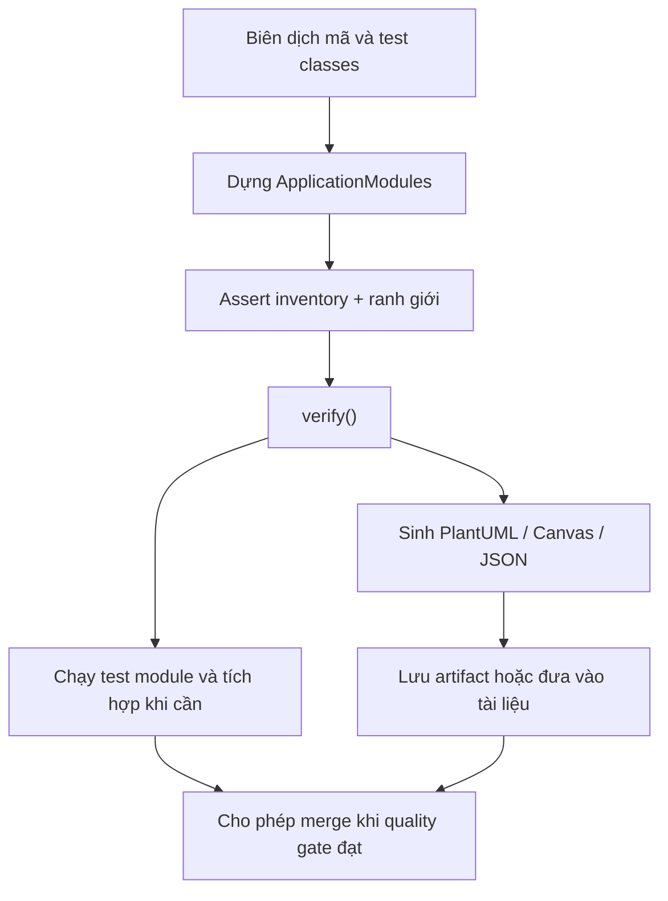

# Dùng mô hình làm đầu vào cho các công cụ khác

## Mục tiêu học tập

Sau bài học, bạn có thể:

1. Xem `ApplicationModules` như một **mô hình kiến trúc dùng chung** cho nhiều công cụ, thay vì chỉ là đối tượng để gọi `verify()`.
2. Chuyển cùng một mô hình vào `Documenter` để tạo sơ đồ và *Application Module Canvas* phục vụ tài liệu thiết kế.
3. Xuất metadata dưới dạng JSON bằng `ApplicationModulesExporter`, đồng thời biết khi nào nên tạo báo cáo riêng từ các API của mô hình.
4. Xây dựng báo cáo dependency có thứ tự ổn định để hệ thống CI, công cụ review hoặc dashboard nội bộ có thể tiêu thụ.
5. Phân biệt việc **xuất tài liệu lúc build/test** với việc **công bố metadata ở runtime** qua Spring Boot Actuator và quan sát tương tác module.
6. Kết hợp tái sử dụng mô hình, kiểm tra danh sách module, `verify()`, `@ApplicationModuleTest` và kiểm thử tích hợp thành quality gate phù hợp.

Bài thuộc chương **ApplicationModules** của lộ trình **SPRING_MODULITH_VERIFICATION_TESTING**. Dịch vụ học tập này tập trung kiểm chứng ranh giới ứng dụng Spring Modulith, kiểm thử module, sự kiện, cơ sở dữ liệu và tích hợp, đồng thời thiết lập quality gate CI ngăn phụ thuộc sai và hồi quy. Ở bài này, ta mở rộng cách dùng mô hình: **phân tích một lần, khai thác cho nhiều đầu ra**, nhưng vẫn phân biệt kết quả phân tích tĩnh với hành vi runtime.

## 1. Ý tưởng: một mô hình, nhiều người tiêu thụ

`ApplicationModules` là biểu diễn của các application module đã được Spring Modulith nhận diện từ lớp/package ứng dụng. Mỗi `ApplicationModule` chứa thông tin về định danh, package nền, API được công bố, kiểu nội bộ và quan hệ phụ thuộc được phân tích.

Từ đó, các nhóm công cụ khác nhau có thể cần những **lát cắt** thông tin khác nhau:

| Người tiêu thụ | Dữ liệu cần lấy từ mô hình | Đầu ra hoặc hành động |
| --- | --- | --- |
| `ApplicationModules.verify()` | Ranh giới và các dependency trong mô hình | Kiểm thử thất bại khi vi phạm quy tắc kiến trúc |
| `Documenter` | Module, dependency, thành phần nổi bật | Sơ đồ PlantUML, Module Canvas, tài liệu tổng hợp |
| `ApplicationModulesExporter` | Metadata các module | JSON để lưu, chuyển hoặc xử lý bằng công cụ khác |
| Báo cáo tự viết | ID, base package, danh sách dependency trực tiếp | CSV, bảng Markdown, dữ liệu cho dashboard |
| Test hợp đồng kiến trúc | Tập module, quyền sở hữu package, các cạnh dependency | Assertion JUnit chạy trong CI |
| Hạ tầng runtime của Spring Modulith | Metadata/module arrangement phù hợp runtime | Actuator, observability và tracing khi cấu hình thêm |



Sơ đồ trên là **luồng dữ liệu ở giai đoạn phân tích/build**. Các tính năng Actuator và observability chạy trong Spring application context cần cấu hình/thành phần runtime riêng; không tự xuất hiện chỉ vì bài test đã tạo `ApplicationModules`.

### Những điều mô hình làm được và không làm được

Mô hình giúp trả lời: “Có những module nào?”, “Ranh giới package nằm ở đâu?”, “Một module biết module nào khác?”, “Những kiểu nào được công bố?”. Nó không tự xác nhận:

- Spring bean sẽ khởi tạo thành công trong môi trường triển khai.
- Repository đã kết nối đúng database hoặc transaction đã commit.
- Sự kiện thực sự được phát, listener xử lý thành công hay có retry đúng.
- Các tương tác thực tế tại runtime có tần suất hoặc độ trễ như thế nào.

Từ mô hình có thể tạo **đồ thị dependency tĩnh**; để có **trace cuộc gọi thật**, phải dùng công cụ observability và chạy ứng dụng.

## 2. Ví dụ xuyên suốt: ứng dụng bán hàng

Ta dùng package gốc `com.example.shop` với ba module nghiệp vụ:

```text
src/main/java/com/example/shop/
├── ShopApplication.java
├── catalog/
│   ├── ProductCatalog.java
│   └── internal/
│       └── ProductService.java
├── orders/
│   ├── OrderPlaced.java
│   └── internal/
│       └── OrderService.java
└── notifications/
    └── internal/
        └── OrderNotificationListener.java
```

Trong đó:

- `catalog` công bố `ProductCatalog` để kiểm tra sản phẩm.
- `orders` sử dụng API này trong quá trình tạo đơn hàng.
- `notifications` lắng nghe sự kiện `OrderPlaced` được công bố bởi `orders`.


Đây là **chiều dependency tĩnh**: module listener tham chiếu kiểu sự kiện trong `orders`, nên có cạnh `notifications → orders`. Việc `orders` phát sự kiện không tự tạo một cạnh ngược tới `notifications`.

Lớp ứng dụng:

```java
// src/main/java/com/example/shop/ShopApplication.java
package com.example.shop;

import org.springframework.boot.SpringApplication;
import org.springframework.boot.autoconfigure.SpringBootApplication;

@SpringBootApplication
public class ShopApplication {

    public static void main(String[] args) {
        SpringApplication.run(ShopApplication.class, args);
    }
}
```

API công khai của `catalog`:

```java
// src/main/java/com/example/shop/catalog/ProductCatalog.java
package com.example.shop.catalog;

public interface ProductCatalog {
    boolean exists(String productId);
}
```

Một service thuộc module `orders`:

```java
// src/main/java/com/example/shop/orders/internal/OrderService.java
package com.example.shop.orders.internal;

import com.example.shop.catalog.ProductCatalog;
import org.springframework.stereotype.Service;

@Service
class OrderService {

    private final ProductCatalog catalog;

    OrderService(ProductCatalog catalog) {
        this.catalog = catalog;
    }

    boolean canOrder(String productId) {
        return catalog.exists(productId);
    }
}
```

Sự kiện của `orders` và listener ở `notifications`:

```java
// src/main/java/com/example/shop/orders/OrderPlaced.java
package com.example.shop.orders;

public record OrderPlaced(String orderId) {}
```

```java
// src/main/java/com/example/shop/notifications/internal/OrderNotificationListener.java
package com.example.shop.notifications.internal;

import com.example.shop.orders.OrderPlaced;
import org.springframework.context.event.EventListener;
import org.springframework.stereotype.Component;

@Component
class OrderNotificationListener {

    @EventListener
    void on(OrderPlaced event) {
        System.out.println("Notifying about " + event.orderId());
    }
}
```

Các lớp trên giúp công cụ phát hiện dependency. Để chạy ứng dụng thật, cần thêm các bean triển khai `ProductCatalog` và luồng tạo/publish `OrderPlaced` tương ứng; ví dụ này **chỉ thiết lập cấu trúc để minh họa mô hình**, không tuyên bố đã cung cấp ứng dụng nghiệp vụ hoàn chỉnh.

## 3. Tạo mô hình một lần và xác minh phạm vi

Trong một bài test JUnit 5:

```java
// src/test/java/com/example/shop/ModuleModelTests.java
package com.example.shop;

import org.junit.jupiter.api.Test;
import org.springframework.modulith.core.ApplicationModules;

class ModuleModelTests {

    private final ApplicationModules modules =
            ApplicationModules.of(ShopApplication.class);

    @Test
    void inspectModules() {
        modules.stream()
                .map(module -> module.getIdentifier().toString())
                .sorted()
                .forEach(System.out::println);
    }
}
```

Với cách phát hiện module mặc định, đầu ra mong đợi:

```text
catalog
notifications
orders
```

Việc gắn `ApplicationModules` vào một field cho phép các test trong cùng lớp **tái sử dụng một đối tượng mô hình**. Nếu nhiều lớp test hoặc công cụ dùng mô hình, có thể tạo nó tại một phương thức factory chung trong test sources; điều quan trọng là **mọi công cụ sử dụng cùng root, classpath và chiến lược phát hiện**, không phải buộc chúng phải chia sẻ cùng object trong bộ nhớ.

`ApplicationModules.of(...)` không khởi động Spring application context. Vì vậy, việc kiểm tra module inventory và xuất sơ đồ/JSON từ mô hình có thể chạy như bài test cấu trúc, không cần `@SpringBootTest`.

### Bảo vệ phạm vi trước khi xuất dữ liệu

Không nên đưa một mô hình chỉ có hai module vào dashboard khi thiết kế yêu cầu ba. Hãy viết assertion kiểm tra input:

```java
import static org.junit.jupiter.api.Assertions.assertEquals;

import java.util.Set;
import java.util.stream.Collectors;

@Test
void moduleInventoryMustBeComplete() {
    Set<String> actual = modules.stream()
            .map(module -> module.getIdentifier().toString())
            .collect(Collectors.toSet());

    assertEquals(Set.of("catalog", "orders", "notifications"), actual);
}
```

Đoạn code trên là phương thức test bổ sung trong `ModuleModelTests`. Nó dùng chính field `modules` đã khởi tạo ở trên. Chỉ khóa toàn bộ tập định danh khi nhóm đã thống nhất danh sách module; nếu hệ thống thường xuyên thêm module hợp lệ, kiểm tra tập module bắt buộc sẽ phù hợp hơn.

**Thứ tự triển khai nên là:** xác định root và inventory → xác minh ranh giới → tạo tài liệu/xuất dữ liệu. Một đầu ra đẹp không có giá trị nếu mô hình được dựng từ package gốc sai hoặc đã loại trừ mất phần nghiệp vụ cần kiểm tra.

## 4. Đưa `ApplicationModules` vào `Documenter`

`org.springframework.modulith.docs.Documenter` là công cụ Spring Modulith dùng trực tiếp mô hình để sinh tài liệu kiến trúc. Đây là ví dụ rõ nhất của mẫu thiết kế **model as input**:

```java
// src/test/java/com/example/shop/ModuleDocumentationTests.java
package com.example.shop;

import org.junit.jupiter.api.Test;
import org.springframework.modulith.core.ApplicationModules;
import org.springframework.modulith.docs.Documenter;

class ModuleDocumentationTests {

    @Test
    void generateModuleDocumentation() {
        ApplicationModules modules =
                ApplicationModules.of(ShopApplication.class);

        modules.verify();

        new Documenter(modules)
                .writeModulesAsPlantUml()
                .writeIndividualModulesAsPlantUml()
                .writeModuleCanvases();
    }
}
```

Quan sát ba tác vụ:

| Phương thức của `Documenter` | Đầu ra |
| --- | --- |
| `writeModulesAsPlantUml()` | Sơ đồ tổng quan và quan hệ giữa các application module |
| `writeIndividualModulesAsPlantUml()` | Sơ đồ riêng cho từng module với các quan hệ liên quan |
| `writeModuleCanvases()` | Bảng *Application Module Canvas*: base package, Spring components, aggregate roots, sự kiện, cấu hình... tùy metadata được nhận diện |

Theo mặc định, file tài liệu được sinh vào thư mục `spring-modulith-docs` bên trong **thư mục output của công cụ build** (ví dụ `target/spring-modulith-docs` với Maven). Vị trí thực tế phụ thuộc build tool và cấu hình `Documenter`.

`Documenter` thường được đặt ở **test scope** qua artifact `spring-modulith-docs` hoặc starter test phù hợp; không cần đưa vào production chỉ để sinh sơ đồ trong CI. Ví dụ khai báo Gradle khi dự án đã quản lý phiên bản Spring Modulith qua BOM:

```groovy
dependencies {
    testImplementation 'org.springframework.boot:spring-boot-starter-test'
    testImplementation 'org.springframework.modulith:spring-modulith-starter-test'
}
```

Starter test của Spring Modulith bao gồm công cụ test và `spring-modulith-docs` ở những phiên bản hỗ trợ cấu trúc starter tương ứng. Nếu chỉ dùng riêng `Documenter`, dự án có thể phụ thuộc trực tiếp vào `org.springframework.modulith:spring-modulith-docs` ở test scope. Không tự trộn các phiên bản Spring Boot/Spring Modulith không tương thích; chọn BOM theo bộ phiên bản dự án.

### Tùy chọn kiểu sơ đồ

Nếu nhóm muốn xuất sơ đồ UML thay vì phụ thuộc vào kiểu mặc định của phiên bản:

```java
import org.springframework.modulith.docs.Documenter;
import org.springframework.modulith.docs.Documenter.DiagramOptions;
import org.springframework.modulith.docs.Documenter.DiagramOptions.DiagramStyle;

ApplicationModules modules =
        ApplicationModules.of(ShopApplication.class);

new Documenter(modules).writeModulesAsPlantUml(
        DiagramOptions.defaults().withStyle(DiagramStyle.UML));
```

Với nhu cầu hiển thị theo kiểu C4, có thể chọn `DiagramStyle.C4`. Hãy chọn cấu hình **rõ ràng** nếu nhóm cần tài liệu nhất quán qua các lần cập nhật Spring Modulith.

### Chỉ sinh sơ đồ cho một module

```java
ApplicationModules modules =
        ApplicationModules.of(ShopApplication.class);

var orders = modules.getModuleByName("orders").orElseThrow();

new Documenter(modules).writeModuleAsPlantUml(orders);
```

Phương thức này phù hợp khi nhóm cần một sơ đồ ngắn để review riêng thay đổi của module `orders`, thay vì sinh lại toàn bộ tài liệu để đọc thủ công.

### Tài liệu sinh ra có nghĩa gì?

Một sơ đồ được sinh từ mô hình giúp người đọc nhìn thấy **dependency mà bộ phân tích phát hiện**. Nó không phải một trace của những lời gọi đã xảy ra ở runtime. Application Module Canvas cũng được tạo từ các dấu hiệu/framework metadata, nên những dữ liệu như sự kiện công bố, aggregate root hoặc configuration properties có thể phụ thuộc cách mã được gắn annotation và cách dự án cung cấp metadata.

Không nên khẳng định “không có sự kiện” chỉ vì canvas không liệt kê kiểu sự kiện chưa được nhận diện theo quy ước mà Documenter hỗ trợ.

## 5. Xuất metadata JSON bằng `ApplicationModulesExporter`

Khi công cụ nhận dữ liệu là một chương trình khác, JSON thường dễ tích hợp hơn văn bản `toString()`. Spring Modulith cung cấp:

```java
org.springframework.modulith.core.util.ApplicationModulesExporter
```

Để tạo JSON từ mô hình:

```java
package com.example.shop;

import org.junit.jupiter.api.Test;
import org.springframework.modulith.core.ApplicationModules;
import org.springframework.modulith.core.util.ApplicationModulesExporter;

class ModuleJsonExportTests {

    @Test
    void exportModuleModelAsJson() {
        ApplicationModules modules =
                ApplicationModules.of(ShopApplication.class);

        ApplicationModulesExporter exporter =
                new ApplicationModulesExporter(modules);

        String json = exporter.toJson();
        String detailedJson = exporter.toFullJson();

        System.out.println(json);
        System.out.println("Detailed payload length: "
                + detailedJson.length());
    }
}
```

`toJson()` xuất mô hình module dạng JSON cơ bản; `toFullJson()` chứa thêm chi tiết như named interfaces. Đây là **chuỗi JSON** chứ không tự ghi một file vào đích tùy ý. Nếu cần tạo file, code test hoặc task build phải ghi chuỗi ra vị trí được cấu hình.

Ví dụ ghi payload đầy đủ vào một thư mục output được truyền từ bên ngoài:

```java
import static java.nio.charset.StandardCharsets.UTF_8;

import java.io.IOException;
import java.nio.file.Files;
import java.nio.file.Path;
import org.springframework.modulith.core.ApplicationModules;
import org.springframework.modulith.core.util.ApplicationModulesExporter;

static void writeJsonReport(
        ApplicationModules modules, Path output) throws IOException {

    Path parent = output.toAbsolutePath().getParent();
    Files.createDirectories(parent);

    String payload = new ApplicationModulesExporter(modules)
            .toFullJson();

    Files.writeString(output, payload, UTF_8);
}
```

Đây là một **helper** để đặt trong lớp hỗ trợ test hoặc tool xuất báo cáo, không phải API có sẵn tên `writeJsonReport` của Spring Modulith. Khi chạy build, hãy truyền một `Path` nằm trong thư mục báo cáo/artifact của Gradle hoặc Maven.

### Tại sao không dùng JSON nguyên vẹn làm snapshot vàng?

JSON của exporter là hợp đồng theo **phiên bản thư viện**, không nhất thiết là schema ổn định vĩnh viễn cho mọi công cụ nội bộ. Mỗi lần nâng cấp framework, tên trường hoặc mức chi tiết có thể thay đổi.

Nếu chỉ cần bảo vệ kiến trúc, ưu tiên **assertion trực tiếp lên API** (tập module, package, cạnh dependency), thay vì so sánh toàn bộ JSON dạng text. Nếu dịch vụ ngoài cần dựa lâu dài vào JSON, hãy có tầng adapter, version schema và kiểm thử hợp đồng của **format do nhóm tự quản lý**.

## 6. Viết adapter riêng: báo cáo cạnh dependency dạng CSV

Ví dụ nhóm muốn nạp các cạnh module vào dashboard hoặc hệ thống phân tích đồ thị. Không cần bóc tách `toString()`: có thể chuyển trực tiếp API mô hình thành danh sách `source,target`.

```java
// src/test/java/com/example/shop/ModuleDependencyCsvTests.java
package com.example.shop;

import java.util.List;
import java.util.stream.Stream;

import org.junit.jupiter.api.Test;
import org.springframework.modulith.core.ApplicationModules;

class ModuleDependencyCsvTests {

    @Test
    void printDirectDependenciesAsCsv() {
        ApplicationModules modules =
                ApplicationModules.of(ShopApplication.class);

        List<String> rows = modules.stream()
                .flatMap(source -> source.getDirectDependencies(modules)
                        .uniqueModules()
                        .map(target -> source.getIdentifier() + ","
                                + target.getIdentifier()))
                .sorted()
                .toList();

        Stream.concat(Stream.of("source,target"), rows.stream())
                .forEach(System.out::println);
    }
}
```

Với ví dụ ở mục 2, báo cáo dự kiến:

```csv
source,target
notifications,orders
orders,catalog
```

Giải thích:

1. `modules.stream()` duyệt **module nguồn**.
2. `getDirectDependencies(modules)` lấy quan hệ **trực tiếp**, không lẫn đường bắc cầu.
3. `uniqueModules()` loại trùng module đích khi có nhiều tham chiếu Java cùng đích.
4. `sorted()` tạo thứ tự ổn định cho báo cáo hoặc diff.
5. `Stream.concat(...)` thêm dòng header trước khi in.

Mẫu này dùng tên định danh module làm giá trị CSV; nếu xuất **display name** hoặc văn bản tự do có dấu phẩy, dấu nháy hoặc xuống dòng, phải dùng thư viện CSV thực hiện escape đúng chuẩn. Không mở rộng cách nối chuỗi trên thành bộ xuất CSV tổng quát không có quy tắc escape.

### Báo cáo cả module không có dependency

CSV cạnh không hiển thị module không có cạnh đi ra hoặc đi vào, ví dụ `catalog` trong kịch bản đơn giản. Nếu một công cụ cần dựng **đồ thị đầy đủ**, nên xuất hai tập dữ liệu riêng:

| Tập dữ liệu | Các cột | Ý nghĩa |
| --- | --- | --- |
| `modules.csv` | `id,basePackage` | Mọi node, kể cả node cô lập |
| `dependencies.csv` | `source,target` | Các cạnh trực tiếp giữa các node |

Ví dụ lấy node:

```java
ApplicationModules modules =
        ApplicationModules.of(ShopApplication.class);

modules.stream()
        .sorted(java.util.Comparator.comparing(
                module -> module.getIdentifier().toString()))
        .forEach(module -> System.out.printf(
                "%s,%s%n",
                module.getIdentifier(),
                module.getBasePackage().getName()));
```

Với định danh và package Java ở ví dụ, cách nối chuỗi là đủ để minh họa. Dữ liệu có trường mở rộng phải được mã hóa/escape theo format đầu ra đã chọn.

### Đừng suy luận độ chặt từ số cạnh

Một hệ thống có ít cạnh chưa chắc kiến trúc tốt, vì có thể:

- Nhiều trách nhiệm không liên quan bị gộp trong cùng một module.
- Một cạnh module che nhiều tham chiếu kiểu Java khác nhau.
- Các phần mã quan trọng bị bỏ ngoài phạm vi phân tích.

Đồ thị làm nổi bật các quan hệ tĩnh, nhưng không thay thế việc xem cohesion, quyền sở hữu dữ liệu và luồng nghiệp vụ.

## 7. Dùng mô hình để tạo quality gate trong JUnit/CI

Đầu ra cho tài liệu, JSON và CSV giúp **quan sát**. Để ngăn hồi quy, cần chuyển mong đợi thành assertion không phụ thuộc format của công cụ xuất.

```java
// src/test/java/com/example/shop/ModuleArchitectureGateTests.java
package com.example.shop;

import static org.junit.jupiter.api.Assertions.assertEquals;
import static org.junit.jupiter.api.Assertions.assertFalse;

import java.util.Set;
import java.util.stream.Collectors;

import org.junit.jupiter.api.Test;
import org.springframework.modulith.core.ApplicationModules;

class ModuleArchitectureGateTests {

    private final ApplicationModules modules =
            ApplicationModules.of(ShopApplication.class);

    @Test
    void inventoryIsComplete() {
        Set<String> discovered = modules.stream()
                .map(module -> module.getIdentifier().toString())
                .collect(Collectors.toSet());

        assertEquals(Set.of("catalog", "orders", "notifications"),
                discovered);
    }

    @Test
    void ordersOnlyDependsDirectlyOnCatalog() {
        var orders = modules.getModuleByName("orders").orElseThrow();

        Set<String> targets = orders.getDirectDependencies(modules)
                .uniqueModules()
                .map(module -> module.getIdentifier().toString())
                .collect(Collectors.toSet());

        assertEquals(Set.of("catalog"), targets);
        assertFalse(targets.contains("notifications"));
    }

    @Test
    void verifyArchitectureRules() {
        modules.verify();
    }
}
```

Bài test kiểm tra ba lớp kỳ vọng:

| Assertion | Mục tiêu | Vì sao cần |
| --- | --- | --- |
| Tập định danh | Dùng **đúng mô hình** để xuất dữ liệu | Nếu phạm vi quét sai, sơ đồ/JSON cũng sai |
| Danh sách dependency riêng của `orders` | Không phát sinh cạnh ngoài thiết kế | Một dependency có thể hợp lệ theo mặc định nhưng không đúng hợp đồng nhóm |
| `verify()` | Không vi phạm các ranh giới kiến trúc được Spring Modulith kiểm chứng | Phát hiện vòng, truy cập trái phép vào nội bộ, `allowedDependencies` |

Ở dự án lớn, tránh khóa cả đồ thị bằng những assertion quá giòn. Chỉ chặn những module và cạnh mà nhóm đã thống nhất là **hợp đồng kiến trúc**, còn tài liệu sinh ra được dùng để thảo luận những thay đổi hợp lệ khác.

### Thứ tự thực hiện trong pipeline



Một ví dụ JUnit kết hợp các bước trong một test:

```java
package com.example.shop;

import org.junit.jupiter.api.Test;
import org.springframework.modulith.core.ApplicationModules;
import org.springframework.modulith.docs.Documenter;

class ModuleDocumentationGateTests {

    @Test
    void verifiedModelProducesDocumentation() {
        ApplicationModules modules =
                ApplicationModules.of(ShopApplication.class);

        modules.verify();

        new Documenter(modules)
                .writeModulesAsPlantUml()
                .writeModuleCanvases();
    }
}
```

Tác vụ tạo tài liệu chạy **sau** bước xác minh trong test này. Nếu `verify()` thất bại, test dừng trước khi tạo artifact của lần chạy đó. Trong dự án nhiều test song song, cũng cần cấu hình output tách biệt hoặc thứ tự task phù hợp để tránh ghi đè artifact của nhau.

### Chạy qua build tool

Trong dự án đã cấu hình phụ thuộc tương thích và JUnit:

```bash
./gradlew test
```

Hoặc:

```bash
./mvnw test
```

Sau đó cấu hình CI lưu **thư mục output thực tế** của `Documenter` và các báo cáo tự viết như một build artifact. Việc sinh file trong build directory **không đồng nghĩa** hệ thống CI tự động đính kèm file vào báo cáo: đó là việc của pipeline.

Đừng dùng tên file, thứ tự module ngẫu nhiên hoặc snapshot toàn bộ JSON làm tín hiệu thành công duy nhất. Tín hiệu chất lượng chính phải là kết quả assertion và các test đã chạy.

## 8. Khi công cụ khác cần cấu trúc module ở runtime

Những ví dụ trước tạo `ApplicationModules` trong bài test hoặc lúc build. Với hệ thống vận hành, Spring Modulith còn có các thành phần riêng để tiêu thụ thông tin module.

### Spring Boot Actuator: endpoint `modulith`

Khi ứng dụng có `spring-modulith-actuator` và Spring Boot Actuator được cấu hình, có thể cung cấp metadata module qua endpoint:

```http
GET /actuator/modulith
```

Metadata trả về biểu diễn các module, base package, tên hiển thị và dependency dưới dạng dữ liệu phù hợp cho hệ thống quản trị/quan sát, tùy phiên bản và cấu hình.

Nếu dự án đã quản lý phiên bản qua BOM, một cách khai báo trong Gradle là:

```groovy
dependencies {
    runtimeOnly 'org.springframework.boot:spring-boot-starter-actuator'
    runtimeOnly 'org.springframework.modulith:spring-modulith-actuator'
}
```

Có thể dùng `spring-modulith-starter-insight` để lấy các thành phần Actuator và observability phù hợp cùng nhau khi version của dự án hỗ trợ starter đó. Cần cấu hình Spring Boot management endpoints, quyền truy cập và hạ tầng giám sát theo chính sách triển khai.

**Bảo mật:** Không mở public endpoint mô tả package nội bộ, tên module và sơ đồ dependency chỉ để tiện debug. Metadata kiến trúc có thể tiết lộ cấu trúc hệ thống; khi cần truy cập, bảo vệ bằng mạng nội bộ, xác thực và phân quyền phù hợp.

### Observability không chỉ là một bản xuất JSON

Spring Modulith observability có thể gắn thông tin module vào **span/trace và metric** của tương tác thực tế. Để thấy trace trong công cụ như Zipkin hoặc Grafana, cần runtime instrumentation và hạ tầng telemetry tương ứng.

So sánh:

| Phương án | Dữ liệu mang tính gì? | Khi nào sử dụng |
| --- | --- | --- |
| `Documenter` | Cấu trúc kiến trúc **tĩnh** trong mã tại build/test | Tài liệu thiết kế, code review |
| `ApplicationModulesExporter` | Metadata mô hình **tĩnh** dạng JSON | Truyền dữ liệu cho công cụ khác |
| Actuator `/actuator/modulith` | Metadata module của ứng dụng khi chạy | Tra cứu kiến trúc tại môi trường runtime đã bảo vệ |
| Spring Modulith observability | Tương tác **được quan sát khi chạy** | Theo dõi trace/metric giữa module, phân tích vận hành |
| `@ApplicationModuleTest` và integration test | Hành vi đã được thực thi trong môi trường test | Kiểm chứng bean, sự kiện, database, transaction |

**Đừng trộn lẫn:** Một dependency xuất hiện trong sơ đồ tĩnh không chứng minh lời gọi đó đã được thực hiện. Ngược lại, một module có ít lời gọi trong trace không chứng minh dependency tĩnh đã hợp lệ.

### Metadata sinh khi build và metadata runtime

Ở những phiên bản Spring Modulith hỗ trợ (chẳng hạn **1.4+**), `Documenter.writeModuleMetadata()` có thể sinh metadata để đóng gói/phục vụ các tính năng runtime.

```java
ApplicationModules modules =
        ApplicationModules.of(ShopApplication.class);

new Documenter(modules).writeModuleMetadata();
```

Thao tác này tạo file trong **vùng output của quá trình build**, không có nghĩa file đã tự nằm trong artifact triển khai. Nếu sử dụng cách cung cấp metadata có sẵn để giảm việc phân tích lại khi khởi động, cần đảm bảo quy trình build thực sự đóng gói resource vào classpath ở vị trí tương thích với Spring Modulith và kiểm tra sự tương ứng với mã được triển khai.

Với dự án chưa có nhu cầu preload metadata ở runtime, không cần thêm bước sinh metadata này chỉ để hoàn thành báo cáo tài liệu. Cũng không nên nhầm `writeModuleMetadata()` với `ApplicationModulesExporter.toFullJson()`: một bên hướng đến file metadata cho build/runtime, bên kia trả về chuỗi JSON để caller tự xử lý.

## 9. Bốn lỗi tích hợp phổ biến

### Lỗi A — Các công cụ tạo mô hình từ hai root khác nhau

```java
// Tool tài liệu
ApplicationModules docsModel =
        ApplicationModules.of(ShopApplication.class);

// Tool thống kê tự viết
ApplicationModules reportModel =
        ApplicationModules.of("com.example.shop.orders");
```

Nếu dùng package `orders` làm điểm bắt đầu cho tool thống kê, số module và các cạnh có thể khác đáng kể so với mô hình toàn ứng dụng. **Không thể so sánh trực tiếp hai output** rồi kết luận một trong hai công cụ bị lỗi.

Giải pháp: định nghĩa một nguồn khởi tạo chung (ví dụ luôn từ `ShopApplication.class`) và test inventory ở mọi pipeline quan trọng.

### Lỗi B — Chỉ so sánh số module

Hai mô hình đều có ba module nhưng định danh khác nhau:

```text
Model A: catalog, orders, notifications
Model B: catalog, orders, shared
```

Số module bằng nhau không bảo vệ việc `notifications` biến mất. So sánh **tập định danh** hoặc ánh xạ ID → base package khi đó là hợp đồng được phê duyệt.

### Lỗi C — Dashboard chỉ lấy cạnh, quên node cô lập

Một module chưa tham chiếu module nào và chưa có module khác dùng nó có thể không có dòng nào trong `dependencies.csv`. Nếu chỉ nhập CSV cạnh, dashboard có thể làm biến mất module đó.

Hãy xuất **module inventory** riêng, rồi ghép các cạnh với tập module đã được phát hiện. Điều này giúp phân biệt một node không có dependency với một node chưa được quét.

### Lỗi D — Giả định tài liệu/metadata là kết quả test hành vi

Sơ đồ có module `orders` và `notifications`, kể cả với mũi tên sự kiện, không chứng minh listener nhận được sự kiện trong transaction thực. JSON exporter cũng không thể xác minh trạng thái cơ sở dữ liệu.

Khi có luồng sự kiện, bổ sung `@ApplicationModuleTest` và assertion về sự kiện hoặc test tích hợp; khi có repository và transaction, dùng test database với môi trường phù hợp.

### Bảng chẩn đoán nhanh

| Triệu chứng | Nguồn gốc có thể | Việc cần làm |
| --- | --- | --- |
| Documenter thiếu module | Root, classpath, detection strategy hoặc filter sai | In inventory từ đúng `ApplicationModules` |
| JSON và sơ đồ không cùng số module | Hai consumer dựng hai model khác nhau | Dùng chung cấu hình khởi tạo và assert inventory |
| Sơ đồ có cạnh ngoài dự kiến | Code tạo dependency mới | Xem `getDirectDependencies(modules)` và chạy `verify()` |
| Tệp không xuất hiện trong CI artifact | Pipeline không thu gom output directory | Cấu hình upload/publish artifact theo build tool |
| `/actuator/modulith` không khả dụng | Thiếu runtime dependencies hoặc endpoint exposure/config | Kiểm tra Actuator, security và cấu hình runtime |
| Dashboard thiếu module độc lập | Chỉ nhập danh sách cạnh | Xuất thêm tập node từ `modules.stream()` |
| Tài liệu đúng nhưng Spring context lỗi | Mô hình tĩnh không khởi động runtime | Dùng `@ApplicationModuleTest`/integration tests |
| Sau upgrade định dạng JSON thay đổi | Tool phụ thuộc schema bên trong framework | Có adapter/schema version và contract test riêng |

## 10. Bài thực hành: xây pipeline tài liệu và quality gate

**Bối cảnh:** Nhóm phát triển cần vừa kiểm tra kiến trúc của `catalog`, `orders`, `notifications`, vừa cung cấp sơ đồ và dữ liệu cho tài liệu nội bộ. Kỹ thuật viên CI muốn một đầu ra ổn định và không bị sai phạm vi khi có refactor package.

**Các bước thực hiện:**

1. Tạo cây package và những kiểu Java ở mục 2, bảo đảm `ShopApplication` nằm tại `com.example.shop`.
2. Tạo một field `ApplicationModules modules = ApplicationModules.of(ShopApplication.class)` trong lớp test kiến trúc và in ID module theo thứ tự tăng dần.
3. Viết assertion cho tập `catalog`, `orders`, `notifications`; thêm `modules.verify()`.
4. Truyền **cùng mô hình** vào `Documenter`, sinh sơ đồ tổng quan và canvas, quan sát các phần được thể hiện.
5. Dùng `ApplicationModulesExporter(modules).toJson()` và `toFullJson()` để so sánh mức độ chi tiết, tránh hard-code cả JSON vào assertion.
6. Xây bộ xuất CSV hai phần: danh sách node (`id,basePackage`) và cạnh (`source,target`), sắp xếp trước khi xuất.
7. Trong nhánh thử nghiệm, đổi một package hoặc tạo dependency mới; quan sát những đầu ra thay đổi, rồi để assertion/`verify()` phát hiện vi phạm đã xác định.
8. Trong pipeline, thu gom thư mục `spring-modulith-docs` và các báo cáo được sinh; kiểm tra artifact có thực sự được đính kèm khi build thành công.
9. Khi có luồng `OrderPlaced` và xử lý database thực, viết `@ApplicationModuleTest` hoặc integration test chứng minh publish/consume sự kiện và trạng thái transaction đúng; không lấy việc sinh sơ đồ thành công làm bằng chứng runtime.

**Tiêu chí hoàn thành:**

- Biết tạo và chia sẻ một `ApplicationModules` tới ít nhất hai consumer khác nhau.
- Phân biệt sơ đồ/JSON/CSV với assertion JUnit và `verify()`.
- Xuất dữ liệu ổn định, giữ được các module không có dependency.
- Chỉ ra được những điều cần cấu hình riêng khi muốn đưa metadata vào Actuator hoặc hệ thống observability.
- Có quality gate CI ngăn hồi quy về phạm vi mô hình và phụ thuộc sai, song song với test runtime khi cần.

## 11. Câu hỏi tự kiểm tra

1. Vì sao nên kiểm tra inventory module trước khi truyền `ApplicationModules` vào `Documenter` hoặc `ApplicationModulesExporter`?
2. `Documenter.writeModuleCanvases()` và `Documenter.writeModulesAsPlantUml()` phục vụ hai nhu cầu khác nhau như thế nào?
3. Tại sao không nên dùng `modules.toString()` làm format tích hợp lâu dài cho một công cụ bên ngoài?
4. `toJson()` và `toFullJson()` khác nhau ở điểm nào? Vì sao cần version schema/adapter nếu dashboard phụ thuộc lâu dài vào output?
5. Vì sao một CSV chỉ chứa cột `source,target` có thể làm mất thông tin module không có cạnh?
6. Có thể coi một sơ đồ có `notifications → orders` là bằng chứng rằng listener của `OrderPlaced` đã chạy thành công không?
7. Sự khác biệt giữa `Documenter.writeModuleMetadata()`, endpoint `/actuator/modulith` và runtime observability là gì?
8. Nếu sơ đồ, JSON và JUnit report chỉ có hai module thay vì ba, nên điều tra thành phần **đầu vào nào** trước tiên?
9. Vì sao `verify()` vẫn cần kết hợp `@ApplicationModuleTest` và test database/sự kiện cho một hệ thống thực?

## Tổng kết

`ApplicationModules` không chỉ là đối tượng để gọi `verify()`: nó là **nguồn dữ liệu kiến trúc chung** có thể truyền trực tiếp cho `Documenter`, `ApplicationModulesExporter`, bộ xuất báo cáo tùy chỉnh và các bài kiểm thử JUnit. Hãy xây mô hình từ đúng root, **assert inventory trước**, dùng API có cấu trúc để tạo sơ đồ, JSON/CSV và quality gate, rồi quản lý các artifact được sinh trong CI. Khi cần quan sát runtime, dùng thành phần Actuator/observability phù hợp và bảo vệ quyền truy cập. Mọi đầu ra từ mô hình tĩnh vẫn cần được bổ sung bằng `@ApplicationModuleTest`, kiểm thử sự kiện, cơ sở dữ liệu và tích hợp để xác nhận hành vi hệ thống.

### Tài liệu tham khảo

- [Spring Modulith — Documenting Application Modules](https://docs.spring.io/spring-modulith/reference/documentation.html)
- [Spring Modulith — ApplicationModules API](https://docs.spring.io/spring-modulith/docs/current/api/org/springframework/modulith/core/ApplicationModules.html)
- [Spring Modulith — Documenter API](https://docs.spring.io/spring-modulith/docs/current/api/org/springframework/modulith/docs/Documenter.html)
- [Spring Modulith — ApplicationModulesExporter API](https://docs.spring.io/spring-modulith/docs/current/api/org/springframework/modulith/core/util/ApplicationModulesExporter.html)
- [Spring Modulith — Production-ready Features](https://docs.spring.io/spring-modulith/reference/production-ready.html)
- [Spring Modulith — Verification](https://docs.spring.io/spring-modulith/reference/verification.html)
- [Spring Modulith — Testing Application Modules](https://docs.spring.io/spring-modulith/reference/testing.html)
