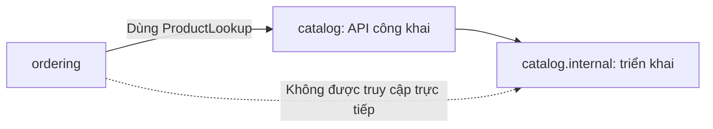
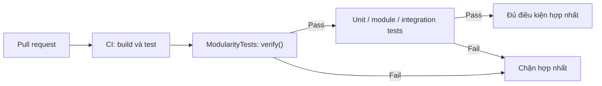

# Mục đích của `ApplicationModules.verify()` trong Spring Modulith

## 1. Vì sao cần kiểm chứng ranh giới module?

Trong ứng dụng Spring Boot lớn, việc chia mã nguồn thành các package như `ordering`, `catalog`, `payment` mới chỉ thể hiện **ý định thiết kế**. Nếu một lớp của `ordering` trực tiếp gọi repository nội bộ của `catalog`, hoặc hai module tham chiếu qua lại, hệ thống vẫn có thể biên dịch và chạy. Tuy nhiên, các module đã bị ghép chặt: thay đổi cách lưu dữ liệu ở `catalog` có thể làm hỏng `ordering`, và việc kiểm thử, phát triển độc lập ngày càng khó.

**`ApplicationModules.verify()` là phép kiểm tra kiến trúc của Spring Modulith** nhằm phát hiện những phụ thuộc trái với ranh giới module đã khai báo. Ta có thể đặt phép kiểm tra này trong một bài kiểm thử JUnit để phát hiện lỗi ngay khi lập trình viên chạy test hoặc khi CI kiểm tra pull request.

Mục tiêu của bài học:

- Hiểu `verify()` kiểm tra **cấu trúc và quan hệ phụ thuộc** giữa các application module để bảo vệ tính module hóa.
- Biết cách tạo bài test dùng `ApplicationModules` và đọc ý nghĩa của một lần kiểm chứng thất bại.
- Phân biệt kiểm chứng kiến trúc với kiểm thử hành vi bằng `@ApplicationModuleTest`, kiểm thử sự kiện, cơ sở dữ liệu và tích hợp.
- Biết cách biến kiểm chứng kiến trúc thành **quality gate** trong CI để ngăn phụ thuộc sai và hồi quy.

## 2. `ApplicationModules` đại diện cho điều gì?

Spring Modulith nhận diện các **application module** từ cấu trúc package của ứng dụng (mặc định là các package con trực tiếp của package gốc; có thể cấu hình cách nhận diện khác). Đối tượng `ApplicationModules` là mô hình các module được phát hiện và các quan hệ phụ thuộc giữa chúng.

Ví dụ về cấu trúc ứng dụng:

```text
com.example.shop
├── ShopApplication.java
├── catalog
│   ├── ProductLookup.java              # API công khai của module catalog
│   └── internal
│       └── JpaProductRepository.java    # Triển khai nội bộ
├── ordering
│   ├── OrderService.java
│   └── internal
│       └── OrderRepository.java
└── payment
    └── PaymentService.java
```

Với quy ước mặc định, `catalog`, `ordering` và `payment` là ba application module. Các kiểu nằm trực tiếp trong package gốc của module, chẳng hạn `com.example.shop.catalog.ProductLookup`, thuộc giao diện có thể được module khác sử dụng. Các kiểu trong package con như `catalog.internal` được xem là **nội bộ**, kể cả khi lớp Java có từ khóa `public`. Khi cần công khai API nằm trong một package con, có thể khai báo **named interface** bằng `@NamedInterface` thay vì mặc nhiên mở toàn bộ nội bộ.

Ví dụ về ranh giới mong muốn:



Mũi tên liền biểu thị quan hệ hợp lệ được thiết kế. Mũi tên nét đứt biểu thị kiểu truy cập vượt qua ranh giới cần phát hiện.

## 3. Gọi `verify()` trong một bài kiểm thử

Tạo bài test trong phần test source của ứng dụng, sử dụng Spring Modulith và JUnit Jupiter:

```java
package com.example.shop;

import org.junit.jupiter.api.Test;
import org.springframework.modulith.core.ApplicationModules;

class ModularityTests {

    @Test
    void verifiesArchitecture() {
        ApplicationModules modules = ApplicationModules.of(ShopApplication.class);
        modules.verify();
    }
}
```

`ApplicationModules.of(ShopApplication.class)` xây dựng mô hình các module dựa trên ứng dụng có lớp gốc `ShopApplication`. Lời gọi `verify()` kiểm tra các quy tắc kiến trúc trên mô hình đó. Nếu phát hiện vi phạm, phép kiểm tra báo lỗi và JUnit đánh dấu test **failed**; nếu không có vi phạm được phát hiện, test **passed**.

Đây là phép kiểm tra quan hệ phụ thuộc ở mức cấu trúc mã nguồn/bytecode. **Không cần khởi động toàn bộ Spring application context hay kết nối cơ sở dữ liệu** chỉ để chạy phép kiểm chứng này. Dự án cần khai báo các dependency Spring Modulith phù hợp với phiên bản Spring Boot và có framework test để chạy JUnit.

## 4. `verify()` bảo vệ những quy tắc nào?

| Quy tắc | Ví dụ vi phạm | Điều muốn bảo vệ |
| --- | --- | --- |
| **Không có vòng phụ thuộc giữa các module** | `ordering → payment → ordering` | Duy trì hướng phụ thuộc rõ ràng, tránh các module phải thay đổi cùng nhau. |
| **Chỉ truy cập API được công khai của module khác** | `ordering` tham chiếu `catalog.internal.JpaProductRepository` | Giấu chi tiết triển khai, cho phép module sở hữu tự thay đổi nội bộ. |
| **Tuân thủ giới hạn phụ thuộc đã khai báo** | `ordering` chỉ được phụ thuộc `catalog`, nhưng lại tham chiếu `payment` | Buộc mã nguồn tuân theo kiến trúc đã thống nhất. |

Ngoài các kiểm tra nền tảng trên, một số quy tắc kiến trúc bổ sung có thể được áp dụng khi dự án tích hợp công cụ như jMolecules/ArchUnit tương ứng. Vì vậy, tập quy tắc cụ thể còn phụ thuộc vào cấu hình và phiên bản thư viện đang dùng.

### 4.1. Phát hiện vòng phụ thuộc

Giả sử `ordering.OrderService` sử dụng `payment.PaymentService`, đồng thời `payment.PaymentService` lại sử dụng một kiểu thuộc module `ordering`. Khi đó xuất hiện vòng `ordering → payment → ordering`. Dù mã nguồn biên dịch được, vòng phụ thuộc làm mờ trách nhiệm và cản trở khả năng tách hoặc kiểm thử module độc lập. `verify()` phát hiện vòng ở cấp **application module**.

Cách xử lý nên bắt đầu từ trách nhiệm nghiệp vụ: chuyển hợp đồng dùng chung về module phù hợp, đảo chiều phụ thuộc thông qua giao diện, hoặc trao đổi bằng sự kiện nếu đúng với luồng nghiệp vụ. Không nên di chuyển lớp tùy tiện chỉ để test chuyển sang màu xanh.

### 4.2. Chặn tham chiếu đến chi tiết nội bộ

Ví dụ **không hợp lệ** trong module `ordering`:

```java
package com.example.shop.ordering;

import com.example.shop.catalog.internal.JpaProductRepository;

class OrderService {
    private final JpaProductRepository products;

    OrderService(JpaProductRepository products) {
        this.products = products;
    }
}
```

Lớp `JpaProductRepository` thuộc package nội bộ của `catalog`; việc nó là `public` ở cấp Java không khiến nó tự động trở thành API của application module. Hướng sửa phù hợp là để `catalog` cung cấp một hợp đồng công khai tại ranh giới module:

```java
// com.example.shop.catalog.ProductLookup
package com.example.shop.catalog;

public interface ProductLookup {
    boolean existsById(Long productId);
}
```

```java
// com.example.shop.ordering.OrderService
package com.example.shop.ordering;

import com.example.shop.catalog.ProductLookup;

class OrderService {
    private final ProductLookup products;

    OrderService(ProductLookup products) {
        this.products = products;
    }
}
```

Triển khai `ProductLookup` có thể nằm trong `catalog.internal`. Module `ordering` chỉ cần biết hợp đồng ổn định, không phụ thuộc vào cấu trúc lưu trữ của `catalog`.

### 4.3. Thực thi danh sách phụ thuộc được phép

Nếu muốn `ordering` chỉ có phụ thuộc trực tiếp tới `catalog`, khai báo trong `ordering/package-info.java`:

```java
@ApplicationModule(allowedDependencies = "catalog")
package com.example.shop.ordering;

import org.springframework.modulith.ApplicationModule;
```

Khi đã khai báo giới hạn này, tham chiếu trực tiếp từ `ordering` tới `payment` sẽ bị xem là không hợp lệ khi `verify()` chạy. **Không khai báo `allowedDependencies` không đồng nghĩa với cấm toàn bộ phụ thuộc**; nếu muốn giới hạn chặt chẽ, cần khai báo rõ tập module được phép dùng.

`allowedDependencies` điều khiển **module đích được phép phụ thuộc**, còn quy tắc API công khai điều khiển **phần nào của module đích được phép truy cập**. Được phép phụ thuộc `catalog` vẫn không cho phép `ordering` gọi `catalog.internal`.

Khi thiết kế API ở package con, `@NamedInterface` cho phép xuất bản có chủ đích một phần package đó; cấu hình dependency có thể tham chiếu named interface bằng dạng `module::interface`. Chỉ nên mở những hợp đồng cần thiết cho module tiêu thụ.

## 5. Diễn giải kết quả và sửa lỗi

Một quy trình xử lý khi bài test thất bại:

1. **Xác định module nguồn và module đích** được nêu trong báo cáo vi phạm, cùng lớp hoặc quan hệ phụ thuộc gây lỗi.
2. **Đối chiếu với thiết kế**: lỗi là vòng phụ thuộc, truy cập package nội bộ, hay sử dụng module nằm ngoài `allowedDependencies`?
3. **Sửa tại ranh giới**: dùng API công khai, tái phân bổ trách nhiệm, hoặc điều chỉnh hướng giao tiếp giữa module khi đúng với yêu cầu nghiệp vụ.
4. **Chạy lại test kiến trúc** và các test hành vi liên quan để bảo đảm thay đổi vẫn đúng chức năng.

Ví dụ: nếu trước khi sửa `OrderService` tiêm trực tiếp `JpaProductRepository`, sau khi sửa nó tiêm `ProductLookup`, bài test kiến trúc sẽ không còn lỗi **truy cập nội bộ** do quan hệ đó. Tuy nhiên, test nghiệp vụ vẫn cần xác nhận `ProductLookup` cho kết quả đúng khi truy vấn sản phẩm thực tế.

Tránh cách “sửa” bằng việc chuyển toàn bộ lớp nội bộ lên package gốc để công khai chúng, hoặc mở rộng `allowedDependencies` một cách vô điều kiện: như vậy bài test có thể chạy qua nhưng ranh giới kiến trúc yếu đi.

## 6. `verify()` khác gì với các loại kiểm thử khác?

`verify()` trả lời câu hỏi **“mã nguồn có tuân thủ kiến trúc module đã thiết kế hay không?”**. Nó không trả lời câu hỏi **“nghiệp vụ có vận hành đúng khi chạy thật hay không?”**.

| Kiểm tra | Câu hỏi chính | Công cụ thường dùng |
| --- | --- | --- |
| Kiến trúc tĩnh | Có vòng phụ thuộc, chạm nội bộ, phụ thuộc ngoài phạm vi cho phép không? | `ApplicationModules.of(...).verify()` trong JUnit |
| Hành vi của một module | Bean và logic trong một module có hoạt động đúng không? | `@ApplicationModuleTest`, unit test |
| Sự kiện | Event có được phát, xử lý và mang đúng dữ liệu không? | `@ApplicationModuleTest`, cơ chế test sự kiện/`Scenario` khi phù hợp |
| Cơ sở dữ liệu và tích hợp | Transaction, mapping, repository, thông điệp và các dịch vụ ngoài có phối hợp đúng không? | Integration test, Testcontainers, test với hệ thống liên quan |
| Chặn hồi quy trên nhánh chính | Thay đổi mới có phá quy tắc kiến trúc hoặc hành vi đã kiểm chứng không? | CI chạy bộ test và bắt buộc kết quả đạt |

Điểm cần nhớ: một ứng dụng có thể **đạt `verify()` nhưng vẫn lỗi nghiệp vụ**, chẳng hạn event không được gửi, listener xử lý sai, transaction rollback hoặc truy vấn cơ sở dữ liệu lỗi. Ngược lại, toàn bộ integration test có thể đạt trong khi một module đang phụ thuộc trực tiếp vào package nội bộ của module khác. Hai lớp kiểm thử bổ sung cho nhau.

`verify()` chủ yếu dựa vào các phụ thuộc tĩnh mà công cụ phân tích nhận diện. Phụ thuộc được tạo động qua reflection, tên lớp dạng chuỗi, HTTP, message broker hoặc truy cập trực tiếp cùng bảng dữ liệu không nhất thiết hiện ra thành quan hệ kiểu Java giữa các module; cần quy ước thiết kế và kiểm thử tích hợp phù hợp để kiểm soát chúng.

## 7. Đưa kiểm chứng kiến trúc vào CI

Đặt `ModularityTests` trong bộ test thông thường (`src/test/java`). Khi đó lệnh test tiêu chuẩn sẽ chạy cả bài kiểm tra ranh giới module:

```bash
# Dự án Maven có Maven Wrapper
./mvnw test

# Hoặc dự án Gradle có Gradle Wrapper
./gradlew test
```

Ví dụ các bước tối thiểu của một quality gate:



Trong pipeline thực tế, các bài test có thể chạy cùng một lượt hoặc tách thành nhiều job. Điều quan trọng là **job chứa bài test kiến trúc phải chạy trên mỗi thay đổi liên quan và được đặt làm required check** trước khi hợp nhất. Nếu `verify()` phát hiện một tham chiếu sai ranh giới, JUnit thất bại, lệnh test trả mã lỗi và CI ngăn thay đổi đó đi vào nhánh được bảo vệ.

Nên để bài test `verify()` ngắn, rõ tên và chạy thường xuyên; nó thường rẻ hơn kiểm thử yêu cầu khởi động context hay cơ sở dữ liệu. Với các thay đổi làm đổi API công khai hoặc hướng phụ thuộc, hãy chạy thêm `@ApplicationModuleTest` và test tích hợp có liên quan.

## 8. Tình huống tự kiểm tra

Giả sử module `ordering` khai báo `allowedDependencies = "catalog"`. Một lập trình viên thêm hai phụ thuộc:

- `OrderService` gọi `catalog.ProductLookup` ở package gốc của `catalog`.
- `OrderService` tiêm `payment.PaymentService` để kích hoạt thanh toán.

Phụ thuộc đầu tiên phù hợp với ranh giới công khai và danh sách module được phép. Phụ thuộc thứ hai vi phạm `allowedDependencies`, dù `PaymentService` nằm ở API công khai của `payment`. `verify()` giúp phát hiện việc thay đổi kiến trúc không được khai báo. Đội phát triển cần quyết định lại hướng giao tiếp giữa `ordering` và `payment`, thay vì tự động nới mọi giới hạn.

**Ghi nhớ:** `ApplicationModules.verify()` là hàng rào kiến trúc chạy được bằng test: nó phát hiện vòng phụ thuộc, truy cập API không được xuất bản và vi phạm giới hạn phụ thuộc giữa application module. Kết hợp hàng rào này với `@ApplicationModuleTest`, kiểm thử event/cơ sở dữ liệu/tích hợp và required CI check để vừa bảo vệ cấu trúc, vừa giữ đúng hành vi của ứng dụng Spring Modulith.
