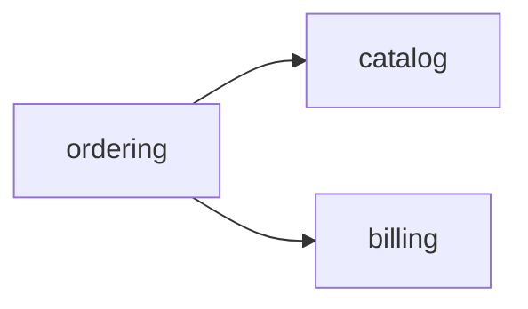
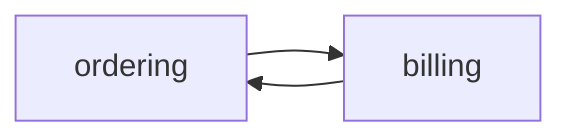
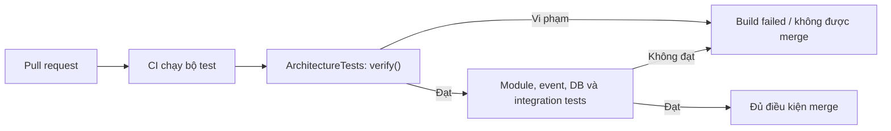

# Luật dependency giữa các module được kiểm tra thế nào?

## 1. Bài toán: phụ thuộc đúng ở mức Java chưa chắc đúng ở mức kiến trúc

Trong một ứng dụng Spring Boot, hai lớp có thể gọi nhau hợp lệ theo Java, chương trình biên dịch thành công và bài kiểm thử nghiệp vụ vẫn đạt. Tuy nhiên, quan hệ đó có thể vi phạm ranh giới **application module**. Chẳng hạn, module `ordering` trực tiếp tiêm repository trong package `catalog.internal`: thay đổi lưu trữ của `catalog` có nguy cơ kéo theo sửa mã của `ordering`.

Spring Modulith cung cấp `ApplicationModules` để mô hình hóa các application module và các quan hệ giữa chúng. Phương thức **`ApplicationModules.verify()`** kiểm tra các quy tắc phụ thuộc trên mô hình này, giúp phát hiện lỗi kiến trúc bằng một bài test chạy lặp lại được. Đây là nền tảng cho mục tiêu kiểm chứng ranh giới module, bổ trợ cho `@ApplicationModuleTest`, kiểm thử sự kiện, cơ sở dữ liệu, tích hợp và quality gate trong CI.

Sau bài học, bạn có thể:

- Giải thích Spring Modulith xác định ranh giới module và nhận diện phụ thuộc giữa các lớp như thế nào.
- Phân biệt ba nhóm kiểm tra: **vòng phụ thuộc**, **truy cập API không công khai** và **phụ thuộc ngoài danh sách được phép**.
- Khai báo `@ApplicationModule(allowedDependencies = ...)`, công bố API bằng `@NamedInterface`, và xác định quan hệ nào hợp lệ.
- Đưa `verify()` vào JUnit/CI, đọc kết quả và chọn cách sửa đúng về kiến trúc.

## 2. Từ cấu trúc package đến đồ thị phụ thuộc

### 2.1. Xác định module và giao diện của module

Theo cách nhận diện mặc định, các package con trực tiếp dưới package gốc của ứng dụng là những application module. Giả sử dự án có cấu trúc:

```text
com.acme.store
├── StoreApplication.java
├── catalog
│   ├── ProductCatalog.java
│   └── internal
│       └── JpaProductRepository.java
├── ordering
│   ├── OrderManagement.java
│   └── internal
│       └── OrderRepository.java
└── billing
    ├── InvoiceService.java
    └── spi
        ├── package-info.java
        └── BillingPort.java
```

Trong ví dụ này, `catalog`, `ordering` và `billing` là ba application module. Các kiểu nằm ngay trong package gốc của module, ví dụ `catalog.ProductCatalog`, thuộc **API mặc định** của module. Các kiểu trong package con như `catalog.internal.JpaProductRepository` không tự động trở thành API công khai, kể cả khi được khai báo `public` trong Java.

> Lưu ý: dự án có thể tùy chỉnh cách nhận diện module và công bố thêm các named interface. Vì vậy, luôn dựa trên cấu trúc module mà `ApplicationModules` thực sự nhận diện, thay vì chỉ nhìn tên folder.

### 2.2. Phát hiện phụ thuộc tĩnh giữa các kiểu

Khi mã nguồn chứa quan hệ phụ thuộc ở mức kiểu Java, chẳng hạn một lớp khai báo field, constructor parameter, kế thừa hoặc gọi phương thức của kiểu thuộc module khác, công cụ phân tích kiến trúc có thể nhận diện quan hệ đó từ bytecode. Ví dụ:

```java
package com.acme.store.ordering;

import com.acme.store.catalog.ProductCatalog;

public class OrderManagement {
    private final ProductCatalog products;

    public OrderManagement(ProductCatalog products) {
        this.products = products;
    }
}
```

`OrderManagement` thuộc `ordering`; `ProductCatalog` thuộc `catalog`. Do đó, ứng dụng có một cạnh phụ thuộc **`ordering → catalog`**. Spring Modulith đánh giá cạnh này dựa trên module nguồn, module đích và API mà module đích xuất bản.

Việc chỉ thấy một dòng `import` chưa đủ để kết luận chắc chắn có vi phạm: điều cần xem là **quan hệ phụ thuộc tĩnh thực sự giữa các kiểu**. Một lệnh gọi qua HTTP hoặc message broker cũng không tự động tạo ra cạnh phụ thuộc Java giữa hai application module.

### 2.3. Đồ thị để suy luận kiến trúc

Ví dụ thiết kế hợp lệ có `ordering → catalog` và `ordering → billing`:



Đồ thị phụ thuộc là cách dễ hiểu để hình dung phép kiểm tra: **đỉnh** là module, **cạnh có hướng** là phụ thuộc. Đây là mô hình diễn giải; việc phân tích được thực hiện thông qua công cụ kiểm tra kiến trúc của Spring Modulith, không phải bằng cách so sánh chuỗi `import` thủ công.

## 3. Ba nhóm luật được `verify()` kiểm tra

### Luật 1 — Không có vòng phụ thuộc giữa các application module

Nếu `ordering` phụ thuộc `billing`, đồng thời `billing` phụ thuộc `ordering`, ta có chu trình:



Vòng cũng có thể gồm ba module hoặc nhiều hơn, ví dụ `ordering → billing → catalog → ordering`. Một vòng khiến hướng phụ thuộc khó kiểm soát, việc sửa và kiểm thử các module trở nên ràng buộc nhau. `verify()` kiểm tra tính không có chu trình của **quan hệ giữa các application module**, chứ không chỉ kiểm tra Java có biên dịch hay không.

Hướng khắc phục có thể là thiết kế lại trách nhiệm nghiệp vụ, đưa hợp đồng sang đúng module sở hữu, đảo chiều phụ thuộc bằng một giao diện thích hợp hoặc tổ chức tương tác bằng sự kiện. Chọn hướng sửa theo ranh giới nghiệp vụ thực tế; không nên đơn giản dời lớp để làm kết quả test chuyển xanh.

### Luật 2 — Chỉ sử dụng phần API được module đích công khai

Xét đoạn mã sau trong `ordering`:

```java
package com.acme.store.ordering;

import com.acme.store.catalog.internal.JpaProductRepository;

class OrderManagement {
    private final JpaProductRepository repository;

    OrderManagement(JpaProductRepository repository) {
        this.repository = repository;
    }
}
```

Lớp `JpaProductRepository` thuộc **package nội bộ** của `catalog`. Quan hệ này vi phạm ranh giới của module `catalog`, mặc dù Java có thể cho phép tham chiếu khi lớp là `public`. Việc lớp có thể truy cập theo quy tắc visibility của Java **khác** với việc lớp được xuất bản làm API của application module.

Sửa bằng cách để `catalog` định nghĩa hợp đồng công khai:

```java
// com/acme/store/catalog/ProductCatalog.java
package com.acme.store.catalog;

public interface ProductCatalog {
    boolean existsById(Long productId);
}
```

```java
// com/acme/store/ordering/OrderManagement.java
package com.acme.store.ordering;

import com.acme.store.catalog.ProductCatalog;

class OrderManagement {
    private final ProductCatalog products;

    OrderManagement(ProductCatalog products) {
        this.products = products;
    }
}
```

Triển khai thực tế của `ProductCatalog` có thể dùng `JpaProductRepository` ở bên trong module `catalog`. Sau khi sửa, `ordering` chỉ biết hợp đồng công khai và không cần biết cách `catalog` lưu dữ liệu.

### Luật 3 — Chỉ phụ thuộc vào module hoặc giao diện được cho phép

Không khai báo giới hạn riêng, Spring Modulith cho phép module sử dụng **API công khai** của những module khác, miễn quan hệ đó không vi phạm các luật kiến trúc khác. Để áp đặt kiến trúc chặt hơn, đặt `@ApplicationModule` lên `package-info.java` của module nguồn:

```java
// com/acme/store/ordering/package-info.java
@ApplicationModule(allowedDependencies = "catalog")
package com.acme.store.ordering;

import org.springframework.modulith.ApplicationModule;
```

Từ đây, phụ thuộc trực tiếp `ordering → catalog` qua API công khai được cho phép, nhưng `ordering → billing` nằm ngoài tập đã khai báo và sẽ bị `verify()` phát hiện. **`allowedDependencies` không tự động công khai package nội bộ**: dù `catalog` được liệt kê, `ordering` vẫn không được tham chiếu `catalog.internal.JpaProductRepository`.

| Phụ thuộc từ `ordering` khi chỉ cho phép `catalog` | Kiểm tra | Lý do |
| --- | --- | --- |
| `catalog.ProductCatalog` | Hợp lệ nếu không tạo vòng | Thuộc API công khai của module được phép. |
| `catalog.internal.JpaProductRepository` | Vi phạm | Truy cập vào phần nội bộ của module đích. |
| `billing.InvoiceService` | Vi phạm | Module đích nằm ngoài `allowedDependencies`, dù kiểu nằm ở API công khai. |
| Một lớp khác trong chính `ordering` | Không phải phụ thuộc liên module | Các luật ranh giới liên module không áp dụng cho cạnh nội bộ này theo cùng cách. |

**Phân biệt hai câu hỏi:** `allowedDependencies` trả lời “được phép phụ thuộc **module/giao diện nào**?”, còn quy tắc đóng gói API trả lời “được phép truy cập **kiểu nào** bên trong module đích?”. Một quan hệ phải thỏa cả hai khi giới hạn phụ thuộc được khai báo.

## 4. `@NamedInterface` giúp mở API ở package con một cách có chủ đích

Có trường hợp hợp đồng dùng chung phải nằm trong package con nhưng vẫn được module khác sử dụng. Spring Modulith hỗ trợ **named interface** để xuất bản có chọn lọc phần API đó.

Ví dụ module `billing` muốn công khai `billing.spi.BillingPort` như một hợp đồng chuyên biệt. Trong `billing/spi/package-info.java`:

```java
@NamedInterface("spi")
package com.acme.store.billing.spi;

import org.springframework.modulith.NamedInterface;
```

```java
// com/acme/store/billing/spi/BillingPort.java
package com.acme.store.billing.spi;

public interface BillingPort {
    void requestPayment(Long orderId);
}
```

Module `ordering` có thể khai báo rõ những giao diện mà nó được phép sử dụng:

```java
// com/acme/store/ordering/package-info.java
@ApplicationModule(allowedDependencies = {"catalog", "billing::spi"})
package com.acme.store.ordering;

import org.springframework.modulith.ApplicationModule;
```

Khi đó, `ordering` có thể tham chiếu `catalog.ProductCatalog` và `billing.spi.BillingPort`. Cách viết `billing::spi` là **tên module `billing` cùng named interface `spi`**, không phải tên package Java. Nó giới hạn phần API của `billing` được sử dụng, thay vì cho phép truy cập mọi kiểu trong `billing`.

Không nên tạo named interface cho toàn bộ package `internal` chỉ để bỏ qua lỗi. Hãy chỉ công khai hợp đồng mà module khác thực sự cần, giữ chi tiết dữ liệu, triển khai và persistence nằm bên trong module sở hữu.

## 5. `verify()` thực hiện những bước nào về mặt khái niệm?

Có thể hình dung trình tự kiểm tra theo bốn bước sau. Đây là **mô hình tư duy**, không phải cam kết về thứ tự chạy nội bộ của thư viện:

1. **Nhận diện module** theo package gốc, quy ước và cấu hình của Spring Modulith. Xác định API mặc định và các named interface đã khai báo.
2. **Phân tích phụ thuộc tĩnh** giữa các kiểu, quy về cạnh giữa các module nguồn và đích.
3. **Đối chiếu luật**: có vòng phụ thuộc liên module không; module nguồn có sử dụng API không được công khai không; và phụ thuộc đó có nằm ngoài `allowedDependencies` không.
4. **Báo vi phạm** nếu có. Khi gọi từ JUnit, lỗi làm bài test thất bại; nếu không phát hiện vi phạm thì bài test đạt.

Đặt lời gọi trong một bài test kiến trúc duy nhất:

```java
package com.acme.store;

import org.junit.jupiter.api.Test;
import org.springframework.modulith.core.ApplicationModules;

class ArchitectureTests {

    @Test
    void applicationModulesRespectDependencyRules() {
        ApplicationModules modules = ApplicationModules.of(StoreApplication.class);
        modules.verify();
    }
}
```

`ApplicationModules.of(StoreApplication.class)` tạo mô hình các module dưới ứng dụng; `verify()` chạy phép kiểm chứng kiến trúc. Bài test này thường không cần khởi động Spring application context hoặc cơ sở dữ liệu, vì đối tượng được kiểm tra là **cấu trúc phụ thuộc**, không phải luồng nghiệp vụ lúc chạy.

Lưu ý: tập quy tắc áp dụng thực tế còn chịu ảnh hưởng của cấu hình dự án, chiến lược nhận diện module và các thư viện kiểm tra kiến trúc bổ sung như jMolecules khi tích hợp. Ba nhóm luật trên là những kiểm tra nền tảng cần nắm khi làm việc với Spring Modulith.

## 6. Tình huống tổng hợp: quan hệ nào sẽ bị chặn?

Giả sử có ba module với mục tiêu kiến trúc:

- `catalog` quản lý sản phẩm, công khai `ProductCatalog`, giấu repository trong `catalog.internal`.
- `billing` cung cấp hợp đồng `BillingPort` qua named interface `billing::spi`.
- `ordering` chỉ được phụ thuộc `catalog` và `billing::spi`, khai báo bằng `@ApplicationModule(allowedDependencies = {"catalog", "billing::spi"})`.

| Thay đổi trong mã nguồn | Dự kiến với `verify()` | Giải thích |
| --- | --- | --- |
| `ordering.OrderManagement` dùng `catalog.ProductCatalog` | Đạt đối với cạnh này | API mặc định của `catalog` và module đích được cho phép. |
| `ordering.OrderManagement` dùng `billing.spi.BillingPort` | Đạt đối với cạnh này | Tham chiếu named interface được xuất bản và cho phép. |
| `ordering.OrderManagement` dùng `catalog.internal.JpaProductRepository` | Không đạt | Vượt qua ranh giới nội bộ của `catalog`. |
| `ordering.OrderManagement` dùng `billing.InvoiceService` | Không đạt | Không thuộc named interface `billing::spi` đã được cho phép. |
| `billing.InvoiceService` tham chiếu một kiểu thuộc `ordering`, trong khi `ordering` đã phụ thuộc `billing` | Không đạt nếu tạo vòng module | Phát sinh chu trình `ordering → billing → ordering`, bất kể từng kiểu riêng lẻ có công khai. |

Ở hàng cuối, quan hệ `ordering → billing` tồn tại thông qua `billing::spi`. Nếu `billing` quay lại phụ thuộc `ordering`, đồ thị có vòng và vi phạm quy tắc thứ nhất. Điều này cho thấy **được phép gọi một API không đủ để bảo đảm toàn bộ kiến trúc hợp lệ**.

Một phép kiểm tra không phát hiện vi phạm ở một cạnh riêng lẻ cũng không đảm bảo tất cả module đều hợp lệ; cần chạy `verify()` trên toàn bộ mô hình module.

## 7. Xử lý một lần `verify()` thất bại

Khi test `ArchitectureTests` thất bại, hãy đọc thông báo để xác định **module nguồn**, **module đích** và **lớp/quan hệ gây lỗi**, rồi phân loại:

| Dấu hiệu | Cần kiểm tra | Cách xử lý ưu tiên |
| --- | --- | --- |
| Vòng phụ thuộc | Có đường quay lại module ban đầu không? | Sắp xếp lại trách nhiệm, đảo chiều quan hệ hoặc dùng hợp đồng/sự kiện phù hợp. |
| Truy cập phần nội bộ | Kiểu đích nằm trong package con không được công khai? | Dùng API mặc định hoặc một named interface được thiết kế rõ ràng. |
| Phụ thuộc không được phép | Module đích hoặc named interface có trong `allowedDependencies`? | Thay cách tương tác; chỉ bổ sung khai báo nếu đó là quyết định kiến trúc có chủ đích. |

Ví dụ, khi chuyển `OrderManagement` từ việc tiêm trực tiếp `JpaProductRepository` sang dùng `ProductCatalog`, ta giải quyết lỗi đóng gói API. Tuy nhiên, nếu `catalog` lại tham chiếu ngược một kiểu trong `ordering`, vẫn còn vòng phụ thuộc cần xử lý riêng.

Một số cách xử lý dễ gây tác dụng ngược là chuyển mọi lớp vào package gốc để chúng trở thành API, mở `allowedDependencies` cho tất cả module, hoặc thêm named interface vào nguyên một package triển khai. Những cách này làm mất ý nghĩa của kiểm chứng ranh giới.

## 8. Giới hạn của kiểm tra dependency tĩnh

`verify()` rất hữu ích, nhưng cần hiểu điều nó **không tự kiểm chứng**:

- Không xác nhận kết quả nghiệp vụ: đơn hàng có được tạo đúng, tiền có được trừ đúng hoặc idempotency có được bảo đảm không.
- Không tự kiểm tra event có được phát, lưu và xử lý thành công; lỗi listener và transaction cần kiểm thử hành vi.
- Không bảo đảm hai module không liên kết gián tiếp bằng truy vấn vào cùng bảng dữ liệu, URL HTTP, message broker, cấu hình dạng chuỗi hoặc reflection.
- Không thay thế kiểm thử transaction, repository, schema database, tích hợp dịch vụ ngoài hay khả năng chạy thực tế của Spring context.

Vì thế, một hệ thống có thể **đạt `verify()` nhưng vẫn lỗi nghiệp vụ**; ngược lại, integration test có thể đạt trong khi mã nguồn đang dùng một lớp nội bộ trái với thiết kế module.

Trong ứng dụng Spring Modulith, nên phối hợp nhiều tầng kiểm tra:

| Tầng | Câu hỏi | Ví dụ |
| --- | --- | --- |
| Kiến trúc | Quan hệ giữa module có hợp lệ? | `ApplicationModules.verify()` |
| Module | Một module hoạt động đúng khi khởi tạo và gọi các bean cần thiết? | `@ApplicationModuleTest` |
| Event | Event được phát và xử lý đúng theo kịch bản? | Kiểm thử sự kiện/kịch bản của Spring Modulith |
| Dữ liệu và tích hợp | Repository, transaction và hệ thống ngoài có hoạt động đúng? | Integration test, Testcontainers khi phù hợp |
| Phòng ngừa hồi quy | Thay đổi có phá ranh giới hoặc hành vi đã chấp nhận? | CI yêu cầu các bài test đạt |

## 9. Biến luật dependency thành quality gate trong CI

Đặt `ArchitectureTests` trong `src/test/java` để công cụ build chạy cùng bộ test:

```bash
# Nếu dự án sử dụng Maven Wrapper
./mvnw test

# Nếu dự án sử dụng Gradle Wrapper
./gradlew test
```

Ví dụ luồng tích hợp:



Thiết lập job chứa bài test kiến trúc làm **required check** trước khi hợp nhất nhánh. Khi thay đổi tạo vòng phụ thuộc, truy cập nội bộ hoặc phá vỡ `allowedDependencies`, bài test thất bại và CI chặn hồi quy kiến trúc. Quy tắc này chỉ có tác dụng ngăn merge nếu quy trình thực sự bắt buộc check phải đạt.

Vì kiểm tra kiến trúc thường không phải khởi chạy cơ sở dữ liệu, có thể cho chạy sớm trong pipeline để phát hiện lỗi phụ thuộc nhanh. Dù vậy, `verify()` phải được chạy cùng các test hành vi và tích hợp thích hợp trước khi quyết định chất lượng một thay đổi.

## 10. Câu hỏi tự kiểm tra

1. **Vì sao lớp `public` trong `catalog.internal` vẫn có thể bị `verify()` xem là vi phạm khi `ordering` sử dụng?** Vì `public` là mức truy cập của Java, còn API application module do Spring Modulith xác định theo package/named interface. Package con không mặc nhiên được xuất bản.
2. **Nếu `ordering` đã khai báo `allowedDependencies = "catalog"`, nó được gọi mọi lớp của `catalog` không?** Không. Nó chỉ được sử dụng phần API mà `catalog` công khai; phần nội bộ vẫn bị bảo vệ.
3. **Một quan hệ có thể vừa nằm trong `allowedDependencies` vừa gây lỗi không?** Có. Ví dụ quan hệ hợp lệ theo danh sách vẫn tạo vòng khi module đích phụ thuộc ngược về module nguồn.
4. **`verify()` đạt có chứng minh event thanh toán đã được xử lý đúng không?** Không. Cần thêm kiểm thử event, transaction và integration thích hợp.

**Ghi nhớ:** `ApplicationModules.verify()` đánh giá **đồ thị phụ thuộc tĩnh** giữa các application module theo ba ràng buộc quan trọng: không có vòng, không chạm phần API chưa công khai và không vượt giới hạn `allowedDependencies` đã khai báo. Kết hợp named interface để công bố hợp đồng rõ ràng, JUnit để chạy lặp lại, `@ApplicationModuleTest` cùng kiểm thử sự kiện/cơ sở dữ liệu/tích hợp để xác nhận hành vi, và CI để chặn những phụ thuộc sai ngay khi chúng được đưa vào dự án.
