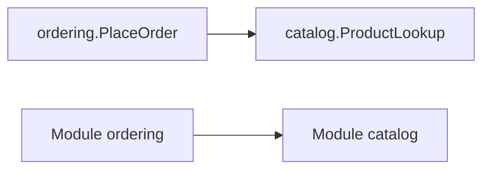
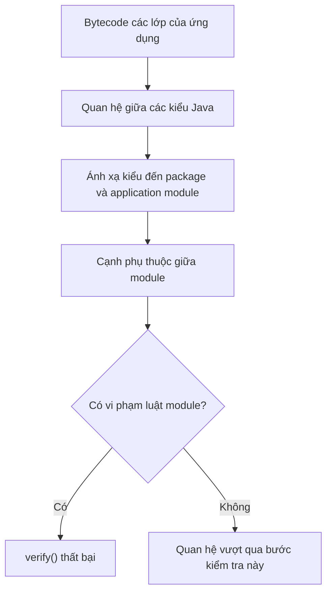
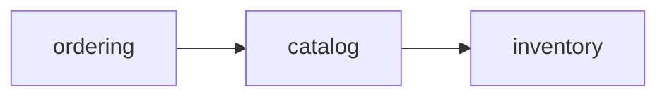

# Phát hiện dependency trực tiếp qua package trong Spring Modulith

## 1. Dependency trực tiếp qua package là gì?

Giả sử một ứng dụng Spring Boot có các module `ordering` (đơn hàng), `catalog` (danh mục sản phẩm) và `payment` (thanh toán). Mỗi module được tổ chức dưới một package riêng. Khi lớp của `ordering` dùng một kiểu được khai báo trong package của `catalog`, mã nguồn hình thành một **phụ thuộc trực tiếp** từ `ordering` đến `catalog`.

Ví dụ:

```java
package com.example.shop.ordering;

import com.example.shop.catalog.ProductLookup;

public class PlaceOrder {
    private final ProductLookup products;

    public PlaceOrder(ProductLookup products) {
        this.products = products;
    }
}
```

Do `PlaceOrder` thuộc module `ordering` còn `ProductLookup` thuộc module `catalog`, quan hệ được biểu diễn thành cạnh có hướng:



Quan hệ này chưa chắc là lỗi: nó hợp lệ nếu module `ordering` được phép sử dụng API `ProductLookup`, và toàn bộ đồ thị module không vi phạm luật khác. **`ApplicationModules.verify()` kiểm tra các quan hệ phụ thuộc đã nhận diện dựa trên ranh giới application module**, giúp ngăn gọi nhầm code nội bộ, phụ thuộc ngoài phạm vi cho phép và vòng phụ thuộc. Đây là một phần quan trọng trong học phần `SPRING_MODULITH_VERIFICATION_TESTING`: kiểm chứng ranh giới kiến trúc, sau đó kết hợp `@ApplicationModuleTest`, test sự kiện, cơ sở dữ liệu, tích hợp và quality gate CI để tránh hồi quy.

Sau bài này, bạn sẽ biết cách:

- Xác định module sở hữu một kiểu dựa trên package.
- Phân biệt **tham chiếu kiểu thực sự** với một dòng `import` không được sử dụng.
- Tìm nguyên nhân phụ thuộc trực tiếp gây lỗi khi chạy `ApplicationModules.verify()`.
- Sửa quan hệ vượt ranh giới thông qua API công khai hoặc named interface, rồi bảo vệ bằng test kiến trúc.

## 2. Spring Modulith xác định ranh giới package thế nào?

Với chiến lược nhận diện mặc định, các package con trực tiếp của package gốc ứng dụng là các application module. Ví dụ:

```text
com.example.shop
├── ShopApplication.java
├── catalog
│   ├── ProductLookup.java
│   └── internal
│       ├── JpaProductRepository.java
│       └── JpaProductLookup.java
├── ordering
│   ├── PlaceOrder.java
│   └── internal
│       └── OrderRepository.java
└── payment
    ├── PaymentFacade.java
    └── internal
        └── PaymentEntity.java
```

Trong trường hợp này, `catalog`, `ordering` và `payment` là các application module. Những kiểu được khai báo ngay trong package gốc module, chẳng hạn `com.example.shop.catalog.ProductLookup`, thuộc **API mặc định** của module. Các package lồng bên trong module, ví dụ `catalog.internal`, được xem là **nội bộ theo mặc định**. Một lớp Java có modifier `public` không tự động được công khai với module khác ở mức Spring Modulith.

| Kiểu Java | Module sở hữu | Vai trò theo quy ước mặc định |
| --- | --- | --- |
| `catalog.ProductLookup` | `catalog` | API công khai của module |
| `catalog.internal.JpaProductRepository` | `catalog` | Triển khai nội bộ |
| `ordering.PlaceOrder` | `ordering` | API công khai của module |
| `ordering.internal.OrderRepository` | `ordering` | Triển khai nội bộ |
| `payment.PaymentFacade` | `payment` | API công khai của module |

Ranh giới này **có thể được tùy chỉnh** khi dự án thay đổi chiến lược nhận diện module hoặc công bố thêm `@NamedInterface`. Vì vậy, không nên dựa vào chữ `internal` như một quy tắc tên cứng: điều đáng chú ý là kiểu nằm trong **package gốc module** hay **package con chưa được xuất bản**.

## 3. Dependency được phát hiện từ điều gì?

### 3.1. Phân tích quan hệ kiểu đã biên dịch

Spring Modulith sử dụng cơ chế phân tích kiến trúc dựa trên các kiểu Java và quan hệ giữa chúng, thông qua nền tảng như ArchUnit. Khi một kiểu thuộc module A tham chiếu tĩnh đến kiểu thuộc module B, hệ thống có thể ghi nhận một phụ thuộc A → B.

Các ví dụ điển hình về tham chiếu kiểu gồm:

| Vị trí tham chiếu trong mã Java | Ví dụ từ `ordering` đến `catalog` | Ý nghĩa |
| --- | --- | --- |
| Kiểu field | `private ProductLookup products;` | Lớp sở hữu field biết kiểu của module khác. |
| Tham số constructor | `PlaceOrder(ProductLookup products)` | Quan hệ dependency injection cũng là phụ thuộc ở mức kiểu. |
| Kiểu tham số hoặc kết quả phương thức | `void check(ProductLookup products)` | Hợp đồng phương thức đã gắn với module khác. |
| Khởi tạo hoặc gọi thành viên kiểu khác | `new ProductId(...)` | Bytecode thể hiện việc dùng kiểu đích. |
| Kế thừa hoặc triển khai interface | `implements CatalogListener` | Quan hệ kế thừa tạo sự ràng buộc ở mức kiểu. |
| Annotation, kiểu generic và các biểu thức liên quan | `List<ProductLookup>` | Có thể tạo quan hệ phụ thuộc khi kiểu đích hiện diện trong thông tin mà bộ phân tích thu thập. |

**Không đánh đồng `import` với dependency.** Trong Java, `import` hỗ trợ cú pháp tham chiếu tên kiểu ở mã nguồn; nó không phải một lệnh gọi lúc chạy. Một `import` thừa không được sử dụng thường không để lại tham chiếu kiểu tương ứng trong bytecode và không đủ, tự nó, để kết luận có cạnh phụ thuộc. Ngược lại, mã dùng tên đầy đủ như `com.example.shop.catalog.ProductLookup` mà không có câu lệnh `import` vẫn có thể tạo phụ thuộc.

Ví dụ đơn giản:

```java
package com.example.shop.ordering;

import com.example.shop.catalog.ProductLookup;
import com.example.shop.payment.PaymentFacade; // import thừa

public class PlaceOrder {
    private final ProductLookup products;

    public PlaceOrder(ProductLookup products) {
        this.products = products;
    }
}
```

Quan hệ cần kiểm tra trong ví dụ là `ordering → catalog` do field và constructor sử dụng `ProductLookup`. Không nên nói rằng `ordering → payment` chỉ vì có dòng `import PaymentFacade` nhưng không tham chiếu kiểu này ở đâu.

### 3.2. Từ dependency giữa lớp đến dependency giữa module

Quy trình suy luận có thể hiểu qua bốn bước:

1. **Nhận diện các application module** dưới package gốc của ứng dụng.
2. **Xác định module sở hữu** từng kiểu được phân tích dựa trên package chứa kiểu đó.
3. **Thu thập các quan hệ phụ thuộc tĩnh** giữa các kiểu và quy về cặp module nguồn → đích.
4. **Kiểm tra luật kiến trúc** trên những quan hệ liên module; nếu vi phạm, `verify()` báo lỗi.



Đây là **mô hình giải thích**, không phải mô tả thứ tự thực thi nội bộ bắt buộc của thư viện.

## 4. Ví dụ thực hành: dependency trực tiếp đi vào package nội bộ

Xét `catalog` có repository bên trong `internal`:

```java
// com/example/shop/catalog/internal/JpaProductRepository.java
package com.example.shop.catalog.internal;

import org.springframework.data.jpa.repository.JpaRepository;

public interface JpaProductRepository
        extends JpaRepository<ProductEntity, Long> {
}
```

`ProductEntity` là entity do `catalog` quản lý và nằm trong package nội bộ tương ứng. Nếu module `ordering` tiêm thẳng repository:

```java
// com/example/shop/ordering/PlaceOrder.java
package com.example.shop.ordering;

import com.example.shop.catalog.internal.JpaProductRepository;

public class PlaceOrder {
    private final JpaProductRepository products;

    public PlaceOrder(JpaProductRepository products) {
        this.products = products;
    }
}
```

Khi phân tích, bộ kiểm tra thấy:

- **Kiểu nguồn**: `com.example.shop.ordering.PlaceOrder`.
- **Kiểu đích**: `com.example.shop.catalog.internal.JpaProductRepository`.
- **Module nguồn**: `ordering`.
- **Module đích**: `catalog`.
- **Vấn đề**: module `ordering` sử dụng kiểu ở package con **không được xuất bản** của module `catalog`.

Đây là lỗi **truy cập API nội bộ**. Java có thể cho phép việc tham chiếu repository vì interface được khai báo `public`, nhưng quy tắc đóng gói của Spring Modulith vẫn không cho module khác phụ thuộc trực tiếp vào package nội bộ.

### Sửa bằng hợp đồng công khai

Đặt một interface ổn định tại package gốc `catalog`:

```java
// com/example/shop/catalog/ProductLookup.java
package com.example.shop.catalog;

public interface ProductLookup {
    boolean existsById(Long productId);
}
```

Triển khai interface đó bên trong `catalog.internal`:

```java
// com/example/shop/catalog/internal/JpaProductLookup.java
package com.example.shop.catalog.internal;

import com.example.shop.catalog.ProductLookup;
import org.springframework.stereotype.Service;

@Service
class JpaProductLookup implements ProductLookup {
    private final JpaProductRepository repository;

    JpaProductLookup(JpaProductRepository repository) {
        this.repository = repository;
    }

    @Override
    public boolean existsById(Long productId) {
        return repository.existsById(productId);
    }
}
```

Trong `ordering`, sử dụng interface công khai:

```java
// com/example/shop/ordering/PlaceOrder.java
package com.example.shop.ordering;

import com.example.shop.catalog.ProductLookup;

public class PlaceOrder {
    private final ProductLookup products;

    public PlaceOrder(ProductLookup products) {
        this.products = products;
    }
}
```

Bây giờ quan hệ trực tiếp `ordering → catalog` vẫn **tồn tại** nhưng hướng tới **API được xuất bản** của `catalog`. Đó là cách sửa thiết kế tốt hơn việc chuyển `JpaProductRepository` ra package gốc để có thể truy cập từ mọi module.

## 5. Dependency trực tiếp khác dependency gián tiếp

Giả sử `ordering.PlaceOrder` dùng `catalog.ProductLookup`, còn `catalog.internal.JpaProductLookup` dùng `inventory.StockGateway`:



Đồ thị có các cạnh trực tiếp `ordering → catalog` và `catalog → inventory`. **Không được tự kết luận có cạnh trực tiếp `ordering → inventory`** chỉ vì tồn tại đường đi dài hai bước. Ngay cả khi `PlaceOrder` gọi nghiệp vụ dẫn đến `catalog` sử dụng `inventory` lúc chạy, điều đó chưa biến nó thành tham chiếu kiểu Java trực tiếp giữa `ordering` và `inventory`.

Tuy nhiên, phép kiểm chứng **toàn bộ đồ thị** vẫn có thể phát hiện vấn đề liên quan đến nhiều cạnh, chẳng hạn chu trình `ordering → catalog → inventory → ordering`. Vì vậy, khi đọc lỗi cần xác định:

- Cạnh **trực tiếp nào** do lớp nào tạo ra?
- Có **đường đi nhiều bước** dẫn đến một vòng phụ thuộc không?
- Vi phạm thuộc quy tắc **truy cập nội bộ**, **danh sách module được phép**, hay **không có vòng phụ thuộc**?

Ba câu hỏi này giúp tìm đúng nơi sửa, tránh nhầm lỗi một cạnh riêng lẻ với lỗi của cả đồ thị.

## 6. Kết hợp luật package với `allowedDependencies`

Việc tham chiếu API công khai của một module khác là điều kiện cần, nhưng dự án có thể quy định module nào được phép phụ thuộc vào module nào. Ví dụ, trong `ordering/package-info.java`:

```java
@ApplicationModule(allowedDependencies = "catalog")
package com.example.shop.ordering;

import org.springframework.modulith.ApplicationModule;
```

Với khai báo này, `ordering` được phép có phụ thuộc trực tiếp đến module `catalog` qua API công khai. Nếu `PlaceOrder` thêm field kiểu `payment.PaymentFacade`, Spring Modulith có thể phát hiện cạnh `ordering → payment` nằm ngoài danh sách `allowedDependencies`.

| Tham chiếu kiểu từ `ordering` | Cạnh trực tiếp | Kết quả dự kiến |
| --- | --- | --- |
| `catalog.ProductLookup` | `ordering → catalog` | Được phép theo danh sách và API mặc định, nếu không tạo vi phạm khác. |
| `catalog.internal.JpaProductRepository` | `ordering → catalog` | Sai vì dùng kiểu nội bộ, dù module `catalog` được phép phụ thuộc. |
| `payment.PaymentFacade` | `ordering → payment` | Sai vì `payment` nằm ngoài danh sách cho phép. |
| `ordering.internal.OrderRepository` | Phụ thuộc bên trong `ordering` | Không tạo cạnh phụ thuộc **liên module** trong ví dụ này. |

Hai loại luật độc lập về ý nghĩa:

- **Luật công khai API**: module đích cho phép module khác dùng **kiểu nào**?
- **Luật `allowedDependencies`**: module nguồn được phép dùng **module/giao diện nào**?

Việc được phép phụ thuộc `catalog` không mở khóa mọi package con của `catalog`. Ngược lại, một lớp `public` trong `payment` không tự vượt được giới hạn `allowedDependencies` của `ordering`.

### Khi API cần nằm trong package con: `@NamedInterface`

Nếu `catalog` cần công khai các hợp đồng tại `catalog.api`, có thể khai báo named interface:

```java
// com/example/shop/catalog/api/package-info.java
@NamedInterface("api")
package com.example.shop.catalog.api;

import org.springframework.modulith.NamedInterface;
```

Sau đó, module dùng hợp đồng có thể khai báo một giới hạn cụ thể, chẳng hạn:

```java
@ApplicationModule(allowedDependencies = "catalog::api")
package com.example.shop.ordering;

import org.springframework.modulith.ApplicationModule;
```

`catalog::api` có nghĩa **named interface `api` của module `catalog`**, không phải chuỗi tên package bất kỳ. Bản thân `@NamedInterface` công bố một vùng API trong package con; `allowedDependencies` xác định module nguồn được dùng vùng API nào. Khi cần dùng cả API mặc định lẫn named interface của cùng module, phải thiết kế và khai báo danh sách giao diện được phép tương ứng, thay vì mặc định rằng một named interface đại diện cho toàn bộ module.

## 7. Viết bài test để phát hiện và chặn dependency sai

Thêm bài kiểm thử kiến trúc vào `src/test/java`:

```java
package com.example.shop;

import org.junit.jupiter.api.Test;
import org.springframework.modulith.core.ApplicationModules;

class ModuleBoundaryTests {

    @Test
    void modulesDoNotDependOnInternalPackages() {
        ApplicationModules modules = ApplicationModules.of(ShopApplication.class);
        modules.verify();
    }
}
```

Khi test chạy:

1. `ApplicationModules.of(ShopApplication.class)` dựng mô hình application module từ ứng dụng.
2. `verify()` kiểm tra các quy tắc kiến trúc như không có vòng phụ thuộc, không sử dụng API nội bộ của module khác và không vượt `allowedDependencies`.
3. Nếu có vi phạm, bài test thất bại và báo thông tin phục vụ xác định quan hệ gây lỗi.

Test này thường **không cần khởi động Spring application context hay kết nối cơ sở dữ liệu**, vì nó kiểm tra quan hệ kiến trúc tĩnh. Tên `modulesDoNotDependOnInternalPackages` nhấn mạnh tình huống đang học, nhưng `verify()` thực tế kiểm tra **nhiều luật** khác nữa, không giới hạn ở package nội bộ.

Chạy test theo công cụ build của dự án:

```bash
# Maven Wrapper
./mvnw test

# Hoặc Gradle Wrapper
./gradlew test
```

Nếu dự án đã thiết lập CI chạy test trên pull request, kết quả thất bại này làm job test không đạt. Đặt job làm **required check** trên nhánh được bảo vệ để ngăn merge khi phát sinh dependency sai.

## 8. Cách khoanh vùng khi `verify()` báo lỗi

Khi có một vi phạm, không nên sửa bằng cách đổi `allowedDependencies` ngay lập tức. Hãy kiểm tra lần lượt:

1. **Lớp nguồn thuộc package/module nào?** Ví dụ: `ordering.PlaceOrder` thuộc `ordering`.
2. **Lớp đích thuộc package/module nào?** Ví dụ: `catalog.internal.JpaProductRepository` thuộc `catalog`.
3. **Quan hệ xuất hiện ở đâu trong mã?** Field, constructor, method signature, implements/extends hay lệnh dùng kiểu?
4. **Kiểu đích có thuộc API được công khai không?** Package gốc hay named interface?
5. **Module nguồn có được phép phụ thuộc vào đích không?** Kiểm tra `@ApplicationModule(allowedDependencies = ...)`.
6. **Thay đổi này có tạo chu trình liên module không?** Xem các cạnh còn lại trong đồ thị.

Ví dụ, khi thông báo dẫn tới field `JpaProductRepository` trong `PlaceOrder`, sửa bằng cách tiêm `ProductLookup`. Sau đó chạy lại test kiến trúc và các bài test hành vi liên quan. Không cần công khai repository hay mở `catalog.internal` cho toàn ứng dụng.

Nếu phụ thuộc được tạo trong lớp DTO hoặc trong chữ ký public method, việc đổi implementation nội bộ mà không đổi chữ ký cũng có thể chưa giải quyết được vi phạm. Hãy sửa **điểm tham chiếu trực tiếp** và hợp đồng tại ranh giới module.

## 9. Những giới hạn cần hiểu rõ

`ApplicationModules.verify()` đánh giá **các phụ thuộc tĩnh mà công cụ phân tích có thể nhận diện**, nên có một số trường hợp cần kiểm thử và quy tắc khác bổ sung:

| Tình huống | Có thể thấy qua phụ thuộc tĩnh? | Bước kiểm chứng bổ sung |
| --- | --- | --- |
| Constructor khai báo `catalog.ProductLookup` | Có, tham chiếu kiểu rõ ràng | Test nghiệp vụ của `PlaceOrder`. |
| Module A gọi module B qua interface Java | Có, nếu interface thuộc B | Kiểm thử hành vi của interface và triển khai. |
| Gọi endpoint HTTP của module/dịch vụ khác bằng URL chuỗi | Không nhất thiết có cạnh kiểu Java tới module đích | Test HTTP, contract test, integration test. |
| Giao tiếp bằng event qua broker | Có thể thấy tham chiếu tới kiểu event, nhưng không tự xác nhận luồng gửi/nhận | Kiểm thử event và xử lý bất đồng bộ. |
| Hai module truy vấn trực tiếp cùng một bảng dữ liệu | Không tự suy ra sở hữu dữ liệu từ graph kiểu | Kiểm thử persistence, transaction và quy ước sở hữu bảng. |
| Tải kiểu qua reflection bằng tên dạng chuỗi | Không bảo đảm phát hiện quan hệ đến kiểu đích | Test chạy thực tế và review thiết kế. |

Vì vậy, **pass `verify()` không đồng nghĩa với ứng dụng vận hành đúng mọi tình huống**. Với Spring Modulith, hãy phối hợp:

- `ApplicationModules.verify()` để giữ cấu trúc module.
- `@ApplicationModuleTest` để xác nhận hành vi và bean trong phạm vi module.
- Test sự kiện để kiểm tra kịch bản phát và tiêu thụ event.
- Test cơ sở dữ liệu và tích hợp để kiểm chứng truy vấn, transaction, ánh xạ và hệ thống ngoài.
- CI bắt buộc test đạt trước khi hợp nhất để ngăn cả hồi quy kiến trúc lẫn hồi quy nghiệp vụ.

## 10. Tự thực hành: xác định cạnh phụ thuộc

Giả sử `ordering` khai báo `allowedDependencies = "catalog"`, còn `catalog` công khai `ProductLookup` tại package gốc nhưng giữ `ProductEntity` trong `catalog.internal`.

Xét các thay đổi sau trong `ordering.PlaceOrder`:

**A.** Thêm `private ProductLookup lookup;`.

**B.** Thêm `private com.example.shop.catalog.internal.ProductEntity entity;`.

**C.** Thêm `private PaymentFacade payment;`, trong đó `PaymentFacade` thuộc package gốc `payment`.

**D.** Chỉ thêm `import com.example.shop.payment.PaymentFacade;` nhưng không dùng kiểu này ở bất kỳ đâu.

**E.** `catalog.ProductLookup` dùng `inventory.StockReader` trong phần triển khai `catalog`, còn `ordering` chỉ tham chiếu `ProductLookup`.

Đáp án và giải thích:

| Trường hợp | Quan hệ trực tiếp từ `ordering` | Đánh giá |
| --- | --- | --- |
| A | `ordering → catalog` | Hợp lệ qua API công khai và danh sách cho phép, nếu không có vi phạm khác. |
| B | `ordering → catalog` | Vi phạm ranh giới API vì tham chiếu `catalog.internal`. |
| C | `ordering → payment` | Vi phạm `allowedDependencies`. |
| D | Không xác định cạnh chỉ từ `import` thừa | Cần có tham chiếu kiểu thực sự được bộ phân tích nhận diện. |
| E | `ordering → catalog` | Không tự kết luận `ordering → inventory`; phụ thuộc của `catalog` cần được kiểm tra theo module nguồn tương ứng. |

**Ghi nhớ:** Muốn phát hiện dependency trực tiếp qua package, cần lần từ **kiểu nguồn → kiểu đích → package/module sở hữu → giao diện được công khai → quy tắc được phép phụ thuộc**. `ApplicationModules.verify()` biến việc đối chiếu đó thành phép kiểm tra kiến trúc lặp lại được trong JUnit và CI. Cách kiểm chứng này bổ sung cho `@ApplicationModuleTest` và các bài kiểm thử event, cơ sở dữ liệu, tích hợp để vừa bảo vệ ranh giới module vừa bảo đảm hành vi ứng dụng.
