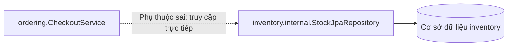
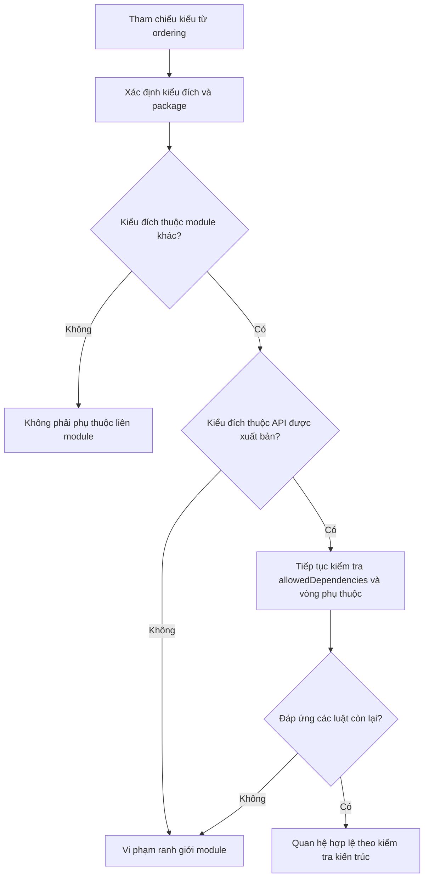
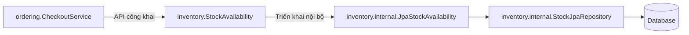
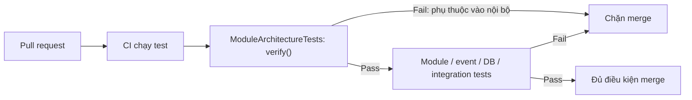

# Phát hiện dependency xuyên qua implementation detail trong Spring Modulith

## 1. Vấn đề: một module biết quá nhiều về cách module khác triển khai

Khi chia ứng dụng thành các **application module**, mỗi module nên cho các module khác biết **nó cung cấp khả năng gì**, còn cách nó thực hiện khả năng đó là trách nhiệm nội bộ. Ví dụ, `inventory` có thể công bố thao tác kiểm tra tồn kho, nhưng việc lưu dữ liệu bằng Spring Data JPA, entity nào được dùng, truy vấn nào được thực hiện phải do `inventory` quyết định.

Xét tình huống module `ordering` trực tiếp tiêm `inventory.internal.StockJpaRepository` để kiểm tra tồn kho. Java vẫn có thể biên dịch nếu repository là `public` và bean có sẵn; thậm chí integration test có thể chạy đúng. Tuy nhiên, `ordering` đang phụ thuộc vào **implementation detail** của `inventory`. Nếu `inventory` thay JPA bằng một dịch vụ bên ngoài, thay schema hoặc tái cấu trúc repository, `ordering` cũng phải sửa theo.

**`ApplicationModules.verify()` giúp phát hiện kiểu phụ thuộc vượt ranh giới này** bằng cách kiểm tra các tham chiếu tĩnh giữa application module và xác định kiểu đích có thuộc API được module đích xuất bản hay không.

Bài học thuộc mục tiêu `SPRING_MODULITH_VERIFICATION_TESTING`: rèn kỹ năng kiểm chứng ranh giới kiến trúc bằng `ApplicationModules`, đồng thời hiểu vì sao vẫn cần `@ApplicationModuleTest`, kiểm thử sự kiện, cơ sở dữ liệu, tích hợp và quality gate trong CI để ngăn lỗi hồi quy.

Sau bài này, bạn có thể:

- Nhận ra những kiểu thường là **implementation detail**: repository, entity persistence, adapter, helper, cấu hình nội bộ.
- Phân biệt truy cập **API công khai** và tham chiếu **package nội bộ** qua biên giới module.
- Viết test `ApplicationModules.verify()` để phát hiện quan hệ sai.
- Sửa sai bằng **hợp đồng công khai**, giữ implementation trong module sở hữu.
- Hiểu trường hợp kiểm tra kiến trúc tĩnh phát hiện được và những kiểu rò rỉ cần thêm review/test.

## 2. Ranh giới module và cách xác định implementation detail

Giả sử Spring Boot đặt lớp ứng dụng tại `com.acme.store.StoreApplication`. Với chiến lược nhận diện mặc định, các package con trực tiếp dưới `com.acme.store` sẽ được nhận diện là application module:

```text
com.acme.store
├── StoreApplication.java
├── inventory
│   ├── StockAvailability.java
│   └── internal
│       ├── JpaStockAvailability.java
│       ├── StockJpaRepository.java
│       └── StockRecord.java
├── ordering
│   ├── CheckoutService.java
│   └── internal
│       └── OrderJpaRepository.java
└── payment
    ├── PaymentService.java
    └── internal
        └── PaymentEntity.java
```

Ba application module trong ví dụ là `inventory`, `ordering` và `payment`.

Theo quy ước mặc định của Spring Modulith:

| Vị trí của kiểu | Ý nghĩa đối với module khác |
| --- | --- |
| `inventory.StockAvailability` ở package gốc của `inventory` | Thuộc **API mặc định** mà module khác có thể sử dụng, nếu luật phụ thuộc cho phép. |
| `inventory.internal.StockJpaRepository` | **Chi tiết nội bộ** của `inventory`; module khác không được tự ý phụ thuộc. |
| `inventory.internal.StockRecord` | **Chi tiết lưu trữ**; không mặc nhiên là hợp đồng liên module. |
| `inventory.internal.JpaStockAvailability` | **Triển khai** của API công khai; không nên là kiểu mà `ordering` trực tiếp biết đến. |
| `ordering.internal.OrderJpaRepository` | Nội bộ của `ordering`; dùng từ chính `ordering` không tạo cạnh phụ thuộc liên module. |

Điểm mấu chốt: từ khóa Java `public` chỉ nói về **khả năng truy cập ở mức ngôn ngữ Java**. Nó không tự động biến một kiểu trong package con của module thành **API application module**.

> Tên package `internal` trong ví dụ giúp người đọc nhận diện ý đồ. Quy tắc cốt lõi dựa trên **ranh giới package và API được công bố**, không phụ thuộc duy nhất vào việc package có chứa chữ “internal” hay không. Cấu hình nhận diện module và named interface có thể thay đổi tập API thực tế.

## 3. Ví dụ sai: truy cập trực tiếp repository của module khác

Trong `inventory`, repository là công cụ persistence nội bộ:

```java
// com/acme/store/inventory/internal/StockJpaRepository.java
package com.acme.store.inventory.internal;

import java.util.UUID;
import org.springframework.data.jpa.repository.JpaRepository;

public interface StockJpaRepository
        extends JpaRepository<StockRecord, UUID> {
}
```

Dù interface này là `public` để thỏa các yêu cầu sử dụng Java/Spring Data trong dự án, nó vẫn nằm trong package con của `inventory`.

Giả sử `ordering` sử dụng trực tiếp:

```java
// com/acme/store/ordering/CheckoutService.java
package com.acme.store.ordering;

import com.acme.store.inventory.internal.StockJpaRepository;
import java.util.UUID;

public class CheckoutService {

    private final StockJpaRepository stockRepository;

    public CheckoutService(StockJpaRepository stockRepository) {
        this.stockRepository = stockRepository;
    }

    public boolean knowsProduct(UUID productId) {
        return stockRepository.existsById(productId);
    }
}
```

Có hai lớp phụ thuộc cần phân biệt:

1. **Phụ thuộc kiểu trực tiếp:** `CheckoutService` của `ordering` khai báo field và constructor parameter kiểu `StockJpaRepository` của `inventory.internal`.
2. **Phụ thuộc thiết kế:** `ordering` đã biết rằng `inventory` dùng Spring Data repository và tự chọn một thao tác persistence làm nghiệp vụ.

Ở cấp đồ thị module, phát sinh cạnh `ordering → inventory`. Cạnh tới đúng module **chưa đủ** để hợp lệ: kiểu được dùng còn phải nằm trong **API đã xuất bản** của `inventory`.



Trong sơ đồ, mũi tên nét đứt là sự phụ thuộc xuyên qua implementation detail cần sửa. Việc `StockJpaRepository` là bean có thể inject thành công không làm thay đổi quy tắc kiến trúc.

## 4. `ApplicationModules.verify()` phát hiện vi phạm bằng cách nào?

Spring Modulith xây dựng mô hình các application module từ cấu trúc ứng dụng và phân tích các quan hệ phụ thuộc tĩnh giữa các kiểu Java (sử dụng cơ chế phân tích kiến trúc như ArchUnit). Khi một kiểu thuộc module này tham chiếu một kiểu thuộc module khác, công cụ có thể đánh giá quan hệ theo ranh giới API đã khai báo.

Đối với ví dụ trên, cách suy luận có thể mô tả như sau:

1. **Tìm kiểu nguồn:** `com.acme.store.ordering.CheckoutService`.
2. **Tìm kiểu đích:** `com.acme.store.inventory.internal.StockJpaRepository`.
3. **Xác định module sở hữu:** `CheckoutService` thuộc `ordering`, repository thuộc `inventory`.
4. **Đánh giá API đích:** repository nằm trong package con `inventory.internal` và không thuộc một named interface được xuất bản.
5. **Đánh giá luật kiến trúc:** tham chiếu từ `ordering` vào phần nội bộ của `inventory` vi phạm nguyên tắc đóng gói module; `verify()` báo vi phạm.



Sơ đồ là **mô hình tư duy** giúp truy vết lỗi, không nhằm khẳng định thứ tự thuật toán nội bộ của Spring Modulith.

### Những vị trí tham chiếu cần rà soát

Không chỉ lệnh gọi method của một repository mới tạo dependency. Khi phân tích mã đã biên dịch, những tham chiếu kiểu tĩnh sau có thể bộc lộ việc vượt ranh giới:

| Dạng tham chiếu từ `ordering` | Ví dụ | Vì sao đáng kiểm tra |
| --- | --- | --- |
| Field hoặc constructor parameter | `private final StockJpaRepository stock;` | Module nguồn phụ thuộc trực tiếp vào kiểu repository. |
| Tham số của method | `void checkout(StockRecord stock)` | Hợp đồng method chứa kiểu persistence của module khác. |
| Kiểu trả về của method | `StockRecord load(UUID id)` | Module nguồn phải biết một kiểu nội bộ. |
| Khởi tạo hoặc gọi API trên kiểu | `new InternalInventoryHelper()` | Mã nguồn dùng triển khai cụ thể của module đích. |
| `extends` / `implements` | `implements InternalStockPort` | Quan hệ kế thừa gắn hai module qua một kiểu nội bộ. |
| Annotation / chữ ký generic khi được phân tích | `List<StockRecord>` | Kiểu nội bộ có thể xuất hiện trong chữ ký được phân tích. |

**Không suy luận dependency chỉ từ một `import` thừa.** `import` chỉ hỗ trợ viết tên Java ở mã nguồn. Cần có tham chiếu kiểu thực sự mà bộ phân tích nhận diện. Ngược lại, sử dụng tên kiểu đầy đủ thay cho `import` không giúp tránh kiểm tra.

## 5. Viết test kiểm chứng ranh giới module

Thêm bài kiểm thử JUnit vào `src/test/java/com/acme/store/ModuleArchitectureTests.java`:

```java
package com.acme.store;

import org.junit.jupiter.api.Test;
import org.springframework.modulith.core.ApplicationModules;

class ModuleArchitectureTests {

    @Test
    void moduleDependenciesRespectEncapsulation() {
        ApplicationModules modules =
                ApplicationModules.of(StoreApplication.class);

        modules.verify();
    }
}
```

Trong đó:

- `ApplicationModules.of(StoreApplication.class)` xác định mô hình module của ứng dụng.
- `verify()` kiểm tra các luật kiến trúc, bao gồm không có vòng phụ thuộc giữa application module, không truy cập API nội bộ của module khác và tuân thủ giới hạn `allowedDependencies` nếu có.
- Khi phát hiện quan hệ như `CheckoutService → StockJpaRepository`, test thất bại và JUnit báo lỗi để người phát triển truy vết.

Phép kiểm tra kiến trúc này **thường không cần khởi động Spring application context hay kết nối cơ sở dữ liệu**, bởi mục tiêu là quan hệ tĩnh giữa các kiểu và module. Nếu bộ test có những bài `@ApplicationModuleTest` hay integration test khác, chúng có thể yêu cầu context hoặc hạ tầng runtime riêng.

> Nội dung thông báo lỗi, các đường dẫn và cách trình bày dependency cụ thể phụ thuộc vào phiên bản/thư viện. Hãy đọc thông tin về kiểu nguồn, kiểu đích và luật bị vi phạm thay vì phụ thuộc vào một mẫu thông báo cố định.

## 6. Cách sửa đúng: xuất bản hợp đồng, giấu implementation

Để `ordering` kiểm tra tồn kho mà không biết repository, `inventory` định nghĩa một interface công khai ở package gốc:

```java
// com/acme/store/inventory/StockAvailability.java
package com.acme.store.inventory;

import java.util.UUID;

public interface StockAvailability {
    boolean isAvailable(UUID productId, int quantity);
}
```

Đưa trách nhiệm truy vấn repository về implementation bên trong `inventory`:

```java
// com/acme/store/inventory/internal/JpaStockAvailability.java
package com.acme.store.inventory.internal;

import com.acme.store.inventory.StockAvailability;
import java.util.UUID;
import org.springframework.stereotype.Service;

@Service
class JpaStockAvailability implements StockAvailability {

    private final StockJpaRepository stockRepository;

    JpaStockAvailability(StockJpaRepository stockRepository) {
        this.stockRepository = stockRepository;
    }

    @Override
    public boolean isAvailable(UUID productId, int quantity) {
        return stockRepository.findById(productId)
                .map(record -> record.getAvailableUnits() >= quantity)
                .orElse(false);
    }
}
```

Ở đây giả định `StockRecord` là entity nội bộ có phương thức `getAvailableUnits()`. Đoạn code tập trung vào hướng phụ thuộc; các ràng buộc tồn kho và xử lý đồng thời phải được kiểm thử riêng theo nghiệp vụ.

Bây giờ `ordering` chỉ dùng hợp đồng:

```java
// com/acme/store/ordering/CheckoutService.java
package com.acme.store.ordering;

import com.acme.store.inventory.StockAvailability;
import java.util.UUID;

public class CheckoutService {

    private final StockAvailability stock;

    public CheckoutService(StockAvailability stock) {
        this.stock = stock;
    }

    public boolean canCheckout(UUID productId, int quantity) {
        return stock.isAvailable(productId, quantity);
    }
}
```



Giờ đây `ordering` vẫn có phụ thuộc trực tiếp đến `inventory`, nhưng chỉ phụ thuộc vào **hợp đồng của module**. `inventory` có thể thay `JpaStockAvailability` bằng một adapter khác mà không buộc `ordering` biết chi tiết thay đổi.

**Không nên sửa vi phạm bằng cách đưa toàn bộ repository hoặc entity lên package gốc** chỉ để đạt `verify()`. Điều đó có thể khiến check chuyển xanh, nhưng làm rộng API công khai và làm yếu ranh giới module.

## 7. Rò rỉ implementation detail qua chữ ký API

Có một dạng coupling tinh vi hơn: module sở hữu định nghĩa interface công khai nhưng **trả về kiểu persistence nội bộ**:

```java
// Ví dụ thiết kế API kém: com/acme/store/inventory/InventoryQueries.java
package com.acme.store.inventory;

import com.acme.store.inventory.internal.StockRecord;
import java.util.UUID;

public interface InventoryQueries {
    StockRecord findStock(UUID productId);
}
```

Ngay cả khi `InventoryQueries` nằm trong package gốc `inventory`, chữ ký của nó phơi bày `StockRecord`. Nếu `ordering` trực tiếp khai báo biến, gọi thành viên hoặc dùng kiểu `StockRecord`, nó có thể tạo tham chiếu tĩnh tới phần nội bộ và bị `verify()` phát hiện.

**Một điểm cần phân biệt:** chỉ việc code *bên trong chính* `inventory` đề cập `StockRecord` trong chữ ký chưa tự nó cấu thành vi phạm liên module. Việc check có phát hiện phụ thuộc sai còn tùy cách **module khác thật sự tham chiếu** kiểu đó và những quan hệ được công cụ phân tích thu thập. Nhưng bản thân chữ ký như vậy đã là dấu hiệu API thiếu ổn định và cần review.

Nên công khai dữ liệu nghiệp vụ tối thiểu, ví dụ một value object hoặc DTO thuộc API của module:

```java
// com/acme/store/inventory/StockSnapshot.java
package com.acme.store.inventory;

import java.util.UUID;

public record StockSnapshot(UUID productId, int availableUnits) {
}
```

```java
// com/acme/store/inventory/InventoryQueries.java
package com.acme.store.inventory;

import java.util.UUID;

public interface InventoryQueries {
    StockSnapshot findStock(UUID productId);
}
```

API mới không buộc caller biết entity hoặc schema persistence; `inventory` tự map dữ liệu từ `StockRecord` sang `StockSnapshot`. Cần kiểm tra rằng DTO này không âm thầm mang theo những kiểu nội bộ khác trong thuộc tính hoặc chữ ký của nó.

### Implementation detail không chỉ là persistence

Một module cũng có thể vô tình làm lộ:

- Adapter gọi bên thứ ba, như `inventory.internal.SupplierApiClient`.
- Thành phần xử lý nội bộ, như `inventory.internal.StockCalculationEngine`.
- Cấu hình hoặc factory kỹ thuật, như `inventory.internal.JpaInventoryConfiguration`.
- Model liên quan công nghệ cụ thể, như entity JPA, document MongoDB hoặc DTO của HTTP client.

Khi API công khai phụ thuộc sâu vào các kiểu này, sự thay đổi công nghệ dễ lan sang module tiêu thụ. `verify()` giúp phát hiện **tham chiếu chéo tới package chưa xuất bản**; nó không tự quyết định một kiểu ở package công khai có thật sự là hợp đồng nghiệp vụ tốt hay không. Chất lượng thiết kế API vẫn cần review.

## 8. Named interface: công khai có chọn lọc thay vì mở cả module

Không phải mọi kiểu trong package con đều là implementation detail. Một số nhóm hợp đồng có chủ đích được đặt trong package con và công khai qua `@NamedInterface`.

Giả sử `inventory` có package `inventory.api` chứa các hợp đồng liên module. Trong `inventory/api/package-info.java`:

```java
@NamedInterface("api")
package com.acme.store.inventory.api;

import org.springframework.modulith.NamedInterface;
```

Các kiểu trong vùng API được đánh dấu có thể được module khác sử dụng theo quy tắc công bố interface của Spring Modulith. Nếu `ordering` cần phụ thuộc riêng phần này, có thể giới hạn trong `ordering/package-info.java`:

```java
@ApplicationModule(allowedDependencies = "inventory::api")
package com.acme.store.ordering;

import org.springframework.modulith.ApplicationModule;
```

Ý nghĩa của `inventory::api` là **named interface `api` của application module `inventory`**. Dấu `::` phân tách tên module và tên interface; đó không phải cú pháp package Java.

Cần tránh hai nhầm lẫn:

1. `@NamedInterface` xuất bản **hợp đồng có chủ đích** trong một package; nó không có nghĩa mọi package con như `inventory.internal` đều được phép truy cập.
2. `allowedDependencies` giới hạn **module/named interface được sử dụng**; nó không biến một repository nội bộ thành API hợp lệ chỉ vì module đích có tên trong danh sách.

Nếu một hợp đồng thật sự cần công khai, nên đặt tên, phạm vi và trách nhiệm rõ ràng. Không nên gắn `@NamedInterface` lên cả package repository/entity chỉ để bỏ qua một lỗi kiến trúc.

## 9. Kiểm tra vi phạm bằng tình huống thực hành

Giả sử `ordering` có:

```java
@ApplicationModule(allowedDependencies = "inventory")
package com.acme.store.ordering;

import org.springframework.modulith.ApplicationModule;
```

Module `inventory` có API mặc định `StockAvailability`, trong khi `StockJpaRepository` và `StockRecord` nằm trong `inventory.internal`. Xét từng thay đổi trong `ordering`:

| Thay đổi | Phân loại | Phán đoán với `verify()` |
| --- | --- | --- |
| Tiêm `inventory.StockAvailability` | Dùng API công khai của module được phép | Hợp lệ theo ranh giới và danh sách phụ thuộc, nếu không có vi phạm khác. |
| Tiêm `inventory.internal.StockJpaRepository` | Dùng trực tiếp repository nội bộ | Vi phạm đóng gói module. |
| Khai báo tham số `inventory.internal.StockRecord` | Đưa entity nội bộ vào chữ ký | Vi phạm vì module khác tham chiếu kiểu không được xuất bản. |
| Tiêm `payment.PaymentService` | Dùng API công khai nhưng sai module được phép | Vi phạm `allowedDependencies` của `ordering`. |
| Chỉ thêm `import` thừa tới `StockJpaRepository` nhưng không sử dụng | Chưa có tham chiếu kiểu thực sự từ dòng `import` | Không kết luận có dependency chỉ dựa vào `import` thừa. |
| `inventory.internal.JpaStockAvailability` gọi `inventory.internal.StockJpaRepository` | Phụ thuộc nội bộ trong cùng module | Không phải lỗi xuyên ranh giới **giữa** `ordering` và `inventory`. |

Các tình huống cho thấy có **ba phép hỏi riêng**:

1. Lớp nguồn và lớp đích có thuộc hai application module khác nhau không?
2. Nếu khác module, kiểu đích đã được xuất bản qua API mặc định hoặc named interface chưa?
3. Quan hệ này có tuân thủ `allowedDependencies` và không góp phần tạo vòng phụ thuộc giữa module không?

Không nên chỉ nhìn phần “module đích được phép” rồi bỏ qua phần “kiểu đích có là implementation detail hay không”.

## 10. Khi `verify()` thất bại, xử lý từ nguyên nhân gốc

Một quy trình xử lý có thể áp dụng trong review hoặc khi CI đỏ:

1. **Đọc báo lỗi để tìm quan hệ:** xác định kiểu nguồn, kiểu đích và ranh giới package bị vượt.
2. **Tìm vị trí tham chiếu tĩnh:** field, constructor, method signature, generic, annotation, kế thừa hoặc lệnh gọi cụ thể.
3. **Kiểm tra chủ sở hữu nghiệp vụ:** kiểu đó là hợp đồng mà module tiêu thụ thật sự cần hay chỉ là một adapter/repository/entity?
4. **Thiết kế lại điểm giao tiếp:** đưa một interface/DTO nghiệp vụ vào API đã xuất bản; giữ triển khai công nghệ trong module sở hữu.
5. **Chạy lại `verify()`** để xác nhận ranh giới kiến trúc.
6. **Chạy thêm kiểm thử hành vi phù hợp** để chắc chắn việc chuyển sang API mới không làm sai dữ liệu hoặc giao dịch.

Ví dụ, đổi constructor của `CheckoutService` từ `StockJpaRepository` sang `StockAvailability` chỉ xử lý **phụ thuộc kiến trúc**. Phải có test xác nhận `StockAvailability` thực sự trả về kết quả tồn kho đúng và nghiệp vụ checkout xử lý trường hợp hết hàng đúng cách.

Tránh sửa lỗi bằng cách thêm bừa `allowedDependencies`, chuyển implementation lên package gốc hoặc công bố toàn bộ package nội bộ. Những cách này có thể làm mất hiệu lực bảo vệ của các ranh giới.

## 11. Kết hợp kiểm tra kiến trúc với test module, event và dữ liệu

`ApplicationModules.verify()` phát hiện các phụ thuộc tĩnh mà hệ thống phân tích được. Nó không trực tiếp kiểm chứng nghiệp vụ chạy đúng trong mọi môi trường.

| Lớp kiểm thử | Kiểm tra câu hỏi nào? | Công cụ/cách tiếp cận |
| --- | --- | --- |
| Kiến trúc module | Module khác có truy cập implementation detail, tạo vòng hoặc vượt luật phụ thuộc không? | `ApplicationModules.of(...).verify()` |
| Hành vi module | Các bean, điều kiện nghiệp vụ và tương tác trong phạm vi module có đúng không? | `@ApplicationModuleTest` và unit test |
| Sự kiện | Có phát và xử lý đúng event trong kịch bản nghiệp vụ không? | Kiểm thử sự kiện/kịch bản Spring Modulith |
| Cơ sở dữ liệu | Mapping JPA, repository, transaction, ràng buộc dữ liệu có đúng không? | Integration test với database phù hợp |
| Tích hợp | HTTP client, broker và các service ngoài có phối hợp đúng không? | Contract/integration test; Testcontainers khi phù hợp |

Một số dạng coupling không nhất thiết hiện thành quan hệ kiểu Java từ module nguồn sang module đích:

- Gọi bằng URL HTTP hoặc tên topic nằm trong chuỗi cấu hình.
- Reflection để tải class bằng tên chuỗi.
- Hai module cùng truy vấn hoặc cập nhật trực tiếp một bảng dữ liệu.
- Giao tiếp bất đồng bộ qua broker mà chỉ chia sẻ định dạng message ngoài mã Java.

Đối với các dạng này, cần **quy ước sở hữu tài nguyên, review thiết kế và kiểm thử tích hợp**, ngoài `verify()`.

## 12. Dùng `verify()` làm quality gate trong CI

Đặt `ModuleArchitectureTests` trong test source và chạy qua build tool thông thường:

```bash
# Dự án Maven có wrapper
./mvnw test

# Hoặc dự án Gradle có wrapper
./gradlew test
```

Trên CI, bảo đảm job test này chạy khi có pull request và được thiết lập thành **required check** trước khi hợp nhất vào nhánh được bảo vệ:



Một thay đổi mới tiêm `StockJpaRepository` từ `ordering` sẽ khiến phép kiểm tra kiến trúc thất bại. Nhờ đó, lỗi ghép chặt vào implementation detail được phát hiện ngay ở pull request, trước khi lan vào nhánh chính.

Việc không cần khởi động toàn bộ database để kiểm tra cấu trúc giúp `verify()` phù hợp với vòng phản hồi nhanh. Tuy nhiên, CI chỉ chặn hồi quy **hành vi** khi các bài test hành vi/tích hợp tương ứng cũng được chạy và bắt buộc đạt.

## 13. Tự kiểm tra

**Câu 1.** Vì sao một `public interface StockJpaRepository` vẫn có thể là implementation detail?

Vì `public` là quyền truy cập Java; `StockJpaRepository` thuộc package con chưa được xuất bản của application module `inventory`. Spring Modulith có quy tắc đóng gói module độc lập với Java visibility.

**Câu 2.** Nếu `ordering` có `allowedDependencies = "inventory"`, nó có được tiêm `inventory.internal.StockJpaRepository` không?

Không. Danh sách được phép phụ thuộc kiểm soát **module đích**; kiểu ở package nội bộ chưa được công khai vẫn bị chặn.

**Câu 3.** Nếu interface `InventoryQueries` tại package gốc trả về `inventory.internal.StockRecord`, `verify()` sẽ luôn thất bại ngay khi interface được tạo chứ?

Không thể khẳng định như vậy. Tham chiếu nội bộ *bên trong cùng module* chưa tự tạo vi phạm liên module. Khi module khác thực sự dùng kiểu nội bộ và hình thành phụ thuộc tĩnh được nhận diện, vi phạm có thể bị phát hiện. Dù chưa có lỗi, việc lộ entity trong hợp đồng công khai vẫn là dấu hiệu thiết kế cần sửa.

**Câu 4.** Thay constructor từ `StockJpaRepository` sang `StockAvailability` đã đủ để khẳng định checkout đúng trong mọi trường hợp?

Chưa. `verify()` chỉ xác nhận ranh giới kiến trúc; cần unit/module test và kiểm thử dữ liệu/tích hợp cho logic tồn kho, transaction và các luồng nghiệp vụ liên quan.

**Ghi nhớ:** Để phát hiện dependency xuyên qua implementation detail, hãy truy từ **kiểu nguồn → kiểu đích → package/module sở hữu → API được xuất bản**. `ApplicationModules.verify()` phát hiện những tham chiếu trái ranh giới này, còn `@ApplicationModuleTest`, test sự kiện, cơ sở dữ liệu và tích hợp giúp kiểm chứng hành vi sau khi sửa. Đưa cả hai nhóm kiểm tra vào CI để bảo vệ thiết kế và ngăn hồi quy.
