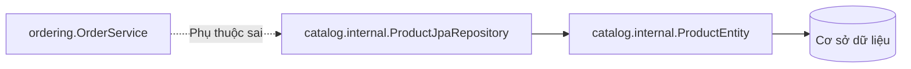
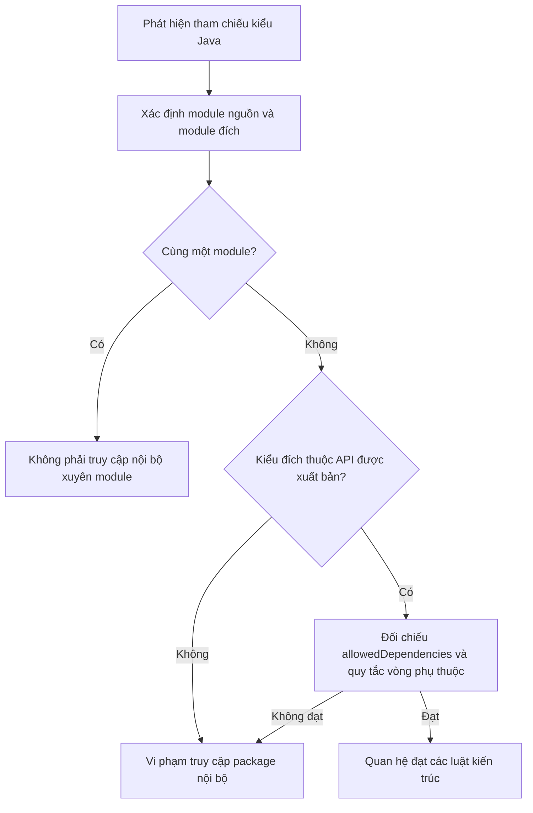
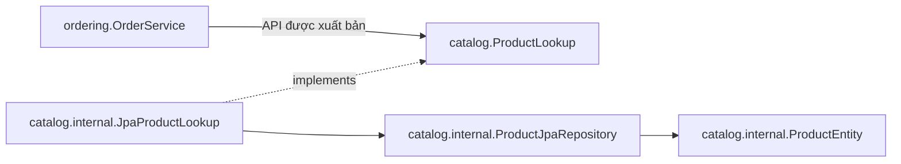
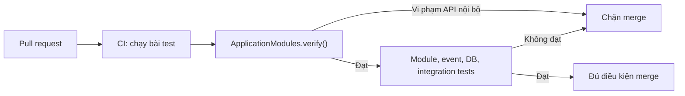

# Vi phạm khi truy cập package nội bộ trong Spring Modulith

## 1. Tình huống: mã Java chạy được nhưng phá ranh giới module

Giả sử ứng dụng bán hàng được chia thành các **application module**: `catalog` quản lý sản phẩm, `ordering` xử lý đơn hàng, `payment` xử lý thanh toán. Lập trình viên của `ordering` muốn kiểm tra sự tồn tại của sản phẩm và tiêm thẳng `catalog.internal.ProductJpaRepository` vào `OrderService`. Mã Java có thể biên dịch, Spring có thể inject bean thành công và bài test nghiệp vụ vẫn có thể đạt. Tuy nhiên, `ordering` đã biết quá nhiều về cách `catalog` lưu trữ dữ liệu.

Đó là **vi phạm truy cập package nội bộ** (*internal package access violation*): một kiểu thuộc module này phụ thuộc trực tiếp vào kiểu nằm trong phần implementation mà module khác **chưa công khai**. Spring Modulith có thể phát hiện vi phạm đó khi chạy `ApplicationModules.verify()`.

Bài học thuộc chương **ApplicationModules.verify** của học phần `SPRING_MODULITH_VERIFICATION_TESTING`. Mục tiêu là rèn kỹ năng kiểm chứng ranh giới kiến trúc và quy tắc phụ thuộc giữa module, đồng thời phối hợp kiểm thử module bằng `@ApplicationModuleTest`, kiểm thử sự kiện, cơ sở dữ liệu, tích hợp và quality gate CI để ngăn phụ thuộc sai và hồi quy.

Sau bài học, bạn có thể:

- Xác định vì sao `public` của Java không có nghĩa là **API công khai của application module**.
- Chỉ ra tham chiếu cụ thể từ một kiểu ở module nguồn đến package nội bộ của module đích.
- Viết JUnit test gọi `ApplicationModules.verify()` và diễn giải nguyên nhân thất bại.
- Sửa vi phạm bằng một hợp đồng nghiệp vụ công khai hoặc một `@NamedInterface` được thiết kế có chủ đích.
- Phân biệt kết quả kiểm chứng kiến trúc với kiểm thử nghiệp vụ, event và persistence.

## 2. Package nào được coi là nội bộ?

Với cách nhận diện module mặc định của Spring Modulith, các package con trực tiếp dưới package gốc của ứng dụng tạo thành các application module. Xét cấu trúc:

```text
com.example.shop
├── ShopApplication.java
├── catalog
│   ├── ProductLookup.java
│   ├── api
│   │   ├── package-info.java
│   │   └── ProductPricing.java
│   └── internal
│       ├── ProductJpaRepository.java
│       ├── JpaProductLookup.java
│       └── ProductEntity.java
├── ordering
│   ├── OrderService.java
│   └── internal
│       └── OrderRepository.java
└── payment
    ├── PaymentFacade.java
    └── internal
        └── PaymentEntity.java
```

Trong ví dụ này, `catalog`, `ordering` và `payment` là ba application module.

**Quy tắc mặc định cần nắm:** các kiểu tại **package gốc của module** như `com.example.shop.catalog.ProductLookup` thuộc API mặc định của `catalog`. Kiểu nằm ở **package con** như `catalog.internal.ProductJpaRepository` được xem là nội bộ nếu chưa được xuất bản qua named interface. Cấu hình nhận diện module hoặc cấu trúc module tường minh có thể thay đổi cách phân loại; luôn kiểm tra cấu trúc thực tế của dự án.

| Vị trí | Nhận diện theo ví dụ | Có thể dùng từ module khác? |
| --- | --- | --- |
| `catalog.ProductLookup` | API mặc định của `catalog` | Có, nếu quyền truy cập Java và các luật dependency đều cho phép. |
| `catalog.internal.ProductJpaRepository` | Nội bộ của `catalog` | Không được sử dụng trực tiếp từ `ordering` theo luật đóng gói mặc định. |
| `catalog.internal.ProductEntity` | Nội bộ của `catalog` | Không được đưa thành kiểu mà `ordering` trực tiếp tham chiếu. |
| `catalog.api.ProductPricing` | Package con; có thể trở thành named interface | Chỉ được dùng khi package này được xuất bản phù hợp. |
| `ordering.internal.OrderRepository` | Nội bộ của chính `ordering` | Các lớp cùng `ordering` có thể dùng theo quy tắc Java, không phải truy cập chéo module. |

**Hai khái niệm cần tách biệt:**

1. **Java visibility:** `public`, `protected`, package-private và `private` quyết định những nơi Java cho phép nhìn thấy một kiểu hoặc thành viên.
2. **Module API của Spring Modulith:** ranh giới module và các named interface quyết định **kiểu nào được công khai cho application module khác**.

Một repository `public` đặt trong `catalog.internal` vẫn có thể là implementation detail của `catalog`. Ngược lại, một kiểu nằm trong package gốc nhưng không `public` vẫn chịu quy tắc truy cập của Java; Spring Modulith không cấp thêm quyền truy cập ngôn ngữ.

> Từ `internal` trong tên package chỉ giúp truyền đạt ý đồ. Quy tắc của Spring Modulith dựa vào **vị trí package so với module và phần API được xuất bản**, không phụ thuộc duy nhất vào chuỗi chữ `internal`.

## 3. Ví dụ vi phạm: `ordering` trực tiếp phụ thuộc repository của `catalog`

Giả sử `catalog` dùng Spring Data JPA. Repository ở phần nội bộ:

```java
// com/example/shop/catalog/internal/ProductJpaRepository.java
package com.example.shop.catalog.internal;

import org.springframework.data.jpa.repository.JpaRepository;

public interface ProductJpaRepository
        extends JpaRepository<ProductEntity, Long> {
}
```

Ở đây `ProductEntity` là entity của `catalog`, được định nghĩa trong cùng package nội bộ; phần mapping JPA được lược bớt để tập trung vào kiểm chứng kiến trúc.

Bên module `ordering`, một triển khai ban đầu như sau:

```java
// com/example/shop/ordering/OrderService.java
package com.example.shop.ordering;

import com.example.shop.catalog.internal.ProductJpaRepository;

public class OrderService {

    private final ProductJpaRepository products;

    public OrderService(ProductJpaRepository products) {
        this.products = products;
    }

    public boolean productExists(Long productId) {
        return products.existsById(productId);
    }
}
```

Vấn đề không nằm ở việc `existsById()` có trả đúng dữ liệu hay không. Vấn đề là **module `ordering` đã phụ thuộc trực tiếp vào một kiểu của package con không được `catalog` công khai**. Từ đây, sửa framework persistence, thay repository hoặc đổi sơ đồ dữ liệu ở `catalog` có thể khiến mã `ordering` phải thay đổi.



Bản chất của lỗi:

| Thành phần | Giá trị trong ví dụ |
| --- | --- |
| Kiểu nguồn | `com.example.shop.ordering.OrderService` |
| Application module nguồn | `ordering` |
| Kiểu đích | `com.example.shop.catalog.internal.ProductJpaRepository` |
| Application module đích | `catalog` |
| Ranh giới bị vượt | API của module `catalog`: sử dụng kiểu chưa được xuất bản |
| Luật liên quan | Không được truy cập phần nội bộ của application module khác |

Ngay cả khi có `@ApplicationModule(allowedDependencies = "catalog")` trong `ordering`, quan hệ trên vẫn **vi phạm quy tắc đóng gói**: được phụ thuộc vào module `catalog` không có nghĩa là được phép dùng mọi lớp nội bộ của nó.

## 4. Những dạng tham chiếu có thể dẫn đến vi phạm

Spring Modulith sử dụng cơ chế phân tích các phụ thuộc tĩnh giữa các kiểu Java (dựa trên công cụ phân tích kiến trúc như ArchUnit). Vì vậy, truy cập package nội bộ không chỉ xuất hiện khi bạn gọi một method. Nó còn có thể lộ ra từ **chữ ký kiểu** hoặc **kế thừa**.

| Dạng tham chiếu của `ordering` | Ví dụ | Điều cần kiểm tra |
| --- | --- | --- |
| Field | `private ProductJpaRepository repository;` | Field mang kiểu của module khác. |
| Constructor injection | `OrderService(ProductJpaRepository repo)` | Constructor phụ thuộc trực tiếp kiểu nội bộ. |
| Method parameter | `void place(ProductEntity product)` | API của nguồn chứa entity nội bộ ở đích. |
| Method return type | `ProductEntity getProduct()` | Caller cần biết kiểu triển khai của module khác. |
| Kế thừa/implements | `implements InternalCatalogPort` | Kế thừa phụ thuộc vào interface chưa xuất bản. |
| Khởi tạo hoặc gọi thành viên | `new InternalPriceCalculator()` | Mã dùng trực tiếp lớp implementation của đích. |
| Chữ ký generic và annotation có chứa kiểu đích | `List<ProductEntity>` | Có thể tạo phụ thuộc mà bộ phân tích nhận diện. |

**Ví dụ rò rỉ qua chữ ký phương thức:**

```java
package com.example.shop.ordering;

import com.example.shop.catalog.internal.ProductEntity;

public interface OrderReport {
    ProductEntity loadProduct(Long id);
}
```

Ở đây, interface `OrderReport` còn chưa thực hiện truy vấn nào nhưng đã trực tiếp nhắc đến kiểu nội bộ `ProductEntity`. Nếu Java cho phép truy cập kiểu đó, quan hệ giữa hai application module vẫn trái với ranh giới đã thiết kế.

**Đừng nhầm `import` với bằng chứng duy nhất về dependency.** Một dòng `import` thừa, không được sử dụng trong mã, không tự nó chứng minh có quan hệ phụ thuộc tĩnh trong bytecode. Ngược lại, viết tên kiểu đầy đủ như `com.example.shop.catalog.internal.ProductEntity` mà không có `import` vẫn tạo tham chiếu nếu kiểu được sử dụng thực sự.

### Trường hợp không phải vi phạm chéo module

Giả sử `catalog.internal.JpaProductLookup` sử dụng `catalog.internal.ProductJpaRepository`. Hai lớp thuộc **cùng module `catalog`**: đây là quan hệ nội bộ hợp lệ về mặt ranh giới giữa các application module. `verify()` không cấm module dùng chi tiết triển khai của chính nó chỉ vì package có tên `internal`.

Không nên hiểu luật là “mọi tham chiếu tới package `internal` đều sai”. Câu hỏi chính xác là: **lớp thuộc module nào đang truy cập package nội bộ của module nào?**

## 5. `ApplicationModules.verify()` phát hiện lỗi bằng cách nào?

Ở mức khái niệm, việc phát hiện có thể hiểu qua những bước sau:

1. **Nhận diện module** từ package và cấu hình Spring Modulith.
2. **Thu thập tham chiếu kiểu tĩnh** giữa các lớp trong ứng dụng.
3. **Ánh xạ kiểu nguồn và đích** về application module sở hữu chúng.
4. Nếu tham chiếu **đi qua ranh giới module**, kiểm tra kiểu đích có thuộc API mặc định hoặc named interface được công khai hay không.
5. Kiểm tra thêm các luật liên quan như danh sách phụ thuộc được phép và vòng phụ thuộc giữa các module.
6. Khi có vi phạm, `verify()` báo lỗi để bài JUnit test thất bại.



Đây là **sơ đồ tư duy**, không phải mô tả chính xác thứ tự cài đặt thuật toán của Spring Modulith.

### Đặt lời gọi `verify()` trong JUnit

```java
// src/test/java/com/example/shop/ModuleArchitectureTests.java
package com.example.shop;

import org.junit.jupiter.api.Test;
import org.springframework.modulith.core.ApplicationModules;

class ModuleArchitectureTests {

    @Test
    void verifiesModuleBoundaries() {
        ApplicationModules modules =
                ApplicationModules.of(ShopApplication.class);

        modules.verify();
    }
}
```

`ApplicationModules.of(ShopApplication.class)` tạo mô hình module của ứng dụng. `modules.verify()` kiểm tra những vi phạm kiến trúc của mô hình đó. Khi `OrderService` tham chiếu repository nội bộ của `catalog`, phép kiểm tra có thể phát hiện quan hệ sai và khiến test thất bại.

Đây là kiểm chứng **cấu trúc tĩnh** nên thông thường không cần khởi động toàn bộ Spring application context hoặc kết nối cơ sở dữ liệu chỉ để thực hiện `verify()`. Cần có dependency Spring Modulith và JUnit phù hợp với dự án để biên dịch, chạy test.

**Minh họa ý nghĩa lỗi**, không phải thông báo nguyên văn của thư viện:

```text
Vi phạm ranh giới module:
  Nguồn: ordering.OrderService
  Đích:  catalog.internal.ProductJpaRepository
  Nguyên nhân: ordering phụ thuộc vào kiểu nội bộ của catalog
```

Đường dẫn, tên lỗi và cách diễn đạt trong output thật phụ thuộc phiên bản công cụ. Hãy xác định **kiểu nguồn**, **kiểu đích** và **luật bị vi phạm** thay vì kiểm tra một chuỗi thông báo cố định.

## 6. Cách sửa: để module đích xuất bản một hợp đồng nghiệp vụ

Để `ordering` biết một sản phẩm tồn tại mà không biết cách `catalog` lưu dữ liệu, đặt một interface tại package gốc `catalog`:

```java
// com/example/shop/catalog/ProductLookup.java
package com.example.shop.catalog;

public interface ProductLookup {
    boolean existsById(Long productId);
}
```

`catalog` tự triển khai hợp đồng bằng repository nội bộ:

```java
// com/example/shop/catalog/internal/JpaProductLookup.java
package com.example.shop.catalog.internal;

import com.example.shop.catalog.ProductLookup;
import org.springframework.stereotype.Service;

@Service
class JpaProductLookup implements ProductLookup {

    private final ProductJpaRepository repository;

    JpaProductLookup(ProductJpaRepository repository) {
        this.repository = repository;
    }

    @Override
    public boolean existsById(Long productId) {
        return repository.existsById(productId);
    }
}
```

`ordering` chỉ tiêm interface công khai:

```java
// com/example/shop/ordering/OrderService.java
package com.example.shop.ordering;

import com.example.shop.catalog.ProductLookup;

public class OrderService {

    private final ProductLookup products;

    public OrderService(ProductLookup products) {
        this.products = products;
    }

    public boolean productExists(Long productId) {
        return products.existsById(productId);
    }
}
```



Sau khi sửa, cạnh liên module **`ordering → catalog` vẫn tồn tại**, nhưng nó hướng tới **API công khai** `ProductLookup` thay vì repository của `catalog`. Điều này giúp đội phát triển `catalog` thay implementation mà không buộc `ordering` biết persistence.

**Lưu ý nghiệp vụ:** ví dụ `existsById()` chỉ biểu đạt việc kiểm tra một sản phẩm có tồn tại. Nó chưa kiểm chứng tồn kho, giữ hàng, đồng thời hoặc transaction. Các yêu cầu nghiệp vụ đó cần hợp đồng và bài test phù hợp, không thể suy ra từ việc `verify()` đạt.

## 7. Khi nào cần `@NamedInterface`?

Đôi khi những hợp đồng liên module được đặt trong package con, chẳng hạn `catalog.api`, thay vì package gốc `catalog`. Theo quy ước mặc định, package con chưa tự được công khai. Spring Modulith cho phép xuất bản có chủ đích bằng **named interface**.

Ví dụ, tại `catalog/api/package-info.java`:

```java
@NamedInterface("api")
package com.example.shop.catalog.api;

import org.springframework.modulith.NamedInterface;
```

Và hợp đồng trong package đó:

```java
// com/example/shop/catalog/api/ProductPricing.java
package com.example.shop.catalog.api;

import java.math.BigDecimal;

public interface ProductPricing {
    BigDecimal priceOf(Long productId);
}
```

Khi `catalog.api` được xuất bản thành named interface, kiểu công khai thuộc vùng đó có thể được module khác sử dụng theo các luật dependency áp dụng. Nếu muốn `ordering` chỉ phụ thuộc vùng API này, trong `ordering/package-info.java` có thể khai báo:

```java
@ApplicationModule(allowedDependencies = "catalog::api")
package com.example.shop.ordering;

import org.springframework.modulith.ApplicationModule;
```

`catalog::api` là **named interface `api` của module `catalog`**. Tên `api` đến từ khai báo `@NamedInterface("api")`; đây không phải cú pháp trỏ đến mọi package trong `catalog`. Nếu `ordering` còn cần API mặc định của `catalog`, danh sách `allowedDependencies` phải phản ánh những giao diện/module thực sự được cho phép.

Không nên đánh dấu `catalog.internal` là một named interface chỉ để che lỗi truy cập repository. Việc xuất bản repository hoặc entity như API liên module tạo coupling không cần thiết và khiến sự thay đổi persistence lan rộng.

## 8. Tách luật package nội bộ khỏi `allowedDependencies` và luật vòng phụ thuộc

Một quan hệ cần được đánh giá theo nhiều chiều. Giả sử `ordering/package-info.java` khai báo:

```java
@ApplicationModule(allowedDependencies = "catalog")
package com.example.shop.ordering;

import org.springframework.modulith.ApplicationModule;
```

Bảng sau xét từng quan hệ riêng lẻ, với điều kiện không có vòng phụ thuộc phát sinh ở nơi khác:

| Phụ thuộc từ `ordering` | Kết quả dự kiến | Vì sao |
| --- | --- | --- |
| `catalog.ProductLookup` | Hợp lệ | Kiểu thuộc API mặc định của module được phép. |
| `catalog.internal.ProductJpaRepository` | **Vi phạm nội bộ** | Module được phép nhưng **kiểu đích** chưa công khai. |
| `catalog.internal.ProductEntity` | **Vi phạm nội bộ** | Rò rỉ kiểu persistence của module khác. |
| `payment.PaymentFacade` | **Vi phạm danh sách phụ thuộc** | Kiểu có thể là API công khai, nhưng `payment` nằm ngoài `allowedDependencies`. |
| `ordering.internal.OrderRepository` | Không phải vi phạm chéo module | Quan hệ nằm trong cùng `ordering`. |

Như vậy:

- **Luật API/đóng gói** hỏi: “Kiểu đích có được module đích công khai không?”
- **`allowedDependencies`** hỏi: “Module nguồn có được phép phụ thuộc module hoặc named interface đích không?”
- **Luật không có vòng** hỏi: “Toàn bộ đồ thị phụ thuộc liên module có tạo chu trình không?”

Một quan hệ hướng tới kiểu công khai và nằm trong `allowedDependencies` vẫn có thể góp phần tạo chu trình, ví dụ `ordering → catalog → ordering`. `verify()` được dùng để kiểm chứng cả cấu trúc, không chỉ riêng một dòng field.

## 9. Một lỗi tinh vi: kiểu nội bộ lọt vào chữ ký API

Giả sử `catalog` viết interface ở package gốc nhưng dùng entity nội bộ trong kiểu trả về:

```java
// Thiết kế có nguy cơ rò rỉ implementation
package com.example.shop.catalog;

import com.example.shop.catalog.internal.ProductEntity;

public interface ProductCatalog {
    ProductEntity getById(Long id);
}
```

Dù `ProductCatalog` là API mặc định, chữ ký của nó gắn hợp đồng với `ProductEntity`. Khi `ordering` sử dụng `ProductEntity` trực tiếp, module `ordering` tạo một tham chiếu đến kiểu nội bộ của `catalog`; phép kiểm chứng kiến trúc có thể phát hiện vi phạm tương ứng.

**Phân biệt chính xác:** việc chính mã `catalog` nhắc đến `catalog.internal.ProductEntity` không tự nó là lỗi **truy cập chéo module**. Không nên khẳng định `verify()` luôn thất bại ngay khi interface này được tạo. Tuy vậy, chữ ký đó là một **API leak** về thiết kế, vì module tiêu thụ có nguy cơ phụ thuộc vào entity của `catalog`.

Cải thiện bằng cách dùng một kiểu dữ liệu công khai, đơn giản, không gắn persistence:

```java
// com/example/shop/catalog/ProductSummary.java
package com.example.shop.catalog;

public record ProductSummary(Long id, String name, boolean active) {
}
```

```java
// com/example/shop/catalog/ProductCatalog.java
package com.example.shop.catalog;

public interface ProductCatalog {
    ProductSummary getById(Long id);
}
```

Phần implementation nằm trong `catalog.internal` có trách nhiệm chuyển từ `ProductEntity` sang `ProductSummary`. Cách này giúp hợp đồng không bị ràng buộc vào mô hình JPA và dễ kiểm thử độc lập.

## 10. Khi `verify()` thất bại, truy vết và sửa như thế nào?

Một quy trình gọn cho lập trình viên hoặc reviewer:

1. **Xác định cạnh lỗi:** kiểu nguồn thuộc module nào; kiểu đích thuộc module nào?
2. **Xác định vị trí tham chiếu:** field, constructor, chữ ký method, generic, inheritance hay chỗ tạo đối tượng?
3. **Xác định nguồn rò rỉ:** repository/entity/adapter nội bộ có bị module khác sử dụng trực tiếp không?
4. **Đối chiếu API thực tế:** kiểu đích thuộc package gốc hay một named interface được xuất bản?
5. **Sửa tại ranh giới:** chuyển nhu cầu nghiệp vụ sang interface/DTO công khai; giữ implementation trong module sở hữu.
6. **Chạy lại test kiến trúc và test nghiệp vụ:** xác nhận vừa hết vi phạm vừa giữ đúng chức năng.

Ví dụ, nếu output dẫn đến constructor của `OrderService` có tham số `ProductJpaRepository`, hãy đổi hợp đồng sang `ProductLookup` và thêm implementation tương ứng trong `catalog`. Sau đó chạy lại `ModuleArchitectureTests` và kiểm thử luồng đặt hàng.

Tránh ba hướng sửa làm suy yếu mục đích kiểm chứng:

- Di chuyển toàn bộ repository/entity ra package gốc để nó thành API mặc định.
- Thêm `allowedDependencies` một cách máy móc để “cho phép mọi thứ”, dù vấn đề thực sự là truy cập nội bộ.
- Công bố cả package `internal` bằng `@NamedInterface` chỉ để bài test đạt.

Tốt hơn là xác định **năng lực nghiệp vụ** mà caller cần và xuất bản duy nhất hợp đồng đó.

## 11. Giới hạn của `verify()` và các test cần kết hợp

`verify()` chủ yếu kiểm tra **các phụ thuộc tĩnh được công cụ phân tích phát hiện**. Vì vậy, nó không tự xác nhận mọi tương tác lúc chạy có đúng hay không.

| Tình huống | `verify()` giúp gì? | Cần kiểm chứng bổ sung |
| --- | --- | --- |
| `ordering` tiêm `catalog.internal.ProductJpaRepository` | Phát hiện tham chiếu tĩnh sai ranh giới module | Test luồng đặt hàng sau khi sửa API. |
| `ordering` chỉ dùng `catalog.ProductLookup` | Có thể xác nhận quan hệ kiến trúc hợp lệ | Test kết quả lookup và trường hợp sản phẩm không tồn tại. |
| `ProductLookup` dùng JPA query sai | Không đánh giá tính đúng của query | Integration test repository và database. |
| Module phát event nhưng listener không xử lý | Không chứng minh luồng sự kiện chạy đúng | Test sự kiện/kịch bản theo Spring Modulith. |
| Hai module cùng thao tác một bảng dữ liệu qua SQL hoặc cấu hình | Không bảo đảm phát hiện vi phạm sở hữu bảng | Quy ước kiến trúc dữ liệu và integration test. |
| Gọi service qua HTTP, broker hoặc reflection theo chuỗi tên | Không bảo đảm suy ra cạnh kiểu Java tới đích | Contract/integration test và review thiết kế. |

**`@ApplicationModuleTest`** kiểm tra cách một application module hoạt động với ngữ cảnh Spring phù hợp; kiểm thử sự kiện xác nhận việc publish/consume; kiểm thử database xác nhận mapping, transaction và repository; kiểm thử tích hợp xác nhận tương tác với thành phần khác. Các tầng kiểm thử này bổ sung cho việc bảo vệ ranh giới bằng `verify()`.

Một dự án **đạt kiểm chứng kiến trúc vẫn có thể lỗi nghiệp vụ**, và một dự án có mọi integration test đạt vẫn có thể vi phạm ranh giới package nội bộ. Cần cả hai góc nhìn.

## 12. Đưa kiểm tra package nội bộ vào quality gate CI

Đặt `ModuleArchitectureTests` trong `src/test/java` để chạy cùng bộ test:

```bash
# Nếu dự án sử dụng Maven Wrapper
./mvnw test

# Hoặc nếu dự án sử dụng Gradle Wrapper
./gradlew test
```

Thiết lập job chứa bài test kiến trúc thành **required check** cho pull request. Khi một thay đổi mới đưa `catalog.internal.ProductJpaRepository` vào `ordering`, `verify()` khiến JUnit test thất bại, lệnh test trả kết quả lỗi và job CI không đạt.



Vì thường không cần Spring context hay database để chạy kiểm chứng kiến trúc, test `verify()` có thể chạy thường xuyên và phản hồi nhanh. Tuy nhiên, việc CI **thực sự chặn merge** đòi hỏi cấu hình bắt buộc check; chỉ viết test mà không chạy trong pipeline hoặc không yêu cầu đạt thì chưa đủ.

## 13. Bài tập tự kiểm tra

Giả sử `ordering` khai báo `allowedDependencies = "catalog"`, `catalog` có API mặc định `ProductLookup` và repository `catalog.internal.ProductJpaRepository` chưa được công khai.

**Bài 1.** `OrderService` sử dụng `ProductLookup`, và `JpaProductLookup` trong `catalog.internal` sử dụng `ProductJpaRepository`. Có vi phạm package nội bộ xuyên module không?

**Đáp án:** Không có trong những cạnh được mô tả. `ordering` sử dụng API của `catalog`; implementation truy cập repository **trong cùng module** `catalog`.

**Bài 2.** `OrderService` trực tiếp tiêm `ProductJpaRepository` với interface Java `public`. Vì sao vẫn sai?

**Đáp án:** `public` không thay thế luật API của application module. Kiểu đích ở package con chưa được xuất bản, nên phụ thuộc xuyên module vi phạm đóng gói.

**Bài 3.** Nếu `ordering` phụ thuộc `payment.PaymentFacade` (kiểu ở package gốc `payment`), đây có phải vi phạm package nội bộ không?

**Đáp án:** Không nhất thiết. `PaymentFacade` là API mặc định của `payment` trong ví dụ; lỗi là `ordering` vượt giới hạn `allowedDependencies = "catalog"`. Phải phân loại đúng luật để sửa đúng nguyên nhân.

**Bài 4.** `catalog` đổi implementation từ JPA sang một API từ hệ thống ngoài. Thiết kế nào ít ảnh hưởng `ordering` hơn?

**Đáp án:** `ordering` chỉ phụ thuộc `catalog.ProductLookup`. Module `catalog` có thể thay adapter nội bộ mà không cần đổi caller, miễn hợp đồng nghiệp vụ giữ nguyên.

**Bài 5.** `verify()` đạt có chứng minh việc đọc dữ liệu sản phẩm và giao dịch đặt hàng luôn đúng không?

**Đáp án:** Không. Cần kiểm thử module, repository, transaction, sự kiện và tích hợp tùy kịch bản.

**Ghi nhớ:** **Vi phạm truy cập package nội bộ** xảy ra khi kiểu của một application module tham chiếu phần implementation chưa được công khai của module khác. `ApplicationModules.verify()` giúp phát hiện các phụ thuộc tĩnh đó; cách sửa bền vững là giữ repository/entity/adapter trong module sở hữu và xuất bản hợp đồng nghiệp vụ ổn định. Kết hợp kiểm chứng ranh giới với `@ApplicationModuleTest`, kiểm thử sự kiện, dữ liệu, tích hợp và CI để ngăn phụ thuộc sai lẫn hồi quy hành vi.
