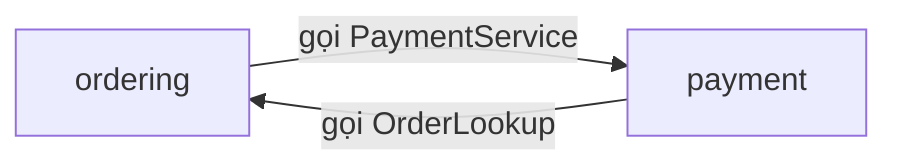
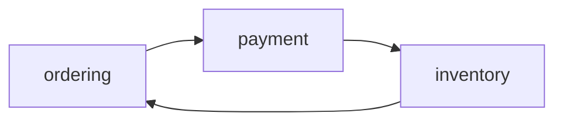
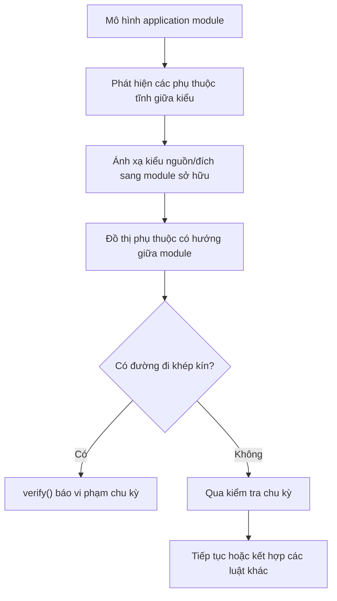
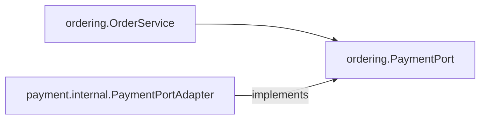
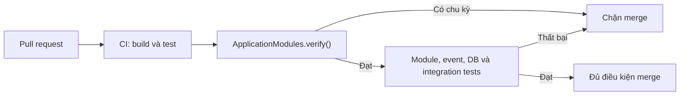

# Vi phạm chu kỳ giữa các module trong Spring Modulith

## 1. Vì sao chu kỳ phụ thuộc là lỗi kiến trúc?

Một ứng dụng Spring Boot có thể được tổ chức thành các package như `ordering` (đơn hàng), `payment` (thanh toán), `inventory` (tồn kho). Cấu trúc package giúp chia trách nhiệm, nhưng nếu mã trong các module gọi qua lại, ranh giới ngày càng khó thay đổi độc lập.

Giả sử:

- Module `ordering` sử dụng dịch vụ của `payment` để thu tiền.
- Module `payment` lại sử dụng API của `ordering` để kiểm tra trạng thái đơn.

Ta có **chu kỳ phụ thuộc** (*dependency cycle*) giữa hai application module:



Vòng này có thể tồn tại dù cả hai kiểu Java đều `public`, đều thuộc API được xuất bản và chương trình vẫn biên dịch. Vấn đề không chỉ là quyền truy cập: **quan hệ phụ thuộc của module không còn đi theo một hướng nhất quán**.

Trong Spring Modulith, `ApplicationModules.verify()` giúp phát hiện chu kỳ giữa các application module khi chạy kiểm chứng kiến trúc. Việc kiểm tra này là một phần trọng tâm của học phần `SPRING_MODULITH_VERIFICATION_TESTING`: bảo vệ ranh giới module và các luật phụ thuộc, sau đó bổ sung `@ApplicationModuleTest`, kiểm thử sự kiện, cơ sở dữ liệu, tích hợp và quality gate CI để ngăn hồi quy.

Mục tiêu sau bài:

1. Nhận diện **chu kỳ trực tiếp** và **chu kỳ gián tiếp** trên đồ thị phụ thuộc module.
2. Giải thích cách `ApplicationModules.verify()` xác định và báo vi phạm.
3. Phân biệt vòng phụ thuộc **application module** với vòng phụ thuộc **bean Spring lúc khởi tạo**.
4. Gỡ chu kỳ bằng phân chia trách nhiệm, đảo chiều phụ thuộc qua interface hoặc giao tiếp sự kiện.
5. Viết test kiến trúc và gắn nó vào CI; kết hợp test hành vi để xác nhận cách sửa vẫn đúng nghiệp vụ.

## 2. Đọc dependency dưới dạng đồ thị có hướng

Trong phép kiểm tra kiến trúc, mỗi **đỉnh** của đồ thị biểu diễn một application module; mỗi **cạnh có hướng** `A → B` biểu diễn việc một kiểu thuộc module A có phụ thuộc tĩnh được nhận diện đến kiểu thuộc module B.

Ví dụ cấu trúc dự án:

```text
com.example.shop
├── ShopApplication.java
├── ordering
│   ├── OrderService.java
│   ├── OrderLookup.java
│   └── internal
│       └── OrderRepository.java
├── payment
│   ├── PaymentService.java
│   └── internal
│       └── PaymentGatewayClient.java
└── inventory
    ├── StockService.java
    └── internal
        └── StockRepository.java
```

Với chiến lược nhận diện mặc định của Spring Modulith, các package con trực tiếp dưới package gốc ứng dụng được nhận diện là application module. Trong ví dụ có ba module: `ordering`, `payment` và `inventory`. Dự án cũng có thể cấu hình cách nhận diện khác; vì vậy phép đánh giá thực tế phải căn cứ vào mô hình module mà Spring Modulith tạo ra.

Ví dụ, nếu `ordering.OrderService` khai báo constructor parameter kiểu `payment.PaymentService`, ta có cạnh trực tiếp `ordering → payment`. Nếu `payment.PaymentService` sử dụng `ordering.OrderLookup`, có cạnh ngược `payment → ordering`.

**Chu kỳ** là đường đi theo chiều các cạnh, bắt đầu từ một module và quay trở lại module đó. Một chu kỳ có thể là:

- **Trực tiếp, hai module:** `ordering → payment → ordering`.
- **Gián tiếp, nhiều module:** `ordering → payment → inventory → ordering`.
- **Nhiều chu kỳ đồng thời:** hai hoặc nhiều đường khép kín tồn tại trong cùng đồ thị.

Một đồ thị phụ thuộc không có chu kỳ được gọi là **đồ thị có hướng không chu trình** (*directed acyclic graph*, DAG). Duy trì DAG làm rõ hướng sử dụng module và giảm nguy cơ thay đổi dây chuyền.

### Chu kỳ ba module vẫn là vi phạm



Ở đây không có cặp module nào nhất thiết gọi qua lại trực tiếp, nhưng đường đi từ `ordering` qua `payment` và `inventory` vẫn quay về `ordering`. Do đó, chỉ kiểm tra “module A có gọi ngược trực tiếp từ B không?” là chưa đủ.

## 3. Một ví dụ tạo chu kỳ dù chỉ gọi API công khai

Giả sử `payment` cung cấp API công khai `PaymentService`. Trong `ordering`:

```java
// com/example/shop/ordering/OrderService.java
package com.example.shop.ordering;

import com.example.shop.payment.PaymentService;

public class OrderService {

    private final PaymentService payment;

    public OrderService(PaymentService payment) {
        this.payment = payment;
    }

    public void submit(Long orderId) {
        payment.charge(orderId);
    }
}
```

Module `payment` lại sử dụng hợp đồng công khai `OrderLookup` của `ordering`:

```java
// com/example/shop/ordering/OrderLookup.java
package com.example.shop.ordering;

public interface OrderLookup {
    boolean exists(Long orderId);
}
```

```java
// com/example/shop/payment/PaymentService.java
package com.example.shop.payment;

import com.example.shop.ordering.OrderLookup;

public class PaymentService {

    private final OrderLookup orders;

    public PaymentService(OrderLookup orders) {
        this.orders = orders;
    }

    public void charge(Long orderId) {
        if (!orders.exists(orderId)) {
            throw new IllegalArgumentException("Unknown order");
        }
        // Thực hiện quy trình thanh toán của payment.
    }
}
```

Hai kiểu tham chiếu đều nằm ở package gốc của module đích, tức thuộc **API mặc định** trong mô hình ví dụ. Tuy vậy, phụ thuộc tĩnh có hướng:

1. `OrderService` dùng `payment.PaymentService` ⇒ `ordering → payment`.
2. `PaymentService` dùng `ordering.OrderLookup` ⇒ `payment → ordering`.
3. Hai cạnh tạo vòng `ordering → payment → ordering`.

**Không có vi phạm API nội bộ cũng vẫn có thể có vi phạm chu kỳ.** Các quy tắc này bổ sung cho nhau: dùng API hợp lệ chỉ giải quyết câu hỏi “được tham chiếu kiểu nào”, chưa giải quyết câu hỏi “hướng phụ thuộc toàn hệ thống có tạo vòng không”.

Lưu ý: các class đơn giản trong ví dụ minh họa quan hệ kiểu, chưa trình bày toàn bộ cấu hình bean, transaction, thanh toán thực tế hoặc quản lý lỗi nghiệp vụ.

## 4. `ApplicationModules.verify()` kiểm tra chu kỳ như thế nào?

Spring Modulith tạo mô hình các application module, phát hiện những quan hệ phụ thuộc tĩnh giữa kiểu Java và quy các quan hệ đó về các cạnh liên module. Nó sử dụng khả năng phân tích kiến trúc như ArchUnit để xác minh các ràng buộc, trong đó có **không tồn tại chu kỳ giữa các application module**.

Có thể hình dung quá trình theo mô hình tư duy:



Sơ đồ giải thích **nguyên lý kiểm tra**, không cam kết thứ tự cài đặt bên trong một phiên bản Spring Modulith cụ thể.

Các phụ thuộc có thể xuất phát từ constructor/field, chữ ký phương thức, lời gọi, kế thừa, interface hoặc những tham chiếu kiểu tĩnh khác mà bộ phân tích nhận diện. Một `import` không được dùng không tự nó là bằng chứng về cạnh phụ thuộc trong bytecode. Ngược lại, dùng tên lớp đầy đủ mà không `import` vẫn có thể tạo cạnh.

Khi đánh giá chu kỳ, cần xác định hai thứ:

- **Cạnh trực tiếp**: lớp nào của module nguồn tham chiếu lớp nào của module đích?
- **Đường khép kín**: từ cạnh đó, có đường đi qua các module khác trở lại module ban đầu không?

Nhờ phân biệt này, ta có thể phát hiện cả chu kỳ gián tiếp mà không nhầm “đường đi gián tiếp `A → B → C`” với một cạnh trực tiếp `A → C`.

## 5. Đặt `verify()` trong kiểm thử JUnit

Một bài test kiến trúc tối thiểu:

```java
// src/test/java/com/example/shop/ModuleArchitectureTests.java
package com.example.shop;

import org.junit.jupiter.api.Test;
import org.springframework.modulith.core.ApplicationModules;

class ModuleArchitectureTests {

    @Test
    void verifiesDependenciesAreAcyclic() {
        ApplicationModules modules =
                ApplicationModules.of(ShopApplication.class);

        modules.verify();
    }
}
```

`ApplicationModules.of(ShopApplication.class)` dựng mô hình module từ lớp ứng dụng; `modules.verify()` xác minh quy tắc kiến trúc. Khi phát hiện chu kỳ, lời gọi kiểm chứng báo lỗi và bài JUnit test bị đánh dấu **failed**. Tên test gợi nhắc luật không có chu kỳ, nhưng **`verify()` không chỉ kiểm tra chu kỳ**: nó còn kiểm tra việc truy cập API của module khác và các giới hạn phụ thuộc đã khai báo.

Thông thường có thể chạy kiểm chứng này mà **không khởi động Spring application context hoặc database**, vì đây là phân tích kiến trúc tĩnh. Điều kiện là dự án có các dependency Spring Modulith, bộ test JUnit và mã đã được biên dịch theo cấu hình build phù hợp.

Ví dụ cách đọc lỗi, **chỉ minh họa ý nghĩa chứ không phải output nguyên văn**:

```text
Architecture verification failed:
  ordering -> payment
  payment  -> ordering
Reason: cyclic dependency among application modules
```

Output thực tế phụ thuộc phiên bản thư viện. Khi xử lý, tập trung vào **danh sách module trong vòng**, **cặp kiểu tạo từng cạnh** và **vị trí tham chiếu trong mã**, thay vì phụ thuộc vào một chuỗi thông báo cố định.

## 6. Đừng nhầm chu kỳ module với circular dependency của Spring bean

Hai lỗi có thể liên quan nhưng **không đồng nhất**:

| Tiêu chí | Chu kỳ application module | Chu kỳ phụ thuộc bean |
| --- | --- | --- |
| Đơn vị xét | Module và quan hệ tham chiếu tĩnh giữa các kiểu Java | Đối tượng/bean và quan hệ tạo, inject tại runtime |
| Ví dụ | `ordering → payment → ordering` từ hai tham chiếu kiểu | Bean A đòi Bean B trong constructor, Bean B đòi Bean A |
| Cách phát hiện | `ApplicationModules.verify()` | Khởi tạo Spring context và cơ chế dependency injection |
| Có cần khởi động context? | Thông thường không | Thường có, để thấy lỗi wiring |
| Kết quả có thể khác nhau? | Có | Có |

Một ứng dụng có thể **khởi động được** dù các application module phụ thuộc vòng, chẳng hạn hai lớp gọi API của nhau nhưng không inject nhau theo chu trình constructor. Ngược lại, các bean trong **cùng một module** có thể bị vòng constructor khiến Spring context khởi động thất bại, trong khi đồ thị application module không có chu kỳ.

Vì thế, bài `verify()` và bài kiểm thử khởi tạo context giải quyết các loại vấn đề khác nhau. Không dùng việc “ứng dụng đã chạy được” làm bằng chứng rằng ranh giới module hợp lệ.

## 7. Cách gỡ chu kỳ: xác định và sửa đúng cạnh

Khi chu kỳ là `ordering → payment → ordering`, cần **phá ít nhất một hướng phụ thuộc tĩnh**. Nhưng sửa đúng không chỉ là xóa một `import`: phải thay đổi cách chia trách nhiệm hoặc hợp đồng để mã nguồn không còn tham chiếu kiểu ở chiều cần loại bỏ.

Quy trình xử lý:

1. **Liệt kê các cạnh của chu kỳ**, ví dụ `ordering.OrderService → payment.PaymentService` và `payment.PaymentService → ordering.OrderLookup`.
2. **Xác định nhu cầu nghiệp vụ** khiến mỗi module cần module còn lại.
3. **Chọn hướng phụ thuộc mong muốn**, chẳng hạn `payment → ordering` nếu thanh toán cung cấp adapter cho một hợp đồng do luồng đặt hàng sở hữu.
4. **Thay thế điểm phụ thuộc sai** bằng một interface ở module chủ hợp đồng, một sự kiện hoặc phân tách chức năng phù hợp.
5. **Chạy lại `verify()` và các bài test hành vi** có liên quan.

Không nên chuyển toàn bộ các lớp vào một package chung hoặc mở mọi giới hạn phụ thuộc chỉ để vòng biến mất khỏi sơ đồ. Cách sửa cần giữ được ranh giới trách nhiệm và có ý nghĩa về nghiệp vụ.

### Cách 1 — Đảo chiều phụ thuộc bằng một port ở module sở hữu nhu cầu

Giả sử `ordering` cần hành động thanh toán, còn `payment` là nơi cung cấp kỹ thuật thanh toán. Định nghĩa **port** tại `ordering`:

```java
// com/example/shop/ordering/PaymentPort.java
package com.example.shop.ordering;

public interface PaymentPort {
    void charge(Long orderId);
}
```

`OrderService` chỉ biết `PaymentPort`, một kiểu trong chính module của nó:

```java
// com/example/shop/ordering/OrderService.java
package com.example.shop.ordering;

public class OrderService {

    private final PaymentPort payments;

    public OrderService(PaymentPort payments) {
        this.payments = payments;
    }

    public void submit(Long orderId) {
        payments.charge(orderId);
    }
}
```

Module `payment` cung cấp adapter triển khai port:

```java
// com/example/shop/payment/internal/PaymentPortAdapter.java
package com.example.shop.payment.internal;

import com.example.shop.ordering.PaymentPort;
import org.springframework.stereotype.Component;

@Component
class PaymentPortAdapter implements PaymentPort {

    @Override
    public void charge(Long orderId) {
        // Gọi cổng thanh toán qua các thành phần nội bộ của payment.
    }
}
```

Các phụ thuộc tĩnh hiện tại:

- `ordering.OrderService → ordering.PaymentPort` là quan hệ **nội module**.
- `payment.internal.PaymentPortAdapter → ordering.PaymentPort` là cạnh **`payment → ordering`**.
- `ordering` không còn tham chiếu bất kỳ kiểu nào thuộc `payment` trong ví dụ này.



Hướng phụ thuộc module chỉ còn **`payment → ordering`**, không có vòng. Trong runtime, Spring có thể inject bean adapter triển khai `PaymentPort` cho `OrderService`; **hướng gọi nghiệp vụ lúc chạy** và **hướng tham chiếu kiểu Java** không nhất thiết trùng nhau. Việc chọn port và điều phối runtime cần phù hợp với cấu hình Spring của dự án.

Lưu ý: port phải mô tả nhu cầu ổn định của module sử dụng. Nếu adapter lại yêu cầu một kiểu `payment` trong chữ ký của port, hoặc `OrderService` vẫn import một DTO của `payment`, cạnh `ordering → payment` có thể vẫn tồn tại và vòng chưa được gỡ.

### Cách 2 — Giao tiếp bằng sự kiện, bỏ lời gọi trực tiếp ngược chiều

Với luồng nghiệp vụ thích hợp cho xử lý sự kiện, `ordering` có thể **phát một sự kiện do nó sở hữu**, còn `payment` lắng nghe. Ví dụ kiểu sự kiện công khai:

```java
// com/example/shop/ordering/OrderSubmitted.java
package com.example.shop.ordering;

public record OrderSubmitted(Long orderId) {
}
```

`ordering` phát sự kiện thông qua API Spring Framework, không cần import kiểu thuộc `payment`:

```java
// com/example/shop/ordering/OrderService.java
package com.example.shop.ordering;

import org.springframework.context.ApplicationEventPublisher;
import org.springframework.stereotype.Service;

@Service
public class OrderService {

    private final ApplicationEventPublisher events;

    public OrderService(ApplicationEventPublisher events) {
        this.events = events;
    }

    public void submit(Long orderId) {
        // Lưu đơn hàng và áp dụng quy tắc nghiệp vụ của ordering.
        events.publishEvent(new OrderSubmitted(orderId));
    }
}
```

`payment` nhận sự kiện qua listener:

```java
// com/example/shop/payment/internal/PaymentOnOrderSubmitted.java
package com.example.shop.payment.internal;

import com.example.shop.ordering.OrderSubmitted;
import org.springframework.context.event.EventListener;
import org.springframework.stereotype.Component;

@Component
class PaymentOnOrderSubmitted {

    private final PaymentProcessor processor;

    PaymentOnOrderSubmitted(PaymentProcessor processor) {
        this.processor = processor;
    }

    @EventListener
    void on(OrderSubmitted event) {
        processor.charge(event.orderId());
    }
}
```

Trong ví dụ này, `PaymentProcessor` là thành phần của chính `payment.internal`, không phải API của `ordering`. Kết quả ở mức tham chiếu tĩnh liên module: `payment → ordering` (do listener dùng `OrderSubmitted`), còn `ordering` không import kiểu của `payment`. Cạnh ngược đã được loại bỏ.

**Không đánh đồng phát sự kiện với bảo đảm giao hàng hoặc bất đồng bộ.** `@EventListener` cơ bản minh họa cơ chế nhận sự kiện trong Spring; thời điểm xử lý, transaction, việc xử lý đồng bộ/bất đồng bộ, retry và bảo đảm delivery cần được thiết kế, cấu hình và kiểm thử riêng. Spring Modulith có các cơ chế hỗ trợ event và kiểm thử kịch bản sự kiện để dùng khi phù hợp.

Nếu `ordering` sau đó lại tham chiếu một lớp `payment` ở chỗ khác, chu kỳ vẫn có thể quay trở lại. Việc dùng event chỉ hiệu quả khi **các cạnh tham chiếu tĩnh** thật sự được tổ chức theo hướng đã chọn.

### Khi nào không nên ép dùng interface hoặc event?

Không phải chu kỳ nào cũng cần hai kỹ thuật trên. Có trường hợp trách nhiệm nghiệp vụ đang chia sai, chẳng hạn `inventory` gọi `ordering` chỉ để hỏi một tính toán thuần túy về sản phẩm. Khi đó, có thể chuyển trách nhiệm đến đúng module sở hữu hoặc tách một hợp đồng ổn định. Tránh tạo module “common” chứa mọi kiểu chỉ vì chúng được nhiều nơi dùng; điều này dễ biến thành nơi gom code không có ranh giới rõ.

## 8. `allowedDependencies` có giải quyết được chu kỳ không?

Spring Modulith cho phép giới hạn những module hoặc named interface mà một module có thể phụ thuộc trực tiếp:

```java
// com/example/shop/ordering/package-info.java
@ApplicationModule(allowedDependencies = "payment")
package com.example.shop.ordering;

import org.springframework.modulith.ApplicationModule;
```

Khai báo này nói rằng `ordering` được phép phụ thuộc vào `payment` theo phạm vi được công bố; **nó không cho phép bỏ qua luật không có chu kỳ**.

Nếu `payment` cũng được phép phụ thuộc `ordering` và mã thực tế tạo vòng `ordering → payment → ordering`, `verify()` vẫn có thể báo vi phạm chu kỳ. `allowedDependencies` giải quyết câu hỏi “module nguồn được phép dùng module đích nào”, còn kiểm tra chu kỳ giải quyết câu hỏi “tổng thể các hướng phụ thuộc có khép thành vòng không”.

| Tình huống | Có API hợp lệ? | Có thể bị `verify()` chặn? |
| --- | --- | --- |
| `ordering → catalog` một chiều, dùng API công khai | Có | Không vì chu kỳ này; vẫn phải xét các luật khác. |
| `ordering → payment → ordering`, cả hai bên dùng API công khai | Có | **Có, vì chu kỳ liên module.** |
| `ordering → catalog.internal.ProductRepository` | Không, dùng kiểu chưa xuất bản | **Có, vì vượt ranh giới API**, ngay cả khi không có vòng. |
| `ordering → payment` khi `allowedDependencies = "catalog"` | Có thể đúng API nhưng sai danh sách cho phép | **Có, vì giới hạn phụ thuộc.** |
| `ordering` dùng `ordering.internal.OrderRepository` | Là quan hệ trong cùng module | Không tạo cạnh **liên module** chỉ từ quan hệ này. |

Khi module dùng `@NamedInterface`, quyền truy cập tới API được xuất bản cũng không tự loại trừ chu kỳ. Named interface giới hạn **những kiểu được dùng**, không thay đổi thực tế là hai module có thể phụ thuộc vòng.

## 9. Khoanh vùng vòng phụ thuộc nhiều module

Giả sử báo cáo kiểm chứng cho thấy:

```text
ordering  -> payment
payment   -> inventory
inventory -> ordering
```

Để sửa, trước tiên tìm **kiểu Java gây mỗi cạnh**, rồi hỏi cạnh nào đi ngược trách nhiệm nghiệp vụ. Ví dụ:

| Cạnh | Quan hệ cụ thể | Hướng phân tích |
| --- | --- | --- |
| `ordering → payment` | `OrderService` dùng `PaymentService` | Có thể thay bằng port do `ordering` sở hữu hoặc sự kiện. |
| `payment → inventory` | `PaymentService` dùng `StockLookup` | Có thực sự là trách nhiệm của payment hay nên cung cấp dữ liệu qua hợp đồng khác? |
| `inventory → ordering` | `StockService` dùng `OrderLookup` | Vì sao kiểm tra tồn kho cần biết đơn hàng? Có thể đổi hướng phối hợp? |

Không nên xử lý vòng ba module bằng cách chỉ tìm cặp gọi ngược. Bất kỳ **một cạnh nào được tổ chức lại đúng cách** làm đứt đường khép kín đều có thể giải quyết chu kỳ đó, nhưng cần chạy lại `verify()` để phát hiện các vòng khác.

Một thuật toán suy luận thủ công hữu ích:

1. Bắt đầu từ một module A.
2. Đi theo một cạnh ra khỏi A và ghi nhận các module đã đi qua.
3. Tiếp tục theo hướng cạnh; nếu gặp lại một module trên **đường đi hiện tại**, đã tìm được chu kỳ.
4. Quay lại và duyệt các nhánh còn lại vì đồ thị có thể có nhiều vòng.

Đây là cách đọc đồ thị khi review. Không cần tự viết thuật toán tìm chu kỳ để sử dụng `ApplicationModules.verify()`.

## 10. Kết hợp `@ApplicationModuleTest` và kiểm thử hành vi sau khi sửa

**`verify()` đạt không chứng minh rằng nghiệp vụ đúng.** Khi đảo chiều phụ thuộc bằng port, phải xác nhận Spring inject adapter phù hợp, giao dịch được xử lý đúng và lỗi từ hệ thống thanh toán được phản ánh đúng. Khi chuyển sang event, phải xác nhận sự kiện được phát và listener xử lý đúng theo kỳ vọng.

Các tầng kiểm thử bổ sung nhau:

| Tầng kiểm thử | Câu hỏi cần trả lời | Công cụ phù hợp |
| --- | --- | --- |
| Kiến trúc module | Có chu kỳ, tham chiếu package nội bộ hoặc vi phạm luật phụ thuộc không? | `ApplicationModules.of(...).verify()` |
| Hành vi một module | Logic, bean và các tương tác trong phạm vi module có đúng? | `@ApplicationModuleTest`, unit test |
| Sự kiện | `OrderSubmitted` được phát và xử lý đúng, đúng ngữ cảnh transaction? | Test event và test kịch bản của Spring Modulith |
| Cơ sở dữ liệu | Lưu đơn, lưu thanh toán, rollback và mapping có đúng? | Integration test với database phù hợp |
| Hệ thống ngoài | Payment gateway, broker và API liên quan hoạt động theo hợp đồng? | Integration/contract test; Testcontainers khi phù hợp |

Ví dụ chiến lược sau khi refactor theo event:

- Chạy `ModuleArchitectureTests` để xác nhận **đồ thị không còn vòng**.
- Test trong phạm vi `ordering` để xác nhận `submit()` lưu đơn và phát `OrderSubmitted` đúng dữ liệu.
- Test phạm vi `payment` hoặc test tích hợp để xác nhận listener nhận sự kiện và gọi processor đúng.
- Test transaction và trường hợp hệ thống thanh toán lỗi: xử lý retry, duplicate event, idempotency hoặc giao dịch bù nếu nghiệp vụ yêu cầu.

Đừng giả định hệ thống đã bảo đảm delivery, retry hoặc tính nhất quán cuối cùng chỉ vì đã thay lời gọi bằng event. Những tính chất ấy phụ thuộc vào cơ chế xử lý và cấu hình thực tế.

### Giới hạn của việc phát hiện tĩnh

`verify()` phân tích các quan hệ kiểu Java nhận diện được. Nó không bảo đảm phát hiện mọi liên kết động như gọi HTTP bằng URL chuỗi, dùng reflection với tên lớp ở cấu hình, chia sẻ trực tiếp bảng dữ liệu, hoặc tương tác qua message broker mà không có tham chiếu kiểu giữa module. Review kiến trúc, contract test và integration test vẫn cần để kiểm soát những dạng coupling đó.

## 11. Chặn chu kỳ mới bằng quality gate CI

Đặt bài `ModuleArchitectureTests` trong `src/test/java` và chạy trong lệnh test thông thường:

```bash
# Với Maven Wrapper
./mvnw test

# Hoặc với Gradle Wrapper
./gradlew test
```

Trong quy trình pull request, cấu hình job có bài test kiến trúc thành **required check**. Khi một lập trình viên thêm cạnh ngược làm khép vòng, `verify()` khiến JUnit thất bại; lệnh test và job CI không đạt, nhờ đó ngăn merge vào nhánh được bảo vệ.



Nếu CI không chạy bài test hoặc check không được yêu cầu đạt để merge, khả năng phòng ngừa hồi quy sẽ bị hạn chế. Nên giữ phép kiểm chứng kiến trúc trong vòng phản hồi thường xuyên của lập trình viên và CI; với thay đổi cấu trúc lớn, chạy thêm các bài kiểm thử hành vi liên quan.

## 12. Bài tập nhận diện và sửa chu kỳ

Xét bốn sơ đồ phụ thuộc dưới đây. Mỗi mũi tên là **một cạnh phụ thuộc tĩnh thực sự giữa hai application module khác nhau**.

| Đồ thị | Có chu kỳ? | Giải thích |
| --- | --- | --- |
| `ordering → catalog`, `ordering → payment` | **Không** | Không có đường quay lại `ordering`. |
| `ordering → payment`, `payment → ordering` | **Có** | Hai module gọi ngược nhau. |
| `ordering → payment`, `payment → inventory`, `inventory → ordering` | **Có** | Vòng ba module, dù không có cặp hai chiều. |
| `payment → ordering`, `inventory → ordering` | **Không** | Cả hai phụ thuộc một chiều về `ordering`. |

**Tình huống thực hành:** `ordering.OrderService` dùng `payment.PaymentService`. `payment.PaymentService` lại dùng `ordering.OrderLookup`. Hai kiểu API đều nằm tại package gốc của module.

1. **Cần chạy phép kiểm tra nào?** Đặt `ApplicationModules.of(ShopApplication.class).verify()` trong bài JUnit test.
2. **Vì sao test có thể thất bại dù kiểu đều `public`?** Vì tồn tại chu kỳ module `ordering → payment → ordering`; luật này độc lập với quyền truy cập API.
3. **Cách sửa nào giúp giữ chiều `payment → ordering`?** Định nghĩa một `PaymentPort` tại `ordering` và cho adapter của `payment` triển khai port, đồng thời bỏ tham chiếu `ordering` đến các kiểu `payment`; hoặc để `ordering` phát sự kiện do nó sở hữu, `payment` lắng nghe và không còn lời gọi trực tiếp ngược chiều.
4. **Cần test gì sau khi sửa?** Chạy lại `verify()`, `@ApplicationModuleTest` ở các module liên quan, test sự kiện hoặc adapter, transaction/database và các integration test cần thiết.
5. **Có thể “cho phép vòng” bằng cách thêm `allowedDependencies` ở cả hai module không?** Không. Cấu hình quyền phụ thuộc không bãi bỏ luật không có chu kỳ.

**Ghi nhớ:** **Chu kỳ giữa các module** xuất hiện khi đồ thị phụ thuộc có đường đi quay lại điểm xuất phát, kể cả vòng gián tiếp qua nhiều module. `ApplicationModules.verify()` giúp phát hiện những vòng đó trước khi mã được hợp nhất. Hãy sửa **hướng phụ thuộc và trách nhiệm nghiệp vụ**, rồi kết hợp `@ApplicationModuleTest`, kiểm thử event, cơ sở dữ liệu, tích hợp cùng required CI check để vừa bảo vệ kiến trúc Spring Modulith vừa ngăn hồi quy hành vi.
