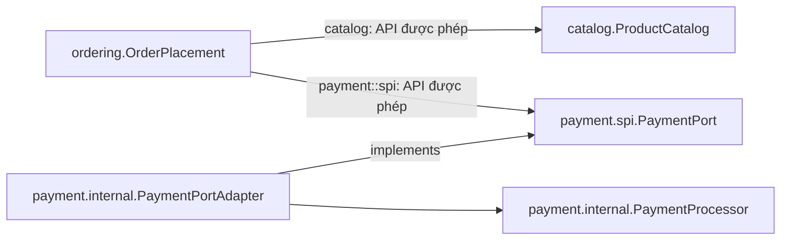
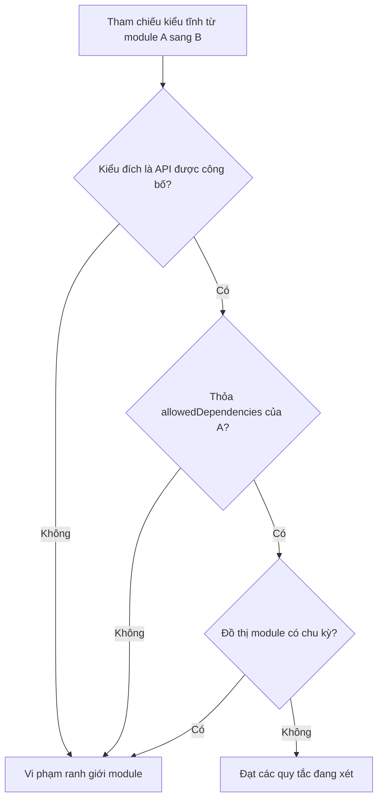
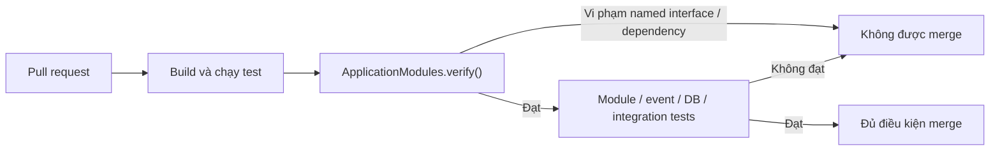

# Kiểm tra named interface và allowed dependencies trong Spring Modulith

## 1. Hai câu hỏi cần kiểm chứng ở ranh giới module

Khi tổ chức ứng dụng Spring Boot theo Spring Modulith, chỉ chia mã thành các package như `catalog`, `ordering`, `payment` chưa đủ để bảo đảm các module phụ thuộc đúng thiết kế. Một kiểu của `ordering` có thể gọi một interface `public` trong `payment` và biên dịch thành công nhưng vẫn vi phạm quy tắc kiến trúc: interface đó chưa được **module `payment` công khai**, hoặc `ordering` chưa được phép phụ thuộc vào phần API ấy.

Để bảo vệ ranh giới, cần trả lời **hai câu hỏi khác nhau**:

1. **Module đích công bố API nào?** Các kiểu trong package gốc module thuộc API mặc định; các package con có thể được công khai có chọn lọc qua `@NamedInterface`. Những kiểu chưa xuất bản là nội bộ.
2. **Module nguồn được phép dùng API của module nào?** `@ApplicationModule(allowedDependencies = ...)` giới hạn các phụ thuộc được phép, có thể chỉ định module hoặc named interface bằng cú pháp `module::interface`.

`ApplicationModules.verify()` kiểm chứng các quan hệ phụ thuộc tĩnh theo những ranh giới đó. Phép kiểm tra còn phát hiện vòng phụ thuộc giữa application module, vì một cạnh hợp lệ về mặt API vẫn có thể góp phần tạo chu kỳ.

Bài học nằm trong `SPRING_MODULITH_VERIFICATION_TESTING`, tập trung rèn kỹ năng kiểm chứng kiến trúc bằng `ApplicationModules`. Sau khi kiểm tra ranh giới, cần kết hợp `@ApplicationModuleTest`, kiểm thử sự kiện, cơ sở dữ liệu, tích hợp và quality gate CI để phát hiện cả hồi quy cấu trúc lẫn hành vi.

**Mục tiêu học tập:**

- Giải thích sự khác nhau giữa API mặc định, named interface và kiểu nội bộ.
- Khai báo `@NamedInterface` trong `package-info.java` để công bố hợp đồng của package con.
- Giới hạn phụ thuộc bằng `@ApplicationModule(allowedDependencies = ...)` và cú pháp `module::interface`.
- Dự đoán quan hệ nào được phép, quan hệ nào sẽ khiến `ApplicationModules.verify()` thất bại.
- Tổ chức test JUnit và CI để phát hiện thay đổi trái ranh giới từ sớm.

## 2. Từ package Java đến giao diện application module

Giả sử ứng dụng có lớp gốc `com.acme.shop.ShopApplication`. Theo cách nhận diện module mặc định, các package con trực tiếp của `com.acme.shop` là các application module:

```text
com.acme.shop
├── ShopApplication.java
├── catalog
│   ├── ProductCatalog.java
│   └── internal
│       ├── JpaProductCatalog.java
│       └── ProductJpaRepository.java
├── payment
│   ├── PaymentFacade.java
│   ├── spi
│   │   ├── package-info.java
│   │   └── PaymentPort.java
│   └── internal
│       ├── PaymentPortAdapter.java
│       └── JpaPaymentRepository.java
└── ordering
    ├── OrderPlacement.java
    ├── package-info.java
    └── internal
        └── OrderRepository.java
```

Ở đây có ba module: `catalog`, `payment` và `ordering`. Dự án thực tế có thể tùy chỉnh chiến lược nhận diện; ví dụ giả định quy ước mặc định để tập trung vào các quy tắc.

| Kiểu hoặc package | Vai trò trong mô hình module |
| --- | --- |
| `catalog.ProductCatalog` | API mặc định của `catalog`, vì nằm trực tiếp tại package gốc module |
| `catalog.internal.ProductJpaRepository` | Kiểu nội bộ của `catalog`; module khác không được tự ý sử dụng |
| `payment.PaymentFacade` | API mặc định của `payment` |
| `payment.spi.PaymentPort` | Kiểu trong package con; chỉ được công bố khi khai báo named interface tương ứng |
| `payment.internal.PaymentPortAdapter` | Implementation thuộc `payment`, không nên xuất bản cho module khác |
| `ordering.OrderPlacement` | Kiểu thuộc API mặc định của `ordering` |

Điểm cần nhớ: `public` trong Java là **quyền truy cập ở mức ngôn ngữ**, còn “được module khác sử dụng” là **quy tắc API của Spring Modulith**. Một kiểu `public` trong `payment.internal` vẫn có thể bị kiểm chứng kiến trúc xem là nội bộ. Ngược lại, kiểu trong API module nhưng không đáp ứng Java visibility cũng không thể được Java sử dụng một cách tùy ý.

## 3. Khai báo và sử dụng một named interface

### 3.1. Công bố package con bằng `@NamedInterface`

Giả sử `payment` muốn cung cấp một hợp đồng xử lý yêu cầu thanh toán cho các module khác, nhưng vẫn giữ riêng adapter và repository. Tạo `payment/spi/package-info.java`:

```java
// src/main/java/com/acme/shop/payment/spi/package-info.java
@NamedInterface("spi")
package com.acme.shop.payment.spi;

import org.springframework.modulith.NamedInterface;
```

Tiếp đó khai báo hợp đồng trong package đã xuất bản:

```java
// src/main/java/com/acme/shop/payment/spi/PaymentPort.java
package com.acme.shop.payment.spi;

public interface PaymentPort {
    void requestPayment(Long orderId);
}
```

Với `@NamedInterface("spi")`, phần API được công bố của `payment.spi` mang tên **`spi`** trong mô hình Spring Modulith. Module khác có thể phụ thuộc vào named interface này khi các luật phụ thuộc tương ứng cho phép.

Đây là bước **module đích công bố hợp đồng**. Nó không tự tạo một quan hệ phụ thuộc; quan hệ phụ thuộc chỉ xuất hiện khi một kiểu ở module khác thật sự tham chiếu hợp đồng đó.

### 3.2. Giữ implementation ở module sở hữu

Trong `payment.internal`, triển khai hợp đồng bằng adapter nội bộ:

```java
// src/main/java/com/acme/shop/payment/internal/PaymentPortAdapter.java
package com.acme.shop.payment.internal;

import com.acme.shop.payment.spi.PaymentPort;
import org.springframework.stereotype.Component;

@Component
class PaymentPortAdapter implements PaymentPort {

    private final PaymentProcessor processor;

    PaymentPortAdapter(PaymentProcessor processor) {
        this.processor = processor;
    }

    @Override
    public void requestPayment(Long orderId) {
        processor.process(orderId);
    }
}
```

Trong ví dụ, `PaymentProcessor` là thành phần nội bộ khác thuộc `payment.internal`, thực hiện nghiệp vụ thanh toán thực tế. `ordering` không cần biết `PaymentPortAdapter`, `PaymentProcessor` hay `JpaPaymentRepository`.

Thiết kế phân biệt rõ:

- **API cho bên ngoài:** `payment.spi.PaymentPort`.
- **Implementation thuộc sở hữu `payment`:** `payment.internal.PaymentPortAdapter` và các thành phần kỹ thuật.
- **Điểm kết nối runtime:** Spring có thể inject bean triển khai `PaymentPort` vào nơi cần dùng; việc kiểm tra module đánh giá **quan hệ kiểu Java**, không chỉ việc inject có chạy hay không.

### 3.3. Khi nào nên tạo named interface?

Named interface hữu ích khi module muốn cung cấp nhiều **nhóm hợp đồng ổn định** cho các bên sử dụng khác nhau. Ví dụ `payment.spi` dành cho yêu cầu thanh toán, còn phần JPA được giữ kín. Việc xuất bản nhóm API riêng giúp reviewer biết chính xác đường tương tác được thiết kế.

Không nên tạo named interface để “mở khóa” toàn bộ package `internal`, vì như vậy sẽ biến repository, entity và adapter thành hợp đồng liên module, làm mất ý nghĩa của đóng gói.

## 4. Dùng `allowedDependencies` để giới hạn module nguồn

Một module có API được xuất bản vẫn chưa có nghĩa **mọi module tiêu thụ đều nên sử dụng API ấy**. Dự án có thể quy định `ordering` chỉ dùng `catalog` và named interface `spi` của `payment`.

Đặt trong `ordering/package-info.java`:

```java
// src/main/java/com/acme/shop/ordering/package-info.java
@ApplicationModule(
    allowedDependencies = {"catalog", "payment::spi"}
)
package com.acme.shop.ordering;

import org.springframework.modulith.ApplicationModule;
```

Ý nghĩa:

- `catalog`: `ordering` được phép phụ thuộc vào module `catalog` theo phần API được nó công bố.
- `payment::spi`: `ordering` được phép phụ thuộc vào **named interface `spi` của module `payment`**.
- Việc `payment` có một API mặc định khác như `payment.PaymentFacade` không tự biến API đó thành phụ thuộc được cho phép bởi khai báo `payment::spi`.

Cú pháp `module::interface` dùng **tên application module** và **tên named interface**, không phải đường dẫn package hay tên lớp. Trong ví dụ, `payment::spi` tương ứng với named interface `spi` đã đăng ký trong module `payment`.

Một class sử dụng hai hợp đồng được phép:

```java
// src/main/java/com/acme/shop/ordering/OrderPlacement.java
package com.acme.shop.ordering;

import com.acme.shop.catalog.ProductCatalog;
import com.acme.shop.payment.spi.PaymentPort;

public class OrderPlacement {

    private final ProductCatalog products;
    private final PaymentPort payments;

    public OrderPlacement(ProductCatalog products, PaymentPort payments) {
        this.products = products;
        this.payments = payments;
    }

    public void place(Long productId, Long orderId) {
        if (!products.existsById(productId)) {
            throw new IllegalArgumentException("Unknown product");
        }
        payments.requestPayment(orderId);
    }
}
```

Ở đây `ProductCatalog` được giả định là interface công khai trong `catalog`, có phương thức `boolean existsById(Long productId)`. Đoạn ví dụ tập trung vào tính hợp lệ của dependency; xử lý tạo đơn, transaction, đảm bảo thanh toán và kết quả nghiệp vụ cần được triển khai/kiểm thử riêng.



Đường phụ thuộc từ `ordering` chỉ đến hợp đồng công khai được cấp quyền. Phần triển khai của `payment` vẫn nằm phía sau ranh giới module.

## 5. `verify()` đối chiếu hai lớp quy tắc ra sao?

Có thể hình dung một phụ thuộc `A → B` được đánh giá qua các câu hỏi:

1. **Kiểu nguồn thuộc module nào?** Ví dụ `ordering.OrderPlacement` thuộc `ordering`.
2. **Kiểu đích thuộc module nào và nằm ở đâu?** Ví dụ `payment.spi.PaymentPort` thuộc `payment` và nằm trong named interface `spi`.
3. **Kiểu đích có thuộc API được xuất bản không?** Nếu nằm trong package con không được công bố, đó là vi phạm đóng gói.
4. **Module nguồn có được phép phụ thuộc tới API đích không?** Nếu khai báo `allowedDependencies`, quan hệ phải thỏa danh sách module/named interface cho phép.
5. **Có vi phạm luật kiến trúc khác không?** Chẳng hạn phụ thuộc hợp lệ này lại góp phần tạo chu kỳ giữa các module.



Sơ đồ là **mô hình giải thích**, không phải cam kết về thứ tự thực thi nội bộ của Spring Modulith. Phép kiểm chứng làm việc với mô hình module và các phụ thuộc tĩnh nhận diện được trong mã đã biên dịch, sử dụng cơ chế kiểm tra kiến trúc như ArchUnit.

### Không khai báo `allowedDependencies` khác gì có khai báo?

Nếu không khai báo danh sách giới hạn, Spring Modulith không mặc nhiên cấm module đó phụ thuộc vào **mọi** module khác. Các quan hệ tới API được xuất bản có thể được chấp nhận, miễn không vi phạm các luật còn lại. Khi thêm `allowedDependencies`, nhóm phát triển chủ động **thu hẹp hướng phụ thuộc** mà module nguồn được phép có.

Vì vậy, thay đổi từ không giới hạn sang `allowedDependencies = {"catalog", "payment::spi"}` là một **quyết định kiến trúc**: các tham chiếu trực tiếp tới module khác không nằm trong danh sách sẽ bị kiểm chứng và có thể bị chặn. Thêm phần tử mới vào danh sách chỉ nên thực hiện khi đó là hướng phụ thuộc được thiết kế có chủ đích.

## 6. Bảng phân loại phụ thuộc hợp lệ và vi phạm

Giả sử:

- `ordering` khai báo `allowedDependencies = {"catalog", "payment::spi"}`.
- `catalog.ProductCatalog` là API mặc định của `catalog`.
- `payment.spi.PaymentPort` thuộc named interface `spi`.
- `payment.PaymentFacade` là API mặc định khác của `payment`.
- `payment.internal.JpaPaymentRepository` và `catalog.internal.ProductJpaRepository` là kiểu nội bộ, chưa được xuất bản.

Các quan hệ dưới đây được xét **riêng lẻ**, với giả định không tạo vòng phụ thuộc khác:

| Tham chiếu từ `ordering` | API công khai? | Nằm trong quyền phụ thuộc? | Kết quả dự kiến |
| --- | --- | --- | --- |
| `catalog.ProductCatalog` | Có | Có, qua `catalog` | **Hợp lệ** |
| `payment.spi.PaymentPort` | Có, qua `spi` | Có, qua `payment::spi` | **Hợp lệ** |
| `payment.PaymentFacade` | Có, qua API mặc định | Không thuộc named interface `spi` được liệt kê | **Vi phạm danh sách phụ thuộc** |
| `payment.internal.JpaPaymentRepository` | Không | Không | **Vi phạm ranh giới API**, đồng thời không thỏa phạm vi được phép |
| `catalog.internal.ProductJpaRepository` | Không | Module `catalog` có trong danh sách | **Vi phạm ranh giới API** |
| `ordering.internal.OrderRepository` | Là kiểu nội bộ của chính `ordering` | Không phải phụ thuộc liên module | Không vi phạm luật liên module vì quan hệ này |
| `shipping.ShippingService` | Có thể là API của `shipping` | `shipping` không được liệt kê | **Vi phạm danh sách phụ thuộc** |

Lưu ý: một quan hệ có thể **vi phạm hơn một ràng buộc**. Thông báo thực tế phụ thuộc phiên bản công cụ, nên không nên giả định luôn có một hoặc nhiều câu báo lỗi theo thứ tự cố định.

### Vì sao `payment.PaymentFacade` có thể bị chặn dù là `public`?

`@NamedInterface("spi")` xuất bản nhóm API `spi`, còn khai báo `allowedDependencies = "payment::spi"` chỉ cho phép `ordering` phụ thuộc **phần API đó** của `payment`. Nếu `ordering` gọi `PaymentFacade` ở API mặc định ngoài phạm vi đã cho phép, khai báo `payment::spi` không bao phủ quan hệ mới.

Muốn `ordering` sử dụng `PaymentFacade`, đội phát triển phải đánh giá lại trách nhiệm và cập nhật phạm vi phụ thuộc khi phù hợp. Không nên tự động mở toàn bộ quyền chỉ để một bài test hết báo lỗi.

### Vì sao `catalog.internal.ProductJpaRepository` vẫn bị chặn?

`catalog` được liệt kê trong `allowedDependencies`, nhưng repository nằm trong package nội bộ chưa được xuất bản. **Được phép phụ thuộc vào một module không đồng nghĩa được phép truy cập tất cả lớp của nó.**

Đây là lỗi thường gặp khi người phát triển chỉ nhìn danh sách module nguồn được phép gọi mà bỏ qua ranh giới API của module đích.

## 7. Kiểm tra bằng `ApplicationModules.verify()` trong JUnit

Tạo một bài kiểm thử kiến trúc:

```java
// src/test/java/com/acme/shop/ModuleArchitectureTests.java
package com.acme.shop;

import org.junit.jupiter.api.Test;
import org.springframework.modulith.core.ApplicationModules;

class ModuleArchitectureTests {

    @Test
    void respectsNamedInterfacesAndAllowedDependencies() {
        ApplicationModules modules =
                ApplicationModules.of(ShopApplication.class);

        modules.verify();
    }
}
```

Các bước khi chạy:

1. `ApplicationModules.of(ShopApplication.class)` xây dựng mô hình application module từ ứng dụng.
2. `verify()` phân tích các quan hệ phụ thuộc kiểu tĩnh, đối chiếu API được công bố và `allowedDependencies`, đồng thời kiểm tra các luật kiến trúc khác như chu kỳ module.
3. Nếu có tham chiếu trái ranh giới hoặc danh sách phụ thuộc, bài kiểm thử thất bại; nếu không phát hiện vi phạm, bài kiểm thử đạt.

`verify()` là **kiểm chứng kiến trúc tĩnh**, vì vậy thông thường không cần khởi động đầy đủ Spring application context hoặc kết nối cơ sở dữ liệu chỉ để chạy bài test này. Dự án vẫn cần cấu hình Spring Modulith và JUnit phù hợp.

**Ví dụ ý nghĩa thông báo**, không phải thông báo nguyên văn từ một phiên bản Spring Modulith cụ thể:

```text
Module dependency violation:
  Source: ordering.OrderPlacement
  Target: payment.PaymentFacade
  Rule: ordering only allows catalog and payment::spi

Module boundary violation:
  Source: ordering.OrderPlacement
  Target: payment.internal.JpaPaymentRepository
  Rule: target type is not part of the published API
```

Khi kiểm tra lỗi thật, tập trung vào **module nguồn**, **module đích**, **kiểu gây tham chiếu** và **luật bị vi phạm**. Dựa vào thông tin đó để sửa ranh giới hoặc hướng phụ thuộc đúng chủ đích.

## 8. Những lỗi cấu hình thường gặp

### Lỗi A — Đặt `@NamedInterface` sai package

Giả sử cần công bố `payment.spi.PaymentPort` nhưng lại đặt `@NamedInterface("spi")` trên `payment.internal/package-info.java`. Khi đó tên interface `spi` đang trỏ đến một nhóm kiểu **khác** với hợp đồng mong muốn. Cần đặt annotation vào đúng package chứa API cần xuất bản và kiểm tra lại tên interface.

Tương tự, chỉ tạo `payment.spi.PaymentPort` mà quên khai báo named interface thích hợp không mặc nhiên khiến package con `payment.spi` trở thành API được công bố trong cấu hình mặc định.

### Lỗi B — Nhầm `payment::spi` với đường dẫn package

`payment::spi` là cú pháp tham chiếu **module và named interface**. Nó không phải classpath Java, `payment.spi` hoặc một package tùy ý. Tên `payment` phải khớp tên module được Spring Modulith nhận diện; `spi` phải khớp tên interface được khai báo.

### Lỗi C — Công bố implementation detail để đạt test

Ví dụ đánh dấu `payment.internal` là named interface để `ordering` truy cập repository và adapter. Bài test có thể không còn lỗi công khai API khi cấu hình được mở rộng phù hợp, nhưng lúc đó ranh giới của `payment` bị suy yếu. Hãy xuất bản **hợp đồng nghiệp vụ**, giữ repository, entity, adapter và cấu hình kỹ thuật ở phần nội bộ.

### Lỗi D — Mở `allowedDependencies` quá rộng

Khi `ordering` xuất hiện phụ thuộc mới tới `shipping`, việc thêm ngay `shipping` vào danh sách mà không xem lại thiết kế có thể che giấu thay đổi sai hướng. Hãy xác định luồng nghiệp vụ nên trực tiếp gọi module khác, dùng port hay giao tiếp bằng sự kiện.

### Lỗi E — Cho rằng named interface loại bỏ luật chu kỳ

Nếu `ordering` dùng `payment::spi`, còn `payment` có kiểu tham chiếu ngược tới API của `ordering`, có thể vẫn hình thành chu kỳ `ordering → payment → ordering`. Named interface bảo vệ **bề mặt API**; `allowedDependencies` bảo vệ **hướng phụ thuộc được phép**; kiểm tra chu kỳ bảo vệ **cấu trúc toàn đồ thị**.

## 9. Sửa một phụ thuộc sai theo từng bước

Giả sử lập trình viên thêm field sau vào `ordering.OrderPlacement`:

```java
// Không hợp lệ với allowedDependencies = {"catalog", "payment::spi"}
private final com.acme.shop.payment.internal.JpaPaymentRepository repository;
```

Để xử lý:

1. **Xác định nhu cầu nghiệp vụ:** `ordering` cần yêu cầu thanh toán, hay thực sự cần thao tác trên bảng payment?
2. **Kiểm tra phần API đã công bố:** `payment.spi.PaymentPort` có đáp ứng nhu cầu đó chưa?
3. **Sửa tham chiếu ở module nguồn:** tiêm `PaymentPort` thay cho `JpaPaymentRepository`.
4. **Chuyển xử lý vào module sở hữu:** adapter/repository thuộc `payment.internal` chịu trách nhiệm gọi hạ tầng.
5. **Chạy lại `verify()`:** xác nhận không còn phụ thuộc sai API/danh sách và không phát sinh chu kỳ.
6. **Chạy test hành vi:** kiểm tra đơn hàng, yêu cầu thanh toán, lỗi nghiệp vụ, dữ liệu và sự kiện theo thiết kế.

Ví dụ sau sửa:

```java
package com.acme.shop.ordering;

import com.acme.shop.payment.spi.PaymentPort;

public class PaymentRequest {

    private final PaymentPort payments;

    public PaymentRequest(PaymentPort payments) {
        this.payments = payments;
    }

    public void request(Long orderId) {
        payments.requestPayment(orderId);
    }
}
```

Sửa này vẫn tạo phụ thuộc tĩnh `ordering → payment`, nhưng đi qua named interface được xuất bản và cho phép. Cách đó giữ `ordering` độc lập với entity, repository và adapter của `payment`.

## 10. Kiểm thử kiến trúc và kiểm thử hành vi bổ sung cho nhau

Bài `ModuleArchitectureTests` trả lời câu hỏi **“cấu trúc có tuân thủ ranh giới module không?”**. Nó không xác nhận việc tạo đơn, thanh toán, transaction hoặc event vận hành đúng.

| Tầng kiểm thử | Câu hỏi chính | Ví dụ công cụ |
| --- | --- | --- |
| Kiến trúc | Có dùng API chưa công bố, vượt `allowedDependencies` hoặc tạo vòng module không? | `ApplicationModules.verify()` |
| Module | Các bean và logic trong một module có hoạt động đúng không? | `@ApplicationModuleTest`, unit test |
| Sự kiện | Event được phát, xử lý và kết hợp transaction theo yêu cầu không? | Kiểm thử sự kiện/kịch bản của Spring Modulith |
| Dữ liệu | Mapping, repository, transaction, rollback có đúng không? | Integration test với database phù hợp |
| Tích hợp | Payment gateway, API bên ngoài và broker có hoạt động theo hợp đồng không? | Integration test/contract test, Testcontainers khi phù hợp |

Ví dụ, `verify()` có thể xác nhận `ordering` chỉ tham chiếu `payment.spi.PaymentPort`; nó **không bảo đảm** Spring tìm đúng bean triển khai `PaymentPort`, hệ thống thanh toán phản hồi đúng hay giao dịch được xử lý an toàn. Điều đó thuộc kiểm thử hành vi và tích hợp.

Các phụ thuộc động qua HTTP, message broker, reflection hoặc việc hai module cùng cập nhật một bảng dữ liệu cũng **không nhất thiết xuất hiện** như một cạnh kiểu Java giữa module nguồn và đích. Cần quy ước kiến trúc, review, test tích hợp và kiểm tra sở hữu dữ liệu để bổ sung cho `verify()`.

## 11. Đưa các luật vào quality gate CI

Đặt bài kiểm thử kiến trúc trong `src/test/java`, để chạy cùng bộ test chuẩn của dự án:

```bash
# Dự án dùng Maven Wrapper
./mvnw test

# Hoặc dự án dùng Gradle Wrapper
./gradlew test
```

Với pull request, CI có thể thực hiện luồng kiểm tra:



Cần cấu hình job test thành **required check** trên nhánh bảo vệ để lỗi kiến trúc thật sự ngăn việc hợp nhất. Nếu một lập trình viên thay `PaymentPort` bằng `JpaPaymentRepository` hoặc bắt đầu gọi `payment.PaymentFacade` trái với quyền đã khai báo, `verify()` sẽ làm test thất bại trên CI.

Không nên tắt hoặc nới giới hạn `allowedDependencies` khi CI đỏ mà chưa xác định nguyên nhân. Hãy kiểm tra thiết kế hợp đồng và luồng phụ thuộc trước, sau đó chạy lại cả test kiến trúc và test nghiệp vụ liên quan.

## 12. Bài tập tự kiểm tra

Dùng cấu hình sau:

- `ordering`: `@ApplicationModule(allowedDependencies = {"catalog", "payment::spi"})`.
- `payment.spi` được xuất bản bằng `@NamedInterface("spi")`.
- `payment.PaymentFacade` là API mặc định, không nằm trong named interface `spi`.
- `payment.internal.JpaPaymentRepository` chưa được xuất bản.
- `catalog.ProductCatalog` là API mặc định; `catalog.internal.JpaProductCatalog` là implementation nội bộ.

**Câu 1.** `ordering` tiêm `payment.spi.PaymentPort`. Quan hệ có hợp lệ không?

**Đáp án:** Có, xét riêng cạnh này: kiểu đích nằm trong named interface được xuất bản và `ordering` được phép dùng `payment::spi`. Vẫn phải kiểm tra cả đồ thị xem có chu kỳ hay vi phạm khác không.

**Câu 2.** `ordering` gọi `payment.PaymentFacade`, một kiểu `public` tại package gốc `payment`. Có hợp lệ không?

**Đáp án:** Không theo cấu hình giới hạn đã nêu. `PaymentFacade` là API công khai, nhưng `ordering` chỉ được cho phép phần `payment::spi` của `payment`, không phải API mặc định đó.

**Câu 3.** `ordering` tiêm `catalog.internal.JpaProductCatalog`, dù đã được phép phụ thuộc `catalog`. Vì sao `verify()` có thể thất bại?

**Đáp án:** Vì `catalog.internal.JpaProductCatalog` là implementation nội bộ chưa được xuất bản. Quyền phụ thuộc module không tự mở API nội bộ.

**Câu 4.** Nếu `payment` dùng ngược một kiểu của `ordering`, việc mọi tham chiếu đều dùng API công khai có bảo đảm `verify()` đạt không?

**Đáp án:** Không. Nếu có hai cạnh `ordering → payment` và `payment → ordering`, đồ thị có chu kỳ và có thể thất bại ở luật không có vòng phụ thuộc.

**Câu 5.** Bài kiểm chứng kiến trúc đã đạt. Có thể bỏ test sự kiện thanh toán và database không?

**Đáp án:** Không. `verify()` không xác nhận event xử lý đúng, repository truy vấn đúng hay transaction thành công. Cần `@ApplicationModuleTest` và các bài test event, cơ sở dữ liệu, tích hợp phù hợp.

**Ghi nhớ:** `@NamedInterface` quyết định **phần API nào của module đích được xuất bản**; `allowedDependencies` quyết định **module nguồn được phép phụ thuộc phần nào**. Cú pháp `module::interface` cho phép giới hạn tới một named interface cụ thể. `ApplicationModules.verify()` kiểm chứng các quan hệ tĩnh, cùng luật không có vòng; kết hợp nó với kiểm thử module, sự kiện, dữ liệu, tích hợp và required CI check để giữ ranh giới Spring Modulith đúng thiết kế qua mỗi thay đổi.
