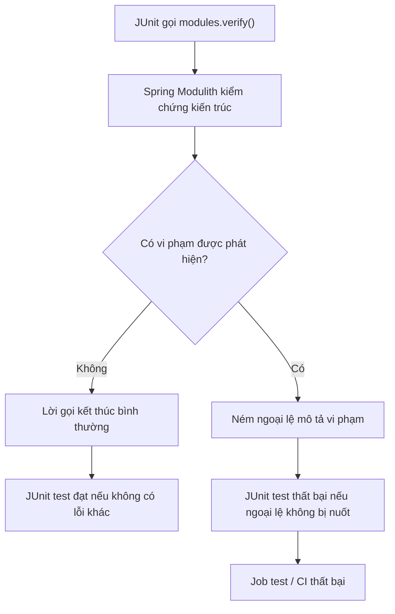
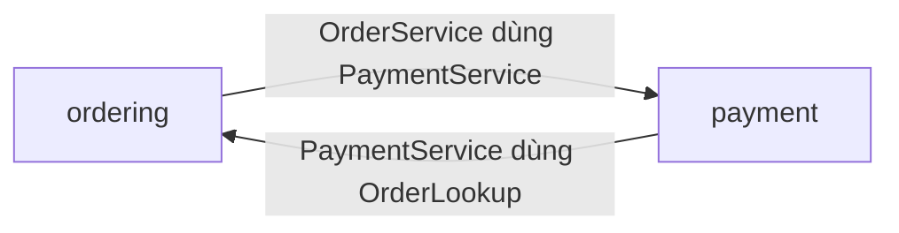
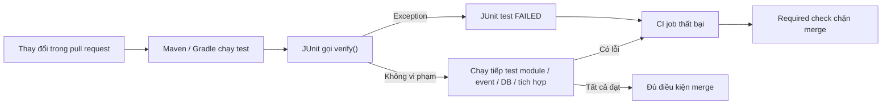

# `ApplicationModules.verify()` trả về hay ném lỗi khi có vi phạm?

## 1. Câu trả lời trực tiếp

**Khi phát hiện vi phạm kiến trúc module, `ApplicationModules.verify()` ném ngoại lệ (exception).** Đây là cách báo thất bại của phép kiểm chứng. Phương thức không cung cấp một kết quả `boolean` kiểu `true` hoặc `false` để lập trình viên tự so sánh trong câu lệnh `if`.

Nếu không phát hiện vi phạm, lời gọi **kết thúc bình thường**. Nếu phát hiện vi phạm, luồng thực thi bị ngắt bởi ngoại lệ; khi lời gọi nằm trong một bài test JUnit và ngoại lệ không bị chặn lại, **JUnit đánh dấu test thất bại**. Nhờ đó, bước test của Maven/Gradle và quality gate trong CI có thể ngăn hợp nhất thay đổi trái quy tắc kiến trúc.

```java
import org.junit.jupiter.api.Test;
import org.springframework.modulith.core.ApplicationModules;

class ModuleArchitectureTests {

    @Test
    void modulesFollowArchitectureRules() {
        ApplicationModules modules =
                ApplicationModules.of(ShopApplication.class);

        modules.verify(); // Bình thường => test đạt; ném exception => test thất bại.
    }
}
```

Không cần viết `assertTrue(modules.verify())` hoặc tự kiểm tra `if (modules.verify())`. `verify()` được sử dụng theo **ngữ nghĩa xác nhận một điều kiện kiến trúc**, tương tự một assertion trong kiểm thử.

Bài này thuộc chương **ApplicationModules.verify** trong học phần `SPRING_MODULITH_VERIFICATION_TESTING`. Mục tiêu là hiểu đúng tín hiệu lỗi kiến trúc để kết hợp với `@ApplicationModuleTest`, kiểm thử sự kiện, cơ sở dữ liệu, tích hợp và các required check trong CI nhằm ngăn phụ thuộc sai và hồi quy.

## 2. `verify()` đang kiểm chứng điều gì?

Giả sử ứng dụng có ba module nghiệp vụ:

```text
com.example.shop
├── ShopApplication.java
├── catalog
│   ├── ProductCatalog.java
│   └── internal
│       └── ProductJpaRepository.java
├── ordering
│   ├── OrderService.java
│   └── package-info.java
└── payment
    └── PaymentService.java
```

Theo cách nhận diện mặc định, những package con trực tiếp dưới package gốc của ứng dụng là các application module. `ApplicationModules.of(ShopApplication.class)` xây dựng mô hình những module được phát hiện cùng các quan hệ phụ thuộc tĩnh giữa các kiểu của chúng. `verify()` kiểm tra mô hình này với các quy tắc kiến trúc, điển hình gồm:

| Nhóm quy tắc | Ví dụ vi phạm | Ý nghĩa |
| --- | --- | --- |
| Không có vòng phụ thuộc giữa module | `ordering → payment → ordering` | Phụ thuộc hai chiều làm mờ trách nhiệm và tăng coupling. |
| Không truy cập API nội bộ của module khác | `ordering.OrderService` tham chiếu `catalog.internal.ProductJpaRepository` | Module nguồn vượt qua giao diện mà `catalog` công khai. |
| Tuân thủ giới hạn phụ thuộc đã khai báo | `ordering` chỉ cho phép `catalog` nhưng lại dùng `payment.PaymentService` | Mã nguồn đi sai hướng phụ thuộc cho phép. |

Những quy tắc bổ sung có thể xuất hiện khi dự án tích hợp công cụ kiểm tra kiến trúc khác hoặc có cấu hình riêng. Bài học tập trung vào **cách `verify()` thông báo kết quả**, áp dụng cho các loại vi phạm được bộ kiểm chứng nhận diện.

Lưu ý: `verify()` kiểm tra các **quan hệ phụ thuộc tĩnh**. Nó không khởi chạy thao tác đặt hàng, gửi event thật hoặc truy vấn bảng dữ liệu để kết luận nghiệp vụ đúng.

## 3. Hai nhánh kết quả: kết thúc bình thường hoặc ném ngoại lệ

Có thể hình dung luồng thực thi:



Từ sơ đồ, có ba điều quan trọng:

1. **Không có một giá trị trả về mang nghĩa `false`.** Không cần ép kiểu hay lưu một biến `valid = ...` để biết kết quả.
2. **Bài test JUnit không cần một assertion bổ sung** sau `verify()`. Nếu lời gọi ném ngoại lệ, framework kiểm thử đã coi đó là thất bại.
3. **Nếu mã kiểm thử bắt rồi bỏ qua ngoại lệ**, JUnit có thể thấy bài test kết thúc bình thường và báo thành công giả, cho dù đã phát hiện lỗi kiến trúc.

Cách hiểu này cũng áp dụng khi gọi `verify()` trong công cụ kiểm tra kiến trúc tự viết: muốn quá trình build biết về vi phạm, phải để ngoại lệ truyền ra ngoài hoặc chủ động biến nó thành lỗi của quy trình.

### `verify()` có trả về đối tượng báo cáo không?

Hãy phân biệt **kết thúc hàm** với **trả về kết quả để xét điều kiện**. API `verify()` thông dụng của Spring Modulith được dùng như một lệnh kiểm chứng: gọi và quan sát **thành công hoặc ngoại lệ**, không phải API trả `boolean` hoặc một danh sách lỗi để duyệt bằng vòng lặp.

Nếu cần trình bày báo cáo vi phạm theo cấu trúc riêng, hãy xem API phát hiện vi phạm và cơ chế báo lỗi **phù hợp phiên bản Spring Modulith mà dự án đang dùng**. Đừng suy đoán một kiểu trả về từ tên `verify()`. Với quality gate thông thường, lời gọi trực tiếp như đoạn JUnit trên là đủ.

### Ngoại lệ cụ thể thuộc kiểu nào?

Tên lớp ngoại lệ, cách gộp nhiều vi phạm và định dạng thông báo có thể thay đổi theo phiên bản thư viện hoặc quy tắc kiểm chứng được tích hợp. Điều quan trọng đối với bài test kiến trúc là **có ngoại lệ thoát ra ngoài khi vi phạm**. Không nên viết test phụ thuộc vào việc thông báo lỗi phải chứa một câu cố định hoặc chỉ có đúng một dòng báo lỗi.

## 4. Ví dụ 1: truy cập package nội bộ làm `verify()` thất bại

Giả sử `catalog` công bố hợp đồng tại package gốc:

```java
// com/example/shop/catalog/ProductCatalog.java
package com.example.shop.catalog;

public interface ProductCatalog {
    boolean existsById(Long id);
}
```

Repository là chi tiết triển khai nội bộ:

```java
// com/example/shop/catalog/internal/ProductJpaRepository.java
package com.example.shop.catalog.internal;

import org.springframework.data.jpa.repository.JpaRepository;

public interface ProductJpaRepository
        extends JpaRepository<ProductEntity, Long> {
}
```

Trong ví dụ, `ProductEntity` được định nghĩa ở cùng package nội bộ. Giả sử `ordering` dùng repository đó trực tiếp:

```java
// com/example/shop/ordering/OrderService.java
package com.example.shop.ordering;

import com.example.shop.catalog.internal.ProductJpaRepository;

public class OrderService {

    private final ProductJpaRepository products;

    public OrderService(ProductJpaRepository products) {
        this.products = products;
    }

    public boolean mayOrder(Long productId) {
        return products.existsById(productId);
    }
}
```

Ở cấp độ Java, `ProductJpaRepository` có thể được tham chiếu vì interface được khai báo `public`. Tuy nhiên, ở cấp **application module**:

- Kiểu nguồn `ordering.OrderService` thuộc module `ordering`.
- Kiểu đích `catalog.internal.ProductJpaRepository` thuộc package con của module `catalog`.
- Package con đó không nằm trong API được xuất bản theo cấu hình mặc định.
- Phụ thuộc trực tiếp từ `ordering` đến chi tiết nội bộ của `catalog` vi phạm ranh giới module.

Khi chạy `modules.verify()` trên ứng dụng, Spring Modulith phát hiện quan hệ tĩnh sai và **ném ngoại lệ**; bài test JUnit thông thường thất bại.

**Minh họa nội dung báo lỗi** (không phải thông báo nguyên văn hoặc cam kết về định dạng):

```text
Architecture verification failed
  Source module: ordering
  Source type:   ordering.OrderService
  Target module: catalog
  Target type:   catalog.internal.ProductJpaRepository
  Problem:       target type is not part of published module API
```

Thông tin hữu ích để sửa gồm **module/kiểu nguồn, module/kiểu đích và quy tắc bị vi phạm**. Khi đọc output thực tế, hãy dùng dữ liệu mà phiên bản thư viện của bạn cung cấp, không đối chiếu từng ký tự với ví dụ này.

### Sửa đúng ranh giới

`ordering` nên sử dụng interface `catalog.ProductCatalog`:

```java
package com.example.shop.ordering;

import com.example.shop.catalog.ProductCatalog;

public class OrderService {

    private final ProductCatalog products;

    public OrderService(ProductCatalog products) {
        this.products = products;
    }

    public boolean mayOrder(Long productId) {
        return products.existsById(productId);
    }
}
```

`catalog.internal` tự triển khai `ProductCatalog` và có thể tiếp tục dùng repository ở bên trong module. Khi đó, cạnh liên module `ordering → catalog` vẫn tồn tại nhưng hướng tới **API công khai**. Nếu không còn vi phạm kiến trúc khác, `verify()` có thể kết thúc bình thường.

Một lỗi cần tránh là chuyển repository/entity lên package gốc chỉ để test không còn ngoại lệ. Điều này làm mở rộng API công khai và tăng coupling thay vì giải quyết nguyên nhân thiết kế.

## 5. Ví dụ 2: vòng phụ thuộc cũng gây ngoại lệ

Xét hai module:

- `ordering.OrderService` sử dụng `payment.PaymentService`.
- `payment.PaymentService` sử dụng `ordering.OrderLookup`.



Dù `PaymentService` và `OrderLookup` đều thuộc API công khai theo cấu trúc package, đồ thị đã có chu trình `ordering → payment → ordering`. Vì vậy, `verify()` vẫn có thể **ném ngoại lệ do vi phạm chu kỳ**.

Đặc điểm cần nhớ: lỗi kiến trúc **không nhất thiết là lỗi biên dịch Java hay lỗi Spring khởi tạo bean**. Hai module có thể được ứng dụng sử dụng bình thường trong một số luồng runtime nhưng vẫn phụ thuộc vòng ở mức kiểu Java. Ngược lại, hai bean trong cùng một module có thể tạo vòng constructor tại runtime mà không tạo chu kỳ **giữa application module**.

Khi xử lý vòng, hãy xác định những cạnh tĩnh tạo ra đường đi khép kín rồi thiết kế lại trách nhiệm: đảo chiều phụ thuộc bằng port/interface phù hợp, điều phối ở module sở hữu nghiệp vụ hoặc giao tiếp qua sự kiện khi đúng với yêu cầu. Thêm quyền `allowedDependencies` không có tác dụng xóa luật kiểm tra chu kỳ.

## 6. Ví dụ 3: vi phạm `allowedDependencies`

Đội phát triển muốn `ordering` chỉ gọi `catalog`. Trong `ordering/package-info.java`:

```java
@ApplicationModule(allowedDependencies = "catalog")
package com.example.shop.ordering;

import org.springframework.modulith.ApplicationModule;
```

Nếu `ordering.OrderService` tham chiếu `payment.PaymentService`, quan hệ `ordering → payment` vi phạm danh sách cho phép. `PaymentService` có thể là API công khai của `payment`, nhưng module `payment` không nằm trong `allowedDependencies` của `ordering`.

Khi gọi `verify()`, test sẽ thất bại nếu quan hệ vi phạm được phát hiện. Cách sửa không phải luôn thêm `payment` vào danh sách: cần xác định hướng phụ thuộc mới có thực sự là một quyết định kiến trúc được chấp nhận hay không. Có thể phải chuyển trách nhiệm, dùng hợp đồng phù hợp hoặc dùng event.

Named interface cũng có thể được kiểm chứng trong các giới hạn này. Ví dụ `allowedDependencies = "payment::spi"` chỉ cho phép phạm vi named interface `spi` của module `payment`; nó không đồng nghĩa cho phép dùng mọi kiểu ở API mặc định hay các package nội bộ của `payment`.

## 7. JUnit chuyển ngoại lệ thành kết quả test như thế nào?

Một bài test kiến trúc **đúng** không cần `assertEquals`, `assertTrue` hoặc `assertThrows`:

```java
package com.example.shop;

import org.junit.jupiter.api.Test;
import org.springframework.modulith.core.ApplicationModules;

class ModuleArchitectureTests {

    @Test
    void respectsModuleBoundaries() {
        ApplicationModules.of(ShopApplication.class).verify();
    }
}
```

Khi chạy bài này:

| Tình trạng kiến trúc | Hành vi của `verify()` | JUnit ghi nhận |
| --- | --- | --- |
| Không phát hiện vi phạm | Kết thúc bình thường | **Passed** nếu test không có lỗi khác |
| Có vòng phụ thuộc liên module | Ném ngoại lệ | **Failed** |
| Truy cập API nội bộ module khác | Ném ngoại lệ | **Failed** |
| Phụ thuộc ngoài `allowedDependencies` | Ném ngoại lệ | **Failed** |
| Test tự bắt rồi bỏ qua ngoại lệ | Ngoại lệ bị nuốt trong test | **Có thể bị báo Passed giả** |

JUnit xem ngoại lệ không được xử lý là kết quả thất bại của test. Vì thế không cần viết một assertion khẳng định hàm “trả về `true`”.

Nếu muốn làm rõ ý định trong code, có thể dùng `assertDoesNotThrow` với một `Executable`, nhưng đó là **lựa chọn diễn đạt**, không phải yêu cầu để JUnit phát hiện lỗi:

```java
import static org.junit.jupiter.api.Assertions.assertDoesNotThrow;

@Test
void architecturePassesVerification() {
    ApplicationModules modules = ApplicationModules.of(ShopApplication.class);
    assertDoesNotThrow(modules::verify);
}
```

Với bài test kiến trúc thông thường, cách gọi trực tiếp `modules.verify()` đơn giản hơn và vẫn bảo đảm JUnit báo lỗi chính xác.

### Sai lầm: bắt rồi bỏ qua ngoại lệ

Đây là ví dụ **không nên dùng** cho quality gate:

```java
@Test
void incorrectlyIgnoresViolations() {
    ApplicationModules modules = ApplicationModules.of(ShopApplication.class);

    try {
        modules.verify();
    } catch (RuntimeException exception) {
        System.err.println(exception.getMessage());
        // Sai: không ném lại, test kết thúc bình thường.
    }
}
```

Nếu `verify()` ném ngoại lệ thuộc nhóm được `catch` bắt, đoạn test vẫn có thể kết thúc thành công. CI có thể báo xanh dù ranh giới module đang sai. Logging **không thay thế** việc báo thất bại của test.

Giải pháp được khuyến nghị: **không bắt ngoại lệ** trong bài test kiến trúc. Nếu thực sự cần thêm ngữ cảnh bằng logging, phải **ném lại ngoại lệ** hoặc chủ động làm test thất bại.

### Khi nào `assertThrows` có ý nghĩa?

`assertThrows` thích hợp cho một **bài test riêng** nhằm kiểm tra rằng một fixture kiến trúc cố tình sai được phát hiện. Khi đó, test được thiết kế để **mong đợi ngoại lệ**.

Tuy nhiên, không đặt `assertThrows` quanh `verify()` của **ứng dụng thực tế** rồi xem đó là quality gate. Làm thế sẽ đảo ngược ý nghĩa: ứng dụng đang có vi phạm lại khiến test đạt vì ngoại lệ đúng như test mong đợi. Bài kiểm chứng kiến trúc của ứng dụng cần yêu cầu **không có vi phạm**.

## 8. Nếu có nhiều vi phạm, chuyện gì xảy ra?

Một đồ thị module có thể đồng thời chứa:

- `ordering` truy cập `catalog.internal.ProductJpaRepository`.
- `ordering` phụ thuộc `payment` trái `allowedDependencies`.
- `payment` lại phụ thuộc `ordering` và tạo chu kỳ.

`verify()` có thể phát hiện và báo một hoặc nhiều vấn đề theo cách tổng hợp của phiên bản/thành phần kiểm chứng đang dùng. Người dùng **không nên giả định** mỗi lần chạy chỉ có đúng một vi phạm, cũng không nên phụ thuộc vào thứ tự câu lỗi.

Khi đọc báo cáo:

1. Xác định các **module nguồn/đích** và **kiểu Java** gây mỗi quan hệ.
2. Phân loại theo luật: **vòng phụ thuộc**, **truy cập package nội bộ** hay **ngoài danh sách được phép**.
3. Ưu tiên sửa tại **ranh giới và trách nhiệm nghiệp vụ**, không mở hàng loạt package hoặc sửa cấu hình chỉ để làm test qua.
4. Chạy lại `verify()` sau khi thay đổi; tiếp tục xử lý các vi phạm còn lại nếu có.
5. Chạy test hành vi liên quan vì thay đổi quan hệ phụ thuộc có thể ảnh hưởng wiring, transaction hoặc event.

Đừng kiểm tra độ đúng bằng cách so sánh toàn bộ `exception.getMessage()` với một chuỗi cố định. Thông báo hữu ích cho con người nhưng định dạng và mức chi tiết có thể thay đổi.

## 9. Không nhầm `verify()` với `@ApplicationModuleTest`

Điều `verify()` xác nhận là **tuân thủ kiến trúc module**, không phải nghiệp vụ chạy thành công. Bài test `@ApplicationModuleTest` kiểm tra hành vi một module trong ngữ cảnh Spring thích hợp; các bài test sự kiện, database và tích hợp xác nhận những mặt khác của hệ thống.

| Phép kiểm tra | Khi không đạt thường có biểu hiện gì? | Vấn đề được phát hiện |
| --- | --- | --- |
| `ApplicationModules.verify()` | Ném ngoại lệ tại lời gọi kiểm chứng | Vòng phụ thuộc, API nội bộ bị truy cập, sai hướng phụ thuộc |
| `@ApplicationModuleTest` | Assertion thất bại, context/wiring lỗi hoặc exception nghiệp vụ | Bean hoặc logic trong phạm vi module không vận hành đúng |
| Kiểm thử sự kiện | Test scenario/assertion thất bại, thiếu event hay listener sai | Event không được phát/tiêu thụ đúng kỳ vọng |
| Kiểm thử database | Query/assertion/transaction thất bại | Mapping, repository, transaction hoặc dữ liệu sai |
| Integration/contract test | Phản hồi sai, timeout, lỗi hợp đồng hoặc kết quả không như mong đợi | Tương tác với module, dịch vụ hay hạ tầng bên ngoài sai |

Một ứng dụng có thể **đạt `verify()` nhưng kiểm thử sự kiện thất bại**, vì cách tổ chức dependency đúng không đảm bảo event được gửi đúng lúc hoặc listener có logic đúng. Ngược lại, toàn bộ integration test có thể đạt nhưng mã nguồn vẫn đang truy cập một repository nội bộ trái thiết kế.

`verify()` cũng không bảo đảm phát hiện mọi coupling động: URL HTTP ở dạng chuỗi, reflection, shared database hoặc message broker không nhất thiết tạo cạnh phụ thuộc kiểu Java. Cần review kiến trúc và kiểm thử tích hợp bổ sung.

## 10. Quality gate trong CI hoạt động nhờ tín hiệu lỗi nào?

Đặt `ModuleArchitectureTests` trong bộ test thông thường của dự án:

```bash
# Maven Wrapper
./mvnw test

# Hoặc Gradle Wrapper
./gradlew test
```

Chuỗi kết quả khi có vi phạm:



Để việc kiểm chứng thật sự ngăn hồi quy:

- Bài test phải **được khám phá và chạy** bởi lệnh test trên CI.
- Ngoại lệ từ `verify()` phải **được phép làm test thất bại**, không bị nuốt trong `try/catch`.
- CI phải **coi job test là điều kiện bắt buộc** trên nhánh bảo vệ.
- Các bài test hành vi/tích hợp liên quan cũng phải chạy, để refactor sửa dependency không làm hỏng nghiệp vụ.

Không cần chủ động gọi `System.exit(1)` trong test hoặc kiểm tra một boolean trả về. JUnit và công cụ build đã có cơ chế chuyển thất bại của test thành kết quả job lỗi.

## 11. Tự thực hành: dự đoán test xanh hay đỏ

Giả sử ứng dụng có các module `catalog`, `ordering`, `payment`; `ordering` khai báo `allowedDependencies = "catalog"`. `ProductCatalog` thuộc package gốc `catalog`, còn `ProductJpaRepository` thuộc `catalog.internal`.

| Tình huống | `verify()` có thể ném lỗi? | Lý do |
| --- | --- | --- |
| `ordering` dùng `catalog.ProductCatalog` và không có lỗi khác | Không vì quan hệ này | API công khai, module đích được phép. |
| `ordering` dùng `catalog.internal.ProductJpaRepository` | **Có** | Truy cập API chưa được xuất bản của `catalog`. |
| `ordering` dùng `payment.PaymentService` | **Có** | `payment` nằm ngoài `allowedDependencies`. |
| `ordering → catalog → ordering` | **Có** | Chu kỳ application module, dù các kiểu đều công khai. |
| `catalog.internal` dùng repository của chính `catalog` | Không vì quan hệ này | Không phải phụ thuộc liên module. |
| `modules.verify()` ném lỗi nhưng test `catch` rồi bỏ qua | Vẫn ném lỗi bên trong | **JUnit có thể báo Passed giả** vì lỗi không thoát ra ngoài. |

**Câu hỏi 1:** Có thể viết `boolean valid = modules.verify();` để xử lý sai kiến trúc theo `if (valid)` không?

**Đáp án:** Không. `verify()` không phải API trả về giá trị boolean báo hợp lệ. Cách dùng là gọi phép kiểm chứng và để ngoại lệ báo thất bại.

**Câu hỏi 2:** Không viết `assertTrue` thì JUnit làm sao biết test `verify()` thất bại?

**Đáp án:** JUnit tự đánh dấu test thất bại khi có ngoại lệ không được xử lý thoát khỏi phương thức test.

**Câu hỏi 3:** Có nên bọc `verify()` bằng `assertThrows` trong bài test kiểm chứng kiến trúc của ứng dụng đang phát triển không?

**Đáp án:** Không. `assertThrows` chấp nhận ngoại lệ như kết quả mong muốn, khiến vi phạm có thể biến thành test đạt. Chỉ dùng trong test fixture riêng cố tình có kiến trúc sai để kiểm tra cơ chế phát hiện.

**Câu hỏi 4:** `verify()` đạt đã đủ để khẳng định logic đặt hàng, thanh toán và event đúng chưa?

**Đáp án:** Chưa. Cần `@ApplicationModuleTest`, unit test, kiểm thử sự kiện, database và tích hợp tùy yêu cầu.

**Câu hỏi 5:** Nếu CI vẫn xanh khi có vi phạm kiến trúc, nên kiểm tra gì?

**Đáp án:** Kiểm tra bài JUnit có được CI chạy hay không, ngoại lệ có bị `catch` rồi bỏ qua không, job có bắt buộc phải đạt trước khi merge không, và cấu hình nhận diện module/luật kiểm chứng có đúng phạm vi mong đợi không.

## 12. Ghi nhớ cho người viết và người review test

- **`verify()` kết thúc bình thường** khi không phát hiện vi phạm; **ném ngoại lệ** khi có vi phạm kiến trúc.
- **Không dùng `if (verify())` hay `assertTrue(verify())`** như thể phương thức trả `boolean`.
- **Đừng nuốt ngoại lệ**; JUnit cần nhìn thấy lỗi để đánh dấu test thất bại.
- **Đọc quan hệ gây lỗi**, không hardcode thông báo hoặc giả định thứ tự vi phạm.
- **Đưa bài test vào required CI check** và kết hợp test hành vi, sự kiện, dữ liệu, tích hợp.

Với cách sử dụng đó, `ApplicationModules.verify()` trở thành một **quality gate kiểm chứng kiến trúc**: phụ thuộc sai ranh giới không chỉ được chỉ ra trong lúc phát triển mà còn khiến pull request thất bại nếu CI được cấu hình chặt chẽ. Các bài `@ApplicationModuleTest` và kiểm thử event/database/integration bổ sung lớp bảo vệ cần thiết để thay đổi đúng kiến trúc cũng vận hành đúng nghiệp vụ.
