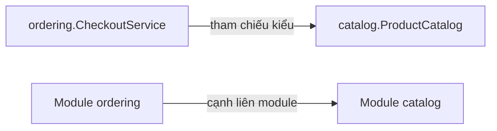
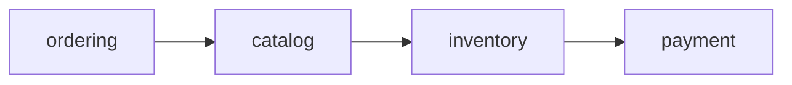
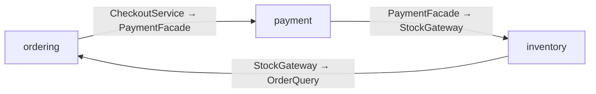
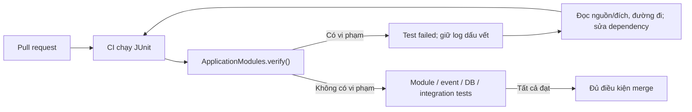

# Đọc thông tin vị trí và đường đi dependency trong `ApplicationModules.verify()`

## 1. Vì sao cần đọc được dấu vết dependency?

Khi chạy `ApplicationModules.verify()`, ứng dụng Spring Modulith có thể báo lỗi vì một module truy cập package nội bộ, phụ thuộc vào module không được phép hoặc tạo **chu kỳ phụ thuộc**. Biết rằng “kiến trúc sai” vẫn chưa đủ để sửa: người phát triển cần xác định **lớp nào tạo quan hệ, quan hệ xuất phát từ vị trí nào trong mã và đường phụ thuộc nào gây vi phạm**.

Ví dụ, thông tin “`ordering` phụ thuộc sai vào `catalog`” còn khá rộng. Một báo cáo hữu ích hơn có thể cho biết `ordering.internal.CheckoutService` tham chiếu `catalog.internal.ProductJpaRepository` trong constructor. Từ đó, ta tìm đúng nơi sửa thành API công khai của `catalog`.

Trong học phần `SPRING_MODULITH_VERIFICATION_TESTING`, việc đọc dấu vết là kỹ năng cầu nối giữa **kiểm chứng kiến trúc với `ApplicationModules`** và **sửa thiết kế**. Sau khi sửa, cần chạy lại bài test kiến trúc và các bài `@ApplicationModuleTest`, kiểm thử sự kiện, cơ sở dữ liệu, tích hợp phù hợp; cuối cùng đưa kết quả vào quality gate CI để ngăn hồi quy.

**Mục tiêu của bài:**

- Hiểu ý nghĩa của **module nguồn**, **module đích**, **kiểu nguồn**, **kiểu đích** và **vị trí mã nguồn**.
- Phân biệt một **cạnh dependency trực tiếp** với một **đường đi gồm nhiều cạnh** trên đồ thị.
- Đọc báo cáo về truy cập package nội bộ, phụ thuộc ngoài `allowedDependencies` và chu kỳ module.
- Khoanh vùng kiểu Java và vị trí cần sửa ngay cả khi thông báo không cung cấp mọi dòng nguồn.
- Dùng phép kiểm chứng trong JUnit/CI mà không che giấu lỗi.

## 2. Bắt đầu từ mô hình application module

Giả sử ứng dụng có cấu trúc:

```text
src/main/java/com/acme/shop/
├── ShopApplication.java
├── ordering/
│   ├── CheckoutService.java
│   ├── OrderQuery.java
│   └── internal/
│       └── OrderJpaRepository.java
├── catalog/
│   ├── ProductCatalog.java
│   └── internal/
│       └── ProductJpaRepository.java
├── payment/
│   ├── PaymentFacade.java
│   └── internal/
│       └── PaymentProcessor.java
└── inventory/
    ├── StockGateway.java
    └── internal/
        └── StockRepository.java
```

Với chiến lược nhận diện module mặc định, `ordering`, `catalog`, `payment` và `inventory` là bốn application module vì là các package con trực tiếp dưới package ứng dụng. Kiểu đặt tại package gốc của module, như `catalog.ProductCatalog`, thuộc API mặc định; kiểu ở package con như `catalog.internal.ProductJpaRepository` được xem là nội bộ trừ khi có cơ chế xuất bản phù hợp.

Spring Modulith có thể xác định **quan hệ phụ thuộc tĩnh giữa các kiểu Java** (thông qua phân tích kiến trúc dựa trên bytecode, ví dụ ArchUnit) rồi quy về **quan hệ giữa application module**. Vì vậy, báo cáo có thể nói về một cạnh ở mức module và kèm theo bằng chứng là lớp cụ thể ở mức Java.



Trong ví dụ, nếu `CheckoutService` có field hoặc constructor parameter kiểu `ProductCatalog`, điều đó tạo một **cạnh trực tiếp** `ordering → catalog`. Bản thân cạnh chưa chắc sai: cần đối chiếu API đích, phạm vi phụ thuộc được phép và các quy tắc kiến trúc khác.

## 3. Năm mảnh thông tin cần lấy từ một báo cáo

Khi `verify()` thất bại, hãy tách thông tin ra theo bảng sau:

| Thông tin | Cần hiểu gì? | Ví dụ |
| --- | --- | --- |
| **Module nguồn** | Module đang phụ thuộc vào module khác | `ordering` |
| **Kiểu nguồn** | Lớp/interface tạo ra tham chiếu tĩnh | `ordering.CheckoutService` |
| **Kiểu đích** | Lớp/interface mà kiểu nguồn sử dụng | `catalog.internal.ProductJpaRepository` |
| **Module đích** | Module sở hữu kiểu được sử dụng | `catalog` |
| **Vị trí và luật** | Nơi khai báo/viết tham chiếu, nếu được báo; quy tắc bị vi phạm | `CheckoutService.java:18`, “API nội bộ” |

**Không phải phiên bản và quy tắc kiểm chứng nào cũng in đủ năm thông tin này**. Thông báo lỗi có thể nêu tên class đầy đủ, tên module, package, một location từ bytecode hoặc đường phụ thuộc nhiều module. Việc thiếu vị trí `file:line` trong output không có nghĩa không tồn tại vi phạm.

### Module nguồn và module đích có thể suy từ package

Chẳng hạn:

```text
com.acme.shop.ordering.CheckoutService
com.acme.shop.catalog.internal.ProductJpaRepository
```

Trong mô hình mặc định:

- `com.acme.shop.ordering...` → module `ordering`.
- `com.acme.shop.catalog.internal...` → module `catalog`, nhưng kiểu đích nằm ở **package con nội bộ**.

Nếu dự án dùng chiến lược nhận diện module tùy chỉnh, cần đối chiếu **mô hình module thực tế** thay vì tự đoán chỉ từ hai thành phần đầu của tên package.

### Location: `file:line` khác gì tên package?

Trong các công cụ phân tích kiến trúc, vị trí nguồn đôi khi được biểu diễn như `(CheckoutService.java:18)`. Khi đó:

- `CheckoutService.java` là file liên quan đến quan hệ phụ thuộc.
- `18` là vị trí dòng được gắn với quan hệ trong metadata phân tích, nếu có.
- Tên kiểu cho biết **ai** tham chiếu; vị trí giúp tìm **ở đâu**.

Không nên mặc định số dòng trỏ đúng lệnh `import` hoặc đúng lời gọi mà bạn đang nghĩ tới. Tùy bytecode, debug information và loại tham chiếu, location có thể trỏ tới **khai báo field, constructor, signature hoặc một dòng sử dụng**; cũng có thể không xuất hiện. Khi file đã thay đổi sau biên dịch, cần build/test lại trước khi đối chiếu số dòng.

## 4. Ví dụ đọc lỗi truy cập package nội bộ

Giả sử `ordering.CheckoutService` tham chiếu repository thuộc `catalog.internal`:

```java
// src/main/java/com/acme/shop/ordering/CheckoutService.java
package com.acme.shop.ordering;

import com.acme.shop.catalog.internal.ProductJpaRepository;

public class CheckoutService {

    private final ProductJpaRepository products;

    public CheckoutService(ProductJpaRepository products) {
        this.products = products;
    }

    public boolean isKnownProduct(Long productId) {
        return products.existsById(productId);
    }
}
```

Vì `ProductJpaRepository` nằm trong package con của `catalog` và chưa được xuất bản làm API, quan hệ này vi phạm đóng gói module.

Để luyện cách đọc, giả sử công cụ cung cấp thông tin **minh họa** sau. Đây **không phải thông báo nguyên văn hoặc định dạng được bảo đảm** của Spring Modulith:

```text
Architecture violation
  Rule: module access / internal package
  From: com.acme.shop.ordering.CheckoutService
  To:   com.acme.shop.catalog.internal.ProductJpaRepository
  At:   CheckoutService.java:9
```

Phân tích:

1. `From` cho biết **kiểu nguồn** là `CheckoutService` thuộc `ordering`.
2. `To` cho biết **kiểu đích** là `ProductJpaRepository` thuộc `catalog`.
3. `catalog.internal` là vùng triển khai chưa công khai; đây là **lỗi ranh giới API**, không phải chỉ đơn thuần “ordering có import catalog”.
4. `At`, nếu có trong output, là **đầu mối** để tìm chỗ khai báo hoặc dùng kiểu. Ở mã ví dụ, constructor và field đều tham chiếu repository, nên phải xem cả hai.

### Cách sửa tận gốc

`catalog` nên công bố một giao diện nghiệp vụ:

```java
// src/main/java/com/acme/shop/catalog/ProductCatalog.java
package com.acme.shop.catalog;

public interface ProductCatalog {
    boolean existsById(Long productId);
}
```

`ordering` dùng interface công khai:

```java
// src/main/java/com/acme/shop/ordering/CheckoutService.java
package com.acme.shop.ordering;

import com.acme.shop.catalog.ProductCatalog;

public class CheckoutService {

    private final ProductCatalog products;

    public CheckoutService(ProductCatalog products) {
        this.products = products;
    }

    public boolean isKnownProduct(Long productId) {
        return products.existsById(productId);
    }
}
```

Implementation `ProductCatalog` và `ProductJpaRepository` vẫn thuộc `catalog.internal`. Sau thay đổi, **cạnh `ordering → catalog` vẫn tồn tại** nhưng đi qua API được công bố. Khi test báo lỗi, mục tiêu là **đổi hướng tham chiếu cụ thể**, không phải làm biến mất tên module `catalog` khỏi toàn bộ đồ thị.

## 5. Đường đi dependency khác một cạnh trực tiếp thế nào?

Giả sử đồ thị có ba cạnh:



Lúc này:

- `ordering → catalog` là **cạnh trực tiếp**.
- `catalog → inventory` là **cạnh trực tiếp**.
- `inventory → payment` là **cạnh trực tiếp**.
- `ordering → catalog → inventory → payment` là **đường đi nhiều bước**.

**Không được tự kết luận có cạnh trực tiếp `ordering → payment`** chỉ vì một đường đi đến `payment` tồn tại. `ordering` có thể hoàn toàn không tham chiếu kiểu Java nào của `payment`.

Khi kiểm tra `allowedDependencies`, hãy tìm **quan hệ trực tiếp mà kiểu Java tạo ra**. Khi kiểm tra **chu kỳ**, lại phải xét **đường đi gồm nhiều cạnh**: một cạnh mới có thể khép một vòng vốn đã tồn tại dưới dạng đường mở.

### Cách đọc cạnh và đường đi trong báo cáo

Báo cáo có thể hiển thị một danh sách quan hệ dạng:

```text
ordering  --> catalog
catalog   --> inventory
inventory --> payment
```

Hãy coi mỗi hàng là **một quan hệ có hướng**. Nếu công cụ chỉ nêu danh sách module trong một chu kỳ, cần truy tìm **kiểu Java gây ra từng cạnh** để xác định vị trí sửa. Không nên ngộ nhận thứ tự các dòng trong thông báo là call stack runtime.

Một **dependency path** trong kiến trúc là đường trên **đồ thị phụ thuộc tĩnh**, khác **call stack** của JVM khi chương trình thực thi.

## 6. Đọc đường đi khi phát hiện chu kỳ module

Giả sử:

- `ordering.CheckoutService` tham chiếu `payment.PaymentFacade`.
- `payment.PaymentFacade` tham chiếu `inventory.StockGateway`.
- `inventory.StockGateway` tham chiếu `ordering.OrderQuery`.

Ta có:



Đây là **chu kỳ gián tiếp ba module**: `ordering → payment → inventory → ordering`. Dù không có cặp module nào gọi ngược nhau trực tiếp, ta vẫn đi theo các cạnh và quay về đỉnh bắt đầu.

Ví dụ output **minh họa về ý nghĩa**, không phải định dạng thật được bảo đảm:

```text
Cyclic module dependency:
  ordering -> payment -> inventory -> ordering

Contributing references:
  ordering.CheckoutService  -> payment.PaymentFacade
  payment.PaymentFacade     -> inventory.StockGateway
  inventory.StockGateway    -> ordering.OrderQuery
```

Nếu công cụ chỉ in đường `ordering → payment → inventory → ordering` mà không ghi `Contributing references`, người phát triển phải **mở các lớp liên quan và tìm tham chiếu kiểu tạo từng cạnh**; không suy đoán một file duy nhất là nguyên nhân của cả vòng.

### Tại sao phải tìm từng cạnh?

Trong chu kỳ nhiều module, thay một quan hệ đúng cách có thể làm đứt đường khép kín. Ví dụ, nếu `inventory` chỉ cần biết thông tin tồn kho và không nên biết đơn hàng, cạnh `inventory → ordering` có thể là dấu hiệu sai trách nhiệm. Nhưng quyết định sửa phải dựa trên nghiệp vụ; không có quy tắc nào bảo “luôn xóa cạnh cuối cùng trong báo cáo”.

Một cách ghi nhận hữu ích khi điều tra:

| Cạnh trong vòng | Kiểu nguồn | Kiểu đích | Câu hỏi thiết kế |
| --- | --- | --- | --- |
| `ordering → payment` | `CheckoutService` | `PaymentFacade` | Nên gọi trực tiếp hay phát event/qua port? |
| `payment → inventory` | `PaymentFacade` | `StockGateway` | Payment có thực sự phải truy vấn tồn kho? |
| `inventory → ordering` | `StockGateway` | `OrderQuery` | Vì sao inventory cần biết ordering? |

Sau khi chọn hướng xử lý, chạy lại `verify()` để biết vòng đã bị xóa và có còn các vi phạm khác không.

## 7. Đọc lỗi `allowedDependencies` và named interface

Một module có thể công bố API hợp lệ nhưng module nguồn **không được phép phụ thuộc** vào nó. Ví dụ `ordering/package-info.java`:

```java
@ApplicationModule(allowedDependencies = "catalog")
package com.acme.shop.ordering;

import org.springframework.modulith.ApplicationModule;
```

Nếu `ordering.CheckoutService` tham chiếu `payment.PaymentFacade`, cạnh `ordering → payment` vi phạm danh sách trên, dù `PaymentFacade` nằm ngay trong package gốc của `payment`.

Khi đọc lỗi, phải tách hai khả năng:

| Kiểu đích | Module nguồn cho phép? | API đích được công bố? | Luật vi phạm |
| --- | --- | --- | --- |
| `catalog.ProductCatalog` | Có, theo `catalog` | Có | Không vi phạm hai luật này |
| `catalog.internal.ProductJpaRepository` | Module `catalog` có trong danh sách | Không | **Truy cập nội bộ** |
| `payment.PaymentFacade` | Không, `payment` không được liệt kê | Có | **Ngoài `allowedDependencies`** |

### Named interface xuất hiện trong đường phụ thuộc ra sao?

Giả sử module `payment` công bố hợp đồng trong `payment.spi`:

```java
// payment/spi/package-info.java
@NamedInterface("spi")
package com.acme.shop.payment.spi;

import org.springframework.modulith.NamedInterface;
```

```java
// payment/spi/PaymentPort.java
package com.acme.shop.payment.spi;

public interface PaymentPort {
    void requestPayment(Long orderId);
}
```

Module `ordering` được phép dùng phần API này khi khai báo:

```java
@ApplicationModule(allowedDependencies = {"catalog", "payment::spi"})
package com.acme.shop.ordering;

import org.springframework.modulith.ApplicationModule;
```

Trong khai báo đó, `payment::spi` là **named interface `spi` của module `payment`**, không phải tên file hay chuỗi package Java. Một tham chiếu tới `payment.spi.PaymentPort` khác về quyền so với tham chiếu tới `payment.internal.PaymentProcessor`.

Nếu báo cáo cho biết `ordering` phụ thuộc vào `payment.PaymentFacade` trong khi chỉ cho phép `payment::spi`, hãy kiểm tra **API nào cụ thể** đã được mở. Việc một module xuất bản named interface không tự cấp quyền sử dụng mọi API khác của module đó.

**Lưu ý:** Một cạnh được phép theo `allowedDependencies` vẫn có thể tạo chu kỳ khi một đường đi ngược tồn tại. Khi đó phải đọc toàn bộ vòng, không chỉ riêng khai báo `package-info.java`.

## 8. Phương pháp truy dấu từ thông báo tới mã nguồn

Một quy trình gọn và lặp lại được:

1. **Giữ lại thông báo lỗi đầy đủ** của bài test `verify()` trong log local/CI.
2. **Ghi ra module nguồn và đích**, rồi xác định tên kiểu đầy đủ nếu output có.
3. **Phân loại lỗi** thành: truy cập API nội bộ, phụ thuộc ngoài danh sách cho phép, hoặc chu kỳ đồ thị.
4. **Tìm file nguồn** theo tên lớp, package và location được cung cấp. Khi `file:line` không rõ, tìm các tham chiếu kiểu của module đích trong module nguồn.
5. **Đối chiếu mối quan hệ thực sự** ở field, constructor, method signature, inheritance, annotation hay lệnh gọi.
6. **Sửa tại ranh giới nghiệp vụ**, chẳng hạn dùng API công khai, named interface phù hợp hoặc thay hướng giao tiếp.
7. **Chạy lại `verify()` và test hành vi** liên quan để xác nhận cách sửa.

Với dự án dùng `ripgrep`, có thể tìm nhanh trong mã nguồn như sau:

```bash
# Tìm những chỗ tham chiếu repository nội bộ
rg -n "ProductJpaRepository" src/main/java

# Tìm các kiểu xuất hiện trong đường chu kỳ
rg -n "PaymentFacade|StockGateway|OrderQuery" src/main/java

# Tìm cấu hình allowedDependencies và named interface
rg -n "allowedDependencies|NamedInterface" src/main/java
```

Đây là ví dụ lệnh khi dùng terminal của dự án có `rg`; không phải bước mà Spring Modulith tự chạy. Nếu hệ thống không có `rg`, có thể tìm bằng IDE. Quan trọng là kiểm tra **vị trí tham chiếu kiểu thực sự**, không chỉ dòng `import`.

### Vì sao chỉ đọc `import` có thể khiến kết luận sai?

- Một `import` không được sử dụng có thể không còn xuất hiện thành phụ thuộc thực trong bytecode.
- Một kiểu có thể được viết bằng **tên Java đầy đủ** mà không cần `import`.
- Một phụ thuộc có thể nằm trong constructor, generic signature hoặc kế thừa, chứ không chỉ một lệnh gọi method.

Nếu output chỉ ra lớp nguồn, hãy kiểm tra toàn bộ chữ ký và chỗ sử dụng kiểu. Với lỗi chu kỳ, đôi khi có nhiều kiểu trong cùng cặp module tạo các cạnh trùng hướng: sửa một tham chiếu nhưng vẫn còn tham chiếu khác, vòng chưa chắc biến mất.

## 9. Những nhầm lẫn khi đọc đường đi dependency

| Nhầm lẫn | Cách hiểu đúng |
| --- | --- |
| “`ordering → catalog → inventory` chứng minh ordering gọi inventory trực tiếp” | Đó là **đường đi**, không tự chứng minh có cạnh trực tiếp `ordering → inventory`. |
| “Chỉ sửa file có dòng đầu tiên trong output là hết vòng” | Cần kiểm tra **mọi cạnh tạo chu kỳ**; output không nhất thiết xếp theo mức ưu tiên sửa. |
| “Class `public` nên chắc chắn là API hợp lệ” | API application module còn tùy **package gốc/named interface** và luật `allowedDependencies`. |
| “Lỗi báo ở `CheckoutService.java:18` nên cứ sửa `import` dòng đầu” | Location là gợi ý; cần xem **field, constructor, chữ ký hoặc chỗ sử dụng** thực sự. |
| “Đường dependency chính là runtime call stack” | Đây là **quan hệ kiểu tĩnh**; JVM có thể có luồng gọi runtime khác. |
| “Mỗi lần `verify()` chỉ có một lỗi” | Có thể có nhiều quan hệ vi phạm; cách tổng hợp báo cáo phụ thuộc phiên bản/cơ chế kiểm chứng. |
| “Không thấy file:line nghĩa là verify không biết lớp nào lỗi” | Báo cáo có thể thiếu location; dựa vào module và tên kiểu để tìm tiếp. |

Một điểm nữa: nếu file nguồn vừa được sửa sau khi build, vị trí từ kết quả cũ có thể lệch. Hãy build/test lại để có dấu vết mới trước khi truy nguyên sâu.

## 10. Đưa việc đọc báo cáo vào bài kiểm thử JUnit

Một bài kiểm thử kiến trúc:

```java
// src/test/java/com/acme/shop/ModuleArchitectureTests.java
package com.acme.shop;

import org.junit.jupiter.api.Test;
import org.springframework.modulith.core.ApplicationModules;

class ModuleArchitectureTests {

    @Test
    void verifiesModuleDependencies() {
        ApplicationModules modules =
                ApplicationModules.of(ShopApplication.class);

        modules.verify();
    }
}
```

`ApplicationModules.of(ShopApplication.class)` tạo mô hình module. Nếu `verify()` phát hiện vi phạm, nó **ném ngoại lệ** và bài JUnit thất bại nếu ngoại lệ được truyền ra ngoài. Người phát triển đọc thông báo, xác định nguồn/đích/đường đi, sửa rồi chạy lại.

**Không nên `catch` ngoại lệ rồi chỉ in log mà không ném lại**, vì JUnit có thể ghi nhận test thành công dù kiến trúc còn sai. Cũng không nên viết quality gate của ứng dụng thực bằng `assertThrows` để mong đợi kiến trúc sai.

Thông thường phép kiểm chứng này không cần khởi động đầy đủ Spring application context hay cơ sở dữ liệu, bởi mục tiêu là phân tích cấu trúc phụ thuộc tĩnh. Tuy nhiên, dự án phải có dependency Spring Modulith/JUnit phù hợp và bộ build/test phải thực sự thực thi bài test.

### Nếu chỉ còn tên module, chưa có đường chi tiết?

Báo cáo có thể ít thông tin hơn điều bạn cần. Khi đó:

- Xác định package của module nguồn và các kiểu đích liên quan.
- Tìm mọi quan hệ tĩnh từ module nguồn sang module đích trong IDE/code search.
- Với vòng `A → B → C → A`, kiểm tra từng cặp `A → B`, `B → C`, `C → A` để tìm lớp tạo cạnh.
- Sử dụng thông tin chẩn đoán hoặc các API mô hình module/kiến trúc **được phiên bản đang dùng hỗ trợ** nếu cần phân tích sâu; tránh giả định có một method hoặc định dạng trace cố định trên mọi phiên bản.

**Mục tiêu là có bằng chứng đủ để sửa**, không cố làm output trùng một ví dụ trên mạng.

## 11. Sau khi sửa dependency, cần kiểm tra những gì?

`verify()` trả lời câu hỏi: **đồ thị phụ thuộc tĩnh có tuân thủ ranh giới đã công bố không?** Nó không chứng minh nghiệp vụ chạy đúng. Ví dụ đổi `CheckoutService` từ việc inject repository sang `ProductCatalog` có thể xóa lỗi đóng gói, nhưng implementation mới vẫn có thể truy vấn sai dữ liệu.

| Lớp kiểm tra | Câu hỏi | Công cụ/cách tiếp cận |
| --- | --- | --- |
| Kiến trúc | Còn cạnh sai, đường chu kỳ hay vi phạm named interface không? | `ApplicationModules.of(...).verify()` |
| Hành vi module | Bean và logic của từng module còn chạy đúng không? | `@ApplicationModuleTest`, unit test |
| Sự kiện | Event được phát, nhận và xử lý đúng kịch bản chưa? | Kiểm thử sự kiện/kịch bản trong Spring Modulith |
| Dữ liệu | Repository, mapping, transaction và rollback hoạt động đúng không? | Test tích hợp database |
| Tích hợp ngoài | HTTP, payment gateway, message broker đáp ứng hợp đồng không? | Contract/integration test; Testcontainers khi phù hợp |

Một số liên kết động như HTTP URL, tên topic message broker, reflection hoặc dùng chung bảng dữ liệu **không nhất thiết tạo cạnh kiểu Java** giữa application module. Do đó, dù không thấy chúng trong báo cáo `verify()`, vẫn phải kiểm tra quy ước sở hữu dữ liệu và tương tác runtime bằng những test phù hợp.

### Chọn sửa port hay sự kiện khi một đường tạo chu kỳ

Nếu việc gọi trực tiếp làm phát sinh vòng, có thể cân nhắc:

- **Port/interface:** đặt hợp đồng ở module sở hữu nhu cầu, cho module cung cấp khả năng triển khai, từ đó đảo hướng phụ thuộc tĩnh.
- **Domain event:** module phát sự kiện do nó sở hữu, module khác lắng nghe mà không tạo lời gọi ngược đến kiểu triển khai.

Dù chọn cách nào, phải kiểm tra **chữ ký kiểu của các bên** còn tạo cạnh không mong muốn hay không. Sử dụng event không tự bảo đảm xử lý bất đồng bộ, retry, delivery hoặc transaction; những tính chất đó cần thiết kế và kiểm thử riêng.

## 12. Bảo vệ khả năng truy vết trong quality gate CI

Đặt bài test `ModuleArchitectureTests` trong `src/test/java` và để công cụ build chạy:

```bash
# Maven Wrapper
./mvnw test

# Hoặc Gradle Wrapper
./gradlew test
```

Thiết lập job chạy test trên pull request và đặt thành **required check** của nhánh được bảo vệ:



Nên giữ nguyên output lỗi của test trong log và lưu báo cáo build phù hợp để reviewer có thể xem **kiểu nguồn, kiểu đích, thông tin location/đường đi** mà không phải đoán. Một CI chỉ thực sự chặn hồi quy kiến trúc nếu **bài test được chạy** và **kết quả đạt là điều kiện bắt buộc để merge**.

Sau refactor, hãy chạy cả các bài test hành vi liên quan: sửa đúng graph không tự bảo đảm Spring wiring, event processing hoặc transaction đã đúng.

## 13. Bài tập thực hành đọc dependency path

Giả sử một bài kiểm chứng cho thấy nội dung minh họa sau:

```text
Violation A
  ordering.CheckoutService --> catalog.internal.ProductJpaRepository
  Location: CheckoutService.java:18
  Rule: target module API

Violation B
  ordering -> payment -> inventory -> ordering
  Rule: module dependency cycle
```

**Câu 1.** Ở Violation A, kiểu nguồn và đích là gì?

**Đáp án:** `ordering.CheckoutService` là nguồn; `catalog.internal.ProductJpaRepository` là đích. Cạnh liên module là `ordering → catalog`. Vấn đề nằm ở **kiểu đích thuộc API nội bộ chưa xuất bản**, không phải bản thân tên module `catalog`.

**Câu 2.** `CheckoutService.java:18` cho phép khẳng định dòng 18 là lệnh `import` không?

**Đáp án:** Không. Đó là một **gợi ý vị trí** theo thông tin công cụ cung cấp. Cần mở file, xem field, constructor, chữ ký hoặc lệnh dùng kiểu và đối chiếu với build hiện tại.

**Câu 3.** Violation B chứng minh có cạnh trực tiếp `ordering → inventory` không?

**Đáp án:** Không. Đường đi gồm **ba cạnh trực tiếp**: `ordering → payment`, `payment → inventory`, `inventory → ordering`. Không suy ra thêm `ordering → inventory`.

**Câu 4.** Với Violation B, có cần mở đúng một lớp là sửa xong không?

**Đáp án:** Chưa chắc. Cần xác định kiểu gây **mỗi cạnh trong vòng**, chọn hướng phụ thuộc cần thay đổi dựa trên trách nhiệm nghiệp vụ, sau đó chạy lại `verify()` để xác nhận không còn chu kỳ khác.

**Câu 5.** Violation A được sửa bằng `catalog.ProductCatalog` và `verify()` đạt. Có cần test database nữa không?

**Đáp án:** Có, nếu thay đổi liên quan truy vấn, mapping, transaction hoặc logic nghiệp vụ. `verify()` chỉ kiểm chứng cấu trúc module, không xác nhận dữ liệu và hành vi đúng.

**Câu 6.** Nếu CI báo xanh nhưng một vi phạm vẫn tồn tại, kiểm tra gì đầu tiên?

**Đáp án:** Xác nhận bài test `verify()` thực sự chạy, ngoại lệ không bị nuốt, cấu hình nhận diện module có đúng, và job được đặt làm required check trên nhánh bảo vệ.

**Ghi nhớ:** Khi đọc kết quả `ApplicationModules.verify()`, hãy tách **vị trí mã nguồn** khỏi **đường đi trong đồ thị**, rồi truy theo **kiểu nguồn → kiểu đích → module sở hữu → luật kiến trúc**. Một cạnh trực tiếp là một quan hệ kiểu; một dependency path có thể gồm nhiều cạnh và khép thành chu kỳ. Sửa đúng chỗ dựa trên bằng chứng rồi chạy lại `verify()`, `@ApplicationModuleTest` và các test sự kiện, dữ liệu, tích hợp trước khi dùng CI để ngăn hồi quy.
