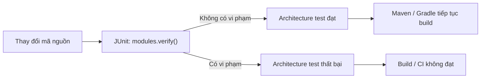
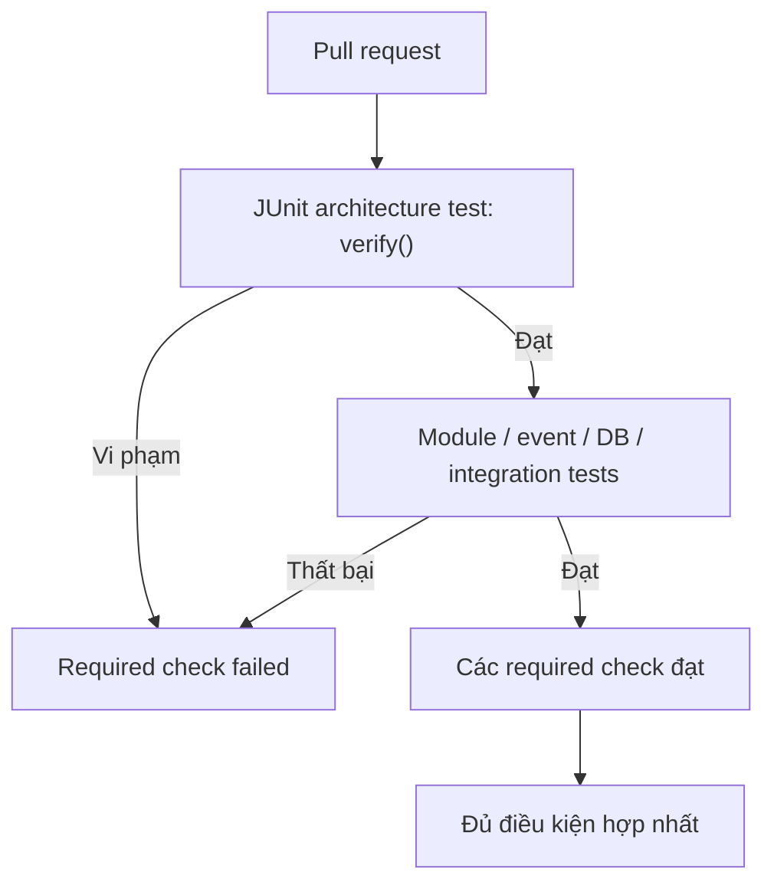

# Chạy `ApplicationModules.verify()` trong test hoặc build

## 1. Mục tiêu: kiểm chứng kiến trúc trở thành một phần của quy trình phát triển

Chia ứng dụng Spring Boot thành các package nghiệp vụ là bước đầu để tạo **application module**. Tuy nhiên, cấu trúc đó vẫn có thể bị phá vỡ bởi một constructor mới tiêm repository của module khác, một tham chiếu ngược tạo vòng phụ thuộc hoặc một thay đổi vượt `allowedDependencies`.

Với Spring Modulith, `ApplicationModules.verify()` kiểm chứng các quy tắc kiến trúc trên mô hình module. Cách sử dụng thực tế và dễ bảo trì nhất là **đặt lời gọi `verify()` trong một bài JUnit test**, để công cụ build chạy bài test cùng các bài kiểm thử khác. Khi có vi phạm, `verify()` ném ngoại lệ; nếu để ngoại lệ truyền ra ngoài, JUnit đánh dấu test thất bại và Maven/Gradle báo build không đạt.



Bài học thuộc chương **ApplicationModules.verify** của `SPRING_MODULITH_VERIFICATION_TESTING`. Mục tiêu cuối cùng là đặt phép kiểm chứng ranh giới module bên cạnh `@ApplicationModuleTest`, kiểm thử sự kiện, cơ sở dữ liệu, tích hợp và **quality gate trong CI**, nhờ đó phát hiện sớm cả phụ thuộc sai lẫn hồi quy.

Sau bài này, bạn sẽ:

- Viết và chạy bài test JUnit dùng `ApplicationModules.of(...).verify()`.
- Cấu hình dependency và test runner cần thiết trong Maven/Gradle.
- Hiểu sự khác nhau giữa **lệnh build `mvn verify`** và **phương thức Java `modules.verify()`**.
- Chạy riêng bài test kiến trúc hoặc chạy toàn bộ test suite.
- Đưa test vào CI, kiểm tra nó thực sự được khám phá/chạy, và đọc tín hiệu thất bại.
- Phối hợp với kiểm thử module, event, cơ sở dữ liệu và tích hợp sau khi sửa kiến trúc.

## 2. Chuẩn bị ứng dụng và ranh giới module

Giả sử project Spring Boot có cấu trúc:

```text
shop/
├── pom.xml                         # hoặc build.gradle(.kts)
└── src/
    ├── main/java/com/acme/shop/
    │   ├── ShopApplication.java
    │   ├── catalog/
    │   │   ├── ProductCatalog.java
    │   │   └── internal/
    │   │       └── ProductJpaRepository.java
    │   ├── ordering/
    │   │   ├── OrderService.java
    │   │   └── package-info.java
    │   └── payment/
    │       └── PaymentFacade.java
    └── test/java/com/acme/shop/
        └── ModuleArchitectureTests.java
```

Lớp ứng dụng nằm tại package gốc:

```java
// src/main/java/com/acme/shop/ShopApplication.java
package com.acme.shop;

import org.springframework.boot.SpringApplication;
import org.springframework.boot.autoconfigure.SpringBootApplication;

@SpringBootApplication
public class ShopApplication {

    public static void main(String[] args) {
        SpringApplication.run(ShopApplication.class, args);
    }
}
```

Theo cách nhận diện mặc định, các package con trực tiếp của `com.acme.shop` tương ứng với các application module `catalog`, `ordering` và `payment`. Các kiểu nằm ngay ở package gốc của mỗi module thuộc API mặc định; những kiểu ở package con như `catalog.internal.ProductJpaRepository` được coi là phần nội bộ nếu không được xuất bản qua named interface.

**Điều kiện cần:** dự án phải biên dịch được mã Java, có Spring Modulith phù hợp với phiên bản Spring Boot và có JUnit Jupiter để chạy test. Có thể tùy chỉnh cách nhận diện module, nhưng trong bài này ta dùng cấu trúc mặc định và một lớp ứng dụng gốc xác định rõ.

## 3. Viết một JUnit test gọi `verify()`

Đặt bài test tại `src/test/java/com/acme/shop/ModuleArchitectureTests.java`:

```java
package com.acme.shop;

import org.junit.jupiter.api.Test;
import org.springframework.modulith.core.ApplicationModules;

class ModuleArchitectureTests {

    @Test
    void verifiesApplicationModuleBoundaries() {
        ApplicationModules modules =
                ApplicationModules.of(ShopApplication.class);

        modules.verify();
    }
}
```

Ý nghĩa từng phần:

1. `@Test` để JUnit Jupiter khám phá và thực thi phương thức kiểm tra.
2. `ApplicationModules.of(ShopApplication.class)` xây dựng mô hình các application module dựa trên ứng dụng.
3. `modules.verify()` kiểm chứng các quy tắc kiến trúc đối với mô hình vừa tạo.
4. **Không phát hiện vi phạm:** lời gọi kết thúc bình thường, bài test có thể đạt.
5. **Phát hiện vi phạm:** phương thức ném ngoại lệ. Nếu không bị nuốt, JUnit đánh dấu bài test **failed**.

Đối với kiểu test này, thông thường **không cần `@SpringBootTest`, `@ApplicationModuleTest` hay khởi động database**. Ta phân tích ranh giới và quan hệ kiểu Java đã biên dịch, thay vì chạy toàn bộ ứng dụng. Điều đó giúp bài test kiến trúc nhanh và dễ đưa vào mọi lần build.

**Không viết** `assertTrue(modules.verify())` hoặc `if (modules.verify())`. Phép kiểm chứng được dùng theo cách **gọi và để ngoại lệ báo thất bại**, không phải đọc một giá trị boolean.

### Vì sao đặt tên lớp là `*Tests`?

Maven Surefire thường khám phá các lớp test có tên theo những mẫu như `*Test` và `*Tests`; Gradle thực hiện test discovery qua JUnit Platform khi được cấu hình. Tên `ModuleArchitectureTests` giúp người đọc nhận diện mục đích và tương thích với cách khám phá test thông dụng.

Tuy vậy, **tên file đúng chưa đủ**: test runner, dependency, source set và cấu hình build phải thực sự cho phép chạy JUnit Jupiter. Nếu build báo thành công nhưng không chạy bài test kiến trúc, CI sẽ không phát hiện thay đổi trái ranh giới.

## 4. Thêm dependency trong Maven

Với project Spring Boot dùng Maven, JUnit Jupiter thường đi qua `spring-boot-starter-test`. Spring Modulith cung cấp test starter cho các bài kiểm thử Modulith. Ví dụ dependency liên quan trong `pom.xml`:

```xml
<dependencies>
    <!-- Bộ kiểm thử Spring Boot / JUnit Jupiter -->
    <dependency>
        <groupId>org.springframework.boot</groupId>
        <artifactId>spring-boot-starter-test</artifactId>
        <scope>test</scope>
    </dependency>

    <!-- Tiện ích kiểm thử Spring Modulith -->
    <dependency>
        <groupId>org.springframework.modulith</groupId>
        <artifactId>spring-modulith-starter-test</artifactId>
        <scope>test</scope>
    </dependency>
</dependencies>
```

Đoạn mã giả định project **đã thiết lập quản lý phiên bản** phù hợp cho các dependency. Trong dự án thật, dùng Spring Modulith BOM hoặc cơ chế dependency management tương thích với Spring Boot; không tự ghép tùy ý các phiên bản Boot và Modulith. Tùy cấu hình hiện có, các dependency phục vụ ứng dụng cũng phải được khai báo ở phạm vi thích hợp.

Với Maven, chạy toàn bộ các bài test thuộc pha `test`:

```bash
# macOS / Linux, ở thư mục chứa mvnw
./mvnw test

# Chạy riêng bài kiểm chứng kiến trúc
./mvnw -Dtest=ModuleArchitectureTests test
```

Trên Windows khi sử dụng Command Prompt hoặc PowerShell, dùng Maven Wrapper tương ứng:

```powershell
.\mvnw.cmd test
.\mvnw.cmd -Dtest=ModuleArchitectureTests test
```

Lệnh chạy riêng hữu ích khi đang sửa một vi phạm ranh giới. Trước khi hợp nhất thay đổi, vẫn cần chạy **bộ test đầy đủ** để phát hiện lỗi do refactor ảnh hưởng tới chức năng.

### `mvn verify` có phải là `ApplicationModules.verify()` không?

**Không.** Đây là hai khái niệm độc lập dù trùng từ “verify”:

| Thành phần | Nghĩa | Việc thực hiện |
| --- | --- | --- |
| `ApplicationModules.verify()` | Phương thức Java của Spring Modulith | Phân tích và kiểm chứng quy tắc kiến trúc module |
| `./mvnw verify` | Pha `verify` trong lifecycle Maven | Chạy các pha build trước đó, gồm `test` theo vòng đời mặc định, và những plugin đã cấu hình |

Nếu `ModuleArchitectureTests` được Maven khám phá và chạy, lệnh `./mvnw verify` sẽ **gián tiếp thực thi** `modules.verify()` qua bài JUnit test. Nếu **không có bài test gọi phương thức** hoặc test bị skip/không được khám phá, chạy `mvn verify` tự nó **không có nghĩa Spring Modulith đã kiểm chứng kiến trúc**.

Ví dụ:

```bash
# Thực thi các pha Maven, bao gồm chạy test theo cấu hình thông thường
./mvnw verify
```

Với project có quy ước build riêng, hãy kiểm tra plugin và báo cáo test để xác nhận chính xác điều gì đã chạy.

## 5. Thêm dependency và test runner trong Gradle

Với Gradle Kotlin DSL (`build.gradle.kts`), những phần liên quan có thể được khai báo như sau:

```kotlin
dependencies {
    testImplementation("org.springframework.boot:spring-boot-starter-test")
    testImplementation("org.springframework.modulith:spring-modulith-starter-test")
}

tasks.test {
    useJUnitPlatform()
}
```

Đoạn mã giả định project đã áp dụng các plugin Java/Spring Boot cần thiết và **quản lý phiên bản dependency Spring Modulith** tương thích, chẳng hạn qua BOM. `useJUnitPlatform()` giúp Gradle thực thi bài test JUnit Jupiter.

Với project dùng Groovy DSL (`build.gradle`), cấu hình test tương ứng:

```groovy
dependencies {
    testImplementation 'org.springframework.boot:spring-boot-starter-test'
    testImplementation 'org.springframework.modulith:spring-modulith-starter-test'
}

test {
    useJUnitPlatform()
}
```

Lệnh chạy:

```bash
# Toàn bộ test của project Gradle
./gradlew test

# Chỉ chạy bài test kiến trúc
./gradlew test --tests "com.acme.shop.ModuleArchitectureTests"

# Chạy các verification task của plugin Java (bao gồm test theo cấu hình chuẩn)
./gradlew check
```

Trên Windows có thể dùng `.\gradlew.bat test` hoặc `.\gradlew.bat check`. Tên task và các quan hệ phụ thuộc có thể được project tùy biến; nếu dùng Gradle nhiều module, cần xác định task `test` của project con chứa `ModuleArchitectureTests`.

**Một bẫy thường gặp:** Gradle báo `BUILD SUCCESSFUL` nhưng task `test` bị vô hiệu hóa hoặc không tìm thấy test nào phù hợp. Khi đó, kết quả build xanh không chứng minh đã chạy `ApplicationModules.verify()`.

## 6. Cố tình tạo một vi phạm để chứng minh bài test hoạt động

Khi thiết lập quality gate lần đầu, có thể kiểm chứng khả năng phát hiện bằng một **thay đổi thử nghiệm tạm thời trong nhánh làm việc**, sau đó hoàn nguyên thay đổi thử nghiệm.

Ví dụ `catalog` có repository ở package con:

```java
// com/acme/shop/catalog/internal/ProductJpaRepository.java
package com.acme.shop.catalog.internal;

import org.springframework.data.jpa.repository.JpaRepository;

public interface ProductJpaRepository
        extends JpaRepository<ProductEntity, Long> {
}
```

Giả sử `ProductEntity` nằm cùng package `catalog.internal`, và `ordering` sửa thành:

```java
// com/acme/shop/ordering/OrderService.java
package com.acme.shop.ordering;

import com.acme.shop.catalog.internal.ProductJpaRepository;

public class OrderService {

    private final ProductJpaRepository products;

    public OrderService(ProductJpaRepository products) {
        this.products = products;
    }
}
```

Spring Modulith sẽ nhận diện việc `ordering` trực tiếp phụ thuộc vào kiểu thuộc package con **chưa được công khai** của `catalog`. Nếu test kiến trúc được chạy đúng, lời gọi `modules.verify()` phải thất bại vì vi phạm ranh giới module.

Một phép thử khác là tạo vòng phụ thuộc `ordering → payment → ordering` bằng những tham chiếu kiểu Java hợp lệ. Dù kiểu đích đều `public` và nằm trong API công khai, vòng ở cấp application module vẫn là vi phạm có thể được `verify()` phát hiện.

Sau khi xác nhận bài test **đã báo lỗi thực sự**, hoàn nguyên phần thay đổi thử nghiệm và chạy lại để có kết quả đạt. Không giữ lại vi phạm cố tình tạo trong nhánh chính.

### Tín hiệu cần quan sát

| Tình huống | Kết quả mong đợi | Việc cần làm |
| --- | --- | --- |
| Không có vi phạm kiến trúc | `ModuleArchitectureTests` passed | Tiếp tục chạy các test hành vi |
| Có tham chiếu vào package nội bộ | `ModuleArchitectureTests` failed | Thay bằng API công khai/named interface |
| Có chu kỳ liên module | `ModuleArchitectureTests` failed | Sửa hướng phụ thuộc hoặc trách nhiệm module |
| Vượt giới hạn `allowedDependencies` | `ModuleArchitectureTests` failed | Xem lại hướng giao tiếp và hợp đồng |
| Thay đổi cố tình sai nhưng build vẫn xanh | Không đáp ứng mục tiêu kiểm chứng | Kiểm tra test discovery, plugin, cấu hình module và việc skip test |

Các thông báo lỗi cụ thể và cách gộp nhiều vi phạm có thể khác nhau giữa các phiên bản Spring Modulith, nên đừng hardcode một chuỗi lỗi để quyết định pass/fail.

## 7. Đừng để ngoại lệ của `verify()` bị nuốt

**Bài test đúng** đơn giản chỉ gọi `verify()`:

```java
@Test
void architectureIsValid() {
    ApplicationModules.of(ShopApplication.class).verify();
}
```

**Bài test nguy hiểm** là bắt rồi bỏ qua ngoại lệ:

```java
@Test
void incorrectlyHidesArchitectureFailure() {
    try {
        ApplicationModules.of(ShopApplication.class).verify();
    } catch (RuntimeException error) {
        System.err.println(error.getMessage());
        // Sai: chỉ log, không ném lại và cũng không làm test fail.
    }
}
```

Trong ví dụ sai, ngoại lệ thuộc nhóm được `catch` có thể bị nuốt, khiến JUnit thấy phương thức test kết thúc bình thường. Job build có thể báo xanh dù phép kiểm chứng đã phát hiện vi phạm.

Không cần bọc test ứng dụng thật bằng `assertThrows`: lệnh đó chỉ thích hợp cho fixture **cố tình sai**, vì nó mong đợi ngoại lệ. Khi dùng trong quality gate của ứng dụng thật, `assertThrows` có thể đảo ngược kết quả mong muốn và khiến kiến trúc sai trở thành test đạt.

## 8. Kiểm tra chắc chắn JUnit đã thực sự chạy `verify()`

Chỉ nhìn mã thoạt thấy đúng hoặc thấy dòng `BUILD SUCCESS` chưa đủ. Hãy kiểm tra **bằng chứng thực thi**:

1. **Tên lớp và phương thức test:** lớp nằm trong test source set, phương thức có `@Test` của JUnit Jupiter.
2. **Test runner:** Maven Surefire hoặc Gradle test task được cấu hình để khám phá JUnit Jupiter.
3. **Kết quả test:** báo cáo ghi nhận tên `ModuleArchitectureTests` và số bài đã chạy, thất bại hoặc bị bỏ qua.
4. **Tham số build:** không có cấu hình `skipTests`, `-x test`, disabled test task hoặc bộ lọc loại trừ bài test.
5. **Lớp gốc ứng dụng:** `ShopApplication.class` phải xác định đúng phạm vi module cần kiểm chứng.

Nơi thường tìm thấy báo cáo sau khi chạy:

| Công cụ | Báo cáo thường gặp | Mục đích |
| --- | --- | --- |
| Maven Surefire | `target/surefire-reports/` | Kiểm tra bài JUnit đã chạy và lỗi tại lời gọi `verify()` |
| Gradle test task | `build/test-results/test/` | XML kết quả test |
| Gradle HTML report | `build/reports/tests/test/index.html` | Xem test passed/failed/skipped một cách trực quan |
| CI | Log job và artifacts báo cáo test | Cho reviewer kiểm tra chất lượng của pull request |

Những vị trí trên là **quy ước mặc định thường gặp** và có thể đổi khi build tùy chỉnh. Đặc biệt, trong Gradle multi-project, báo cáo thường nằm trong `build/` của project con chạy test.

### Một số nguyên nhân khiến “build xanh nhưng verify chưa chạy”

- Chưa thêm hoặc chạy đúng lớp `ModuleArchitectureTests`.
- Thiếu cấu hình JUnit Platform làm bài Jupiter không được khám phá.
- Lệnh build chạy với `-DskipTests` hoặc `-x test`.
- Một profile hay test filter chỉ chạy bộ test khác.
- Module chứa bài test không thuộc phần build được CI thực thi.
- Lời gọi `verify()` bị chặn bởi `try/catch` và ngoại lệ không được ném lại.

Khi nghi ngờ, **chạy riêng bài `ModuleArchitectureTests`** và kiểm tra báo cáo test trước khi kết luận quy trình đã bảo vệ kiến trúc.

## 9. Đưa test vào CI: quality gate của pull request

Một ví dụ GitHub Actions dùng Maven Wrapper (`.github/workflows/architecture.yml`):

```yaml
name: Architecture and tests

on:
  pull_request:
  push:
    branches: [main]

jobs:
  verify:
    runs-on: ubuntu-latest
    steps:
      - uses: actions/checkout@v4

      - uses: actions/setup-java@v4
        with:
          distribution: temurin
          java-version: '21'
          cache: maven

      - name: Run Maven verification lifecycle
        run: ./mvnw -B verify
```

Đây là ví dụ minh họa: cần chọn phiên bản Java, phiên bản actions và bộ build phù hợp dự án thực tế. Lệnh `./mvnw -B verify` chạy các bài test thuộc Maven lifecycle nếu không bị skip và nếu test runner được cấu hình đúng. Vì `ModuleArchitectureTests` gọi `ApplicationModules.verify()`, vi phạm kiến trúc sẽ làm bài test và job thất bại.

Nếu dự án dùng Gradle, bước build tương đương thường là:

```yaml
- name: Run Gradle tests and checks
  run: ./gradlew check
```

Bước này chỉ phù hợp khi Gradle project đã cấu hình task `check` phụ thuộc vào những bài test và verification task cần thiết.

**Quality gate chỉ thực sự chặn merge** khi job tương ứng được thiết lập làm **required status check** trong quy tắc bảo vệ nhánh. Một workflow tồn tại nhưng không được trigger trên pull request, hoặc job không bắt buộc đạt, chưa đảm bảo ngăn hồi quy.

### Nên chạy test kiến trúc riêng hay cùng bộ test đầy đủ?

Có hai cách hợp lý:

- **Cùng test suite:** để `ModuleArchitectureTests` chạy trong `mvn test`/`mvn verify` hoặc `gradlew test`/`gradlew check`. Cách này đơn giản và thường đủ.
- **Tách job phản hồi nhanh:** chạy riêng `ModuleArchitectureTests` trước, sau đó chạy đầy đủ `@ApplicationModuleTest`, kiểm thử sự kiện, database, integration. Nếu tách job, cả job kiến trúc và các job chất lượng bắt buộc phải được CI kiểm tra khi merge.

Không nên chỉ chạy một test kiến trúc rồi coi ứng dụng đã đủ điều kiện phát hành; `verify()` xác nhận **cấu trúc module**, không xác nhận nghiệp vụ đúng.



## 10. Khi test kiến trúc thất bại, sửa như thế nào?

Khi `ModuleArchitectureTests` báo đỏ, hãy lấy **quan hệ gây vi phạm** từ thông báo và truy ra mã nguồn. Một quy trình thực hành:

1. **Đọc loại lỗi**: chu kỳ giữa module, truy cập API nội bộ hay phụ thuộc ngoài `allowedDependencies`.
2. **Xác định module nguồn/đích và kiểu Java** xuất hiện trong báo cáo.
3. **Tìm tham chiếu thực sự** trong field, constructor, method signature, kế thừa hoặc lời gọi; tránh chỉ sửa một import thừa.
4. **Sửa ranh giới theo nghiệp vụ**: dùng API công khai, named interface có chủ đích, tách hợp đồng hoặc đổi hướng giao tiếp để phá chu kỳ.
5. **Chạy lại bài test kiến trúc** để xác nhận không còn vi phạm.
6. **Chạy thêm test hành vi liên quan** để chắc chắn thay đổi cấu trúc vẫn vận hành đúng.

Ví dụ, nếu `ordering.OrderService` đang tiêm `catalog.internal.ProductJpaRepository`, hãy cho `catalog` công bố `catalog.ProductCatalog` làm hợp đồng nghiệp vụ, đặt triển khai repository bên trong `catalog` và để `ordering` chỉ dùng interface công khai đó. Khi đó, cạnh `ordering → catalog` vẫn có thể tồn tại và **hợp lệ**.

Đừng chỉ nới `allowedDependencies` hoặc chuyển toàn bộ class nội bộ lên package gốc để bài test qua. Cách sửa phải xử lý nguyên nhân khiến hai module ghép chặt.

## 11. `verify()` không thay thế kiểm thử hành vi và tích hợp

Để tránh nhầm “architecture pass = application pass”, hãy phân chia rõ:

| Tầng kiểm chứng | Câu hỏi cần trả lời | Ví dụ |
| --- | --- | --- |
| Kiến trúc module | Các module có chu kỳ, truy cập API nội bộ hoặc phụ thuộc ngoài giới hạn không? | `ApplicationModules.of(...).verify()` |
| Hành vi module | Spring bean và nghiệp vụ trong phạm vi một module có đúng không? | `@ApplicationModuleTest`, unit test |
| Sự kiện | Event được phát và xử lý theo kịch bản mong muốn không? | Kiểm thử event/scenario Spring Modulith |
| Cơ sở dữ liệu | Repository, transaction, mapping và rollback có đúng không? | Database integration test |
| Tích hợp | HTTP, message broker, dịch vụ ngoài có đáp ứng hợp đồng không? | Integration/contract test và Testcontainers khi phù hợp |
| Chặn hồi quy | Test có chạy tự động và bắt buộc đạt khi merge? | CI required status checks |

Một ứng dụng **đạt `verify()` vẫn có thể gặp lỗi nghiệp vụ**: event không được phát, listener xử lý sai, repository trả kết quả không đúng hoặc Spring wiring thiếu bean. Ngược lại, integration test có thể đạt dù mã nguồn đang phụ thuộc vào package nội bộ của module khác.

Phép kiểm chứng tĩnh cũng không bảo đảm phát hiện mọi phụ thuộc động từ HTTP URL, reflection, message broker hoặc việc chia sẻ bảng dữ liệu. Cần review thiết kế và kiểm thử tích hợp để bổ sung.

## 12. Bài tập tự kiểm tra

**Tình huống:** dự án Maven có test sau tại `src/test/java/com/acme/shop/ModuleArchitectureTests.java`:

```java
@Test
void architectureShouldBeValid() {
    ApplicationModules.of(ShopApplication.class).verify();
}
```

`ordering` khai báo `@ApplicationModule(allowedDependencies = "catalog")`. Một developer bổ sung constructor parameter kiểu `payment.PaymentFacade` vào `ordering.OrderService`.

**Câu 1.** Nếu `payment.PaymentFacade` là kiểu Java `public` tại package gốc `payment`, `verify()` có phát hiện vi phạm không?

**Đáp án:** Có thể phát hiện và báo vi phạm `allowedDependencies`: module nguồn `ordering` chỉ cho phép `catalog`, còn `payment` nằm ngoài phạm vi đó. Việc kiểu đích là API công khai không tự cấp quyền phụ thuộc.

**Câu 2.** Lệnh `./mvnw verify` có tự bảo đảm kiến trúc được kiểm tra chỉ vì chữ “verify” không?

**Đáp án:** Không. Maven `verify` là pha build. `ApplicationModules.verify()` chỉ chạy khi bài test/công cụ được cấu hình gọi nó và test đó thực sự được Maven thực thi.

**Câu 3.** Có thể chạy riêng bài test kiến trúc với Maven thế nào?

**Đáp án:** Chạy `./mvnw -Dtest=ModuleArchitectureTests test`, hoặc `.\mvnw.cmd -Dtest=ModuleArchitectureTests test` trên Windows dùng Maven Wrapper.

**Câu 4.** Nếu CI báo xanh dù đã thêm một vi phạm cố tình, cần kiểm tra gì?

**Đáp án:** Kiểm tra bài test có được JUnit khám phá và chạy không, có bị skip hay filter không, exception có bị nuốt không, mô hình module có đúng phạm vi không, và job có thực sự là required check không.

**Câu 5.** Sau khi đổi `OrderService` từ phụ thuộc vào `payment` sang một hợp đồng API phù hợp, `verify()` đạt. Có thể bỏ các bài `@ApplicationModuleTest` và test event/database không?

**Đáp án:** Không. `verify()` chỉ kiểm tra kiến trúc. Cần test hành vi, Spring bean wiring, event, persistence và tích hợp phù hợp với thay đổi nghiệp vụ.

**Câu 6.** Nếu `ModuleArchitectureTests` không chạy do test task bị vô hiệu hóa nhưng `./gradlew check` báo thành công, chất lượng kiến trúc đã được bảo vệ chưa?

**Đáp án:** Chưa. Cần xác nhận test thật sự chạy qua báo cáo JUnit, sửa cấu hình test task/source set và thiết lập required CI check.

**Ghi nhớ:** Đưa `ApplicationModules.verify()` vào một **JUnit test có thể khám phá và chạy tự động**, sau đó để Maven/Gradle thực thi trong `test`/`verify`/`check` theo cấu hình build. Khi có vi phạm, **ngoại lệ từ `verify()` phải làm test thất bại**; CI phải yêu cầu job đó đạt mới cho phép merge. Kết hợp phép kiểm chứng kiến trúc với `@ApplicationModuleTest`, kiểm thử sự kiện, cơ sở dữ liệu và tích hợp để vừa giữ ranh giới Spring Modulith vừa ngăn hồi quy nghiệp vụ.
