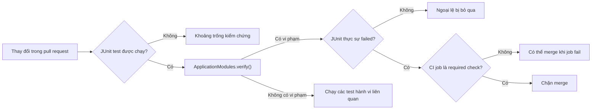
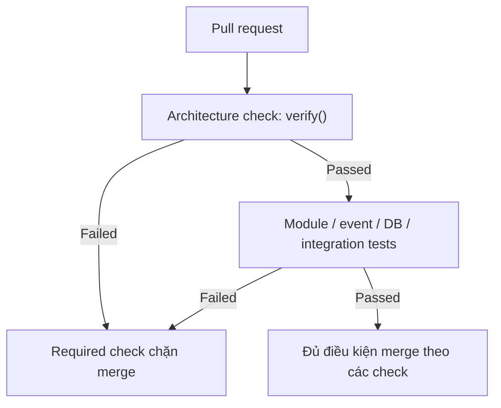

# Bảo vệ `ApplicationModules.verify()` khỏi việc bị bỏ qua

## 1. Vì sao một bài test kiến trúc tồn tại vẫn chưa đủ?

Spring Modulith giúp chia ứng dụng Spring Boot thành các **application module** với ranh giới rõ ràng. `ApplicationModules.verify()` kiểm tra các quan hệ phụ thuộc tĩnh giữa các module, phát hiện những tình huống như vòng phụ thuộc, truy cập package nội bộ hoặc sử dụng module ngoài danh sách `allowedDependencies`.

Nhưng ngay cả khi nhóm đã viết bài test gọi `verify()`, một pull request vẫn có thể chứa phụ thuộc sai nếu **bài test không được chạy**, **ngoại lệ bị bỏ qua**, hoặc **CI không bắt buộc kết quả kiểm tra đạt**. Ví dụ, ai đó chạy build với `-DskipTests`, vô tình thêm `@Disabled` vào lớp test, hoặc bỏ job kiểm tra kiến trúc khỏi pipeline. Khi đó trạng thái “build xanh” không còn chứng minh ranh giới module được bảo vệ.

Mục tiêu của bài **Bảo vệ verify khỏi việc bị bỏ qua** là xây dựng một **quality gate có thể tin cậy** cho học phần `SPRING_MODULITH_VERIFICATION_TESTING`: kiểm chứng kiến trúc bằng `ApplicationModules` và các luật phụ thuộc, kết hợp `@ApplicationModuleTest`, kiểm thử sự kiện, database, tích hợp và CI để ngăn phụ thuộc sai lẫn hồi quy nghiệp vụ.

Ta sẽ bảo vệ ba mắt xích:

1. **Thực thi:** JUnit test chứa `verify()` phải được test runner tìm thấy và chạy.
2. **Báo thất bại:** vi phạm kiến trúc phải làm JUnit/Maven/Gradle thất bại; không được nuốt ngoại lệ.
3. **Áp dụng chính sách:** CI phải chạy test trên các thay đổi liên quan và có **required check** để không thể hợp nhất khi kiểm chứng thất bại.



Sơ đồ mô tả các điều kiện cần để chất lượng kiến trúc được áp dụng trong quy trình, không khẳng định rằng một required check riêng lẻ bảo đảm mọi hành vi của ứng dụng đúng.

## 2. Bắt đầu bằng bài test JUnit tối thiểu, dễ nhận diện

Giả sử ứng dụng có package gốc `com.acme.shop`, lớp `ShopApplication` và các module con `catalog`, `ordering`, `payment`.

```text
src/
├── main/java/com/acme/shop/
│   ├── ShopApplication.java
│   ├── catalog/
│   │   ├── ProductCatalog.java
│   │   └── internal/ProductJpaRepository.java
│   ├── ordering/
│   │   ├── OrderService.java
│   │   └── package-info.java
│   └── payment/PaymentFacade.java
└── test/java/com/acme/shop/
    └── ModuleArchitectureTests.java
```

Theo chiến lược nhận diện mặc định, các package con trực tiếp của package gốc là application module. Đặt bài kiểm thử kiến trúc vào `src/test/java/com/acme/shop/ModuleArchitectureTests.java`:

```java
package com.acme.shop;

import org.junit.jupiter.api.Test;
import org.springframework.modulith.core.ApplicationModules;

class ModuleArchitectureTests {

    @Test
    void applicationModulesRespectArchitecture() {
        ApplicationModules modules =
                ApplicationModules.of(ShopApplication.class);

        modules.verify();
    }
}
```

Điểm cần kiểm tra:

- `@Test` đến từ **JUnit Jupiter**; lớp được biên dịch trong test source set và test runner hỗ trợ JUnit Platform.
- `ApplicationModules.of(ShopApplication.class)` tạo mô hình module từ đúng package ứng dụng.
- `modules.verify()` được **gọi trực tiếp**; khi có vi phạm, lời gọi ném ngoại lệ.
- Ngoại lệ phải thoát khỏi phương thức test để JUnit ghi nhận **failed**.
- Tên `ModuleArchitectureTests` giúp dễ nhận biết và phù hợp mẫu tên test thông dụng của Maven Surefire.

**Không cần `@SpringBootTest` hoặc `@ApplicationModuleTest` trong bài test kiến trúc tĩnh này.** `verify()` thông thường không khởi động toàn bộ Spring context hay database. Các annotation và bài test module/tích hợp được dùng ở những bài kiểm thử hành vi khác.

## 3. Những con đường khiến `verify()` bị bỏ qua

Một build xanh có thể không chạy `verify()` vì nhiều nguyên nhân:

| Điểm bị bỏ qua | Ví dụ | Hậu quả |
| --- | --- | --- |
| Test không được khám phá | Đặt sai source set, quên `@Test`, thiếu JUnit Platform | `ModuleArchitectureTests` không được thực thi. |
| Test bị vô hiệu hóa | `@Disabled` hoặc điều kiện chỉ chạy trong profile nhất định | JUnit báo skipped/disabled thay vì thực hiện kiểm chứng. |
| Test runner bị skip | Maven `-DskipTests`, `-Dmaven.test.skip=true`; Gradle `-x test` | Build có thể thành công mà không chạy kiểm tra kiến trúc. |
| Test bị loại bởi bộ lọc | Chạy riêng nhóm integration test hoặc exclude tên lớp | Bài test `verify()` không nằm trong tập thực thi. |
| Test chạy nhưng ngoại lệ bị nuốt | `catch` rồi chỉ log, hoặc dùng `assertThrows` sai mục đích | JUnit có thể báo passed dù kiến trúc sai. |
| Build bỏ qua thất bại | Gradle `ignoreFailures = true`, bước CI `continue-on-error: true` hoặc `|| true` | Vi phạm không chuyển thành lỗi job cần thiết. |
| CI không thực thi ở pull request | Workflow trigger không bao phủ thay đổi, job bị đặt điều kiện `if` không phù hợp | Thay đổi kiến trúc không được kiểm chứng trước merge. |
| CI job không bắt buộc | Check không có trong branch protection/ruleset | Người có quyền có thể hợp nhất khi job không đạt, tùy chính sách repository. |

Không phải mọi cách bỏ qua đều xuất phát từ chủ ý. Một thay đổi plugin, tên test hoặc cấu hình workflow cũng có thể làm test mất hiệu lực. Vì vậy, cần **kiểm tra bằng chứng rằng `verify()` đã chạy và thất bại đúng khi kiến trúc sai**.

## 4. Bảo vệ bước khám phá test

### 4.1. Maven: gọi riêng bài test và xem báo cáo Surefire

Trong dự án Maven đã khai báo JUnit Jupiter và dependency Spring Modulith test tương thích với Spring Boot, chạy:

```bash
# Chạy riêng lớp test kiểm chứng kiến trúc
./mvnw -B -Dtest=ModuleArchitectureTests test

# Chạy toàn bộ test
./mvnw -B test

# Chạy Maven lifecycle đến pha verify, gồm pha test theo cấu hình thông thường
./mvnw -B verify
```

Với Maven Surefire, khi chỉ định `-Dtest=ModuleArchitectureTests`, bộ lọc yêu cầu một lớp test tương ứng; cấu hình mặc định thường báo lỗi nếu không tìm thấy test khớp chỉ định. Có thể đặt rõ chính sách `-Dsurefire.failIfNoSpecifiedTests=true` khi muốn nhấn mạnh yêu cầu này.

```bash
./mvnw -B -Dtest=ModuleArchitectureTests \
  -Dsurefire.failIfNoSpecifiedTests=true test
```

Trên Windows, dùng `.\mvnw.cmd` thay cho `./mvnw`. Lệnh ví dụ nhiều dòng ở trên theo cú pháp shell Unix; trên Windows nên viết cùng một dòng hoặc dùng cách xuống dòng phù hợp PowerShell.

**Quan trọng:** `./mvnw verify` là **pha `verify` của Maven**, khác với phương thức **`ApplicationModules.verify()`** của Spring Modulith. Maven chỉ thực thi phương thức Java khi có test hoặc một bước build được cấu hình gọi nó.

Kiểm tra báo cáo thường ở `target/surefire-reports/`. Tìm bài `ModuleArchitectureTests` và phương thức `applicationModulesRespectArchitecture`; xem test được chạy, passed, failed hay skipped. Trong dự án nhiều Maven module, báo cáo nằm ở thư mục `target/` của module chạy test.

### 4.2. Gradle: xác nhận task `test` dùng JUnit Platform

Với Java/Spring Boot project dùng Gradle, cấu hình test runner thông dụng trong `build.gradle.kts`:

```kotlin
tasks.test {
    useJUnitPlatform()
}
```

Chạy:

```bash
# Chạy riêng bài test kiến trúc
./gradlew test --tests "com.acme.shop.ModuleArchitectureTests"

# Chạy toàn bộ test
./gradlew test

# Chạy các verification task được cấu hình qua Java plugin
./gradlew check
```

Với Gradle, test filter `--tests` thường báo lỗi nếu không có test phù hợp trong task được yêu cầu. Trong multi-project build, chỉ định đúng module, chẳng hạn `:shop-app:test`, vì task `test` của project khác có thể không chứa bài `ModuleArchitectureTests`.

Kết quả thường nằm ở `build/test-results/test/` (XML) và `build/reports/tests/test/index.html`. Kiểm tra số test thực sự chạy và mục `ModuleArchitectureTests`. Nếu task `test` hiện `SKIPPED`, `NO-SOURCE` hoặc không có bài test mong đợi, phải kiểm tra lại cấu hình/source set; đừng suy luận từ chữ `BUILD SUCCESSFUL`.

### 4.3. Không dùng tên test hoặc điều kiện chạy mong manh

Tên file và vị trí trong test source set nên ổn định, rõ ý nghĩa. Tránh đặt bài kiểm chứng ranh giới vào lớp chỉ chạy khi có external database, profile tùy chọn hoặc một test suite ít khi được gọi. Kiến trúc tĩnh nên được kiểm tra **mọi lần chạy bộ test chính**.

Ví dụ cấu hình không phù hợp nếu `verify()` phải luôn chạy:

```java
import org.junit.jupiter.api.Disabled;
import org.junit.jupiter.api.Test;

@Disabled("Tạm bỏ qua để build xanh") // Không dùng cho quality gate.
class ModuleArchitectureTests {

    @Test
    void architectureIsValid() {
        ApplicationModules.of(ShopApplication.class).verify();
    }
}
```

`@Disabled` khiến test không thực thi. Xóa annotation, sửa nguyên nhân thất bại và xác nhận báo cáo JUnit ghi **executed**, không phải **skipped**.

## 5. Để ngoại lệ từ `verify()` trở thành lỗi build

### Cách đúng: để JUnit nhận ngoại lệ

```java
@Test
void architectureIsValid() {
    ApplicationModules.of(ShopApplication.class).verify();
}
```

Nếu phát hiện vòng phụ thuộc, truy cập package nội bộ hoặc vi phạm `allowedDependencies`, `verify()` ném ngoại lệ. JUnit đánh dấu bài test failed; test task thông thường trả kết quả không đạt để CI xử lý.

### Cách sai: bắt rồi nuốt ngoại lệ

```java
@Test
void hidesArchitectureViolations() {
    try {
        ApplicationModules.of(ShopApplication.class).verify();
    } catch (RuntimeException exception) {
        System.err.println(exception.getMessage());
        // Sai: ngoại lệ đã bị nuốt; JUnit có thể báo passed.
    }
}
```

Ghi log giúp chẩn đoán, nhưng **ghi log không làm test thất bại**. Nếu có lý do cần bắt ngoại lệ để bổ sung ngữ cảnh, hãy ném lại hoặc dùng cơ chế assertion fail của JUnit; thông thường, tốt nhất là không bắt.

Một lỗi khác là viết `assertThrows` quanh `verify()` của ứng dụng thật. `assertThrows` sẽ coi **có ngoại lệ** là kết quả mong đợi và có thể biến một kiến trúc sai thành test xanh. Chỉ dùng `assertThrows` trong một bài test **fixture kiến trúc cố tình vi phạm** để kiểm tra cơ chế phát hiện, không dùng làm gate cho kiến trúc ứng dụng.

### Cách sai: bảo build bỏ qua thất bại

Đừng cấu hình task Gradle kiểm tra kiến trúc theo cách sau:

```kotlin
tasks.test {
    ignoreFailures = true // Không phù hợp nếu task là required quality gate.
}
```

Tương tự, trong CI tránh:

```yaml
- name: Architecture test
  run: ./mvnw -B -Dtest=ModuleArchitectureTests test
  continue-on-error: true # Không dùng cho bước bắt buộc
```

Một dạng rủi ro khác là viết `./mvnw test || true` trong shell, khiến mã thoát có thể trở thành thành công dù Maven báo lỗi. Khi gate phải bắt buộc, hãy để test runner trả mã lỗi bình thường.

## 6. Chạy trên CI và biến job thành required check

Ví dụ GitHub Actions chạy bài test kiến trúc và bộ test Maven trong cùng một job:

```yaml
name: Module architecture

on:
  pull_request:
  push:
    branches: [main]

permissions:
  contents: read

jobs:
  architecture:
    runs-on: ubuntu-latest
    steps:
      - name: Checkout
        uses: actions/checkout@v4

      - name: Set up JDK
        uses: actions/setup-java@v4
        with:
          distribution: temurin
          java-version: '21'
          cache: maven

      - name: Verify Spring Modulith boundaries
        run: ./mvnw -B -Dtest=ModuleArchitectureTests -Dsurefire.failIfNoSpecifiedTests=true test

      - name: Run remaining tests and Maven verification
        run: ./mvnw -B verify
```

Ví dụ giả định Maven Wrapper có thể thực thi, dự án sử dụng JDK 21 và đã cấu hình các dependency/test plugin phù hợp. Điều chỉnh phiên bản JDK, actions và lệnh theo project thực tế. Trong multi-module Maven build, chọn đúng module có `ModuleArchitectureTests`; lệnh chọn một tên test ở toàn bộ reactor có thể không phù hợp với module không chứa test đó.

**Để job thật sự bảo vệ merge**, ngoài YAML workflow cần cấu hình trong repository:

1. Bật quy tắc bảo vệ nhánh hoặc ruleset cho nhánh đích, chẳng hạn `main`.
2. Đặt **check của job `architecture`** làm required status check theo tên hiển thị thực tế.
3. Xác nhận workflow chạy với `pull_request` cho các thay đổi cần kiểm chứng.
4. Giữ ổn định tên job/check hoặc cập nhật required check khi đổi tên.
5. Bảo vệ các thay đổi tới workflow, build script và lớp test bằng review phù hợp.

Không tự động xem một workflow là required check chỉ vì nó tồn tại trong repository. **Chính sách bảo vệ nhánh/ruleset** mới quyết định thất bại của check có ngăn hợp nhất hay không.

### Cần cân nhắc điều kiện `if` và path filter

Một workflow chỉ chạy khi sửa `src/main/java/ordering/**` có thể bỏ sót thay đổi ở `catalog`, `payment`, `package-info.java` hoặc build script làm thay đổi quy tắc phụ thuộc. Để đơn giản và an toàn, cho job kiểm tra kiến trúc chạy trên **mọi pull request liên quan đến ứng dụng**.

Nếu dùng `paths` hoặc điều kiện `if` để tối ưu CI, phải đánh giá các trường hợp có thể làm thay đổi module graph và bảo đảm required check không bị mất. Trong GitHub Actions, một workflow bị bỏ qua do path filter còn có thể để required check ở trạng thái chờ, gây chặn merge; vì vậy việc lọc đường dẫn cần thiết kế kỹ và kiểm tra thực tế, không mặc định rằng “skip sẽ an toàn”.

### Tách kiểm tra kiến trúc khỏi test tích hợp tốn thời gian

`verify()` thường không cần khởi động Spring context hoặc database, nên có thể chạy **sớm** để phản hồi nhanh. Nhưng chỉ có architecture test vẫn chưa đủ. Job CI phải chạy hoặc yêu cầu các job khác chạy `@ApplicationModuleTest`, kiểm thử event, database và integration theo nhu cầu sản phẩm.



Khi tách thành nhiều job, hãy bảo đảm **tất cả check quan trọng đều bắt buộc** theo quy tắc của repository; đừng dựa vào một job xanh để đại diện cho những bài test không chạy.

## 7. Cách chứng minh gate thực sự phát hiện vi phạm

Sau khi tích hợp lần đầu hoặc thay đổi cấu hình build/CI, cần kiểm tra bằng thực nghiệm chứ không chỉ đọc cấu hình.

### Phép thử âm tính có kiểm soát

Trên một nhánh thử nghiệm, tạm thời tạo một phụ thuộc sai **rõ ràng và vẫn biên dịch được**. Ví dụ module `catalog` có `public interface ProductJpaRepository` trong `catalog.internal`, module `ordering` thêm constructor parameter kiểu đó:

```java
// com/acme/shop/ordering/OrderService.java - thay đổi thử nghiệm
package com.acme.shop.ordering;

import com.acme.shop.catalog.internal.ProductJpaRepository;

public class OrderService {
    private final ProductJpaRepository repository;

    public OrderService(ProductJpaRepository repository) {
        this.repository = repository;
    }
}
```

Với quy ước API mặc định, `ProductJpaRepository` thuộc package con chưa công bố của `catalog`. Khi chạy `ModuleArchitectureTests`, phép `verify()` phải phát hiện vi phạm truy cập nội bộ. Nếu không có lỗi, hãy điều tra **test discovery, cấu hình module, bước chạy, skip flag hoặc exception handling** trước khi kết luận kiến trúc đã được bảo vệ.

Sau khi kiểm chứng gate đỏ, **hoàn nguyên chính thay đổi thử nghiệm** và chạy lại test để xác nhận gate xanh trên mã hợp lệ. Không đưa vi phạm cố tình tạo vào nhánh chính hoặc gộp nhầm với thay đổi nghiệp vụ.

### Thu thập bằng chứng đủ để review

Cần có ba bằng chứng:

| Bằng chứng | Điều xác nhận |
| --- | --- |
| Báo cáo JUnit chứa `ModuleArchitectureTests.applicationModulesRespectArchitecture` | Bài test thực sự được test runner khám phá và chạy. |
| Khi cố tình tạo quan hệ sai, bài test và lệnh build thất bại | Ngoại lệ từ `verify()` không bị nuốt hoặc bỏ qua. |
| PR thử nghiệm bị required check chặn khi job thất bại | CI bảo vệ nhánh thực sự áp dụng kết quả kiểm tra. |

Khi thay đổi build script hoặc workflow CI, kiểm tra lại các bằng chứng liên quan. Chẳng hạn, đổi tên test class hoặc job `architecture` có thể ảnh hưởng test discovery hay tên check bắt buộc.

## 8. Khi CI xanh nhưng kiến trúc có vẻ sai: quy trình chẩn đoán

Đừng vội nới giới hạn `allowedDependencies`. Hãy phân biệt xem hệ thống **không phát hiện vi phạm** hay **đã phát hiện nhưng kết quả bị bỏ qua**.

1. **Xác định test đã chạy chưa:** xem JUnit XML, HTML report, số test passed/skipped và log riêng của `ModuleArchitectureTests`.
2. **Kiểm tra tham số build:** có `-DskipTests`, `-Dmaven.test.skip=true`, `-x test`, exclude filter, disabled task hoặc `@Disabled` không?
3. **Kiểm tra ngoại lệ:** có `catch` rồi chỉ log, `assertThrows`, `ignoreFailures`, `continue-on-error` hoặc shell `|| true` không?
4. **Kiểm tra phạm vi mô hình:** `ApplicationModules.of(ShopApplication.class)` có trỏ đúng lớp ứng dụng và nhận diện đúng các module không?
5. **Kiểm tra tính chất của quan hệ:** có tham chiếu kiểu Java trực tiếp mà bộ phân tích nhận diện không, hay chỉ là HTTP URL, message broker, reflection hoặc shared database?
6. **Kiểm tra workflow và chính sách:** job có chạy cho PR này và có nằm trong required checks của nhánh đích không?

Nếu test chưa chạy, sửa **đường thực thi**. Nếu test đã chạy nhưng ngoại lệ bị bỏ qua, sửa **cách báo thất bại**. Nếu `verify()` chạy đúng và không phát hiện một liên kết động, cần **kiểm thử tích hợp/review kiến trúc bổ sung**, vì đó có thể nằm ngoài phạm vi phân tích tĩnh.

## 9. Không “sửa” gate bằng cách làm yếu ranh giới

Khi `verify()` báo lỗi thật, cách xử lý đúng là sửa quan hệ sai. Ví dụ:

- `ordering` tiêm `catalog.internal.ProductJpaRepository` → chuyển sang hợp đồng `catalog.ProductCatalog` được xuất bản; `catalog` tự quản lý repository.
- `ordering → payment → ordering` tạo vòng → xem lại trách nhiệm, dùng port hoặc event phù hợp để loại bỏ một hướng phụ thuộc tĩnh.
- `ordering` có `allowedDependencies = "catalog"` nhưng bắt đầu dùng `payment.PaymentFacade` → xác định đây có phải hướng phụ thuộc hợp lệ được kiến trúc chấp nhận hay cần đổi cách giao tiếp.

Không nên chuyển repository/entity nội bộ lên package gốc, công bố toàn bộ package `internal` bằng `@NamedInterface` hoặc mở `allowedDependencies` vô điều kiện để có build xanh. Những cách này có thể làm bài test bớt phát hiện lỗi nhưng khiến ranh giới module mất ý nghĩa.

Nếu cần thay đổi chính sách phụ thuộc có chủ đích, cập nhật kiến trúc, giải thích lý do trong review và tiếp tục duy trì test bắt buộc.

## 10. Vì sao còn cần `@ApplicationModuleTest` và integration test?

`verify()` trả lời câu hỏi **“quan hệ phụ thuộc tĩnh có tuân thủ ranh giới module không?”**. Nó không chứng minh **“ứng dụng hoạt động đúng khi chạy”**.

| Lớp kiểm thử | Mục đích | Ví dụ |
| --- | --- | --- |
| `ApplicationModules.verify()` | Chặn vòng phụ thuộc, truy cập API nội bộ và sai luật phụ thuộc | JUnit architecture test |
| `@ApplicationModuleTest` | Kiểm tra bean và logic trong phạm vi module | Module slice/integration test |
| Kiểm thử sự kiện | Xác nhận event được phát, nhận và xử lý đúng kịch bản | Spring Modulith event/scenario test |
| Kiểm thử database | Xác nhận repository, transaction, mapping và rollback | DB integration test; Testcontainers khi phù hợp |
| Kiểm thử hệ thống ngoài | Xác nhận hợp đồng HTTP, broker và dịch vụ tích hợp | Contract/integration test |
| CI required check | Bắt buộc các bài kiểm tra quan trọng đạt trước khi merge | Branch protection/ruleset |

Ví dụ, sau khi thay `OrderService` từ repository nội bộ sang interface công khai, `verify()` có thể đạt nhưng implementation của interface vẫn có thể trả sai tồn kho hoặc transaction xử lý sai. Cần chạy thêm test module, database, event và integration phù hợp.

Đặc biệt, `@ApplicationModuleTest` có thể cần Spring context và hạ tầng test tùy cấu hình; vì vậy cách tối ưu thời gian hợp lý là cho test kiến trúc chạy nhanh và thường xuyên, sau đó thực hiện các bài kiểm thử hành vi đầy đủ theo pipeline.

## 11. Tình huống tự kiểm tra

Giả sử dự án có `ModuleArchitectureTests` gọi `ApplicationModules.of(ShopApplication.class).verify()`. Nhánh `main` được bảo vệ bởi job `architecture`.

**Tình huống A.** Developer chạy `./mvnw -DskipTests verify`, nhận `BUILD SUCCESS`. Kết quả này có chứng minh `verify()` đã chạy không?

**Đáp án:** Không. `-DskipTests` thường bỏ qua thực thi test, nên bài JUnit chứa `verify()` có thể không chạy. Phải xem báo cáo test và dùng lệnh không skip cho quality gate.

**Tình huống B.** Class test có `@Disabled`. CI báo xanh. Hệ thống đã được bảo vệ chưa?

**Đáp án:** Chưa. Test bị vô hiệu hóa; cần xóa `@Disabled` và xác nhận bài test được **executed**, không phải skipped.

**Tình huống C.** Trong bài test có `try { modules.verify(); } catch (RuntimeException ex) { log(ex); }`. Khi có lỗi, JUnit có thể báo xanh không?

**Đáp án:** Có, vì ngoại lệ đã bị nuốt. Cần bỏ `catch` hoặc ném lại ngoại lệ.

**Tình huống D.** Job CI có `continue-on-error: true`. Vi phạm làm bước test thất bại nhưng PR vẫn có thể merge. Vấn đề nằm ở đâu?

**Đáp án:** Cấu hình pipeline đang cho phép bỏ qua lỗi. Cần để bước kiểm chứng bắt buộc thất bại và cấu hình check liên quan làm required trong quy tắc bảo vệ nhánh.

**Tình huống E.** `./gradlew check` xanh nhưng `test` báo `NO-SOURCE`. Có thể kết luận kiến trúc hợp lệ không?

**Đáp án:** Không. Cần kiểm tra đúng source set và project Gradle, bảo đảm JUnit Platform nhận ra `ModuleArchitectureTests` rồi xem báo cáo kết quả.

**Tình huống F.** `verify()` chạy đúng và xanh, nhưng hai module chia sẻ cùng bảng database qua SQL cấu hình. Có phải `verify()` bảo đảm không có coupling không?

**Đáp án:** Không. Những liên kết động hoặc ở tầng dữ liệu không nhất thiết tạo phụ thuộc kiểu Java giữa module. Cần quy ước sở hữu dữ liệu, review thiết kế và integration test.

**Tình huống G.** Nhóm đổi tên job `architecture` thành `module-check`. Có bước vận hành nào cần kiểm tra?

**Đáp án:** Kiểm tra lại required status checks theo tên job/check thực tế, workflow trigger và bằng chứng test chạy, để không làm mất hiệu lực bảo vệ nhánh.

## 12. Checklist duy trì chất lượng của `verify()`

Trước khi coi pipeline đã bảo vệ kiến trúc Spring Modulith, hãy xác nhận:

- **JUnit khám phá và chạy** `ModuleArchitectureTests`, không bị `@Disabled`, exclude hoặc skip.
- **`verify()` được gọi trực tiếp** trên mô hình module đúng phạm vi.
- **Ngoại lệ làm test và build thất bại**; không có `catch` nuốt lỗi, `ignoreFailures` hoặc `continue-on-error` cho gate.
- **CI chạy trên pull request phù hợp** và job là **required check** của nhánh đích.
- **Đã thử có kiểm soát** rằng một vi phạm kiến trúc khiến test/CI đỏ, sau đó hoàn nguyên vi phạm.
- **Các kiểm thử hành vi liên quan vẫn được chạy**: `@ApplicationModuleTest`, event, database và integration.

**Ghi nhớ:** Bảo vệ `ApplicationModules.verify()` nghĩa là bảo vệ **việc thực thi**, **tín hiệu thất bại** và **quy tắc bắt buộc trên CI**. Một bài test không được chạy hoặc một ngoại lệ bị nuốt không tạo ra quality gate. Khi cả ba mắt xích hoạt động và được kiểm tra định kỳ, các phụ thuộc trái ranh giới sẽ bị chặn sớm, trong khi các test module/sự kiện/dữ liệu/tích hợp tiếp tục bảo vệ hành vi ứng dụng.
