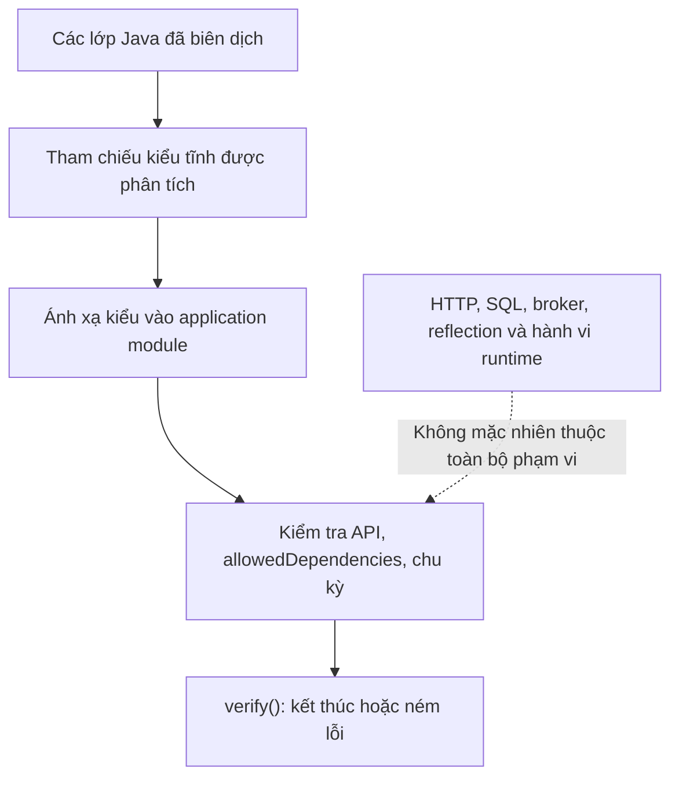
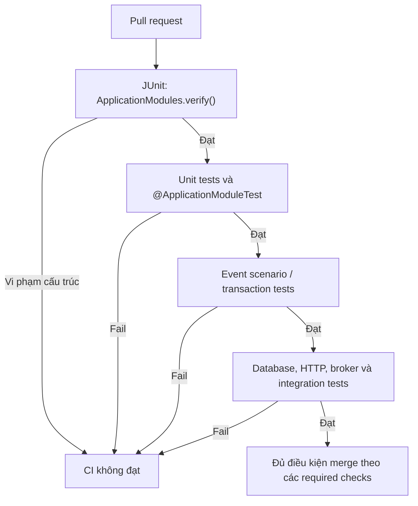

# Giới hạn của kiểm chứng tĩnh dựa trên bytecode và package trong Spring Modulith

## 1. Kiểm chứng kiến trúc là cần thiết, nhưng không phải kiểm chứng toàn bộ hệ thống

Một ứng dụng Spring Boot có thể được chia thành các **application module** rõ ràng, chạy `ApplicationModules.verify()` thành công và vẫn tồn tại những vấn đề quan trọng: hai module cùng sửa một bảng dữ liệu, một listener không nhận được sự kiện, một adapter HTTP gọi sai endpoint hoặc một bean không được khởi tạo ở môi trường thật.

Điều này không làm `verify()` kém giá trị. Công cụ giải quyết **một lớp vấn đề cụ thể**: kiểm tra **cấu trúc phụ thuộc tĩnh giữa các kiểu Java và ranh giới application module**. Nó giúp phát hiện vòng phụ thuộc, sử dụng API nội bộ và quan hệ vượt `allowedDependencies` trước khi các thay đổi làm kiến trúc khó bảo trì.

Tuy nhiên, **“kiểm chứng tĩnh đạt” không đồng nghĩa “ứng dụng đúng nghiệp vụ, đúng dữ liệu và chạy đúng khi tích hợp”**.

Bài học thuộc chương **ApplicationModules.verify** của `SPRING_MODULITH_VERIFICATION_TESTING`, với mục tiêu rèn kỹ năng kiểm chứng ranh giới kiến trúc và phối hợp `@ApplicationModuleTest`, kiểm thử sự kiện, cơ sở dữ liệu, tích hợp cùng quality gate CI để ngăn phụ thuộc sai và hồi quy.

Sau khi học, bạn sẽ:

- Mô tả được đầu vào, phạm vi và kết quả của `ApplicationModules.verify()`.
- Phân biệt **phụ thuộc tĩnh nhìn thấy qua bytecode** với **phụ thuộc động khi chạy**.
- Giải thích vì sao HTTP, message broker, reflection, SQL và shared database có thể nằm ngoài khả năng phát hiện trực tiếp của phép kiểm chứng.
- Nhận diện giới hạn của cách xác định module theo package và API được công bố.
- Thiết kế **ma trận kiểm thử nhiều tầng** để bù đúng những điểm mà kiểm chứng tĩnh không thể xác nhận.
- Đặt các bài kiểm tra thích hợp vào CI, tránh nhầm một architecture test xanh với chất lượng toàn hệ thống.

## 2. `ApplicationModules.verify()` thực sự kiểm tra những gì?

Giả sử một ứng dụng có cấu trúc:

```text
com.acme.shop
├── ShopApplication.java
├── catalog
│   ├── ProductCatalog.java
│   └── internal
│       └── ProductJpaRepository.java
├── ordering
│   ├── OrderService.java
│   ├── OrderPlaced.java
│   └── package-info.java
├── payment
│   ├── PaymentPort.java
│   └── internal
│       └── PaymentProcessor.java
└── inventory
    ├── StockAvailability.java
    └── internal
        └── StockRecord.java
```

Theo chiến lược nhận diện mặc định, các package con trực tiếp dưới package gốc ứng dụng tạo thành bốn application module: `catalog`, `ordering`, `payment` và `inventory`. Các kiểu nằm trực tiếp trong package gốc của module thuộc **API mặc định**; những kiểu ở package con chưa xuất bản được xem là **nội bộ**.

Spring Modulith xây dựng mô hình application module và sử dụng cơ chế phân tích kiến trúc dựa trên các kiểu Java đã biên dịch, thông qua những công cụ như ArchUnit, để xác định các quan hệ phụ thuộc tĩnh. Từ các quan hệ đó, `verify()` kiểm tra những quy tắc nền tảng:

| Quy tắc | Ví dụ bị chặn | Lý do |
| --- | --- | --- |
| Không có chu kỳ giữa các module | `ordering → payment → ordering` | Đồ thị phụ thuộc có đường quay về module ban đầu. |
| Không truy cập phần API chưa được xuất bản | `ordering.OrderService` dùng `catalog.internal.ProductJpaRepository` | Module nguồn phụ thuộc implementation detail của module khác. |
| Tuân thủ `allowedDependencies` nếu đã khai báo | `ordering` chỉ được dùng `catalog` nhưng tham chiếu `payment.PaymentPort` | Quan hệ nằm ngoài hướng phụ thuộc được cho phép. |

Các ràng buộc khác có thể được bổ sung tùy cấu hình hoặc thư viện tích hợp. **Bộ quy tắc tĩnh không tự suy ra mọi quyết định kiến trúc mà nhóm chưa mô tả**.

### Ví dụ kiểm chứng kiến trúc trong JUnit

```java
// src/test/java/com/acme/shop/ModuleArchitectureTests.java
package com.acme.shop;

import org.junit.jupiter.api.Test;
import org.springframework.modulith.core.ApplicationModules;

class ModuleArchitectureTests {

    @Test
    void moduleDependenciesStayWithinBoundaries() {
        ApplicationModules modules =
                ApplicationModules.of(ShopApplication.class);

        modules.verify();
    }
}
```

Khi không có vi phạm được nhận diện, lời gọi `verify()` kết thúc bình thường. Khi có vi phạm, nó ném ngoại lệ để JUnit đánh dấu bài kiểm thử thất bại, miễn là ngoại lệ không bị bắt rồi bỏ qua.

Đây là **kiểm chứng cấu trúc**. Bài test thông thường không cần khởi động đầy đủ Spring application context hay database để phân tích những quan hệ tĩnh ấy.

## 3. Bytecode cho thấy những quan hệ nào?

Bộ phân tích kiến trúc xem các **tham chiếu kiểu Java thực sự tồn tại trong mã đã biên dịch**, không đơn giản đếm những dòng `import` xuất hiện trong file nguồn.

Ví dụ module `ordering` sử dụng API của `catalog`:

```java
package com.acme.shop.ordering;

import com.acme.shop.catalog.ProductCatalog;

public class OrderService {

    private final ProductCatalog products;

    public OrderService(ProductCatalog products) {
        this.products = products;
    }
}
```

Field và constructor chứa kiểu `ProductCatalog`. Bộ phân tích có thể ghi nhận cạnh **`ordering → catalog`**. Một số nguồn tham chiếu kiểu tĩnh thường gặp gồm:

| Nguồn quan hệ kiểu | Ví dụ | Có thể giúp phát hiện cạnh tĩnh? |
| --- | --- | --- |
| Field | `ProductCatalog products` | Có. |
| Tham số constructor | `OrderService(ProductCatalog products)` | Có. |
| Kiểu tham số hoặc kết quả phương thức | `ProductInfo lookup(ProductId id)` | Có thể, theo kiểu được tham chiếu và metadata mà bộ phân tích thu thập. |
| Kế thừa hoặc triển khai interface | `implements PaymentPort` | Có. |
| Khởi tạo, gọi phương thức, truy cập thành viên | `new ProductId(...)` | Có khi phát sinh tham chiếu kiểu trong bytecode. |
| Generic, annotation và metadata lớp | `List<ProductInfo>` | Có thể được nhận diện tùy dạng thông tin và bộ phân tích. |
| `import` thừa, không dùng kiểu | `import com.acme.shop.payment.PaymentPort;` | **Không tự chứng minh** có cạnh phụ thuộc. |

Điểm cần nhớ là `ApplicationModules.verify()` đánh giá **những phụ thuộc tĩnh được công cụ phân tích nhận diện**, chứ không thực thi từng nhánh mã nghiệp vụ. Một kiểu có thể được tham chiếu nhưng nhánh chứa hành vi tương ứng chưa bao giờ chạy; ngược lại, một tương tác lúc chạy có thể xảy ra mà không có tham chiếu kiểu trực tiếp giữa hai module.



Đây là sơ đồ phạm vi, không phải thứ tự thuật toán nội bộ được cam kết cho mọi phiên bản Spring Modulith.

## 4. Giới hạn thứ nhất: phụ thuộc động không nhất thiết tạo cạnh kiểu Java

Một số hình thức giao tiếp được quyết định ở **runtime** bằng chuỗi cấu hình, URL, tên topic, tên lớp hoặc dữ liệu từ bên ngoài. Chúng có thể làm hai module ghép chặt về hành vi mà không hình thành cạnh phụ thuộc tĩnh giữa các kiểu tương ứng.

### 4.1. Gọi HTTP bằng URL

Giả sử `ordering` gọi endpoint kiểm tra tồn kho:

```java
package com.acme.shop.ordering;

import org.springframework.web.client.RestClient;

public class RemoteStockLookup {

    private final RestClient client;

    public RemoteStockLookup(RestClient client) {
        this.client = client;
    }

    public Boolean hasStock(Long productId) {
        return client.get()
                .uri("/inventory/stock/{id}", productId)
                .retrieve()
                .body(Boolean.class);
    }
}
```

Ở mức kiểu Java, mã này tham chiếu `RestClient` của Spring Framework, không nhất thiết tham chiếu một lớp `inventory.StockAvailability` của application module `inventory`. **Đường dẫn chuỗi `/inventory/stock/{id}` không tự tạo một cạnh kiểu Java `ordering → inventory`** để `verify()` đánh giá.

Tuy nhiên, runtime vẫn phụ thuộc vào endpoint, định dạng phản hồi, xác thực, độ trễ và khả năng sẵn sàng của bên cung cấp.

**Bù bằng:** HTTP integration test, contract test, test timeout/retry và review quy tắc giao tiếp giữa các module. Nếu hai module thuộc cùng ứng dụng, cân nhắc xem gọi HTTP nội bộ có thật sự cần thiết hay chỉ làm ranh giới phức tạp hơn.

### 4.2. Giao tiếp qua message broker

Một publisher có thể gửi message qua topic tên `payment-requested`. Consumer ở module khác đọc message từ topic tương ứng. Nếu hai bên chỉ dùng **chuỗi tên topic và định dạng payload được cấu hình độc lập**, bộ kiểm tra tĩnh không nhất thiết nhận diện một quan hệ kiểu Java trực tiếp giữa publisher và consumer.

Ngược lại, nếu `payment` khai báo listener nhận một lớp sự kiện `ordering.OrderPlaced`, **chính tham chiếu tới kiểu sự kiện** có thể tạo cạnh `payment → ordering` mà công cụ phân tích nhận thấy. Nhưng kể cả khi `verify()` đánh giá cạnh đó hợp lệ, nó vẫn **không xác nhận** sự kiện được gửi, nhận, deserialize, xử lý hoặc retry đúng.

**Bù bằng:** event scenario test, kiểm thử publisher/consumer, schema/contract test, transaction, xử lý trùng lặp và idempotency khi phù hợp.

### 4.3. Reflection và tên kiểu ở dạng chuỗi

Một ví dụ mang tính minh họa:

```java
package com.acme.shop.ordering;

public class DynamicAdapterLoader {

    public Class<?> load(String configuredClassName)
            throws ClassNotFoundException {
        return Class.forName(configuredClassName);
    }
}
```

Nếu cấu hình runtime cấp tên `com.acme.shop.payment.internal.SomeAdapter`, mã chỉ có quan hệ trực tiếp với API reflection của Java; **không bắt buộc tồn tại một tham chiếu kiểu tĩnh** tới `SomeAdapter` trong lớp `DynamicAdapterLoader`.

Các cách tải lớp qua reflection, plugin discovery hoặc tên class nằm trong configuration có thể không hiện thành cạnh liên module trong phân tích kiểu.

**Bù bằng:** kiểm thử khởi tạo, kiểm thử cấu hình runtime, kiểm thử plugin/adapter được chọn và rà soát quy tắc cho phép tải kiểu.

## 5. Giới hạn thứ hai: phụ thuộc dữ liệu không thể suy ra đầy đủ từ package

Một ranh giới module tốt không chỉ bao gồm **ai import lớp của ai**, mà còn bao gồm **ai sở hữu dữ liệu nào**.

Giả sử module `catalog` sở hữu bảng `products`. Một lớp trong `ordering` có thể chạy SQL bằng chuỗi:

```java
package com.acme.shop.ordering;

import org.springframework.jdbc.core.JdbcTemplate;

public class OrderPricingQuery {

    private final JdbcTemplate jdbc;

    public OrderPricingQuery(JdbcTemplate jdbc) {
        this.jdbc = jdbc;
    }

    public String findProductName(Long productId) {
        return jdbc.queryForObject(
                "select name from products where id = ?",
                String.class,
                productId
        );
    }
}
```

Mã chỉ tham chiếu `JdbcTemplate` ở mức kiểu. Tên bảng `products` nằm trong SQL string; `verify()` không tự biết rằng bảng này **được module `catalog` sở hữu**, cũng không thể khẳng định `ordering` đang vi phạm chính sách sở hữu dữ liệu chỉ bằng đồ thị module.

Điều tương tự có thể xảy ra khi:

- Hai module cùng sửa một bảng nhưng dùng repository hoặc query riêng.
- Module A đọc trực tiếp schema của module B qua một JDBC connection chung.
- Module A dựa vào trigger, view hoặc stored procedure do module B quản lý.
- Dữ liệu được chia sẻ qua cache key hoặc tên collection ở dạng chuỗi.

### Vì sao đây là rủi ro?

Nếu `catalog` đổi schema `products`, truy vấn SQL của `ordering` có thể hỏng dù mọi phụ thuộc kiểu Java giữa module vẫn hợp lệ. Với hai module cùng ghi dữ liệu, các quy tắc transaction và nhất quán còn có thể bị vi phạm mà không tạo chu kỳ hay truy cập package nội bộ.

**Bù bằng:** quy định module sở hữu bảng/collection, review SQL và migration, kiểm thử repository với database thật hoặc gần thực tế, integration test transaction và kiểm tra quyền truy cập dữ liệu theo thiết kế.

Một giải pháp thường tốt hơn là để `catalog` xuất bản **API truy vấn nghiệp vụ** như `ProductCatalog.findName(...)`; module khác dùng API đó thay vì đọc bảng trực tiếp. Tuy nhiên, việc bảo vệ sở hữu dữ liệu vẫn cần quy tắc và test bổ sung.

## 6. Giới hạn thứ ba: cấu trúc đúng không chứng minh bean wiring và hành vi đúng

Kiểm chứng tĩnh trả lời **“hướng phụ thuộc kiểu có hợp lệ?”**, không phải **“ứng dụng khởi động được và thực hiện đúng chức năng?”**.

Ví dụ, `ordering` chỉ dùng interface công khai `catalog.ProductCatalog`. Quan hệ `ordering → catalog` có thể hợp lệ theo `verify()`. Nhưng khi chạy Spring context, ứng dụng vẫn có thể lỗi nếu:

- Không có bean nào triển khai `ProductCatalog`.
- Có nhiều bean cùng kiểu mà thiếu quy tắc chọn phù hợp.
- Một bean phụ thuộc vào cấu hình bí mật, endpoint hoặc profile không khả dụng.
- Một implementation đúng ranh giới nhưng trả kết quả nghiệp vụ sai.
- Transaction hoặc xử lý ngoại lệ không phù hợp với yêu cầu.

Một ví dụ phụ thuộc về mặt kiến trúc là hợp lệ:

```java
package com.acme.shop.ordering;

import com.acme.shop.catalog.ProductCatalog;
import org.springframework.stereotype.Service;

@Service
public class OrderService {

    private final ProductCatalog products;

    public OrderService(ProductCatalog products) {
        this.products = products;
    }

    public boolean canOrder(Long productId) {
        return products.existsById(productId);
    }
}
```

`verify()` không khởi tạo bean `OrderService` để chứng minh có `ProductCatalog` thực sự được inject. Cần một bài test có **Spring application context** hoặc kiểm thử hành vi để xác nhận điều đó.

| Vấn đề runtime | `verify()` có bảo đảm phát hiện không? | Hướng kiểm chứng |
| --- | --- | --- |
| Thiếu bean triển khai interface | Không | Spring context test hoặc `@ApplicationModuleTest` |
| Sai qualifier hoặc lựa chọn bean | Không | Test context và wiring |
| Logic `existsById` trả kết quả sai | Không | Unit/module test |
| Sai mapping entity hoặc query SQL | Không | Database integration test |
| Lỗi transaction/rollback | Không | Integration test có transaction và database phù hợp |
| Lỗi timeout, xác thực, TLS hoặc HTTP contract | Không | HTTP/contract/integration test |

### `@ApplicationModuleTest` bổ sung điều gì?

`@ApplicationModuleTest` cung cấp khả năng kiểm thử một application module trong ngữ cảnh Spring phù hợp. Nó giúp kiểm tra bean, cấu hình và hành vi trong phạm vi module; khi tương tác với module khác, cần thiết kế test theo cơ chế bootstrap/dependency của Spring Modulith và các test double hoặc fixture phù hợp.

Ví dụ khung kiểm thử (phần assertion nghiệp vụ phải được hoàn thiện theo domain thật):

```java
package com.acme.shop.ordering;

import org.junit.jupiter.api.Test;
import org.springframework.beans.factory.annotation.Autowired;
import org.springframework.modulith.test.ApplicationModuleTest;

import static org.assertj.core.api.Assertions.assertThat;

@ApplicationModuleTest
class OrderingModuleTests {

    @Autowired
    OrderService orders;

    @Test
    void moduleWiresItsOrderService() {
        assertThat(orders).isNotNull();
    }
}
```

Bài test mẫu kiểm tra việc nạp module và inject bean, **chưa đủ để xác nhận nghiệp vụ đặt hàng đúng**. Cần bổ sung ca kiểm thử đầu vào, kết quả, tương tác, transaction và lỗi nghiệp vụ của hệ thống cụ thể.

## 7. Giới hạn thứ tư: event hợp lệ về dependency vẫn có thể chạy sai

Spring Modulith hỗ trợ giao tiếp giữa các module bằng sự kiện. Cơ chế này có thể giúp giảm phụ thuộc trực tiếp từ bên phát đến bên nhận, nhưng **không tự biến việc xử lý event thành đúng hoặc đáng tin cậy**.

Giả sử `ordering` công bố một kiểu sự kiện:

```java
// com/acme/shop/ordering/OrderPlaced.java
package com.acme.shop.ordering;

public record OrderPlaced(Long orderId) {
}
```

Module `payment` có listener dùng kiểu đó:

```java
// com/acme/shop/payment/internal/PaymentOnOrderPlaced.java
package com.acme.shop.payment.internal;

import com.acme.shop.ordering.OrderPlaced;
import org.springframework.context.event.EventListener;
import org.springframework.stereotype.Component;

@Component
class PaymentOnOrderPlaced {

    private final PaymentProcessor processor;

    PaymentOnOrderPlaced(PaymentProcessor processor) {
        this.processor = processor;
    }

    @EventListener
    void on(OrderPlaced event) {
        processor.requestPayment(event.orderId());
    }
}
```

`PaymentProcessor` trong ví dụ là một thành phần thuộc chính `payment.internal`. Tham chiếu kiểu `OrderPlaced` tạo quan hệ tĩnh `payment → ordering`. Nếu `ordering` không tham chiếu ngược lại `payment`, đồ thị có thể không có vòng.

Tuy vậy, `verify()` **không kiểm tra rằng**:

- `OrderPlaced` thực sự được publish sau nghiệp vụ đặt hàng.
- Listener được đăng ký và xử lý trong đúng transaction.
- Cách xử lý đồng bộ, bất đồng bộ hoặc sau commit phù hợp.
- Khi listener lỗi, retry/recovery hoặc lưu trữ publication hoạt động đúng theo cấu hình.
- Sự kiện không bị xử lý hai lần theo cách gây tác dụng phụ ngoài ý muốn.
- Dữ liệu event tương thích với contract và phiên bản consumer.

`@EventListener` cơ bản chỉ minh họa cách đăng ký listener. Nó **không tự bảo đảm** xử lý bất đồng bộ, delivery bền vững hoặc retry. Những tính chất đó phụ thuộc cơ chế, cấu hình và thiết kế cụ thể.

**Bù bằng:** kiểm thử event scenario, xác nhận event được publish/consume, kiểm thử transaction, fault injection, idempotency và integration test cho broker/event publication khi cần.

## 8. Giới hạn thứ năm: mô hình module chỉ đúng trong phạm vi được phân tích

Một phép kiểm chứng có thể “đạt” vì **không thấy** phần ứng dụng mà nhóm tưởng nó đang kiểm tra. Vì vậy, phải kiểm chứng chính **phạm vi mô hình module**, không chỉ kết quả `verify()`.

### 8.1. Package gốc và chiến lược nhận diện

`ApplicationModules.of(ShopApplication.class)` được dùng để nhận diện các module thuộc ứng dụng. Với chiến lược mặc định, các package con trực tiếp dưới package ứng dụng trở thành application module. Nếu lớp ứng dụng đặt sai package, hoặc dự án tùy chỉnh chiến lược nhận diện, tập module thực tế có thể khác kỳ vọng.

Chẳng hạn, một package `com.acme.shared` nằm ngoài phạm vi được nhận diện không nên được **tự động mặc định** là một application module mà `verify()` sẽ bảo vệ giống `catalog`, `ordering` hoặc `payment`.

**Việc cần làm:** kiểm tra cấu trúc package, module được nhận diện và lựa chọn lớp gốc ứng dụng trong test. Với dự án nhiều build module hoặc nhiều ứng dụng, hãy xác định rõ phạm vi nào được quét và kiểm chứng.

### 8.2. Thay đổi package có thể đổi kết quả mà không cải thiện thiết kế

Giả sử nhóm chuyển repository `catalog.internal.ProductJpaRepository` lên `catalog.ProductJpaRepository`. Khi đó kiểu nằm ở API mặc định của module `catalog` theo quy ước, nên lỗi truy cập package nội bộ có thể biến mất. Nhưng **về thiết kế**, việc mở repository persistence ra bên ngoài có thể còn tệ hơn.

Điều này cho thấy **tuân thủ chính sách được cấu hình không đồng nghĩa chính sách đó đã đúng với nghiệp vụ**. Tên package và `@NamedInterface` cần phản ánh các hợp đồng thật, không phải được chỉnh chỉ để cho phép mọi tham chiếu.

### 8.3. Cấu hình `allowedDependencies` không tự biết ý đồ nghiệp vụ

Nếu nhóm chưa khai báo giới hạn phụ thuộc cho `ordering`, một quan hệ tới API công khai của `payment` có thể không vi phạm ràng buộc hướng phụ thuộc dù kiến trúc mong muốn là `ordering` không trực tiếp biết `payment`.

Có thể đặt ràng buộc:

```java
// com/acme/shop/ordering/package-info.java
@ApplicationModule(allowedDependencies = "catalog")
package com.acme.shop.ordering;

import org.springframework.modulith.ApplicationModule;
```

Khi đó, nếu `ordering` tham chiếu trực tiếp API của `payment`, `verify()` có cơ sở để báo quan hệ ngoài phạm vi cho phép.

**Không khai báo quy tắc đồng nghĩa công cụ không có đủ thông tin để kiểm tra quy tắc ấy.** Cần đưa các quyết định kiến trúc quan trọng thành API module, named interface, ràng buộc `allowedDependencies` hoặc quy tắc kiểm chứng bổ sung phù hợp.

### 8.4. Mã chưa được biên dịch hoặc không có trong tập phân tích

Vì phép kiểm tra dựa trên những lớp và metadata mà bộ phân tích truy cập được, không nên giả định mã nguồn chưa biên dịch, một plugin chỉ có ở môi trường triển khai hay artifact không nằm trên classpath phân tích đều được kiểm tra như mã của ứng dụng.

**Bù bằng:** chạy build đúng phạm vi, dùng dependency và cấu hình test phù hợp, kiểm tra source set/classpath, bảo đảm các application module cần bảo vệ có mặt trong mô hình.

## 9. Giới hạn thứ sáu: kiểm tra dependency không thay thế các nguyên tắc thiết kế

Một quan hệ có thể hoàn toàn hợp lệ theo ranh giới package nhưng vẫn là **lựa chọn kiến trúc kém**:

- Một API công khai chứa quá nhiều method, làm module gọi phụ thuộc rộng vào nội bộ.
- Module A biết quá nhiều khái niệm nghiệp vụ của module B dù không dùng package nội bộ.
- Interface công khai trả về kiểu dữ liệu gắn với công nghệ persistence.
- Module “common” trở thành nơi gom mọi DTO và helper dùng chéo, che giấu trách nhiệm sở hữu.
- Hai module không có chu kỳ nhưng vẫn cần phát hành cùng nhau vì một contract dễ thay đổi.
- Một hệ thống có giới hạn phụ thuộc Java hợp lệ nhưng dữ liệu, transaction và SLA tích hợp không rõ chủ sở hữu.

`verify()` giúp thực thi **luật mà công cụ nhận diện**, chứ không chứng minh một kiến trúc đã tối ưu về domain boundaries, coupling nghiệp vụ, latency hay tính độc lập triển khai.

Để đánh giá chất lượng thiết kế, vẫn cần review trách nhiệm module, API surface, dữ liệu sở hữu và sự thay đổi của các contract theo thời gian.

## 10. Ma trận chọn phép kiểm tra cho từng rủi ro

Dựa trên các giới hạn ở trên, nên xây dựng chiến lược kiểm chứng nhiều tầng:

| Rủi ro | Kiểm tra phù hợp | Kỳ vọng |
| --- | --- | --- |
| Module tham chiếu package nội bộ của module khác | `ApplicationModules.verify()` | Chặn dependency tĩnh trái API. |
| Module tạo vòng phụ thuộc | `ApplicationModules.verify()` | Chặn đường phụ thuộc khép kín trong đồ thị module. |
| Module phụ thuộc trái `allowedDependencies` | `ApplicationModules.verify()` | Chặn hướng phụ thuộc không được khai báo. |
| Bean thiếu hoặc inject sai | `@ApplicationModuleTest` / context integration test | Bắt lỗi wiring/cấu hình và khởi tạo. |
| Nghiệp vụ của một module sai | Unit test, `@ApplicationModuleTest` | Kiểm tra kết quả, nhánh lỗi, invariant và side effect. |
| Listener không nhận hoặc xử lý sai event | Event scenario test và integration test | Xác nhận publish, delivery/consumption theo cơ chế được dùng. |
| Entity mapping hoặc query SQL sai | Database integration test | Xác nhận persistence với schema và transaction. |
| Hai module cùng sửa một bảng | Review ownership + integration test + kiểm tra SQL/quyền dữ liệu | Ngăn coupling ngoài API Java. |
| HTTP hoặc message contract thay đổi | Contract test + integration test | Bắt thay đổi endpoint, payload và lỗi tương tác. |
| Reflection/plugin load sai cấu hình | Runtime/context test | Bắt lỗi tên lớp, bean và cấu hình. |
| Thay đổi gây hồi quy sau merge | CI required checks | Bắt buộc các nhóm test phù hợp phải đạt. |

Ma trận này không có nghĩa mọi bài test đều phải dùng cơ sở dữ liệu thật hoặc dịch vụ ngoài ở mọi lần chạy. Nên lựa chọn **unit test nhanh**, **module test theo phạm vi**, **test tích hợp có fixture đáng tin cậy** và **test kiến trúc nhanh** theo độ rủi ro của chức năng.

## 11. Một chiến lược kiểm thử từ nhanh đến sâu

Có thể sắp xếp pipeline theo thứ tự giúp nhận phản hồi nhanh:



Ví dụ lệnh chạy test kiến trúc riêng khi đang refactor:

```bash
# Maven Wrapper
./mvnw -Dtest=ModuleArchitectureTests test

# Gradle Wrapper
./gradlew test --tests "com.acme.shop.ModuleArchitectureTests"
```

Ví dụ chạy các test theo vòng đời build:

```bash
# Maven
./mvnw verify

# Gradle với Java plugin
./gradlew check
```

**Phân biệt:** pha `verify` trong Maven không phải phương thức Java `ApplicationModules.verify()`. Bài JUnit phải thực sự gọi phương thức này và được Maven/Gradle khám phá, chạy. Cần kiểm tra báo cáo test để tránh trường hợp job thành công nhưng bài kiểm chứng kiến trúc bị skip.

Để quality gate có tác dụng, CI phải chạy trên pull request liên quan và cấu hình các job phù hợp thành **required checks** của nhánh đích. Kiến trúc tĩnh đạt không thể thay thế các kiểm thử event, dữ liệu hay tích hợp cần thiết.

## 12. Tình huống phân tích: `verify()` xanh, thanh toán vẫn gặp sự cố

Giả sử ứng dụng có kiến trúc dự kiến:

- `ordering` công bố sự kiện `OrderPlaced`.
- `payment` lắng nghe `OrderPlaced` và gửi yêu cầu tới cổng thanh toán.
- `catalog` sở hữu thông tin sản phẩm.
- `inventory` sở hữu dữ liệu tồn kho.

Khi chạy `ApplicationModules.verify()`, không phát hiện vi phạm: các module không có vòng phụ thuộc, kiểu được tham chiếu qua API đã xuất bản và quan hệ không vượt `allowedDependencies`.

Tuy nhiên, khi kiểm thử end-to-end, phát hiện **hai lỗi**:

1. `payment` xử lý lại cùng một event khiến cổng thanh toán được gọi hai lần.
2. `ordering` đọc trực tiếp bảng tồn kho bằng SQL khi tạo đơn, nên một thay đổi schema của `inventory` khiến truy vấn hỏng.

### Phân tích bằng giới hạn của công cụ

| Lỗi | Vì sao `verify()` có thể vẫn đạt? | Cách kiểm tra và sửa |
| --- | --- | --- |
| Thanh toán hai lần | Dependency kiểu event hợp lệ không chứng minh idempotency hoặc delivery behavior. | Test event trùng lặp, thêm quy tắc idempotency và cơ chế xử lý/ghi nhận phù hợp. |
| SQL đọc thẳng bảng `inventory` | Tên bảng là chuỗi SQL; không nhất thiết xuất hiện cạnh kiểu Java tới module `inventory`. | Review sở hữu dữ liệu, chuyển truy vấn qua API module, thêm database integration test. |

Sau khi sửa, chạy **lại `verify()`**, vì việc thay thiết kế giao tiếp có thể tạo phụ thuộc kiểu mới. Đồng thời chạy **test event, database và module test**, vì việc đạt kiểm chứng tĩnh không xác nhận hai lỗi ban đầu đã biến mất.

**Bài học:** một kết quả kiểm chứng xanh là **bằng chứng giới hạn về những quy tắc đã kiểm tra**, không phải giấy chứng nhận chất lượng không điều kiện.

## 13. Các hiểu lầm thường gặp

| Hiểu lầm | Điều cần hiểu đúng |
| --- | --- |
| “Không có dependency trong đồ thị nghĩa là hai module độc lập hoàn toàn.” | Chúng có thể phụ thuộc qua HTTP, SQL, broker, cache key hoặc cấu hình runtime. |
| “`verify()` kiểm tra mọi file Java trực tiếp.” | Việc kiểm chứng phụ thuộc vào các kiểu và metadata đã biên dịch mà bộ phân tích có thể truy cập. |
| “Mã biên dịch và `verify()` đạt nghĩa là Spring context khởi động được.” | Wiring, cấu hình, bean condition và các lỗi runtime cần test riêng. |
| “Event không tạo dependency giữa module.” | Nếu listener tham chiếu một kiểu event của module khác, vẫn có dependency tĩnh theo hướng đó. |
| “Event hợp lệ nghĩa là được giao và xử lý đúng một lần.” | Delivery, retry, idempotency, transaction là vấn đề runtime cần thiết kế/test. |
| “Không thấy lỗi truy cập nội bộ nghĩa là API module đủ tốt.” | Một API quá rộng hoặc rò rỉ trách nhiệm nghiệp vụ vẫn có thể hợp lệ theo cấu hình. |
| “Có `allowedDependencies` thì mọi ràng buộc dữ liệu đã được bảo vệ.” | Nó kiểm soát quan hệ được phép giữa các module/interface, không tự biết quyền sở hữu bảng hoặc schema. |
| “Architecture test xanh là đủ cho CI.” | Cần unit, module, event, database, integration test và required checks theo mức rủi ro. |

## 14. Bài tập tự kiểm tra

Giả sử một project có bốn application module `ordering`, `catalog`, `payment` và `inventory`. Bài test `ApplicationModules.of(ShopApplication.class).verify()` đã đạt.

**Câu 1.** `ordering` dùng `RestClient` gọi `/inventory/stock`. Điều này có chắc được `verify()` ghi nhận là cạnh `ordering → inventory` không?

**Đáp án:** Không. URL ở dạng chuỗi không bắt buộc tạo tham chiếu kiểu Java đến module `inventory`. Cần kiểm thử HTTP contract/tích hợp và review hướng giao tiếp.

**Câu 2.** `payment` có listener nhận kiểu `ordering.OrderPlaced`. Có phụ thuộc tĩnh liên module không?

**Đáp án:** Có thể có: chữ ký listener tham chiếu kiểu sự kiện của `ordering` nên có thể tạo cạnh `payment → ordering`. Nhưng `verify()` không xác nhận listener thực sự nhận hay xử lý event đúng.

**Câu 3.** `ordering` chạy SQL `SELECT * FROM products`, bảng do `catalog` sở hữu. Vì sao architecture test vẫn có thể xanh?

**Đáp án:** Việc chia sẻ bảng được thể hiện qua SQL string, không nhất thiết tạo dependency tới kiểu Java của module `catalog`. Cần kiểm tra sở hữu dữ liệu và database integration test.

**Câu 4.** `ordering` inject interface `catalog.ProductCatalog`, một API công khai và được cho phép. `verify()` có bảo đảm có bean triển khai interface khi chạy thật không?

**Đáp án:** Không. Cần `@ApplicationModuleTest` hoặc context integration test để kiểm tra bean wiring, và test hành vi để xác nhận logic.

**Câu 5.** Nhóm chuyển mọi repository từ `catalog.internal` lên package gốc `catalog` để `verify()` hết lỗi. Kiến trúc đã cải thiện chưa?

**Đáp án:** Chưa chắc; việc đó mở rộng API mặc định và có thể làm tăng coupling. Nên giữ repository nội bộ và xuất bản hợp đồng nghiệp vụ ổn định.

**Câu 6.** Nếu `verify()` không thấy module `inventory` trong mô hình do chọn sai lớp gốc, CI xanh có đáng tin không?

**Đáp án:** Không. Cần xác định đúng phạm vi module được nhận diện, classpath/bộ build và chạy lại bài test.

**Câu 7.** Để phát hiện lỗi xử lý event trùng lặp và lỗi transaction, chọn test nào?

**Đáp án:** Kiểm thử event scenario và integration test transaction/database, bổ sung ca trùng lặp/idempotency theo yêu cầu nghiệp vụ; không chỉ chạy `verify()`.

## 15. Checklist khi đánh giá phạm vi của `verify()`

Trước khi coi kết quả kiến trúc đáng tin, hãy kiểm tra:

- **Phạm vi:** lớp ứng dụng, package gốc, các module được nhận diện và các artifact đã biên dịch đúng kỳ vọng.
- **Luật:** các API mặc định, `@NamedInterface` và `allowedDependencies` phản ánh chính sách kiến trúc dự kiến.
- **Quan hệ tĩnh:** phụ thuộc nội bộ, chu kỳ và hướng phụ thuộc được kiểm tra bằng `verify()` trong một bài JUnit thực sự chạy.
- **Phụ thuộc động:** HTTP, broker, reflection, cấu hình và tài nguyên dữ liệu có chiến lược kiểm thử/review riêng.
- **Hành vi:** `@ApplicationModuleTest`, kiểm thử sự kiện, transaction, database và tích hợp được chạy theo kịch bản nghiệp vụ.
- **CI:** các check thiết yếu thực thi trên pull request, báo lỗi đúng và bắt buộc đạt trước khi merge.

**Ghi nhớ:** `ApplicationModules.verify()` là **hàng rào kiểm chứng cấu trúc tĩnh dựa trên bytecode và ranh giới package/application module**, không phải bộ kiểm thử mọi tương tác runtime. Nó phát hiện sớm các phụ thuộc sai mà Java vẫn cho phép biên dịch, nhưng không tự thấy đầy đủ SQL, HTTP, broker, reflection hay tính đúng của giao dịch và sự kiện. Muốn ngăn hồi quy thực chất, hãy dùng `verify()` cùng `@ApplicationModuleTest`, kiểm thử event, database, integration và quality gate trong CI.
