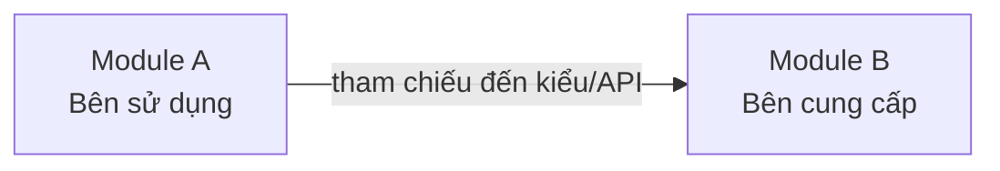
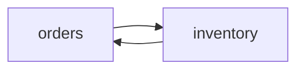
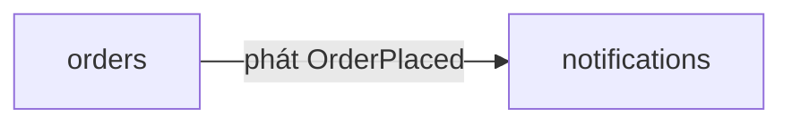
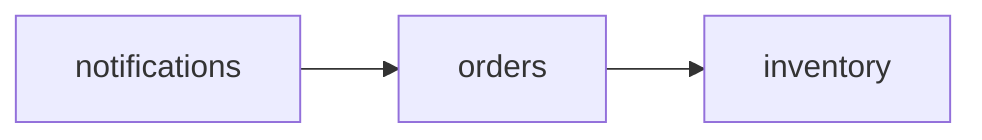

# Dependency từ module A sang module B có nghĩa gì?

Trong **Spring Modulith**, một ứng dụng Spring Boot có thể được tổ chức thành nhiều *application module* cùng chạy trong một tiến trình. Các module có trách nhiệm riêng và giao tiếp qua những điểm truy cập được công bố. Vì vậy, câu hỏi “module A phụ thuộc vào module B” là câu hỏi về **ranh giới kiến trúc và hướng sử dụng mã nguồn**; nó không có nghĩa A và B phải là hai microservice hoặc hai tệp JAR riêng.

Bài học thuộc phạm vi **`SPRING_MODULITH_VERIFICATION_TESTING`**: học cách dùng `ApplicationModules`, các quy tắc phụ thuộc và kiểm thử để phát hiện việc vượt ranh giới giữa các module trước khi thay đổi đó gây hồi quy. Trọng tâm của phần **Dependency rules** này là hiểu chính xác ý nghĩa của một cạnh phụ thuộc, từ đó đọc đúng kết quả kiểm chứng kiến trúc.

## 1. Một cạnh phụ thuộc A → B diễn tả điều gì?

**A → B** có nghĩa là **mã trong A tham chiếu hoặc sử dụng một kiểu (type) thuộc B**. A là bên sử dụng (*consumer*, hoặc *dependent*), còn B là bên cung cấp (*provider*, hoặc *dependency*). Chẳng hạn, A khai báo trường có kiểu của B, nhận đối tượng B qua constructor, gọi phương thức trên API của B, hoặc sử dụng kiểu sự kiện do B định nghĩa.



Trong một ứng dụng bán hàng, nếu `orders.OrderService` dùng `inventory.StockChecker` để kiểm tra tồn kho, chiều phụ thuộc là **`orders → inventory`**. Không được đọc ngược thành `inventory → orders` chỉ vì kết quả kiểm tra được trả về cho `orders`.

Một vài hệ quả quan trọng:

- **Đây là quan hệ có hướng**: A phụ thuộc B không mặc nhiên có nghĩa B phụ thuộc A.
- **Đây là quan hệ ở mức mã/kiến trúc**: Spring Modulith phân tích những tham chiếu giữa các kiểu Java để xác định quan hệ. Việc hai module cùng tồn tại trong một `ApplicationContext` chưa đủ để kết luận chúng phụ thuộc nhau.
- **Phụ thuộc hợp lệ không đồng nghĩa ghép nối tùy tiện**: A có thể được phép dùng API công khai của B nhưng không được đi sâu vào phần cài đặt nội bộ của B.
- **Phụ thuộc có tính lan truyền về tác động**: thay đổi hợp đồng công khai của B có thể buộc A sửa theo; đây là lý do cần kiểm soát số lượng và hướng phụ thuộc.

Đừng nhầm quan hệ này với một lời gọi HTTP, một dòng dữ liệu trong cơ sở dữ liệu, hay thứ tự khởi động bean. Những hoạt động đó có thể tạo ra sự phụ thuộc vận hành, nhưng không phải lúc nào cũng tạo ra cạnh phụ thuộc kiểu Java mà bộ kiểm chứng kiến trúc nhìn thấy.

## 2. Spring Modulith xác định ranh giới A và B như thế nào?

Với cách tổ chức mặc định, mỗi package con trực tiếp bên dưới package gốc của ứng dụng Spring Boot là một application module. Ví dụ:

```text
com.example.shop
├── ShopApplication.java
├── orders                          ← module orders (A)
│   ├── OrderService.java           ← API/package gốc của orders
│   └── internal
│       └── OrderRepository.java    ← cài đặt nội bộ của orders
└── inventory                       ← module inventory (B)
    ├── StockChecker.java           ← API/package gốc của inventory
    └── internal
        └── JpaStockChecker.java    ← cài đặt nội bộ của inventory
```

Ở đây, `orders` và `inventory` là hai module ngang hàng. `orders.internal` thuộc **bên trong** module `orders`; nó không tự trở thành một module ngang hàng khác trong cách phát hiện mặc định. Spring Modulith cho phép tùy chỉnh cách xác định module, vì thế kết luận về cấu trúc cụ thể luôn cần dựa vào cấu hình phát hiện module của dự án.

Với module đóng (*closed module*, kiểu thông thường), các kiểu nằm trực tiếp trong **package gốc** của module tạo thành API mặc định; các kiểu trong package con, như `inventory.internal`, thuộc phần nội bộ. Việc một class nội bộ được khai báo `public` theo Java **không làm nó tự động trở thành API của module**. Có thể công bố thêm những package khác qua *named interface*, nhưng cần khai báo rõ ràng.

## 3. Ví dụ: `orders` phụ thuộc hợp lệ vào `inventory`

Module `inventory` đưa ra một hợp đồng ở package gốc:

```java
// com/example/shop/inventory/StockChecker.java
package com.example.shop.inventory;

public interface StockChecker {
    boolean inStock(String sku, int quantity);
}
```

Module `orders` chỉ sử dụng hợp đồng đó:

```java
// com/example/shop/orders/OrderService.java
package com.example.shop.orders;

import com.example.shop.inventory.StockChecker;
import org.springframework.stereotype.Service;

@Service
public class OrderService {

    private final StockChecker stockChecker;

    public OrderService(StockChecker stockChecker) {
        this.stockChecker = stockChecker;
    }

    public void placeOrder(String sku, int quantity) {
        if (!stockChecker.inStock(sku, quantity)) {
            throw new IllegalStateException("Không đủ tồn kho");
        }

        // Tiếp tục quy trình tạo đơn hàng.
    }
}
```

Một bean thuộc `inventory.internal` có thể triển khai `StockChecker` và được Spring inject vào `OrderService`. `orders` không cần biết tên class triển khai, repository hoặc cơ chế lưu kho. Chỉ riêng việc `OrderService` tham chiếu đến `StockChecker` đã đủ để thể hiện cạnh **`orders → inventory`**.

Nếu muốn ghi rõ chính sách cho module `orders`, có thể tạo `package-info.java` của chính package đó:

```java
// com/example/shop/orders/package-info.java
@org.springframework.modulith.ApplicationModule(
    allowedDependencies = "inventory"
)
package com.example.shop.orders;
```

Khai báo này có nghĩa `orders` chỉ được phụ thuộc vào module ứng dụng `inventory` theo phạm vi API mà module đó công bố (ngoài các ngoại lệ như shared module được cấu hình). Nó **không** cho phép `orders` truy cập mọi class trong `inventory.internal`. Nếu `orders` bắt đầu tham chiếu đến module `payments`, quy tắc `allowedDependencies` sẽ phát hiện vi phạm.

> **Lưu ý:** `allowedDependencies` mô tả **những phụ thuộc được phép**, không tự sinh ra một cạnh phụ thuộc. Chỉ khi mã của `orders` thực sự sử dụng kiểu từ `inventory` thì cạnh `orders → inventory` mới xuất hiện trong đồ thị phụ thuộc thực tế.

## 4. Ba kiểu vi phạm dễ gặp

| Tình huống | Kết luận | Vì sao? |
| --- | --- | --- |
| `orders` sử dụng `inventory.StockChecker` | Hợp lệ theo cấu hình ví dụ | Truy cập API ở package gốc của module được phép |
| `orders` import `inventory.internal.JpaStockChecker` | Vi phạm ranh giới API | Đi trực tiếp vào phần nội bộ của module khác, kể cả khi class là `public` |
| `orders` sử dụng `payments.PaymentService` khi chỉ khai báo `allowedDependencies = "inventory"` | Vi phạm danh sách phụ thuộc được phép | `payments` nằm ngoài tập module `orders` được phép tham chiếu |
| `inventory` lại sử dụng kiểu từ `orders`, trong khi `orders → inventory` đã tồn tại | Tạo chu trình `orders ↔ inventory` | Quy tắc mặc định yêu cầu đồ thị phụ thuộc giữa các application module không có chu trình |

### 4.1. Xuyên thủng nội bộ của module B

Giả sử B có `inventory.internal.JpaStockChecker`. Nếu A inject trực tiếp class này thay vì `inventory.StockChecker`, A bị buộc chặt với chi tiết cài đặt của B. Khi B đổi công nghệ lưu trữ, A cũng có thể phải sửa. Cách khắc phục là đưa **hợp đồng cần chia sẻ** vào API của B, giữ implementation trong package nội bộ và chỉ inject theo hợp đồng.

### 4.2. Khai báo quá rộng hoặc thiếu chính sách phụ thuộc

Nếu module có quá nhiều tham chiếu đến các module khác, một thay đổi nhỏ có thể tác động đến nhiều nơi. `@ApplicationModule(allowedDependencies = ...)` giúp biến thiết kế mong muốn thành quy tắc có thể kiểm tra. Không bắt buộc phải khai báo cho mọi module; khi không có danh sách này, Spring Modulith vẫn kiểm tra chu trình và việc truy cập nội bộ theo các quy tắc áp dụng.

### 4.3. Phụ thuộc vòng



Một vòng phụ thuộc làm hai module khó thay đổi và kiểm thử độc lập. Nếu luồng nghiệp vụ có vẻ buộc cả hai gọi nhau, hãy xem xét dịch chuyển trách nhiệm, trích xuất một hợp đồng dùng chung có chủ đích, hoặc phát sự kiện từ module sở hữu nghiệp vụ để module khác phản ứng. Không nên chỉ đổi tên package để che một vòng phụ thuộc đang có thật.

## 5. Khi dùng sự kiện, hướng phụ thuộc được tính ra sao?

Hướng phát sự kiện nghiệp vụ và hướng tham chiếu đến **kiểu sự kiện** có thể khác nhau. Giả sử `orders` định nghĩa kiểu công khai `OrderPlaced` rồi phát sự kiện; module `notifications` lắng nghe sự kiện đó:



Sơ đồ trên biểu diễn **dòng xử lý sự kiện**. Nếu listener trong `notifications` import `orders.OrderPlaced`, đồ thị **phụ thuộc mã nguồn** lại chứa cạnh `notifications → orders`: `notifications` cần biết hợp đồng sự kiện do `orders` sở hữu, còn `orders` không cần tham chiếu đến `notifications`.

Đây thường là một hướng ghép nối hợp lý: module phát sự kiện không phải biết ai sẽ tiêu thụ. Tuy nhiên, **dùng event không mặc nhiên xóa mọi phụ thuộc kiến trúc**. Nếu `orders` đồng thời gọi trực tiếp API của `notifications`, hai cạnh trái chiều có thể tạo chu trình. Khi thiết kế sự kiện, cần xác định rõ module sở hữu kiểu sự kiện, package công khai của kiểu và quan hệ phụ thuộc mà subscriber tạo ra.

## 6. Kiểm chứng ranh giới bằng `ApplicationModules`

Spring Modulith cho phép dựng mô hình các module và kiểm tra quy tắc bằng một bài test JUnit:

```java
import com.example.shop.ShopApplication;
import org.junit.jupiter.api.Test;
import org.springframework.modulith.core.ApplicationModules;

class ModularityTests {

    @Test
    void verifiesModuleBoundaries() {
        ApplicationModules.of(ShopApplication.class).verify();
    }
}
```

Lời gọi `verify()` kiểm tra các ràng buộc kiến trúc mặc định, bao gồm:

1. Đồ thị phụ thuộc giữa các application module không có chu trình.
2. Module khác chỉ truy cập những kiểu được công bố qua API của module đích; với module đóng, không truy cập package nội bộ.
3. Nếu module khai báo `allowedDependencies`, mọi tham chiếu xuyên module phải tuân thủ danh sách đó.

Khi có vi phạm, phép kiểm chứng thất bại và test có thể làm pipeline CI thất bại. Đây là một **quality gate** hữu ích: người viết mã nhận phản hồi ngay khi thêm import hoặc tham chiếu phá vỡ kiến trúc, trước khi merge.

`@ApplicationModuleTest` phục vụ mục đích bổ sung: khởi chạy Spring context giới hạn theo module để kiểm thử hành vi và tích hợp. Chế độ `STANDALONE` chạy riêng module hiện tại; `DIRECT_DEPENDENCIES` thêm các module mà nó phụ thuộc trực tiếp; `ALL_DEPENDENCIES` thêm toàn bộ cây phụ thuộc. Những kiểm thử này giúp phát hiện vấn đề wiring bean, database hoặc sự kiện ở phạm vi phù hợp, nhưng **không thay thế** phép kiểm chứng tĩnh `ApplicationModules.verify()`.

Tương tự, kiểm chứng phụ thuộc kiểu Java không đủ để chứng minh mọi tương tác runtime đều đúng: truy vấn chéo bảng dữ liệu, tên topic trong chuỗi, reflection hoặc lời gọi qua mạng có thể cần thêm integration test và quy tắc thiết kế riêng.

## 7. Named interface: cho phép dùng một phần API của B

Không phải mọi API cần lộ ra đều nằm trong package gốc. Nếu `inventory` có package `inventory.spi` chứa hợp đồng dùng cho module khác, có thể công bố nó thành *named interface*:

```java
// com/example/shop/inventory/spi/package-info.java
@org.springframework.modulith.NamedInterface("spi")
package com.example.shop.inventory.spi;
```

Khi đó module `orders` có thể chỉ được phép dùng phần hợp đồng này:

```java
// com/example/shop/orders/package-info.java
@org.springframework.modulith.ApplicationModule(
    allowedDependencies = "inventory::spi"
)
package com.example.shop.orders;
```

Để cấu hình trên phù hợp, các kiểu mà `orders` cần dùng phải nằm trong `inventory.spi`. Quy tắc `inventory::spi` hẹp hơn việc cho phép toàn bộ API mà `inventory` công bố; nó không ngầm cho phép `orders` sử dụng kiểu ở package gốc `inventory`. Đây là cách ghi rõ **A được biết chính xác phần nào của B**.

## 8. Tự kiểm tra cách đọc đồ thị phụ thuộc

Cho ba module `orders`, `inventory`, `notifications`:



Hãy thử trả lời trước khi đọc đáp án:

1. Nếu API công khai của `inventory` thay đổi, module nào trực tiếp có nguy cơ phải sửa?
2. Nếu `orders` thêm import đến `notifications.NotificationSender`, đồ thị có vấn đề gì?
3. Nếu `notifications` chỉ nhận sự kiện có kiểu `orders.OrderPlaced`, tại sao `orders` không nhất thiết phụ thuộc `notifications`?

**Đáp án:** (1) `orders` có phụ thuộc trực tiếp vào `inventory`; (2) tạo cạnh `orders → notifications` trong khi đã có `notifications → orders`, dẫn đến chu trình; (3) `notifications` là nơi tham chiếu kiểu sự kiện, còn bên phát `orders` không cần biết listener cụ thể.

Khi gặp một quan hệ phụ thuộc mới, hãy tự đặt ba câu hỏi: **Ai đang sử dụng kiểu của ai? Kiểu đó thuộc API được phép hay thuộc phần nội bộ? Cạnh mới có vi phạm danh sách cho phép hoặc tạo chu trình không?** Trả lời được ba câu hỏi này là nền tảng để sử dụng Spring Modulith kiểm chứng kiến trúc, xây dựng kiểm thử module, và đặt quality gate hiệu quả trong CI.

## Tài liệu tham khảo

- [Spring Modulith — Fundamentals (module, API, allowed dependencies, named interfaces)](https://docs.spring.io/spring-modulith/reference/fundamentals.html)
- [Spring Modulith — Verifying Application Module Structure](https://docs.spring.io/spring-modulith/reference/verification.html)
- [Spring Modulith — Integration Testing Application Modules](https://docs.spring.io/spring-modulith/reference/testing.html)
