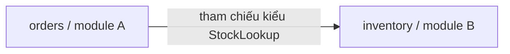
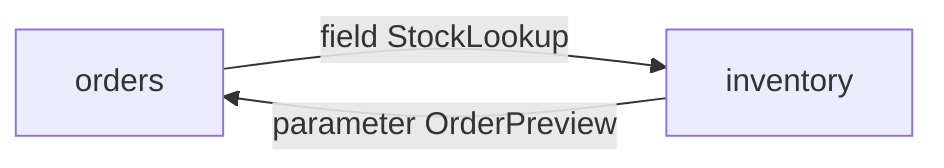

# Phụ thuộc qua kiểu tham số, trường và kiểu trả về

Khi kiểm chứng kiến trúc bằng **Spring Modulith**, không thể chỉ tìm những chỗ module A gọi phương thức của module B. **Chỉ cần A khai báo một kiểu thuộc B trong tham số, trường dữ liệu hoặc kiểu trả về, A đã hình thành phụ thuộc mã nguồn vào B.** Phụ thuộc đó tồn tại dù phương thức chưa từng chạy, dù trường là `private`, hoặc dù việc tiêm bean được Spring thực hiện tự động.

Bài học thuộc chương **Dependency rules** của `SPRING_MODULITH_VERIFICATION_TESTING`. Mục tiêu của module học là rèn khả năng dùng `ApplicationModules` để kiểm chứng ranh giới kiến trúc, kết hợp `@ApplicationModuleTest`, kiểm thử sự kiện, cơ sở dữ liệu, tích hợp và quality gate CI nhằm ngăn phụ thuộc sai và hồi quy. Trong bài này, ta tập trung nhận diện chính xác ba nguồn phụ thuộc qua *kiểu Java* và cách chúng ảnh hưởng đến kết quả `ApplicationModules.verify()`.

## 1. Trước hết, hiểu đúng chiều phụ thuộc

Giả sử ứng dụng có hai application module:

- `orders`: quản lý đặt hàng, gọi là **module A**.
- `inventory`: cung cấp khả năng xem tồn kho, gọi là **module B**.

Nếu một lớp trong `orders` tham chiếu đến `inventory.StockLookup`, chiều phụ thuộc là **`orders → inventory`**: mã của A cần biết một kiểu do B định nghĩa.



Đây là **hướng phụ thuộc tĩnh của mã Java**, không nhất thiết là chiều dữ liệu chạy qua hệ thống. Chẳng hạn, B trả kết quả về cho A khi thực thi nhưng điều đó không biến cạnh thành `inventory → orders`. Một tham chiếu đến `String`, `List` hoặc `Instant` của thư viện chuẩn cũng không tự tạo cạnh giữa hai *application module* của ứng dụng.

Với cách phát hiện module mặc định của Spring Modulith, các package con trực tiếp dưới package gốc ứng dụng là các module. Ví dụ:

```text
com.example.store
├── StoreApplication.java
├── orders
│   ├── OrderPreviewService.java
│   └── OrderPreview.java
└── inventory
    ├── StockLookup.java
    ├── StockStatus.java
    └── internal
        └── JpaStockLookup.java
```

`inventory` là một module, còn `inventory.internal` là package nội bộ trong module đó. Theo mô hình module đóng thông thường, các kiểu ở package gốc `inventory` thuộc API mặc định mà module khác có thể dùng; các kiểu trong `inventory.internal` không được tự ý truy cập xuyên ranh giới dù được khai báo `public` trong Java.

## 2. Ba vị trí khai báo có thể tạo cạnh A → B

Hãy xem bảng với giả định mọi đoạn mã nằm trong module `orders`, còn `StockLookup` và `StockStatus` được khai báo trong module `inventory`:

| Vị trí | Khai báo trong A | Vì sao tạo `orders → inventory`? |
| --- | --- | --- |
| **Trường** (*field*) | `private StockLookup stockLookup;` | Kiểu của trạng thái đối tượng do B định nghĩa |
| **Tham số constructor** | `OrderService(StockLookup lookup)` | Chữ ký khởi tạo phải biết kiểu của B |
| **Tham số phương thức** | `void assess(StockStatus status)` | Đầu vào của phương thức có kiểu từ B |
| **Kiểu trả về** | `StockStatus inspect(String sku)` | Đầu ra trong chữ ký phương thức dùng kiểu từ B |

Một kiểu có thể xuất hiện ở **nhiều vị trí cùng lúc**, nhưng điều đó không tạo ra nhiều hướng phụ thuộc khác nhau: kết luận ở mức module vẫn là A phụ thuộc B. Các tham chiếu này được xác định từ cấu trúc kiểu Java; không cần chạy đường đi nghiệp vụ để chúng tồn tại.

### 2.1. Phụ thuộc qua trường dữ liệu

```java
package com.example.store.orders;

import com.example.store.inventory.StockLookup;

class OrderService {
    private StockLookup stockLookup;
}
```

Ngay ở dòng `private StockLookup stockLookup;`, `OrderService` đã biết `StockLookup` của `inventory`. `private` chỉ hạn chế nơi được đọc trường trong Java, **không loại bỏ phụ thuộc kiến trúc**. Kể cả khi chưa gọi phương thức nào của `stockLookup`, cạnh `orders → inventory` vẫn tồn tại.

Điều này cũng đúng với một trường `static`, `final` hoặc một trường có kiểu mảng như `StockStatus[]`, vì phần khai báo vẫn tham chiếu đến kiểu thuộc B.

### 2.2. Phụ thuộc qua kiểu tham số

```java
package com.example.store.orders;

import com.example.store.inventory.StockLookup;
import com.example.store.inventory.StockStatus;

class OrderService {
    OrderService(StockLookup lookup) {         // Tham số constructor
        // Có thể chưa gọi lookup tại đây.
    }

    void evaluate(StockStatus status) {       // Tham số phương thức
        // Có thể chưa sử dụng status.
    }
}
```

Cả hai chữ ký đều kéo kiểu của B vào A. **Tiêm phụ thuộc qua constructor** là một kỹ thuật thiết kế tốt khi A sử dụng hợp đồng công khai của B, nhưng việc tiêm bằng Spring **không làm mất cạnh phụ thuộc tĩnh**: A vẫn nhắc đến tên kiểu của B.

Với tham số phương thức, ranh giới còn được thể hiện ở hợp đồng đầu vào. Nếu `evaluate(StockStatus status)` được công khai để nhiều module gọi, các bên gọi có thể phải biết thêm kiểu `StockStatus`. Đó là một dạng lan truyền ghép nối cần cân nhắc khi thiết kế API.

### 2.3. Phụ thuộc qua kiểu trả về

```java
package com.example.store.orders;

import com.example.store.inventory.StockStatus;

class OrderService {
    StockStatus previewRawStock(String sku) {
        throw new UnsupportedOperationException("Ví dụ chữ ký phương thức");
    }
}
```

Chỉ riêng `StockStatus` trước tên phương thức đã tạo tham chiếu từ `orders` đến `inventory`. Việc phương thức luôn ném exception trong ví dụ không ảnh hưởng đến quan hệ kiểu: **trình biên dịch vẫn cần biết `StockStatus`**.

Nếu phương thức là `public`, kiểu B còn trở thành một phần của bề mặt API do A công bố. Tác động thực tế có thể vượt qua A: module C muốn làm việc với giá trị trả về cũng có thể phải nhập kiểu do B sở hữu.

## 3. Ví dụ xuyên suốt: một nghiệp vụ có cả ba dạng phụ thuộc

Module `inventory` công bố hai kiểu ở package gốc:

```java
// inventory/StockStatus.java
package com.example.store.inventory;

public record StockStatus(String sku, int availableQuantity) {}
```

```java
// inventory/StockLookup.java
package com.example.store.inventory;

public interface StockLookup {
    StockStatus findBySku(String sku);
}
```

Module `orders` định nghĩa kiểu kết quả nghiệp vụ riêng:

```java
// orders/OrderPreview.java
package com.example.store.orders;

public record OrderPreview(String sku, int requestedQuantity,
                           boolean sufficientStock) {}
```

Sau đó `orders` sử dụng API của `inventory`:

```java
// orders/OrderPreviewService.java
package com.example.store.orders;

import com.example.store.inventory.StockLookup;
import com.example.store.inventory.StockStatus;
import org.springframework.stereotype.Service;

@Service
public class OrderPreviewService {
    private final StockLookup stockLookup;               // [1] Kiểu trường

    public OrderPreviewService(StockLookup stockLookup) { // [2] Tham số constructor
        this.stockLookup = stockLookup;
    }

    public OrderPreview preview(String sku, int quantity) {
        StockStatus stock = stockLookup.findBySku(sku);
        return toPreview(stock, quantity);
    }

    private OrderPreview toPreview(StockStatus stock, int quantity) { // [3] Tham số
        return new OrderPreview(
                stock.sku(), quantity,
                stock.availableQuantity() >= quantity
        );
    }

    public StockStatus inspectStock(String sku) {        // [4] Kiểu trả về
        return stockLookup.findBySku(sku);
    }
}
```

Từng vị trí đánh dấu `[1]` đến `[4]` đều sử dụng kiểu do `inventory` sở hữu. Chỉ cần một trong những vị trí đó tồn tại, đồ thị phụ thuộc đã có cạnh `orders → inventory`. Ở `[3]`, dù `toPreview` là `private`, phương thức vẫn tham chiếu đến kiểu B. Ở `[4]`, `inspectStock()` còn **đưa kiểu `StockStatus` ra API công khai** của `orders`.

Phương thức `preview()` thể hiện một lựa chọn khác: A chuyển dữ liệu của B thành `OrderPreview`, kiểu do A sở hữu, trước khi trả về. Cách này giúp các module gọi API của `orders` không phải phụ thuộc vào cấu trúc `StockStatus` của `inventory`. Tuy nhiên, vì `orders` vẫn dùng `StockLookup` và `StockStatus` bên trong, **cạnh `orders → inventory` vẫn tồn tại**. Thiết kế API gọn hơn không đồng nghĩa đã xóa toàn bộ phụ thuộc bên trong.

## 4. Kiểu lồng trong collection và kiểu tổng quát (generic)

Không phải tham chiếu đến B lúc nào cũng xuất hiện trực tiếp ở đầu chữ ký. Ví dụ:

```java
import com.example.store.inventory.StockStatus;
import java.util.List;
import java.util.Optional;
import java.util.concurrent.CompletionStage;

// Các khai báo nằm trong một class thuộc module orders.
private List<StockStatus> statuses;

public Optional<StockStatus> findStock(String sku);

public void receive(List<StockStatus> updates);

public CompletionStage<StockStatus> fetchAsync(String sku);
```

`List`, `Optional` và `CompletionStage` là kiểu thư viện, nhưng **đối số generic `StockStatus` vẫn là một kiểu được nhắc đến trong hợp đồng Java**. Về mặt thiết kế, A đang phụ thuộc vào kiểu của B; generic không phải cơ chế che giấu ranh giới module.

Các dòng trên là **mẫu chữ ký độc lập để phân tích**, không phải một file Java hoàn chỉnh có thể biên dịch nguyên khối. Khi kiểm tra dự án cụ thể, cần dùng đúng phiên bản Spring Modulith/ArchUnit của dự án để xác nhận cách công cụ thu thập mọi dạng tham chiếu bytecode hoặc generic. Điều quan trọng trong review là phải xem cả kiểu nằm bên trong `<...>`, chứ không chỉ kiểu bao ngoài.

## 5. Khi phụ thuộc trở thành vi phạm ranh giới

Việc phát hiện A → B **chưa đủ để kết luận sai**. Phải kiểm tra thêm **A được phép phụ thuộc B hay không** và **kiểu mà A sử dụng có thuộc API B công bố hay không**.

### 5.1. Dùng kiểu thuộc package nội bộ của B

Giả sử `inventory.internal.StockEntity` chỉ phục vụ lưu trữ. Đoạn mã sau đặt trong `orders`:

```java
package com.example.store.orders;

import com.example.store.inventory.internal.StockEntity;

class OrderService {
    private StockEntity stock;                  // Field vượt ranh giới

    void reserve(StockEntity stock) {           // Parameter vượt ranh giới
        this.stock = stock;
    }

    StockEntity currentStock() {                // Return type vượt ranh giới
        return stock;
    }
}
```

Nếu `inventory` là module đóng và package `internal` không được công bố, **cả ba khai báo** đều kéo implementation của B sang A. Dù `StockEntity` được đánh dấu `public`, Java vẫn cho phép biên dịch trong nhiều cấu hình classpath, nhưng quy tắc kiến trúc của Spring Modulith có thể từ chối cách sử dụng đó.

Cách sửa là đưa **hợp đồng thật sự được phép chia sẻ** về API của `inventory` (ví dụ `StockLookup` và `StockStatus` ở package gốc) rồi để `inventory.internal` tự xử lý entity. Không chuyển toàn bộ entity nội bộ ra API chỉ để qua được kiểm tra: điều đó làm ranh giới của B mất ý nghĩa.

### 5.2. Dùng module không có trong danh sách cho phép

Module `orders` có thể khai báo chính sách phụ thuộc tại package gốc:

```java
// com/example/store/orders/package-info.java
@org.springframework.modulith.ApplicationModule(
    allowedDependencies = "inventory"
)
package com.example.store.orders;
```

Trong ví dụ này, `orders` được phép dùng API mặc định của `inventory`. Nếu thêm trường `private PaymentGateway paymentGateway;` với `PaymentGateway` thuộc module `payments`, hoặc thêm tham số/kiểu trả về thuộc `payments`, thì **`orders → payments`** có thể vi phạm `allowedDependencies` dù chẳng có lời gọi phương thức nào được thực thi.

Với một *named interface* của B, có thể nêu chính xác phần API được phép bằng cú pháp `inventory::tenInterface` trong `allowedDependencies`, khi B đã công bố named interface đó bằng `@NamedInterface`. **Danh sách phụ thuộc được phép chỉ giới hạn những cạnh hợp lệ**; khai báo `allowedDependencies = "inventory"` không tự tạo ra phụ thuộc nếu mã `orders` chưa dùng kiểu nào của `inventory`.

### 5.3. Vòng phụ thuộc có thể xuất hiện ngay từ chữ ký

Giả sử `orders` khai báo trường `StockLookup` thuộc `inventory`, tạo `orders → inventory`. Nếu `inventory` sau đó có phương thức:

```java
// Trong package inventory
public void acknowledge(com.example.store.orders.OrderPreview preview) {
    // Chưa cần gọi phương thức nào của orders.
}
```

Vì `OrderPreview` thuộc `orders`, chữ ký này tạo thêm cạnh `inventory → orders`. Đồ thị trở thành vòng phụ thuộc:



Việc cả hai phía chỉ dùng kiểu dữ liệu không làm vòng phụ thuộc biến mất. Nên cân nhắc ai sở hữu hợp đồng và bên nào thực sự cần biết bên kia, hoặc thay đổi cách cộng tác giữa các module để tránh hai chiều tham chiếu.

## 6. Phân biệt phụ thuộc mã nguồn với việc inject bean và chạy nghiệp vụ

Ba câu hỏi sau có ý nghĩa khác nhau:

| Câu hỏi | Ví dụ | Kiểm chứng phù hợp |
| --- | --- | --- |
| Có cạnh phụ thuộc kiểu A → B không? | Constructor của A nhận `StockLookup` từ B | Phân tích cấu trúc module bằng `ApplicationModules` |
| Cạnh đó có tuân thủ ranh giới không? | A chỉ được dùng API B, không được dùng `B.internal` | `ApplicationModules.verify()` |
| Runtime có tạo đủ bean và xử lý đúng không? | Spring có bean triển khai `StockLookup`, kết quả tồn kho đúng không? | `@ApplicationModuleTest`, kiểm thử tích hợp và nghiệp vụ |

Ví dụ, A nhận `StockLookup` trong constructor có thể **hợp lệ về kiến trúc** nhưng vẫn **khởi động thất bại** nếu Spring không tìm thấy bean triển khai. Ngược lại, Spring có thể inject thành công một class nội bộ của B trong cấu hình classpath thông thường, trong khi quy tắc ranh giới của Spring Modulith vẫn báo vi phạm.

Khi sử dụng sự kiện, cũng cần đọc đúng chiều: nếu `notifications` có tham số listener kiểu `orders.OrderPlaced`, thì `notifications → orders` là phụ thuộc kiểu, mặc dù **dòng sự kiện runtime** đi từ nơi phát ở `orders` đến nơi nhận ở `notifications`. Không suy ra hướng phụ thuộc chỉ từ hướng thông điệp chạy.

## 7. Đặt kiểm chứng tĩnh vào test và CI

Một bài kiểm tra cấu trúc module có thể được viết bằng JUnit:

```java
package com.example.store;

import org.junit.jupiter.api.Test;
import org.springframework.modulith.core.ApplicationModules;

class ModularityTests {
    @Test
    void moduleDependenciesFollowRules() {
        ApplicationModules.of(StoreApplication.class).verify();
    }
}
```

`verify()` phân tích các module đã được nhận diện và kiểm tra các quy tắc kiến trúc áp dụng, trong đó có **không tạo chu trình**, **không truy cập phần nội bộ của module khác**, và **tuân thủ `allowedDependencies` nếu được khai báo**. Khi một thay đổi làm xuất hiện kiểu bị cấm trong trường, tham số hoặc kiểu trả về, bài kiểm chứng kiến trúc có thể thất bại trước khi chức năng đó được chạy thật.

Vì vậy, hãy chạy bài test này như một phần của bộ test trong CI và yêu cầu pipeline pass trước khi merge. Điều này giúp phát hiện những lỗi kiểu “chỉ sửa chữ ký phương thức” nhưng vô tình phá vỡ ranh giới. Bài test này kiểm tra **cấu trúc**, không khẳng định tất cả cấu hình Spring, giao dịch, truy vấn cơ sở dữ liệu hay việc chuyển phát sự kiện đều hoạt động.

Để kiểm thử phần tích hợp của `orders`, có thể bổ sung một test riêng:

```java
import org.junit.jupiter.api.Test;
import org.springframework.modulith.test.ApplicationModuleTest;

@ApplicationModuleTest(
    mode = ApplicationModuleTest.BootstrapMode.DIRECT_DEPENDENCIES
)
class OrdersModuleIntegrationTests {
    @Test
    void contextStartsWithDirectDependencies() {
        // Có thể bổ sung assertion nghiệp vụ và bean wiring.
    }
}
```

`DIRECT_DEPENDENCIES` mở rộng phạm vi khởi tạo sang các module phụ thuộc trực tiếp để kiểm thử tích hợp. Đây là phép kiểm bổ sung cho `ApplicationModules.verify()`, đặc biệt khi có wiring bean, dữ liệu hoặc sự kiện; không dùng nó thay cho việc kiểm tra hướng phụ thuộc tĩnh.

## 8. Cách review hoặc sửa một phụ thuộc sai

Khi thêm một field, tham số hoặc kiểu trả về trong module A, có thể tự kiểm theo trình tự sau:

1. **Xác định chủ sở hữu của kiểu**: kiểu nằm trong package của A, package công khai B, package nội bộ B, hay thuộc thư viện ngoài?
2. **Vẽ đúng chiều cạnh**: class của A dùng kiểu B nghĩa là A → B, bất kể ai gọi ai lúc chạy.
3. **Kiểm tra chính sách**: `allowedDependencies` của A có cho phép B không? Kiểu B có được module B công bố qua API mặc định hoặc named interface không?
4. **Kiểm tra API lộ ra ngoài**: một tham số hoặc kiểu trả về `public` có làm các module khác bị buộc phụ thuộc vào DTO/implementation của B không?
5. **Kiểm tra chu trình**: B đã tham chiếu ngược về một kiểu của A chưa?
6. **Chạy kiểm chứng**: `ApplicationModules.verify()` trước, sau đó chạy test module và integration test liên quan nếu thay đổi chạm wiring hoặc nghiệp vụ.

Hướng sửa thường là **dùng interface/DTO công khai** của module sở hữu dữ liệu, chuyển đổi dữ liệu ở ranh giới, hoặc điều chỉnh phân công trách nhiệm để tránh phụ thuộc ngược. Nếu A chỉ cần một giá trị đơn giản, chẳng hạn `boolean sufficientStock`, cân nhắc giữ kiểu của B trong phần cài đặt A và trả về DTO của A cho người dùng API. Nhưng không nên cố biến mọi hợp đồng thành `Object`, `Map<String, Object>` hoặc chuỗi JSON để “qua kiểm tra”: mất an toàn kiểu sẽ làm hệ thống khó bảo trì hơn mà quan hệ nghiệp vụ vẫn còn.

## 9. Bài tập nhận diện phụ thuộc

Giả sử các khai báo sau đều nằm trong lớp thuộc module `orders`; `inventory` có `StockLookup` và `StockStatus` trong API công khai, còn `inventory.internal.StockEntity` là kiểu nội bộ chưa được công bố:

| Mã trong `orders` | Có cạnh `orders → inventory`? | Có thể vi phạm ranh giới module? |
| --- | --- | --- |
| `private StockLookup lookup;` | Có | Hợp lệ nếu `orders` được phép dùng API `inventory` |
| `void reserve(StockStatus status)` | Có | Hợp lệ nếu dùng API được phép |
| `StockStatus check(String sku)` | Có | Hợp lệ nếu dùng API được phép; chú ý lộ kiểu B ở chữ ký |
| `private StockEntity entity;` | Có | Có, vì `StockEntity` thuộc `inventory.internal` |
| `List<StockStatus> results()` | Có về mặt tham chiếu kiểu | Hợp lệ hay không tùy chính sách và cách API được công bố |
| `OrderPreview preview(String sku)` | Không thể kết luận có cạnh đến `inventory` **chỉ từ chữ ký này** | Cần xem thân hàm, trường và những khai báo khác |

**Câu hỏi suy luận:** Nếu `OrderPreview preview(String sku)` bên trong gọi `inventory.StockLookup`, lời gọi có thể tạo thêm cạnh A → B dù chữ ký công khai chỉ dùng kiểu của A không? **Có.** Chủ đề bài này là ba vị trí khai báo thường bị bỏ sót, nhưng Spring Modulith còn xem xét những quan hệ kiểu và lời gọi khác trong mã; không nên kết luận toàn bộ đồ thị chỉ bằng việc xem chữ ký công khai.

Điểm cần ghi nhớ: **kiểu của trường, tham số và giá trị trả về đều là một phần của hợp đồng mã nguồn**. Mỗi nơi A nhắc đến kiểu của B là một vị trí cần đối chiếu với ranh giới module. Phân biệt được *có phụ thuộc*, *phụ thuộc có được phép*, và *runtime có hoạt động* sẽ giúp kiểm thử kiến trúc Spring Modulith chính xác hơn.

## Tài liệu tham khảo

- [Spring Modulith — Fundamentals: Application Modules, Named Interfaces và Allowed Dependencies](https://docs.spring.io/spring-modulith/reference/fundamentals.html)
- [Spring Modulith — Verifying Application Module Structure](https://docs.spring.io/spring-modulith/reference/verification.html)
- [Spring Modulith — Integration Testing Application Modules](https://docs.spring.io/spring-modulith/reference/testing.html)
