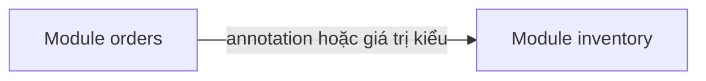

# Phụ thuộc qua annotation và metadata

Một class Java có thể **không khai báo trường, tham số hay kiểu trả về** thuộc module khác nhưng vẫn tạo ra phụ thuộc kiến trúc thông qua annotation. Chẳng hạn, một cấu hình trong module `orders` viết `@Import(InventoryPersistenceConfiguration.class)` sẽ tham chiếu trực tiếp đến kiểu nằm trong module `inventory`. Ngay cả khi class cấu hình chưa được Spring khởi tạo, tham chiếu đến `InventoryPersistenceConfiguration.class` đã nằm trong metadata của mã Java đã biên dịch.

Ngược lại, `@Qualifier("inventoryService")` hoặc `@Table(name = "inventory_stock")` chỉ chứa **giá trị chuỗi**. Chúng có thể thể hiện sự ghép nối ở runtime, nhưng không tự tạo ra cạnh phụ thuộc *theo kiểu Java* đến module `inventory` chỉ vì chuỗi có chữ “inventory”.

Bài học thuộc chương **Dependency rules**, trong phạm vi `SPRING_MODULITH_VERIFICATION_TESTING`: kiểm chứng ranh giới Spring Modulith bằng `ApplicationModules` và quy tắc phụ thuộc, kết hợp `@ApplicationModuleTest`, kiểm thử sự kiện, cơ sở dữ liệu, tích hợp và quality gate CI để ngăn thay đổi phá vỡ kiến trúc. Trọng tâm ở đây là **đọc đúng phụ thuộc hình thành qua annotation/metadata**, phân biệt các quy tắc do Spring Modulith khai báo với quan hệ phụ thuộc thực sự trong mã.

## 1. Vì sao annotation cũng có thể tạo ra phụ thuộc?

Annotation là một kiểu Java đặc biệt. Khi một class A sử dụng annotation do module B định nghĩa, A đã phải biết **kiểu annotation** của B. Ngoài tên annotation, các thuộc tính annotation còn có thể chứa những giá trị như `SomeClass.class`, enum, annotation lồng nhau hoặc mảng `Class<?>[]`. Các giá trị kiểu `Class` có thể tạo thêm tham chiếu đến lớp được chỉ ra.

Giả sử ứng dụng được tổ chức theo cách phát hiện module mặc định:

```text
com.example.shop
├── ShopApplication.java
├── orders
│   ├── package-info.java
│   └── internal
│       ├── OrdersConfiguration.java
│       └── StockChangeHandler.java
└── inventory
    ├── InventoryFeature.java
    ├── events
    │   ├── package-info.java
    │   └── StockAdjusted.java
    └── internal
        └── InventoryPersistenceConfiguration.java
```

`orders` và `inventory` là hai *application module*. Các package `inventory.events` và `inventory.internal` là package con của module `inventory`, không tự trở thành application module ngang hàng. Với module đóng thông thường, package gốc `inventory` là API mặc định; package con chỉ được dùng từ module khác nếu được công bố theo cơ chế phù hợp, chẳng hạn *named interface*.

Nếu class nằm trong `orders` có annotation chứa tham chiếu kiểu do `inventory` sở hữu, cạnh có hướng là:



**Hướng mũi tên luôn đi từ nơi chứa khai báo/tham chiếu đến nơi sở hữu kiểu được tham chiếu**, không phụ thuộc annotation đó có làm bean chạy ở runtime hay không.

## 2. Ba hình thức tham chiếu thường gặp

| Trường hợp trong module `orders` | Điều được tham chiếu | Có cạnh kiểu `orders → inventory`? |
| --- | --- | --- |
| `@InventoryFeature`, với `InventoryFeature` do `inventory` định nghĩa | Kiểu annotation của B | **Có** |
| `@Import(InventoryPersistenceConfiguration.class)` | Giá trị `Class` thuộc B | **Có** |
| `@ConditionalOnClass(InventoryFeature.class)` | Giá trị `Class` thuộc B | **Có** |
| `@Qualifier("inventoryService")` | Chuỗi tên bean, annotation thuộc thư viện Spring | **Không suy ra được cạnh đến inventory từ annotation này** |
| `@ConditionalOnClass(name = "com.example.shop.inventory.InventoryFeature")` | Tên class ở dạng chuỗi | **Không có tham chiếu kiểu tĩnh đến InventoryFeature chỉ từ giá trị chuỗi** |
| `@Table(name = "inventory_stock")` | Tên bảng ở dạng chuỗi | **Không có cạnh kiểu trực tiếp đến inventory chỉ từ tên bảng** |

Cột cuối nói về **tham chiếu kiểu thấy được từ chính annotation đang xét**. Một class vẫn có thể tạo cùng cạnh ở trường, tham số, kiểu trả về, kế thừa, lời gọi hoặc những khai báo khác. Cũng cần phân biệt “có cạnh” với “cạnh hợp lệ”: Spring Modulith còn kiểm tra API mà B cho phép sử dụng, chu trình và `allowedDependencies`.

### 2.1. Dùng annotation do module B định nghĩa

Module `inventory` công bố một annotation tại package gốc:

```java
// inventory/InventoryFeature.java
package com.example.shop.inventory;

import java.lang.annotation.ElementType;
import java.lang.annotation.Retention;
import java.lang.annotation.RetentionPolicy;
import java.lang.annotation.Target;

@Target(ElementType.TYPE)
@Retention(RetentionPolicy.RUNTIME)
public @interface InventoryFeature {}
```

Module `orders` sử dụng annotation đó:

```java
// orders/internal/InventoryAwareOrderService.java
package com.example.shop.orders.internal;

import com.example.shop.inventory.InventoryFeature;

@InventoryFeature
class InventoryAwareOrderService {}
```

Đây là **phụ thuộc kiểu** `orders → inventory`, dù `InventoryAwareOrderService` không gọi phương thức nào và annotation chỉ là dấu đánh dấu. Trong ví dụ, `InventoryFeature` thuộc API mặc định của B nên việc dùng nó có thể hợp lệ nếu chính sách phụ thuộc cho phép.

Nếu thay bằng annotation ở `inventory.internal`, A sẽ tham chiếu trực tiếp vào phần nội bộ của B. `public` trong Java chỉ liên quan khả năng truy cập ở mức ngôn ngữ; nó không tự biến một kiểu thuộc package nội bộ thành API Spring Modulith.

### 2.2. Annotation thuộc thư viện chung nhưng giá trị trỏ tới B

Một annotation của framework **không tự tạo cạnh đến module nghiệp vụ B**. Tuy nhiên, giá trị kiểu được truyền vào annotation đó có thể tạo cạnh:

```java
// orders/internal/OrdersConfiguration.java
package com.example.shop.orders.internal;

import com.example.shop.inventory.internal.InventoryPersistenceConfiguration;
import org.springframework.context.annotation.Configuration;
import org.springframework.context.annotation.Import;

@Configuration
@Import(InventoryPersistenceConfiguration.class)
class OrdersConfiguration {}
```

Ở đây:

1. `@Configuration` và `@Import` đều là kiểu của Spring Framework, không thuộc module `inventory`.
2. Giá trị `InventoryPersistenceConfiguration.class` **là tham chiếu đến class của `inventory`**.
3. Vì class đích nằm trong `inventory.internal`, cấu hình này vượt API của module B nếu package đó không được công bố.

Điểm dễ bỏ sót là class `OrdersConfiguration` **không có field, constructor hay method nhận kiểu B**. Nếu chỉ tìm theo chữ ký phương thức, phụ thuộc do annotation tạo ra sẽ bị bỏ qua.

Đây cũng là vấn đề thiết kế: module `orders` đang gắn chặt vào cấu hình persistence nội bộ của `inventory`. Cách phù hợp thường là để module `inventory` tự sở hữu cấu hình lưu trữ và công bố hợp đồng nghiệp vụ cần thiết cho `orders`, rồi để Spring inject qua hợp đồng đó.

### 2.3. Annotation có nhiều giá trị kiểu hoặc kiểu lồng nhau

Ví dụ với `@EntityScan`:

```java
// Ví dụ minh họa riêng trong module orders
@org.springframework.boot.autoconfigure.domain.EntityScan(
    basePackageClasses = {
        com.example.shop.inventory.internal.InventoryEntity.class
    }
)
class OrdersJpaConfiguration {}
```

`basePackageClasses` có kiểu `Class<?>[]`; mỗi phần tử như `InventoryEntity.class` là một tham chiếu kiểu. Giá trị nằm trong mảng annotation không làm mất phụ thuộc.

Tương tự, khi annotation dùng enum, annotation con hoặc nhiều lớp trong `@Import({A.class, B.class})`, cần xem kiểu được khai báo trong các giá trị đó thuộc module nào. Việc một giá trị xuất hiện sâu trong metadata không có nghĩa nó vô hình trước phân tích bytecode.

## 3. Metadata chuỗi không tương đương tham chiếu kiểu Java

Xét hai biến thể có ý định cấu hình gần giống nhau:

```java
// Tham chiếu lớp thực sự trong annotation
@org.springframework.boot.autoconfigure.condition.ConditionalOnClass(
    value = com.example.shop.inventory.InventoryFeature.class
)
class TypedCondition {}
```

```java
// Tên lớp dưới dạng chuỗi
@org.springframework.boot.autoconfigure.condition.ConditionalOnClass(
    name = "com.example.shop.inventory.InventoryFeature"
)
class NamedCondition {}
```

Biến thể thứ nhất chứa kiểu `InventoryFeature` ngay trong giá trị annotation. Biến thể thứ hai chứa tên lớp ở dạng chuỗi. **Không nên coi chuỗi là một cạnh phụ thuộc kiểu tĩnh** chỉ vì giá trị của nó trông giống tên package.

Tuy nhiên, cả hai có thể ảnh hưởng đến cách Spring khởi tạo bean. `name = "... "` không phải “mẹo” để hợp thức hóa việc A cấu hình sâu vào nội bộ B. Khi dùng chuỗi, rủi ro còn là lỗi chính tả hoặc tên class thay đổi mà trình biên dịch không cảnh báo.

Các ví dụ tương tự:

- `@Qualifier("inventoryService")`: chỉ định tên/qualifier bean, không chứng minh lớp chứa annotation có tham chiếu đến kiểu của module `inventory`.
- `@Table(name = "inventory_stock")` hoặc `@Query("select ...")`: metadata liên quan cơ sở dữ liệu có thể tạo phụ thuộc dữ liệu thật, nhưng không nhất thiết xuất hiện như cạnh **kiểu Java** giữa hai application module.
- `@RequestMapping("/inventory/stock")`: khai báo route bằng chuỗi không tự cho biết class HTTP handler thuộc module nào hoặc có dùng kiểu API của module `inventory` hay không.

**Giới hạn quan trọng:** `ApplicationModules.verify()` được dùng để kiểm chứng các quan hệ cấu trúc Java mà Spring Modulith/ArchUnit nhìn thấy. Nó không chứng minh mọi chuỗi cấu hình, đường dẫn HTTP, tên topic, câu truy vấn, reflection hoặc truy cập chéo bảng dữ liệu đều tuân thủ ranh giới nghiệp vụ. Các trường hợp đó cần kiểm thử tích hợp và quy tắc bổ sung nếu dự án muốn kiểm soát.

## 4. Meta-annotation: lần theo nơi thực sự chứa tham chiếu

Spring thường dùng *composed annotation*: một annotation được định nghĩa bằng những annotation khác. Giả sử module `common` (một application module giả định) khai báo:

```java
// common/EnableInventoryPersistence.java
package com.example.shop.common;

import com.example.shop.inventory.internal.InventoryPersistenceConfiguration;
import org.springframework.context.annotation.Import;
import java.lang.annotation.ElementType;
import java.lang.annotation.Retention;
import java.lang.annotation.RetentionPolicy;
import java.lang.annotation.Target;

@Target(ElementType.TYPE)
@Retention(RetentionPolicy.RUNTIME)
@Import(InventoryPersistenceConfiguration.class)
public @interface EnableInventoryPersistence {}
```

Sau đó `orders` dùng:

```java
// orders/internal/OrdersConfiguration.java
package com.example.shop.orders.internal;

import com.example.shop.common.EnableInventoryPersistence;

@EnableInventoryPersistence
class OrdersConfiguration {}
```

Hãy phân biệt:

- Trong **mã `orders`**, tham chiếu trực tiếp từ `@EnableInventoryPersistence` là đến kiểu annotation thuộc `common`.
- Trong **mã khai báo annotation ở `common`**, `@Import(InventoryPersistenceConfiguration.class)` tạo tham chiếu trực tiếp `common → inventory`.
- Khi Spring xử lý meta-annotation, cơ chế runtime có thể kéo cấu hình `inventory` vào ứng dụng. Đây là tác động runtime cần kiểm tra thêm.

```mermaid
flowchart LR
    O[orders] -->|dùng @EnableInventoryPersistence| C[common]
    C -->|@Import class token| I[inventory]
```

Đồ thị trên mô tả **các nơi khai báo phụ thuộc kiểu**; không được tự suy diễn có **cạnh trực tiếp** `orders → inventory` chỉ vì annotation trung gian sau đó tải cấu hình ở runtime. Mỗi cạnh cụ thể phải được xác minh từ mã đã biên dịch và cách bộ phân tích nhận diện module.

Meta-annotation cũng lý giải vì sao một annotation “trông vô hại” có thể tạo hiệu ứng framework phức tạp. Khi review, hãy đọc **định nghĩa annotation** nếu nó là annotation do dự án sở hữu, không chỉ nhìn dòng sử dụng.

## 5. Đừng nhầm annotation khai báo quy tắc với cạnh phụ thuộc thực tế

Spring Modulith dùng metadata để **mô tả ranh giới**, nhưng các khai báo đó không tự tạo quan hệ dùng API nghiệp vụ.

### 5.1. `@ApplicationModule(allowedDependencies = ...)` là chính sách

```java
// orders/package-info.java
@org.springframework.modulith.ApplicationModule(
    allowedDependencies = "inventory"
)
package com.example.shop.orders;
```

Ý nghĩa: nếu mã trong `orders` thực sự tham chiếu đến application module khác, các cạnh phải thỏa tập module được phép, ví dụ `inventory`, và vẫn phải tôn trọng API công bố của module đích. Giá trị `"inventory"` chỉ là **định danh module trong quy tắc**. Bản thân giá trị chuỗi này không tạo cạnh thực tế `orders → inventory`.

Vì vậy, một cấu hình cho phép `inventory` vẫn có thể hợp lệ dù hiện tại `orders` chưa dùng bất kỳ kiểu nào từ `inventory`. Ngược lại, nếu `orders` import lớp nội bộ của `inventory`, việc nêu `"inventory"` trong `allowedDependencies` không tự hợp thức hóa truy cập vào phần nội bộ.

### 5.2. `@NamedInterface` công bố một phần API

Nếu module `inventory` muốn công bố riêng các kiểu sự kiện ở `inventory.events`:

```java
// inventory/events/package-info.java
@org.springframework.modulith.NamedInterface("events")
package com.example.shop.inventory.events;
```

Module `orders` có thể giới hạn phụ thuộc đến phần API này:

```java
// orders/package-info.java
@org.springframework.modulith.ApplicationModule(
    allowedDependencies = "inventory::events"
)
package com.example.shop.orders;
```

`inventory::events` là cú pháp chỉ **named interface `events` của module `inventory`**. Đây là cách viết hợp đồng phụ thuộc được phép; nếu chưa có mã sử dụng kiểu từ `inventory.events` thì chưa có cạnh phụ thuộc thực tế vì riêng chuỗi đó.

Để hình thành cạnh, `orders` có thể có listener:

```java
// inventory/events/StockAdjusted.java
package com.example.shop.inventory.events;

public record StockAdjusted(String sku, int newQuantity) {}
```

```java
// orders/internal/StockChangeHandler.java
package com.example.shop.orders.internal;

import com.example.shop.inventory.events.StockAdjusted;
import org.springframework.context.event.EventListener;
import org.springframework.stereotype.Component;

@Component
class StockChangeHandler {
    @EventListener
    void on(StockAdjusted event) {
        // Phản ứng với thay đổi tồn kho.
    }
}
```

Ở đây, **tham số `StockAdjusted`** tạo cạnh `orders → inventory` và đối chiếu được với `inventory::events`. `@EventListener` thuộc thư viện Spring; riêng việc dùng annotation đó không tạo cạnh đến `inventory`. Ngược lại, dòng sự kiện ở runtime có thể đi từ `inventory` (nơi phát) sang `orders` (nơi nhận). **Hướng truyền sự kiện và hướng tham chiếu kiểu không nhất thiết trùng nhau.**

### 5.3. `@ApplicationModuleTest` định phạm vi bài kiểm thử

Ví dụ một bài kiểm thử đặt trong package thuộc module `orders`:

```java
// src/test/java/com/example/shop/orders/OrdersModuleTests.java
package com.example.shop.orders;

import org.junit.jupiter.api.Test;
import org.springframework.modulith.test.ApplicationModuleTest;

@ApplicationModuleTest(
    mode = ApplicationModuleTest.BootstrapMode.DIRECT_DEPENDENCIES
)
class OrdersModuleTests {
    @Test
    void startsWithDirectDependencies() {
        // Bổ sung assertion kiểm thử nghiệp vụ/wiring khi cần.
    }
}
```

Metadata `DIRECT_DEPENDENCIES` yêu cầu test context khởi tạo thêm những module phụ thuộc trực tiếp theo mô hình Spring Modulith. Annotation này **không có nghĩa bản thân mã sản xuất của `orders` vừa có thêm cạnh đến một module tên là “direct dependencies”**. Class test thuộc phạm vi kiểm thử; không nên suy luận đồ thị phụ thuộc mã ứng dụng chỉ bằng annotation được đặt trong `src/test/java`.

Kiểm thử module có thể xác nhận Spring wiring, sự kiện, giao dịch hoặc tương tác cơ sở dữ liệu theo setup test, nhưng mục tiêu khác với kiểm chứng cấu trúc bằng `ApplicationModules.verify()`.

## 6. Cơ chế phát hiện và giới hạn của phân tích bytecode

Trong Java, annotation có chính sách giữ lại metadata (*retention*):

| Retention | Điều xảy ra khi biên dịch | Lưu ý khi kiểm chứng |
| --- | --- | --- |
| `RetentionPolicy.RUNTIME` | Metadata có trong `.class` và có thể đọc qua reflection | Spring thường cần mức này để xử lý annotation ở runtime; bộ phân tích bytecode cũng có thể đọc |
| `RetentionPolicy.CLASS` | Metadata có trong `.class`, không bắt buộc hiện diện qua reflection runtime | Công cụ đọc bytecode vẫn có thể xem thông tin được lưu |
| `RetentionPolicy.SOURCE` | Metadata annotation không được giữ trong `.class` | Không nên khẳng định kiểm chứng chỉ đọc bytecode sẽ thấy trực tiếp annotation này |

Spring Modulith sử dụng cơ chế phân tích cấu trúc dựa trên ArchUnit cho nhiều quy tắc xác minh. Những quan hệ có dấu vết trong bytecode, chẳng hạn kiểu annotation được giữ lại và các giá trị `Class`, là nguồn dữ liệu quan trọng. Tuy nhiên, **khả năng phát hiện chính xác từng kiểu metadata còn phụ thuộc vào bytecode sinh ra, phạm vi class được import và phiên bản thư viện**.

Một số tình huống cần chú ý:

1. **Annotation processor** có thể tạo ra class hoặc wiring bổ sung. Đồ thị kiểm chứng phải chạy trên bản biên dịch chứa các lớp cần phân tích, đồng thời hiểu đâu là mã nguồn do công cụ sinh.
2. **Chuỗi tên class, cấu hình XML/YAML, reflection và dynamic proxies** có thể tạo tác động runtime không thể suy ra đầy đủ từ những phụ thuộc kiểu Java tĩnh.
3. **Meta-annotation** có thể kéo cấu hình thông qua một annotation khác; cần xem module sở hữu từng annotation và class được tham chiếu, thay vì suy từ hành vi runtime ra một cạnh Java trực tiếp.
4. **Annotation trong mã kiểm thử** có thể không nằm trong phạm vi class ứng dụng mà `ApplicationModules.of(...)` phân tích theo cấu hình mặc định.

Do đó, khi phát hiện một trường hợp đáng nghi, hãy đọc thông báo vi phạm thực tế của `verify()` và đối chiếu vị trí phụ thuộc trong source/bytecode. Nếu cần khẳng định công cụ bắt được một trường hợp khó như annotation ở mức `SOURCE` hoặc metadata do processor sinh ra, hãy bổ sung một bài kiểm chứng nhỏ với đúng phiên bản thư viện của dự án.

## 7. Kiểm chứng ranh giới với `ApplicationModules.verify()`

Đặt một bài test JUnit trong module ứng dụng:

```java
// src/test/java/com/example/shop/ModularityTests.java
package com.example.shop;

import org.junit.jupiter.api.Test;
import org.springframework.modulith.core.ApplicationModules;

class ModularityTests {

    @Test
    void verifiesDependenciesBetweenApplicationModules() {
        ApplicationModules.of(ShopApplication.class).verify();
    }
}
```

`verify()` đánh giá các quy tắc kiến trúc áp dụng, bao gồm:

- Phụ thuộc giữa các application module không tạo chu trình.
- Module không truy cập vào phần nội bộ của module khác ngoài API đã công bố.
- Những module có khai báo `allowedDependencies` phải tuân thủ tập phụ thuộc được phép.

Giả sử `orders` có `allowedDependencies = "inventory::events"` và ai đó thêm:

```java
// Trong một class của orders
@org.springframework.context.annotation.Import(
    com.example.shop.inventory.internal.InventoryPersistenceConfiguration.class
)
class AccidentalInventoryImport {}
```

Cạnh `orders → inventory` ở đây nhắc tới **package nội bộ**, không phải named interface `events`. Bộ kiểm chứng cấu trúc có cơ sở để báo vi phạm ranh giới, dù class chưa bao giờ được gọi trong một bài test nghiệp vụ.

Một luồng quality gate CI hữu ích:

```text
Commit / Pull request
    ↓
Compile mã Java, bao gồm mã được sinh nếu có
    ↓
Chạy JUnit ModularityTests → ApplicationModules.verify()
    ↓
Chạy unit test, @ApplicationModuleTest và integration test liên quan
    ↓
Chỉ cho merge khi các bước bắt buộc đều PASS
```

Không cần cấu hình CI đặc biệt cho riêng `verify()` nếu nó đã là một JUnit test được task test của dự án thu thập. Nhưng phải bảo đảm job CI thực sự chạy lớp test này; chỉ gọi lệnh build bỏ qua test sẽ không tạo quality gate kiến trúc.

## 8. Review annotation và metadata trong một pull request

Khi một thay đổi thêm annotation hoặc sửa giá trị annotation, có thể dùng bảng kiểm sau:

| Câu hỏi | Mục đích |
| --- | --- |
| **Annotation này do package/module nào định nghĩa?** | Tìm phụ thuộc đến kiểu annotation ở module khác |
| **Thuộc tính có chứa `SomeType.class`, enum hoặc annotation lồng nhau không?** | Tìm phụ thuộc kiểu thông qua giá trị metadata |
| **Có chỉ dùng chuỗi tên class, bean, bảng, route, topic không?** | Phân biệt rủi ro runtime với cạnh kiểu tĩnh |
| **Kiểu được tham chiếu có thuộc API/named interface của module đích không?** | Phát hiện truy cập package nội bộ |
| **`allowedDependencies` cho phép module/interface đó không?** | Đối chiếu với chính sách kiến trúc |
| **Annotation có meta-annotation hoặc processor sinh mã không?** | Xem nơi khác có tạo thêm tham chiếu hoặc hành vi runtime |
| **Có thể phát sinh vòng A → B → A không?** | Kiểm tra hướng phụ thuộc sau thay đổi |
| **Đã chạy test cấu trúc và test tích hợp tương ứng chưa?** | Ngăn vi phạm kiến trúc lẫn lỗi runtime |

Khi cần sửa, nên **đưa hợp đồng cần dùng vào API công khai** của module đích, **công bố named interface** khi đúng mục đích, hoặc **chuyển quyền sở hữu cấu hình** về module thực sự quản lý tài nguyên. Tránh chuyển tên class sang chuỗi chỉ để che việc tham chiếu package nội bộ: lối làm đó có thể khiến `verify()` không nhìn thấy cạnh kiểu tĩnh, nhưng tính ghép nối thực tế và rủi ro hồi quy vẫn tồn tại.

## 9. Bài tập nhận diện nhanh

Giả sử:

- `inventory.api.InventoryEvent` thuộc named interface `inventory::api`.
- `inventory.internal.InventoryEntity` là lớp nội bộ chưa được công bố.
- `orders` chỉ khai báo `allowedDependencies = "inventory::api"`.
- Các annotation Spring trong ví dụ đều đến từ thư viện ngoài những application module của ứng dụng.

Hãy phân tích từng khai báo trong một class thuộc `orders`:

| Khai báo | Nhận xét |
| --- | --- |
| `@EventListener` trên method có tham số `InventoryEvent` | **Có** cạnh `orders → inventory` do **tham số method**, có thể hợp lệ theo `inventory::api` |
| `@Import(InventoryEntity.class)` | **Có** cạnh qua giá trị annotation, **vi phạm** ranh giới nội bộ |
| `@ConditionalOnClass(name = "com.example.shop.inventory.internal.InventoryEntity")` | **Không suy ra cạnh kiểu trực tiếp** chỉ từ chuỗi; có rủi ro coupling runtime |
| `@Qualifier("inventoryEntityManager")` | Không đủ căn cứ kết luận có cạnh kiểu đến module `inventory` |
| `@ApplicationModule(allowedDependencies = "inventory::api")` | Là **chính sách** cho phép; tự nó chưa chứng minh có cạnh phụ thuộc thực tế |
| `@InventoryFeature`, nếu annotation này nằm ở package gốc `inventory` | **Có** cạnh đến kiểu annotation; có thể vi phạm danh sách chỉ cho phép `inventory::api` |

**Tình huống suy luận:** Một developer xóa tham số `InventoryEvent` khỏi method listener nhưng vẫn giữ `@Import(InventoryEntity.class)`. Đã hết phụ thuộc `orders → inventory` chưa? **Chưa.** Giá trị `Class` trong `@Import` vẫn giữ cạnh kiểu từ `orders` đến `inventory`, và kiểu được tham chiếu vẫn thuộc phần nội bộ bị cấm.

**Điểm cốt lõi:** Annotation là mã Java có kiểu và metadata, vì vậy nó có thể tạo phụ thuộc kiến trúc ngay cả khi không xuất hiện ở field hay method signature. Nhưng **chuỗi metadata và các khai báo chính sách** không được đồng nhất với cạnh phụ thuộc kiểu thực tế. Nhận diện ba trường hợp này giúp đọc kết quả `ApplicationModules.verify()` đúng, thiết kế ranh giới module rõ và đặt quality gate hiệu quả trong CI.

## Tài liệu tham khảo

- [Spring Modulith — Fundamentals: Application Modules, Named Interfaces và Allowed Dependencies](https://docs.spring.io/spring-modulith/reference/fundamentals.html)
- [Spring Modulith — Verifying Application Module Structure](https://docs.spring.io/spring-modulith/reference/verification.html)
- [Spring Modulith — Integration Testing Application Modules](https://docs.spring.io/spring-modulith/reference/testing.html)
- [ArchUnit User Guide — Dependencies and Dependency Rules](https://www.archunit.org/userguide/html/000_Index.html)
- [Java SE — RetentionPolicy](https://docs.oracle.com/en/java/javase/21/docs/api/java.base/java/lang/annotation/RetentionPolicy.html)
