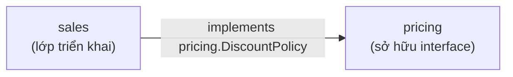
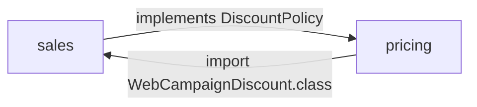

# Phụ thuộc do kế thừa hoặc triển khai interface

Trong Java, một class có thể phụ thuộc vào class hoặc interface của module khác **chỉ bằng việc khai báo `extends` hoặc `implements`**. Không cần tạo đối tượng, gọi phương thức hay chạy ứng dụng: tên kiểu ở mệnh đề kế thừa/triển khai đã thiết lập quan hệ phụ thuộc trong mã nguồn và bytecode.

Đây là chủ đề của chương **Dependency rules** thuộc `SPRING_MODULITH_VERIFICATION_TESTING`. Trong phạm vi học phần, chúng ta dùng `ApplicationModules` và các quy tắc phụ thuộc để kiểm chứng ranh giới kiến trúc Spring Modulith, đồng thời thực hành `@ApplicationModuleTest`, kiểm thử sự kiện, cơ sở dữ liệu, tích hợp và tích hợp quality gate trong CI nhằm ngăn phụ thuộc sai và hồi quy. Bài này tập trung vào **hướng phụ thuộc do `extends`/`implements`**, khi nào quan hệ đó hợp lệ, khi nào vượt ranh giới module, và cách kiểm chứng.

## 1. Kế thừa tạo cạnh phụ thuộc theo hướng nào?

Giả sử ứng dụng có hai application module:

- **A = `sales`**: quản lý quy tắc khuyến mại của kênh bán hàng.
- **B = `pricing`**: công bố hợp đồng tính chiết khấu.

Nếu `sales.WebCampaignDiscount implements pricing.DiscountPolicy` thì **`sales → pricing`**. Module `sales` biết interface của `pricing` để biên dịch và thực hiện hợp đồng. Điều đó **không có nghĩa `pricing` phải biết lớp `WebCampaignDiscount`**.



Tương tự, `class SalesRule extends PricingRule` tạo `sales → pricing` nếu `PricingRule` thuộc module `pricing`. **Mũi tên đi từ lớp con/kiểu triển khai về kiểu cha hoặc interface được nhắc đến**, chứ không đi theo chiều gọi phương thức tại runtime.

Một điểm cần nhớ: `extends`/`implements` là phụ thuộc **tĩnh ở mức Java**. Dù một subclass không ghi đè phương thức nào, dù `@Override` bị bỏ đi, hay dù chưa có bean nào được tạo, quan hệ kiểu vẫn tồn tại.

## 2. Nhận diện các dạng kế thừa và triển khai

| Khai báo trong module A | Kiểu thuộc B | Hướng phụ thuộc | Ý nghĩa |
| --- | --- | --- | --- |
| `class AService extends BBaseService` | Lớp cha `BBaseService` | A → B | A kế thừa hành vi/trạng thái do B định nghĩa |
| `class APolicy implements BPolicy` | Interface `BPolicy` | A → B | A cam kết thực hiện hợp đồng thuộc B |
| `interface AContract extends BContract` | Interface cha `BContract` | A → B | API của A mở rộng hợp đồng B |
| `record AEvent(...) implements BMarker` | Interface `BMarker` | A → B | Record vẫn có thể triển khai interface |
| `class APolicy extends ABase implements BPolicy` | `ABase` thuộc A, `BPolicy` thuộc B | A → B | Cạnh xuyên module do `implements`, không phải `extends ABase` |

**Không phải mọi `extends` đều là phụ thuộc giữa application module.** Ví dụ, `class X extends RuntimeException` chỉ tham chiếu kiểu thuộc thư viện Java chuẩn, không hình thành cạnh đến một application module khác của ứng dụng. Tương tự, `implements Serializable` là phụ thuộc đến API Java, không phải đến module nghiệp vụ.

Trong Java, class thường chỉ được `extends` **một class**, nhưng có thể `implements` **nhiều interface**. Một interface cũng có thể `extends` nhiều interface. Vì vậy một khai báo có thể tạo cạnh đến nhiều module:

```java
// Minh họa cú pháp: BPolicy thuộc pricing, CAuditable thuộc audit
class CampaignPolicy implements BPolicy, CAuditable {
    // Phải hiện thực các phương thức trừu tượng theo hợp đồng.
}
```

Nếu class này thuộc `sales` thì hình thành các cạnh `sales → pricing` và `sales → audit`. Đây là ví dụ minh họa quan hệ kiểu; các interface giả định không phải API có sẵn của Spring Modulith.

## 3. Ví dụ thực tế: module A triển khai interface công khai của B

Xét cấu trúc package:

```text
com.example.shop
├── ShopApplication.java
├── pricing                            ← module B
│   ├── DiscountPolicy.java           ← API mặc định của pricing
│   ├── PricingService.java
│   └── internal
│       └── DefaultPricingRules.java
└── sales                              ← module A
    ├── package-info.java
    ├── WebCampaignDiscount.java
    └── internal
        └── SalesCampaignService.java
```

Ở cách phát hiện module mặc định, `pricing` và `sales` là hai application module; package con `pricing.internal` là chi tiết bên trong `pricing`. Interface nằm trực tiếp trong package `pricing` là một phần API mặc định của module đóng.

Module `pricing` định nghĩa hợp đồng cho những quy tắc giảm giá có thể được mở rộng:

```java
// com/example/shop/pricing/DiscountPolicy.java
package com.example.shop.pricing;

import java.math.BigDecimal;

public interface DiscountPolicy {
    boolean supports(String salesChannel);
    BigDecimal discount(BigDecimal subtotal);
}
```

Module `sales` triển khai hợp đồng đó:

```java
// com/example/shop/sales/WebCampaignDiscount.java
package com.example.shop.sales;

import com.example.shop.pricing.DiscountPolicy;
import java.math.BigDecimal;
import org.springframework.stereotype.Component;

@Component
public class WebCampaignDiscount implements DiscountPolicy {

    @Override
    public boolean supports(String salesChannel) {
        return "WEB".equals(salesChannel);
    }

    @Override
    public BigDecimal discount(BigDecimal subtotal) {
        return subtotal.multiply(new BigDecimal("0.05"));
    }
}
```

Ở ví dụ này, chỉ riêng `implements DiscountPolicy` đã đủ chứng minh **`sales → pricing`**. Những phương thức `supports` và `discount` làm hợp đồng có ích ở runtime, nhưng không phải điều kiện để quan hệ kiểu xuất hiện. Annotation `@Component` của Spring giúp đăng ký bean; nó không đảo chiều phụ thuộc giữa hai application module.

Module `pricing` có thể nhận mọi bean triển khai chính interface **do nó sở hữu**, mà không import class cụ thể của `sales`:

```java
// com/example/shop/pricing/PricingService.java
package com.example.shop.pricing;

import java.util.List;
import org.springframework.stereotype.Service;

@Service
public class PricingService {

    private final List<DiscountPolicy> discountPolicies;

    public PricingService(List<DiscountPolicy> discountPolicies) {
        this.discountPolicies = discountPolicies;
    }

    public int availablePolicies() {
        return discountPolicies.size();
    }
}
```

Khi chạy trong một Spring context quét được các bean phù hợp, `WebCampaignDiscount` có thể được đưa vào danh sách `DiscountPolicy`. Đây là **quan hệ cộng tác tại runtime**: `pricing` có thể gọi một implementation do `sales` cung cấp. Còn **đồ thị phụ thuộc kiểu** của các đoạn mã trên chỉ có cạnh `sales → pricing`; `PricingService` dùng kiểu `DiscountPolicy` thuộc chính `pricing` và không nhắc tên `WebCampaignDiscount`.

Điều này quan trọng cho thiết kế plugin/extension: **module sở hữu interface không cần biết trước tất cả module sẽ triển khai interface đó**. Cách tách này có thể giúp tránh chu trình, dù vẫn cần kiểm thử kết quả wiring thực tế.

## 4. Kế thừa lớp cha: phụ thuộc sâu hơn một hợp đồng

Khi dùng `extends`, lớp con thường kế thừa các phương thức và có thể cả hành vi được bảo vệ (`protected`), khiến mức ghép nối lớn hơn việc chỉ triển khai interface.

Giả sử `pricing` cung cấp một lớp cơ sở ở package API:

```java
// com/example/shop/pricing/AbstractDiscountPolicy.java
package com.example.shop.pricing;

import java.math.BigDecimal;

public abstract class AbstractDiscountPolicy implements DiscountPolicy {

    protected BigDecimal percentage(BigDecimal subtotal, String rate) {
        return subtotal.multiply(new BigDecimal(rate));
    }
}
```

Module `sales` kế thừa:

```java
// com/example/shop/sales/LoyaltyDiscount.java
package com.example.shop.sales;

import com.example.shop.pricing.AbstractDiscountPolicy;
import java.math.BigDecimal;
import org.springframework.stereotype.Component;

@Component
public class LoyaltyDiscount extends AbstractDiscountPolicy {

    @Override
    public boolean supports(String salesChannel) {
        return "LOYALTY".equals(salesChannel);
    }

    @Override
    public BigDecimal discount(BigDecimal subtotal) {
        return percentage(subtotal, "0.10");
    }
}
```

`LoyaltyDiscount` chỉ có một mệnh đề `extends` trỏ đến lớp của B, nhưng qua lớp cha nó cũng thực hiện hợp đồng `DiscountPolicy`. Cạnh xuyên module vẫn là **`sales → pricing`**. Module B thay đổi constructor, phương thức `protected` hoặc hành vi của `AbstractDiscountPolicy` có thể buộc module A phải thay đổi hoặc gây hồi quy. Vì vậy khi chỉ cần hợp đồng, **ưu tiên interface và composition**; chỉ công bố lớp cơ sở để kế thừa khi B thực sự muốn hỗ trợ kiểu mở rộng này.

Nếu lớp cơ sở nằm trong `pricing.internal.AbstractDiscountPolicy` thì việc `sales extends` lớp đó là **truy cập nội bộ xuyên module** đối với module đóng, cho dù class có modifier `public` và mã Java biên dịch được trên classpath.

> Lưu ý: trong ví dụ trên `DiscountPolicy`, `AbstractDiscountPolicy` và `LoyaltyDiscount` đều là các kiểu minh họa của ứng dụng. `extends` và `implements` là cú pháp Java thông thường; Spring Modulith không đòi hỏi phải thêm annotation đặc biệt để các quan hệ kiểu này tồn tại.

## 5. Interface kế thừa interface và quan hệ bắc cầu

Một interface của A có thể mở rộng interface của B:

```java
// com/example/shop/pricing/DiscountPolicy.java
package com.example.shop.pricing;

public interface DiscountPolicy {
    boolean supports(String channel);
}
```

```java
// com/example/shop/sales/SalesDiscountPolicy.java
package com.example.shop.sales;

import com.example.shop.pricing.DiscountPolicy;

public interface SalesDiscountPolicy extends DiscountPolicy {
    String campaignCode();
}
```

`SalesDiscountPolicy` chứa `extends DiscountPolicy`, do đó có cạnh **`sales → pricing`**, dù chưa có class nào implement `SalesDiscountPolicy`. Phụ thuộc nằm ngay trên **định nghĩa API của A**. Bất kỳ kiểu nào triển khai `SalesDiscountPolicy` cũng phải tuân thủ các nghĩa vụ interface kế thừa từ `DiscountPolicy`.

Phân biệt:

- **Phụ thuộc trực tiếp:** A nhắc đến kiểu thuộc B bằng `extends`/`implements`.
- **Quan hệ phụ thuộc bắc cầu trong đồ thị:** A → B và B → C tạo đường A → B → C. Điều đó không có nghĩa A đã trực tiếp import kiểu C.
- **Kế thừa kiểu bắc cầu:** `AImpl extends ABase`, trong khi `ABase implements BInterface`. Class `AImpl` có thể là một `BInterface` theo luật kiểu Java, nhưng cần xem **nơi khai báo quan hệ** để đánh giá các cạnh trực tiếp mà bộ phân tích ghi nhận.

Đặc biệt, đừng suy luận kiểu “`pricing` có thể gọi implementation ở `sales` nên `pricing → sales`”. Chỉ khi mã của `pricing` thực sự tham chiếu đến kiểu do `sales` sở hữu thì mới có căn cứ cho cạnh Java tĩnh `pricing → sales`.

## 6. Kế thừa/triển khai khi nào vi phạm Dependency rules?

Một cạnh A → B **không mặc nhiên là lỗi**. Spring Modulith xét đồng thời tính chu trình, quyền dùng module khác và bề mặt API được công bố.

### 6.1. Vượt ranh giới package nội bộ

Giả sử module `pricing` có:

```java
// com/example/shop/pricing/internal/BaseJpaDiscountCalculator.java
package com.example.shop.pricing.internal;

public abstract class BaseJpaDiscountCalculator {
    protected abstract String discountGroup();
}
```

Và module `sales` khai báo:

```java
// com/example/shop/sales/internal/SalesJpaDiscountCalculator.java
package com.example.shop.sales.internal;

import com.example.shop.pricing.internal.BaseJpaDiscountCalculator;

class SalesJpaDiscountCalculator extends BaseJpaDiscountCalculator {
    @Override
    protected String discountGroup() {
        return "WEB";
    }
}
```

Dù `BaseJpaDiscountCalculator` là `public`, nó nằm ở `pricing.internal`. Với mô hình module đóng, `sales` **không được kế thừa kiểu nội bộ đó** trừ khi package tương ứng được công bố hợp lệ. Việc làm này còn làm `sales` phụ thuộc vào chi tiết lưu trữ của `pricing`.

Hướng sửa là công bố một interface nhỏ ở API `pricing` (ví dụ `DiscountPolicy`) và để A triển khai interface đó; giữ việc thao tác JPA trong nội bộ B. Không nên chuyển toàn bộ repository/entity của B ra package API chỉ để hợp thức hóa quan hệ kế thừa.

### 6.2. Vi phạm danh sách phụ thuộc được phép

Nếu tại package gốc module `sales` có:

```java
// com/example/shop/sales/package-info.java
@org.springframework.modulith.ApplicationModule(
    allowedDependencies = "pricing"
)
package com.example.shop.sales;
```

thì `sales` được phép phụ thuộc vào **API được công bố** của `pricing`. Bản thân chuỗi `"pricing"` chỉ thể hiện **chính sách cho phép**, không tự sinh cạnh. `WebCampaignDiscount implements DiscountPolicy` tạo cạnh thực tế hợp lệ nếu các điều kiện khác thỏa mãn.

Ngược lại:

```java
// Giả định AuditedDiscount thuộc module audit, không thuộc pricing
class SalesDiscount implements com.example.shop.audit.AuditedDiscount {
    // Cần triển khai các phương thức theo contract tương ứng.
}
```

Nếu `sales` chỉ cho phép phụ thuộc `pricing`, mệnh đề `implements` dẫn tới **`sales → audit`** và có thể làm `verify()` thất bại. Việc class chưa được Spring scan hoặc chưa xuất hiện trong một luồng nghiệp vụ không hợp thức hóa phụ thuộc.

### 6.3. Chu trình phát sinh khi module B tham chiếu ngược module A

Ví dụ:

1. `sales.WebCampaignDiscount implements pricing.DiscountPolicy` tạo **`sales → pricing`**.
2. Một class trong `pricing` lại viết `@Import(sales.WebCampaignDiscount.class)` hoặc khai báo trường kiểu `sales.WebCampaignDiscount`, tạo **`pricing → sales`**.



Đó là **vòng phụ thuộc giữa application module**. Nó xuất hiện ở cấp mã Java dù dependency injection khi chạy có thể vẫn thực hiện được. Trong mô hình mở rộng bằng interface, thường nên để `pricing` chỉ biết `DiscountPolicy` và Spring tự tìm các implementation, thay vì để `pricing` import từng lớp ở `sales`.

## 7. Named interface: chỉ công bố một nhóm hợp đồng cho A

Nếu `pricing` muốn dành một package riêng cho hợp đồng extension, có thể đặt `DiscountPolicy` trong `pricing.spi` rồi công bố package đó bằng named interface:

```java
// com/example/shop/pricing/spi/package-info.java
@org.springframework.modulith.NamedInterface("spi")
package com.example.shop.pricing.spi;
```

```java
// com/example/shop/pricing/spi/DiscountPolicy.java
package com.example.shop.pricing.spi;

import java.math.BigDecimal;

public interface DiscountPolicy {
    BigDecimal discount(BigDecimal subtotal);
}
```

Và tại `sales`:

```java
// com/example/shop/sales/package-info.java
@org.springframework.modulith.ApplicationModule(
    allowedDependencies = "pricing::spi"
)
package com.example.shop.sales;
```

Khi `sales` viết `class WebDiscount implements pricing.spi.DiscountPolicy`, cạnh **`sales → pricing`** là phụ thuộc đến named interface `spi` được phép. Nếu thay bằng `extends pricing.internal.AbstractDiscountPolicy` thì sẽ vi phạm vì kiểu nội bộ không thuộc `pricing::spi`.

**Hai tầng kiểm soát khác nhau:** `@NamedInterface("spi")` nói *phần nào của pricing được công bố*, còn `allowedDependencies = "pricing::spi"` nói *sales được phép sử dụng phần nào*. Chỉ có mệnh đề `implements`/`extends` (hoặc tham chiếu Java thực tế khác) mới thể hiện việc A thật sự phụ thuộc vào B.

## 8. Interface, đảo ngược phụ thuộc và sở hữu hợp đồng

Câu “dùng interface để đảo ngược phụ thuộc” dễ bị hiểu sai. Với một interface thuộc **B**:

```text
sales.WebCampaignDiscount implements pricing.DiscountPolicy
```

thì hướng phụ thuộc mã nguồn vẫn là **`sales → pricing`**. Điều được đảo ngược thường là **quan hệ biết implementation cụ thể** hoặc chiều điều khiển lúc chạy: `pricing` gọi object được inject qua interface, không cần phụ thuộc compile-time vào class `sales`.

Nếu mục tiêu kiến trúc là **A không được phụ thuộc B**, chỉ thay `new ConcreteB()` bằng `BInterface` nằm trong B **chưa loại bỏ A → B**. Phải cân nhắc **chuyển quyền sở hữu interface** sang một module hợp đồng thích hợp hoặc thay đổi cách các module tương tác. Việc chọn module sở hữu hợp đồng phụ thuộc vào trách nhiệm nghiệp vụ, chứ không chỉ do mong muốn làm test pass.

Một số nguyên tắc khi thiết kế:

| Lựa chọn | Khi phù hợp | Rủi ro cần kiểm soát |
| --- | --- | --- |
| A `implements` interface API của B | B định nghĩa extension point, A là plugin | B không được quay lại phụ thuộc class cụ thể ở A |
| A `extends` abstract class API của B | B chủ đích hỗ trợ tái sử dụng hành vi và ổn định base class | Thay đổi `protected` method, constructor hoặc hành vi nền có thể làm A hỏng |
| A `extends` class ở `B.internal` | Thường là thiết kế cần sửa | Vượt ranh giới, kéo chi tiết implementation vào A |
| A `implements` interface do A sở hữu | Không có cạnh xuyên module từ chính mệnh đề `implements` này | Những field/constructor/call bên trong vẫn có thể tạo các cạnh khác |

## 9. Kiểm chứng bằng `ApplicationModules.verify()`

Khai báo một test JUnit ở package gốc của ứng dụng:

```java
// src/test/java/com/example/shop/ModularityTests.java
package com.example.shop;

import org.junit.jupiter.api.Test;
import org.springframework.modulith.core.ApplicationModules;

class ModularityTests {

    @Test
    void checksModuleDependencies() {
        ApplicationModules.of(ShopApplication.class).verify();
    }
}
```

Khi chạy, `verify()` kiểm tra các ràng buộc áp dụng lên mô hình application module, bao gồm **không có chu trình**, **không truy cập phần nội bộ ngoài API được công bố**, và **tuân thủ `allowedDependencies` nếu có**.

Phân tích cấu trúc dựa trên mã đã biên dịch có thể thấy quan hệ superclass/interface mà không cần khởi động Spring context. Vì vậy nó phù hợp để bắt hồi quy kiểu “chỉ thêm `implements`/`extends`” nhưng làm sai đồ thị phụ thuộc.

| Thay đổi | Kết quả mong đợi theo quy tắc ví dụ |
| --- | --- |
| `sales.WebCampaignDiscount implements pricing.DiscountPolicy`; `sales` được phép dùng `pricing` | Hợp lệ |
| `sales.SalesJpaDiscountCalculator extends pricing.internal.BaseJpaDiscountCalculator`, package chưa công bố | Vi phạm API nội bộ |
| `sales.SalesDiscount implements audit.AuditedDiscount` khi `allowedDependencies = "pricing"` | Vi phạm module được phép |
| `sales implements pricing.DiscountPolicy` và `pricing` import ngược class ở `sales` | Vi phạm do chu trình |

**Lưu ý:** tên class, bố trí package, chế độ phát hiện module và phiên bản Spring Modulith phải khớp ứng dụng cụ thể. Test trên là mã minh họa; có thể cần bổ sung dependency kiểm thử và cấu hình dự án. Không có kết quả kiểm chứng cho ứng dụng thật nếu chưa chạy bài test trong chính dự án đó.

## 10. Kiểm thử tích hợp bổ sung với `@ApplicationModuleTest`

`ApplicationModules.verify()` trả lời **kiến trúc có hợp lệ không**; nó không xác nhận bean của `WebCampaignDiscount` được scan, inject, hay thực sự tính giá đúng trong môi trường chạy.

Để kiểm tra hành vi runtime của module `sales`, có thể bổ sung một test trong package của nó:

```java
// src/test/java/com/example/shop/sales/SalesModuleTests.java
package com.example.shop.sales;

import org.junit.jupiter.api.Test;
import org.springframework.modulith.test.ApplicationModuleTest;

@ApplicationModuleTest(
    mode = ApplicationModuleTest.BootstrapMode.DIRECT_DEPENDENCIES
)
class SalesModuleTests {

    @Test
    void startsWithModulesSalesDirectlyDependsOn() {
        // Thêm assertions về bean, hợp đồng và nghiệp vụ tùy bài test.
    }
}
```

Chế độ `DIRECT_DEPENDENCIES` đưa các module phụ thuộc trực tiếp vào phạm vi khởi tạo của test, phù hợp để kiểm thử wiring khi A dùng API của B. Với ví dụ `sales → pricing`, bài kiểm thử có thể cần đến bean và cấu hình của `pricing`; các assertion cụ thể phải dựa trên nghiệp vụ thật.

Ngoài ra, nếu interface được triển khai để nhận sự kiện hoặc xử lý dữ liệu, cần kiểm thử cả luồng phát/nhận sự kiện, transaction boundary, repository và cơ sở dữ liệu liên quan. **Sự hợp lệ của `implements` trên đồ thị không chứng minh listener đã chạy hoặc dữ liệu đã lưu đúng**; ngược lại, runtime test pass cũng không thay cho quy tắc kiến trúc.

Để tạo quality gate CI, đưa `ModularityTests` vào tác vụ test thường xuyên, rồi chạy song song hoặc tiếp sau các integration test quan trọng. Pipeline cần báo lỗi khi `verify()` phát hiện một cạnh sai do `extends`/`implements`. Không cần viết một thuật toán tự quét chuỗi `extends` trong source vì kiểm tra cấu trúc sẽ xét mô hình kiểu của code biên dịch đáng tin cậy hơn.

## 11. Tình huống tự kiểm tra

Giả sử các module `sales`, `pricing`, `audit` được nhận diện đúng; `sales` chỉ có `allowedDependencies = "pricing"`; module `pricing` là module đóng và chỉ công bố API mặc định ở package gốc.

Phân tích các khai báo sau, biết tất cả đều nằm trong module `sales`:

| Khai báo | Có tạo cạnh nào? | Nhận xét |
| --- | --- | --- |
| `class WebDiscount implements pricing.DiscountPolicy` | `sales → pricing` | Hợp lệ nếu `DiscountPolicy` thuộc API mặc định |
| `class WebDiscount extends pricing.internal.BaseDiscount` | `sales → pricing` | Vi phạm vì kế thừa class nội bộ |
| `interface SalesPolicy extends pricing.DiscountPolicy` | `sales → pricing` | Dù chưa có implementation, vẫn có phụ thuộc kiểu |
| `class SalesAuditor implements audit.Auditable` | `sales → audit` | Vi phạm `allowedDependencies` |
| `class SalesError extends RuntimeException` | Không có cạnh đến `pricing` chỉ từ `extends` này | Superclass thuộc Java chuẩn |
| `class SalesPolicy implements sales.SalesContract` | Không có cạnh xuyên module chỉ từ `implements` này | Cả hai kiểu thuộc `sales` |

**Câu hỏi 1:** Nếu `pricing.PricingService` chỉ inject `List<DiscountPolicy>`, còn `sales` có `WebDiscount implements DiscountPolicy`, `pricing` có phụ thuộc kiểu trực tiếp vào `sales.WebDiscount` không?

**Trả lời:** Không, với các khai báo vừa nêu. `pricing` nhắc đến interface do chính nó sở hữu; `sales` nhắc đến interface `pricing`. Spring có thể gắn bean `WebDiscount` vào danh sách lúc chạy, nhưng không nên đảo chiều mũi tên phụ thuộc tĩnh vì cơ chế injection.

**Câu hỏi 2:** Nếu đổi `WebDiscount implements DiscountPolicy` thành `WebDiscount extends pricing.internal.AbstractDiscountPolicy`, điều gì cần kiểm tra đầu tiên?

**Trả lời:** Kiểm tra `AbstractDiscountPolicy` có nằm trong API được công bố của `pricing` không. Với package `internal` chưa công bố, thay đổi đó vi phạm ranh giới bất kể Java cho phép `extends` một class `public`. Tiếp theo xem thay đổi có tạo chu trình hay vi phạm `allowedDependencies` khác hay không.

**Câu hỏi 3:** Nếu bỏ `@Component` khỏi `WebDiscount` thì `sales → pricing` có mất đi không?

**Trả lời:** Không. Bean có thể không còn được Spring đăng ký tự động, nhưng mệnh đề `implements DiscountPolicy` vẫn giữ nguyên phụ thuộc kiểu. Đây là minh chứng rõ nhất cho sự khác biệt giữa kiểm chứng kiến trúc tĩnh và kiểm thử wiring runtime.

Khi review một `extends` hoặc `implements` mới, hãy hỏi: **Kiểu cha/interface do module nào sở hữu? Module đó có công bố kiểu này không? Module hiện tại có được phép phụ thuộc không? Có tham chiếu ngược dẫn đến chu trình không?** Sau đó chạy `ApplicationModules.verify()` và các bài `@ApplicationModuleTest`/integration test phù hợp. Đây là cách giữ ranh giới Spring Modulith rõ ràng ngay cả khi cơ chế kế thừa và dependency injection khiến dòng điều khiển runtime trông như đi theo hướng khác.

## Tài liệu tham khảo

- [Spring Modulith — Fundamentals: Application Modules, Named Interfaces, Allowed Dependencies](https://docs.spring.io/spring-modulith/reference/fundamentals.html)
- [Spring Modulith — Verifying Application Module Structure](https://docs.spring.io/spring-modulith/reference/verification.html)
- [Spring Modulith — Integration Testing Application Modules](https://docs.spring.io/spring-modulith/reference/testing.html)
- [Java Language Specification — Classes and Interfaces](https://docs.oracle.com/javase/specs/jls/se21/html/jls-8.html)
- [ArchUnit User Guide](https://www.archunit.org/userguide/html/000_Index.html)
