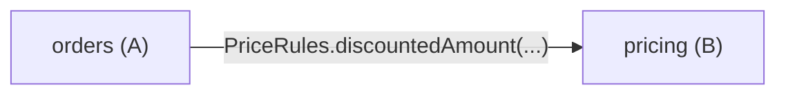
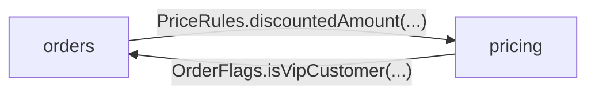

# Phụ thuộc do gọi phương thức tĩnh

Trong Java, khi mã thuộc **module A** gọi một phương thức `static` được định nghĩa ở **module B**, A đã có **phụ thuộc mã nguồn vào B**. Lời gọi có thể chỉ là phép tính đơn giản, không tạo đối tượng, không có `@Service`, không inject bean và không dùng Spring context. Dù vậy, Java vẫn cần biết class sở hữu phương thức và bytecode có thể chứa lệnh gọi đến class đó.

Đây là bài học trong chương **Dependency rules** của `SPRING_MODULITH_VERIFICATION_TESTING`. Học phần hướng đến việc dùng `ApplicationModules` và quy tắc phụ thuộc để kiểm chứng ranh giới Spring Modulith, thực hành `@ApplicationModuleTest`, kiểm thử sự kiện, cơ sở dữ liệu và tích hợp, đồng thời đưa quality gate vào CI để ngăn phụ thuộc sai hoặc hồi quy. Bài này tập trung vào **phụ thuộc do gọi phương thức tĩnh**, cách xác định chiều phụ thuộc, nhận diện vi phạm và kiểm chứng phù hợp.

## 1. Gọi phương thức tĩnh tạo quan hệ A → B như thế nào?

Giả sử ứng dụng bán hàng có hai application module:

- `orders` (**A**): chuẩn bị báo giá, tạo đơn hàng.
- `pricing` (**B**): quản lý quy tắc tính giá.

Nếu `orders.OrderQuoteService` gọi `pricing.PriceRules.discountedAmount(...)`, hướng phụ thuộc là **`orders → pricing`**: mã của `orders` dùng một phương thức được khai báo ở kiểu thuộc `pricing`.



**Chiều mũi tên đi từ nơi gọi đến module sở hữu kiểu được gọi.** Kết quả trả về đi từ B về A không tạo cạnh ngược. Cũng không thể kết luận `pricing` phụ thuộc vào `orders` chỉ vì `pricing` được gọi thường xuyên.

Trong Spring Modulith, ứng dụng thường nằm trong một tiến trình Spring Boot và các package con trực tiếp dưới package gốc ứng dụng là các application module theo quy ước phát hiện mặc định:

```text
com.example.shop
├── ShopApplication.java
├── orders
│   ├── OrderQuoteService.java
│   └── internal
│       └── OrderRepository.java
└── pricing
    ├── PriceRules.java
    ├── PricingCalculator.java
    └── internal
        └── InternalPriceRules.java
```

Ở ví dụ này, `orders` và `pricing` là hai application module. `pricing.internal` thuộc **nội bộ của `pricing`**, không phải application module ngang hàng. Với module đóng thông thường, kiểu ở package gốc `pricing` thuộc API mặc định; kiểu ở package con phải được công bố hợp lệ mới được module khác dùng.

## 2. Ví dụ đầy đủ: gọi API tĩnh hợp lệ của module B

Module `pricing` công bố một công cụ tính giá ở package gốc:

```java
// com/example/shop/pricing/PriceRules.java
package com.example.shop.pricing;

import java.math.BigDecimal;
import java.util.Objects;

public final class PriceRules {

    private PriceRules() {
        // Lớp tiện ích: không tạo instance.
    }

    public static BigDecimal discountedAmount(
            BigDecimal original, BigDecimal discountRate) {
        Objects.requireNonNull(original, "original");
        Objects.requireNonNull(discountRate, "discountRate");

        if (original.signum() < 0
                || discountRate.compareTo(BigDecimal.ZERO) < 0
                || discountRate.compareTo(BigDecimal.ONE) > 0) {
            throw new IllegalArgumentException("Giá hoặc tỷ lệ giảm không hợp lệ");
        }

        return original.multiply(BigDecimal.ONE.subtract(discountRate));
    }
}
```

Module `orders` gọi phương thức đó:

```java
// com/example/shop/orders/OrderQuoteService.java
package com.example.shop.orders;

import com.example.shop.pricing.PriceRules;
import java.math.BigDecimal;
import org.springframework.stereotype.Service;

@Service
public class OrderQuoteService {

    public BigDecimal quote(BigDecimal unitPrice,
                            int quantity,
                            BigDecimal discountRate) {
        if (quantity <= 0) {
            throw new IllegalArgumentException("Số lượng phải dương");
        }

        BigDecimal subtotal = unitPrice.multiply(
                BigDecimal.valueOf(quantity)
        );
        return PriceRules.discountedAmount(subtotal, discountRate);
    }
}
```

Tại dòng `PriceRules.discountedAmount(subtotal, discountRate)`, mã `orders` tham chiếu đến phương thức `static` của kiểu `pricing.PriceRules`. Không có constructor injection nào dành cho `PriceRules`; nó cũng không cần là Spring bean. Tuy vậy, **`orders → pricing` đã tồn tại**.

Với lời gọi `quote(100, 2, 0.10)` trong ý nghĩa số thập phân `BigDecimal`, giá trước giảm là 200 và giá sau giảm là 180. Đây chỉ là ví dụ nghiệp vụ; phép tính không cần truy cập cơ sở dữ liệu để thể hiện một cạnh phụ thuộc kiến trúc.

**Vì sao một phụ thuộc có thể hợp lệ?** `PriceRules` nằm ở package gốc, là một phần API mặc định của `pricing`. Nếu `orders` được phép phụ thuộc `pricing` và không tạo chu trình, dùng API này phù hợp với ranh giới đã công bố.

## 3. `import static` không làm mất phụ thuộc

Thay vì gọi qua tên class, Java cho phép import một phương thức tĩnh:

```java
// com/example/shop/orders/OrderQuoteService.java
package com.example.shop.orders;

import static com.example.shop.pricing.PriceRules.discountedAmount;

import java.math.BigDecimal;

class OrderQuoteService {
    BigDecimal quote(BigDecimal subtotal, BigDecimal rate) {
        return discountedAmount(subtotal, rate);
    }
}
```

Ở đây lời gọi chỉ viết `discountedAmount(...)`, nhưng kiểu sở hữu phương thức vẫn là `com.example.shop.pricing.PriceRules`. Vì thế **hướng phụ thuộc không đổi: `orders → pricing`**.

Hai cách viết có tác động kiến trúc tương đương:

| Cú pháp bên trong `orders` | Module được tham chiếu | Có cạnh A → B? |
| --- | --- | --- |
| `PriceRules.discountedAmount(amount, rate)` | `pricing` | Có |
| `discountedAmount(amount, rate)` sau `import static pricing.PriceRules.discountedAmount` | `pricing` | Có |
| `Math.max(x, y)` | Thư viện Java chuẩn | Không tạo cạnh đến một application module nghiệp vụ |
| `LocalMath.round(amount)` với `LocalMath` thuộc `orders` | Chính `orders` | Không tạo cạnh xuyên application module |

**Lưu ý khi đọc mã:** import không phải là hành vi chạy. Một import chưa được sử dụng có thể bị trình biên dịch bỏ qua và tự nó không đủ để kết luận có lời gọi trong bytecode. Cần phân tích thực tế kiểu và lệnh gọi đã biên dịch, thay vì chỉ tìm chuỗi `import` trong source.

## 4. Ba tình huống dễ nhầm với gọi tĩnh

### 4.1. Tham chiếu đến phương thức tĩnh, chưa trực tiếp gọi

Java hỗ trợ *method reference*:

```java
package com.example.shop.orders;

import com.example.shop.pricing.PriceRules;
import java.math.BigDecimal;
import java.util.function.BiFunction;

class DiscountPipeline {
    private final BiFunction<BigDecimal, BigDecimal, BigDecimal> calculator =
            PriceRules::discountedAmount;
}
```

`PriceRules::discountedAmount` là tham chiếu đến phương thức `static` thuộc `pricing`. Nó vẫn **ghép nối mã của `orders` với API `pricing`** dù chưa gọi `calculator.apply(...)`. Khi điều tra kết quả từ ArchUnit/Spring Modulith, cần lưu ý khả năng nhận diện các hình thức như method reference phụ thuộc phiên bản thư viện và dạng bytecode tạo ra. Về mặt thiết kế, không nên coi method reference là cách tránh phụ thuộc.

### 4.2. Gọi phương thức `static` qua một class trung gian

Xét:

```java
// com/example/shop/orders/OrderDiscounts.java
package com.example.shop.orders;

import com.example.shop.pricing.PriceRules;
import java.math.BigDecimal;

public final class OrderDiscounts {
    private OrderDiscounts() {}

    public static BigDecimal forCampaign(BigDecimal amount) {
        return PriceRules.discountedAmount(
                amount, new BigDecimal("0.05")
        );
    }
}
```

Một class khác của `orders` chỉ gọi `OrderDiscounts.forCampaign(...)` thì lời gọi đó trực tiếp trỏ đến **kiểu của chính `orders`**. Nhưng trong `OrderDiscounts` vẫn có lời gọi đến `pricing.PriceRules`; vì thế ở **cấp toàn module**, `orders → pricing` vẫn tồn tại.

Đặt một *wrapper* trong A có thể giúp tập trung việc đổi API B tại một chỗ, nhưng **không xóa cạnh phụ thuộc A → B**. Muốn loại bỏ cạnh, phải thay đổi module sở hữu hợp đồng hoặc cách hợp tác, chứ không đơn thuần đổi tên phương thức.

### 4.3. Tên class hoặc tên phương thức chỉ nằm trong chuỗi

Ví dụ:

```java
// Trong một class của orders
String targetMethod = "com.example.shop.pricing.PriceRules.discountedAmount";
```

Chuỗi trên không phải một lời gọi phương thức Java tĩnh. Nó có thể được sử dụng sau đó bằng reflection hoặc cơ chế cấu hình khác, tạo ghép nối runtime, nhưng **không tự tạo cạnh method-call tĩnh** được xác định từ bytecode chỉ vì chuỗi giống tên class.

Tương tự, việc cùng ghi giá trị literal `"pricing"` trong YAML, `@Qualifier` hoặc URL không chứng minh tồn tại lời gọi tĩnh đến module `pricing`. Ngược lại, nếu mã có `PriceRules.class`, đó là tham chiếu đến **kiểu**, một dạng quan hệ cấu trúc khác với **lệnh gọi phương thức tĩnh**.

## 5. `public static` không đồng nghĩa API được phép

Giả sử module `pricing` có một tiện ích nội bộ:

```java
// com/example/shop/pricing/internal/InternalPriceRules.java
package com.example.shop.pricing.internal;

import java.math.BigDecimal;

public final class InternalPriceRules {
    private InternalPriceRules() {}

    public static BigDecimal rawDatabaseDiscount(BigDecimal amount) {
        return amount.subtract(BigDecimal.ONE);
    }
}
```

Module `orders` gọi:

```java
// com/example/shop/orders/internal/OrderPricingAdapter.java
package com.example.shop.orders.internal;

import com.example.shop.pricing.internal.InternalPriceRules;
import java.math.BigDecimal;

class OrderPricingAdapter {
    BigDecimal adjustedAmount(BigDecimal amount) {
        return InternalPriceRules.rawDatabaseDiscount(amount);
    }
}
```

Đây là **`orders → pricing`**, nhưng đích lời gọi nằm trong **`pricing.internal`**. Trong mô hình module đóng, package con này không phải API được phép truy cập từ module khác, trừ khi được công bố bằng cơ chế phù hợp. Modifier `public` giúp Java cho phép gọi từ package khác trên classpath; nó **không tự công bố một kiểu thành API Spring Modulith**.

Vi phạm này đáng chú ý vì mã thường vẫn biên dịch và thậm chí chạy được. Rủi ro thực tế là `orders` bắt đầu biết chi tiết xử lý lưu trữ, công thức tạm hoặc quy ước nội bộ mà `pricing` có thể thay đổi tự do. Khi `pricing` refactor, `orders` vô tình phải sửa theo.

Cách sửa tốt là **đưa hợp đồng có ý nghĩa nghiệp vụ** ra API của `pricing`. Ví dụ, `pricing.PriceRules.discountedAmount` ở package gốc có thể đại diện cho nghiệp vụ tính giá; `InternalPriceRules` vẫn ở trong B để thực hiện chi tiết.

## 6. `allowedDependencies` kiểm soát cả lời gọi `static`

Spring Modulith cho phép khai báo các module mà A được phép phụ thuộc:

```java
// com/example/shop/orders/package-info.java
@org.springframework.modulith.ApplicationModule(
    allowedDependencies = "pricing"
)
package com.example.shop.orders;
```

Khai báo này quy định **`orders` chỉ được phụ thuộc vào module ứng dụng `pricing` theo API được phép** (ngoài các ngoại lệ như shared module nếu ứng dụng có cấu hình). Nó không đòi hỏi phụ thuộc phải được biểu diễn bằng Spring bean, constructor injection hoặc interface.

| Thao tác trong module `orders` | Đánh giá với chính sách ví dụ |
| --- | --- |
| Gọi `pricing.PriceRules.discountedAmount(...)` ở package API | Hợp lệ nếu không gây chu trình và tuân thủ các quy tắc khác |
| Gọi `pricing.internal.InternalPriceRules.rawDatabaseDiscount(...)` | Vi phạm vì đi vào package nội bộ |
| Gọi `payments.PaymentTools.createReceipt(...)`, với `payments` là module khác | Vi phạm danh sách `allowedDependencies` |
| Chỉ khai báo chuỗi `allowedDependencies = "pricing"` nhưng chưa tham chiếu `pricing` trong mã | Chưa tạo cạnh phụ thuộc thực tế từ chuỗi chính sách đó |

Nói cách khác, **`allowedDependencies` mô tả cạnh *được phép***, còn **lời gọi phương thức tĩnh là một nguồn tạo cạnh *thực tế***.

### Chỉ cho phép một named interface

Nếu `pricing` công bố các phép tính giá riêng ở package `pricing.api`:

```java
// com/example/shop/pricing/api/package-info.java
@org.springframework.modulith.NamedInterface("calculator")
package com.example.shop.pricing.api;
```

```java
// com/example/shop/pricing/api/PriceCalculator.java
package com.example.shop.pricing.api;

import java.math.BigDecimal;

public final class PriceCalculator {
    private PriceCalculator() {}

    public static BigDecimal withFee(BigDecimal base, BigDecimal fee) {
        return base.add(fee);
    }
}
```

Module `orders` có thể giới hạn quyền phụ thuộc:

```java
// com/example/shop/orders/package-info.java
@org.springframework.modulith.ApplicationModule(
    allowedDependencies = "pricing::calculator"
)
package com.example.shop.orders;
```

Khi đó lời gọi `pricing.api.PriceCalculator.withFee(...)` thuộc phần API được cho phép. Lời gọi đến `pricing.internal` vẫn bị cấm; lời gọi đến phần API khác ngoài named interface đã liệt kê cũng cần đối chiếu chính sách. Named interface **không tự tạo phụ thuộc**: cạnh chỉ xuất hiện nếu mã thực sự tham chiếu kiểu hay thành viên của module B.

## 7. Chu trình có thể hình thành chỉ qua hai lời gọi tĩnh

Giả sử:

1. `orders` gọi `pricing.PriceRules.discountedAmount(...)`, tạo **`orders → pricing`**.
2. Sau đó một phương thức của `pricing` gọi `orders.OrderFlags.isVipCustomer(...)`, tạo **`pricing → orders`**.



Một ví dụ rút gọn cho chiều ngược:

```java
// com/example/shop/pricing/internal/PromotionRules.java
package com.example.shop.pricing.internal;

import com.example.shop.orders.OrderFlags;

public class PromotionRules {
    public boolean allowVipDiscount(String customerId) {
        return OrderFlags.isVipCustomer(customerId);
    }
}
```

Ở đây giả định `orders.OrderFlags` là một kiểu API của `orders` có phương thức `static boolean isVipCustomer(String)`. Mặc dù không có vòng gọi đệ quy tại runtime, **đồ thị phụ thuộc giữa module đã có chu trình** `orders ↔ pricing`. Spring Modulith kiểm chứng kiến trúc dựa trên hướng phụ thuộc, không đợi vòng lặp vô hạn xảy ra khi chạy chương trình.

Hướng điều chỉnh là xác định **module sở hữu quy tắc VIP** và hợp đồng mà các module còn lại cần biết, hoặc chuyển thông tin qua một API/event thích hợp để không cần tham chiếu kiểu lẫn nhau. Không nên chỉ thay lời gọi bằng reflection hoặc tên class dạng chuỗi để che vấn đề thiết kế.

## 8. Kiểm chứng cấu trúc bằng `ApplicationModules.verify()`

Một bài test JUnit nhỏ có thể tạo mô hình các application module và kiểm chứng các quy tắc phụ thuộc:

```java
// src/test/java/com/example/shop/ModularityTests.java
package com.example.shop;

import org.junit.jupiter.api.Test;
import org.springframework.modulith.core.ApplicationModules;

class ModularityTests {

    @Test
    void verifiesApplicationModuleBoundaries() {
        ApplicationModules.of(ShopApplication.class).verify();
    }
}
```

Theo các quy tắc được áp dụng cho module, `verify()` kiểm tra:

- **Không tạo chu trình** giữa các application module.
- **Không truy cập kiểu nội bộ** của module khác, nếu kiểu đó không được công bố qua API/named interface.
- **Không phụ thuộc module ngoài danh sách `allowedDependencies`** khi danh sách đó được khai báo.

Các quan hệ gọi phương thức nằm trong bytecode là một nguồn thông tin của bộ phân tích kiến trúc dựa trên ArchUnit. Đối với ví dụ `orders → pricing.internal` hoặc `orders → payments` ở trên, lời gọi tĩnh có thể đưa ra một vi phạm ranh giới mà Java compiler thông thường không ngăn cản.

**Giới hạn cần hiểu đúng:** Việc phát hiện từng biến thể cú pháp cụ thể, đặc biệt method reference, code do compiler sinh hoặc lời gọi thông qua reflection, còn phụ thuộc cách bytecode được tạo ra và phiên bản Spring Modulith/ArchUnit. Hãy đọc báo cáo vi phạm thực tế trong dự án; không dựa vào việc xuất hiện chuỗi chữ `pricing` trong source để khẳng định bộ kiểm chứng sẽ bắt được một cạnh.

## 9. Kiểm thử `static` và `@ApplicationModuleTest` khác nhau ra sao?

Một hàm tĩnh thuần, không có I/O hoặc trạng thái toàn cục, có thể được kiểm thử bằng **unit test Java/JUnit**:

```java
// src/test/java/com/example/shop/pricing/PriceRulesTests.java
package com.example.shop.pricing;

import static org.junit.jupiter.api.Assertions.assertEquals;
import java.math.BigDecimal;
import org.junit.jupiter.api.Test;

class PriceRulesTests {

    @Test
    void appliesTenPercentDiscount() {
        BigDecimal actual = PriceRules.discountedAmount(
                new BigDecimal("200.00"),
                new BigDecimal("0.10")
        );

        assertEquals(0, new BigDecimal("180.00").compareTo(actual));
    }
}
```

Đây là kiểm thử **kết quả tính giá**; nó không đảm bảo `orders` chỉ dùng API hợp lệ của `pricing`. Vì vậy phải chạy cả bài test `ApplicationModules.verify()`.

Trong trường hợp `orders` có các Spring bean, repository hoặc phát sự kiện bên cạnh lời gọi tĩnh, có thể dùng:

```java
// src/test/java/com/example/shop/orders/OrdersModuleTests.java
package com.example.shop.orders;

import org.junit.jupiter.api.Test;
import org.springframework.modulith.test.ApplicationModuleTest;

@ApplicationModuleTest(
    mode = ApplicationModuleTest.BootstrapMode.DIRECT_DEPENDENCIES
)
class OrdersModuleTests {

    @Test
    void startsModuleWithItsDirectDependencies() {
        // Bổ sung assertions nghiệp vụ và wiring tùy mã ứng dụng.
    }
}
```

`DIRECT_DEPENDENCIES` mở rộng phạm vi Spring test context sang các module phụ thuộc trực tiếp của module được kiểm thử. Tuy nhiên, **lời gọi static thuần không cần Spring inject bean** và không được “thay thế” tự động chỉ vì chạy `@ApplicationModuleTest`. Nếu `pricing` có truy cập cơ sở dữ liệu hoặc publish event, nên để hành vi đó trong bean/service phù hợp rồi kiểm thử các giao dịch và tương tác runtime tương ứng.

Một lưu ý thực tiễn: lời gọi `static` được thực hiện trực tiếp trên class, nên không thể dựa vào cơ chế Spring AOP proxy của instance bean để tự động áp dụng các hành vi như `@Transactional` cho phương thức tĩnh. Nếu nghiệp vụ cần transaction, repository, cache, event publishing hoặc quan sát (observability) dựa trên bean, nên cân nhắc service inject qua interface công khai.

## 10. Khi nào nên dùng `static`, khi nào nên chuyển sang hợp đồng instance?

**Phương thức tĩnh không tự nó là vi phạm kiến trúc.** Nó phù hợp với thuật toán thuần, định dạng dữ liệu, kiểm tra điều kiện đơn giản hoặc phép tính ổn định. Điều cần kiểm soát là **module nào sở hữu API** và mức ghép nối mà bên gọi chấp nhận.

| Cách thiết kế | Điểm mạnh | Cần lưu ý |
| --- | --- | --- |
| `orders` gọi `pricing.PriceRules.discountedAmount` (API công khai) | Gọn, dễ gọi, kiểm thử unit trực tiếp | `orders → pricing` vẫn tồn tại; không có DI để thay implementation bằng bean |
| `orders` gọi `pricing.internal.InternalPriceRules` | Có thể biên dịch trên classpath | Vượt API module B, làm A gắn chặt implementation |
| `orders` inject `pricing.PricingCalculator` (interface công khai) | Thay implementation qua DI, thuận tiện kiểm thử tích hợp | Vẫn có `orders → pricing` do dùng kiểu interface của B |
| `orders` gọi wrapper tĩnh của chính `orders`, wrapper lại gọi B | Tập trung điểm kết nối | Cạnh ở cấp module `orders → pricing` vẫn còn |
| Đưa công thức dùng chung vào module hợp đồng/phép tính độc lập được thiết kế rõ | Có thể thay đổi quyền sở hữu dependency | Chỉ nên làm khi trách nhiệm nghiệp vụ thực sự phù hợp |

Một API bean thay thế cho phép tính giá có thể được mô tả như sau:

```java
// com/example/shop/pricing/PricingCalculator.java
package com.example.shop.pricing;

import java.math.BigDecimal;

public interface PricingCalculator {
    BigDecimal discountedAmount(BigDecimal amount, BigDecimal rate);
}
```

```java
// com/example/shop/orders/OrderPricingAdapter.java
package com.example.shop.orders;

import com.example.shop.pricing.PricingCalculator;
import java.math.BigDecimal;
import org.springframework.stereotype.Service;

@Service
public class OrderPricingAdapter {
    private final PricingCalculator calculator;

    public OrderPricingAdapter(PricingCalculator calculator) {
        this.calculator = calculator;
    }

    public BigDecimal quote(BigDecimal amount, BigDecimal rate) {
        return calculator.discountedAmount(amount, rate);
    }
}
```

Với thiết kế này, module `pricing` cần cung cấp một bean implement `PricingCalculator` và Spring context phải tìm thấy bean đó. Hướng phụ thuộc **vẫn là `orders → pricing`** vì A dùng kiểu của B, nhưng interface giúp thay implementation và kiểm thử wiring dễ hơn. Chỉ dùng thiết kế này khi nhu cầu thay đổi hoặc tích hợp runtime thực sự cần đến nó; không nhất thiết chuyển mọi hàm tính toán thuần thành Spring service.

## 11. Quality gate CI cho lời gọi tĩnh xuyên module

Một pipeline có thể kiểm tra cả kiến trúc và hành vi:

```text
Pull request
    ↓
Compile Java và test classes
    ↓
JUnit: ModularityTests
    └── ApplicationModules.of(...).verify()
    ↓
JUnit: kiểm thử hàm tính giá tĩnh
    ↓
@ApplicationModuleTest / integration test (nếu có Spring wiring, DB, event)
    ↓
Merge khi các bước bắt buộc đều PASS
```

Quality gate cần chạy test kiểm chứng trên **mã biên dịch mới nhất**. Nếu job CI bỏ qua test, hoặc chỉ chạy test nghiệp vụ mà không chạy `ModularityTests`, một lời gọi `static` xuyên ranh giới có thể lọt vào main branch. Không cần viết script tự tìm chuỗi `SomeUtils.` trong source để thay thế cho `verify()`.

Khi test phát hiện vi phạm, cách xử lý hiệu quả:

1. Xác định class và phương thức tĩnh được gọi từ module nào.
2. Xác định module sở hữu class đích; class ở package gốc/API hay package nội bộ?
3. Đối chiếu `allowedDependencies` và named interface của module gọi.
4. Kiểm tra có cạnh phụ thuộc ngược tạo chu trình không.
5. Chỉnh lại quyền sở hữu API hoặc điểm kết nối, rồi chạy lại test kiến trúc và test nghiệp vụ liên quan.

## 12. Bài tập nhận diện phụ thuộc

Giả sử `orders` chỉ được phép phụ thuộc `pricing`; `pricing` là module đóng với API mặc định ở package gốc; `payments` là một application module khác:

| Dòng mã trong `orders` | Có phụ thuộc xuyên module? | Nhận xét |
| --- | --- | --- |
| `PriceRules.discountedAmount(a, b)` với `PriceRules` ở `pricing` | `orders → pricing` | Hợp lệ nếu dùng API được công bố |
| `discountedAmount(a, b)` sau `import static pricing.PriceRules.discountedAmount` | `orders → pricing` | `import static` không đổi hướng |
| `pricing.internal.InternalPriceRules.rawDatabaseDiscount(a)` | `orders → pricing` | Vi phạm vì truy cập phần nội bộ |
| `PaymentTools.createReceipt(...)` với `PaymentTools` ở `payments` | `orders → payments` | Vi phạm `allowedDependencies` |
| `Math.max(a, b)` | Không phải cạnh giữa hai application module | Thuộc Java chuẩn |
| `"pricing.PriceRules.discountedAmount"` trong chuỗi | Không thể suy ra cạnh method-call tĩnh | Có thể tồn tại ghép nối runtime khác |
| `OrderDiscounts.forCampaign(a)` với class ở `orders` | Không có cạnh xuyên module **từ lời gọi này** | Phải xem phần cài đặt `OrderDiscounts` |

**Câu hỏi 1.** Nếu đổi `PriceRules.discountedAmount(...)` thành `import static PriceRules.discountedAmount` rồi gọi ngắn gọn `discountedAmount(...)`, `orders → pricing` còn không?

**Đáp án:** Còn. Cú pháp import tĩnh không thay đổi class sở hữu phương thức được gọi.

**Câu hỏi 2.** Nếu công thức giảm giá đã chạy đúng qua unit test, có thể bỏ `ApplicationModules.verify()` không?

**Đáp án:** Không nên. Unit test chứng minh một đầu ra với dữ liệu kiểm tra, không chứng minh API được sử dụng hợp lệ, không có chu trình và tuân thủ `allowedDependencies`.

**Câu hỏi 3.** Nếu muốn mock/đổi cách tính giá theo môi trường, chuyển lời gọi tĩnh sang interface `PricingCalculator` thuộc `pricing` có xóa cạnh `orders → pricing` không?

**Đáp án:** Không. Nó thay cách cộng tác runtime và tăng khả năng thay implementation bằng DI, nhưng constructor vẫn nhận kiểu `pricing.PricingCalculator`. Muốn thay đổi **hướng** phụ thuộc, phải xem lại module sở hữu hợp đồng và thiết kế tổng thể.

Ghi nhớ ba ý: **(1)** một lời gọi `static` có thể tạo phụ thuộc xuyên module dù không có bean; **(2)** `public static` chỉ là quyền truy cập của Java, còn Spring Modulith quản lý API/named interface và quy tắc cho phép; **(3)** `ApplicationModules.verify()` kiểm chứng ranh giới tĩnh, còn unit test và `@ApplicationModuleTest` xác minh hành vi và tương tác runtime. Kết hợp cả ba giúp chặn hồi quy kiến trúc trong CI.

## Tài liệu tham khảo

- [Spring Modulith — Fundamentals: Application Modules, Named Interfaces và Allowed Dependencies](https://docs.spring.io/spring-modulith/reference/fundamentals.html)
- [Spring Modulith — Verifying Application Module Structure](https://docs.spring.io/spring-modulith/reference/verification.html)
- [Spring Modulith — Integration Testing Application Modules](https://docs.spring.io/spring-modulith/reference/testing.html)
- [ArchUnit User Guide — Dependencies and Architecture Rules](https://www.archunit.org/userguide/html/000_Index.html)
- [Java Language Specification — Method Invocations](https://docs.oracle.com/javase/specs/jls/se21/html/jls-15.html#jls-15.12)
