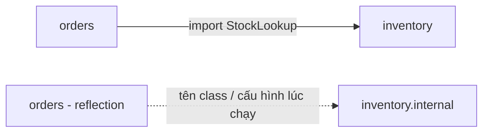

# Phụ thuộc ẩn qua reflection và cấu hình

Trong một ứng dụng **Spring Modulith**, hai application module có thể bị ghép nối với nhau ngay cả khi mã Java của module thứ nhất **không import, không khai báo tham số và không gọi trực tiếp kiểu** của module thứ hai. Ví dụ, module `orders` đọc một tên class từ `application.yml` rồi dùng `Class.forName(...)` để tải class trong `inventory.internal`. Việc phụ thuộc vào class nội bộ đó chỉ hiện rõ khi chạy. Kết quả kiểm chứng kiến trúc tĩnh có thể vẫn thành công nếu không có tham chiếu kiểu Java nào khác để phát hiện.

Bài học **“Phụ thuộc ẩn qua reflection và cấu hình”** thuộc chương **Dependency rules**, học phần `SPRING_MODULITH_VERIFICATION_TESTING`. Mục tiêu của học phần là kiểm chứng ranh giới kiến trúc qua `ApplicationModules` và quy tắc phụ thuộc, thực hành `@ApplicationModuleTest`, kiểm thử sự kiện, cơ sở dữ liệu và tích hợp, đồng thời đặt quality gate trong CI để ngăn phụ thuộc sai và hồi quy. Ở đây, ta làm rõ **phần nào công cụ kiểm chứng cấu trúc nhìn thấy, phần nào phải kiểm tra bằng những biện pháp bổ sung**.

## 1. Phân biệt phụ thuộc tĩnh và phụ thuộc ẩn

Giả sử `orders` cần tra cứu tồn kho từ `inventory`:

| Cách sử dụng trong `orders` | Tín hiệu về phụ thuộc | Khả năng kiểm chứng |
| --- | --- | --- |
| `private final StockLookup lookup;` với `StockLookup` thuộc `inventory` | Tham chiếu kiểu Java trực tiếp | `ApplicationModules`/ArchUnit có thông tin kiểu để phân tích |
| `InventoryStockService.check(sku)` với class thuộc `inventory` | Lời gọi Java trực tiếp | Có quan hệ kiểu/lệnh gọi trong bytecode |
| `Class.forName("com.example.shop.inventory.internal.LegacyStockProbe")` | Tên kiểu nằm trong **chuỗi** | Không thể mặc định suy ra cạnh kiểu Java đến `LegacyStockProbe` chỉ từ chuỗi |
| `application.yml` chỉ định tên class của `inventory.internal` | Metadata bên ngoài mã nguồn Java | Cần kiểm tra cấu hình và hành vi runtime |
| `applicationContext.getBean("inventoryStockLookup")` | Tên bean dạng chuỗi | Có thể ghép nối với bean của module khác, không đủ thông tin kiểu đích |
| `@Query("select ... from inventory_stock")` | Tham chiếu bảng qua chuỗi truy vấn | Có thể phụ thuộc dữ liệu, không tự tạo cạnh kiểu Java đến module `inventory` |

**Cạnh phụ thuộc thực tế về kiến trúc nghiệp vụ** và **cạnh mà bộ phân tích cấu trúc Java nhận diện** không luôn trùng nhau. Một module có thể sử dụng chức năng của module khác qua lookup động, tên bean hoặc cấu hình mà không có tham chiếu kiểu tĩnh rõ ràng.



Mũi tên liền biểu diễn phụ thuộc kiểu có thể quan sát bằng phân tích cấu trúc. Mũi tên đứt biểu diễn một quan hệ runtime được giải quyết bằng tên hoặc metadata. Sơ đồ **không khẳng định Spring Modulith sẽ tự động tìm và cấm mọi mũi tên đứt**.

## 2. Reflection che khuất kiểu đích như thế nào?

Với cách phát hiện module mặc định, các package con trực tiếp dưới package gốc ứng dụng Spring Boot được xem là application module:

```text
com.example.shop
├── ShopApplication.java
├── orders
│   ├── OrderStockService.java
│   └── internal
│       └── ReflectiveStockGateway.java
└── inventory
    ├── StockLookup.java
    └── internal
        └── LegacyStockProbe.java
```

`orders` và `inventory` là hai application module ngang hàng. `inventory.internal` là phần nội bộ của `inventory` trong mô hình module đóng thông thường; `public` trong Java không tự công bố class ở đó thành API của Spring Modulith.

### 2.1. Class nằm trong nội bộ module B

Giả sử `inventory` có một class cũ để tra cứu tồn kho:

```java
// com/example/shop/inventory/internal/LegacyStockProbe.java
package com.example.shop.inventory.internal;

public final class LegacyStockProbe {

    private LegacyStockProbe() {}

    public static boolean available(String sku) {
        // Ví dụ dữ liệu cố định để minh họa, không phải logic tồn kho thực.
        return "SKU-001".equals(sku);
    }
}
```

Đây là một kiểu `public` thuộc **package nội bộ**. Module `orders` không nên biết hoặc gọi trực tiếp nó nếu `inventory.internal` chưa được công bố.

### 2.2. Module A tải class theo tên

Thay vì import class, `orders` dùng reflection:

```java
// com/example/shop/orders/internal/ReflectiveStockGateway.java
package com.example.shop.orders.internal;

import java.lang.reflect.Method;
import org.springframework.beans.factory.annotation.Value;
import org.springframework.stereotype.Component;

@Component
public class ReflectiveStockGateway {

    private final String implementationClassName;

    public ReflectiveStockGateway(
            @Value("${orders.stock-probe-class}") String implementationClassName) {
        this.implementationClassName = implementationClassName;
    }

    public boolean available(String sku) throws ReflectiveOperationException {
        Class<?> target = Class.forName(implementationClassName);
        Method method = target.getMethod("available", String.class);
        Object result = method.invoke(null, sku);
        return (Boolean) result;
    }
}
```

Trong `application.yml`:

```yaml
orders:
  stock-probe-class: com.example.shop.inventory.internal.LegacyStockProbe
```

Diễn biến khi chạy:

1. Spring truyền giá trị `orders.stock-probe-class` vào `ReflectiveStockGateway`.
2. `Class.forName(...)` tìm kiểu có tên tương ứng trên classpath.
3. `getMethod(...)` tìm phương thức `public static boolean available(String)`.
4. `invoke(null, sku)` gọi phương thức tĩnh; kết quả được ép về `Boolean`.

Trong đoạn mã Java thuộc `orders`, **không hề có tham chiếu trực tiếp đến kiểu `LegacyStockProbe`**. Chuỗi đầy đủ tên class nằm ở `application.yml`. Vì vậy, chỉ từ việc kiểm chứng phụ thuộc kiểu tĩnh, không thể đảm bảo phát hiện được quan hệ runtime này.

Mã trên chỉ là **minh họa về rủi ro kiến trúc**, không phải lựa chọn thiết kế được khuyến nghị. Nó thiếu kiểm tra kiểu của kết quả, buộc chặt vào tên phương thức, và lỗi tên class có thể chỉ xuất hiện lúc chạy. Trong ứng dụng thật, lỗi runtime còn có thể đến từ `ClassNotFoundException`, `NoSuchMethodException`, `IllegalAccessException`, `InvocationTargetException` hoặc vấn đề cấu hình classloader/module path.

> **Quan trọng:** `Class.forName(...)` **không tự động vượt mọi giới hạn truy cập của JVM**. Ví dụ trên dùng class và method `public` trên classpath thông thường; Java module system, quyền truy cập reflection hoặc native image có thể đặt thêm điều kiện. Vấn đề kiến trúc cần thấy là **cơ chế lookup động che giấu tên kiểu đích khỏi các khai báo tham chiếu Java tĩnh**.

## 3. `SomeType.class` khác gì với `Class.forName("...")`?

Hai câu lệnh có thể trả về một đối tượng `Class<?>`:

```java
// Tham chiếu kiểu trực tiếp:
Class<?> direct = com.example.shop.inventory.internal.LegacyStockProbe.class;

// Lookup động theo tên:
Class<?> dynamic = Class.forName(
        "com.example.shop.inventory.internal.LegacyStockProbe"
);
```

**Dòng thứ nhất** nhắc đến `LegacyStockProbe` như một **kiểu Java** trong source/bytecode. Nó là ứng viên để bộ phân tích cấu trúc xác định cạnh `orders → inventory`, và có thể vi phạm ranh giới nếu class nằm trong `inventory.internal`.

**Dòng thứ hai** chỉ cung cấp **chuỗi ký tự** cho hàm lookup. Dù người đọc nhận ra tên package, bộ phân tích phụ thuộc dựa trên kiểu không thể mặc định khẳng định chuỗi đó là tên một class thực sự sẽ được nạp. Giá trị có thể được ghép động, thay đổi theo môi trường hoặc không bao giờ được dùng khi chạy.

Tương tự:

| Khai báo | Đánh giá |
| --- | --- |
| `@Import(InventoryConfiguration.class)` | Chứa class literal có tham chiếu kiểu đến class đích |
| `@ConditionalOnClass(value = LegacyStockProbe.class)` | Chứa class literal có tham chiếu kiểu |
| `@ConditionalOnClass(name = "com.example.shop.inventory.internal.LegacyStockProbe")` | Chứa tên class dạng chuỗi; không thể suy ra cạnh kiểu trực tiếp chỉ từ chuỗi |
| `Class.forName(configuredTypeName)` | Tên kiểu chỉ biết lúc chạy |
| `MethodHandles.lookup().findStatic(target, method, methodType)` | Có thể thực hiện lookup động; mức độ hiển thị phụ thuộc những kiểu/giá trị được khai báo |

Annotation, class literal và metadata chuỗi có các quy tắc xử lý khác nhau. Không nên coi **mọi annotation đều vô hình** hoặc coi **mọi chuỗi class đều được `verify()` phát hiện**.

## 4. Phụ thuộc ẩn qua Spring bean name và cấu hình

Reflection không phải con đường duy nhất khiến A biết B theo cách động. Spring còn hỗ trợ tra cứu bean bằng tên và cấu hình từ môi trường.

### 4.1. Lấy bean bằng tên

```java
// Minh họa trong module orders
package com.example.shop.orders;

import org.springframework.context.ApplicationContext;
import org.springframework.stereotype.Service;

@Service
public class OrderBeanBridge {

    private final ApplicationContext context;

    public OrderBeanBridge(ApplicationContext context) {
        this.context = context;
    }

    public Object lookupInventoryBean() {
        return context.getBean("inventoryStockLookup");
    }
}
```

`ApplicationContext` là kiểu của Spring Framework; `"inventoryStockLookup"` là **tên bean**, chưa xác định kiểu thuộc application module nào ở thời điểm phân tích tĩnh. Nhưng khi chạy, bean có tên đó có thể được đăng ký bởi `inventory`. Đổi tên bean, phạm vi scan hoặc profile có thể làm code của `orders` thất bại, dù không có import đến một class cụ thể của `inventory`.

Cũng cần chú ý `@Qualifier("inventoryStockLookup")`: metadata chuỗi có thể ràng buộc việc inject ở runtime. Nếu constructor đồng thời khai báo tham số kiểu `inventory.StockLookup`, thì **chính kiểu tham số** vẫn tạo cạnh phụ thuộc tĩnh; không được suy rằng dùng `@Qualifier` luôn che được toàn bộ cạnh.

### 4.2. Bean được khai báo qua cấu hình

Các cơ chế như `application.yml`, XML cấu hình, profile, SpEL hoặc tên implementation trong `@ConfigurationProperties` có thể quyết định class/bean nào được dùng tại runtime. Ví dụ:

```yaml
orders:
  stock:
    implementation: com.example.shop.inventory.internal.LegacyStockProbe
```

Đây là **một chuỗi cấu hình**, chưa phải lời gọi Java đến `LegacyStockProbe`. Nếu một factory đọc nó và dùng reflection, lúc đó phụ thuộc runtime vào class nội bộ xuất hiện. Nếu ứng dụng không sử dụng giá trị này, chuỗi có thể hoàn toàn vô tác dụng. Muốn biết kết quả, phải xét cả **cách cấu hình được tiêu thụ**.

SpEL cũng có thể tham chiếu tên kiểu:

```java
// Ví dụ ý niệm về biểu thức runtime, không nên dùng để vượt module boundary:
@org.springframework.beans.factory.annotation.Value(
    "#{T(com.example.shop.inventory.internal.LegacyStockProbe).available('SKU-001')}"
)
private boolean stockAvailable;
```

Biểu thức `T(...)` được Spring xử lý lúc chạy. Nó có thể tạo phụ thuộc vào kiểu thuộc module khác mà mã Java bên ngoài annotation chỉ lưu **một chuỗi biểu thức**. Khi review, phải kiểm tra nội dung biểu thức và lúc nào nó được đánh giá.

### 4.3. Phụ thuộc qua tên resource, event và dữ liệu

Các chuỗi sau có thể tạo ghép nối hệ thống:

```java
// Mã minh họa ở orders; không phải lời gọi kiểu Java đến inventory.
String sql = "select quantity from inventory_stock where sku = ?";
String eventTopic = "inventory.stock-adjusted";
String resourceName = "classpath:inventory/default-stock.json";
```

| Loại tên | Phụ thuộc tiềm ẩn | Kiểm thử bổ sung |
| --- | --- | --- |
| Bảng `inventory_stock` | A truy cập dữ liệu do B sở hữu | Integration test với schema/database và review quyền sở hữu dữ liệu |
| Topic `inventory.stock-adjusted` | A trông đợi sự kiện/hợp đồng message do B phát | Test gửi/nhận sự kiện, payload và cách xử lý lỗi |
| Resource `inventory/default-stock.json` | A đọc dữ liệu đóng gói cùng B | Test cấu hình/classpath và quy tắc sở hữu resource |
| Tên bean `inventoryStockLookup` | A phụ thuộc cấu hình DI của B | Spring context test và kiểm tra wiring bean |

Những quan hệ này **có thể hợp lệ nếu được thiết kế thành hợp đồng tích hợp chính thức**. Điều sai là để A truy cập chi tiết nội bộ của B một cách ngầm định mà không có hợp đồng, kiểm thử và quy tắc bảo vệ tương ứng.

## 5. `ApplicationModules.verify()` kiểm chứng được gì, bỏ sót gì?

Spring Modulith mô hình hóa các application module từ cấu trúc ứng dụng. `ApplicationModules.verify()` sử dụng thông tin kiến trúc để kiểm tra các quy tắc được áp dụng như:

1. **Không có chu trình phụ thuộc** giữa các application module.
2. **Không truy cập kiểu nội bộ** của module khác ngoài những API/named interface đã công bố.
3. **Tôn trọng `allowedDependencies`** nếu module khai báo giới hạn phụ thuộc.

Ví dụ test JUnit:

```java
// src/test/java/com/example/shop/ModularityTests.java
package com.example.shop;

import org.junit.jupiter.api.Test;
import org.springframework.modulith.core.ApplicationModules;

class ModularityTests {

    @Test
    void applicationModulesRespectBoundaries() {
        ApplicationModules.of(ShopApplication.class).verify();
    }
}
```

Các kiểm tra trên dựa nhiều vào quan hệ **kiểu/bytecode Java** được Spring Modulith và ArchUnit nhận diện. Vì vậy, nếu `orders` viết:

```java
import com.example.shop.inventory.internal.LegacyStockProbe;

boolean hasStock = LegacyStockProbe.available("SKU-001");
```

thì có tham chiếu trực tiếp rõ ràng `orders → inventory` đến **package nội bộ**. Nhưng khi đổi thành `Class.forName(nameFromConfig)`, việc phát hiện được **lời gọi vào API reflection** không đồng nghĩa công cụ đã biết **class đích** thực sự thuộc `inventory`.

**Không được suy ra:** “`verify()` PASS nên chắc chắn mọi reflection, bean lookup, database query và cấu hình đều tuân thủ ranh giới.” Kết luận được hỗ trợ chỉ là **những quy tắc kiến trúc đã chạy không phát hiện vi phạm trong phạm vi thông tin và quy tắc chúng phân tích**.

Ngược lại, việc dùng reflection cũng không bảo đảm qua được kiểm chứng. Nếu A vẫn có một field, annotation, class literal, generic hoặc method call tham chiếu trực tiếp kiểu B, công cụ có thể phát hiện cạnh đó. **Nhiều nguồn phụ thuộc có thể cùng tồn tại trong một class.**

## 6. Vì sao `@ApplicationModuleTest` là lớp kiểm thử bổ sung?

`@ApplicationModuleTest` giúp khởi chạy **Spring application context giới hạn theo module** để xác nhận hành vi và tích hợp. Các chế độ bootstrap thường gặp:

| Chế độ | Phạm vi dự kiến | Tác dụng khi điều tra phụ thuộc ẩn |
| --- | --- | --- |
| `STANDALONE` | Module được kiểm thử | Có thể bộc lộ nhu cầu bean của module khác chưa được khai báo theo mô hình |
| `DIRECT_DEPENDENCIES` | Module hiện tại và các module mà nó phụ thuộc trực tiếp | Dùng để thử khả năng tích hợp với các phụ thuộc đã được mô hình nhận diện |
| `ALL_DEPENDENCIES` | Module hiện tại và cây phụ thuộc theo mô hình | Hữu ích cho kiểm thử tích hợp rộng hơn theo dependency graph |

Một bài test trong module `orders`:

```java
// src/test/java/com/example/shop/orders/OrdersModuleTests.java
package com.example.shop.orders;

import org.junit.jupiter.api.Test;
import org.springframework.modulith.test.ApplicationModuleTest;

@ApplicationModuleTest(
    mode = ApplicationModuleTest.BootstrapMode.DIRECT_DEPENDENCIES
)
class OrdersModuleTests {

    @Test
    void startsWithModeledDirectDependencies() {
        // Thêm assertion bean wiring, cấu hình hoặc nghiệp vụ liên quan.
    }
}
```

**Hai giới hạn cần hiểu đúng:**

- Spring context bị giới hạn theo module **không đồng nghĩa class ở module khác đã biến mất khỏi JVM classpath**. Một lời gọi `Class.forName(...)` có thể vẫn tải được class thuộc module “không bootstrap”. Do đó, context khởi động thành công chưa đủ phát hiện mọi coupling ẩn.
- Nếu cấu hình ẩn đòi một bean của B nhưng test chỉ bootstrap A, test **có thể** thất bại vì thiếu bean. Khi đó, điều tra nguyên nhân thay vì ngay lập tức mở rộng test bằng `ALL_DEPENDENCIES`; việc mở rộng có thể che vấn đề thiết kế.

Để kiểm chứng một chức năng thực, hãy thêm assertion có thể quan sát: bean nào được đăng ký, giao dịch có thành công, sự kiện có được nhận, dữ liệu có thay đổi đúng, cấu hình profile nào được dùng. Một test `contextLoads` chỉ kiểm tra Spring khởi tạo được trong điều kiện test; nó không xác nhận mọi đường đi động.

## 7. Chuyển phụ thuộc ẩn thành hợp đồng được công bố

Nếu nghiệp vụ của `orders` thực sự cần kiểm tra tồn kho, một cách thiết kế rõ ràng là để `inventory` sở hữu **interface công khai**, còn implementation vẫn nằm ở nội bộ.

### 7.1. Module B công bố API

```java
// com/example/shop/inventory/StockLookup.java
package com.example.shop.inventory;

public interface StockLookup {
    boolean inStock(String sku);
}
```

Một bean trong nội bộ `inventory` cung cấp implementation:

```java
// com/example/shop/inventory/internal/DefaultStockLookup.java
package com.example.shop.inventory.internal;

import com.example.shop.inventory.StockLookup;
import org.springframework.stereotype.Component;

@Component
class DefaultStockLookup implements StockLookup {

    @Override
    public boolean inStock(String sku) {
        // Ví dụ đơn giản; nghiệp vụ thật có thể gọi repository.
        return "SKU-001".equals(sku);
    }
}
```

### 7.2. Module A phụ thuộc vào hợp đồng

```java
// com/example/shop/orders/OrderStockService.java
package com.example.shop.orders;

import com.example.shop.inventory.StockLookup;
import org.springframework.stereotype.Service;

@Service
public class OrderStockService {

    private final StockLookup stockLookup;

    public OrderStockService(StockLookup stockLookup) {
        this.stockLookup = stockLookup;
    }

    public boolean canOrder(String sku) {
        return stockLookup.inStock(sku);
    }
}
```

Giờ đây `orders` có phụ thuộc kiểu Java **rõ ràng** `orders → inventory` qua `StockLookup`. Không cần biết `DefaultStockLookup` hoặc tên bean và không cần reflection. `inventory.internal` vẫn được bảo vệ. Nếu muốn quy định minh bạch tập phụ thuộc:

```java
// com/example/shop/orders/package-info.java
@org.springframework.modulith.ApplicationModule(
    allowedDependencies = "inventory"
)
package com.example.shop.orders;
```

Chuỗi `"inventory"` ở đây là **chính sách cho phép**, còn trường/constructor kiểu `StockLookup` mới tạo phụ thuộc thực tế. Nếu `orders` sau đó bắt đầu dùng kiểu thuộc module `payments` hoặc truy cập `inventory.internal`, `verify()` có cơ sở phát hiện vi phạm trong các quan hệ Java mà nó phân tích.

Đôi khi B muốn chỉ công bố một package đặc biệt, có thể dùng `@NamedInterface` và `allowedDependencies = "inventory::api"`. Cần đặt kiểu trong package đã được công bố và khai báo tên interface nhất quán, thay vì lạm dụng tính năng này để đưa cả implementation nội bộ ra ngoài.

## 8. Kiểm thử phản ánh đúng rủi ro reflection, sự kiện và dữ liệu

Không phải mọi phụ thuộc ẩn đều sửa được chỉ bằng DI. Một dự án có thể cần cơ chế plugin động, service discovery, kết nối hệ thống cũ hoặc cấu hình có thể thay lúc deploy. Khi đó cần **kiểm thử và quản trị hợp đồng cụ thể**.

### 8.1. Kiểm thử cấu hình reflection

Với cơ chế `orders.stock-probe-class` ở đầu bài, nên có test trên **profile cấu hình thực tế** để xác nhận:

- Thuộc tính bắt buộc có giá trị và kiểu đích nạp được.
- Kiểu đích có phương thức đúng tên, đúng tham số và kiểu trả về.
- Giá trị trả về có thể chuyển đổi an toàn.
- Cấu hình chỉ cho phép những implementation đã được phê duyệt hoặc đăng ký qua extension point công khai.
- Lỗi class không tồn tại, sai chữ ký hoặc không có quyền truy cập được thông báo sớm, có khả năng chẩn đoán.

Có thể xác nhận hợp đồng reflection bằng một unit test trực tiếp:

```java
// Ví dụ kiểm thử đúng đường reflection, không kiểm thử quy tắc module.
import static org.junit.jupiter.api.Assertions.assertEquals;
import java.lang.reflect.Method;
import org.junit.jupiter.api.Test;

class ConfiguredStockProbeTests {

    @Test
    void configuredProbeHasExpectedMethod() throws Exception {
        Class<?> type = Class.forName(
            "com.example.shop.inventory.internal.LegacyStockProbe"
        );
        Method available = type.getMethod("available", String.class);

        assertEquals(boolean.class, available.getReturnType());
        assertEquals(true, available.invoke(null, "SKU-001"));
    }
}
```

Test này chứng minh một tên class/cách gọi cụ thể **hoạt động trên classpath của test**. Nó không khiến việc `orders` truy cập `inventory.internal` trở thành thiết kế hợp lệ. Trong thực tế, nên ưu tiên dùng API/plugin interface công khai, rồi kiểm tra các implementation động tuân thủ hợp đồng đó.

### 8.2. Kiểm thử event và dữ liệu có hợp đồng rõ

Nếu `orders` đăng ký một topic bằng chuỗi hoặc trực tiếp truy vấn bảng của `inventory`, quality gate về kiểu Java không đủ:

- Với **sự kiện**: kiểm tra producer phát đúng sự kiện, consumer nhận đúng payload, idempotency/retry và hậu quả khi listener lỗi. Nếu dùng Spring application event, `@ApplicationModuleTest` kết hợp các tiện ích kiểm thử sự kiện của Spring Modulith có thể hỗ trợ xác nhận sự kiện trong ngữ cảnh module.
- Với **database**: kiểm thử repository, migration/schema và giao dịch; đánh giá việc truy vấn bảng của module khác có vi phạm quyền sở hữu dữ liệu hay không. Một truy vấn SQL dạng chuỗi có thể vượt ranh giới dù không tham chiếu kiểu Java của B.
- Với **cấu hình môi trường**: chạy kiểm thử profile phù hợp với deployment. Giá trị `application-test.yml` đúng không chứng minh `application-prod.yml` cũng đúng.

Những bài test này **bổ sung** cho `ApplicationModules.verify()`. Không một test đơn lẻ nào bao phủ toàn bộ phụ thuộc kiểu, hành vi runtime, cấu hình, schema và hệ thống bên ngoài.

## 9. Thêm quy tắc cho việc sử dụng reflection trong CI

Ngoài `ApplicationModules.verify()`, nếu dự án muốn hạn chế một số API reflection nguy hiểm cho ranh giới, có thể viết **quy tắc ArchUnit bổ sung**. Ví dụ, chính sách nội bộ không cho phép `orders` gọi trực tiếp overload `Class.forName(String)`:

```java
package com.example.shop;

import com.tngtech.archunit.core.domain.JavaClasses;
import com.tngtech.archunit.core.importer.ClassFileImporter;
import org.junit.jupiter.api.Test;

import static com.tngtech.archunit.lang.syntax.ArchRuleDefinition.noClasses;

class ReflectionPolicyTests {

    @Test
    void ordersDoesNotUseClassForNameByString() {
        JavaClasses classes = new ClassFileImporter()
                .importPackages("com.example.shop");

        noClasses()
                .that().resideInAPackage("..orders..")
                .should().callMethod(Class.class, "forName", String.class)
                .check(classes);
    }
}
```

Đây là **quy tắc minh họa chính sách**, không phải quy tắc mặc định của Spring Modulith. Nó chỉ nhằm phát hiện một mẫu lời gọi `Class.forName(String)` tại những class trong package `orders` được import. Nó không tự cấm `ClassLoader.loadClass(...)`, `MethodHandles`, bean lookup theo tên, SpEL hoặc chuỗi trong YAML. Cũng có trường hợp reflection hợp lệ (serialization, framework, plugin), vì vậy chính sách cần phù hợp với kiến trúc dự án.

Nếu phụ thuộc ẩn đến từ **cấu hình**, nên có thêm bước kiểm tra cấu hình bằng whitelist/registry, test bootstrap từng profile hoặc kiểm tra tài nguyên config theo chính sách. Chỉ regex tìm chữ `inventory` trong file không đủ: một tên nằm trong mô tả log hoặc comment chưa chắc là phụ thuộc, còn tên lớp được xây dựng từ nhiều chuỗi thì regex đơn giản có thể bỏ sót.

Một quality gate CI có thể tổ chức:

```text
Commit / Pull request
    |
    v
Build và compile classes
    |
    v
JUnit ModularityTests              -> ApplicationModules.verify()
    |
    v
ArchUnit rule cho reflection       -> Các API lookup động bị giới hạn
    |
    v
Kiểm tra cấu hình/profile          -> Tên class, bean, topic, schema hợp lệ
    |
    v
@ApplicationModuleTest             -> Bean wiring và hành vi từng module
    |
    v
Integration test                   -> Sự kiện, database, hệ thống ngoài
    |
    v
Merge khi mọi quality gate bắt buộc PASS
```

Các bước cần được cấu hình chạy thật trong CI, không bị `skipTests` hoặc filter test bỏ qua. Các test tích hợp phụ thuộc database/broker nên dùng môi trường kiểm thử có thể tái tạo để tránh kết quả chỉ đúng trên máy cá nhân.

## 10. Thiết kế plugin động nhưng vẫn giữ ranh giới

Reflection có tình huống sử dụng hợp lý, chẳng hạn tải plugin theo cấu hình. Để tránh phụ thuộc vào class nội bộ của B, nên thiết kế **hợp đồng rõ**, rồi đăng ký implementation theo hợp đồng:

| Lựa chọn | Hướng phụ thuộc / đặc điểm | Khi nào phù hợp |
| --- | --- | --- |
| A gọi `B.internal.LegacyStockProbe` bằng reflection | Có ghép nối runtime tới implementation nội bộ B nhưng khó phát hiện bằng phụ thuộc kiểu | Nên loại bỏ khi đó chỉ là cách né API |
| A inject `B.StockLookup` công khai | Có cạnh tĩnh `A → B`, dễ kiểm chứng | Hợp đồng nghiệp vụ ổn định, dùng Spring DI |
| A dùng registry `Map<String, StockLookup>` được B công bố | A phụ thuộc interface công khai; tên chỉ chọn implementation phù hợp | Cần chọn chiến lược lúc chạy |
| A dùng `ServiceLoader` qua interface chung | Quan hệ kiểu tới interface được công bố, implementation được phát hiện động | Plugin mở rộng ngoài quá trình khởi tạo bean của Spring |
| A nhận raw `Object` hoặc FQN class từ YAML và gọi reflection | Ít đảm bảo an toàn kiểu, lỗi muộn | Chỉ khi có yêu cầu tương thích đặc biệt và test/giới hạn chặt |

Nếu chọn registry, hãy kiểm tra rằng mỗi tên ánh xạ đến implementation của interface công khai, không truyền tên class nội bộ ra biên giới module. Nếu dùng `ServiceLoader`, cần quản lý classpath/module path, provider registration và test các plugin được triển khai; bản thân cơ chế loader không thay thế quy tắc sở hữu hợp đồng.

**Lưu ý về native image:** Trong môi trường biên dịch AOT/GraalVM, reflection có thể cần đăng ký reflection hints hoặc metadata phù hợp. Một class lookup chạy trên JVM tiêu chuẩn không đảm bảo có thể hoạt động trong native image. Đây là thêm một lý do để hạn chế đường reflection không cần thiết và kiểm thử đúng kiểu triển khai mục tiêu.

## 11. Quy trình điều tra khi `verify()` PASS mà hệ thống vẫn ghép nối sai

Giả sử `orders` gặp lỗi khi thay đổi nội bộ `inventory`, dù test `ApplicationModules.verify()` thành công:

1. **Xác định điểm lỗi runtime**: stack trace báo `ClassNotFoundException`, thiếu bean, thiếu bảng hay lỗi listener? Ghi nhận profile và cấu hình lúc chạy.
2. **Tìm nơi giải quyết tên động**: `Class.forName`, `ClassLoader.loadClass`, `getBean(String)`, `@Qualifier`, `@Value`, SpEL, câu SQL, topic hoặc endpoint cấu hình.
3. **Xác định chủ sở hữu**: class/bean/bảng/topic thuộc module nào? Đó có phải API/hợp đồng công khai không?
4. **Vẽ lại cạnh thực tế**: module nào tiêu thụ tài nguyên của module nào, theo kiểu Java hay theo tên runtime?
5. **Đánh giá cách sửa**: chuyển sang interface/named interface hợp lệ, định nghĩa message/data contract, hoặc giữ cơ chế động nhưng áp whitelist, registry và kiểm thử cấu hình.
6. **Bổ sung kiểm thử hồi quy**: giữ `verify()` để kiểm soát cạnh tĩnh và thêm test nhắm đúng cơ chế động đã gây lỗi.

Không dùng cách đổi `import B.internal.SomeType` thành `Class.forName("B.internal.SomeType")` như một bản sửa kiến trúc. Điều đó có thể chỉ khiến phụ thuộc **khó phát hiện hơn**, trong khi lớp A vẫn cần biết đến implementation nội bộ của B để hoạt động.

## 12. Bài tập và đáp án

Giả sử `orders` chỉ được phép dùng API công khai của `inventory`; `inventory.internal.LegacyStockProbe` chưa được công bố:

| Tình huống trong `orders` | Kết luận cần nêu |
| --- | --- |
| `LegacyStockProbe.available("SKU-001")` với import kiểu nội bộ | Có tham chiếu Java trực tiếp `orders → inventory`, vi phạm ranh giới |
| `Class.forName("com.example.shop.inventory.internal.LegacyStockProbe")` | Có ý định phụ thuộc runtime vào class nội bộ; `verify()` không được mặc định kỳ vọng phát hiện đích chỉ từ chuỗi |
| `Class.forName(targetFromApplicationYml)` | Đích chỉ biết từ cấu hình/runtime; cần test theo profile và kiểm soát giá trị |
| `@Import(LegacyStockProbe.class)` | Có class literal tham chiếu kiểu nội bộ |
| `context.getBean("inventoryStockLookup")` | Có ghép nối theo tên bean; chưa thể suy ra kiểu đích từ chuỗi |
| `InventoryStockLookup lookup` với interface ở API của `inventory` | Có cạnh kiểu `orders → inventory`, có thể hợp lệ |
| `@Query("select * from inventory_stock")` | Rủi ro phụ thuộc dữ liệu; kiểm tra quyền sở hữu schema và test tích hợp |

**Câu hỏi 1:** Tại sao `ApplicationModules.of(ShopApplication.class).verify()` có thể PASS khi `orders` vẫn gọi class nội bộ của `inventory` qua tên cấu hình?

**Đáp án:** Vì lookup động dùng chuỗi. Bộ kiểm chứng cấu trúc có thể thấy lời gọi đến API reflection nhưng không nhất thiết biết class đích nào được nạp ở runtime. Test PASS không khẳng định mọi quan hệ cấu hình đã được kiểm soát.

**Câu hỏi 2:** Chạy `@ApplicationModuleTest(mode = DIRECT_DEPENDENCIES)` có luôn bắt được `Class.forName(...)` đến module chưa khai báo không?

**Đáp án:** Không. Giới hạn bootstrap chủ yếu điều khiển Spring context; các class khác có thể vẫn tồn tại trên JVM classpath. Nếu chức năng động được thực thi và sai cấu hình, test có thể phát hiện; nếu không, nó có thể PASS dù có ghép nối ẩn.

**Câu hỏi 3:** Có thể giữ plugin động mà vẫn kiểm soát kiến trúc không?

**Đáp án:** Có. Định nghĩa interface/hợp đồng công khai, registry hoặc `ServiceLoader` theo hợp đồng, giới hạn danh sách implementation được phép, kiểm thử lookup/configuration và giữ quality gate `verify()` cho các phụ thuộc Java tĩnh.

**Câu hỏi 4:** Nếu thay reflection bằng constructor injection của `inventory.StockLookup`, cạnh `orders → inventory` có biến mất không?

**Đáp án:** Không. Cạnh trở thành **rõ ràng và có thể kiểm chứng** thông qua kiểu `StockLookup` do B sở hữu. Giá trị của thay đổi là không còn phụ thuộc tên class nội bộ và lỗi có thể được phát hiện sớm hơn.

Điểm cốt lõi: **phụ thuộc ẩn không đồng nghĩa không có phụ thuộc**. `ApplicationModules.verify()` bảo vệ ranh giới bằng những quan hệ kiến trúc mà nó nhận diện; reflection, chuỗi cấu hình, lookup bean, truy vấn dữ liệu và tích hợp sự kiện đòi hỏi thêm hợp đồng và kiểm thử runtime. Kết hợp phân tích cấu trúc, kiểm thử module, kiểm thử tích hợp và quality gate trong CI là cách giảm hồi quy khi hệ thống Spring Modulith thay đổi.

## Tài liệu tham khảo

- [Spring Modulith — Fundamentals: Application Modules, APIs, Named Interfaces and Allowed Dependencies](https://docs.spring.io/spring-modulith/reference/fundamentals.html)
- [Spring Modulith — Verifying Application Module Structure](https://docs.spring.io/spring-modulith/reference/verification.html)
- [Spring Modulith — Integration Testing Application Modules](https://docs.spring.io/spring-modulith/reference/testing.html)
- [ArchUnit User Guide — Dependencies and Architecture Rules](https://www.archunit.org/userguide/html/000_Index.html)
- [Java SE — Reflection API: Class.forName](https://docs.oracle.com/en/java/javase/21/docs/api/java.base/java/lang/Class.html#forName(java.lang.String))
- [Spring Framework — Core: Classpath Scanning and Managed Components](https://docs.spring.io/spring-framework/reference/core/beans/classpath-scanning.html)
