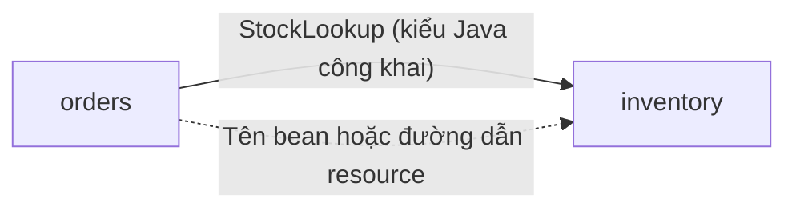

# Phụ thuộc qua resource hoặc tên bean

Một ứng dụng Spring Modulith có thể có phụ thuộc giữa hai module mà **không thể nhìn thấy chỉ bằng cách tìm các `import` Java**. Ví dụ, module `orders` gọi `applicationContext.getBean("inventoryStockLookup")` hoặc đọc tệp `classpath:inventory/policies/stock-policy.properties`. Cả hai đều có thể khiến `orders` phụ thuộc vào cách `inventory` tổ chức bean hoặc resource, nhưng tên bean và đường dẫn resource chỉ là **chuỗi**, không tự tạo ra một cạnh phụ thuộc kiểu Java đến `inventory`.

Bài này thuộc chương **Dependency rules** của học phần `SPRING_MODULITH_VERIFICATION_TESTING`. Mục tiêu chung là kiểm chứng ranh giới kiến trúc bằng `ApplicationModules` và các quy tắc phụ thuộc, thực hành `@ApplicationModuleTest`, kiểm thử sự kiện, cơ sở dữ liệu và tích hợp, đồng thời đưa quality gate vào CI để chặn phụ thuộc sai và hồi quy. Riêng bài này, ta phân biệt **phụ thuộc tĩnh có thể được phân tích theo kiểu Java** với **phụ thuộc động thông qua resource hoặc tên bean**, rồi chọn cách kiểm chứng phù hợp cho từng trường hợp.

## 1. Hiểu đúng ba khái niệm dễ bị nhầm

Trong hệ sinh thái Spring, từ “resource” có thể xuất hiện ở ba ngữ cảnh khác nhau:

| Khái niệm | Ví dụ | Bản chất |
| --- | --- | --- |
| **Resource của classpath / tệp** | `classpath:inventory/policies/stock-policy.properties` | Tài nguyên được đóng gói hoặc nạp từ một vị trí |
| **Annotation `@Resource`** | `@Resource(name = "inventoryStockLookup")` | Cơ chế inject đối tượng theo tên/quy tắc của Spring và Jakarta |
| **Bean name** | `"inventoryStockLookup"` | Định danh của một bean trong Spring `ApplicationContext` |

Một resource tệp **không phải** một Java application module. Annotation `@Resource` **không đồng nghĩa** với việc đọc file. Một tên bean **không có kiểu Java của bean đích** chỉ vì người lập trình đặt tên trông giống tên module.

Để hiểu mức độ phụ thuộc, luôn hỏi: **Chuỗi này được ai tiêu thụ?** Nó có thực sự dẫn đến bean hoặc tệp do module khác sở hữu không? Trong source có đồng thời xuất hiện một kiểu Java thuộc module khác không?

## 2. Bối cảnh: `orders` dùng thông tin tồn kho của `inventory`

Giả sử ứng dụng có cấu trúc:

```text
com.example.shop
├── ShopApplication.java
├── orders
│   ├── OrderAvailabilityService.java
│   ├── OrderReorderAdvisor.java
│   ├── package-info.java
│   └── internal
│       └── OrderStockConfiguration.java
└── inventory
    ├── StockLookup.java
    ├── StockPolicy.java
    ├── StockPolicyReader.java
    └── internal
        ├── DefaultStockLookup.java
        └── ClasspathStockPolicyReader.java

src/main/resources
└── inventory
    └── policies
        └── stock-policy.properties
```

Theo cách nhận diện mặc định của Spring Modulith, `orders` và `inventory` là hai application module; `inventory.internal` là package nội bộ của module `inventory`. Các kiểu nằm ở package gốc `inventory` tạo thành API mặc định khi module là **module đóng**. Tệp `stock-policy.properties` nằm trong đường dẫn tài nguyên của ứng dụng; nó không trở thành một *Java application module* chỉ vì tên thư mục của nó là `inventory`.

Ta sẽ so sánh hai cách `orders` sử dụng khả năng tra cứu tồn kho:



Đường liền: tham chiếu kiểu Java có thể đóng góp vào đồ thị phụ thuộc của Spring Modulith. Đường đứt: quan hệ sử dụng theo tên hoặc vị trí, có thể chỉ xác định được khi đọc cấu hình hoặc chạy ứng dụng.

## 3. Phụ thuộc qua tên bean `getBean(String)`

Module `inventory` có thể đăng ký bean với một tên rõ ràng:

```java
// com/example/shop/inventory/StockLookup.java
package com.example.shop.inventory;

public interface StockLookup {
    boolean inStock(String sku);
}
```

```java
// com/example/shop/inventory/internal/DefaultStockLookup.java
package com.example.shop.inventory.internal;

import com.example.shop.inventory.StockLookup;
import org.springframework.stereotype.Service;

@Service("inventoryStockLookup")
class DefaultStockLookup implements StockLookup {
    @Override
    public boolean inStock(String sku) {
        return "SKU-001".equals(sku);
    }
}
```

Nếu `orders` tra cứu bean theo tên và chỉ giữ kiểu `Object`:

```java
// com/example/shop/orders/internal/OrderStockConfiguration.java
package com.example.shop.orders.internal;

import org.springframework.context.ApplicationContext;
import org.springframework.stereotype.Component;

@Component
class OrderStockConfiguration {
    private final ApplicationContext context;

    OrderStockConfiguration(ApplicationContext context) {
        this.context = context;
    }

    String selectedBeanType() {
        Object bean = context.getBean("inventoryStockLookup");
        return bean.getClass().getName();
    }
}
```

`orders` **phụ thuộc ở runtime** vào việc Spring context có một bean mang tên `inventoryStockLookup`. Đổi tên bean, thay profile, điều kiện đăng ký, phạm vi module được bootstrap hoặc loại bỏ bean có thể làm `getBean(String)` ném ngoại lệ. Nhưng từ dòng `getBean("inventoryStockLookup")`, bộ phân tích kiểu Java không thể chắc chắn kiểu của bean đích thuộc module nào: tên bean được tra cứu khi chạy.

**Quan trọng:** mã này không tự động là một cạnh phụ thuộc kiểu `orders → inventory` do `ApplicationModules.verify()` phát hiện; nó là một **hợp đồng runtime theo tên** cần xem xét bổ sung. Nếu class ở `orders` còn khai báo kiểu `inventory.StockLookup` tại chỗ khác, tham chiếu kiểu đó vẫn tạo cạnh tĩnh bình thường.

Tên bean là namespace của **Spring `ApplicationContext`**, không phải namespace API application module. Spring Boot thường từ chối hai bean trùng tên trong cùng context theo cấu hình thông dụng, nhưng việc tùy chỉnh ghi đè, alias, profile hoặc nhiều context có thể khiến cách resolve phức tạp hơn. Không nên coi tên bean như một API ổn định giữa hai module nếu không có hợp đồng và kiểm thử rõ ràng.

## 4. `@Resource(name = ...)` và `@Qualifier(...)`: nhìn cả tên lẫn kiểu

### 4.1. `@Resource` với tên bean và trường kiểu `Object`

Trong một Spring Boot 3.x project có Jakarta annotations:

```java
// Mã minh họa trong module orders
package com.example.shop.orders;

import jakarta.annotation.Resource;
import org.springframework.stereotype.Component;

@Component
class NamedStockConsumer {

    @Resource(name = "inventoryStockLookup")
    private Object bean;

    String implementationName() {
        return bean.getClass().getSimpleName();
    }
}
```

Khai báo `@Resource(name = "inventoryStockLookup")` yêu cầu Spring resolve bean theo tên được nêu. **Kiểu trường `Object` không tiết lộ module sở hữu bean**. Vì vậy, quan hệ `orders` cần một bean của `inventory` có thể tồn tại lúc chạy mà không xuất hiện như một cạnh tĩnh trực tiếp đến `inventory` chỉ từ đoạn mã này.

Annotation `jakarta.annotation.Resource` là kiểu thư viện; `@Resource` trên một trường **không tự đồng nghĩa** với `orders` import class của module B. Cách resolve cụ thể còn chịu ảnh hưởng của Spring context và các quy ước injection; ví dụ này dùng `name` rõ ràng để tập trung vào phụ thuộc theo tên.

### 4.2. `@Qualifier` đi cùng kiểu của B

Đối chiếu với constructor injection có hợp đồng:

```java
// com/example/shop/orders/OrderAvailabilityService.java
package com.example.shop.orders;

import com.example.shop.inventory.StockLookup;
import org.springframework.beans.factory.annotation.Qualifier;
import org.springframework.stereotype.Service;

@Service
public class OrderAvailabilityService {
    private final StockLookup stockLookup;

    public OrderAvailabilityService(
            @Qualifier("inventoryStockLookup") StockLookup stockLookup) {
        this.stockLookup = stockLookup;
    }

    public boolean canCreateOrder(String sku) {
        return stockLookup.inStock(sku);
    }
}
```

Ở đây tồn tại **hai quan hệ khác nhau**:

1. `StockLookup` do module `inventory` sở hữu tạo **phụ thuộc kiểu `orders → inventory`**.
2. `"inventoryStockLookup"` chọn một ứng viên bean theo qualifier tại runtime. Chuỗi này không phải nguyên nhân chính tạo cạnh kiểu.

Đoạn mã trên rõ ràng hơn vì hợp đồng nghiệp vụ được thể hiện bằng interface. Nếu chỉ có một bean `StockLookup` phù hợp, dự án có thể bỏ `@Qualifier` để giảm ghép nối vào tên bean; nếu có nhiều implementation, qualifier hoặc cơ chế chọn chiến lược có thể cần thiết và nên được kiểm thử.

### 4.3. `@DependsOn` và tên bean cũng tạo ràng buộc vận hành

```java
// Ví dụ độc lập trong module orders
@org.springframework.context.annotation.DependsOn("inventoryCacheInitializer")
@org.springframework.stereotype.Component
class OrdersWarmup {}
```

`@DependsOn("inventoryCacheInitializer")` là ràng buộc về thứ tự khởi tạo/hủy bean theo tên. Nó có thể ảnh hưởng đến startup của `orders` khi bean mục tiêu không có mặt, nhưng **không tự chứng minh có tham chiếu kiểu Java** đến module `inventory`. Dùng `@DependsOn` để buộc thứ tự giữa hai module có thể che giấu sự phụ thuộc vào chi tiết khởi tạo, cần được cân nhắc cùng ranh giới nghiệp vụ.

## 5. Phụ thuộc qua tệp trong `classpath:`

Trong Java, tài nguyên trong `src/main/resources` thường được đóng gói lên classpath. Nếu module `inventory` sở hữu chính sách tồn kho:

```properties
# src/main/resources/inventory/policies/stock-policy.properties
minimum-stock=5
```

Mã của `orders` có thể đọc trực tiếp:

```java
// com/example/shop/orders/internal/OrderPolicyFileReader.java
package com.example.shop.orders.internal;

import java.io.IOException;
import java.io.InputStream;
import java.util.Properties;
import org.springframework.core.io.ClassPathResource;

class OrderPolicyFileReader {

    int minimumStock() throws IOException {
        var resource = new ClassPathResource(
                "inventory/policies/stock-policy.properties");

        var properties = new Properties();
        try (InputStream input = resource.getInputStream()) {
            properties.load(input);
        }
        return Integer.parseInt(properties.getProperty("minimum-stock"));
    }
}
```

`ClassPathResource` là kiểu của Spring Framework, `Properties` thuộc Java chuẩn; chữ `inventory` chỉ nằm trong **chuỗi đường dẫn**. Dù `orders` đọc dữ liệu được `inventory` sở hữu, đoạn mã trên không tự nêu một kiểu Java thuộc `inventory`. Bởi vậy, **phụ thuộc vào tài nguyên dữ liệu** có thể tồn tại mà kiểm chứng ranh giới ở cấp kiểu Java không xác nhận được.

Rủi ro xuất hiện khi module `inventory` đổi tên đường dẫn, đổi khóa `minimum-stock`, thay định dạng file hoặc chuyển nơi lưu dữ liệu. `orders` có thể lỗi lúc chạy dù không đổi một import Java nào.

Một số đặc điểm của classpath resource:

- `ClassPathResource` đọc tài nguyên qua classloader. Trong ứng dụng đóng gói JAR, tài nguyên có thể nằm bên trong JAR; không nên mặc định chuyển nó thành `java.io.File` trên filesystem.
- `Resource#getInputStream()` có thể làm việc với resource nằm trong JAR, nhưng sẽ báo lỗi nếu resource không có hoặc không thể đọc.
- Cùng đường dẫn tài nguyên có thể được đóng gói từ nhiều dependency. Tránh dùng tên quá chung và đặt quy ước namespace rõ ràng.
- Đường dẫn như `inventory/policies/...` mô tả ý định sở hữu, **không phải một ranh giới kiểu Java mà Spring Modulith tự động bảo vệ**.

Đây là loại coupling cần được quản lý như một **hợp đồng resource/data**.

## 6. Resource được chọn từ cấu hình và profile

Resource có thể được lựa chọn qua `application.yml`:

```yaml
orders:
  stock-policy-location: classpath:inventory/policies/stock-policy.properties
```

Và inject qua Spring:

```java
// Ví dụ độc lập trong module orders
import org.springframework.beans.factory.annotation.Value;
import org.springframework.core.io.Resource;
import org.springframework.stereotype.Component;

@Component
class ConfiguredPolicySource {

    private final Resource resource;

    ConfiguredPolicySource(
            @Value("${orders.stock-policy-location}") Resource resource) {
        this.resource = resource;
    }

    Resource selectedResource() {
        return resource;
    }
}
```

Ở đây `Resource` là **interface `org.springframework.core.io.Resource`**, không phải annotation `jakarta.annotation.Resource` ở phần trước. Spring có thể chuyển location `classpath:...` thành một đối tượng `Resource` thông qua cơ chế chuyển đổi thuộc tính/bean.

Điều cần kiểm thử là **giá trị cấu hình thực tế**. Profile `test` có thể dùng tài nguyên giả, trong khi profile `prod` dùng location khác hoặc tệp chưa được đóng gói. Việc `@ApplicationModuleTest` PASS với cấu hình test chưa đủ bảo đảm đường dẫn production đúng.

Phụ thuộc qua tài nguyên có thể phức tạp hơn một file tĩnh: `ResourceLoader.getResource(location)` hỗ trợ location theo giao thức, còn `classpath*:` và `ResourcePatternResolver` có thể tìm nhiều resource. Với các trường hợp này, thứ tự tìm kiếm, số lượng kết quả và nguồn tài nguyên nên được xác nhận bằng integration test.

## 7. Vì sao `ApplicationModules.verify()` có thể chưa phát hiện?

Một bài test kiểm chứng cấu trúc thông dụng:

```java
// src/test/java/com/example/shop/ModularityTests.java
package com.example.shop;

import org.junit.jupiter.api.Test;
import org.springframework.modulith.core.ApplicationModules;

class ModularityTests {

    @Test
    void verifiesModuleBoundaries() {
        ApplicationModules.of(ShopApplication.class).verify();
    }
}
```

Lời gọi `verify()` kiểm tra các ràng buộc kiến trúc áp dụng, trong đó có **chu trình phụ thuộc giữa application module**, **truy cập vào nội bộ module khác** và **tuân thủ `allowedDependencies` nếu được khai báo**. Những quy tắc này được xây dựng từ mô hình module và các quan hệ cấu trúc mà Spring Modulith/ArchUnit nhận diện.

Vì vậy:

| Phát sinh trong `orders` | Có thể xác nhận từ phụ thuộc kiểu? | Bài kiểm bổ sung |
| --- | --- | --- |
| Trường `inventory.StockLookup lookup` | Có tham chiếu kiểu tới `inventory` | `verify()`, module test cho wiring |
| `context.getBean("inventoryStockLookup")` | Tên bean không trực tiếp chỉ ra kiểu module B | Spring context test xác nhận bean/qualifier |
| `@Resource(name = "inventoryStockLookup") Object bean` | Tên bean và `Object` không trực tiếp chỉ ra B | Test injection với bean thực |
| `new ClassPathResource("inventory/policies/stock-policy.properties")` | Đường dẫn không phải tham chiếu kiểu Java tới B | Test tồn tại, định dạng và quyền sở hữu resource |
| `@Value("${orders.stock-policy-location}") Resource r` | Location lấy từ cấu hình runtime | Test profile và location được đóng gói |

**`verify()` thành công không chứng minh mọi tương tác theo chuỗi đều đúng.** Ngược lại, nếu cùng class vẫn sử dụng `inventory.StockLookup` trong trường, tham số, kiểu trả về hoặc lời gọi Java trực tiếp, phần phụ thuộc tĩnh đó vẫn có thể được phát hiện. Hai loại quan hệ hoàn toàn có thể cùng tồn tại.

Không nên kết luận rằng cứ dùng `@Resource` hoặc resource file là vi phạm Spring Modulith. Câu hỏi chính là **nó có vượt hợp đồng mà các module đã thỏa thuận hay không**, và có cơ chế kiểm chứng rủi ro đó hay chưa.

## 8. Khai báo `allowedDependencies` và named interface có giúp gì?

Module `orders` có thể ghi rõ những application module được phép tham chiếu:

```java
// com/example/shop/orders/package-info.java
@org.springframework.modulith.ApplicationModule(
    allowedDependencies = "inventory"
)
package com.example.shop.orders;
```

Khai báo trên giới hạn các **phụ thuộc ứng dụng theo quy tắc mà Spring Modulith kiểm chứng**. Nó không tự tạo cạnh `orders → inventory` khi chưa có tham chiếu thực tế trong Java. Nó cũng không làm công cụ tự suy ra `"inventoryStockLookup"` hoặc `"inventory/policies/stock-policy.properties"` thuộc module `inventory`.

Nếu chỉ muốn cho phép một nhóm interface cụ thể trong package riêng của B, có thể công bố **named interface**:

```java
// com/example/shop/inventory/api/package-info.java
@org.springframework.modulith.NamedInterface("api")
package com.example.shop.inventory.api;
```

Và giới hạn:

```java
// com/example/shop/orders/package-info.java
@org.springframework.modulith.ApplicationModule(
    allowedDependencies = "inventory::api"
)
package com.example.shop.orders;
```

Khi đó các kiểu cần dùng phải được đặt đúng package `inventory.api` đã công bố. Named interface là cơ chế công bố **API kiểu Java**. Nó **không tự công bố một thư mục resource thành API**, cũng không bảo đảm các tên bean được quản lý theo cùng namespace. Tên bean và resource cần quy ước hợp đồng riêng khi thật sự phải chia sẻ.

## 9. Cải tiến: để module B sở hữu cả resource lẫn cách đọc

Nếu `inventory` sở hữu tệp `stock-policy.properties`, một thiết kế có ranh giới rõ là để **`inventory` đọc tệp và công bố API có kiểu**, thay vì để `orders` đọc đường dẫn nội bộ của `inventory`.

### 9.1. API công khai do `inventory` định nghĩa

```java
// com/example/shop/inventory/StockPolicy.java
package com.example.shop.inventory;

public record StockPolicy(int minimumStock) {}
```

```java
// com/example/shop/inventory/StockPolicyReader.java
package com.example.shop.inventory;

public interface StockPolicyReader {
    StockPolicy currentPolicy();
}
```

### 9.2. `inventory.internal` đọc và xử lý resource

```java
// com/example/shop/inventory/internal/ClasspathStockPolicyReader.java
package com.example.shop.inventory.internal;

import com.example.shop.inventory.StockPolicy;
import com.example.shop.inventory.StockPolicyReader;
import java.io.IOException;
import java.io.InputStream;
import java.io.UncheckedIOException;
import java.util.Properties;
import org.springframework.core.io.ClassPathResource;
import org.springframework.stereotype.Component;

@Component
class ClasspathStockPolicyReader implements StockPolicyReader {

    @Override
    public StockPolicy currentPolicy() {
        var resource = new ClassPathResource(
                "inventory/policies/stock-policy.properties");
        var values = new Properties();

        try (InputStream input = resource.getInputStream()) {
            values.load(input);
        } catch (IOException error) {
            throw new UncheckedIOException("Không đọc được chính sách tồn kho", error);
        }

        String raw = values.getProperty("minimum-stock");
        if (raw == null) {
            throw new IllegalStateException("Thiếu khóa minimum-stock");
        }
        return new StockPolicy(Integer.parseInt(raw));
    }
}
```

### 9.3. `orders` chỉ nhận hợp đồng có kiểu

```java
// com/example/shop/orders/OrderReorderAdvisor.java
package com.example.shop.orders;

import com.example.shop.inventory.StockPolicyReader;
import org.springframework.stereotype.Service;

@Service
public class OrderReorderAdvisor {
    private final StockPolicyReader policyReader;

    public OrderReorderAdvisor(StockPolicyReader policyReader) {
        this.policyReader = policyReader;
    }

    public boolean shouldReviewStock(int remainingStock) {
        return remainingStock < policyReader.currentPolicy().minimumStock();
    }
}
```

Giờ `orders` có một cạnh **`orders → inventory`** rõ ràng qua `StockPolicyReader`, và có thể được đối chiếu với `allowedDependencies`/API của B. Module `orders` không còn biết tên bean implementation hoặc đường dẫn resource. Module `inventory` có thể thay việc đọc từ classpath bằng database hay remote config mà không làm API của `orders` thay đổi nếu vẫn giữ hợp đồng.

Thiết kế này không loại bỏ phụ thuộc giữa hai module; nó **chuyển phụ thuộc ngầm vào chi tiết cài đặt thành phụ thuộc tường minh vào hợp đồng được công bố**. Chính sự tường minh giúp review, kiểm thử và tiến hành refactor an toàn hơn.

## 10. Kiểm thử resource và bean bằng test đúng mức

### 10.1. Unit test cho tệp chính sách

Một test đọc đúng resource có thể giúp phát hiện file bị thiếu hoặc đổi khóa:

```java
package com.example.shop.inventory;

import static org.junit.jupiter.api.Assertions.assertEquals;
import java.io.InputStream;
import java.util.Properties;
import org.junit.jupiter.api.Test;
import org.springframework.core.io.ClassPathResource;

class StockPolicyResourceTests {

    @Test
    void stockPolicyResourceContainsMinimumStock() throws Exception {
        var resource = new ClassPathResource(
                "inventory/policies/stock-policy.properties");
        var values = new Properties();
        try (InputStream input = resource.getInputStream()) {
            values.load(input);
        }
        assertEquals("5", values.getProperty("minimum-stock"));
    }
}
```

Test này xác nhận **nội dung tài nguyên cụ thể** trên test classpath. Nó không xác nhận mọi profile deploy, mọi đường dẫn thay đổi ở runtime, hoặc việc `orders` được phép sử dụng resource đó theo thiết kế.

### 10.2. `@ApplicationModuleTest` cho wiring và hành vi

Test module `orders` với các phụ thuộc trực tiếp:

```java
// src/test/java/com/example/shop/orders/OrdersModuleTests.java
package com.example.shop.orders;

import static org.junit.jupiter.api.Assertions.assertFalse;
import static org.junit.jupiter.api.Assertions.assertTrue;
import org.junit.jupiter.api.Test;
import org.springframework.beans.factory.annotation.Autowired;
import org.springframework.modulith.test.ApplicationModuleTest;

@ApplicationModuleTest(
    mode = ApplicationModuleTest.BootstrapMode.DIRECT_DEPENDENCIES
)
class OrdersModuleTests {

    @Autowired
    OrderReorderAdvisor advisor;

    @Test
    void usesThePublishedInventoryPolicy() {
        assertTrue(advisor.shouldReviewStock(4));
        assertFalse(advisor.shouldReviewStock(5));
    }
}
```

Với dữ liệu `minimum-stock=5` ở ví dụ, test này kiểm tra bean của `orders` có thể sử dụng hợp đồng `inventory` và cho ra kết quả mong đợi. `DIRECT_DEPENDENCIES` cho phép bootstrap cả module mà `orders` phụ thuộc trực tiếp **theo mô hình đã nhận diện**.

Nếu `orders` **chỉ** dùng `getBean(String)` mà không có cạnh kiểu, mô hình phụ thuộc có thể không đưa `inventory` vào tập dependency trực tiếp. Khi đó test có thể báo thiếu bean dù ứng dụng đầy đủ chạy được. Đây là tín hiệu cần điều tra hợp đồng ngầm, không phải lý do mặc định đổi hết test sang `ALL_DEPENDENCIES`.

**Giới hạn:** phạm vi bootstrap Spring context không nhất thiết loại toàn bộ class/resource của module khác khỏi classpath JVM. Resource có thể vẫn đọc được trong một test giới hạn module. Vì vậy test cần assertion nghiệp vụ và quy tắc sở hữu resource; chỉ kiểm tra context khởi động chưa đủ chứng minh ranh giới đúng.

## 11. Quality gate trong CI để ngăn phụ thuộc theo tên bị vỡ

`ApplicationModules.verify()` là một phần của quality gate, nhưng khi có resource và bean name, nên bổ sung kiểm thử đúng hợp đồng:

| Quality gate | Nhắm vào lỗi nào? |
| --- | --- |
| `ApplicationModules.verify()` | Cạnh Java trái phép, truy cập nội bộ, chu trình theo quy tắc áp dụng |
| Test xác nhận resource tồn tại và parse được | Đổi đường dẫn/định dạng/khóa, resource không được đóng gói |
| `@ApplicationModuleTest` với assertion nghiệp vụ | Bean wiring, qualifier/name và hành vi khi bootstrap module |
| Integration test cấu hình/profile | Resource location và bean registration thay đổi theo môi trường |
| Test database/event nếu policy đi qua repository hoặc message | Hợp đồng schema, giao dịch và sự kiện không thể suy ra chỉ từ tên |

Một chuỗi kiểm tra minh họa:

```text
Pull request / merge request
    ↓
Compile Java + test classes
    ↓
JUnit ModularityTests       → verify() kiến trúc
    ↓
Unit test resource          → resource tồn tại và đúng format
    ↓
@ApplicationModuleTest      → đúng bean, đúng hợp đồng
    ↓
Integration test cần thiết  → profile, database, event, resource thực
    ↓
Merge khi quality gate bắt buộc PASS
```

Trong CI cần bảo đảm job thật sự **chạy các test**, không bỏ qua qua `skipTests` hoặc filter sai; môi trường test có resource và profile tương ứng. Nếu chỉ chạy `verify()` thì thay đổi tên bean, tên resource hoặc nội dung file vẫn có thể gây lỗi runtime mà không phá đồ thị kiểu Java.

Khi cần quy tắc nghiêm ngặt hơn, dự án có thể viết thêm test/ArchUnit rule riêng để hạn chế việc dùng `ApplicationContext.getBean(String)` bên ngoài vùng hạ tầng, hoặc kiểm tra các chuỗi `classpath:inventory/...` trong mã `orders` theo quy ước sở hữu resource. Đây là **chính sách bổ sung do dự án đặt ra**, không phải một quy tắc mặc định được `ApplicationModules.verify()` tự động thực thi. Nên cho phép các ngoại lệ có chủ đích và kiểm tra cả mã đã cấu hình tên động.

## 12. Cách review một thay đổi chứa tên bean hoặc resource

Một quy trình thực tế:

1. **Xác định nơi có tên**: `getBean("...")`, `@Resource(name = "...")`, `@Qualifier`, `@DependsOn`, `@Value`, `ClassPathResource`, `ResourceLoader` hoặc tệp cấu hình.
2. **Tìm bên sở hữu**: bean do module nào đăng ký, tệp do module nào quản lý, ai có quyền thay đổi tên hoặc cấu trúc?
3. **Kiểm tra tham chiếu kiểu song song**: có field, tham số, kiểu trả về hoặc lời gọi Java trực tiếp đến module B không? Nếu có, `verify()` vẫn áp dụng cho cạnh đó.
4. **Xác định đây là hợp đồng công khai hay chi tiết nội bộ**: module A có nên biết tên bean implementation hoặc đường dẫn tệp bên trong B không?
5. **Đánh giá khi đổi tên/đổi profile**: có unit test resource, context test, integration test và cảnh báo lỗi rõ không?
6. **Cân nhắc thay bằng API có kiểu**: để B quản lý resource/bean và công bố interface hoặc DTO ở package công khai; giữ coupling theo tên chỉ khi có nhu cầu kiến trúc thật sự.
7. **Chạy `verify()` và các bài test bổ sung**, xem kết quả ở CI trước khi merge.

Trong các ứng dụng có nhiều module, quy ước đặt tên resource theo namespace `inventory/...` có ích cho con người nhưng không tự thay thế cơ chế công bố API. Tương tự, dùng `@Service("inventoryStockLookup")` có thể hữu ích để lựa chọn bean nhưng không bảo đảm các module khác được phép phụ thuộc vào bean đó.

## 13. Bài tập phân biệt các kiểu phụ thuộc

Giả sử `orders` chỉ được phép sử dụng API công khai của `inventory`. Bean `inventoryStockLookup` được cung cấp bởi một class ở `inventory.internal`. Tệp `inventory/policies/stock-policy.properties` cũng thuộc quyền quản lý nghiệp vụ của `inventory`.

| Đoạn mã trong `orders` | Kết luận |
| --- | --- |
| `context.getBean("inventoryStockLookup")` | Có thể ghép nối runtime theo tên; không tự suy ra kiểu/module đích từ chuỗi |
| `@Resource(name = "inventoryStockLookup") Object bean` | Injection theo tên, có thể ẩn module sở hữu bean |
| `@Qualifier("inventoryStockLookup") StockLookup lookup` | Có cạnh tĩnh `orders → inventory` do **kiểu `StockLookup`**, cộng thêm ràng buộc tên |
| `new ClassPathResource("inventory/policies/stock-policy.properties")` | Phụ thuộc resource theo vị trí/định dạng; không tự tạo cạnh kiểu tới `inventory` |
| `Resource r` từ `@Value("${orders.stock-policy-location}")` | Tên location ở cấu hình runtime, cần test profile |
| `private StockPolicyReader policyReader;` nếu `StockPolicyReader` là interface ở API `inventory` | Có tham chiếu kiểu Java `orders → inventory` qua kiểu trường |
| `@ApplicationModule(allowedDependencies = "inventory")` | Khai báo chính sách; riêng chuỗi này không tạo cạnh phụ thuộc thực tế |

**Câu hỏi 1.** Vì sao chuyển `getBean("inventoryStockLookup")` sang injection `StockLookup` giúp kiểm chứng kiến trúc?

**Đáp án:** `orders` bắt đầu tham chiếu trực tiếp kiểu `StockLookup` thuộc API của `inventory`. Bộ kiểm chứng có thể xét hướng phụ thuộc và các giới hạn `allowedDependencies`/API, thay vì phải suy từ chuỗi bean name.

**Câu hỏi 2.** `ApplicationModules.verify()` PASS có chứng minh tệp `stock-policy.properties` tồn tại và có khóa `minimum-stock` đúng không?

**Đáp án:** Không. Kiểm chứng cấu trúc module không phải phép kiểm nội dung resource. Cần unit test đọc/parse tài nguyên và integration test nếu location phụ thuộc cấu hình runtime.

**Câu hỏi 3.** Nếu `@ApplicationModuleTest(STANDALONE)` vẫn đọc được `classpath:inventory/policies/stock-policy.properties` thì có nghĩa `orders` được phép truy cập resource nội bộ của `inventory` không?

**Đáp án:** Không. Test context giới hạn các bean/module được bootstrap, còn resource vẫn có thể nằm trên classpath. Việc đọc được tài nguyên chứng minh khả năng truy cập trong môi trường test, chưa chứng minh tính đúng đắn của hợp đồng kiến trúc.

**Câu hỏi 4.** Nếu chỉ đổi tên bean `inventoryStockLookup`, phần nào của CI có khả năng bắt lỗi?

**Đáp án:** Test Spring context có thực thi phần injection hoặc lookup theo tên; `verify()` có thể vẫn PASS vì kiểu Java không đổi. Cần giữ assertion về wiring và hành vi, đặc biệt ở những profile quan trọng.

Điểm cần nhớ: **tên bean và đường dẫn resource là hợp đồng runtime**, có thể tạo ghép nối xuyên module nhưng không nhất thiết xuất hiện như cạnh kiểu Java. **`ApplicationModules.verify()` bảo vệ ranh giới của những quan hệ cấu trúc được nhận diện**, còn `@ApplicationModuleTest`, unit test tài nguyên, integration test và quality gate CI kiểm tra những rủi ro theo tên/vị trí. Thiết kế bền vững thường để module sở hữu bean và resource công bố một **API có kiểu, ổn định**, rồi để module khác sử dụng hợp đồng đó.

## Tài liệu tham khảo

- [Spring Modulith — Fundamentals: Application Modules, APIs and Allowed Dependencies](https://docs.spring.io/spring-modulith/reference/fundamentals.html)
- [Spring Modulith — Verifying Application Module Structure](https://docs.spring.io/spring-modulith/reference/verification.html)
- [Spring Modulith — Integration Testing Application Modules](https://docs.spring.io/spring-modulith/reference/testing.html)
- [Spring Framework — Using `@Resource`](https://docs.spring.io/spring-framework/reference/core/beans/annotation-config/resource.html)
- [Spring Framework — Resources](https://docs.spring.io/spring-framework/reference/core/resources.html)
- [Spring Framework — Fine-tuning Annotation-based Autowiring with Qualifiers](https://docs.spring.io/spring-framework/reference/core/beans/annotation-config/autowired-qualifiers.html)
