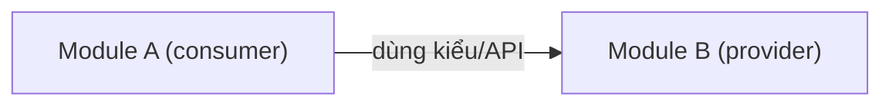
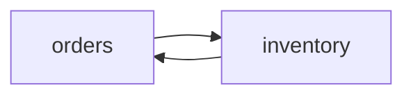
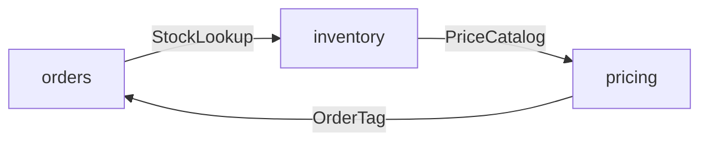
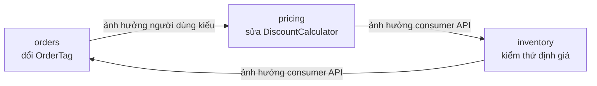
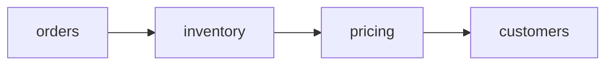

# Dependency cycle và tác động đến thay đổi

**Dependency cycle** (vòng phụ thuộc) xuất hiện khi có thể bắt đầu từ một application module, đi theo các cạnh phụ thuộc qua một hoặc nhiều module và cuối cùng quay lại đúng module ban đầu. Chẳng hạn `orders → inventory → pricing → orders` là một vòng. Các module trong vòng này khó thay đổi độc lập vì một thay đổi hợp đồng ở một nơi có thể gây ảnh hưởng dây chuyền đến những nơi khác, rồi quay ngược về module ban đầu.

Trong Spring Modulith, kiểm chứng vòng phụ thuộc thuộc nhóm **Dependency rules** của học phần `SPRING_MODULITH_VERIFICATION_TESTING`. Mục tiêu của học phần là kiểm chứng ranh giới kiến trúc bằng `ApplicationModules` và các quy tắc phụ thuộc, thực hành `@ApplicationModuleTest`, kiểm thử sự kiện, cơ sở dữ liệu và tích hợp, kết hợp quality gate CI để ngăn phụ thuộc sai và hồi quy. Bài này đi sâu vào **ý nghĩa của vòng phụ thuộc giữa application module, tác động khi thay đổi mã, cách phá vòng và cách tự động ngăn vòng tái xuất hiện**.

## 1. Nhắc lại: cạnh phụ thuộc giữa hai module có nghĩa gì?

Trong một ứng dụng Spring Boot được chia thành application module, ký hiệu **A → B** nghĩa là mã nguồn/bytecode trong A tham chiếu đến những kiểu hoặc thành viên do B sở hữu. Ví dụ, A sử dụng kiểu B trong constructor, field, tham số, giá trị trả về, `extends`/`implements`, hoặc gọi một phương thức trên class thuộc B.



Một cạnh có hướng **không tự tạo ra vòng**. Nếu chỉ có `orders → inventory`, module `inventory` không vì thế phụ thuộc lại `orders`. Để tạo vòng, phải tồn tại một đường đi có hướng từ `inventory` quay lại `orders`.

Phân biệt ba khái niệm:

| Khái niệm | Ví dụ | Ý nghĩa |
| --- | --- | --- |
| **Phụ thuộc trực tiếp** | `orders → inventory` | Có tham chiếu mã Java từ `orders` đến `inventory` |
| **Đường phụ thuộc bắc cầu** | `orders → inventory → pricing` | Thay đổi ở `pricing` có thể ảnh hưởng gián tiếp đến `orders` qua `inventory` |
| **Vòng phụ thuộc** | `orders → inventory → pricing → orders` | Từ `orders` đi theo hướng phụ thuộc và quay lại `orders` |

Một đường bắc cầu **không có nghĩa** `orders` đã trực tiếp import một kiểu của `pricing`. Tuy nhiên, tính phụ thuộc gián tiếp làm phạm vi ảnh hưởng của thay đổi có thể rộng hơn từng cạnh trực tiếp.

## 2. Vòng hai module và vòng nhiều module

### 2.1. Vòng trực tiếp: A ↔ B



Ví dụ:

- `orders` dùng `inventory.StockLookup` để kiểm tra tồn kho.
- `inventory` lại dùng `orders.OrderSummary` để lập báo cáo tồn kho sau khi bán.

Hai tham chiếu Java trên tạo các cạnh `orders → inventory` và `inventory → orders`. Đây là **vòng trực tiếp**, cho dù Spring vẫn có thể khởi tạo các bean liên quan.

### 2.2. Vòng gián tiếp: A → B → C → A



Mỗi cặp module có thể có **chỉ một chiều phụ thuộc**, nhưng toàn đồ thị vẫn có vòng. Nếu chỉ kiểm tra từng cặp để tìm `A ↔ B`, bạn sẽ bỏ sót vòng ba module. Bởi vậy, cần kiểm tra **toàn bộ đồ thị phụ thuộc có hướng**.

Một ứng dụng còn có thể chứa nhiều vòng chồng nhau, ví dụ `A → B → A` và `B → C → B`. Không nên cho rằng sửa một import ở một nơi là đã giải quyết mọi vòng.

## 3. Ví dụ cụ thể bằng Java: chu trình `orders → inventory → pricing → orders`

Giả sử cấu trúc mặc định của một ứng dụng Spring Boot:

```text
com.example.shop
├── ShopApplication.java
├── orders
│   ├── OrderService.java
│   ├── OrderTag.java
│   └── internal
│       └── OrderRepository.java
├── inventory
│   ├── StockLookup.java
│   └── InventoryValuation.java
└── pricing
    ├── PriceCatalog.java
    └── DiscountCalculator.java
```

Theo cách phát hiện module mặc định, `orders`, `inventory` và `pricing` là ba application module. Với module đóng thông thường, các kiểu trong package gốc của mỗi module là API mặc định, còn package con như `orders.internal` là phần nội bộ chưa được công bố.

### 3.1. `orders` cần `inventory`

```java
// com/example/shop/inventory/StockLookup.java
package com.example.shop.inventory;

public interface StockLookup {
    boolean inStock(String sku, int quantity);
}
```

```java
// com/example/shop/orders/OrderService.java
package com.example.shop.orders;

import com.example.shop.inventory.StockLookup;
import org.springframework.stereotype.Service;

@Service
public class OrderService {
    private final StockLookup stockLookup;

    public OrderService(StockLookup stockLookup) {
        this.stockLookup = stockLookup;
    }

    public boolean canPlaceOrder(String sku, int quantity) {
        return stockLookup.inStock(sku, quantity);
    }
}
```

`OrderService` nhận `StockLookup` từ module `inventory`. Hướng phụ thuộc là **`orders → inventory`**.

### 3.2. `inventory` dùng `pricing` để định giá tồn kho

```java
// com/example/shop/pricing/PriceCatalog.java
package com.example.shop.pricing;

import java.math.BigDecimal;

public interface PriceCatalog {
    BigDecimal unitPrice(String sku);
}
```

```java
// com/example/shop/inventory/InventoryValuation.java
package com.example.shop.inventory;

import com.example.shop.pricing.PriceCatalog;
import java.math.BigDecimal;
import org.springframework.stereotype.Service;

@Service
public class InventoryValuation {
    private final PriceCatalog prices;

    public InventoryValuation(PriceCatalog prices) {
        this.prices = prices;
    }

    public BigDecimal valueOf(String sku, int quantity) {
        return prices.unitPrice(sku).multiply(BigDecimal.valueOf(quantity));
    }
}
```

`InventoryValuation` tham chiếu `PriceCatalog`, tạo **`inventory → pricing`**. Đến đây đồ thị vẫn **chưa có vòng**.

### 3.3. `pricing` phụ thuộc ngược vào `orders`

```java
// com/example/shop/orders/OrderTag.java
package com.example.shop.orders;

public enum OrderTag {
    STANDARD, VIP
}
```

```java
// com/example/shop/pricing/DiscountCalculator.java
package com.example.shop.pricing;

import com.example.shop.orders.OrderTag;
import java.math.BigDecimal;

public class DiscountCalculator {
    public BigDecimal apply(BigDecimal subtotal, OrderTag tag) {
        return tag == OrderTag.VIP
                ? subtotal.multiply(new BigDecimal("0.90"))
                : subtotal;
    }
}
```

Chỉ riêng **tham số `OrderTag`** và phép so sánh với `OrderTag.VIP` trong module `pricing` đã tạo **`pricing → orders`**. Như vậy, ba cạnh hợp lại thành vòng **`orders → inventory → pricing → orders`**.

Đây là ví dụ minh họa về quan hệ Java. Các interface `StockLookup`, `PriceCatalog` cần implementation bean phù hợp để một context tích hợp chạy được, nhưng **sự tồn tại của vòng kiến trúc không phụ thuộc vào việc context có khởi động thành công hay không**.

## 4. Vì sao dependency cycle gây khó khăn khi thay đổi?

### 4.1. Thay đổi hợp đồng lan qua nhiều module

Giả sử bộ phận định giá cần mở rộng `OrderTag` từ `STANDARD`, `VIP` thành nhiều mức ưu đãi. `OrderTag` đang thuộc `orders`, nên `pricing.DiscountCalculator` phải quan tâm đến thay đổi này. Nếu `pricing` đổi quy tắc và phương thức định giá, `inventory.InventoryValuation` có thể cần sửa theo. Sau đó `orders`, nơi tiêu thụ chức năng tồn kho, có thể cần kiểm thử lại những luồng nghiệp vụ phụ thuộc kết quả từ `inventory`.



Đây là **đường lan truyền rủi ro**, không phải lời khẳng định mọi thay đổi đều bắt buộc sửa cả ba module. Nếu hợp đồng tương thích ngược và được thiết kế ổn định, các consumer có thể không cần sửa mã. Điểm bất lợi là một vòng tạo ra khả năng ảnh hưởng lẫn nhau và làm việc cô lập khó được bảo đảm.

### 4.2. Mất khả năng hiểu và kiểm thử module độc lập

Để hiểu hành vi của `orders`, developer phải hiểu `inventory`; để hiểu `inventory` lại phải hiểu `pricing`; và `pricing` quay lại dùng kiểu của `orders`. Phạm vi cần đọc và kiểm tra trở nên lớn hơn.

Trong test tích hợp, tập phụ thuộc trực tiếp hoặc bắc cầu của một module có thể kéo theo nhiều module khác. Vòng là tín hiệu ranh giới chưa rõ, khiến việc thiết kế một test context cô lập dễ phát sinh nhu cầu mock, bean wiring hoặc dữ liệu ngoài dự kiến.

### 4.3. Thay đổi có vẻ cục bộ trở thành thay đổi kiến trúc

Ví dụ, developer muốn chuyển một enum `OrderTag` sang package `orders.internal` để “dọn API”. Khi `pricing` vẫn import enum đó, thay đổi có thể làm lộ vi phạm **API nội bộ**. Hoặc developer thêm `@Import` trỏ đến cấu hình module đối diện và vô tình bổ sung cạnh ngược. Vấn đề phát sinh ngay ở cấu trúc Java, trước khi nghiệp vụ chạy.

### 4.4. Cần phân biệt ba loại vòng

| Loại vòng | Ví dụ | Cách xác nhận |
| --- | --- | --- |
| **Application-module dependency cycle** | `orders → inventory → pricing → orders` | Phân tích đồ thị module bằng `ApplicationModules.verify()` |
| **Spring bean dependency cycle** | Bean `OrderService` inject `InventoryService`, bean kia inject ngược `OrderService` | Spring context bootstrap/integration test |
| **Vòng gọi hàm hoặc deadlock runtime** | `a()` gọi `b()` rồi `b()` gọi lại `a()` không có điều kiện dừng; hai transaction khóa chéo | Unit/integration test, log, phân tích luồng chạy |

Chúng **có thể liên quan nhưng không đồng nhất**. Một vòng ở cấp application module có thể xuất hiện từ enum và interface mà không hề có vòng inject bean. Ngược lại, lỗi bean cycle bên trong **cùng một application module** không nhất thiết tạo vòng phụ thuộc **giữa các module**. Và vòng module không tự động gây vô hạn đệ quy hoặc deadlock.

## 5. Kiểm chứng vòng bằng `ApplicationModules.verify()`

Một bài kiểm tra JUnit có thể chạy trong bộ test của dự án:

```java
// src/test/java/com/example/shop/ModularityTests.java
package com.example.shop;

import org.junit.jupiter.api.Test;
import org.springframework.modulith.core.ApplicationModules;

class ModularityTests {

    @Test
    void verifiesApplicationModuleDependencies() {
        ApplicationModules.of(ShopApplication.class).verify();
    }
}
```

Với các module được Spring Modulith nhận diện đúng, `verify()` kiểm tra các quy tắc kiến trúc mặc định, bao gồm **đồ thị application module không có chu trình**, **không truy cập package nội bộ của module khác ngoài API được công bố**, và **tôn trọng `allowedDependencies` khi được khai báo**.

Trong ví dụ `orders → inventory → pricing → orders`, phép kiểm chứng phải được kỳ vọng **thất bại vì có vòng**. Không cần khởi động ba service, chèn dữ liệu test hoặc đợi chức năng bán hàng chạy mới xác định vòng kiến trúc.

Khi thấy lỗi, cần đọc đầy đủ **đường vòng** mà thông báo phân tích đưa ra và đối chiếu class/phương thức gây từng cạnh. Không sửa vội những lời gọi nghiệp vụ tùy ý: vòng có thể do một field, annotation, kiểu trả về, `extends`, `implements` hoặc tham chiếu `Class` trong metadata.

### Phân biệt `verify()` với test chạy Spring context

`ApplicationModules.verify()` xác minh ràng buộc cấu trúc. Ngược lại, `@ApplicationModuleTest` khởi tạo Spring context giới hạn theo module để kiểm tra **wiring và hành vi runtime**.

```java
// src/test/java/com/example/shop/orders/OrdersModuleTests.java
package com.example.shop.orders;

import org.junit.jupiter.api.Test;
import org.springframework.modulith.test.ApplicationModuleTest;

@ApplicationModuleTest(
    mode = ApplicationModuleTest.BootstrapMode.DIRECT_DEPENDENCIES
)
class OrdersModuleTests {

    @Test
    void startsWithItsDirectDependencies() {
        // Bổ sung assertion bean và luồng nghiệp vụ thật của orders.
    }
}
```

`DIRECT_DEPENDENCIES` nhằm mở rộng phạm vi test theo các module phụ thuộc trực tiếp được mô hình nhận diện; `STANDALONE` giới hạn hơn, còn `ALL_DEPENDENCIES` thêm phụ thuộc bắc cầu. Không sử dụng việc thay `STANDALONE` thành `ALL_DEPENDENCIES` như cách “sửa” một vòng kiến trúc. Việc một test Spring context PASS **không đồng nghĩa** đồ thị application module không có vòng; phải chạy bài test kiểm chứng cấu trúc riêng.

## 6. Phá vòng bằng việc chuyển đúng quyền sở hữu hợp đồng

Trong ví dụ ban đầu, `pricing` phụ thuộc `orders.OrderTag`. Hãy hỏi **mức ưu đãi thuộc trách nhiệm nào?** Nếu thực chất đó là mức quyền lợi khách hàng, nó có thể thuộc một module `customers` công bố `CustomerTier`, thay vì là một enum do `orders` sở hữu.

### 6.1. Tách khái niệm ổn định sang module sở hữu phù hợp

```java
// com/example/shop/customers/CustomerTier.java
package com.example.shop.customers;

public enum CustomerTier {
    STANDARD, VIP
}
```

`pricing` dùng kiểu do `customers` công bố:

```java
// com/example/shop/pricing/DiscountCalculator.java
package com.example.shop.pricing;

import com.example.shop.customers.CustomerTier;
import java.math.BigDecimal;

public class DiscountCalculator {
    public BigDecimal apply(BigDecimal subtotal, CustomerTier tier) {
        return tier == CustomerTier.VIP
                ? subtotal.multiply(new BigDecimal("0.90"))
                : subtotal;
    }
}
```

Sau khi loại bỏ **mọi tham chiếu còn sót** từ `pricing` sang `orders`, đồ thị ví dụ trở thành:



Không còn đường đi có hướng từ `customers` hoặc `pricing` quay về `orders`, nên **vòng đã được phá**. Thay đổi này có ý nghĩa nếu `CustomerTier` thực sự thuộc trách nhiệm của `customers`, được công bố thành hợp đồng ổn định và không tạo thêm cạnh ngược khác.

**Không tạo một module `common` chỉ để chứa mọi DTO/enums bị vướng vòng.** Một module “dùng chung tất cả” dễ thành nơi tập hợp trách nhiệm không rõ, làm giảm tính gắn kết. Hãy chọn module sở hữu khái niệm theo nghiệp vụ; nếu là hợp đồng dùng chung, cần xác định ai có quyền thay đổi và những consumer nào phụ thuộc vào nó.

### 6.2. Chuyển đổi dữ liệu ở ranh giới

Một hướng khác là `orders` giữ `OrderTag` cho nghiệp vụ đặt hàng, còn `pricing` chỉ nhận **đầu vào cần thiết của chính nó**, chẳng hạn một `DiscountContext` ở API của `pricing`:

```java
// com/example/shop/pricing/DiscountContext.java
package com.example.shop.pricing;

public record DiscountContext(boolean eligibleForVipDiscount) {}
```

```java
// com/example/shop/pricing/DiscountCalculator.java
package com.example.shop.pricing;

import java.math.BigDecimal;

public class DiscountCalculator {
    public BigDecimal apply(BigDecimal subtotal, DiscountContext context) {
        return context.eligibleForVipDiscount()
                ? subtotal.multiply(new BigDecimal("0.90"))
                : subtotal;
    }
}
```

Các consumer có thể chuyển trạng thái khách hàng hoặc đơn hàng sang `DiscountContext` trước khi gọi API của `pricing`. Khi chính `pricing` **không còn import `orders.OrderTag`**, cạnh `pricing → orders` bị loại bỏ.

Ưu điểm của cách này là `pricing` sở hữu hợp đồng đầu vào của nó, giảm ảnh hưởng khi enum hoặc mô hình đơn hàng thay đổi. Hạn chế là cần xác định rõ ai tính `eligibleForVipDiscount` và không sao chép các quy tắc quan trọng ra nhiều module. Một DTO thuộc đúng module sở hữu hợp đồng thường có giá trị hơn việc lặp lại hàng loạt kiểu nghiệp vụ lớn.

## 7. Phá vòng bằng sự kiện: đúng hướng phụ thuộc kiểu

Một nguyên nhân vòng phổ biến là **module phát sự kiện đồng thời gọi trực tiếp module nhận**, còn module nhận lại import kiểu sự kiện của module phát.

Giả sử `orders` phát `OrderPlaced` do chính `orders` định nghĩa, `inventory` lắng nghe:

```java
// com/example/shop/orders/OrderPlaced.java
package com.example.shop.orders;

public record OrderPlaced(String orderId, String sku, int quantity) {}
```

```java
// com/example/shop/inventory/internal/OrderPlacedHandler.java
package com.example.shop.inventory.internal;

import com.example.shop.orders.OrderPlaced;
import org.springframework.context.event.EventListener;
import org.springframework.stereotype.Component;

@Component
class OrderPlacedHandler {

    @EventListener
    void on(OrderPlaced event) {
        // Xử lý tồn kho theo một giao ước sự kiện đã định nghĩa.
    }
}
```

Listener có tham số kiểu `orders.OrderPlaced`, nên tạo **`inventory → orders`**. Nếu `orders` đồng thời inject `inventory.StockLookup`, hệ thống có thêm **`orders → inventory`** và trở thành vòng.

**Sự kiện không tự loại bỏ mọi phụ thuộc.** Spring chuyển thông điệp từ `orders` sang `inventory` ở runtime, nhưng listener vẫn cần biết **kiểu `OrderPlaced`** và do đó phụ thuộc mã nguồn theo chiều `inventory → orders`.

### Hai hướng thiết kế, phải chọn theo nghiệp vụ

**Hướng A — Giao tiếp chủ yếu bằng sự kiện:** `orders` phát `OrderPlaced` và không gọi trực tiếp kiểu `inventory` trong quy trình này. Khi đó `inventory → orders` có thể là chiều phụ thuộc duy nhất giữa hai module. Đổi lại, phản ứng của `inventory` xảy ra qua sự kiện, nên cần quyết định rõ thời điểm xử lý, khả năng thất bại và tính nhất quán. Không áp dụng tùy tiện nếu nghiệp vụ bắt buộc phải xác nhận đủ tồn kho *trước khi* chấp nhận đơn.

**Hướng B — Giao tiếp đồng bộ chủ yếu một chiều:** `orders` dùng API `inventory.StockReservation` để đặt giữ hàng. `inventory` có thể phát `StockReserved` do **`inventory` sở hữu**, `orders` lắng nghe để tiếp tục trạng thái đơn; cả nơi gọi API và listener đều phụ thuộc theo chiều **`orders → inventory`**. Module `inventory` không cần import kiểu trong `orders`:

```java
// com/example/shop/inventory/StockReserved.java
package com.example.shop.inventory;

public record StockReserved(String reservationId, String sku, int quantity) {}
```

```java
// com/example/shop/orders/internal/StockReservedHandler.java
package com.example.shop.orders.internal;

import com.example.shop.inventory.StockReserved;
import org.springframework.context.event.EventListener;
import org.springframework.stereotype.Component;

@Component
class StockReservedHandler {

    @EventListener
    void on(StockReserved event) {
        // Cập nhật trạng thái đơn từ sự kiện giữ hàng.
    }
}
```

Hướng B phù hợp khi `inventory` sở hữu sự kiện giữ hàng; vẫn phải đảm bảo hợp đồng định danh (`reservationId`, `sku`), tính idempotent và hành vi giao dịch phù hợp. **Không phải mọi vòng đều nên chữa bằng event.** Nếu hai module phụ thuộc nhau do phân chia trách nhiệm sai, sửa lại quyền sở hữu mô hình thường là cách đơn giản hơn.

## 8. Phụ thuộc vòng có thể xuất hiện ở những nơi nào?

Không chỉ một lời gọi service trực tiếp mới tạo vòng. Cần xem toàn bộ các tham chiếu kiểu Java:

| Cơ chế trong A | Ví dụ A → B | Nếu B đã phụ thuộc A thì sao? |
| --- | --- | --- |
| Kiểu trường hoặc constructor | `private final BService service;` | Có thể đóng vòng |
| Tham số / kiểu trả về | `BResult handle(BCommand command)` | Có thể đóng vòng |
| Kế thừa/triển khai | `class AImpl implements BPort` | Có thể đóng vòng |
| Gọi phương thức tĩnh | `BUtils.calculate(...)` | Có thể đóng vòng |
| Annotation chứa class literal | `@Import(BConfiguration.class)` | Có thể đóng vòng |
| Event listener có tham số kiểu B | `void on(BEvent event)` | Có thể đóng vòng |
| Tên bean hoặc reflection qua chuỗi | `getBean("bService")`; `Class.forName("...")` | Có thể gây ghép nối runtime nhưng chưa chắc được nhận diện thành cạnh kiểu |

Vòng phụ thuộc **ở mức hành vi** cũng có thể tồn tại qua database, HTTP, topic hoặc đường dẫn cấu hình mà phân tích phụ thuộc Java tĩnh không suy ra được toàn bộ. `ApplicationModules.verify()` kiểm tra những quan hệ cấu trúc thuộc phạm vi nhận diện, không thay thế phân tích luồng dữ liệu và tích hợp runtime.

## 9. `allowedDependencies` và named interface có ngăn được vòng không?

Ví dụ khai báo cho `orders`:

```java
// com/example/shop/orders/package-info.java
@org.springframework.modulith.ApplicationModule(
    allowedDependencies = "inventory"
)
package com.example.shop.orders;
```

Và cho `inventory`:

```java
// com/example/shop/inventory/package-info.java
@org.springframework.modulith.ApplicationModule(
    allowedDependencies = "pricing"
)
package com.example.shop.inventory;
```

Các khai báo này quy định **những module được phép tham chiếu**, nhưng **không tạo cạnh thực tế** nếu không có tham chiếu Java. Quan trọng hơn, chúng **không hợp thức hóa vòng**. Dù mỗi cạnh trong vòng đều có tên trong `allowedDependencies` của nơi gọi, `verify()` vẫn cần đảm bảo quy tắc **không có chu trình**.

Nếu module B công bố các kiểu qua `@NamedInterface`, A có thể dùng cú pháp như `allowedDependencies = "inventory::api"` để giới hạn chính xác phần API được phép. Việc công bố named interface giúp bảo vệ chi tiết nội bộ, nhưng **không tự phá một vòng** nếu B vẫn tham chiếu ngược A. Cần sửa **hướng các tham chiếu thực tế** để đồ thị trở nên không có chu trình.

Sau khi phá vòng, có thể khai báo giới hạn minh bạch:

```java
// com/example/shop/pricing/package-info.java
@org.springframework.modulith.ApplicationModule(
    allowedDependencies = "customers"
)
package com.example.shop.pricing;
```

Theo ví dụ refactor `pricing → customers`, danh sách này ngăn `pricing` vô tình đưa thêm tham chiếu `orders` và tái tạo vòng. Cũng cần kiểm tra các phụ thuộc thực tế khác của `pricing` trước khi áp danh sách giới hạn để tránh cấm những cạnh đang được thiết kế hợp lệ.

## 10. Ảnh hưởng đến test, database và giao dịch

### 10.1. Thử thay đổi theo biên module

Sau khi loại bỏ vòng, có thể xây dựng một lớp kiểm thử:

1. **Kiểm chứng tĩnh:** `ApplicationModules.verify()` để phát hiện cạnh sai, chu trình và truy cập nội bộ.
2. **Unit test:** test tính toán của `pricing`, trạng thái đơn ở `orders`, tính tồn kho ở `inventory` trong các đơn vị chức năng nhỏ.
3. **`@ApplicationModuleTest`:** kiểm thử wiring, dịch vụ công khai và sự kiện trong phạm vi module/phụ thuộc xác định.
4. **Integration test:** kiểm thử các trường hợp cần cơ sở dữ liệu, giao dịch, migration, broker hoặc tương tác nhiều module; xác nhận đường đi nghiệp vụ thực tế.

Một module test có thể ghi rõ phạm vi:

```java
// src/test/java/com/example/shop/inventory/InventoryModuleTests.java
package com.example.shop.inventory;

import org.junit.jupiter.api.Test;
import org.springframework.modulith.test.ApplicationModuleTest;

@ApplicationModuleTest(
    mode = ApplicationModuleTest.BootstrapMode.DIRECT_DEPENDENCIES
)
class InventoryModuleTests {

    @Test
    void startsWithDirectDependencies() {
        // Thêm assertions cho hợp đồng tồn kho và bean wiring.
    }
}
```

Đừng kết luận vòng đã biến mất chỉ vì `@ApplicationModuleTest` khởi động thành công; hãy chạy bài `verify()` riêng. Ngược lại, `verify()` PASS không chứng minh transaction, repository, test database hay listener đều xử lý đúng trong runtime.

### 10.2. Database và event có thể tạo ghép nối khó thấy

Giả sử `orders` và `inventory` cùng truy cập bảng `inventory_stock` bằng câu SQL dạng chuỗi. Thay đổi schema có thể làm cả hai module hỏng, dù Java import giữa chúng không đổi. Hoặc `orders` publish event theo tên topic string, `inventory` subscribe tên đó: hệ thống có hợp đồng thông điệp runtime mà phân tích kiểu Java không nhất thiết thấy toàn bộ.

Khi vòng mã nguồn được tháo, vẫn nên **xác định module sở hữu dữ liệu** và **hợp đồng tương tác**. Nếu `inventory` sở hữu bảng tồn kho, hãy cân nhắc để module khác dùng API được công bố, thay vì truy cập nội bộ schema của `inventory`. Đối với sự kiện, cần kiểm tra ít nhất payload, producer/consumer, idempotency, retry, thời điểm commit và phản ứng khi xử lý thất bại.

Phá vòng ở đồ thị Java là điều kiện kiến trúc quan trọng, nhưng **chưa đủ để loại bỏ mọi phụ thuộc vận hành**.

## 11. Cách phân tích tác động thay đổi bằng đồ thị

Đồ thị phụ thuộc dùng hướng **consumer → provider**. Vì vậy, nếu API của **provider B** thay đổi, muốn tìm các module *có nguy cơ* bị ảnh hưởng, hãy lần theo **các cạnh đi ngược** từ B đến những consumer.

Ví dụ đồ thị sau refactor:


Nếu `customers.CustomerTier` thay đổi, `pricing` là consumer trực tiếp; `inventory` và `orders` là consumer gián tiếp qua đường phụ thuộc. **Đây là phạm vi cần ưu tiên đánh giá**, không có nghĩa tất cả sẽ chắc chắn phải sửa.

Trong đồ thị có vòng, việc đi ngược từ bất kỳ module nào trong vòng đều có thể quay về module ban đầu. Điều đó phản ánh một nhóm module phụ thuộc qua lại, khó xác định điểm ranh giới rõ ràng.

Khi review pull request có sửa public API:

- Xác định module sở hữu kiểu/hợp đồng được sửa.
- Tìm những module trực tiếp tham chiếu nó.
- Xem consumer gián tiếp có bị ảnh hưởng bởi thay đổi hành vi hoặc hợp đồng được chuyển tiếp không.
- Xem có cạnh mới làm xuất hiện đường quay về module ban đầu không.
- Bổ sung test phù hợp ở nơi thay đổi và các consumer thực sự chịu ảnh hưởng.

Nếu thay đổi chỉ ở **implementation nội bộ** của một module đóng và các consumer dùng đúng API, số nơi cần sửa lý tưởng sẽ nhỏ hơn. Đây là lợi ích của ranh giới module và hợp đồng ổn định.

## 12. Quality gate trong CI để ngăn vòng quay trở lại

Một chuỗi kiểm tra minh họa cho pull request:

```text
Thay đổi trong pull request
    ↓
Biên dịch mã ứng dụng và test
    ↓
ModularityTests: ApplicationModules.verify()
    ├── Không có dependency cycle?
    ├── Không truy cập package nội bộ?
    └── Có tuân thủ allowedDependencies?
    ↓
Unit test / @ApplicationModuleTest
    ↓
Integration test quan trọng về DB, event, transaction
    ↓
Chỉ merge khi tất cả gate bắt buộc PASS
```

Trong dự án dùng Maven, JUnit test `ModularityTests` có thể được chạy cùng lệnh test thông thường, ví dụ:

```bash
mvn test
```

Trong dự án dùng Gradle:

```bash
./gradlew test
```

Hai lệnh trên chỉ là **ví dụ cách chạy test**; phải điều chỉnh theo build tool và cấu hình thực tế của dự án. Bảo đảm CI **không bỏ qua test**, và lớp `ModularityTests` thực sự được test runner thu thập. Một test `verify()` không chạy thì không bảo vệ được PR khỏi vòng phụ thuộc mới.

Để quality gate có giá trị, hãy giữ lại test kiến trúc sau refactor. Nếu xóa `verify()` chỉ để pipeline xanh, vòng sẽ có thể xuất hiện trở lại khi ai đó thêm một tham số, annotation hoặc lời gọi xuyên module.

## 13. Quy trình xử lý khi test báo dependency cycle

Khi `ApplicationModules.verify()` thất bại vì có vòng:

1. **Đọc đường đi của vòng:** ví dụ `orders → inventory → pricing → orders`. Chú ý chiều mỗi cạnh.
2. **Tìm từng tham chiếu Java tạo cạnh:** field, constructor, method signature, interface, static call, annotation hay kiểu event; phân biệt với lời gọi runtime bằng chuỗi.
3. **Xác định trách nhiệm sai lệch:** vì sao `pricing` cần `orders.OrderTag`? `OrderTag` thuộc đơn hàng hay là khái niệm về khách hàng/định giá?
4. **Chọn cạnh nên loại bỏ:** thay hợp đồng, chuyển quyền sở hữu kiểu, chuyển đổi DTO ở biên hoặc thay đổi cách cộng tác theo nghiệp vụ.
5. **Sửa toàn bộ các tham chiếu còn sót:** xóa một import nhưng còn field hoặc annotation thì cạnh vẫn còn; không thay Java import bằng reflection để “né” kiểm chứng.
6. **Chạy lại `verify()`**, rồi test hành vi liên quan và test DB/event nếu cách cộng tác đã thay đổi.
7. **Giữ test trong CI** và bổ sung giới hạn `allowedDependencies` cho các module cần bảo vệ hướng phụ thuộc.

Nên ưu tiên cách sửa **ít làm thay đổi ngữ nghĩa nghiệp vụ nhất** mà vẫn loại bỏ đường vòng. Chẳng hạn, chuyển một enum về đúng module sở hữu và chuyển dữ liệu ở ranh giới thường đơn giản hơn viết lại toàn bộ luồng xử lý đồng bộ thành bất đồng bộ.

## 14. Bài tập tự kiểm tra

### Bài 1 — Nhận diện vòng

Cho đồ thị:

```text
orders -> inventory
inventory -> pricing
pricing -> customers
customers -> orders
```

**Hỏi:** Có dependency cycle không? Nếu có, ghi đầy đủ đường đi.

**Đáp án:** Có: `orders → inventory → pricing → customers → orders`. Không cần hai module bất kỳ phụ thuộc trực tiếp qua lại mới tạo vòng.

### Bài 2 — Đường phụ thuộc không có vòng

```text
orders -> inventory
orders -> payments
inventory -> pricing
payments -> pricing
```

**Hỏi:** Có vòng không? Nếu `pricing` đổi một API dùng chung, ai nên được xem xét?

**Đáp án:** Không có vòng; không tồn tại đường đi quay về module xuất phát. `inventory` và `payments` là những consumer trực tiếp của `pricing`; `orders` là consumer gián tiếp qua hai đường. Cần đánh giá tác động thực tế của thay đổi API đối với các consumer, không mặc định chúng đều phải sửa mã.

### Bài 3 — Sự kiện có tự loại bỏ vòng?

`orders` nhận `inventory.StockLookup` trong constructor. `inventory` đăng ký `@EventListener` với tham số kiểu `orders.OrderPlaced`.

**Hỏi:** Đồ thị có vòng không? Nếu chỉ đổi method listener thành bất đồng bộ thì vòng có biến mất không?

**Đáp án:** Có: constructor tạo `orders → inventory`, tham số event listener tạo `inventory → orders`. Chuyển listener sang bất đồng bộ chỉ ảnh hưởng thời điểm runtime; kiểu `OrderPlaced` vẫn thuộc `orders` nên cạnh phụ thuộc tĩnh **không đổi**. Muốn phá vòng phải thay đổi hướng tham chiếu kiểu hoặc thiết kế cộng tác.

### Bài 4 — Có nên chỉ thêm `allowedDependencies`?

Module `orders` phụ thuộc `inventory`, `inventory` phụ thuộc `pricing`, `pricing` phụ thuộc `orders`. Cả ba module đều khai báo `allowedDependencies` cho phép module kế tiếp trong vòng.

**Hỏi:** `verify()` có coi vòng đó hợp lệ vì mọi cạnh đều được liệt kê không?

**Đáp án:** Không. `allowedDependencies` kiểm tra **cạnh nào được phép**, còn quy tắc **không có chu trình** kiểm tra hình dạng của **toàn đồ thị**. Cho phép từng cạnh không làm mất vòng.

### Bài 5 — Phân biệt vòng module với vòng bean

Hai Spring bean `AService` và `BService` inject nhau, nhưng cả hai class đều nằm trong cùng application module `orders`; không class nào tham chiếu module khác.

**Hỏi:** Điều này có tự tạo dependency cycle giữa application module không?

**Đáp án:** Không. Đây là khả năng **vòng phụ thuộc bean trong `orders`**, cần xử lý bằng thiết kế và kiểm thử Spring context, nhưng không tự tạo vòng **giữa application module**. Ngược lại, một vòng kiểu Java giữa ba module có thể tồn tại dù không có một bean cycle nào.

## 15. Ghi nhớ khi review và refactor

Một vòng phụ thuộc không phải chỉ là “hai class gọi nhau”. Nó là **một đường đi có hướng khép kín trong đồ thị application module**. Vòng khiến việc thay đổi hợp đồng, phân tích tác động, kiểm thử cô lập và giữ ranh giới trở nên khó dự đoán hơn.

Trong Spring Modulith, cách xử lý đáng tin cậy là **xác định nơi sở hữu hợp đồng, loại bỏ cạnh phụ thuộc sai hướng, rồi dùng `ApplicationModules.verify()` bảo vệ kiến trúc**. Sau đó dùng `@ApplicationModuleTest` và integration test để xác minh wiring, sự kiện, cơ sở dữ liệu và hành vi nghiệp vụ. Quality gate CI cần chạy những test này thường xuyên để vòng đã gỡ không xuất hiện trở lại.

## Tài liệu tham khảo

- [Spring Modulith — Fundamentals: Application Modules, APIs and Allowed Dependencies](https://docs.spring.io/spring-modulith/reference/fundamentals.html)
- [Spring Modulith — Verifying Application Module Structure](https://docs.spring.io/spring-modulith/reference/verification.html)
- [Spring Modulith — Integration Testing Application Modules](https://docs.spring.io/spring-modulith/reference/testing.html)
- [ArchUnit User Guide — Dependencies and Architecture Rules](https://www.archunit.org/userguide/html/000_Index.html)
- [Spring Framework — Application Events](https://docs.spring.io/spring-framework/reference/core/beans/context-introduction.html)
