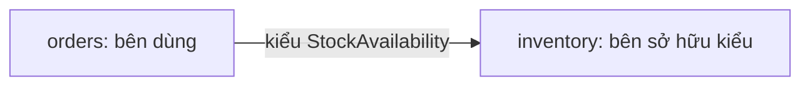
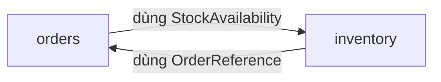
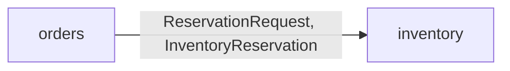
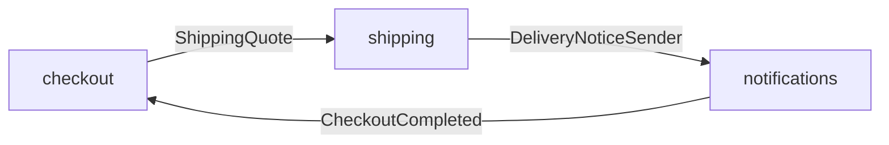
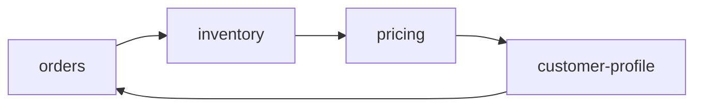
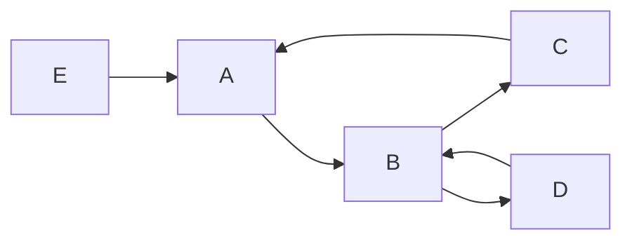
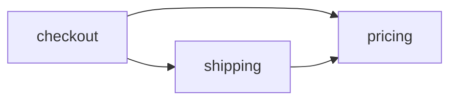
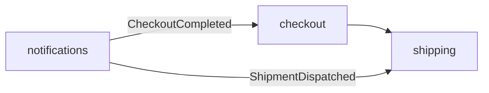

# Cycle trực tiếp và cycle thông qua nhiều module

Một hệ thống có thể tuân thủ quy tắc phụ thuộc ở **từng cặp module** mà vẫn hình thành một **vòng phụ thuộc (dependency cycle)** khi ghép toàn bộ các cạnh lại. Vòng trực tiếp dễ nhìn thấy vì hai module phụ thuộc qua lại: `A → B → A`. Vòng nhiều module tinh vi hơn: `A → B → C → A`, trong đó không nhất thiết có cặp module nào tham chiếu trực tiếp hai chiều.

Đây là bài học thuộc chương **Dependency rules** của `SPRING_MODULITH_VERIFICATION_TESTING`. Trong học phần, chúng ta luyện dùng `ApplicationModules` để kiểm chứng ranh giới, phối hợp các quy tắc phụ thuộc giữa application module với `@ApplicationModuleTest`, kiểm thử sự kiện, cơ sở dữ liệu và tích hợp, sau đó đặt quality gate trong CI nhằm ngăn phụ thuộc sai và hồi quy. Bài này tập trung phân biệt **vòng trực tiếp** với **vòng thông qua nhiều module**, cách xác định chúng trên đồ thị có hướng, và cách phá vòng mà không làm sai ngữ nghĩa nghiệp vụ.

## 1. Nắm chắc hướng cạnh trước khi tìm cycle

Giả sử application module `orders` khai báo trường kiểu `inventory.StockAvailability`:

```java
package com.example.shop.orders;

import com.example.shop.inventory.StockAvailability;

class OrderPlacementService {
    private final StockAvailability stock;

    OrderPlacementService(StockAvailability stock) {
        this.stock = stock;
    }
}
```

Mã của `orders` **biết một kiểu do `inventory` sở hữu**, vì vậy ta vẽ **`orders → inventory`**. Hướng mũi tên là **consumer → provider**, không phải hướng dữ liệu trả về hay hướng điều khiển khi Spring gọi một bean.



Khi đọc một đồ thị, hãy phân biệt:

| Thuật ngữ | Ví dụ | Ý nghĩa |
| --- | --- | --- |
| **Cạnh trực tiếp** | `A → B` | Mã A có tham chiếu đến kiểu/thành viên thuộc B |
| **Đường đi** | `A → B → C` | Đi theo các cạnh có hướng từ A đến C |
| **Vòng (cycle)** | `A → B → C → A` | Đường đi khép kín, quay về điểm bắt đầu |
| **Đồ thị không chu trình (DAG)** | `A → B`, `A → C`, `B → C` | Không có đường đi có hướng quay lại module xuất phát |

Không được nhầm đường đi bắc cầu với cạnh trực tiếp: từ `A → B → C` **chưa thể kết luận** A import một kiểu do C định nghĩa. Nhưng A có thể chịu ảnh hưởng gián tiếp nếu hợp đồng của C làm B thay đổi.

Trong ví dụ chuẩn của Spring Modulith, các package con trực tiếp dưới package ứng dụng thường được nhận diện thành các application module. Kiểu Java trong một module tạo quan hệ đến module khác qua field, constructor, kiểu tham số/trả về, kế thừa, lời gọi, annotation chứa kiểu, v.v. Một chuỗi cấu hình `"BService"` hoặc đường dẫn resource không nhất thiết được phân tích thành một cạnh kiểu Java; giới hạn đó cần được kiểm chứng riêng.

## 2. Cycle trực tiếp: hai module phụ thuộc lẫn nhau

Xét hai module `orders` và `inventory`:



Cạnh thứ nhất là `orders → inventory`. Cạnh thứ hai là `inventory → orders`. Vì đã có đường **`orders → inventory → orders`**, đây là **vòng trực tiếp giữa hai module**.

### 2.1. Ví dụ Java tạo cạnh thứ nhất

Module `inventory` công bố hợp đồng kiểm tra tồn kho:

```java
// inventory/StockAvailability.java
package com.example.shop.inventory;

public interface StockAvailability {
    boolean available(String sku, int requestedQuantity);
}
```

Module `orders` dùng hợp đồng này:

```java
// orders/OrderPlacementService.java
package com.example.shop.orders;

import com.example.shop.inventory.StockAvailability;

public class OrderPlacementService {

    private final StockAvailability stock;

    public OrderPlacementService(StockAvailability stock) {
        this.stock = stock;
    }

    public boolean canPlace(String sku, int quantity) {
        return stock.available(sku, quantity);
    }
}
```

`orders` tham chiếu `StockAvailability` trong field và constructor, nên **`orders → inventory`**. Việc class này có được Spring đăng ký thành bean hay chưa không làm thay đổi quan hệ kiểu.

### 2.2. Ví dụ Java tạo cạnh ngược

Module `orders` cũng định nghĩa một kiểu định danh:

```java
// orders/OrderReference.java
package com.example.shop.orders;

public record OrderReference(String value) {}
```

Giả sử `inventory` nhận kiểu đó khi giữ hàng:

```java
// inventory/InventoryReservation.java
package com.example.shop.inventory;

import com.example.shop.orders.OrderReference;

public class InventoryReservation {

    public void reserve(String sku, int quantity, OrderReference order) {
        // Ví dụ minh họa: triển khai lưu trữ được lược bỏ.
    }
}
```

`InventoryReservation.reserve(...)` có tham số kiểu `OrderReference` thuộc `orders`. Như vậy **`inventory → orders`** tồn tại. Hai cạnh tạo vòng **dù phương thức `reserve(...)` chưa được gọi** và dù không có bean nào inject nhau.

### 2.3. Vì sao vòng trực tiếp dễ lọt qua code review?

Mỗi thay đổi đơn lẻ có thể trông hợp lý: `orders` hỏi tồn kho, còn `inventory` muốn lưu tham chiếu đến đơn hàng. Tuy nhiên, khi cả hai module cùng sở hữu một phần hợp đồng của nhau, mỗi lần sửa API đều có nguy cơ làm phía kia phải đổi. Việc kiểm tra từng PR theo từng file chưa chắc bộc lộ cạnh còn lại đã tồn tại từ trước.

**Cách phát hiện nhanh:** nếu thấy `A → B`, hãy tìm trong B xem có **bất kỳ** tham chiếu Java nào về A không. Chỉ cần một cạnh `B → A` là đủ tạo vòng hai module, bất kể tham chiếu đó nằm trong constructor, annotation, listener hay `implements`.

## 3. Phá cycle trực tiếp: chuyển đổi dữ liệu ở ranh giới

Với ví dụ trên, `inventory` không nhất thiết phải biết **kiểu `orders.OrderReference`**. Nó chỉ cần một mã tham chiếu để liên kết nghiệp vụ giữ hàng. Module `inventory` có thể sở hữu input contract của chính mình:

```java
// inventory/ReservationRequest.java
package com.example.shop.inventory;

public record ReservationRequest(
        String sku, int quantity, String externalReference) {}
```

```java
// inventory/InventoryReservation.java
package com.example.shop.inventory;

public class InventoryReservation {

    public void reserve(ReservationRequest request) {
        // Kiểm tra và ghi nhận giữ hàng trong inventory.
    }
}
```

Tại phía `orders`, chuyển `OrderReference` thành giá trị dành cho API của `inventory`:

```java
// Ví dụ bên trong orders
var request = new com.example.shop.inventory.ReservationRequest(
        sku, quantity, orderReference.value());
inventoryReservation.reserve(request);
```

Giờ đây `orders` vẫn phụ thuộc `inventory`, nhưng `inventory` **không phải import kiểu từ `orders`** trong ví dụ. Đồ thị còn:



Điều kiện quan trọng là **không còn tham chiếu ngược nào khác** trong `inventory`. Chỉ xóa một import sẽ không phá vòng nếu module đó vẫn nhận kiểu `orders` qua một method khác, annotation hoặc event listener.

Cách sửa này giữ ranh giới rõ: `inventory` sở hữu hợp đồng yêu cầu giữ hàng, `orders` chuyển đổi giá trị tại nơi gọi. Không nhất thiết tạo một module `common` cho mọi kiểu dữ liệu; chỉ đưa hợp đồng vào module phù hợp với trách nhiệm nghiệp vụ.

## 4. Cycle qua nhiều module: từng cặp một chiều nhưng cả chuỗi khép kín

Một vòng **ba module** có thể hình thành khi:

- `checkout → shipping`: checkout cần báo giá giao hàng.
- `shipping → notifications`: shipping dùng dịch vụ thông báo.
- `notifications → checkout`: notifications nhận sự kiện có kiểu do checkout sở hữu.



Không có cặp nào trong ba cặp trên bắt buộc phải có **hai cạnh ngược chiều trực tiếp**. Nhưng đi từ `checkout` theo mũi tên sẽ quay lại `checkout`, nên **toàn đồ thị có cycle**.

### 4.1. Cạnh checkout → shipping

```java
// shipping/ShippingQuote.java
package com.example.shop.shipping;

import java.math.BigDecimal;

public interface ShippingQuote {
    BigDecimal costFor(String postalCode);
}
```

```java
// checkout/CheckoutPlanner.java
package com.example.shop.checkout;

import com.example.shop.shipping.ShippingQuote;
import java.math.BigDecimal;

public class CheckoutPlanner {

    private final ShippingQuote quote;

    public CheckoutPlanner(ShippingQuote quote) {
        this.quote = quote;
    }

    public BigDecimal shippingCost(String postalCode) {
        return quote.costFor(postalCode);
    }
}
```

Constructor của `CheckoutPlanner` tạo **`checkout → shipping`**.

### 4.2. Cạnh shipping → notifications

```java
// notifications/DeliveryNoticeSender.java
package com.example.shop.notifications;

public interface DeliveryNoticeSender {
    void send(String shipmentId);
}
```

```java
// shipping/ShippingDispatch.java
package com.example.shop.shipping;

import com.example.shop.notifications.DeliveryNoticeSender;

public class ShippingDispatch {

    private final DeliveryNoticeSender notices;

    public ShippingDispatch(DeliveryNoticeSender notices) {
        this.notices = notices;
    }

    public void dispatched(String shipmentId) {
        notices.send(shipmentId);
    }
}
```

Đây là **`shipping → notifications`**. Không có tham chiếu trực tiếp từ `notifications` ngược về `shipping` trong hai đoạn mã này.

### 4.3. Cạnh notifications → checkout

```java
// checkout/CheckoutCompleted.java
package com.example.shop.checkout;

public record CheckoutCompleted(String checkoutId) {}
```

```java
// notifications/CheckoutCompletedListener.java
package com.example.shop.notifications;

import com.example.shop.checkout.CheckoutCompleted;
import org.springframework.context.event.EventListener;
import org.springframework.stereotype.Component;

@Component
public class CheckoutCompletedListener {

    @EventListener
    void on(CheckoutCompleted event) {
        // Gửi thông báo xác nhận theo hợp đồng sự kiện.
    }
}
```

Tham số `CheckoutCompleted` là kiểu thuộc `checkout`, vì vậy listener tạo **`notifications → checkout`**. Việc sự kiện thực tế được phát *từ* checkout *đến* notifications không đảo chiều cạnh **phụ thuộc mã nguồn**.

Ba lớp ở trên đóng thành vòng mà không cần một dependency injection cycle. Nếu chạy kiểm chứng kiến trúc, cần xét **toàn bộ module graph**, không chỉ các cặp `checkout/shipping`, `shipping/notifications` và `notifications/checkout` riêng rẽ.

## 5. Vòng bốn module và nhiều vòng lồng nhau

Các vòng lớn có thể đi qua bốn module hoặc nhiều hơn:



Đường khép kín là `orders → inventory → pricing → customer-profile → orders`. Nếu chỉ tìm `A ↔ B` sẽ không phát hiện được.

Một đồ thị khác còn có thể chứa **nhiều vòng**:



Ở đây có `A → B → C → A` và `B → D → B`. Module `E` phụ thuộc vào A nhưng **không tự thuộc vòng**, vì chưa có đường đi quay lại E.

Điểm cần phân biệt: **liên thông theo đường đi** không đủ để gọi là vòng; phải có đường đi **theo đúng chiều mũi tên** để trở về điểm xuất phát. Nếu sơ đồ chỉ có `E → A → B → C` và không có cạnh nào quay về E, E không thuộc cycle.

## 6. So sánh trực tiếp với cycle qua nhiều module

| Tiêu chí | Cycle trực tiếp | Cycle qua nhiều module |
| --- | --- | --- |
| Vòng nhỏ nhất thường gặp | `A → B → A` | `A → B → C → A`, có thể dài hơn |
| Cần có cặp phụ thuộc hai chiều không? | Có, giữa A và B | **Không** |
| Cách nhận diện bằng mắt | Kiểm tra cạnh A → B và B → A | Lần theo cả đường đi có hướng |
| Rủi ro review chỉ một class | Bỏ sót tham chiếu ngược trong module còn lại | Bỏ sót cạnh ở module thứ ba/thứ tư |
| Cách phá | Loại ít nhất một hướng A → B hoặc B → A | Loại hoặc đổi hướng ít nhất một cạnh trên mọi đường vòng liên quan |
| Kiểm chứng phù hợp | Kiểm tra toàn bộ application-module graph | Kiểm tra toàn bộ application-module graph |

Nói “loại một cạnh” ở đây là điều kiện trên đồ thị: phải bảo đảm **không còn đường vòng thay thế**. Với đồ thị có nhiều cycle, sửa một cạnh của cycle thứ nhất chưa chắc loại được cycle thứ hai.

## 7. Khi nào một sơ đồ trông giống vòng nhưng thực ra không có?

### 7.1. Hai đường cùng đi đến một provider



Có hai đường từ `checkout` tới `pricing`: trực tiếp và qua `shipping`. Nhưng **không có đường từ pricing quay về checkout hoặc shipping**, nên đây là một **DAG** (đồ thị có hướng không chu trình).

### 7.2. Thứ tự gọi runtime không phải cạnh tĩnh

`checkout` gọi API của `shipping`; `shipping` trả kết quả. Dòng kết quả trả về **không phải** một cạnh `shipping → checkout`. Để có cạnh ngược, trong mã `shipping` phải xuất hiện tham chiếu tới một kiểu/thành viên của `checkout` (hoặc cơ chế dependency được bộ phân tích ghi nhận).

### 7.3. Một listener nhận event không chứng minh bên phát phụ thuộc bên nhận

Nếu `notifications` có listener tham số `checkout.CheckoutCompleted`, đó là **`notifications → checkout`**. Không nên vẽ thêm `checkout → notifications` chỉ bởi sự kiện chạy theo hướng ấy. Hãy kiểm tra mã của `checkout` có thực sự dùng kiểu do `notifications` sở hữu hay không.

### 7.4. Vòng bean khác vòng application module

Hai bean `AService` và `BService` nằm **cùng module** và inject lẫn nhau có thể gây lỗi Spring wiring, nhưng không tự tạo **vòng giữa hai application module**. Ngược lại, vòng Java `checkout → shipping → notifications → checkout` có thể xuất hiện chỉ từ interface và tham số event mà Spring context vẫn khởi tạo được trong một tình huống cụ thể.

Phải dùng **`ApplicationModules.verify()`** cho kiến trúc module; dùng **Spring context test** để kiểm tra wiring bean, và test hành vi để kiểm tra đệ quy, sự kiện hoặc giao dịch runtime.

## 8. Cách phát hiện cycle từ đồ thị có hướng

Có hai cách tư duy hữu ích bên cạnh công cụ có sẵn:

### 8.1. Duyệt đường đi và phát hiện điểm quay lại

Từ module A, đi theo những cạnh `A → B`, `B → C`, ... Nếu gặp lại module đang nằm trên **đường duyệt hiện tại** thì có một cycle.

Mô hình thuật toán DFS thường dùng ba trạng thái:

| Trạng thái | Ý nghĩa |
| --- | --- |
| **Chưa thăm** | Module chưa được duyệt |
| **Đang duyệt** | Module nằm trên ngăn xếp DFS hiện tại |
| **Đã hoàn tất** | Đã duyệt xong các cạnh đi ra từ module |

Nếu DFS đi tới một module **đang duyệt**, đó là một *back edge* và xác nhận vòng. Ví dụ, khi đường đang duyệt là `checkout → shipping → notifications` và thấy `notifications → checkout`, `checkout` vẫn đang trên ngăn xếp: cycle được tìm thấy.

**Lưu ý:** chỉ gặp lại một module đã từng thăm *ở nhánh khác* chưa đủ để kết luận có cycle. Cần phân biệt trạng thái “đang duyệt” với “đã hoàn tất”.

### 8.2. Thành phần liên thông mạnh (SCC)

Một **strongly connected component** là nhóm module trong đó mỗi module đều có đường đi tới mọi module khác trong cùng nhóm. Nếu một SCC có từ **hai module** trở lên, chắc chắn có ít nhất một cycle giữa chúng.

Trong ví dụ:

```text
A -> B -> C -> A
B -> D -> B
E -> A
```

Nhóm `{A, B, C, D}` thuộc cùng một SCC vì chúng đều có thể tới nhau theo các đường có hướng; `E` không thuộc nhóm đó vì chưa có đường từ A/B/C/D quay lại E. Nhìn theo SCC giúp nhận diện **cụm module bị ghép vòng**, không chỉ một đường vòng đơn lẻ.

Với công việc Spring Modulith, **không cần tự cài DFS/Tarjan chỉ để kiểm chứng mặc định**. `ApplicationModules.verify()` đã có nhiệm vụ kiểm tra chu trình của module graph; kiến thức DFS/SCC chủ yếu giúp đọc thông báo và hoạch định refactor chính xác.

## 9. Phá vòng nhiều module mà không tạo vòng khác

Quay lại ba module:

```text
checkout -> shipping -> notifications -> checkout
```

Một lựa chọn là để `shipping` **không gọi trực tiếp API của notifications**. Thay vào đó, `shipping` phát sự kiện do chính nó sở hữu; `notifications` lắng nghe sự kiện đó:

```java
// shipping/ShipmentDispatched.java
package com.example.shop.shipping;

public record ShipmentDispatched(String shipmentId) {}
```

```java
// shipping/ShippingDispatch.java
package com.example.shop.shipping;

import org.springframework.context.ApplicationEventPublisher;

public class ShippingDispatch {

    private final ApplicationEventPublisher events;

    public ShippingDispatch(ApplicationEventPublisher events) {
        this.events = events;
    }

    public void dispatched(String shipmentId) {
        events.publishEvent(new ShipmentDispatched(shipmentId));
    }
}
```

```java
// notifications/ShipmentDispatchedListener.java
package com.example.shop.notifications;

import com.example.shop.shipping.ShipmentDispatched;
import org.springframework.context.event.EventListener;
import org.springframework.stereotype.Component;

@Component
public class ShipmentDispatchedListener {

    @EventListener
    void on(ShipmentDispatched event) {
        // Thông báo về lô hàng đã gửi.
    }
}
```

Sau thay đổi này, **shipping không cần phụ thuộc notifications** để thông báo lô hàng. `notifications` tham chiếu kiểu sự kiện của `shipping`; hướng Java mới là **`notifications → shipping`**.

Giả sử `notifications` vẫn nhận `checkout.CheckoutCompleted`, đồ thị còn:



Không có đường đi có hướng quay lại `notifications`, nên **không còn cycle trong đồ thị minh họa**. Quan trọng là đã loại bỏ thực sự việc `shipping` dùng `notifications.DeliveryNoticeSender`; nếu code cũ còn tồn tại, cạnh `shipping → notifications` vẫn tồn tại và vòng chưa biến mất.

**Đánh đổi:** sử dụng sự kiện thay đổi cách phối hợp ở runtime; nơi phát có thể không còn nhận kết quả gửi thông báo ngay tại lệnh gọi. Cần thiết kế thời điểm xử lý, lỗi listener, idempotency, retry, transaction và đảm bảo delivery theo yêu cầu nghiệp vụ. Không nên biến mọi lời gọi đồng bộ thành sự kiện chỉ để test kiến trúc màu xanh.

## 10. Các hướng sửa khác ngoài sự kiện

| Cách sửa | Ví dụ | Khi phù hợp |
| --- | --- | --- |
| **Đưa hợp đồng về đúng chủ sở hữu** | `inventory` tự định nghĩa `ReservationRequest` thay vì nhận `orders.OrderReference` | B chỉ cần dữ liệu đầu vào, không cần biết model A |
| **Chuyển đổi DTO tại ranh giới** | A chuyển `OrderReference` thành `String externalReference` hoặc DTO của B | Muốn tránh đưa internal domain type qua ranh giới |
| **Đảo hướng qua interface công khai** | B công bố extension point, A implement B's interface | B cần cơ chế mở rộng nhưng không cần import class cụ thể của A |
| **Sự kiện do nơi phát sở hữu** | `shipping.ShipmentDispatched`, `notifications` lắng nghe | Hợp đồng bất đồng bộ thích hợp với nghiệp vụ |
| **Tách module có trách nhiệm đúng** | Đưa chính sách xác thực khách hàng về module `identity` | Hai module bị vòng vì phân quyền sở hữu khái niệm không đúng |

Các kỹ thuật đều nhằm **thay đổi cạnh phụ thuộc thực tế**, không phải giấu cạnh:

- Đổi một `import` thành `Class.forName("...")` có thể che phụ thuộc kiểu khỏi phân tích tĩnh nhưng vẫn giữ ghép nối runtime.
- Đưa tất cả DTO vào `common` mà không có ranh giới sở hữu chỉ khiến `common` trở thành điểm ghép nối tập trung.
- Chuyển sang DI qua interface **không tự làm mất cạnh** nếu interface vẫn thuộc module mà bên dùng đã phụ thuộc. Cần xem **module sở hữu interface**.

## 11. Kiểm chứng cycle bằng `ApplicationModules.verify()`

Một bài JUnit test có thể thực thi kiểm chứng kiến trúc Spring Modulith:

```java
// src/test/java/com/example/shop/ModularityTests.java
package com.example.shop;

import org.junit.jupiter.api.Test;
import org.springframework.modulith.core.ApplicationModules;

class ModularityTests {

    @Test
    void moduleDependenciesAreValid() {
        ApplicationModules.of(ShopApplication.class).verify();
    }
}
```

`ApplicationModules.of(ShopApplication.class)` xây dựng mô hình những application module dựa trên cấu trúc ứng dụng và cấu hình nhận diện module. `verify()` kiểm tra các quy tắc kiến trúc được áp dụng, bao gồm:

1. **Không có cycle** giữa các application module.
2. **Không truy cập phần nội bộ** của module khác ngoài API được công bố.
3. **Tuân thủ `allowedDependencies`** nếu module có khai báo giới hạn phụ thuộc.

Với vòng `orders → inventory → orders` hoặc `checkout → shipping → notifications → checkout`, kỳ vọng bài test **thất bại** khi các quan hệ đó được bộ phân tích nhận diện. Đây là kiểm chứng **cấu trúc**, nên không cần thực hiện một đường đi nghiệp vụ đủ dài để vòng chạy thật.

Khi `verify()` thất bại, hãy **đọc thông báo vi phạm và chuỗi cạnh cụ thể**. Một lần chạy có thể báo cả chu trình lẫn truy cập package nội bộ hoặc vi phạm `allowedDependencies`. Không dựa vào thông báo giả định về tên exception hay định dạng lỗi: cách trình bày có thể thay đổi giữa các phiên bản.

### 11.1. Ví dụ ràng buộc phụ thuộc được phép

Nếu `checkout` chỉ được dùng API `shipping`, có thể khai báo trong package gốc của nó:

```java
// checkout/package-info.java
@org.springframework.modulith.ApplicationModule(
    allowedDependencies = "shipping"
)
package com.example.shop.checkout;
```

`allowedDependencies = "shipping"` là **chính sách cho phép**, không tự tạo cạnh checkout → shipping. Cạnh thực tế xuất hiện khi mã `checkout` dùng `ShippingQuote` hoặc kiểu khác của shipping. Quan trọng hơn, **dù từng cạnh trong một vòng đều được liệt kê là được phép, vòng vẫn vi phạm quy tắc không chu trình**.

Nếu cần giới hạn phần API B, hãy sử dụng `@NamedInterface` trên package B muốn công bố và khai báo theo cú pháp `shipping::tenInterface`. Việc công bố named interface giúp kiểm soát bề mặt API, nhưng không tự xóa một vòng đang tồn tại.

### 11.2. Những trường hợp nên kiểm tra thêm

Các phụ thuộc được nhận diện dựa trên kiểu/bytecode Java, nhưng **reflection**, cấu hình theo chuỗi, tên bean, SQL hoặc tên topic có thể tạo ghép nối runtime mà bộ phân tích không suy ra đầy đủ. Nếu một test `verify()` PASS, điều đó có nghĩa **các quy tắc đã chạy không phát hiện vi phạm trong phạm vi phân tích**, không phải mọi luồng tích hợp đều không có vòng vận hành.

Đồng thời, không nên coi lời gọi event bất đồng bộ là một kiểu phụ thuộc “vô hình”. Listener có tham số kiểu sự kiện của module khác vẫn tạo tham chiếu Java rõ ràng và có thể đóng một cycle.

## 12. `@ApplicationModuleTest` kiểm tra điều gì khác?

`@ApplicationModuleTest` giúp bootstrap Spring context với phạm vi module để xác minh bean wiring và hành vi. Ví dụ với `checkout` sau khi đã phá vòng:

```java
// src/test/java/com/example/shop/checkout/CheckoutModuleTests.java
package com.example.shop.checkout;

import org.junit.jupiter.api.Test;
import org.springframework.modulith.test.ApplicationModuleTest;

@ApplicationModuleTest(
    mode = ApplicationModuleTest.BootstrapMode.DIRECT_DEPENDENCIES
)
class CheckoutModuleTests {

    @Test
    void startsWithDirectModuleDependencies() {
        // Bổ sung assertions cho nghiệp vụ checkout và Spring wiring.
    }
}
```

Thông thường, `STANDALONE` tập trung vào module test, `DIRECT_DEPENDENCIES` thêm các phụ thuộc trực tiếp, còn `ALL_DEPENDENCIES` bao gồm phụ thuộc bắc cầu theo mô hình module. Chúng phục vụ **kiểm thử tích hợp có phạm vi**, không thay thế `ApplicationModules.verify()` trong việc chứng minh không có cycle.

Ba điểm cần phân biệt:

- **Test context khởi tạo được** chưa chứng minh mọi cạnh kiến trúc hợp lệ. Một số vòng kiểu Java không tạo bean cycle.
- **Architecture test PASS** chưa chứng minh listener thực sự nhận sự kiện, bean cấu hình đúng hoặc repository lưu dữ liệu như kỳ vọng.
- **Test với `ALL_DEPENDENCIES`** không phải “cách khắc phục” module cycle; nếu cần quá nhiều module để test một chức năng nhỏ, đó có thể là tín hiệu cần xem lại ranh giới.

Khi chuyển từ lời gọi đồng bộ sang sự kiện để phá vòng, nên thêm integration test cho việc phát/nhận sự kiện, thời điểm transaction, lỗi listener và xử lý trùng lặp. Nếu các module tương tác qua database, cần test repository, migration và quyền sở hữu dữ liệu; vòng ghép nối qua SQL/chia sẻ schema không nhất thiết hiển thị trong đồ thị kiểu Java.

## 13. Quality gate CI: chặn vòng trực tiếp lẫn vòng nhiều module

Một pipeline đơn giản có thể dùng JUnit architecture test như quality gate:

```text
Pull request
    |
    v
Compile source/test classes
    |
    v
ModularityTests -> ApplicationModules.verify()
    |-- cycle 2 module?
    |-- cycle 3+ module?
    |-- truy cập internal API?
    '-- sai allowedDependencies?
    |
    v
Unit test -> @ApplicationModuleTest -> integration test liên quan
    |
    v
Merge khi tất cả bước bắt buộc đều PASS
```

Điều kiện để gate có giá trị: job phải chạy test thật, không bị bỏ qua qua cấu hình như `skipTests` hoặc filter chỉ chạy một phần suite. Khi một developer thêm một import nhỏ tạo cạnh cuối cùng `C → A` và khép vòng `A → B → C → A`, test kiến trúc phải chạy trong PR đó để phát hiện sớm.

Với ví dụ ba module ở phần 4, một ca kiểm thử có mục đích rõ:

| Trạng thái code | Các cạnh chính | Kỳ vọng kiểm chứng cycle |
| --- | --- | --- |
| Ban đầu | `checkout → shipping → notifications → checkout` | **FAIL** |
| Chỉ xóa `@EventListener`, vẫn giữ tham số `CheckoutCompleted` ở class notifications | `notifications → checkout` còn | **Vẫn có thể FAIL** |
| Loại hết tham chiếu `shipping → notifications`, chuyển sang sự kiện `shipping.ShipmentDispatched` | `checkout → shipping`; `notifications → shipping` và `notifications → checkout` | **Không có vòng trong phần đồ thị minh họa** |
| Thêm lại `shipping → notifications` ở một cấu hình khác | Đường vòng được tái lập | **FAIL** |

Lưu ý: kỳ vọng PASS/FAIL này xét **riêng vòng được minh họa**. Dự án thật có thể có vi phạm kiến trúc khác; không thể bảo đảm toàn bộ `verify()` PASS chỉ bằng việc loại một cycle.

## 14. Quy trình điều tra khi báo lỗi cycle

Khi một thay đổi làm test architecture thất bại:

1. **Ghi lại đường cycle đầy đủ**, ví dụ `checkout → shipping → notifications → checkout`. Đừng dừng ở hai module đầu tiên.
2. **Tìm nguồn tạo từng cạnh**: class, field, tham số, kiểu trả về, annotation có `SomeType.class`, `implements`, static call hoặc event listener.
3. **Phân loại vòng**: hai module trực tiếp, ba module, hay nhiều vòng giao nhau. Nếu có nhiều vòng, phải kiểm tra cả nhóm module liên quan.
4. **Hỏi về quyền sở hữu hợp đồng**: ai sở hữu dữ liệu, sự kiện và interface? Có module nào đang tham chiếu chi tiết của module khác mà không cần thiết?
5. **Chọn điểm cắt phù hợp với nghiệp vụ**: chuyển DTO tại ranh giới, đổi bên sở hữu kiểu, bỏ phụ thuộc ngược hoặc đổi mô hình cộng tác qua API/sự kiện.
6. **Tìm mọi tham chiếu còn sót** trên cạnh muốn bỏ. Xóa một dòng import chưa đủ nếu class vẫn có tham chiếu khác.
7. **Chạy lại `verify()`**, sau đó chạy unit/module/integration test ở các module chịu ảnh hưởng. Giữ architecture test trong CI để ngăn vòng trở lại.

Không nhất thiết chọn cạnh dễ xóa nhất. Nên chọn cạnh **làm sai ranh giới trách nhiệm** nhất; như vậy kiến trúc sau khi phá vòng mới ổn định khi yêu cầu nghiệp vụ thay đổi.

## 15. Bài tập phân biệt cycle trực tiếp và gián tiếp

### Bài 1 — Hai module

```text
orders -> inventory
inventory -> orders
```

**Hỏi:** Có vòng không? Thuộc loại nào?

**Đáp án:** Có, **cycle trực tiếp** `orders → inventory → orders`. Chỉ cần hai cạnh là đủ.

### Bài 2 — Ba module không có cạnh hai chiều nào

```text
checkout -> shipping
shipping -> notifications
notifications -> checkout
```

**Hỏi:** Có vòng không, dù không cặp nào phụ thuộc trực tiếp hai chiều?

**Đáp án:** Có, **cycle qua ba module** `checkout → shipping → notifications → checkout`. Phải xét toàn đồ thị có hướng.

### Bài 3 — Có đường bắc cầu nhưng không có vòng

```text
checkout -> shipping
checkout -> pricing
shipping -> pricing
```

**Hỏi:** Có cycle không?

**Đáp án:** Không. `pricing` không có đường phụ thuộc quay lại `checkout` hoặc `shipping`. Đó là một DAG.

### Bài 4 — Nhiều vòng chung một module

```text
A -> B
B -> C
C -> A
B -> D
D -> B
E -> A
```

**Hỏi:** Có bao nhiêu đường vòng dễ nhận diện? E có thuộc vòng không?

**Đáp án:** Có ít nhất hai cycle: `A → B → C → A` và `B → D → B`. E **không thuộc cycle** theo các cạnh đã cho vì không có đường quay từ A/B/C/D về E. Các module `A, B, C, D` tạo một cụm liên thông mạnh.

### Bài 5 — Đổi kiểu event có tác dụng gì?

`checkout` gọi API `shipping`; `shipping` gọi `notifications.DeliveryNoticeSender`; `notifications` nhận `checkout.CheckoutCompleted`. Một developer thay lời gọi `shipping → notifications` bằng việc `shipping` phát sự kiện `shipping.ShipmentDispatched`, còn `notifications` lắng nghe kiểu sự kiện mới.

**Hỏi:** Sau khi xóa hết các tham chiếu cũ, cycle ban đầu còn không?

**Đáp án:** Không, với các cạnh được nêu. `checkout → shipping` và `notifications → checkout` cùng `notifications → shipping` không tạo đường khép kín. Nhưng cần kiểm thử việc phát/nhận sự kiện và các trường hợp lỗi runtime.

### Bài 6 — Giới hạn của test

Hai Spring bean trong **cùng** module `orders` inject nhau. Không có cạnh mã Java giữa `orders` và application module khác.

**Hỏi:** Đó có phải cycle giữa application module?

**Đáp án:** Không. Đây là vấn đề vòng bean nội bộ (có thể ảnh hưởng startup) chứ không phải dependency cycle giữa application module. Cần kiểm thử Spring context và sửa thiết kế bean riêng.

## 16. Tổng kết

**Cycle trực tiếp** là đường khép kín qua hai module, ví dụ `A → B → A`. **Cycle qua nhiều module** có ba hoặc nhiều module trên đường vòng, ví dụ `A → B → C → A`; nó có thể tồn tại dù không có cặp phụ thuộc trực tiếp hai chiều nào. Cả hai đều là vi phạm đối với quy tắc **không có chu trình** của mô hình application module Spring Modulith.

Muốn phát hiện chính xác, hãy dùng **đồ thị có hướng của toàn ứng dụng**, không chỉ tìm cặp import lẫn nhau. Muốn sửa bền vững, hãy xác định module sở hữu hợp đồng, bỏ hoặc đổi hướng các tham chiếu sai, và chứng minh đường khép kín đã biến mất. Cuối cùng, giữ `ApplicationModules.verify()` trong CI và bổ sung `@ApplicationModuleTest` cùng kiểm thử sự kiện, cơ sở dữ liệu, tích hợp khi thay đổi cách các module cộng tác.

## Tài liệu tham khảo

- [Spring Modulith — Fundamentals: Application Modules, Named Interfaces và Allowed Dependencies](https://docs.spring.io/spring-modulith/reference/fundamentals.html)
- [Spring Modulith — Verifying Application Module Structure](https://docs.spring.io/spring-modulith/reference/verification.html)
- [Spring Modulith — Integration Testing Application Modules](https://docs.spring.io/spring-modulith/reference/testing.html)
- [ArchUnit User Guide — Dependencies and Architecture Rules](https://www.archunit.org/userguide/html/000_Index.html)
- [Spring Framework — Application Events](https://docs.spring.io/spring-framework/reference/core/beans/context-introduction.html)
