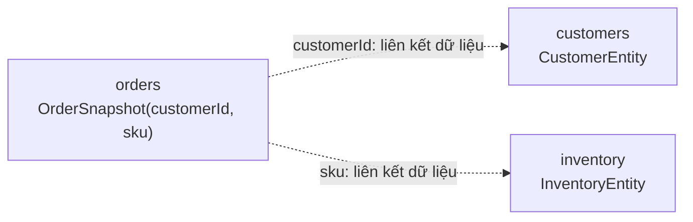
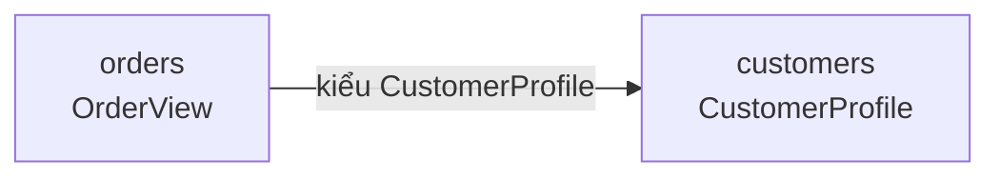
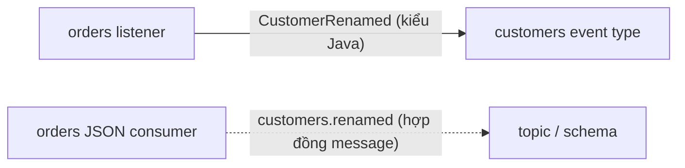
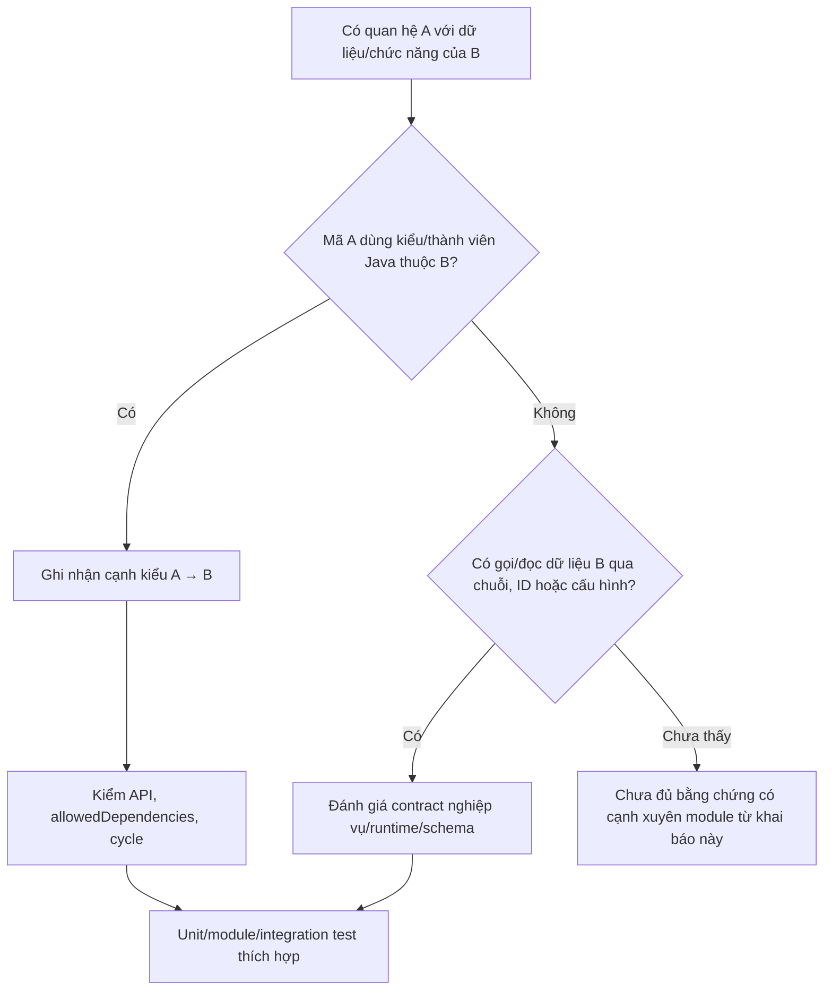

# Phân biệt dependency thật với liên kết dữ liệu đơn thuần

Khi phân tích kiến trúc Spring Modulith, câu hỏi **“module `orders` có phụ thuộc module `customers` không?”** cần được đặt trong một ngữ cảnh rõ ràng. Một đối tượng đơn hàng có thể lưu `customerId = "C-001"`, nhưng **chỉ riêng giá trị đó chưa tạo một cạnh phụ thuộc kiểu Java** từ `orders` đến `customers`. Ngược lại, nếu class trong `orders` có trường kiểu `customers.CustomerProfile`, cạnh phụ thuộc kiến trúc `orders → customers` đã hình thành, dù code chưa gọi phương thức nào của `CustomerProfile`.

Hai cách thiết kế đều có thể liên quan tới cùng một khách hàng trong nghiệp vụ. Vì thế, cần phân biệt:

1. **Dependency theo mô hình module/Java**: mã A tham chiếu kiểu hoặc thành viên do B sở hữu; loại này là đối tượng chính của quy tắc phụ thuộc trong Spring Modulith.
2. **Liên kết dữ liệu**: dữ liệu của A mang khóa, định danh, giá trị hoặc tham chiếu logic đến dữ liệu do B quản lý, nhưng bản thân biểu diễn đó không nhất thiết tham chiếu kiểu Java của B.
3. **Coupling ở runtime hoặc hợp đồng nghiệp vụ**: hai module phụ thuộc vào schema, tên topic, ý nghĩa của mã định danh, sự tồn tại của bản ghi hay một hệ thống bên ngoài. Những phụ thuộc này có thể **rất thực tế** dù kiểm tra tĩnh không luôn nhìn thấy.

Bài thuộc chương **Dependency rules** của học phần `SPRING_MODULITH_VERIFICATION_TESTING`. Mục tiêu học phần là dùng `ApplicationModules` và quy tắc phụ thuộc để kiểm chứng ranh giới ứng dụng, thực hành `@ApplicationModuleTest`, kiểm thử sự kiện, cơ sở dữ liệu, tích hợp và quality gate CI nhằm ngăn phụ thuộc sai và hồi quy. Trọng tâm bài này là **phân loại đúng quan hệ đang xét trước khi quyết định đó có phải vi phạm module boundary hay không**.

## 1. “Dependency thật” phải được hiểu theo loại quan hệ nào?

Trong ngữ cảnh kiểm chứng cấu trúc bằng Spring Modulith, ta tập trung vào **cạnh phụ thuộc giữa application module do tham chiếu Java tạo ra**. Quy ước:

```text
A → B = code của module A sử dụng kiểu/thành viên thuộc module B
```

Ví dụ trong module `orders`:

```java
import com.example.shop.customers.CustomerProfile;

class OrderEnricher {
    private CustomerProfile customer; // orders → customers
}
```

Kiểu `CustomerProfile` do `customers` sở hữu. Không cần đối tượng thật được tạo hoặc Spring context chạy thì phụ thuộc Java đã tồn tại.

Đối chiếu:

```java
package com.example.shop.orders;

public record OrderSnapshot(
        String orderId,
        String customerId,
        String currencyCode
) {}
```

Chỉ từ `String customerId`, không thể xác định `OrderSnapshot` **tham chiếu kiểu của module `customers`**. `String` thuộc thư viện Java chuẩn, `OrderSnapshot` thuộc chính `orders`. Nhưng dữ liệu `customerId` vẫn mang ý nghĩa liên kết đến khách hàng và có thể cần kiểm tra tính hợp lệ tại runtime.

**Nguyên tắc:** “Không có dependency theo Java module graph” **không đồng nghĩa** “không có quan hệ nghiệp vụ” hoặc “không có rủi ro khi thay đổi”.

## 2. Ví dụ nền: ba module của hệ thống bán hàng

Giả sử có ứng dụng Spring Boot:

```text
com.example.shop
├── ShopApplication.java
├── orders
│   ├── OrderSnapshot.java
│   ├── OrderAdmissionService.java
│   ├── OrderLine.java
│   └── internal
│       └── OrderEntity.java
├── customers
│   ├── CustomerLookup.java
│   ├── CustomerProfile.java
│   └── internal
│       ├── CustomerEntity.java
│       └── DefaultCustomerLookup.java
└── inventory
    ├── StockLookup.java
    └── internal
        └── InventoryEntity.java
```

Theo quy ước nhận diện module mặc định, các package `orders`, `customers`, `inventory` là ba application module. Với **module đóng**, package gốc là API mặc định; package con `*.internal` thuộc nội bộ và không được module khác tham chiếu kiểu tùy ý trừ khi được công bố phù hợp.

Ví dụ nghiệp vụ: đơn hàng lưu `orderId`, `customerId` và các dòng `sku/quantity`. Dữ liệu khách hàng được quản lý bởi `customers`; số lượng tồn kho thuộc `inventory`.



Sơ đồ đường đứt mô tả **liên kết dữ liệu/ý nghĩa nghiệp vụ**, không khẳng định có hai cạnh phụ thuộc kiểu Java `orders → customers` và `orders → inventory`. Để vẽ cạnh kiểu, phải xem **mã Java thực tế**.

## 3. Trường hợp A: cùng một `customerId` nhưng chưa có cạnh Java xuyên module

Một cách lưu thông tin đơn hàng:

```java
// orders/OrderLine.java
package com.example.shop.orders;

public record OrderLine(String sku, int quantity) {}
```

```java
// orders/OrderSnapshot.java
package com.example.shop.orders;

import java.util.List;

public record OrderSnapshot(
        String orderId,
        String customerId,
        List<OrderLine> lines
) {}
```

Hai kiểu đều thuộc `orders`; chúng dùng `String` và `List` của Java. **Không có tham chiếu kiểu trực tiếp đến `customers` hay `inventory` từ hai khai báo này**. Dù vậy, dữ liệu `"C-001"` và `"SKU-001"` được ứng dụng hiểu là định danh của khách hàng và sản phẩm/tồn kho.

Điều này có hai mặt:

- **Ưu điểm về ranh giới kiểu:** `orders` không phải import entity hoặc DTO nội bộ của `customers` chỉ để giữ một mã khách hàng.
- **Rủi ro về ngữ nghĩa:** giá trị `customerId` có thể không tồn tại, bị xóa, hoặc đổi quy ước định dạng; `sku` có thể không còn hợp lệ. Không có tham chiếu kiểu Java không tự đảm bảo toàn vẹn nghiệp vụ.

Trong thiết kế DDD/modular monolith, lưu một **định danh của aggregate khác** thường giúp tránh kéo toàn bộ object graph qua ranh giới. Tuy nhiên, dự án vẫn phải xác định **ai chịu trách nhiệm kiểm tra định danh và xử lý khi bản ghi đích thay đổi**.

## 4. Trường hợp B: thêm kiểu `CustomerProfile` là tạo cạnh dependency thật

Giả sử `customers` công bố một DTO:

```java
// customers/CustomerProfile.java
package com.example.shop.customers;

public record CustomerProfile(String id, String displayName) {}
```

Trong `orders`, một developer mở rộng DTO:

```java
// orders/OrderView.java
package com.example.shop.orders;

import com.example.shop.customers.CustomerProfile;

public record OrderView(String orderId, CustomerProfile customer) {}
```

Giờ `OrderView` **tham chiếu trực tiếp kiểu `CustomerProfile`**, do đó tạo **`orders → customers`**.



Đây là phụ thuộc kiểu có thể được Spring Modulith/ArchUnit phân tích. Nó **không mặc nhiên vi phạm**: nếu `CustomerProfile` thuộc API được công bố của `customers`, `orders` được phép phụ thuộc `customers` và không tạo chu trình, quan hệ có thể hợp lệ.

Tuy nhiên, nếu `orders` thay bằng `customers.internal.CustomerEntity` thì đây là **truy cập nội bộ xuyên module** trong mô hình module đóng thông thường, dù class entity có modifier `public`. Chỉ sửa trường dữ liệu từ `String customerId` thành `CustomerEntity customer` đã thay đổi **kiến trúc phụ thuộc**, không chỉ thay đổi format payload.

**Tình huống review:** khi thêm một kiểu vào DTO/API của A, cần hỏi nó có khiến A công khai mô hình của B ra ngoài hay không. Một kiểu trả về chứa DTO B khiến cả consumer của A có thể bị kéo theo hợp đồng B, làm tăng chi phí thay đổi API.

## 5. Bảng quyết định: loại quan hệ nào đang hiện diện?

| Khai báo trong `orders` | Cạnh kiểu `orders → customers`? | Coupling khác cần chú ý |
| --- | --- | --- |
| `String customerId` | **Không suy ra từ riêng khai báo này** | Quy ước ID, sự tồn tại khách hàng |
| `UUID customerId` | **Không**, nếu `UUID` chỉ là `java.util.UUID` | Quy ước và vòng đời định danh |
| `CustomerProfile profile` (kiểu ở `customers`) | **Có** | Hợp đồng DTO của B |
| `CustomerLookup lookup` (interface ở `customers`) | **Có** | Hợp đồng API và bean wiring |
| `CustomerEntity entity` (kiểu ở `customers.internal`) | **Có** | Thêm rủi ro vi phạm API nội bộ |
| `String topic = "customers.changed"` | **Không chỉ từ chuỗi** | Hợp đồng event/topic runtime |
| `Class.forName("...customers.internal.CustomerEntity")` | **Không có class literal trực tiếp chỉ từ chuỗi** | Runtime reflection tới class nội bộ |
| `@ManyToOne CustomerEntity customer` | **Có** do kiểu `CustomerEntity` | Đồng thời có quan hệ ORM/database |
| `@Column(name = "customer_id") String customerId` | **Không chỉ từ tên cột** | Mapping schema, có thể có foreign key |

Đây là bảng xét **tham chiếu đến module `customers` từ khai báo được chỉ ra**. Một class có thể tạo cạnh ấy ở những field, method, annotation hoặc lời gọi khác. Cũng không nên đồng nhất `import` chưa dùng với phụ thuộc bytecode thực tế; hãy đối chiếu mã biên dịch và kết quả kiểm chứng.

## 6. Dùng API có kiểu để kiểm tra liên kết dữ liệu

Để xác thực khách hàng trước khi tạo đơn, `customers` có thể công bố một hợp đồng:

```java
// customers/CustomerLookup.java
package com.example.shop.customers;

public interface CustomerLookup {
    boolean exists(String customerId);
}
```

Implementation do `customers` sở hữu:

```java
// customers/internal/DefaultCustomerLookup.java
package com.example.shop.customers.internal;

import com.example.shop.customers.CustomerLookup;
import org.springframework.stereotype.Component;

@Component
class DefaultCustomerLookup implements CustomerLookup {

    @Override
    public boolean exists(String customerId) {
        // Dữ liệu cố định để minh họa; thực tế có thể gọi repository.
        return "C-001".equals(customerId);
    }
}
```

Module `orders` tiêu thụ API:

```java
// orders/OrderAdmissionService.java
package com.example.shop.orders;

import com.example.shop.customers.CustomerLookup;
import org.springframework.stereotype.Service;

@Service
public class OrderAdmissionService {

    private final CustomerLookup customers;

    public OrderAdmissionService(CustomerLookup customers) {
        this.customers = customers;
    }

    public boolean canAccept(String customerId, int quantity) {
        return quantity > 0 && customers.exists(customerId);
    }
}
```

Đây là một **phụ thuộc thực sự theo đồ thị Java: `orders → customers`** qua `CustomerLookup`, nhưng là phụ thuộc **được biểu đạt bằng hợp đồng công khai**, không phải truy cập entity nội bộ. Nó có thể là cách thiết kế tốt hơn việc để `orders` mở repository của `customers` rồi tự truy vấn bảng khách hàng.

### Lưu ID hay dùng API: không phải lựa chọn loại trừ nhau

Trong nhiều trường hợp, cách phù hợp là **vừa lưu `customerId` trong `OrderSnapshot`, vừa gọi `CustomerLookup` tại thời điểm cần xác thực**. Phụ thuộc kiểu xuất hiện do API lookup, **không phải** do biến `customerId`.

Vì vậy, không nên kết luận:

- “Có `customerId` nên chắc chắn module `orders` phụ thuộc trực tiếp vào `customers` theo ArchUnit” — **sai** nếu chỉ dựa vào tên/giá trị trường.
- “Dùng `customerId` nên module `orders` không cần quan tâm dữ liệu khách hàng” — **cũng sai**, vì còn yêu cầu kiểm tra, xử lý khách hàng bị xóa và tính nhất quán.

## 7. Một giá trị mã định danh có thể trở thành phụ thuộc kiểu ở đâu?

Cách diễn đạt ID quyết định bề mặt phụ thuộc:

```java
// Trong module customers:
package com.example.shop.customers;

public record CustomerId(String value) {}
```

Nếu `orders` dùng:

```java
// Trong module orders:
private com.example.shop.customers.CustomerId customerId;
```

thì **`orders → customers`** vẫn tồn tại, dù `CustomerId` chỉ bọc một chuỗi. Việc đổi `String` thành value object của B đã tạo tham chiếu kiểu Java.

Đây không nhất thiết là vấn đề: dùng `CustomerId` công khai có thể giúp kiểm tra kiểu và giảm nhầm ID khách hàng với ID đơn hàng. Quyết định tùy vào **chính sách phụ thuộc và độ ổn định của hợp đồng**.

Nếu kiến trúc yêu cầu `orders` không phụ thuộc vào `customers` theo Java graph, cần cân nhắc ID trung lập do `orders` sở hữu hoặc một hợp đồng do module phù hợp sở hữu. Tránh tạo module `common` mơ hồ chỉ để di chuyển mọi ID: module dùng chung vẫn có quyền sở hữu, vòng đời và tác động thay đổi riêng.

**Bài học thiết kế:** “Dữ liệu trông đơn giản” không quyết định có cạnh kiến trúc hay không; **module sở hữu kiểu dữ liệu** mới là yếu tố cần xét.

## 8. Database: foreign key không đồng nghĩa phụ thuộc kiểu Java

Xét bảng đơn hàng và khách hàng:

```sql
CREATE TABLE customers (
    id VARCHAR(64) PRIMARY KEY,
    display_name VARCHAR(255) NOT NULL
);

CREATE TABLE orders (
    id VARCHAR(64) PRIMARY KEY,
    customer_id VARCHAR(64) NOT NULL,
    CONSTRAINT fk_orders_customer
        FOREIGN KEY (customer_id) REFERENCES customers(id)
);
```

Khóa ngoại `fk_orders_customer` tạo **ràng buộc toàn vẹn ở tầng cơ sở dữ liệu**: không thể tùy ý lưu `customer_id` trỏ đến bản ghi không tồn tại (tùy cấu hình và trạng thái constraint). Nhưng việc đặt foreign key trong DDL **không tự tạo một tham chiếu kiểu Java** `orders → customers`.

So sánh hai cách ORM:

**Cách 1 — lưu ID thuần trong entity của `orders`:**

```java
// orders/internal/OrderEntity.java
package com.example.shop.orders.internal;

import jakarta.persistence.Column;
import jakarta.persistence.Entity;
import jakarta.persistence.Id;
import jakarta.persistence.Table;

@Entity
@Table(name = "orders")
class OrderEntity {

    @Id
    String id;

    @Column(name = "customer_id", nullable = false)
    String customerId;
}
```

`OrderEntity` không dùng class `CustomerEntity`. Với riêng khai báo này, không có cạnh kiểu Java đến `customers`, **dù schema có foreign key liên bảng**.

**Cách 2 — quan hệ object JPA xuyên module:**

```java
// Ví dụ phản diện trong orders, giả sử class đích có quyền truy cập Java
@jakarta.persistence.ManyToOne
@jakarta.persistence.JoinColumn(name = "customer_id")
private com.example.shop.customers.internal.CustomerEntity customer;
```

Ở cách 2, `CustomerEntity` là kiểu do module `customers` sở hữu, lại nằm trong package nội bộ; vì vậy có **cạnh phụ thuộc Java và rủi ro vi phạm API module**. Quan hệ JPA không khiến quy tắc Spring Modulith tự bỏ qua một tham chiếu kiểu không hợp lệ.

### Vì sao phụ thuộc dữ liệu vẫn cần được quản lý?

Ngay cả khi dùng `String customerId`, `orders` vẫn có thể chịu tác động khi:

- `customers` thay quy tắc tạo/xóa ID hoặc cho phép hợp nhất khách hàng.
- Database migration đổi tên cột, kiểu khóa hoặc chính sách foreign key.
- Hai module cùng ghi vào bảng do một module sở hữu, làm xung đột transaction.
- Một truy vấn của `orders` join thẳng bảng `customers` và phụ thuộc vào cột nội bộ.

**Không nên gọi đây là “hoàn toàn không có dependency”.** Chính xác hơn: “chưa có **cạnh Java module dependency** từ những khai báo đã xét, nhưng có **data/schema coupling**”. Cần migration test, integration test và nguyên tắc sở hữu dữ liệu để kiểm soát phần còn lại.

## 9. Event: liên kết bằng ID khác với dùng kiểu event của module khác

Giả sử module `customers` phát sự kiện khách hàng thay đổi:

```java
// customers/CustomerRenamed.java
package com.example.shop.customers;

public record CustomerRenamed(String customerId, String newName) {}
```

Module `orders` lắng nghe:

```java
// orders/internal/CustomerRenamedListener.java
package com.example.shop.orders.internal;

import com.example.shop.customers.CustomerRenamed;
import org.springframework.context.event.EventListener;
import org.springframework.stereotype.Component;

@Component
class CustomerRenamedListener {

    @EventListener
    void on(CustomerRenamed event) {
        // Ví dụ: cập nhật bản sao tên khách hàng nếu nghiệp vụ cần.
    }
}
```

Ở đây `CustomerRenamed` **là kiểu Java do `customers` sở hữu** nên listener tạo cạnh **`orders → customers`**. Việc record chứa hai `String` không làm mất cạnh: **tham số listener** tham chiếu chính kiểu `CustomerRenamed`.

Ngược lại, khi hai ứng dụng/module tích hợp qua một message broker với tên topic `"customers.renamed"` và payload JSON chỉ chứa `customerId`/`newName`, **chuỗi topic và nội dung JSON không tự tạo tham chiếu kiểu Java đến module `customers`**. Tuy nhiên, consumer phụ thuộc vào hợp đồng message tại runtime. Đổi field JSON, phiên bản schema hoặc topic có thể gây lỗi dù kiểm tra tĩnh PASS.



**Lưu ý chiều:** nếu `customers` phát `CustomerRenamed` và `orders` nhận nó, dòng sự kiện runtime thường từ `customers` sang `orders`, nhưng tham chiếu kiểu listener là **`orders → customers`**. Đừng vẽ cạnh Java theo hướng dữ liệu di chuyển.

## 10. HTTP, JSON, resource và tên bean cũng cần được phân loại

Các tương tác theo tên thường không để lại tham chiếu trực tiếp đến kiểu của module nghiệp vụ đích:

```java
// Ví dụ chỉ là metadata/string, không import kiểu customers:
String url = "/customers/C-001";
String topic = "customers.renamed";
String file = "classpath:customers/default-profile.json";
String beanName = "customerLookup";
```

Nhưng nếu `orders` thực sự gọi endpoint, đọc resource hoặc lookup bean bằng các giá trị này thì có thể có **phụ thuộc vận hành**:

| Cơ chế | Cạnh Java đến B chỉ từ tên? | Rủi ro thực tế |
| --- | --- | --- |
| HTTP path `"/customers/{id}"` | Không | API contract, status code, auth, latency |
| JSON chứa `"customerId"` | Không | Schema/versioning và tính hợp lệ của ID |
| `ApplicationContext.getBean("customerLookup")` | Không suy ra kiểu B từ riêng tên | Bean wiring, profile, thay tên bean |
| `@Qualifier("customerLookup") CustomerLookup x` | **Có**, do kiểu `CustomerLookup` thuộc B | Cả ràng buộc kiểu và qualifier |
| `ClassPathResource("customers/default-profile.json")` | Không | Đường dẫn, định dạng và chủ sở hữu resource |
| `Class.forName("...customers.internal.CustomerEntity")` | Không có class literal từ chuỗi | Reflection runtime, phụ thuộc nội bộ khó thấy |

Do đó, review cần đọc **nơi tiêu thụ chuỗi** chứ không chỉ tìm tên module trong code. Một URL literal chưa được sử dụng chỉ là dữ liệu; một HTTP client gọi API thật là quan hệ tích hợp. Tương tự, ID đứng riêng trong một record chưa chứng minh có lời gọi qua ranh giới.

## 11. Khi nào data link đã đủ và khi nào phải gọi API?

Không có công thức duy nhất; hãy chọn theo yêu cầu nhất quán và trách nhiệm nghiệp vụ:

| Nhu cầu | Thiết kế thường hợp lý | Cần kiểm chứng |
| --- | --- | --- |
| Lưu tham chiếu để tra cứu sau | Lưu `customerId`/`sku` trong entity của A | Tính hợp lệ theo thời điểm và chính sách xóa |
| Từ chối tạo đơn khi khách không tồn tại | Gọi `customers.CustomerLookup` qua API công khai | Unit/module test cho điều kiện nghiệp vụ |
| Hiển thị tên khách đã được snapshot lúc mua | Lưu chuỗi tên snapshot trong A, quy định lúc nào cập nhật | Semantics snapshot, không tự đồng bộ theo B |
| Phản ứng khi khách đổi tên | Event có hợp đồng công khai hoặc message versioned | Event integration, retry/idempotency |
| Bảo đảm tham chiếu không mồ côi trong cùng DB | Foreign key nếu phù hợp mô hình sở hữu/schema | Migration, transaction, deletion policy |
| Truy vấn thuộc tính riêng của khách | API/query service do B công bố thay vì đọc bảng nội bộ | Boundary review, integration test |

Ví dụ, tạo đơn có thể cần **xác thực đồng bộ** rằng khách còn hoạt động, trong khi lịch sử đơn hàng nên giữ **snapshot tên khách tại thời điểm mua**. Sử dụng cùng một `customerId` không nhất thiết có cùng nhu cầu consistency ở hai trường hợp.

Nếu muốn module tương đối độc lập, hãy tránh gọi qua lại liên tục chỉ để lấy từng field. Thiết kế hợp đồng đúng mức, xác định eventual consistency/snapshot khi phù hợp, và không thay thế quy tắc nghiệp vụ bằng việc “có ID là đủ”.

## 12. Spring Modulith kiểm chứng cạnh nào?

Một bài JUnit kiểm chứng cấu trúc:

```java
// src/test/java/com/example/shop/ModularityTests.java
package com.example.shop;

import org.junit.jupiter.api.Test;
import org.springframework.modulith.core.ApplicationModules;

class ModularityTests {

    @Test
    void verifiesModuleBoundaries() {
        ApplicationModules.of(ShopApplication.class).verify();
    }
}
```

`verify()` đánh giá các quy tắc kiến trúc được áp dụng cho application module, thường gồm:

1. **Không có dependency cycle** giữa các application module.
2. **Không truy cập nội bộ** của module khác ngoài phần API/named interface được công bố.
3. **Tuân thủ `allowedDependencies`** khi module khai báo các phụ thuộc được phép.

Trong những ví dụ trên, `orders.OrderView` dùng `customers.CustomerProfile` hoặc `orders.OrderAdmissionService` dùng `customers.CustomerLookup` đều tạo cạnh **`orders → customers`**. Việc hợp lệ hay không còn tùy API công bố và danh sách phụ thuộc cho phép.

Ngược lại, một record chỉ có `String customerId`, một cột `customer_id` hoặc chuỗi topic `"customers.renamed"` **không tự chứng minh có cạnh kiểu Java**. `verify()` PASS không xác nhận foreign key, giá trị ID, file JSON hay hợp đồng HTTP đều đúng; những thứ đó nằm ngoài phạm vi mà phân tích kiểu tự động chứng minh.

### Khai báo phụ thuộc được phép

Để cho `orders` phụ thuộc API của `customers`, có thể khai báo:

```java
// orders/package-info.java
@org.springframework.modulith.ApplicationModule(
    allowedDependencies = "customers"
)
package com.example.shop.orders;
```

Chuỗi `"customers"` biểu thị **chính sách**; tự nó chưa tạo cạnh thực tế. Nếu `orders` còn dùng API của `inventory`, cần xem lại danh sách cho phép theo thiết kế thật thay vì mặc định chỉ dùng `customers`.

Nếu `customers` công bố phần API riêng ở package `customers.api`:

```java
// customers/api/package-info.java
@org.springframework.modulith.NamedInterface("api")
package com.example.shop.customers.api;
```

thì `orders` có thể giới hạn `allowedDependencies = "customers::api"` và chỉ dùng những kiểu được công bố tương ứng. Điều đó **không khiến mỗi chuỗi `customerId` trở thành phụ thuộc đến named interface**. Cơ chế này bảo vệ **bề mặt kiểu Java** khi mã thực sự sử dụng nó.

## 13. `@ApplicationModuleTest` để kiểm chứng tương tác thực

`ApplicationModules.verify()` là kiểm tra **cấu trúc**. Để xác nhận bean của `orders` thật sự gọi được API khách hàng và xử lý ID đúng, có thể dùng module integration test:

```java
// src/test/java/com/example/shop/orders/OrdersModuleTests.java
package com.example.shop.orders;

import static org.junit.jupiter.api.Assertions.assertFalse;
import static org.junit.jupiter.api.Assertions.assertTrue;

import org.junit.jupiter.api.Test;
import org.springframework.beans.factory.annotation.Autowired;
import org.springframework.modulith.test.ApplicationModuleTest;

@ApplicationModuleTest(
    mode = ApplicationModuleTest.BootstrapMode.DIRECT_DEPENDENCIES
)
class OrdersModuleTests {

    @Autowired
    OrderAdmissionService service;

    @Test
    void validatesCustomerAndQuantity() {
        assertTrue(service.canAccept("C-001", 1));
        assertFalse(service.canAccept("C-404", 1));
        assertFalse(service.canAccept("C-001", 0));
    }
}
```

Test này dùng implementation minh họa `DefaultCustomerLookup` đã nêu; ở một ứng dụng thật, cần chuẩn bị bean/repository và dữ liệu kiểm thử tương ứng. Chế độ `DIRECT_DEPENDENCIES` mở rộng phạm vi Spring context sang các module mà module được kiểm thử phụ thuộc trực tiếp theo mô hình Spring Modulith.

Kiểm thử này chứng minh **hành vi trong context của test**, không thay thế `verify()` và không đảm bảo cấu hình production, transaction hay dữ liệu thực giống hệt. Đặc biệt, khi dependency chỉ được biểu diễn bằng chuỗi tên bean/resource, module graph có thể không nhận diện được module đích; test bootstrap giới hạn không tự đảm bảo mọi ghép nối ngầm đều được phát hiện.

### Với quan hệ dữ liệu, cần thêm kiểm thử tương ứng

- **Repository/DB:** test constraint, migration, transaction và các kịch bản khách hàng bị xóa/hợp nhất; không chỉ test method getter `customerId`.
- **Sự kiện:** test phát và nhận event, payload, tính idempotent, retry và thời điểm commit; tránh giả định event chỉ có field `String` thì không có hợp đồng.
- **HTTP/message:** test versioning, schema, timeout và failure behavior nếu A dùng API/message của B.
- **Resource/name:** test location, profile và bean wiring nếu module đọc file hoặc tra cứu bean theo tên.

Đây là các lớp kiểm chứng **bổ sung**: kiểm thử chạy đúng không tự làm hợp lệ một tham chiếu Java vào `customers.internal`, còn kiểm chứng kiến trúc PASS không chứng minh database constraint hay dữ liệu đã chính xác.

## 14. Data association không đồng nghĩa được phép truy cập internals

Hai câu sau có ý nghĩa rất khác nhau:

> “Đơn hàng lưu mã khách hàng để biết đơn thuộc về ai.”

> “Module đơn hàng đọc bảng hoặc dùng entity nội bộ của module khách hàng.”

Câu thứ nhất mô tả **quan hệ dữ liệu**. Câu thứ hai mô tả **cách triển khai tích hợp**; nếu sử dụng kiểu `CustomerEntity` hoặc repository nội bộ, có thể tạo cạnh Java trái phép. Nếu dùng SQL chuỗi đọc bảng `customers`, có thể **không tạo cạnh Java**, nhưng vẫn tạo data coupling và làm module `orders` phụ thuộc schema riêng của `customers`.

Trách nhiệm khi review:

- Xác định module **sở hữu dữ liệu** và định nghĩa các quy tắc về vòng đời ID.
- Kiểm tra A đang **lưu một mã** hay **truy cập hiện trạng của B**.
- Nếu truy cập hiện trạng, ưu tiên API/hợp đồng của B hoặc integration contract được thống nhất.
- Không “sửa” vi phạm API nội bộ bằng việc chuyển import sang reflection/chuỗi SQL để làm `verify()` không thấy.
- Đặt test cho ràng buộc dữ liệu và nghiệp vụ tương ứng với cách tích hợp đã chọn.

**Phụ thuộc có thể bị ẩn, chứ không biến mất, khi thay kiểu Java bằng chuỗi.**

## 15. Sơ đồ quyết định khi review thay đổi



Đây không phải thuật toán tự động đánh giá hợp lệ mọi hệ thống; đó là **bảng hỏi phân loại**. Một class có thể đồng thời có cả cạnh Java A → B và phụ thuộc data/schema. Hãy xét toàn bộ mã và luồng nghiệp vụ, không chỉ một dòng khai báo.

## 16. Quality gate CI: kiểm cả kiến trúc lẫn dữ liệu

Một pipeline minh họa:

```text
Pull request
    ↓
Compile Java và test classes
    ↓
JUnit ModularityTests
    └── ApplicationModules.verify()
        ├── Không có cycle?
        ├── Không truy cập internals?
        └── allowedDependencies hợp lệ?
    ↓
Unit test
    └── Xử lý customerId, validation nghiệp vụ, mapping
    ↓
@ApplicationModuleTest
    └── Wiring API giữa orders và customers, test hành vi
    ↓
Integration test
    └── Foreign key, migration, repository, event/message
    ↓
Merge khi các gate bắt buộc đều PASS
```

Khi triển khai, bảo đảm job CI **thực sự chạy** `ModularityTests` và các integration test được yêu cầu; không bỏ qua test bằng filter hoặc cấu hình `skipTests`. Test dữ liệu cần môi trường tái tạo được, nhất là khi kiểm tra foreign key, migration hay transaction.

**Ví dụ hồi quy cần chặn:** một developer thay `String customerId` trong entity đơn hàng bằng `customers.internal.CustomerEntity`. Unit test có thể vẫn PASS, nhưng `verify()` nên được kỳ vọng phát hiện tham chiếu kiểu vào nội bộ của module khác. Ngược lại, một migration đổi tên cột `customer_id` có thể phá SQL của `orders` dù `verify()` vẫn PASS; integration test DB mới là lớp bảo vệ phù hợp.

## 17. Bài tập phân loại dependency

Giả sử `orders` là A, `customers` là B. Module B đóng, API công khai ở package gốc; `customers.internal` không được công bố.

| Tình huống | Có cạnh kiểu A → B từ khai báo đó không? | Rủi ro/bài test |
| --- | --- | --- |
| `record Order(String customerId)` | Không | Kiểm tính hợp lệ của ID theo nghiệp vụ |
| `record Order(CustomerProfile customer)` với `CustomerProfile` ở B | Có | Kiểm API/named interface và `allowedDependencies` |
| `private CustomerEntity customer` với `CustomerEntity` ở `B.internal` | Có | Vi phạm ranh giới nội bộ |
| `@Column(name = "customer_id") String customerId` | Không chỉ từ annotation/cột | Kiểm DB mapping và schema |
| `@ManyToOne CustomerEntity customer` | Có | Cạnh kiểu và coupling ORM/schema |
| `@EventListener void on(CustomerRenamed event)` với `CustomerRenamed` ở B | Có | Contract event Java và test listener |
| `String topic = "customers.renamed"` | Không chỉ từ chuỗi | Test broker/schema/message |
| `CustomerLookup lookup` với kiểu do B công bố | Có | API công khai và wiring |

### Câu hỏi 1 — Đổi biểu diễn ID

Module `orders` đổi `String customerId` thành `customers.CustomerId`, trong đó `CustomerId` là `record` công khai của B. Có còn là liên kết dữ liệu đơn thuần không?

**Đáp án:** Không phải chỉ có liên kết dữ liệu nữa. `orders` đã tham chiếu **kiểu `customers.CustomerId`**, nên tồn tại cạnh Java `orders → customers`. Điều này có thể hợp lệ nếu hợp đồng được công bố và quy tắc phụ thuộc cho phép.

### Câu hỏi 2 — Khóa ngoại

Schema có `orders.customer_id REFERENCES customers(id)`, nhưng entity `OrderEntity` chỉ lưu `String customerId`, không import kiểu của B. `verify()` có chứng minh foreign key hợp lệ không?

**Đáp án:** Không. Có **phụ thuộc dữ liệu** ở DB; riêng đoạn mã Java không tạo cạnh kiểu tới B. Cần integration/migration test kiểm tra schema và thao tác lưu/xóa.

### Câu hỏi 3 — Event qua kiểu và qua JSON

`orders` lắng nghe `customers.CustomerRenamed` bằng `@EventListener`. Sau đó hệ thống chuyển sang nhận JSON từ topic `"customers.renamed"` và map bằng DTO chỉ thuộc `orders`. Loại phụ thuộc nào thay đổi?

**Đáp án:** Tham chiếu kiểu Java đến `customers.CustomerRenamed` có thể được loại bỏ nếu không còn chỗ dùng khác. Tuy nhiên, `orders` vẫn phụ thuộc **hợp đồng message** tại runtime: tên topic, cấu trúc JSON, ý nghĩa ID và quy tắc phiên bản. Test cấu trúc không thay cho test message contract.

### Câu hỏi 4 — Hai chiều và cycle

`orders` dùng `customers.CustomerLookup`. `customers` lại tham chiếu `orders.OrderSummary` trong một field. Dù hai module chỉ trao đổi những record chứa ID, có cycle không?

**Đáp án:** Có. `orders → customers` do `CustomerLookup`, và `customers → orders` do `OrderSummary`. Nội dung record chứa `String` không làm hai cạnh kiểu Java biến mất. Cần đổi quyền sở hữu hợp đồng hoặc thiết kế ranh giới để phá vòng.

### Câu hỏi 5 — Tên bean

`orders` chỉ gọi `context.getBean("customerLookup")`, không import API B. `verify()` PASS. Có đủ cơ sở khẳng định A hoàn toàn độc lập B không?

**Đáp án:** Không. Bean được giải quyết tại runtime; chuỗi tên không tự chứng minh cạnh kiểu Java, nhưng có thể tạo ghép nối thực với bean do B đăng ký. Cần test Spring context và cân nhắc API có kiểu nếu đây là hợp đồng ổn định.

## 18. Tổng kết

**Một ID, khóa ngoại, tên topic hoặc đường dẫn resource có thể liên kết dữ liệu của hai module mà không trực tiếp tạo cạnh phụ thuộc kiểu Java.** Ngược lại, một field, tham số, kiểu trả về, annotation hay lời gọi có tham chiếu kiểu do module khác sở hữu là dấu hiệu **dependency thật theo mô hình Java module graph** mà Spring Modulith hướng đến kiểm chứng.

Không nên gọi những liên kết dữ liệu/runtime là “không có dependency” theo nghĩa tuyệt đối: chúng có thể ảnh hưởng đến thay đổi schema, phiên bản event, tính nhất quán giao dịch và việc xóa/sửa dữ liệu. Cách đánh giá đúng là **phân loại quan hệ**, sau đó kết hợp `ApplicationModules.verify()` cho ranh giới cấu trúc với `@ApplicationModuleTest`, unit test và integration test cho hợp đồng, dữ liệu và hành vi vận hành. Giữ những kiểm tra đó trong CI giúp tránh cả hồi quy kiến trúc lẫn lỗi tích hợp.

## Tài liệu tham khảo

- [Spring Modulith — Fundamentals: Application Modules, Named Interfaces và Allowed Dependencies](https://docs.spring.io/spring-modulith/reference/fundamentals.html)
- [Spring Modulith — Verifying Application Module Structure](https://docs.spring.io/spring-modulith/reference/verification.html)
- [Spring Modulith — Integration Testing Application Modules](https://docs.spring.io/spring-modulith/reference/testing.html)
- [ArchUnit User Guide — Dependencies and Architecture Rules](https://www.archunit.org/userguide/html/000_Index.html)
- [Spring Framework — Application Events](https://docs.spring.io/spring-framework/reference/core/beans/context-introduction.html)
