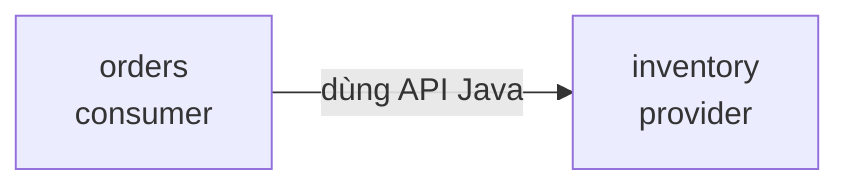
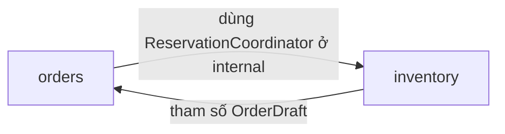
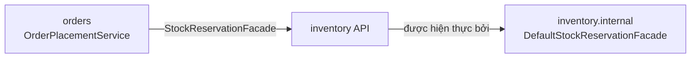
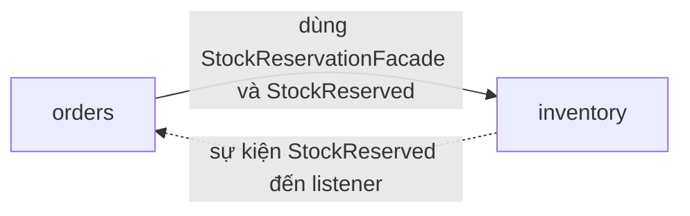
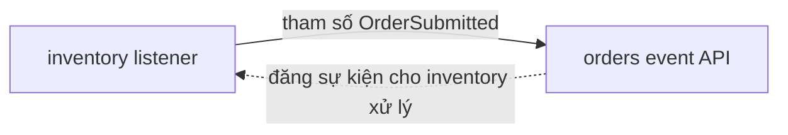

# Cách làm rõ dependency bằng facade hoặc event

Khi xây dựng một ứng dụng Spring Modulith, vấn đề không phải **cấm các module cộng tác**, mà là làm rõ **module nào cần biết hợp đồng của module nào**, vì sao cần biết, và việc đó diễn ra đồng bộ hay thông qua sự kiện. Hai lựa chọn thường gặp là:

- **Facade (API công khai):** module B công bố một giao diện nghiệp vụ ổn định; module A gọi giao diện đó để nhận kết quả trực tiếp. Cạnh phụ thuộc Java **A → B vẫn tồn tại**, nhưng đã rõ ràng, có thể kiểm chứng và không đi vào chi tiết nội bộ B.
- **Event (sự kiện):** module phát thông báo một sự thật nghiệp vụ đã xảy ra, các module quan tâm đăng ký phản ứng. Cách này có thể bỏ một lời gọi trực tiếp, nhưng **chiều phụ thuộc kiểu Java phụ thuộc vào nơi định nghĩa kiểu sự kiện và nơi sử dụng kiểu đó**. Sự kiện không tự động làm mọi module độc lập.

Bài học thuộc chương **Dependency rules** của `SPRING_MODULITH_VERIFICATION_TESTING`. Mục tiêu của học phần là rèn kiểm chứng ranh giới bằng `ApplicationModules` và các quy tắc phụ thuộc, sử dụng `@ApplicationModuleTest`, kiểm thử sự kiện, cơ sở dữ liệu và tích hợp, rồi đưa quality gate vào CI để ngăn phụ thuộc sai và hồi quy. Ở đây, ta so sánh facade và event bằng cùng một bối cảnh đặt hàng–giữ tồn kho, xây dựng ví dụ Java, và kiểm tra được kết quả bằng Spring Modulith.

## 1. Dependency cần “làm rõ” là gì?

Giả sử có hai application module:

- **`orders`** sở hữu quy trình tạo đơn và trạng thái đơn hàng.
- **`inventory`** sở hữu số lượng tồn, đặt giữ hàng và dữ liệu lưu kho.

Trong đồ thị ứng dụng, ký hiệu **`orders → inventory`** nghĩa là Java code ở `orders` tham chiếu đến kiểu/thành viên do `inventory` định nghĩa: field, constructor, tham số, kiểu trả về, `extends`/`implements`, lời gọi phương thức hoặc annotation chứa class literal.



Mũi tên này là **hướng phụ thuộc của mã nguồn**, không nhất thiết là hướng dòng sự kiện hay hướng đối tượng được inject lúc chạy. Nếu `orders` gọi một interface do `inventory` sở hữu, Java cần biết interface đó; đây là phụ thuộc có chủ đích và **không mặc định sai**.

Một quan hệ bắt đầu trở nên khó kiểm soát khi:

1. A dùng class trong `B.internal` thay vì API công khai của B.
2. A và B tham chiếu ngược kiểu của nhau, tạo **dependency cycle**.
3. A lookup tên bean, tên class hoặc resource bằng chuỗi, che giấu quan hệ runtime.
4. Hai module dùng chung entity, repository hoặc schema nội bộ của nhau khiến refactor ảnh hưởng dây chuyền.
5. Người đọc không biết lời gọi là **command/query cần kết quả ngay** hay chỉ là **thông báo sự kiện**.

Facade và event giải quyết các vấn đề **khác nhau**. Không nên chọn chỉ vì code trông ngắn hơn hoặc test `verify()` đang thất bại.

## 2. Ví dụ ban đầu: phụ thuộc hai chiều và rò rỉ nội bộ

Giả sử module `orders` gọi thẳng một implementation trong `inventory.internal`:

```java
// orders/OrderWorkflow.java — ví dụ phản diện
package com.example.shop.orders;

import com.example.shop.inventory.internal.ReservationCoordinator;

public class OrderWorkflow {
    private final ReservationCoordinator reservations;

    public OrderWorkflow(ReservationCoordinator reservations) {
        this.reservations = reservations;
    }

    public void place(OrderDraft order) {
        reservations.reserve(order);
    }
}
```

Và code ở `inventory` lại nhận toàn bộ model đơn hàng:

```java
// inventory/internal/ReservationCoordinator.java — ví dụ phản diện
package com.example.shop.inventory.internal;

import com.example.shop.orders.OrderDraft;

public class ReservationCoordinator {
    public void reserve(OrderDraft order) {
        // Inventory phải hiểu model OrderDraft của orders.
    }
}
```

Giả định `OrderDraft` là một class công khai do `orders` định nghĩa. Hai cạnh xuất hiện:



Đây là **cycle `orders ↔ inventory`**, đồng thời `orders` đang chạm vào package nội bộ của `inventory`. Dù Java vẫn biên dịch nếu class được công khai, việc vượt ranh giới application module vẫn là vấn đề kiến trúc.

**Mục tiêu refactor:** `orders` chỉ biết hợp đồng đặt giữ hàng được `inventory` công bố. `inventory` không cần import `orders.OrderDraft` và có thể đổi repository hay chiến lược giữ hàng mà không đổi hợp đồng bên ngoài.

## 3. Facade: công bố một cổng nghiệp vụ rõ ràng

*Facade* là một bề mặt API mô tả **khả năng nghiệp vụ** của module, thay vì phơi bày cách module xử lý bên trong. Trong bối cảnh này, nó có thể là một interface Spring bean được module B sở hữu và một implementation nằm ở `B.internal`.

Với cấu trúc mặc định:

```text
com.example.shop
├── ShopApplication.java
├── orders
│   ├── OrderPlacementService.java
│   └── package-info.java
└── inventory
    ├── StockReservationFacade.java
    ├── ReservationRequest.java
    ├── ReservationOutcome.java
    ├── StockReserved.java
    └── internal
        ├── DefaultStockReservationFacade.java
        └── StockRepository.java
```

`orders` và `inventory` là hai application module theo cách phát hiện mặc định của Spring Modulith. Với module đóng, các kiểu ở package gốc `inventory` thuộc API mặc định; `inventory.internal` chỉ nên được module `inventory` sử dụng nội bộ, trừ các package được công bố rõ.

### 3.1. Đặt request/response theo ngôn ngữ của module cung cấp

Module `inventory` công bố dữ liệu đầu vào và kết quả **không chứa kiểu domain do `orders` sở hữu**:

```java
// inventory/ReservationRequest.java
package com.example.shop.inventory;

public record ReservationRequest(
        String sku,
        int quantity,
        String externalReference
) {}
```

```java
// inventory/ReservationOutcome.java
package com.example.shop.inventory;

public record ReservationOutcome(
        boolean accepted,
        String reservationId
) {}
```

`externalReference` chỉ là một định danh đối chiếu do bên gọi truyền vào. Nó không buộc `inventory` phải import `orders.OrderDraft`. Trong ứng dụng thật, cần quy định giá trị nào được chấp nhận, tính duy nhất, chính sách retry và vòng đời của mã này.

### 3.2. Công bố facade ở package API

```java
// inventory/StockReservationFacade.java
package com.example.shop.inventory;

public interface StockReservationFacade {
    ReservationOutcome reserve(ReservationRequest request);
}
```

Đây là **hợp đồng đồng bộ**: phía gọi muốn biết ngay liệu yêu cầu đặt giữ hàng có được chấp nhận không. Tên `reserve`, `ReservationRequest` và `ReservationOutcome` diễn tả nhiệm vụ nghiệp vụ tốt hơn việc cho A truy cập `StockRepository` hay `InventoryEntity`.

### 3.3. Giấu implementation trong `inventory.internal`

```java
// inventory/internal/DefaultStockReservationFacade.java
package com.example.shop.inventory.internal;

import com.example.shop.inventory.ReservationOutcome;
import com.example.shop.inventory.ReservationRequest;
import com.example.shop.inventory.StockReservationFacade;
import java.util.UUID;
import org.springframework.stereotype.Service;

@Service
class DefaultStockReservationFacade implements StockReservationFacade {

    @Override
    public ReservationOutcome reserve(ReservationRequest request) {
        if (request.quantity() <= 0 || request.sku().isBlank()) {
            return new ReservationOutcome(false, null);
        }

        // Chỉ minh họa hợp đồng: production phải kiểm tra tồn kho,
        // ghi giữ hàng atomically và xử lý các lần thử lại.
        return new ReservationOutcome(true, UUID.randomUUID().toString());
    }
}
```

`@Service` đăng ký implementation nội bộ thành bean. `orders` không cần biết `DefaultStockReservationFacade`; Spring có thể inject bean đó qua interface `StockReservationFacade`. Class implementation có thể là package-private, vì phía ngoài chỉ sử dụng kiểu API công khai.

**Lưu ý:** mã minh họa chưa phải một thuật toán giữ tồn kho đúng cho production: trả về `accepted = true` chưa chứng minh đã giảm hoặc khóa số lượng trong database. Cần repository, transaction và kiểm thử đồng thời/giữ hàng theo nghiệp vụ thật.

### 3.4. Module `orders` sử dụng facade

```java
// orders/OrderPlacementService.java
package com.example.shop.orders;

import com.example.shop.inventory.ReservationOutcome;
import com.example.shop.inventory.ReservationRequest;
import com.example.shop.inventory.StockReservationFacade;
import org.springframework.stereotype.Service;

@Service
public class OrderPlacementService {
    private final StockReservationFacade inventory;

    public OrderPlacementService(StockReservationFacade inventory) {
        this.inventory = inventory;
    }

    public boolean canStartOrder(
            String orderId, String sku, int quantity) {
        var request = new ReservationRequest(sku, quantity, orderId);
        ReservationOutcome outcome = inventory.reserve(request);
        return outcome.accepted();
    }
}
```

**Sau refactor:**



Đối với đồ thị application module, cả `API` và `IMPL` đều thuộc **cùng module `inventory`**; cạnh xuyên module quan trọng là **`orders → inventory`**. Không còn `inventory → orders` từ hợp đồng ví dụ nên cycle cũ được phá, **nếu thực sự đã loại bỏ mọi tham chiếu ngược khác**.

Facade **không xóa phụ thuộc**: `orders` vẫn phải biên dịch cùng kiểu `StockReservationFacade`, `ReservationRequest` và `ReservationOutcome` của `inventory`. Facade làm cho phụ thuộc **có ý nghĩa, đúng nơi công bố và dễ kiểm chứng**.

## 4. Giới hạn facade bằng `allowedDependencies` và named interface

Nếu `orders` chỉ nên dùng API của `inventory`, có thể khai báo tại package gốc:

```java
// orders/package-info.java
@org.springframework.modulith.ApplicationModule(
    allowedDependencies = "inventory"
)
package com.example.shop.orders;
```

Khi `orders` tham chiếu các kiểu API ở `inventory`, đây là một cạnh **được phép**. Ngược lại, nếu `orders` import `inventory.internal.StockRepository` hoặc một module không nằm trong danh sách cho phép, `ApplicationModules.verify()` có thể phát hiện vi phạm ranh giới trong phạm vi quan hệ Java được phân tích.

`allowedDependencies` là **chính sách cho phép**; bản thân chuỗi `"inventory"` không tạo cạnh mới. Cạnh thực tế do tham chiếu kiểu/bytecode tạo ra.

Với module có nhiều nhóm API, có thể công bố facade trong package riêng bằng named interface:

```java
// inventory/api/package-info.java
@org.springframework.modulith.NamedInterface("reservations")
package com.example.shop.inventory.api;
```

Sau khi **chuyển toàn bộ các kiểu công khai cần dùng** (`StockReservationFacade`, `ReservationRequest`, `ReservationOutcome`) vào `inventory.api` và cập nhật các import tương ứng, module `orders` có thể khai báo:

```java
// orders/package-info.java — biến thể dùng named interface
@org.springframework.modulith.ApplicationModule(
    allowedDependencies = "inventory::reservations"
)
package com.example.shop.orders;
```

Hai đoạn `package-info.java` trên là **phương án thay thế**, không phải cấu hình dùng đồng thời với ví dụ API ở package gốc mà không đổi package. Named interface quy định **bề mặt công bố**, còn `allowedDependencies` quy định **bề mặt bên gọi được sử dụng**. Cả hai đều không tự động phá một cycle nếu implementation còn import model của bên gọi.

## 5. Event: công bố điều đã xảy ra thay vì gọi nơi nhận

Facade thường phù hợp với câu hỏi **“hãy làm việc này và cho tôi biết kết quả ngay”**. Event phù hợp với thông báo **“sự kiện nghiệp vụ này đã xảy ra; module quan tâm hãy phản ứng”**.

Trong Spring, `ApplicationEventPublisher` cho phép module phát một sự kiện mà không biết trước class của các listener:

```java
// inventory/StockReserved.java
package com.example.shop.inventory;

public record StockReserved(
        String reservationId,
        String externalReference,
        String sku,
        int quantity
) {}
```

`StockReserved` do **`inventory` sở hữu**, vì inventory là nơi xác nhận việc giữ hàng. Payload dùng những giá trị cần thiết cho bên nhận; không đưa `inventory.internal.InventoryEntity` vào event.

Trong implementation của `inventory`, sau khi một yêu cầu được xử lý thành công:

```java
// inventory/internal/DefaultStockReservationFacade.java
package com.example.shop.inventory.internal;

import com.example.shop.inventory.ReservationOutcome;
import com.example.shop.inventory.ReservationRequest;
import com.example.shop.inventory.StockReservationFacade;
import com.example.shop.inventory.StockReserved;
import java.util.UUID;
import org.springframework.context.ApplicationEventPublisher;
import org.springframework.stereotype.Service;

@Service
class DefaultStockReservationFacade implements StockReservationFacade {
    private final ApplicationEventPublisher events;

    DefaultStockReservationFacade(ApplicationEventPublisher events) {
        this.events = events;
    }

    @Override
    public ReservationOutcome reserve(ReservationRequest request) {
        if (request.quantity() <= 0 || request.sku().isBlank()) {
            return new ReservationOutcome(false, null);
        }

        // Minh họa: trong production cần ghi nhận reservation thành công
        // đúng transaction trước khi phát sự kiện phù hợp.
        String reservationId = UUID.randomUUID().toString();
        events.publishEvent(new StockReserved(
                reservationId,
                request.externalReference(),
                request.sku(),
                request.quantity()
        ));
        return new ReservationOutcome(true, reservationId);
    }
}
```

Đây là **biến thể có phát sự kiện** thay thế implementation ở phần 3.3, không phải class thứ hai được tạo cùng lúc trong cùng package. Vẫn cần bảo đảm việc phát `StockReserved` chỉ phản ánh **một reservation thực sự đã được xác nhận**; event không phải bằng chứng có transaction khi mã ví dụ chưa cài đặt repository.

Module `orders` có thể lắng nghe thông báo do `inventory` công bố:

```java
// orders/internal/StockReservedListener.java
package com.example.shop.orders.internal;

import com.example.shop.inventory.StockReserved;
import org.springframework.context.event.EventListener;
import org.springframework.stereotype.Component;

@Component
class StockReservedListener {

    @EventListener
    void on(StockReserved event) {
        // Dựa trên externalReference để cập nhật đơn hàng tương ứng.
        // Hành vi thực tế cần repository và kiểm soát idempotency.
    }
}
```

Phân biệt **hai chiều**:



- **Cạnh kiểu Java:** `orders → inventory`, vì `orders` dùng interface/record do `inventory` sở hữu.
- **Luồng sự kiện runtime:** `inventory` phát; listener của `orders` nhận.

Hai mũi tên **không phải hai cạnh Java ngược chiều**. Việc `orders` xử lý một sự kiện do `inventory` định nghĩa không khiến `inventory` phải import class của `orders`. Vì vậy, nếu không có tham chiếu ngược khác, ví dụ này **không tái tạo cycle Java**.

## 6. Một thiết kế event-only có thể đổi chiều phụ thuộc

Giả sử quy trình là “đơn hàng được gửi” rồi tồn kho xử lý sau. `orders` có thể phát event do **`orders` sở hữu** mà không gọi trực tiếp API `inventory`:

```java
// orders/OrderSubmitted.java
package com.example.shop.orders;

public record OrderSubmitted(
        String orderId,
        String sku,
        int quantity
) {}
```

```java
// orders/OrderSubmissionService.java
package com.example.shop.orders;

import org.springframework.context.ApplicationEventPublisher;
import org.springframework.stereotype.Service;

@Service
public class OrderSubmissionService {
    private final ApplicationEventPublisher events;

    public OrderSubmissionService(ApplicationEventPublisher events) {
        this.events = events;
    }

    public void submit(String orderId, String sku, int quantity) {
        // Production: lưu trạng thái SUBMITTED theo transaction nghiệp vụ.
        events.publishEvent(new OrderSubmitted(orderId, sku, quantity));
    }
}
```

`inventory` xử lý sự kiện:

```java
// inventory/internal/OrderSubmittedListener.java
package com.example.shop.inventory.internal;

import com.example.shop.orders.OrderSubmitted;
import org.springframework.context.event.EventListener;
import org.springframework.stereotype.Component;

@Component
class OrderSubmittedListener {

    @EventListener
    void on(OrderSubmitted event) {
        // Yêu cầu giữ tồn kho dựa vào thông tin sự kiện.
        // Cần một cơ chế phản hồi kết quả và xử lý lỗi rõ ràng.
    }
}
```

Ở phương án này, **`inventory → orders`** vì listener có tham số kiểu `orders.OrderSubmitted`. Nếu `orders` **không còn** dùng kiểu nào do `inventory` sở hữu, không có cạnh `orders → inventory` từ các đoạn mã trên.



**Điều kiện bắt buộc:** không đồng thời để `orders` inject `inventory.StockReservationFacade` mà không xem lại đồ thị. Nếu `orders → inventory` được giữ, thêm listener `inventory → orders` có thể tạo **cycle hai module**. Event không xóa một cạnh đã tồn tại ở nơi khác.

**Đánh đổi nghiệp vụ:** khi `submit(...)` trả về, không nhất thiết reservation đã thành công. Đơn có thể cần trạng thái `PENDING_STOCK`, `RESERVED` hoặc `REJECTED`, kèm cơ chế thông báo/đối soát. Nếu người dùng phải biết chắc “có hàng hay không” trước khi xác nhận đơn, giao tiếp đồng bộ qua facade thường phù hợp hơn với đoạn quyết định đó.

## 7. Event không mặc định bất đồng bộ hoặc bền vững

`ApplicationEventPublisher.publishEvent(...)` là API phát application event của Spring. Với listener `@EventListener` thông thường và multicaster mặc định, việc gọi listener có thể diễn ra **đồng bộ**, ngay trong luồng phát. Bởi vậy:

- **Đổi lời gọi trực tiếp sang event chưa chắc làm công việc xảy ra sau**, chưa chắc cải thiện latency, và cũng chưa chắc tách lỗi của listener ra khỏi lời gọi gốc.
- `@TransactionalEventListener` có thể điều chỉnh thời điểm xử lý theo transaction, ví dụ `phase = AFTER_COMMIT`. Khi không có transaction phù hợp, listener dạng này có thể không chạy nếu không cấu hình fallback.
- Spring Modulith cung cấp `@ApplicationModuleListener` cho việc xử lý sự kiện qua ranh giới module theo mẫu bất đồng bộ và transaction-aware; vẫn cần hiểu cấu hình, tính nhất quán và hành vi lỗi theo phiên bản/thành phần đang dùng.
- **Phát event nội bộ không đồng nghĩa có message broker**, không mặc định có bảo đảm giao ít nhất một lần hoặc lưu sự kiện bền vững trên mọi cấu hình.

Ví dụ listener cần xử lý **sau khi transaction của phía phát commit**:

```java
// Biến thể thay thế listener @EventListener khi cần AFTER_COMMIT.
package com.example.shop.orders.internal;

import com.example.shop.inventory.StockReserved;
import org.springframework.stereotype.Component;
import org.springframework.transaction.event.TransactionPhase;
import org.springframework.transaction.event.TransactionalEventListener;

@Component
class CommittedStockReservedListener {

    @TransactionalEventListener(phase = TransactionPhase.AFTER_COMMIT)
    void on(StockReserved event) {
        // Chỉ được gọi khi event được phát trong transaction phù hợp
        // và transaction commit; cần xem cách xử lý lỗi/retry thực tế.
    }
}
```

Đây là **phương án listener thay thế**, không phải đề nghị đăng ký cùng lúc mọi listener ở phần 5 và phần này cho cùng một tác vụ (vì có thể xử lý trùng). Nếu facade không chạy trong transaction, ví dụ `@TransactionalEventListener` này có thể **không nhận sự kiện** theo cấu hình mặc định.

Trong luồng có database, cách thiết kế chính xác cần xác định:

1. **Khi nào trạng thái được ghi và commit?** Không phát thông báo “đã giữ hàng” khi transaction còn có khả năng rollback mà không kiểm soát hậu quả.
2. **Có lưu event publication để xử lý lại?** Spring Modulith có cơ chế Event Publication Registry khi được tích hợp/cấu hình phù hợp, nhưng không nên mặc định đã bật hoặc bảo đảm “exactly once”.
3. **Listener có idempotent không?** Retry hoặc phát lại có thể dẫn tới sự kiện trùng; cần khóa hoặc quy tắc xử lý dựa trên `reservationId`.
4. **Nếu consumer hỏng thì sao?** Cần logging/monitoring, retry, khả năng khôi phục hoặc trạng thái thất bại để nghiệp vụ không mắc kẹt.
5. **Khi nào cần phản hồi người gọi?** Đừng dùng fire-and-forget cho một quyết định cần kết quả ngay.

## 8. Facade và event giải quyết hai trục khác nhau

| Tiêu chí | Facade / API đồng bộ | Event / thông báo nghiệp vụ |
| --- | --- | --- |
| Ý định chính | Yêu cầu B làm việc hoặc trả lời một câu hỏi | Thông báo sự kiện đã xảy ra |
| Bên gọi có cần biết B? | Thường có: A dùng kiểu facade của B | Bên phát không cần biết class listener |
| Hướng phụ thuộc kiểu | A → B khi A dùng interface/DTO của B | Consumer → module sở hữu **kiểu sự kiện** |
| Kết quả ngay | Có thể trả `ReservationOutcome` hoặc ném lỗi | Thường không nhận kết quả xử lý từ consumer trong lời phát |
| Transaction / độ trễ | Cần thiết kế nhất quán của lệnh gọi đồng bộ | Cần xác định listener đồng bộ/bất đồng bộ, after-commit, retry |
| Số bên tham gia | Thích hợp cho một khả năng nghiệp vụ cụ thể | Hợp cho nhiều consumer quan tâm cùng một sự thật |
| Rủi ro điển hình | Facade quá lớn, lộ repository/entity, gọi vòng hai chiều | Quên hướng dependency kiểu event, xử lý trùng, eventual consistency |
| Kiểm thử trọng tâm | API contract, kết quả và DB transaction | Publish/consume, payload, thời điểm xử lý, idempotency |

**Không có một phương án luôn tốt hơn.** Một hệ thống thường cần cả hai: facade cho các kiểm tra bắt buộc trước khi hoàn tất nghiệp vụ, event cho các hậu quả liên quan như gửi email, cập nhật bản chiếu đọc hoặc thông báo sau commit.

## 9. Các sai lầm thường gặp khi “làm rõ” dependency

### 9.1. Gọi mọi service công khai là facade

Một facade tốt nói theo **ngôn ngữ nghiệp vụ** và chỉ công bố những thao tác phù hợp. Nếu `InventoryFacade` có `getRepository()`, `getEntityManager()`, `findAllEntities()` hay trả trực tiếp entity nội bộ, nó chỉ dời đường rò rỉ ra một địa chỉ khác.

Facade nên che giấu chi tiết lưu trữ. Module `inventory` phải giữ quyền thay đổi JPA entity, query và transaction trong nội bộ mà không bắt `orders` sửa theo.

### 9.2. Dùng “facade ở A” để bọc class nội bộ của B

Ví dụ `orders.InventoryHelper` gọi `inventory.internal.StockRepository`. Class helper có thể tập trung code ở một nơi, nhưng **cạnh `orders → inventory.internal` vẫn tồn tại**, và `verify()` vẫn có cơ sở báo vi phạm. Một wrapper ở phía consumer **không tự biến API nội bộ thành hợp lệ**.

Facade cần là **hợp đồng B chủ động công bố** hoặc một adapter dựa trên API được B công bố, chứ không phải lối đi vòng vào implementation của B.

### 9.3. Event mang kiểu nội bộ của module phát

```java
// Không nên: event API lộ kiểu internal của inventory.
public record StockReserved(
        com.example.shop.inventory.internal.InventoryEntity entity
) {}
```

Listener của module khác bắt buộc biết `InventoryEntity`, tạo sự phụ thuộc vào internal model, dễ hỏng khi refactor JPA và có nguy cơ vi phạm boundary. Event cần **payload ổn định, đủ nghĩa nghiệp vụ** như `reservationId`, `sku`, `quantity`, không mang theo toàn bộ aggregate/entity chỉ để tiện dùng.

### 9.4. Biến event thành remote procedure call trá hình

Một nơi phát `ReserveStockRequested` rồi chờ một listener trả giá trị ngay, trong khi không có cơ chế request/reply rõ, thực chất đang cố tái tạo synchronous command trên event bus. Nếu thật sự cần kết quả tức thì, **facade** có thể trực tiếp hơn và dễ quản lý transaction, timeout, lỗi.

### 9.5. Gộp event và API tạo chu trình

Nếu `orders` gọi `inventory.StockReservationFacade`, đồng thời `inventory` lắng nghe `orders.OrderSubmitted`, thì vẫn có thể tồn tại **`orders → inventory → orders`**. Chỉ cần tên “event-driven” trong kiến trúc không đủ để làm vòng biến mất.

### 9.6. Đổi Java import sang reflection hoặc tên bean

`Class.forName("...inventory.internal.StockRepository")` hoặc `context.getBean("inventoryRepository")` có thể che một tham chiếu kiểu khỏi một số kiểm tra tĩnh nhưng vẫn giữ phụ thuộc runtime vào implementation của B. Đó không phải giải pháp ranh giới, chỉ làm việc phát hiện lỗi khó hơn.

## 10. Phương án chọn nhanh theo tình huống

| Tình huống nghiệp vụ | Hướng thiết kế cần cân nhắc | Lý do |
| --- | --- | --- |
| Checkout phải từ chối ngay nếu không giữ được tồn kho | Facade `inventory.StockReservationFacade` | Cần kết quả đồng bộ để quyết định |
| Sau khi giữ hàng, nhiều module cần biết để cập nhật read model hoặc gửi thông báo | `inventory.StockReserved` | Bên phát sở hữu sự kiện; consumer tự phản ứng |
| Đơn được gửi, giữ hàng có thể diễn ra sau trong một tiến trình trạng thái | `orders.OrderSubmitted`, listener phía inventory | Tách quy trình bằng event, chấp nhận trạng thái tạm |
| Hai module import entity/repository nội bộ lẫn nhau | Công bố hợp đồng đúng chủ sở hữu, chuyển DTO ở ranh giới | Phá cycle, không phụ thuộc implementation |
| Cần nhiều triển khai thay thế của cùng một nghiệp vụ | Interface facade có implementation do B quản lý | DI thay implementation mà consumer dùng hợp đồng ổn định |
| Chỉ cần một mã tham chiếu từ đơn hàng trong kho | `externalReference` trong request B | Không bắt B dùng kiểu domain của A |
| Một listener có thể xử lý lại sự kiện | Payload có ID ổn định, idempotent handler | Tránh cập nhật dữ liệu hai lần khi retry |

Khi quyết định, viết rõ cả **hướng đồ thị Java mong muốn** và **điều kiện nhất quán nghiệp vụ**. Một sơ đồ không có cycle nhưng gửi event trước khi commit rồi bỏ mất reservation vẫn là thiết kế không đạt yêu cầu.

## 11. Kiểm chứng kiến trúc bằng `ApplicationModules.verify()`

Sau refactor, tạo một bài test JUnit ở package gốc ứng dụng:

```java
// src/test/java/com/example/shop/ModularityTests.java
package com.example.shop;

import org.junit.jupiter.api.Test;
import org.springframework.modulith.core.ApplicationModules;

class ModularityTests {

    @Test
    void verifiesApplicationModuleStructure() {
        ApplicationModules.of(ShopApplication.class).verify();
    }
}
```

Các quy tắc Spring Modulith có thể xác minh gồm:

1. **Không có dependency cycle** giữa các application module.
2. **Không truy cập phần nội bộ** của module khác nếu phần đó không được công bố như API/named interface.
3. **Tuân thủ `allowedDependencies`** khi module khai báo danh sách các phụ thuộc được phép.

Với ví dụ facade, kỳ vọng `verify()` không còn báo vòng `orders ↔ inventory` **nếu `inventory` đã bỏ mọi tham chiếu ngược** đến kiểu `orders`. Bản thân việc đặt tên interface `StockReservationFacade` không khiến test thành công; **cấu trúc phụ thuộc thực tế** mới quyết định.

Với phương án event-only, listener `inventory` nhận kiểu `orders.OrderSubmitted` dẫn đến **`inventory → orders`**. Nếu `orders` còn import `inventory.StockReservationFacade` ở bất cứ class nào, vòng hai chiều có thể tái xuất hiện. Không được suy luận “event không tạo dependency” để bỏ qua cạnh listener.

Một điểm nữa: `verify()` phân tích những quan hệ kiến trúc được nhận diện từ Java/bytecode. Tên bean, reflection qua chuỗi, SQL, broker topic hay resource có thể tạo coupling runtime không được chứng minh đầy đủ bằng test này. Vì thế, **architecture test cần đi cùng runtime integration test**.

## 12. Kiểm thử facade bằng `@ApplicationModuleTest`

Với `orders` phụ thuộc trực tiếp vào `inventory` qua `StockReservationFacade`, có thể kiểm thử Spring wiring và hành vi đồng bộ:

```java
// src/test/java/com/example/shop/orders/OrdersModuleTests.java
package com.example.shop.orders;

import static org.junit.jupiter.api.Assertions.assertFalse;
import static org.junit.jupiter.api.Assertions.assertTrue;

import org.junit.jupiter.api.Test;
import org.springframework.beans.factory.annotation.Autowired;
import org.springframework.modulith.test.ApplicationModuleTest;

@ApplicationModuleTest(
    mode = ApplicationModuleTest.BootstrapMode.DIRECT_DEPENDENCIES
)
class OrdersModuleTests {

    @Autowired
    OrderPlacementService orders;

    @Test
    void usesInventoryFacadeContract() {
        assertTrue(orders.canStartOrder("ORDER-1", "SKU-001", 2));
        assertFalse(orders.canStartOrder("ORDER-2", "SKU-001", 0));
    }
}
```

Test này minh họa với implementation đơn giản ở phần 3.3. Với ứng dụng thật, assertion phải kiểm tra **tồn kho được ghi giữ thực sự**, số lượng còn lại, thứ tự xử lý và hành vi khi thiếu hàng; không thể xem `accepted = true` giả lập như bằng chứng transaction đúng.

`DIRECT_DEPENDENCIES` đưa các module phụ thuộc trực tiếp theo mô hình Spring Modulith vào phạm vi test. Có thể dùng `STANDALONE` khi module đủ độc lập hoặc mock rõ các phụ thuộc ngoài phạm vi, và `ALL_DEPENDENCIES` cho tình huống cần các phụ thuộc bắc cầu. **Mở rộng test context không giải quyết được một dependency cycle về kiến trúc**.

Trong unit test thông thường, có thể cung cấp một fake implementation của `StockReservationFacade` để kiểm tra logic `OrderPlacementService` mà không khởi động Spring. Unit test có phạm vi nhỏ hơn; `@ApplicationModuleTest` giúp kiểm tra việc tích hợp các bean và cấu hình trong phạm vi module.

## 13. Kiểm thử event: phát, nhận và phản ứng

Kiểm thử event cần xác nhận hai nhóm kết quả khác nhau:

- **Producer test:** khi reservation thành công, `inventory` phát đúng `StockReserved` với ID và dữ liệu đã thống nhất.
- **Consumer test:** khi `orders` nhận `StockReserved`, trạng thái đơn tương ứng chuyển đúng, không áp dụng trùng, xử lý được trường hợp bản ghi không tồn tại hoặc event đến muộn.

Spring Modulith cung cấp hỗ trợ thu thập event đã phát trong module test, ví dụ:

```java
// src/test/java/com/example/shop/inventory/InventoryEventsTests.java
package com.example.shop.inventory;

import static org.assertj.core.api.Assertions.assertThat;

import org.junit.jupiter.api.Test;
import org.springframework.beans.factory.annotation.Autowired;
import org.springframework.modulith.test.ApplicationModuleTest;
import org.springframework.modulith.test.PublishedEvents;

@ApplicationModuleTest
class InventoryEventsTests {

    @Autowired
    StockReservationFacade facade;

    @Test
    void publishesStockReservedOnAcceptedReservation(PublishedEvents events) {
        var result = facade.reserve(
                new ReservationRequest("SKU-001", 2, "ORDER-1"));

        assertThat(result.accepted()).isTrue();
        assertThat(events.ofType(StockReserved.class)).hasSize(1);
    }
}
```

Đây là ví dụ cho phiên bản Spring Modulith Test hỗ trợ inject `PublishedEvents` vào bài test module. Tùy phiên bản và cấu hình thực tế, cần đối chiếu API hỗ trợ kiểm thử event và điều chỉnh test. Nếu test chạy cùng repository, fixture phải làm cho `reserve(...)` thành công; không dựa vào implementation giả lập trong bài học để khẳng định mọi DB path đều được kiểm tra.

**Chỉ assert event đã được publish không chứng minh listener xử lý thành công.** Với consumer, cần một bài test module/integration có khởi tạo listener phù hợp, kích hoạt event và kiểm tra trạng thái bền vững/side effect. Các tiện ích kiểm thử `Scenario` của Spring Modulith có thể giúp điều phối và chờ tác động của event trong các test bất đồng bộ, nhưng vẫn phải xác định rõ trạng thái mong đợi.

Nếu dùng `@TransactionalEventListener(AFTER_COMMIT)` hoặc `@ApplicationModuleListener`, kiểm tra **transaction boundary, timeout, thứ tự sự kiện, retry và idempotency**. Trong test transaction rollback mặc định, một listener sau commit có thể không chạy; phải thiết kế ca test cho điều kiện commit thật thay vì xem kết quả đó là lỗi event bus.

## 14. Kiểm thử cơ sở dữ liệu và tính nhất quán

Facade và event thường đi kèm cập nhật dữ liệu; đây là phần mà `verify()` **không thể chứng minh**. Một số ca kiểm thử nên có cho module `inventory`:

| Trường hợp | Kết quả cần xác nhận |
| --- | --- |
| Hai request đồng thời giữ cùng lượng hàng cuối cùng | Không bán/giữ quá số tồn thực tế |
| Retry cùng một `externalReference` hoặc `reservationId` | Không tạo reservation trùng ngoài chính sách |
| Transaction giữ hàng thất bại/rollback | Không phát thông báo thành công gây hiểu sai |
| Event đã phát nhưng consumer thất bại | Có đường retry/khôi phục/giám sát phù hợp |
| Consumer nhận lại cùng `StockReserved` | Không cập nhật trạng thái đơn hai lần |
| Module thay bảng/column/migration | API facade và các integration test liên quan vẫn đúng |

Khi `orders` và `inventory` dùng chung database, đừng để `orders` trực tiếp viết bảng nội bộ của `inventory` chỉ vì hai module chạy cùng JVM. Ranh giới sở hữu dữ liệu vẫn cần được kiểm soát bằng API, repository riêng, transaction contract và test migration. Đối với ứng dụng dùng message broker ngoài JVM, cần thêm contract test cho schema, routing và delivery phù hợp.

## 15. Quality gate CI để giữ hướng phụ thuộc rõ ràng

Sau khi chọn facade hoặc event và gỡ cycle, hãy đưa test vào luồng PR:

```text
Pull request
    ↓
Compile code + test classes
    ↓
ModularityTests
    └── ApplicationModules.verify()
        ├── Không có cycle?
        ├── Không dùng implementation nội bộ?
        └── Đúng allowedDependencies / named interface?
    ↓
Unit test API facade / logic chuyển trạng thái
    ↓
@ApplicationModuleTest
    ├── Facade wiring + kết quả
    └── Event publication / listener
    ↓
Integration test database, transaction, event delivery
    ↓
Merge khi tất cả gate bắt buộc PASS
```

Hai nguyên tắc quan trọng:

1. Job CI phải **thực sự chạy** `ModularityTests`, không bị `skipTests` hoặc test filter bỏ qua.
2. Khi một developer thêm cạnh `inventory → orders` mới, PR phải thất bại **ngay cả khi unit test của facade và event vẫn xanh**. Ngược lại, nếu event bị phát hai lần, `verify()` có thể PASS nhưng integration test/idempotency test phải phát hiện.

Không dùng việc “đổi lời gọi thành event” làm lý do xóa architecture test. Việc định nghĩa payload trong module nào và nơi nào import kiểu event là một phần của **hợp đồng kiến trúc cần được bảo vệ lâu dài**.

## 16. Quy trình refactor thực tế

Giả sử hiện tại `orders` phụ thuộc `inventory.internal` và `inventory` import `orders.OrderDraft`:

1. **Vẽ đồ thị hiện trạng.** Đánh dấu các cạnh `orders → inventory` và `inventory → orders`, class/phương thức gây mỗi cạnh và các package nội bộ bị truy cập.
2. **Làm rõ yêu cầu nghiệp vụ.** `orders` cần kết quả giữ hàng ngay để chấp nhận đơn, hay chỉ thông báo có đơn để `inventory` xử lý sau?
3. **Chọn một hướng phụ thuộc kiểu mong muốn.** Với facade, hướng `orders → inventory`; với event `orders.OrderSubmitted` do inventory lắng nghe, có thể là `inventory → orders` nếu không còn cạnh ngược.
4. **Thiết kế hợp đồng public nhỏ nhất.** Facade nhận `ReservationRequest` của `inventory`, trả `ReservationOutcome`; event chứa thông tin định danh và giá trị đủ dùng, không chứa entity nội bộ.
5. **Dời implementation vào đúng module.** Giữ repository, entity và transaction trong `inventory.internal`; thay mọi lệnh gọi trực tiếp đến implementation.
6. **Loại toàn bộ tham chiếu Java sai hướng.** Kiểm field, constructor, generic, annotation, static call, listener và model; không chỉ xóa một import.
7. **Chạy `ApplicationModules.verify()`.** Nếu vẫn báo cycle, đọc đường vòng đầy đủ; nếu báo internal API, kiểm lại vị trí hợp đồng/named interface.
8. **Thực hiện test đúng kiểu tương tác.** Với facade, test kết quả và transaction đồng bộ; với event, test publication, consumer, retry và tình huống xử lý trễ.
9. **Bật quality gate CI** và bảo vệ các ranh giới mới bằng `allowedDependencies` theo thiết kế thực tế.

Không nhất thiết chuyển toàn hệ thống sang event hoặc facade trong một lần. Cách an toàn là chọn một luồng nghiệp vụ có thể quan sát, định nghĩa hợp đồng, thay điểm kết nối và kiểm tra regression trước khi refactor tiếp.

## 17. Bài tập áp dụng

### Bài 1 — Facade có làm biến mất cạnh không?

`orders.OrderService` đổi từ việc inject `inventory.internal.StockRepository` sang `inventory.StockReservationFacade`.

**Hỏi:** Cạnh `orders → inventory` còn không? Có tiến bộ gì?

**Đáp án:** **Còn.** `orders` vẫn dùng kiểu `StockReservationFacade` do `inventory` sở hữu. Tiến bộ là A không dùng repository nội bộ của B, hợp đồng có ý nghĩa nghiệp vụ và được Spring Modulith kiểm chứng theo API/`allowedDependencies`.

### Bài 2 — Event nào tạo cạnh Java ngược?

`orders` phát `orders.OrderSubmitted` bằng `ApplicationEventPublisher`. `inventory` có listener tham số `orders.OrderSubmitted`.

**Hỏi:** Chiều phụ thuộc kiểu giữa các module từ listener là gì?

**Đáp án:** **`inventory → orders`**. Event chạy từ publisher ở `orders` tới listener `inventory`, nhưng **kiểu tham số** do `orders` sở hữu và được `inventory` import.

### Bài 3 — Event đi cùng facade có tạo cycle?

`orders` gọi `inventory.StockReservationFacade`. `inventory` phát `inventory.StockReserved`, `orders` lắng nghe `inventory.StockReserved`. Không có class nào của `inventory` import kiểu `orders`.

**Hỏi:** Có vòng phụ thuộc kiểu `orders ↔ inventory` do các quan hệ này không?

**Đáp án:** **Không.** Các tham chiếu Java xuyên module được nêu đều theo chiều **`orders → inventory`**. Event runtime từ inventory về orders không tự tạo cạnh Java `inventory → orders`.

### Bài 4 — Hai phương án khác nhau về thời điểm hoàn tất

Trang checkout phải báo ngay “không còn hàng” trước khi xác nhận thanh toán. Một đồng nghiệp đề xuất chỉ phát `OrderSubmitted` rồi chờ inventory xử lý sau.

**Hỏi:** Cần kiểm tra điều gì trước khi đồng ý?

**Đáp án:** Xác định yêu cầu **kết quả đồng bộ, transaction, timeout và trạng thái đơn**. Nếu bắt buộc xác nhận giữ hàng ngay, facade đồng bộ thường trực tiếp và dễ kiểm soát hơn. Event-only đòi trạng thái pending và luồng xử lý từ chối/khôi phục; không nên thay đổi ngữ nghĩa nghiệp vụ chỉ để phá cycle.

### Bài 5 — Tên event có làm biến mất phụ thuộc nội bộ?

`inventory` phát record `StockReserved(InventoryEntity entity)`, trong đó `InventoryEntity` thuộc `inventory.internal`; listener ở `orders` nhận record đó.

**Hỏi:** Ranh giới đã tốt chưa?

**Đáp án:** **Chưa.** Event công khai đang mang kiểu nội bộ của B, làm phía nhận phải biết model lưu trữ. Nên dùng payload nghiệp vụ ổn định như `reservationId`, `sku`, `quantity` và không lộ entity.

### Bài 6 — Kiến trúc PASS nhưng xử lý sai?

`ApplicationModules.verify()` PASS sau khi refactor. Tuy nhiên, listener cập nhật đơn hai lần khi cùng `StockReserved` được gửi lại.

**Hỏi:** Vì sao `verify()` không ngăn được và cần test gì?

**Đáp án:** `verify()` kiểm chứng ranh giới **cấu trúc**, không xác nhận tính idempotent của logic runtime. Cần integration test phát/nhận sự kiện lặp, assertion trạng thái DB, và cơ chế chống xử lý trùng dựa trên định danh sự kiện/reservation.

## 18. Tổng kết

**Facade làm rõ phụ thuộc đồng bộ:** module B sở hữu interface và DTO công khai, A gọi theo một chiều đã được thiết kế; việc bỏ truy cập `B.internal` không xóa cạnh `A → B` mà làm cạnh **đúng, ổn định và kiểm chứng được**.

**Event làm rõ sự phối hợp dựa trên sự thật nghiệp vụ:** bên phát không cần gọi trực tiếp từng consumer, nhưng listener sử dụng kiểu event của module phát vẫn tạo một cạnh Java **consumer → module sở hữu event**. Chọn nơi sở hữu event và kiểm tra những cạnh còn lại để tránh một cycle mới. Event cũng yêu cầu thiết kế kỹ transaction, giao nhận, retry và idempotency.

Để bảo vệ các quyết định này trong Spring Modulith, kết hợp **`ApplicationModules.verify()`** cho ranh giới và chu trình, **`@ApplicationModuleTest`** cho bean wiring và hành vi phạm vi module, **integration test** cho sự kiện/cơ sở dữ liệu và **quality gate CI** để phát hiện hồi quy trước khi merge.

## Tài liệu tham khảo

- [Spring Modulith — Fundamentals: Application Modules, APIs, Named Interfaces và Allowed Dependencies](https://docs.spring.io/spring-modulith/reference/fundamentals.html)
- [Spring Modulith — Verifying Application Module Structure](https://docs.spring.io/spring-modulith/reference/verification.html)
- [Spring Modulith — Integration Testing Application Modules](https://docs.spring.io/spring-modulith/reference/testing.html)
- [Spring Modulith — Working with Application Events](https://docs.spring.io/spring-modulith/reference/events.html)
- [Spring Framework — Application Events](https://docs.spring.io/spring-framework/reference/core/beans/context-introduction.html)
- [Spring Framework — Transaction-bound Events](https://docs.spring.io/spring-framework/reference/data-access/transaction/event.html)
- [ArchUnit User Guide — Dependencies and Architecture Rules](https://www.archunit.org/userguide/html/000_Index.html)
