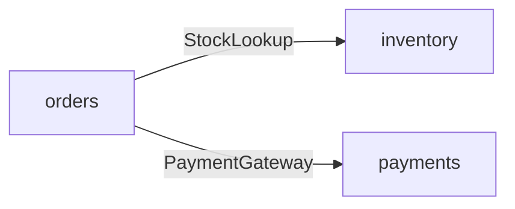
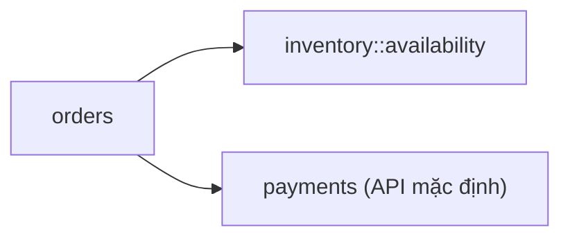
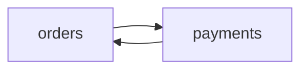

# Ghi nhận dependency được phép ở mô hình module

Trong Spring Modulith, việc module A sử dụng API của module B **không mặc định là một vi phạm**. Một ứng dụng bán hàng có thể cần cho `orders` sử dụng `inventory` để kiểm tra tồn kho và `payments` để thanh toán. Vấn đề cần giải quyết là: **làm thế nào ghi lại rõ ràng những hướng phụ thuộc được thiết kế cho phép**, và khiến một tham chiếu mới, không nằm trong thiết kế, bị phát hiện khi kiểm chứng kiến trúc?

Spring Modulith cung cấp `@ApplicationModule(allowedDependencies = ...)` để giới hạn **những application module hoặc named interface mà một module được phép phụ thuộc**. Khi kết hợp với `ApplicationModules.verify()`, chính sách này trở thành một **quy tắc có thể kiểm tra tự động**, thay vì chỉ tồn tại trên sơ đồ hoặc tài liệu thiết kế.

Bài học thuộc chương **Dependency rules** của học phần `SPRING_MODULITH_VERIFICATION_TESTING`. Học phần hướng đến việc kiểm chứng ranh giới kiến trúc bằng `ApplicationModules` và quy tắc phụ thuộc, thực hành `@ApplicationModuleTest`, kiểm thử sự kiện, cơ sở dữ liệu và tích hợp, kết hợp quality gate trong CI để ngăn phụ thuộc sai và hồi quy. Bài này tập trung vào **cách ghi nhận dependency được phép trong mô hình module**: cú pháp, ý nghĩa, phạm vi giới hạn, cách kiểm chứng và quy trình bảo trì khi yêu cầu nghiệp vụ thay đổi.

## 1. Hai tập quan hệ khác nhau: thực tế và được phép

Giả sử có ba application module:

- `orders`: tiếp nhận và xử lý đơn.
- `inventory`: kiểm tra và quản lý tồn kho.
- `payments`: xác thực và ghi nhận thanh toán.

Trong mã Java, `orders.OrderCheckoutService` có thể dùng `inventory.StockLookup` và `payments.PaymentGateway`. Khi đó, đồ thị **phụ thuộc thực tế** có hai cạnh:



Ta cần thêm một khái niệm khác: **chính sách dependency được phép**. Ví dụ, nhóm kiến trúc quyết định rằng `orders` chỉ được dùng API công khai từ `inventory` và `payments`, không được gọi trực tiếp `notifications` hay `shipping`.

```text
Phụ thuộc thực tế (observed):
  orders -> inventory
  orders -> payments

Phụ thuộc được phép (allowed):
  orders -> inventory
  orders -> payments

Không được phép thêm:
  orders -> notifications
  orders -> shipping
```

Điểm cốt lõi:

1. **Cạnh thực tế** xuất hiện khi mã trong A tham chiếu kiểu hoặc thành viên do B sở hữu.
2. **Cạnh được phép** là ranh giới được khai báo bởi chính sách kiến trúc.
3. Một cạnh có trong danh sách cho phép **chưa chắc đã tồn tại trong mã**.
4. Một cạnh có trong mã nhưng **ngoài danh sách cho phép** là vi phạm quy tắc đã đặt.

Về tư duy tập hợp, ta muốn **tập cạnh thực tế do A tạo ra nằm trong tập đích mà A được phép dùng**, đồng thời tất cả các cạnh còn phải đáp ứng quy tắc API và không có chu trình.

**Lưu ý về phạm vi:** Đây là các quan hệ **giữa application module được mô hình Spring Modulith nhận diện**. `java.util.List`, `java.math.BigDecimal` hoặc annotation của Spring Framework không phải những application module nghiệp vụ của ứng dụng chỉ vì Java code dùng chúng.

## 2. Cấu trúc application module trong ví dụ

Xét một ứng dụng Spring Boot:

```text
com.example.shop
├── ShopApplication.java
├── orders
│   ├── package-info.java
│   ├── OrderCheckoutService.java
│   └── internal
│       └── OrderRepository.java
├── inventory
│   ├── availability
│   │   ├── package-info.java
│   │   └── StockLookup.java
│   └── internal
│       ├── DefaultStockLookup.java
│       └── InventoryRepository.java
├── payments
│   ├── PaymentGateway.java
│   ├── PaymentResult.java
│   └── internal
│       └── DefaultPaymentGateway.java
└── notifications
    ├── NotificationPublisher.java
    └── internal
        └── EmailNotificationPublisher.java
```

Với quy ước phát hiện mặc định, `orders`, `inventory`, `payments` và `notifications` là bốn application module con trực tiếp dưới package ứng dụng.

Trong module đóng thông thường:

- Kiểu ở **package gốc** của module, như `payments.PaymentGateway`, thuộc API mặc định.
- Kiểu ở **package con**, như `inventory.internal.InventoryRepository`, không mặc nhiên trở thành API cho module khác.
- Package con có thể được **công bố qua named interface**, ví dụ `inventory.availability`.

Ví dụ class ứng dụng:

```java
// com/example/shop/ShopApplication.java
package com.example.shop;

import org.springframework.boot.SpringApplication;
import org.springframework.boot.autoconfigure.SpringBootApplication;

@SpringBootApplication
public class ShopApplication {
    public static void main(String[] args) {
        SpringApplication.run(ShopApplication.class, args);
    }
}
```

Những ví dụ dưới đây đặt trọng tâm vào **hợp đồng kiến trúc**, nên các implementation dùng dữ liệu giả lập để minh họa. Khi xây dựng sản phẩm thật, phần inventory/payment cần repository, transaction, idempotency và kiểm thử tích hợp phù hợp.

## 3. Ghi nhận dependency được phép bằng `@ApplicationModule`

`@ApplicationModule` có thể được đặt trong `package-info.java` ở package gốc của module. Với `orders`:

```java
// com/example/shop/orders/package-info.java
@org.springframework.modulith.ApplicationModule(
    allowedDependencies = { "inventory::availability", "payments" }
)
package com.example.shop.orders;
```

Khai báo này có hai phần:

| Giá trị | Ý nghĩa |
| --- | --- |
| `"inventory::availability"` | `orders` được phép phụ thuộc phần **named interface `availability`** đã được công bố của `inventory` |
| `"payments"` | `orders` được phép phụ thuộc API mặc định được công bố của application module `payments` |

Đây là **danh sách những dependency được phép** đối với `orders`, không phải danh sách bean sẽ được Spring inject hay thứ tự khởi tạo module.

Chuỗi định danh trong `allowedDependencies` phải khớp **tên application module/named interface trong mô hình Spring Modulith**. Không dùng tên package Java đầy đủ như `com.example.shop.inventory` hoặc đường dẫn file tùy ý để thay cho định danh module nếu mô hình đang đặt tên module là `inventory`.

**Chú ý:** nếu không khai báo danh sách hạn chế, Spring Modulith vẫn có thể kiểm tra chu trình và vi phạm API module; điều đó không đồng nghĩa **mặc định không cho phép một phụ thuộc nào**. `allowedDependencies` là cách thêm một hạn chế tường minh, cần phân biệt với trạng thái không thiết lập whitelist. Muốn áp một quy tắc “module không được phụ thuộc module nào khác” thật chặt, hãy kiểm tra chính sách cụ thể hoặc bổ sung quy tắc ArchUnit phù hợp, không suy từ một mảng mặc định rỗng rằng mọi dependency đã bị cấm.

## 4. Công bố named interface trước khi cho phép sử dụng

Khai báo `"inventory::availability"` chỉ có ý nghĩa nếu module `inventory` thực sự công bố named interface mang tên `availability`.

Tạo `package-info.java`:

```java
// com/example/shop/inventory/availability/package-info.java
@org.springframework.modulith.NamedInterface("availability")
package com.example.shop.inventory.availability;
```

Và đưa hợp đồng công khai vào cùng package:

```java
// com/example/shop/inventory/availability/StockLookup.java
package com.example.shop.inventory.availability;

public interface StockLookup {
    boolean available(String sku, int quantity);
}
```

Implementation nằm ở nội bộ của `inventory`:

```java
// com/example/shop/inventory/internal/DefaultStockLookup.java
package com.example.shop.inventory.internal;

import com.example.shop.inventory.availability.StockLookup;
import org.springframework.stereotype.Component;

@Component
class DefaultStockLookup implements StockLookup {

    @Override
    public boolean available(String sku, int quantity) {
        // Ví dụ đơn giản, không đại diện cho logic tồn kho production.
        return "SKU-001".equals(sku) && quantity > 0 && quantity <= 10;
    }
}
```

Kiểu `StockLookup` thuộc **`inventory::availability`**, được module `inventory` công bố cho bên ngoài. Trong khi đó `DefaultStockLookup` là chi tiết cài đặt và không cần xuất hiện trong code `orders`.

**Phân biệt quan trọng:**

- **Java interface** là `interface StockLookup`, một kiểu Java dùng để gọi phương thức hoặc inject bean.
- **Named interface của Spring Modulith** là **một nhóm kiểu được công bố** ở ranh giới module, được đánh dấu bằng `@NamedInterface("availability")`.

Chúng đều có chữ *interface* nhưng **không phải một khái niệm**. Một named interface có thể chứa nhiều class, record, enum hoặc Java interface; còn `StockLookup` chỉ là một kiểu nằm trong named interface đó.

## 5. API mặc định của một module khác: `payments`

Module `payments` cung cấp các kiểu ở package gốc:

```java
// com/example/shop/payments/PaymentResult.java
package com.example.shop.payments;

public record PaymentResult(boolean authorized, String reference) {}
```

```java
// com/example/shop/payments/PaymentGateway.java
package com.example.shop.payments;

import java.math.BigDecimal;

public interface PaymentGateway {
    PaymentResult authorize(String orderId, BigDecimal amount);
}
```

Và implementation nội bộ:

```java
// com/example/shop/payments/internal/DefaultPaymentGateway.java
package com.example.shop.payments.internal;

import com.example.shop.payments.PaymentGateway;
import com.example.shop.payments.PaymentResult;
import java.math.BigDecimal;
import org.springframework.stereotype.Component;

@Component
class DefaultPaymentGateway implements PaymentGateway {

    @Override
    public PaymentResult authorize(String orderId, BigDecimal amount) {
        boolean authorized = amount.signum() > 0;
        return new PaymentResult(authorized,
                authorized ? "PAY-" + orderId : null);
    }
}
```

`orders` được phép dùng API mặc định của `payments` bởi chính sách `allowedDependencies = { "inventory::availability", "payments" }` đã khai báo. Tuy nhiên, **quyền sử dụng API không cho phép truy cập mọi package nội bộ của `payments`**.

Với module đóng, `payments.internal.DefaultPaymentGateway` vẫn thuộc chi tiết implementation; chính sách `"payments"` không có nghĩa “tự do import mọi class Java của payments”.

## 6. Đối chiếu phụ thuộc thực tế với chính sách

Module `orders` có service:

```java
// com/example/shop/orders/OrderCheckoutService.java
package com.example.shop.orders;

import com.example.shop.inventory.availability.StockLookup;
import com.example.shop.payments.PaymentGateway;
import java.math.BigDecimal;
import org.springframework.stereotype.Service;

@Service
public class OrderCheckoutService {

    private final StockLookup stockLookup;
    private final PaymentGateway payments;

    public OrderCheckoutService(
            StockLookup stockLookup, PaymentGateway payments) {
        this.stockLookup = stockLookup;
        this.payments = payments;
    }

    public boolean checkout(
            String orderId, String sku, int quantity, BigDecimal amount) {

        if (orderId == null || orderId.isBlank()
                || quantity <= 0 || amount == null || amount.signum() <= 0) {
            return false;
        }
        if (!stockLookup.available(sku, quantity)) {
            return false;
        }
        return payments.authorize(orderId, amount).authorized();
    }
}
```

Từ constructor và các lời gọi, mô hình có hai cạnh:



Từng cạnh có thể được xem xét:

1. `orders → inventory::availability`: **phù hợp** danh sách được phép và bề mặt API công bố.
2. `orders → payments`: **phù hợp** danh sách được phép, với `PaymentGateway` là API mặc định.
3. Không có tham chiếu `orders → notifications` từ class ví dụ này.

**Quan trọng:** trong bài minh họa, `checkout()` gọi hai hệ thống theo thứ tự, nhưng code này chưa đảm bảo một giao dịch nghiệp vụ phân tán an toàn. Nếu payment thành công nhưng bước ghi đơn thất bại, ứng dụng thật cần cơ chế bù trừ, idempotency hoặc chiến lược nhất quán phù hợp. Chính sách phụ thuộc kiến trúc **không thay thế** kiểm thử transaction nghiệp vụ.

## 7. Ba kiểu vi phạm phổ biến dù mã Java vẫn có thể biên dịch

### 7.1. Dùng module không có trong danh sách được phép

Giả sử `orders` bắt đầu import:

```java
// Mã phản diện trong orders:
import com.example.shop.notifications.NotificationPublisher;

class CheckoutNotifier {
    private NotificationPublisher publisher;
}
```

Đây là cạnh **`orders → notifications`**, nhưng chính sách `orders` chỉ liệt kê `inventory::availability` và `payments`. Vì vậy nó **vi phạm `allowedDependencies`**.

Không nên “chữa” bằng cách thêm `"notifications"` vào danh sách chỉ để test xanh. Cần hỏi `orders` có thật sự phải chủ động gọi notification không, hay việc gửi thông báo có thể do module nhận sự kiện thực hiện.

### 7.2. Gọi phần nội bộ của module đã được phép

Ví dụ:

```java
// Mã phản diện trong orders:
import com.example.shop.payments.internal.DefaultPaymentGateway;
```

Module `payments` có trong danh sách cho phép, nhưng `DefaultPaymentGateway` thuộc `payments.internal`, **không phải API mặc định được công bố**. Với module đóng thông thường, đây là vi phạm ranh giới, dù class có modifier Java `public` (ở ví dụ này class còn package-private và Java compiler đã chặn import ngoài package).

Để minh họa trường hợp **Java compiler cho qua nhưng kiến trúc không cho phép**, giả sử `payments.internal.PaymentDebugTools` được khai báo `public`. `orders` vẫn không nên tham chiếu nó chỉ vì tên module `payments` nằm trong `allowedDependencies`.

### 7.3. Dùng package con khác với named interface đã cho phép

Giả sử `inventory` công bố thêm named interface `reporting`, chứa `inventory.reporting.StockReportReader`. `orders` có:

```java
// Mã phản diện trong orders:
import com.example.shop.inventory.reporting.StockReportReader;
```

Nếu `orders` chỉ được phép `inventory::availability` thì **không được dùng `inventory::reporting`**. Việc cả hai package cùng thuộc application module `inventory` không tự mở rộng whitelist.

Muốn có thêm quyền, phải đánh giá yêu cầu và cập nhật chính sách kiến trúc **có chủ đích**; không tự động đổi thành `allowedDependencies = "inventory"` khi chưa kiểm tra tác động đến bề mặt API.

### Bảng kiểm nhanh

| Tham chiếu trong `orders` | Chính sách của ví dụ | Kết luận |
| --- | --- | --- |
| `inventory.availability.StockLookup` | `inventory::availability` | Được phép |
| `payments.PaymentGateway` | `payments` | Được phép |
| `payments.internal.PaymentDebugTools` | `payments` nhưng kiểu nội bộ | Vi phạm API module đóng |
| `inventory.reporting.StockReportReader` | Chỉ `inventory::availability` | Vi phạm named interface/whitelist |
| `notifications.NotificationPublisher` | Không liệt kê `notifications` | Vi phạm danh sách cho phép |
| `java.util.UUID` hoặc `BigDecimal` | Không phải application module của ứng dụng | Không tạo cạnh giữa các application module nghiệp vụ |

## 8. Phụ thuộc được phép vẫn phải không tạo cycle

Giả sử nhóm phát triển cho phép:

```text
orders -> payments
payments -> orders
```

Ngay cả khi cả hai module đều khai báo module đối diện trong `allowedDependencies`, **vòng phụ thuộc `orders ↔ payments` vẫn tồn tại**.



Spring Modulith kiểm tra **không có chu trình** giữa application module như một quy tắc kiến trúc riêng. `allowedDependencies` chỉ giới hạn **cạnh nào được phép**, không hợp thức hóa mọi hình dạng đồ thị.

Ví dụ `payments` nhận một kiểu event do `orders` sở hữu:

```java
// com/example/shop/orders/OrderSubmitted.java
package com.example.shop.orders;

public record OrderSubmitted(String orderId) {}
```

```java
// com/example/shop/payments/internal/OrderSubmittedListener.java
package com.example.shop.payments.internal;

import com.example.shop.orders.OrderSubmitted;
import org.springframework.context.event.EventListener;
import org.springframework.stereotype.Component;

@Component
class OrderSubmittedListener {

    @EventListener
    void on(OrderSubmitted event) {
        // Minh họa một listener, chưa có xử lý thanh toán thật.
    }
}
```

Listener tạo **`payments → orders`** vì tham số `OrderSubmitted` là kiểu của `orders`. Trong khi đó `OrderCheckoutService` vẫn dùng `payments.PaymentGateway`, nên **`orders → payments`** vẫn tồn tại. Đây là cycle.

**Sự kiện không tự loại bỏ phụ thuộc kiểu Java.** Nếu muốn tổ chức event-driven, phải chọn nơi sở hữu event và hướng tham chiếu sao cho không còn vòng, thay vì chỉ đổi lời gọi đồng bộ thành `@EventListener`.

## 9. Ghi nhận policy không đồng nghĩa tạo Spring bean dependency

Khai báo:

```java
@org.springframework.modulith.ApplicationModule(
    allowedDependencies = { "inventory::availability", "payments" }
)
package com.example.shop.orders;
```

chỉ mô tả **quy tắc kiến trúc**, không có nghĩa:

- Spring tự inject `StockLookup` hoặc `PaymentGateway` vào mọi class trong `orders`.
- Spring tự đăng ký bean của `inventory`/`payments` chỉ vì hai tên được liệt kê.
- Các module được bootstrap đúng thứ tự trên cơ sở chuỗi chính sách.
- Spring Modulith tự kiểm thử SQL, REST, broker hay dữ liệu thuộc module khác chỉ từ khai báo này.
- Mọi module được liệt kê chắc chắn đã được code sử dụng.

Trong ví dụ, chính `OrderCheckoutService` có field/constructor kiểu `StockLookup` và `PaymentGateway` mới tạo các cạnh Java thực tế. Spring DI tìm bean phù hợp khi xây dựng context; đó là một cơ chế runtime khác với **phép kiểm chứng đồ thị module**.

### Đọc từ mô hình thay vì suy từ tên package

Trong bài kiểm chứng, `ApplicationModules.of(ShopApplication.class)` xây dựng mô hình các application module được phát hiện. Khi dự án tùy chỉnh cách xác định module hoặc tên module, cần dùng **đúng tên mà mô hình nhận diện** để khai báo `allowedDependencies`. Không tự suy rằng mọi thư mục bất kỳ, subpackage hoặc Maven module đều là application module Spring Modulith.

Đối với module có nhiều bề mặt API, hãy chủ động xác định đâu là **API mặc định**, đâu là **named interface**, và phần nào luôn nội bộ. Đây là bước thiết kế trước khi viết whitelist.

## 10. Kiểm chứng chính sách bằng `ApplicationModules.verify()`

Một test JUnit nhỏ có thể biến chính sách trên thành điều kiện bắt buộc trong dự án:

```java
// src/test/java/com/example/shop/ModularityTests.java
package com.example.shop;

import org.junit.jupiter.api.Test;
import org.springframework.modulith.core.ApplicationModules;

class ModularityTests {

    @Test
    void verifiesDeclaredModuleDependencies() {
        ApplicationModules.of(ShopApplication.class).verify();
    }
}
```

Theo các quy tắc được áp dụng, `verify()` kiểm tra:

1. **Không có vòng phụ thuộc** giữa các application module.
2. **Không truy cập phần nội bộ** của module khác ngoài API được công bố.
3. **Không tham chiếu application module/named interface nằm ngoài danh sách `allowedDependencies`** khi danh sách đó được giới hạn.

Ở trạng thái ví dụ hợp lệ, `orders` chỉ dùng `StockLookup` thuộc `inventory::availability` và `PaymentGateway` thuộc `payments`, nên các cạnh này **phù hợp với chính sách**. Nếu developer thêm `notifications.NotificationPublisher` vào `orders`, test kiến trúc được kỳ vọng báo vi phạm whitelist, với điều kiện module/cạnh được nhận diện và không có cấu hình ngoại lệ làm thay đổi quy tắc.

**`verify()` không cần khởi động toàn bộ Spring application context** chỉ để phân tích ranh giới; nó hoạt động trên mô hình cấu trúc ứng dụng. Một context khởi động thành công không tự chứng minh whitelist hợp lệ. Tương tự, test architecture PASS không có nghĩa nghiệp vụ thanh toán, transaction và dữ liệu tồn kho đều chính xác.

## 11. Quan sát chính sách và kết quả kiểm chứng theo từng tình huống

Giả sử trước đó `orders` có:

```java
@org.springframework.modulith.ApplicationModule(
    allowedDependencies = { "inventory::availability", "payments" }
)
package com.example.shop.orders;
```

Một loạt thay đổi có thể dẫn đến:

| Thay đổi | Kỳ vọng về kiến trúc |
| --- | --- |
| `orders` thêm gọi `inventory.availability.StockLookup.available(...)` | Được phép vì đúng named interface |
| `orders` xóa hết phần dùng `payments` nhưng vẫn giữ `"payments"` trong whitelist | Không tự tạo cạnh; chính sách cho phép có thể rộng hơn mức đang dùng |
| `orders` thêm `shipping.ShippingCalculator` ở application module khác | Vi phạm `allowedDependencies` vì `shipping` không có trong whitelist |
| `orders` dùng `inventory.internal.InventoryRepository` | Vi phạm ranh giới API nội bộ dù `inventory` được cho phép một phần |
| `payments` bắt đầu dùng `orders.OrderSubmitted` | Có nguy cơ tạo cycle vì `orders` vẫn phụ thuộc `payments` |
| `orders` chỉ lưu `String topic = "notifications.send"` | Không suy ra cạnh kiểu Java `orders → notifications` chỉ từ chuỗi |

Nhìn bảng, có thể thấy **cho phép ≠ đã sử dụng** và **được phép ở cấp tên module ≠ được dùng mọi implementation nội bộ**.

Nếu tổ chức muốn policy bám sát mức sử dụng hiện tại, nên review những whitelist entry không còn consumer nào. Tuy nhiên, một quyền được giữ có chủ đích cho extension sắp triển khai vẫn là quyết định kiến trúc hợp lệ; `verify()` không có nhiệm vụ mặc định buộc mỗi mục trong `allowedDependencies` phải có một cạnh thực tế.

## 12. Cập nhật chính sách khi phát triển tính năng mới

Ví dụ yêu cầu mới: sau checkout thành công, `orders` cần biết chi phí giao hàng từ module `shipping`. Có ba hướng phân tích:

### Phương án A: thêm dependency được phép

Nếu nghiệp vụ thực sự cần kết quả đồng bộ:

```java
// com/example/shop/orders/package-info.java
@org.springframework.modulith.ApplicationModule(
    allowedDependencies = {
        "inventory::availability",
        "payments",
        "shipping"
    }
)
package com.example.shop.orders;
```

Trước khi cập nhật, cần xác nhận `shipping` công bố API phù hợp, không có cạnh ngược gây cycle và bài test module/integration xác nhận nghiệp vụ.

### Phương án B: giới hạn một named interface của shipping

Nếu `shipping` có nhiều API, chỉ một phần cần được mở cho `orders`. `shipping` có thể đặt hợp đồng trong `shipping.quotes` và công bố `@NamedInterface("quotes")`. Khi đó, policy có thể dùng `"shipping::quotes"` thay vì `"shipping"`.

Điều kiện là cả `@NamedInterface` và kiểu cần dùng đều ở đúng package; chỉ sửa chuỗi trong `allowedDependencies` mà không công bố API tương ứng là chưa đủ.

### Phương án C: không thêm cạnh Java, dùng hợp đồng sự kiện phù hợp

Nếu `orders` chỉ cần thông báo “đơn đã xác nhận” để `shipping` tự tạo tác vụ giao hàng, có thể dùng event `orders.OrderConfirmed` và listener ở `shipping`. Nhưng khi `shipping` import kiểu event của `orders`, hướng dependency Java trở thành **`shipping → orders`**, không phải không có cạnh.

Cần chọn theo **yêu cầu giao tiếp**: có cần kết quả ngay, transaction nào làm chủ, xử lý lỗi và retry ra sao. Không chọn event chỉ để tránh thêm một tên vào whitelist.

### Quy trình đánh giá thay đổi policy

1. Xác định **nhu cầu nghiệp vụ thật** và module sở hữu khả năng được dùng.
2. Xác định **hướng phụ thuộc mong muốn**, kể cả các cạnh hiện có có thể tạo chu trình.
3. Xác định **API nhỏ nhất**: package gốc hay named interface cần công bố.
4. Cập nhật `allowedDependencies` với tên module/named interface chính xác.
5. Thêm hoặc sửa mã gọi **chỉ dùng API công khai**, không dùng internal entity/repository.
6. Chạy `ApplicationModules.verify()`, module test và integration test cần thiết.
7. Review policy như **thay đổi kiến trúc**, không coi là một thao tác “sửa test”.

## 13. Ghi nhận phụ thuộc từ event, database và cấu hình

`allowedDependencies` là cơ chế kiểm soát **phụ thuộc kiến trúc giữa application module được nhận diện**. Trong một ứng dụng Spring Modulith, các quan hệ khác cũng cần được ghi nhận nhưng **không nhất thiết hiện diện dưới dạng cạnh kiểu Java**:

| Cơ chế | Ví dụ | Có thể tạo cạnh Java? | Cần kiểm chứng thêm |
| --- | --- | --- | --- |
| Constructor injection của interface B | `private final PaymentGateway gateway;` | Có, vì kiểu B | Module boundary và Spring wiring |
| Event listener nhận kiểu event của B | `void on(PaymentAuthorized event)` | Có, nếu kiểu thuộc B | Payload, thời điểm event, retry |
| Chỉ lưu ID | `String paymentId` | Không suy ra từ riêng giá trị | Tính hợp lệ, vòng đời ID |
| SQL chuỗi | `"select ... from inventory_stock"` | Không tự chỉ ra một kiểu B | Quyền sở hữu bảng/schema, migration |
| Tên bean | `getBean("paymentGateway")` | Không suy ra kiểu B chỉ từ chuỗi | Context test, profile/bean resolution |
| Reflection theo tên class | `Class.forName(configuredType)` | Không tự suy ra kiểu đích B từ chuỗi | Test cấu hình, whitelist implementation |
| Topic ngoài JVM | `"payment.authorized"` | Không tự chỉ ra một kiểu B | Schema/versioning, consumer integration |

**Kết luận đúng:** `verify()` PASS xác nhận những quy tắc nó thực thi không tìm ra vi phạm trong phạm vi quan hệ được phân tích; nó **không** chứng minh tất cả SQL, topic, resource, bean name hay business workflow đều không có coupling ẩn.

Do đó, “ghi nhận dependency được phép” có hai lớp thực hành bổ trợ:

- **Mô hình module/code:** `@ApplicationModule(allowedDependencies=...)`, `@NamedInterface` và architecture test.
- **Hợp đồng runtime/data:** tài liệu ownership, hợp đồng sự kiện, API, database schema và test tích hợp/contract tương ứng.

Đừng che một phụ thuộc nội bộ Java bằng chuỗi reflection hoặc SQL chỉ để làm architecture test xanh; việc đó thường giảm khả năng phát hiện lỗi sớm.

## 14. `@ApplicationModuleTest` kiểm chứng phần nào?

Sau khi policy cho `orders` dùng `inventory::availability` và `payments`, có thể kiểm thử cách các bean cộng tác:

```java
// src/test/java/com/example/shop/orders/OrdersModuleTests.java
package com.example.shop.orders;

import static org.junit.jupiter.api.Assertions.assertFalse;
import static org.junit.jupiter.api.Assertions.assertTrue;
import java.math.BigDecimal;
import org.junit.jupiter.api.Test;
import org.springframework.beans.factory.annotation.Autowired;
import org.springframework.modulith.test.ApplicationModuleTest;

@ApplicationModuleTest(
    mode = ApplicationModuleTest.BootstrapMode.DIRECT_DEPENDENCIES
)
class OrdersModuleTests {

    @Autowired
    OrderCheckoutService checkout;

    @Test
    void usesOnlyItsModeledDirectDependencies() {
        assertTrue(checkout.checkout(
                "ORDER-1", "SKU-001", 2, new BigDecimal("250.00")));

        assertFalse(checkout.checkout(
                "ORDER-2", "MISSING", 2, new BigDecimal("250.00")));
    }
}
```

Với implementation giả lập ở bài, ca test này có thể kiểm tra việc Spring wiring từ `orders` sang `inventory` và `payments`, cùng một số kết quả nghiệp vụ đơn giản. Chế độ `DIRECT_DEPENDENCIES` thêm các module phụ thuộc trực tiếp theo mô hình vào test context.

**Đây không phải là một phép kiểm chứng whitelist độc lập.** `@ApplicationModuleTest` được dùng để kiểm thử Spring context và hành vi trong phạm vi module; `ApplicationModules.verify()` mới là quality gate trực tiếp cho các quy tắc ranh giới. Cần chạy **cả hai**.

Với hệ thống thực, test cần fixture database và thực hiện assertions về reservation/payment, transaction, idempotency. Nếu tích hợp event, kiểm tra phát, nhận và xử lý sự kiện; nếu có listener sau commit, đảm bảo kịch bản test thực sự commit transaction để listener được kích hoạt theo thiết kế.

## 15. Policy quá rộng cũng là một rủi ro

Giả sử nhóm phát triển ghi:

```java
@org.springframework.modulith.ApplicationModule(
    allowedDependencies = {
        "inventory",
        "payments",
        "customers",
        "shipping",
        "notifications",
        "reporting"
    }
)
package com.example.shop.orders;
```

Chính sách này có thể vẫn tuân thủ kỹ thuật nếu các tên hợp lệ, nhưng nó **mất ý nghĩa hạn chế** khi gần như mọi module đều có tên trong whitelist. Một developer vô tình thêm tham chiếu tới `reporting` sẽ khó bị nhận diện là sai về hướng phụ thuộc nếu tên đó đã được cho phép quá rộng.

Các dấu hiệu cần review:

- Mỗi lần test fail đều được xử lý bằng việc thêm tên module vào `allowedDependencies` mà không kiểm tra trách nhiệm nghiệp vụ.
- Thay vì named interface nhỏ, mọi consumer được cấp quyền dùng API gốc của B rộng hơn mức cần thiết.
- Module có quá nhiều phụ thuộc trực tiếp; một thay đổi nhỏ của B ảnh hưởng nhiều nơi.
- Có cạnh ngược gây cycle mà người review chỉ nhìn danh sách cho phép từng module.
- Tài liệu nói “module A độc lập B” nhưng code đã tham chiếu API B.

Chính sách đủ chặt nên bắt đầu từ **những năng lực module thật sự cần**, không phải từ một tập module lớn được điền sẵn để tránh lỗi test tương lai.

## 16. CI quality gate cho dependency được phép

Một pipeline minh họa:

```text
Pull request
    |
    v
Compile Java source và test classes
    |
    v
JUnit ModularityTests
    '-- ApplicationModules.of(...).verify()
          |-- Không dùng application module ngoài allowedDependencies?
          |-- Chỉ truy cập API / named interface công khai?
          '-- Không tạo dependency cycle?
    |
    v
JUnit unit tests
    '-- Logic đơn hàng, dữ liệu đầu vào, giá trị trả về
    |
    v
@ApplicationModuleTest
    '-- Spring bean wiring và nghiệp vụ theo phạm vi module
    |
    v
Integration tests
    '-- Database, transaction, sự kiện, hệ thống ngoài
    |
    v
Merge khi các quality gate bắt buộc PASS
```

Với một dự án Maven tiêu chuẩn, một lệnh test minh họa là:

```bash
mvn test
```

Với Gradle:

```bash
./gradlew test
```

Đây là **lệnh ví dụ**, không phải kết quả đã chạy trên dự án. Cần đảm bảo `ModularityTests` thực sự được test runner thu thập và job CI không bỏ qua bằng `skipTests` hoặc bộ lọc test sai.

**Quy tắc review trong PR:** mỗi thay đổi `allowedDependencies` phải được xem như một quyết định kiến trúc. Người review nên thấy tên module được cấp quyền, lý do nghiệp vụ, API được sử dụng, kết quả test kiến trúc và nguy cơ tạo cycle. Tránh gộp việc mở whitelist với nhiều thay đổi implementation không liên quan khiến khó kiểm soát phạm vi.

## 17. Quy trình xử lý khi `verify()` báo vi phạm

Khi CI báo module `orders` phụ thuộc sai:

1. **Đọc đường dẫn lỗi thực tế.** Xác định class và kiểu/thành viên tạo cạnh; không chỉ nhìn tên module trong exception.
2. **Xác định loại sai:** chưa được whitelist, dùng package nội bộ, sai named interface hay có cycle?
3. **Tìm module sở hữu đúng năng lực.** Có nên sử dụng `inventory.availability.StockLookup` hay gọi một API của module khác?
4. **Kiểm quyền sở hữu hợp đồng.** Nếu kiểu nằm trong `inventory.internal`, module B phải công bố một facade/named interface phù hợp thay vì A truy cập thẳng implementation.
5. **Kiểm đồ thị hiện tại** trước khi thêm quyền. Nếu B đang phụ thuộc A, việc thêm `A → B` có thể tạo vòng ngay.
6. **Chọn cách sửa:** đổi tham chiếu sang API được phép, đặt lại hướng phụ thuộc, chuyển DTO ở ranh giới, dùng sự kiện đúng hướng hoặc cập nhật whitelist có căn cứ.
7. **Chạy lại `verify()`** và module/integration test liên quan; giữ ca kiểm chứng trong CI để phát hiện hồi quy.

Không nên sửa một lỗi về API nội bộ bằng cách di chuyển `internal` class vào package gốc chỉ để dễ import. Đưa một kiểu ra API nghĩa là **cam kết bề mặt hợp đồng** với các consumer; cần xem xét sự ổn định và trách nhiệm của kiểu đó.

## 18. Bài tập thực hành

Giả sử `orders` có:

```java
@org.springframework.modulith.ApplicationModule(
    allowedDependencies = { "inventory::availability", "payments" }
)
package com.example.shop.orders;
```

`inventory.availability` là named interface được công bố, `payments` có API mặc định ở package gốc, và cả hai đều là module đóng theo mô hình thông thường.

### Bài 1 — Cho phép có nghĩa đã sử dụng?

`orders` chưa gọi bất kỳ kiểu nào trong `payments`, nhưng trong whitelist đã có `"payments"`.

**Hỏi:** Có cạnh `orders → payments` thực tế chưa?

**Đáp án:** **Chưa thể kết luận có**, chỉ dựa trên chính sách. `"payments"` ghi nhận **quyền phụ thuộc**, không tạo lời gọi Java hay field. Phải xét mã thực tế mới khẳng định có cạnh.

### Bài 2 — Đúng module nhưng sai package

`orders` sử dụng kiểu `inventory.internal.InventoryRepository` với modifier `public`.

**Hỏi:** Được phép vì `inventory` có trong whitelist không?

**Đáp án:** **Không.** `inventory::availability` chỉ công bố nhóm API availability. `inventory.internal` chưa được công bố; một class Java `public` không mặc định là API Spring Modulith.

### Bài 3 — API mặc định và named interface

`orders` dùng `payments.PaymentGateway` ở package gốc và `inventory.availability.StockLookup` trong named interface.

**Hỏi:** Hai cạnh này có đúng whitelist không?

**Đáp án:** **Có**, theo những giả định trong bài. `"payments"` cho phép API mặc định của module payments; `"inventory::availability"` cho phép named interface availability.

### Bài 4 — Cho phép hai chiều có hết cycle?

`orders` dùng `payments.PaymentGateway`; `payments` bắt đầu dùng `orders.OrderSubmitted` và hai bên cùng ghi tên module còn lại vào `allowedDependencies`.

**Hỏi:** Có thể xem kiến trúc hợp lệ vì hai cạnh đều được whitelist không?

**Đáp án:** **Không.** `orders → payments → orders` là vòng. Chính sách cho phép từng cạnh không vô hiệu hóa quy tắc không có chu trình.

### Bài 5 — Cấu hình theo chuỗi

`orders` dùng `applicationContext.getBean("notificationPublisher")`, nhưng không import kiểu của `notifications`. `verify()` PASS.

**Hỏi:** Có thể nói không có bất kỳ phụ thuộc nào tới notifications không?

**Đáp án:** **Không.** Có thể tồn tại phụ thuộc runtime qua tên bean mà công cụ phân tích kiểu Java không suy ra từ chuỗi. Cần test bean wiring, xem xét API công khai có kiểu và chính sách kiến trúc thực tế.

### Bài 6 — Một thay đổi whitelist nên được duyệt ra sao?

Nhóm muốn thêm `"shipping"` vào whitelist của `orders` để gọi `shipping.ShippingCalculator`.

**Hỏi:** Bước nào cần thực hiện trước khi thêm tên vào YAML/annotation chính sách?

**Đáp án:** Xác định yêu cầu nghiệp vụ có cần giao tiếp đồng bộ không, `ShippingCalculator` có thực sự là API công bố của `shipping` không, liệu `shipping` có đang phụ thuộc ngược `orders` không, và nên giới hạn bằng named interface hay cho cả API mặc định. Sau đó cập nhật `package-info.java`, chạy `verify()` và test tích hợp cần thiết.

## 19. Tổng kết

**Ghi nhận dependency được phép** là công việc mô hình hóa **những hướng phụ thuộc mà kiến trúc chấp nhận** và đưa chính sách ấy vào source code để được kiểm chứng. Trong Spring Modulith, `@ApplicationModule(allowedDependencies = ...)` chỉ định module hoặc named interface mà một module được phép dùng; `@NamedInterface` công bố một phần API cụ thể; và `ApplicationModules.verify()` giúp phát hiện phụ thuộc ngoài whitelist, truy cập nội bộ hoặc cycle theo các quy tắc áp dụng.

Điều cần nhớ nhất là **quyền được phụ thuộc không tạo ra phụ thuộc thực tế**, và **một phụ thuộc được cho phép vẫn phải đi qua API hợp lệ, không tạo chu trình**. Khi kiến trúc thay đổi, hãy sửa hợp đồng và chính sách có chủ đích rồi kiểm thử bằng `ApplicationModules.verify()`, `@ApplicationModuleTest` và integration test về sự kiện, cơ sở dữ liệu và giao dịch. Giữ các test trong quality gate CI giúp quyết định ranh giới được duy trì khi hệ thống phát triển.

## Tài liệu tham khảo

- [Spring Modulith — Fundamentals: Application Modules, Named Interfaces, Allowed Dependencies](https://docs.spring.io/spring-modulith/reference/fundamentals.html)
- [Spring Modulith — Verifying Application Module Structure](https://docs.spring.io/spring-modulith/reference/verification.html)
- [Spring Modulith — Integration Testing Application Modules](https://docs.spring.io/spring-modulith/reference/testing.html)
- [Spring Modulith — Working with Application Events](https://docs.spring.io/spring-modulith/reference/events.html)
- [ArchUnit User Guide — Dependencies and Architecture Rules](https://www.archunit.org/userguide/html/000_Index.html)
