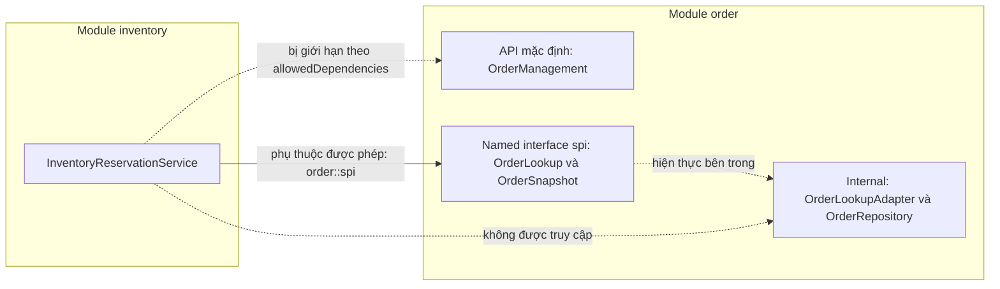

# Named interface biểu diễn API module như thế nào?

Trong Spring Modulith, **named interface** là một nhóm kiểu (type) mà một *application module* chủ động công bố để module khác được phép sử dụng. Nó giúp mô tả chính xác **module cung cấp hợp đồng gì**, **hợp đồng nằm ở đâu** và **module tiêu thụ được phụ thuộc vào phần nào**. Nhờ vậy, ranh giới kiến trúc có thể được kiểm chứng bằng `ApplicationModules.verify()` và đưa vào quy trình kiểm thử/CI.

Chủ đề thuộc phần **Named interfaces** của lộ trình **SPRING_MODULITH_VERIFICATION_TESTING**: rèn kỹ năng kiểm chứng ranh giới kiến trúc của ứng dụng Spring Modulith bằng `ApplicationModules`, quy tắc phụ thuộc giữa module và các phép thử chống hồi quy. Từ “interface” ở đây mang nghĩa **giao diện công khai của module**, không đồng nghĩa với riêng từ khóa Java `interface`, giao diện người dùng hay REST API.

## 1. Vì sao module cần một API rõ ràng?

Một ứng dụng Spring Boot dạng modular monolith có nhiều module nghiệp vụ cùng chạy trong một tiến trình JVM. Theo quy ước mặc định, mỗi package con trực tiếp của package chứa lớp `@SpringBootApplication` có thể được Spring Modulith nhận diện là một application module.

Giả sử lớp khởi động ở `com.acme.shop`, ta tổ chức như sau:

```text
com.acme.shop
├── ShopApplication.java
├── order/                       ← application module: order
│   ├── OrderManagement.java     ← API mặc định (package gốc)
│   ├── spi/
│   │   ├── package-info.java
│   │   ├── OrderLookup.java
│   │   └── OrderSnapshot.java
│   └── internal/
│       ├── OrderLookupAdapter.java
│       └── OrderRepository.java
└── inventory/                   ← application module: inventory
    ├── package-info.java
    └── InventoryReservationService.java
```

Với module **đóng** (*closed module*, chế độ thông thường):

- Những kiểu public ở **package gốc** `com.acme.shop.order` thuộc API mặc định của module `order` (còn gọi là *unnamed interface*).
- Những kiểu trong **subpackage** như `order.internal` hoặc `order.spi` mặc định được coi là phần bên trong module, kể cả khi khai báo `public` để các package nội bộ cùng sử dụng.
- `public` là mức truy cập của **Java**; nó chưa nói rằng kiểu đó được phép trở thành phụ thuộc của **module nghiệp vụ khác**. Spring Modulith bổ sung một quy tắc kiến trúc trên cấu trúc package.

Vấn đề thường gặp: `inventory` cần một tính năng tra cứu đơn hàng từ `order`, nhưng không nên truy cập `order.internal.OrderRepository`. Đặt mọi kiểu public vào package gốc để tiện tái sử dụng sẽ làm API phình to. **Named interface cho phép công bố một nhóm API chuyên biệt trong subpackage**, giữ phần triển khai ở bên trong.

## 2. Named interface được biểu diễn bằng những gì?

Một named interface gồm ba yếu tố có quan hệ với nhau:

| Thành phần | Vai trò | Ví dụ |
| --- | --- | --- |
| **Module cung cấp** | Chủ sở hữu API và phần triển khai | `order` |
| **Tên giao diện** | Định danh một phần API do module công bố | `spi` |
| **Các kiểu được công bố** | Lớp, Java interface, record, enum, sự kiện… thuộc giao diện | `OrderLookup`, `OrderSnapshot` |

Tên đủ để một module khác tham chiếu giao diện này trong khai báo phụ thuộc là **`order::spi`**: `order` là tên logic của module, dấu `::` phân tách và `spi` là tên named interface. `spi` thường viết tắt của *Service Provider Interface*, nhưng có thể dùng tên theo nghiệp vụ như `events`, `query` hoặc `integration`.

Để công bố package `order.spi`, tạo file `src/main/java/com/acme/shop/order/spi/package-info.java`:

```java
@org.springframework.modulith.NamedInterface("spi")
package com.acme.shop.order.spi;
```

Hai kiểu nằm trong package đó là các hợp đồng được công bố:

```java
// src/main/java/com/acme/shop/order/spi/OrderSnapshot.java
package com.acme.shop.order.spi;

public record OrderSnapshot(String orderId, String status) {}
```

```java
// src/main/java/com/acme/shop/order/spi/OrderLookup.java
package com.acme.shop.order.spi;

import java.util.Optional;

public interface OrderLookup {
    Optional<OrderSnapshot> findById(String orderId);
}
```

Chú ý: `OrderSnapshot` cũng nằm trong package được công bố. Nếu một API public trả về hoặc nhận một kiểu chỉ tồn tại trong `order.internal`, người dùng API có thể bị kéo theo một phụ thuộc mà kiến trúc muốn cấm. Vì vậy, **chữ ký của API cũng phải tôn trọng ranh giới module**.

Một Spring bean ở `order.internal` có thể hiện thực `OrderLookup`; bean này thực hiện nghiệp vụ nhưng module khác chỉ cần thấy `OrderLookup` và `OrderSnapshot`. Việc gắn `@NamedInterface` vào package **không tự tạo bean, không đăng ký endpoint, không tự sinh implementation**. Đây là khai báo về *mặt tiếp xúc kiến trúc* của module.



Trong sơ đồ này, module **`order` là chủ sở hữu API**; `inventory` là module **tiêu thụ API**. Dù cả hai chạy cùng JVM, `inventory` không nên biết chi tiết kho lưu trữ hay cách `order` hiện thực nghiệp vụ.

## 3. Named interface và `allowedDependencies` phối hợp ra sao?

`@NamedInterface` đặt ở **module cung cấp** để chọn phần được công bố. `@ApplicationModule(allowedDependencies = ...)` đặt ở **module tiêu thụ** để giới hạn những module hoặc named interface mà nó được phụ thuộc.

Ví dụ, `inventory` chỉ được dựa vào giao diện tra cứu của `order`:

```java
// src/main/java/com/acme/shop/inventory/package-info.java
@org.springframework.modulith.ApplicationModule(
    allowedDependencies = "order::spi"
)
package com.acme.shop.inventory;
```

Ứng dụng của API đó:

```java
// src/main/java/com/acme/shop/inventory/InventoryReservationService.java
package com.acme.shop.inventory;

import com.acme.shop.order.spi.OrderLookup;
import org.springframework.stereotype.Service;

@Service
public class InventoryReservationService {

    private final OrderLookup orders;

    public InventoryReservationService(OrderLookup orders) {
        this.orders = orders;
    }

    public boolean canReserveFor(String orderId) {
        return orders.findById(orderId)
                .map(order -> "CONFIRMED".equals(order.status()))
                .orElse(false);
    }
}
```

Nếu `order` có Spring bean hiện thực `OrderLookup`, Spring có thể inject bean đó vào `InventoryReservationService`. **Sự phụ thuộc ở mã nguồn hướng tới hợp đồng** `order.spi.OrderLookup` thay vì lớp hiện thực ở `order.internal`.

Lưu ý hai lớp quy tắc:

1. **Có được công bố không?** Một kiểu của `order` phải thuộc API mặc định hoặc named interface thì các module khác mới có thể phụ thuộc hợp lệ vào nó (đối với module đóng).
2. **Module tiêu thụ có được chọn giao diện đó không?** Nếu `inventory` đã khai báo `allowedDependencies`, nó chỉ được dùng các đích có trong danh sách cho phép. Danh sách này không làm hợp lệ một kiểu nội bộ chưa được công bố.

Với `allowedDependencies = "order::spi"`, ba phụ thuộc sau cho kết quả khác nhau:

| Tham chiếu từ `inventory` | Hợp lệ? | Lý do |
| --- | --- | --- |
| `order.spi.OrderLookup` | **Có** | Thuộc named interface `order::spi` và đã được cho phép |
| `order.OrderManagement` | **Không** | Thuộc API mặc định của `order`, nhưng `inventory` chỉ khai báo quyền dùng `spi` |
| `order.internal.OrderRepository` | **Không** | Thuộc phần nội bộ; không được công bố qua API module |

Nếu `inventory` **không khai báo** `allowedDependencies`, nó vẫn phải tuân thủ quy tắc không truy cập `order.internal`, nhưng có thể tham chiếu các phần **được công bố** của các module khác. Khai báo `allowedDependencies` giúp thu hẹp phạm vi đó thành một hợp đồng rõ ràng và có thể kiểm chứng.

### Các cú pháp phụ thuộc dễ nhầm

| Khai báo trên module tiêu thụ | Phần API `order` được phép sử dụng |
| --- | --- |
| `"order"` | Chỉ giao diện **mặc định**, tức API ở package gốc của `order` |
| `"order::spi"` | Chỉ named interface `spi` |
| `"order::*"` | **Tất cả named interface được khai báo tường minh** của `order`, **không gồm** API mặc định ở package gốc |
| `"order::**"` | Toàn bộ phần **được công bố** của `order`: API mặc định **và** các named interface |

Ví dụ, khi `inventory` cần đồng thời API gốc và `spi` nhưng không muốn mở mọi named interface khác, có thể viết:

```java
@org.springframework.modulith.ApplicationModule(
    allowedDependencies = { "order", "order::spi" }
)
package com.acme.shop.inventory;
```

Không nên dùng `"order::**"` chỉ để làm một bài kiểm chứng hết lỗi: phạm vi được phép rộng hơn thì ranh giới sẽ kém hữu ích. Ngược lại, `"order::spi"` cũng không tự động cho phép truy cập API gốc; dấu `::` là một phần của ý nghĩa khai báo.

> **Phân biệt:** `@NamedInterface` là *định nghĩa API mà module cung cấp* (provided interface). `allowedDependencies` là *giới hạn API mà module khác tiêu thụ* (required dependency). Hai khai báo nằm ở hai phía của quan hệ phụ thuộc.

## 4. Xác minh ranh giới bằng `ApplicationModules`

Spring Modulith dựng mô hình các module từ package và annotation, rồi dùng `verify()` để phát hiện những tham chiếu không phù hợp. Tạo một phép thử JUnit cho toàn bộ ứng dụng:

```java
// src/test/java/com/acme/shop/ModulithArchitectureTest.java
package com.acme.shop;

import org.junit.jupiter.api.Test;
import org.springframework.modulith.core.ApplicationModules;

class ModulithArchitectureTest {

    @Test
    void verifiesModuleBoundaries() {
        ApplicationModules.of(ShopApplication.class).verify();
    }
}
```

`ShopApplication` là lớp `@SpringBootApplication` nằm ở package `com.acme.shop`, bao quanh hai module. Test cần các thư viện Spring Modulith phù hợp trên classpath, chẳng hạn phần core/test trong cấu hình Maven hoặc Gradle của dự án.

Khi chạy, việc kiểm chứng kiến trúc bao gồm các quy tắc quan trọng:

- **Không có vòng phụ thuộc giữa các module** (module dependency cycle).
- **Không tham chiếu trực tiếp vào kiểu nội bộ** của một module đóng từ module khác.
- **Không vượt quá `allowedDependencies`** đã khai báo, nếu module tiêu thụ có đặt ràng buộc này.

Ví dụ một người sửa `InventoryReservationService` thành:

```java
// Ví dụ SAI: minh họa phụ thuộc bị kiểm chứng từ chối.
import com.acme.shop.order.internal.OrderRepository;
```

Giả sử `OrderRepository` được khai báo `public` để đoạn mã vẫn biên dịch, `ApplicationModules.verify()` vẫn phát hiện truy cập chéo vào phần `internal` không được công bố. Tương tự, dùng `order.OrderManagement` tại `inventory` cũng vi phạm **ràng buộc cụ thể** `allowedDependencies = "order::spi"` dù `OrderManagement` là API mặc định của `order`.

Để sửa đúng nguyên nhân, chuyển nhu cầu tra cứu qua hợp đồng `OrderLookup` ở `order.spi`, để `order` tự quyết định cách lấy dữ liệu từ repository. Nếu có yêu cầu nghiệp vụ khác, bổ sung một thao tác phù hợp vào API công bố hoặc thiết kế tương tác qua sự kiện thay vì mở rộng quyền truy cập một cách vô điều kiện.

Việc xác minh này là **phân tích kiến trúc**, không phải bài test kết nối database hay khởi động toàn bộ ngữ cảnh Spring để thực thi luồng nghiệp vụ. Đó là lý do nên giữ phép thử `verify()` độc lập, chạy nhanh và xuất hiện trong mọi lần kiểm tra chất lượng.

## 5. Quan hệ với `@ApplicationModuleTest`, sự kiện và CI

Named interface xác định **biên của API hợp lệ**, còn các kiểu kiểm thử khác xác nhận **hành vi của API đó**:

| Công cụ/kiểu kiểm thử | Câu hỏi chính | Vai trò với named interface |
| --- | --- | --- |
| `ApplicationModules.of(...).verify()` | Có phụ thuộc chéo module sai hoặc vòng phụ thuộc không? | Kiểm tra cấu trúc, API được công bố và `allowedDependencies` |
| `@ApplicationModuleTest` | Module có khởi tạo/chạy đúng ở phạm vi kiểm thử mong muốn không? | Kiểm thử tương tác Spring và hành vi của module trong phạm vi phù hợp |
| Test sự kiện/module interaction | Khi phát sinh sự kiện, bên nhận phản ứng đúng không? | Kiểm chứng hợp đồng giao tiếp bất đồng bộ nếu module chọn dùng sự kiện |
| Test database/tích hợp | Repository, transaction, adapter có xử lý đúng không? | Bổ sung bảo đảm cho implementation phía sau API |
| CI quality gate | Một thay đổi có làm hỏng cấu trúc hoặc hành vi không? | Chạy test kiến trúc và test liên quan trước khi chấp nhận thay đổi |

Chẳng hạn, `order` có thể công bố một kiểu sự kiện trong API mặc định hoặc một named interface như `order::events`; module khác chỉ nên tham chiếu kiểu sự kiện **đã được công bố và được phép phụ thuộc**. Việc một event được Spring phân phối thành công không chứng minh rằng cấu trúc phụ thuộc giữa các module là hợp lệ. Ngược lại, `verify()` thành công không bảo đảm event listener xử lý đúng, giao dịch đúng hoặc cơ sở dữ liệu luôn sẵn sàng.

Vì vậy, một quality gate hợp lý sẽ thực thi test kiến trúc cùng các test hành vi trong pipeline kiểm thử. Với Gradle, lệnh minh họa là `./gradlew test` (hoặc `gradlew.bat test` trên Windows), miễn là bài test kiến trúc đã nằm trong test suite được chạy. Khi có vi phạm, JUnit test thất bại và job CI phải báo thất bại; không nên chỉ ghi log cảnh báo rồi tiếp tục.

## 6. Những sai lầm thường gặp

**“Class `public` thì mọi module được dùng.”** Java có thể cho phép import, nhưng Spring Modulith còn kiểm chứng package API và quy tắc phụ thuộc. Một class `public` trong `order.internal` vẫn là implementation detail của `order`.

**“Có `@NamedInterface` thì module khác tự động được dùng mọi API của module cung cấp.”** Annotation chỉ công bố đúng nhóm kiểu của giao diện đó. Nếu module tiêu thụ có `allowedDependencies`, nó còn phải cho phép giao diện tương ứng; quyền dùng `order::spi` không đồng nghĩa quyền dùng API gốc hoặc các named interface khác.

**“Named interface phải là Java `interface`.”** Không bắt buộc. Giao diện module có thể gồm `interface`, `record`, class, enum hoặc kiểu sự kiện. Điều quan trọng là hợp đồng được công bố có ổn định, cần thiết và không làm rò rỉ kiểu nội bộ.

**“Tạo package `spi` là đủ.”** Tên package là quy ước đặt tên; trong module đóng, subpackage `spi` chỉ trở thành API được công bố khi có khai báo named interface tương ứng (hoặc cơ chế cấu hình kiến trúc tương đương).

**“Named interface chặn lời gọi lúc runtime.”** Đây là ràng buộc kiến trúc kiểm chứng từ mã nguồn/bytecode, không phải sandbox bảo mật, Java Platform Module System hay cơ chế chặn reflection lúc chạy. Cần đưa `verify()` vào test/CI để phát hiện vi phạm kịp thời.

**“Chuyển module sang `OPEN` sẽ giải quyết được thiết kế API.”** Open module cho phép truy cập rộng hơn vào phần bên trong và hữu ích khi chuyển đổi hệ thống cũ theo từng bước; nó không thay thế việc xác định hợp đồng rõ ràng cho modular monolith lâu dài.

## 7. Bài thực hành tự kiểm chứng

Giữ cấu trúc `order`–`inventory` như ví dụ và thực hiện lần lượt:

1. **Công bố API:** tạo `order.spi/package-info.java`, `OrderLookup` và `OrderSnapshot`. Kiểm tra rằng `order.internal` không được gắn `@NamedInterface`.
2. **Giới hạn phụ thuộc:** đặt `@ApplicationModule(allowedDependencies = "order::spi")` trên package `inventory`. Dùng `OrderLookup` trong service của `inventory`.
3. **Tạo baseline:** chạy `ModulithArchitectureTest`. Nếu các module khác trong ứng dụng không có vi phạm, phép kiểm tra kiến trúc phải vượt qua.
4. **Chủ động tạo vi phạm:** thay một tham chiếu bằng `order.internal.OrderRepository` (giả sử kiểu được khai báo public). Chạy lại test và giải thích vì sao dependency bị từ chối dù Java biên dịch được.
5. **So sánh hai loại vi phạm:** thử phụ thuộc vào `order.OrderManagement` khi vẫn chỉ cho phép `order::spi`. Đây là lỗi *allowed dependency*, khác với lỗi truy cập *internal* ở bước trước.
6. **Sửa và khóa hồi quy:** loại bỏ các tham chiếu sai, dùng hợp đồng `OrderLookup`, chạy lại test và bảo đảm CI chạy cùng test này trong các lần thay đổi sau.

Để tự đánh giá, hãy giải thích được ba nhận định: **(a)** `order.spi.OrderLookup` được phép vì được công bố và được `inventory` cho phép; **(b)** `order.OrderManagement` được công bố nhưng chưa được `inventory` cho phép trong cấu hình `order::spi`; **(c)** `order.internal.OrderRepository` không thuộc API được công bố của module đóng, nên thêm tên module vào `allowedDependencies` không giải quyết nguyên nhân.

## 8. Ghi nhớ

**Named interface là một phần API có tên do module sở hữu và công bố cho các module khác.** Package gốc là API mặc định, còn các subpackage muốn công bố riêng có thể khai báo `@NamedInterface`. Module tiêu thụ chọn đúng phần API cần thiết qua `allowedDependencies` với cú pháp `module::interface`. Sau đó, `ApplicationModules.verify()` giúp giữ cam kết này trước những thay đổi mã nguồn; các test module, event và database bổ sung xác nhận hành vi ở bên trong hợp đồng.

### Tài liệu tham khảo

- [Spring Modulith Reference — Fundamentals, mục Named Interfaces](https://docs.spring.io/spring-modulith/reference/fundamentals.html)
- [Spring Modulith Reference — Verifying Application Module Structure](https://docs.spring.io/spring-modulith/reference/verification.html)
