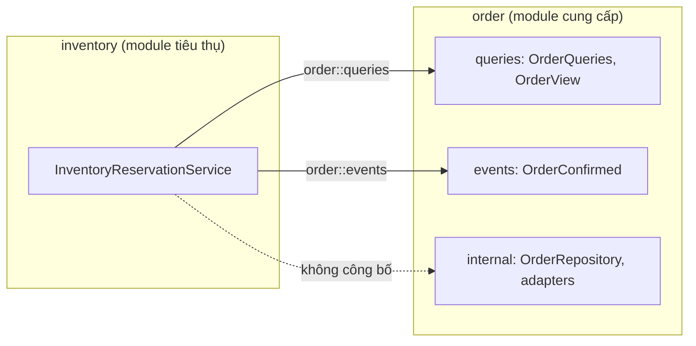

# Đặt tên và mô tả named interface

Một **named interface** trong Spring Modulith là một phần API của application module được gắn **tên logic** để các module khác tham chiếu một cách tường minh. Đặt tên tốt giúp người đọc nhận ra **module cung cấp năng lực gì**; mô tả tốt giúp họ biết **được phép dùng những kiểu nào, dùng để làm gì và phải tuân thủ hợp đồng nào**. Trong lộ trình **SPRING_MODULITH_VERIFICATION_TESTING**, đây là bước cần thiết để chuyển thiết kế module thành quy tắc phụ thuộc có thể kiểm chứng bằng `ApplicationModules` và CI.

Tên named interface không phải tên một Java `interface` cụ thể, không phải đường dẫn REST và cũng không phải cơ chế bảo mật runtime. Nó là **định danh cho một nhóm kiểu công khai** trong mô hình kiến trúc Spring Modulith.

## 1. Ba lớp tên cần phân biệt

Giả sử ứng dụng có module `order` và `inventory`. `inventory` cần tra cứu đơn hàng nhưng không cần biết cách `order` lưu dữ liệu. Chúng ta đặt tên phần API tra cứu là `queries`:

```java
// src/main/java/com/acme/shop/order/api/queries/package-info.java
@org.springframework.modulith.NamedInterface("queries")
package com.acme.shop.order.api.queries;
```

Khi đó, ba tên sau có vai trò khác nhau:

| Thành phần | Ví dụ | Ý nghĩa |
| --- | --- | --- |
| **Tên application module** | `order` | Chủ sở hữu API, thường lấy từ package module theo cấu hình mặc định |
| **Tên named interface** | `queries` | Nhóm hợp đồng mà module `order` chủ động công bố |
| **Tên đầy đủ trong ràng buộc phụ thuộc** | `order::queries` | Đích mà module tiêu thụ cho phép trong `allowedDependencies` |

Package `com.acme.shop.order.api.queries` là **vị trí chứa mã Java**. Chuỗi `queries` là **tên kiến trúc** ghi trong `@NamedInterface`. Khi đặt `@NamedInterface("queries")` trên package, những kiểu public thích hợp trong package đó được đưa vào named interface. Việc đặt package tên `queries` tự nó **chưa** khai báo named interface; annotation mới thể hiện ý định công bố API.

Tên package và tên named interface **có thể khác nhau**, chẳng hạn package `order.publicapi.readmodel` vẫn có thể công bố `@NamedInterface("queries")`. Tuy nhiên, nếu không có lý do đặc biệt, đặt chúng gần nghĩa nhau giúp mã nguồn dễ khám phá hơn.

> **Phân biệt:** package gốc của application module tạo thành **API mặc định** (unnamed interface). Named interface cho phép công bố thêm API trong những package con được chọn, thay vì chuyển toàn bộ mã dùng chung lên package gốc.

## 2. Chọn tên theo năng lực và ngữ nghĩa của hợp đồng

Một cái tên tốt nên trả lời được câu hỏi: *“Nếu module khác được phụ thuộc vào giao diện này, nó sẽ được làm loại việc gì?”*

### Các tiêu chí thực hành

1. **Diễn tả đúng một mục đích.** `queries` thể hiện thao tác đọc; `events` thể hiện các kiểu sự kiện để module khác quan sát; `reservations` thể hiện hợp đồng đặt giữ hàng.
2. **Ngắn nhưng đủ phân biệt.** Ưu tiên một hoặc hai từ có nghĩa trong miền nghiệp vụ; tránh tên dài như `allPublicTypesUsedByOtherModules`.
3. **Ổn định theo thời gian.** Tên xuất hiện trong cấu hình phụ thuộc của các module tiêu thụ; đổi tên có thể làm các phép kiểm chứng kiến trúc thất bại.
4. **Nhất quán toàn hệ thống.** Cùng loại hợp đồng nên dùng cách gọi tương tự giữa các module; đừng để `events`, `messages`, `signals` mang cùng nghĩa nếu không có chủ đích.
5. **Không hứa phạm vi rộng hơn thực tế.** `everything`, `shared`, `commons` hoặc `api` thường quá chung chung, dễ trở thành nơi chứa kiểu bất kỳ.
6. **Dễ đọc trong cú pháp phụ thuộc.** `order::queries` cho biết quan hệ rõ ràng hơn `order::v2x` hoặc `order::misc`.

Đây là các **quy ước thiết kế đề xuất**, không phải danh sách từ khóa được Spring Modulith bắt buộc. Trong dự án Java, tên chữ thường ASCII như `queries`, `events`, `reporting` thường thuận tiện khi thống nhất tên package, annotation và `allowedDependencies`.

| Nhu cầu giao tiếp | Tên nên cân nhắc | Tên dễ gây hiểu nhầm | Vì sao? |
| --- | --- | --- | --- |
| Module khác tra cứu trạng thái đơn hàng | `queries`, `orderQueries` | `utils` | Nêu rõ hợp đồng đọc dữ liệu thay vì một nhóm tiện ích mơ hồ |
| Module khác đăng ký phản ứng với sự kiện | `events` | `internalEvents` | Công bố sự kiện có chủ đích; `internal` mâu thuẫn với vai trò API |
| Module khác đặt giữ hàng | `reservations` | `service` | Nêu được năng lực nghiệp vụ, không chỉ loại kỹ thuật |
| Module khác gọi cổng tích hợp đã xác định | `integration`, `partners` | `all` | Giới hạn rõ nhóm người dùng và mục đích hợp đồng |

Không có một cách đặt tên đúng cho mọi dự án. Ví dụ `events` có thể phù hợp nếu tất cả sự kiện đều được công bố cho các module nội bộ; nếu sự kiện dành cho các đối tác với chính sách ổn định riêng, tên cụ thể hơn như `partnerEvents` có thể diễn đạt đúng ranh giới hơn.

## 3. Mô tả named interface: viết hợp đồng, không chỉ diễn giải tên

Annotation `@NamedInterface("queries")` dùng để đánh dấu **tên và thành viên của API**. Nó không thay thế cho tài liệu mô tả hành vi. Muốn người khác biết giao diện có phục vụ đúng nhu cầu hay không, hãy tài liệu hóa các yếu tố sau:

| Mục cần mô tả | Câu hỏi cần trả lời | Ví dụ cho `order::queries` |
| --- | --- | --- |
| **Mục đích** | Cung cấp năng lực nghiệp vụ nào? | Tra cứu trạng thái và thông tin tối thiểu của đơn hàng |
| **Người tiêu thụ** | Module nào có lý do phụ thuộc? | `inventory`, `shipping` |
| **Các kiểu công bố** | API gồm interface, record, sự kiện nào? | `OrderQueries`, `OrderView` |
| **Đầu vào/đầu ra** | Định danh, DTO và điều kiện hợp lệ ra sao? | Tìm bằng `orderId`; trả `Optional<OrderView>` |
| **Ngữ nghĩa hành vi** | Chỉ đọc hay gây tác dụng phụ? | Không chỉnh sửa trạng thái đơn hàng |
| **Lỗi và trường hợp biên** | Không tìm thấy, lỗi tích hợp xử lý thế nào? | Không tìm thấy trả `Optional.empty()` |
| **Bảo đảm/tính nhất quán** | Có cần dữ liệu tức thời, idempotency hay thứ tự sự kiện không? | Ghi rõ giới hạn nhất quán nếu có |
| **Giới hạn phạm vi** | Điều gì không được phép sử dụng? | Không lộ repository, entity JPA hoặc cơ chế thanh toán |
| **Chủ sở hữu và thay đổi** | Ai phê duyệt thay đổi hợp đồng? | Nhóm quản lý module `order`; CI kiểm tra phụ thuộc |

Không nhất thiết chép toàn bộ bảng vào từng file. Với một API nhỏ, **JavaDoc ở `package-info.java`** nêu mục đích và giới hạn, còn **JavaDoc trên kiểu public** nêu rõ từng thao tác là một cách tổ chức thực tế.

### Ví dụ mô tả trực tiếp trên package

```java
/**
 * API truy vấn đơn hàng cho các module nội bộ như inventory và shipping.
 *
 * <p>Chỉ công bố thông tin cần thiết để kiểm tra điều kiện nghiệp vụ.
 * Không công bố entity JPA, repository, trạng thái thanh toán chi tiết
 * hoặc các thao tác cập nhật đơn hàng.
 *
 * <p>Hợp đồng công khai gồm OrderQueries và OrderView.
 */
@org.springframework.modulith.NamedInterface("queries")
package com.acme.shop.order.api.queries;
```

Trong cùng package, đặt hai kiểu công khai:

```java
// OrderView.java
package com.acme.shop.order.api.queries;

/** Dữ liệu đọc tối thiểu mà module khác được phép biết về đơn hàng. */
public record OrderView(String orderId, String status) {}
```

```java
// OrderQueries.java
package com.acme.shop.order.api.queries;

import java.util.Optional;

/** Hợp đồng đọc đơn hàng, không thực hiện thao tác thay đổi dữ liệu. */
public interface OrderQueries {

    /**
     * Tìm đơn hàng theo định danh.
     *
     * @param orderId định danh đơn hàng, không được rỗng
     * @return thông tin đơn hàng nếu tồn tại; ngược lại là Optional.empty()
     */
    Optional<OrderView> findById(String orderId);
}
```

`OrderView` được đặt **cùng phần API được công bố** vì nó xuất hiện trong chữ ký public của `OrderQueries`. Nếu khai báo `findById()` trả `order.internal.OrderEntity`, module tiêu thụ sẽ phải biết một kiểu nội bộ; hợp đồng trở nên rò rỉ và có thể vi phạm ranh giới kiến trúc.

Việc mô tả “chỉ đọc” là **cam kết hành vi cần được kiểm thử**: `@NamedInterface` và `ApplicationModules.verify()` chỉ kiểm tra cấu trúc phụ thuộc, không tự bảo đảm rằng implementation không cập nhật database.

## 4. Một module có thể công bố nhiều named interface

Cùng một module `order` có thể cho hai nhóm người dùng khác nhau hai phần API: truy vấn đồng bộ và sự kiện. Hãy tách tên và mô tả theo **mục đích tiêu thụ**:

```text
com.acme.shop
├── ShopApplication.java
├── order/
│   ├── api/
│   │   ├── queries/
│   │   │   ├── package-info.java    ← @NamedInterface("queries")
│   │   │   ├── OrderQueries.java
│   │   │   └── OrderView.java
│   │   └── events/
│   │       ├── package-info.java    ← @NamedInterface("events")
│   │       └── OrderConfirmed.java
│   └── internal/
│       ├── OrderQueryAdapter.java
│       └── OrderRepository.java
└── inventory/
    ├── package-info.java
    └── InventoryReservationService.java
```

Tại `order/api/events/package-info.java`:

```java
/**
 * Các sự kiện nghiệp vụ đã được order xác nhận và công bố để
 * các module khác phản ứng độc lập.
 *
 * <p>Payload chỉ chứa dữ liệu công khai cần thiết cho người tiêu thụ.
 * Sự kiện cho biết việc đã xảy ra, không phải lệnh gọi ngược vào order.
 */
@org.springframework.modulith.NamedInterface("events")
package com.acme.shop.order.api.events;
```

Kiểu sự kiện thuộc named interface:

```java
// OrderConfirmed.java
package com.acme.shop.order.api.events;

import java.time.Instant;

/** Thông báo đơn hàng đã chuyển sang trạng thái xác nhận. */
public record OrderConfirmed(String orderId, Instant occurredAt) {}
```

Hai named interface có tên **khác nhau**, được công bố bởi **cùng chủ sở hữu**:

| Giao diện | Dùng để | Điều không nên chứa |
| --- | --- | --- |
| `order::queries` | Hỏi trạng thái, lấy dữ liệu đọc có kiểm soát | Entity lưu trữ, thao tác chỉnh sửa, truy vấn SQL |
| `order::events` | Công bố sự kiện nghiệp vụ cho listener của module khác | Spring repository, adapter, lệnh cập nhật nội bộ |

`OrderQueryAdapter` và `OrderRepository` vẫn nằm ở `order.internal`. Chúng có thể hiện thực API hoặc phát sự kiện, nhưng **không phải là một phần của giao diện được công bố**.

### Khi nào nên tách, khi nào nên gộp?

Tách thành hai named interface khi nhóm người tiêu thụ, nhịp thay đổi hoặc chính sách phụ thuộc khác nhau. Ví dụ `shipping` chỉ quan tâm `order::events`, còn `inventory` cần thêm `order::queries`. Gộp khi các kiểu luôn thay đổi và được tiêu thụ như một hợp đồng thống nhất; tách quá nhỏ làm cấu hình khó theo dõi.

Không nên tạo tên `read`, `write`, `events` một cách máy móc cho mọi module. Hãy dựa vào **ranh giới nghiệp vụ có người tiêu thụ thực sự**.

## 5. Thử tên bằng một quy tắc phụ thuộc thực tế

Tên tốt phải có ích khi đọc một khai báo phụ thuộc. Module `inventory` cần cả hai API của `order`:

```java
// src/main/java/com/acme/shop/inventory/package-info.java
@org.springframework.modulith.ApplicationModule(
    allowedDependencies = {
        "order::queries",
        "order::events"
    }
)
package com.acme.shop.inventory;
```

Điều này diễn đạt: *inventory chỉ được biết các API tra cứu và sự kiện mà order công bố*. Nó **không** tự cấp quyền truy cập toàn bộ lớp public thuộc `order`, và không cho phép dùng `order.internal.OrderRepository`.



Một phần việc của code review là đọc `allowedDependencies` và hỏi: “Chỉ nhìn vào tên `order::queries` và `order::events`, ta có hiểu vì sao `inventory` cần chúng không?” Nếu câu trả lời là không, cân nhắc đặt lại tên hoặc tách hợp đồng.

### Phân biệt ràng buộc kiến trúc và mô tả bằng văn bản

- `@NamedInterface("queries")` cho Spring Modulith biết **những kiểu thuộc giao diện tên gì**.
- `@ApplicationModule(allowedDependencies = "order::queries")` cho Spring Modulith biết **module tiêu thụ được tham chiếu giao diện nào**.
- JavaDoc và tài liệu thiết kế cho **con người** biết **ý nghĩa và cam kết** của giao diện.
- Unit/integration test xác nhận **implementation thực hiện đúng cam kết**.

Mô tả tốt không thay thế annotation. Ngược lại, annotation hợp lệ cũng không đủ để người tiêu thụ đoán chính sách dữ liệu, tính nhất quán hoặc lỗi nghiệp vụ.

## 6. Đặt tên không đúng tạo ra lỗi gì?

| Tình huống | Hậu quả | Cách sửa |
| --- | --- | --- |
| `@NamedInterface("api")` bao trùm nhiều năng lực không liên quan | Không biết module nào cần phần nào; thay đổi một phần ảnh hưởng rộng | Tách các phần có người tiêu thụ khác nhau, ví dụ `queries` và `events` |
| `@NamedInterface("helpers")` chứa entity hoặc repository | Module khác bắt đầu phụ thuộc vào chi tiết triển khai | Thiết kế DTO/hợp đồng nghiệp vụ, chuyển lớp nội bộ trở về `internal` |
| Package tên `queries` nhưng không có `@NamedInterface` | Subpackage trong module đóng chưa trở thành API được công bố | Đặt annotation trên `package-info.java` tương ứng |
| Annotation đặt tên `query`, nhưng `allowedDependencies` ghi `order::queries` | Tham chiếu tên named interface không khớp | Thống nhất đúng chuỗi tên ở cả hai phía |
| Đổi `queries` thành `readApi` mà quên cập nhật module tiêu thụ | Quy tắc kiến trúc cũ không còn trỏ tới tên đang được công bố | Tìm các tham chiếu `order::queries`, cập nhật có kiểm soát và chạy test kiến trúc |
| Trả `OrderEntity` trong API công bố | Rò rỉ kiểu nội bộ và khiến module khác bị ràng buộc vào persistence | Công bố `OrderView` hoặc kiểu dữ liệu phù hợp bên trong API |
| Đặt tên `events` nhưng nội dung chủ yếu là lệnh chỉnh sửa đơn hàng | Tên và ngữ nghĩa bất nhất; người dùng sai cách | Đổi thiết kế hợp đồng hoặc chia thành giao diện phù hợp hơn |

Một nguyên tắc hữu ích: **đừng sửa lỗi phụ thuộc bằng cách mở rộng API vô hạn**. Nếu chỉ một module cần đọc trạng thái đơn hàng, hãy cung cấp một hợp đồng đọc phù hợp; đừng biến toàn bộ `order.internal` thành API.

## 7. Kiểm chứng tên và ranh giới bằng `ApplicationModules`

Ví dụ có lớp khởi động `com.acme.shop.ShopApplication` được gắn `@SpringBootApplication`. Tạo test JUnit:

```java
// src/test/java/com/acme/shop/ModulithArchitectureTest.java
package com.acme.shop;

import org.junit.jupiter.api.Test;
import org.springframework.modulith.core.ApplicationModules;

class ModulithArchitectureTest {

    @Test
    void moduleDependenciesFollowPublishedInterfaces() {
        ApplicationModules.of(ShopApplication.class).verify();
    }
}
```

Phép kiểm chứng này có thể phát hiện vi phạm ranh giới module đóng, `allowedDependencies` và các vòng phụ thuộc. Dưới đây là các tình huống để kiểm tra quy tắc hiện tại của `inventory`:

| Tham chiếu từ `inventory` tới `order` | Kết quả mong đợi | Giải thích |
| --- | --- | --- |
| `order.api.queries.OrderQueries` | Hợp lệ | Được công bố qua `order::queries` và nằm trong danh sách cho phép |
| `order.api.events.OrderConfirmed` | Hợp lệ | Được công bố qua `order::events` và nằm trong danh sách cho phép |
| `order.internal.OrderRepository` | Vi phạm | Là kiểu nội bộ, không được công bố |
| API mặc định ở package gốc `order` | Vi phạm nếu không cho phép thêm | Danh sách chỉ cho phép hai named interface |
| `order::newApi` chỉ được nhắc trong `allowedDependencies` | Không làm API tự xuất hiện | Phải có named interface tương ứng do `order` công bố |

Các dòng trên là **kỳ vọng kiểm chứng thiết kế**, không phải kết quả chạy test thực tế trong bài này. Khi chủ động tạo trường hợp lỗi, nhớ giữ kiểu Java có thể truy cập về mặt ngôn ngữ (chẳng hạn `public`) để nhìn thấy lỗi **kiến trúc** thay vì chỉ dừng ở lỗi biên dịch.

Đặt test `verify()` trong suite chạy bởi CI, ví dụ `./gradlew test` hoặc Maven test tương ứng. Khi đổi tên một named interface, chạy test trước và sau thay đổi để phát hiện nơi còn phụ thuộc vào tên cũ. Sau đó dùng `@ApplicationModuleTest`, test sự kiện và test database/tích hợp để kiểm tra hành vi của những hợp đồng đã công bố; chúng bổ sung cho phép kiểm chứng cấu trúc.

## 8. Quản lý vòng đời của tên và mô tả

Tên `order::queries` là một phần của **hợp đồng kiến trúc**. Mỗi module tiêu thụ có thể ghi nguyên tên này trong `allowedDependencies`, nên việc đổi tên cần được xem như một thay đổi ảnh hưởng người dùng API.

Một quy trình thay đổi an toàn:

1. **Xác định nhu cầu:** giao diện thật sự đổi ý nghĩa hay chỉ đổi cách đặt tên? Nếu chỉ tài liệu chưa rõ, ưu tiên cập nhật JavaDoc.
2. **Liệt kê các module tiêu thụ:** tìm tham chiếu tên đầy đủ cũ (ví dụ `order::queries`) và các imports của kiểu API.
3. **Thiết kế hợp đồng mới:** làm rõ các public types, dữ liệu trả về và chính sách sử dụng; tránh đưa kiểu `internal` ra ngoài.
4. **Cập nhật đồng bộ:** sửa khai báo `@NamedInterface`, `allowedDependencies`, phần mã tiêu thụ, ví dụ và tài liệu khi thực sự đổi tên hoặc cấu trúc.
5. **Chạy quality gate:** test kiến trúc, test module, test sự kiện và test tích hợp liên quan; yêu cầu các thay đổi vượt qua trước khi hợp nhất.
6. **Truyền đạt ý nghĩa:** ghi rõ tên mới, lý do đổi, khác biệt hợp đồng và người chịu trách nhiệm duy trì.

Giữ tên tương đối ổn định, nhưng **không hy sinh ranh giới chỉ vì muốn giữ một giao diện quá rộng**. Nếu `queries` dần kiêm luôn tạo lệnh, hãy đánh giá lại trách nhiệm và tách ra khi đã có người tiêu thụ cần ranh giới riêng.

## 9. Bài thực hành: thiết kế danh mục API của `order`

Giả sử ứng dụng có ba module: `order`, `inventory`, `shipping` với các nhu cầu:

- `inventory` cần kiểm tra một đơn hàng đã xác nhận hay chưa.
- `shipping` chỉ cần phản ứng khi đơn hàng được xác nhận.
- Không module nào được phép truy cập repository hoặc entity lưu trữ của `order`.

Hãy tự thực hiện:

1. **Đặt tên hai named interface** và giải thích vì sao `queries` và `events` phù hợp với hai kiểu tương tác. Nếu chọn tên khác, cần bảo vệ được ý nghĩa và tính nhất quán.
2. **Viết JavaDoc cho hai `package-info.java`** gồm mục đích, đối tượng tiêu thụ, public types và điều không được tiết lộ.
3. **Thiết kế hợp đồng:** `OrderQueries.findById(String)` trả về `Optional<OrderView>`; `OrderConfirmed` chứa `orderId` và thời điểm phát sinh.
4. **Khai báo giới hạn:** `inventory` được dùng `order::queries`; `shipping` được dùng `order::events`. Chỉ cho phép thêm interface khi có nhu cầu đã được giải thích.
5. **Chạy test kiến trúc:** xác minh trạng thái hợp lệ; sau đó thử import `OrderRepository` từ một module tiêu thụ để chứng minh ranh giới đang được kiểm chứng.
6. **Đổi tên có kiểm soát:** giả sử `queries` thành `orderQueries`, liệt kê những chỗ cần cập nhật trước khi làm và các phép thử phải chạy sau đó.

**Tiêu chí hoàn thành:** Người đọc mã có thể nhìn vào `order::queries` hoặc `order::events` để hiểu năng lực được công bố; JavaDoc mô tả được hành vi và giới hạn; phép thử kiến trúc từ chối phụ thuộc vào phần nội bộ; các test hành vi xác nhận hợp đồng như mong đợi.

## 10. Ghi nhớ

**Đặt tên** named interface để xác định một năng lực nghiệp vụ rõ ràng, dễ đọc khi xuất hiện dưới dạng `module::interface`. **Mô tả** nó như một hợp đồng có mục đích, người tiêu thụ, kiểu công khai, đầu vào/đầu ra, giới hạn và quy tắc thay đổi. **Kiểm chứng** nó bằng `@NamedInterface`, `allowedDependencies` và `ApplicationModules.verify()`; dùng các bài test module, sự kiện và tích hợp để bảo đảm nội dung mô tả phản ánh hành vi thật.

### Tài liệu tham khảo

- [Spring Modulith Reference — Fundamentals, Named Interfaces](https://docs.spring.io/spring-modulith/reference/fundamentals.html)
- [Spring Modulith Reference — Verifying Application Module Structure](https://docs.spring.io/spring-modulith/reference/verification.html)
