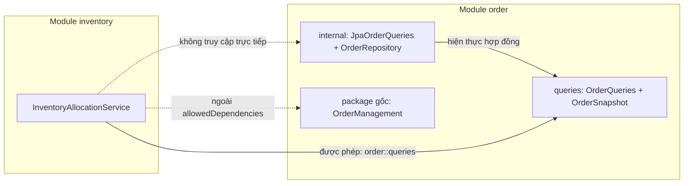

# Đánh dấu package công khai cho module khác

Trong Spring Modulith, một application module có **ranh giới kiến trúc** riêng dù các module cùng nằm trong một ứng dụng Spring Boot và một tiến trình JVM. Khi module khác cần sử dụng một kiểu nằm trong package con của module sở hữu, cách công bố hợp đồng rõ ràng là **đánh dấu package đó bằng `@NamedInterface`**. Tên được công bố sẽ được dùng trong quy tắc phụ thuộc và có thể được kiểm chứng bằng `ApplicationModules.verify()`.

Bài học thuộc chương **Named interfaces** của **SPRING_MODULITH_VERIFICATION_TESTING**. Trọng tâm là làm đúng ba việc: chọn package làm API, khai báo quyền tiêu thụ API, rồi đưa phép kiểm chứng ranh giới vào bộ test và quality gate CI. Các phép thử `@ApplicationModuleTest`, kiểm thử sự kiện, database và tích hợp tiếp tục xác nhận hành vi của các hợp đồng này.

> “Công khai” ở đây là **công khai trong mô hình kiến trúc module**, không có nghĩa tự tạo REST endpoint, Spring bean, thư viện xuất bản ra ngoài hoặc quyền truy cập bảo mật mới.

## 1. Vì sao một package Java `public` vẫn chưa là API của module?

Ví dụ ứng dụng bán hàng có lớp khởi động ở `com.acme.shop.ShopApplication`, các package con trực tiếp `order` và `inventory` được nhận diện thành application module theo cấu hình mặc định:

```text
com.acme.shop
├── ShopApplication.java
├── order/                      ← module order
│   ├── OrderManagement.java    ← package gốc: API mặc định
│   ├── queries/
│   │   ├── package-info.java  ← vị trí sẽ khai báo named interface
│   │   ├── OrderQueries.java
│   │   └── OrderSnapshot.java
│   └── internal/
│       ├── OrderRepository.java
│       └── JpaOrderQueries.java
└── inventory/                  ← module inventory
    ├── package-info.java
    └── InventoryAllocationService.java
```

Trong một **module đóng** (closed application module, quy tắc thường dùng), Spring Modulith phân biệt:

| Vị trí kiểu | Mặc định có thuộc API module không? | Ý nghĩa |
| --- | --- | --- |
| `com.acme.shop.order.OrderManagement` | **Có** | Kiểu public ở package gốc của module thuộc **unnamed interface** (API mặc định) |
| `com.acme.shop.order.queries.OrderQueries` | **Chưa** | Đây là subpackage; cần công bố rõ ràng nếu muốn module khác phụ thuộc |
| `com.acme.shop.order.internal.OrderRepository` | **Không** | Chi tiết hiện thực của `order`, không nên bị module khác import |

Từ khóa Java `public` quyết định khả năng truy cập của mã Java; **ranh giới Spring Modulith** bổ sung quy tắc thiết kế cho phụ thuộc giữa các module. Một class `public` trong `order.internal` có thể được Java cho phép import, nhưng test kiến trúc của Spring Modulith vẫn có thể báo vi phạm. Ngược lại, gắn `@NamedInterface` vào package không làm class package-private trở thành `public` trong Java.

Bài toán cần giải quyết: `inventory` muốn hỏi “đơn hàng đã xác nhận chưa?” thông qua `OrderQueries`, nhưng không được biết `OrderRepository` hay cách `order` lưu dữ liệu.

## 2. Đánh dấu package bằng `package-info.java`

Cách khai báo tường minh ở cấp package là tạo file **`package-info.java` ngay trong package muốn công bố**, rồi đặt annotation `@NamedInterface` trước khai báo `package`.

Ví dụ đường dẫn:

```text
src/main/java/com/acme/shop/order/queries/package-info.java
```

Nội dung:

```java
/**
 * Hợp đồng truy vấn trạng thái đơn hàng dành cho các module khác.
 *
 * <p>Chỉ công bố dữ liệu đọc cần thiết. Các repository và entity lưu trữ
 * vẫn thuộc phần triển khai nội bộ của module order.
 */
@org.springframework.modulith.NamedInterface("queries")
package com.acme.shop.order.queries;
```

Cách viết đầy đủ `@org.springframework.modulith.NamedInterface` tránh phải thêm câu `import` vào `package-info.java`. Có thể dùng cách import thông thường nếu dự án muốn giữ annotation ngắn gọn:

```java
@org.springframework.modulith.NamedInterface("queries")
package com.acme.shop.order.queries;
```

Các thành phần cần khớp nhau:

1. **Đường dẫn file** tương ứng với package Java: `order/queries/package-info.java`.
2. **Khai báo package** phải là `com.acme.shop.order.queries`, tức package thật chứa những kiểu cần công bố.
3. **Giá trị annotation** `"queries"` là *tên logic* của named interface.
4. **Tên module cung cấp** là `order`, vì package này thuộc application module `order`.
5. **Tên giao diện đầy đủ** khi module khác khai báo phụ thuộc là **`order::queries`**.

Dấu `::` là ký hiệu trong cấu hình quan hệ giữa **module** và **named interface**, không phải cách viết package Java hay biểu thức được import trong mã nguồn.

### Những kiểu nào nằm trong giao diện được công bố?

Tạo các kiểu public có chủ đích trong `com.acme.shop.order.queries`:

```java
// src/main/java/com/acme/shop/order/queries/OrderSnapshot.java
package com.acme.shop.order.queries;

import java.util.UUID;

/** Dữ liệu đọc tối thiểu dùng cho quyết định của module khác. */
public record OrderSnapshot(UUID orderId, boolean confirmed) {}
```

```java
// src/main/java/com/acme/shop/order/queries/OrderQueries.java
package com.acme.shop.order.queries;

import java.util.Optional;
import java.util.UUID;

/** Giao diện tra cứu, không chỉnh sửa trạng thái đơn hàng. */
public interface OrderQueries {
    Optional<OrderSnapshot> findById(UUID orderId);
}
```

`OrderQueries` và `OrderSnapshot` đều nằm trong package được đánh dấu, nên chúng là phần hợp đồng mà module khác có thể sử dụng. `OrderSnapshot` quan trọng vì nó xuất hiện trong chữ ký của `OrderQueries`: **các kiểu đầu vào và đầu ra của API cũng cần có khả năng được tiêu thụ hợp lệ**, không kéo theo entity/repository nội bộ.

`@NamedInterface` **không khởi tạo implementation**. Module `order` vẫn phải cung cấp một Spring bean hiện thực `OrderQueries`, chẳng hạn adapter trong `order.internal`; adapter này tự truy vấn repository và trả về `OrderSnapshot`. Phía tiêu thụ chỉ biết interface công khai.

## 3. Đánh dấu ở module cung cấp, khai báo phụ thuộc ở module tiêu thụ

Hai annotation đặt ở **hai phía của quan hệ**:

- **`@NamedInterface("queries")`** đặt trên package của module **`order`**: tuyên bố “đây là một phần API tôi công bố”.
- **`@ApplicationModule(allowedDependencies = "order::queries")`** đặt trên module **`inventory`**: tuyên bố “tôi chỉ sử dụng phần API này của `order`”.

File `src/main/java/com/acme/shop/inventory/package-info.java`:

```java
@org.springframework.modulith.ApplicationModule(
    allowedDependencies = "order::queries"
)
package com.acme.shop.inventory;
```

Bây giờ `InventoryAllocationService` phụ thuộc vào hợp đồng công khai:

```java
// src/main/java/com/acme/shop/inventory/InventoryAllocationService.java
package com.acme.shop.inventory;

import com.acme.shop.order.queries.OrderQueries;
import java.util.UUID;
import org.springframework.stereotype.Service;

@Service
public class InventoryAllocationService {

    private final OrderQueries orders;

    public InventoryAllocationService(OrderQueries orders) {
        this.orders = orders;
    }

    public boolean canAllocate(UUID orderId) {
        return orders.findById(orderId)
                .map(snapshot -> snapshot.confirmed())
                .orElse(false);
    }
}
```

Để chạy ví dụ này trong Spring, `order` cần có bean hiện thực `OrderQueries` được Spring quản lý. Bản thân `package-info.java` không đăng ký bean; nó mô tả **ranh giới kiến trúc**. Logic trả về `false` khi không tìm thấy đơn hàng chỉ là một quy tắc minh họa, cần được thống nhất và kiểm thử theo nghiệp vụ thực tế.



Đối với `inventory`, cách viết `order::queries` chính là **quyền phụ thuộc vào giao diện được đặt tên**, không phải quyền truy cập tùy ý mọi class `public` của module `order`.

### API mặc định và named interface khác nhau thế nào?

| Mục tiêu phụ thuộc của `inventory` | Với `allowedDependencies = "order::queries"` | Giải thích |
| --- | --- | --- |
| `order.queries.OrderQueries` | **Hợp lệ** | Có mặt trong API được công bố `order::queries` |
| `order.queries.OrderSnapshot` | **Hợp lệ** | Kiểu dữ liệu công khai thuộc cùng giao diện |
| `order.OrderManagement` | **Không hợp lệ** | API mặc định của `order` chưa được cho phép trong cấu hình này |
| `order.internal.OrderRepository` | **Không hợp lệ** | Phần nội bộ không thuộc API được công bố |
| `order.internal.JpaOrderQueries` | **Không hợp lệ** | Implementation nằm phía sau hợp đồng `OrderQueries` |

Nếu module tiêu thụ không khai báo `allowedDependencies`, các API **được công bố** thường có thể được dùng, nhưng phần nội bộ của module đóng vẫn bị bảo vệ bởi quy tắc kiến trúc. `allowedDependencies` có tác dụng **thu hẹp phần mà module tiêu thụ được phép phụ thuộc**, không thay đổi package bên cung cấp.

## 4. Đánh dấu nhiều package công khai theo từng mục đích

Một module có thể công bố nhiều nhóm API khác nhau thay vì dồn mọi kiểu vào một package lớn. Ví dụ `order` công bố:

```text
order/
├── queries/
│   ├── package-info.java     ← @NamedInterface("queries")
│   ├── OrderQueries.java
│   └── OrderSnapshot.java
├── events/
│   ├── package-info.java     ← @NamedInterface("events")
│   └── OrderConfirmed.java
└── internal/
    ├── OrderRepository.java
    └── JpaOrderQueries.java
```

File `order/events/package-info.java`:

```java
/**
 * Các sự kiện đơn hàng được công bố để module khác phản ứng.
 *
 * <p>Payload không lộ cấu trúc lưu trữ nội bộ của order.
 */
@org.springframework.modulith.NamedInterface("events")
package com.acme.shop.order.events;
```

Kiểu sự kiện minh họa:

```java
// src/main/java/com/acme/shop/order/events/OrderConfirmed.java
package com.acme.shop.order.events;

import java.time.Instant;
import java.util.UUID;

public record OrderConfirmed(UUID orderId, Instant occurredAt) {}
```

Nếu module `shipping` chỉ phản ứng với sự kiện, nó có thể khai báo:

```java
// src/main/java/com/acme/shop/shipping/package-info.java
@org.springframework.modulith.ApplicationModule(
    allowedDependencies = "order::events"
)
package com.acme.shop.shipping;
```

Khi đó, việc `shipping` phụ thuộc `OrderConfirmed` là hợp lệ, còn `shipping` không được tự động sử dụng `OrderQueries`. Việc sự kiện có được gửi và xử lý đúng là **vấn đề hành vi** cần kiểm thử riêng; công bố `events` chỉ xác định **kiểu sự kiện được phép tham chiếu về mặt kiến trúc**.

| API công bố | Người tiêu thụ ví dụ | Mục đích | Điều cần giữ kín |
| --- | --- | --- | --- |
| `order::queries` | `inventory` | Tra cứu dữ liệu đơn hàng tối thiểu | Entity JPA, SQL, repository |
| `order::events` | `shipping` | Nhận thông tin sự kiện nghiệp vụ | Adapter nội bộ và cơ chế phát sự kiện |
| API mặc định của `order` | Module được cấp phép riêng | Các thao tác public ở package gốc | Implementation trong subpackage nội bộ |

**Nguyên tắc:** tách named interface khi người tiêu thụ hoặc mục đích khác nhau. Không nên công bố thêm package chỉ vì bên trong chứa class `public`.

## 5. Kiểm chứng package công khai bằng `ApplicationModules.verify()`

Sau khi đánh dấu package, cần biến tuyên bố “module khác chỉ được sử dụng phần này” thành một **bài kiểm tra kiến trúc tự động**.

```java
// src/test/java/com/acme/shop/ModulithArchitectureTest.java
package com.acme.shop;

import org.junit.jupiter.api.Test;
import org.springframework.modulith.core.ApplicationModules;

class ModulithArchitectureTest {

    @Test
    void verifiesModuleBoundaries() {
        ApplicationModules.of(ShopApplication.class).verify();
    }
}
```

Đây là bài test JUnit cần có Spring Modulith core và các dependency kiểm thử thích hợp trên classpath; nó không cần khởi động toàn bộ Spring ApplicationContext để kiểm chứng cấu trúc module. Tùy cấu hình module và phiên bản thư viện, `verify()` kiểm tra các ràng buộc kiến trúc quan trọng như vòng phụ thuộc, truy cập API không được công bố và `allowedDependencies`.

Hãy thử các thay đổi có chủ đích:

1. **Trường hợp đúng:** `inventory` import `order.queries.OrderQueries`. Interface nằm trong package đã đánh dấu, và `inventory` cho phép `order::queries`.
2. **Trường hợp sai do chưa công bố:** xóa tạm annotation `@NamedInterface("queries")`, giữ nguyên import trong `inventory`. Package con `queries` trở về phần bên trong module đóng, nên phụ thuộc không còn hợp lệ.
3. **Trường hợp sai do quyền tiêu thụ:** giữ `@NamedInterface("queries")` nhưng đặt `allowedDependencies = "order::events"` trên `inventory`. `OrderQueries` vẫn được công bố, nhưng `inventory` không được phép sử dụng nhóm đó.
4. **Trường hợp sai do chạm internal:** import `order.internal.OrderRepository` từ `inventory`, giả sử kiểu được khai báo `public` để Java có thể biên dịch. Test kiến trúc phải chặn phụ thuộc trực tiếp vào chi tiết triển khai.
5. **Khôi phục trạng thái đúng:** đưa annotation và quyền phụ thuộc về đúng `queries`, bỏ import nội bộ, chạy lại test.

Các lỗi trên là **kỳ vọng của bài thực hành**, không phải kết quả đã chạy trên một repository cụ thể. Nếu Java từ chối import class package-private ở bước 4 thì đó mới là lỗi truy cập ngôn ngữ; hãy dùng một kiểu giả lập `public` để kiểm chứng đúng quy tắc module.

### Những lỗi mà test kiến trúc không thay thế được

`ApplicationModules.verify()` phát hiện vấn đề ở **cấu trúc phụ thuộc**, nhưng không khẳng định mọi chức năng của `OrderQueries` hoạt động đúng. Cần phối hợp:

| Kiểm thử | Câu hỏi cần trả lời |
| --- | --- |
| `ApplicationModules.verify()` | `inventory` có phụ thuộc đúng API đã công bố không? Có chu trình hoặc truy cập nội bộ sai không? |
| `@ApplicationModuleTest` | Các Spring bean trong phạm vi module hoạt động và tương tác đúng không? |
| Test sự kiện | `OrderConfirmed` được phát, nhận và xử lý theo kỳ vọng không? |
| Test repository/database | Truy vấn và mapping sang `OrderSnapshot` có đúng dữ liệu, transaction và ràng buộc không? |
| Test tích hợp | Luồng đặt hàng, phân bổ hàng và giao hàng phối hợp đúng trong môi trường gần thực tế không? |

Khi `ApplicationModules.verify()` chạy trong suite của CI (ví dụ `./gradlew test` với Gradle, `mvn test` với Maven), một thay đổi xóa nhầm `@NamedInterface` hoặc tạo import vào package nội bộ sẽ khiến test kiến trúc thất bại. Quality gate cần coi kết quả test thất bại là điều kiện chặn thay đổi, đồng thời chạy những test hành vi phù hợp để ngăn hồi quy.

## 6. Sai lầm thường gặp khi đánh dấu package

### Nhầm `public` của Java với API được công bố

```java
// order/internal/OrderRepository.java
package com.acme.shop.order.internal;

public interface OrderRepository { /* ... */ }
```

Từ khóa `public` chỉ cho phép truy cập theo luật Java. Nó **không** tự biến `order.internal` thành API module. Nếu `inventory` import kiểu trên, test kiến trúc sẽ phát hiện ranh giới sai đối với module đóng, dù lệnh biên dịch có thể vẫn hợp lệ.

### Đặt `package-info.java` sai chỗ

Giả sử file nằm tại `order/queries/package-info.java` nhưng lại khai báo:

```java
@org.springframework.modulith.NamedInterface("queries")
package com.acme.shop.order;
```

Khi đó annotation đang nhắm vào **package gốc `order`**, không phải `order.queries`, và có thể gây sai cấu trúc khai báo/gây nhầm lẫn. Hãy đặt file và khai báo package khớp đúng package muốn công bố, rồi xác minh mô hình module bằng test. Không dùng tên folder thay cho câu `package ...;` thực tế.

### Đánh dấu một package quá rộng

Nếu đặt toàn bộ DTO, repository, service implementation và entity vào `order.api` rồi gắn `@NamedInterface("api")`, các module khác dễ phụ thuộc vào chi tiết không ổn định. Hãy giữ package công bố **nhỏ và có mục đích nghiệp vụ**; chỉ đặt hợp đồng, dữ liệu cần thiết vào đó. Phần hiện thực vẫn ở `internal`.

### Đánh dấu đúng nhưng gõ sai tên trong `allowedDependencies`

```java
// Bên cung cấp: @NamedInterface("queries")
// Bên tiêu thụ: allowedDependencies = "order::query" // SAI TÊN
```

`queries` và `query` là hai chuỗi khác nhau. Tên đầy đủ `order::queries` phải khớp giao diện mà `order` thực sự công bố. Khi đổi tên, rà soát tất cả module tiêu thụ và chạy lại phép kiểm chứng kiến trúc.

### Lộ kiểu nội bộ qua chữ ký API

```java
// Ví dụ thiết kế không nên áp dụng
package com.acme.shop.order.queries;

import com.acme.shop.order.internal.OrderEntity;

public interface OrderQueries {
    OrderEntity findById(String id);
}
```

Dù `OrderQueries` nằm trong package đã đánh dấu, việc trả về `OrderEntity` kéo người tiêu thụ tới kiểu lưu trữ nội bộ. Hãy trả về một `OrderSnapshot` hoặc DTO công khai chứa đúng dữ liệu họ cần. Nếu cần giao tiếp bất đồng bộ, hãy công bố kiểu sự kiện ổn định thay vì entity JPA.

### Coi annotation là cơ chế chặn ở runtime

`@NamedInterface` không chặn reflection, không cài đặt rào chắn bảo mật và không thay Java Platform Module System. Nó khai báo kiến trúc để công cụ Spring Modulith **kiểm chứng từ mã**. Do đó, bảo vệ ranh giới bền vững đòi hỏi test kiến trúc chạy thường xuyên trong CI.

## 7. Quy trình thực hành hoàn chỉnh

Mục tiêu: module `inventory` được phép hỏi tình trạng đơn hàng; module `shipping` được phép xử lý sự kiện xác nhận; cả hai không được import trực tiếp `order.internal`.

1. **Tạo package hợp đồng:** `com.acme.shop.order.queries`, gồm `OrderQueries` và `OrderSnapshot`. Các kiểu dùng chung phải có mức truy cập Java phù hợp và không phụ thuộc vào implementation.
2. **Đánh dấu package:** tạo `order/queries/package-info.java`, khai báo `@NamedInterface("queries")` cùng JavaDoc nêu mục đích, kiểu được công bố và giới hạn.
3. **Giữ implementation nội bộ:** tạo hoặc sử dụng adapter trong `order.internal` để hiện thực `OrderQueries`; mọi truy cập repository nằm ở phía `order`.
4. **Giới hạn module gọi:** trong `inventory/package-info.java`, đặt `@ApplicationModule(allowedDependencies = "order::queries")` và chỉ import `order.queries.*` khi cần.
5. **Công bố API sự kiện riêng:** nếu `shipping` cần nhận `OrderConfirmed`, tạo `order/events/package-info.java` với `@NamedInterface("events")` và `allowedDependencies = "order::events"` ở `shipping`.
6. **Viết bài test kiến trúc:** dùng `ApplicationModules.of(ShopApplication.class).verify()`; kiểm tra trạng thái đúng, rồi tạo các vi phạm ở mục 5 để thấy test bị chặn.
7. **Kiểm thử hành vi:** thêm `@ApplicationModuleTest` hoặc test phù hợp để kiểm tra `OrderQueries`; test sự kiện và database để bảo đảm API có tác dụng như mô tả.
8. **Đưa vào CI:** chạy toàn bộ test liên quan trong quality gate; trước khi chấp nhận thay đổi phải có kết quả xác minh ranh giới và hành vi.

### Câu hỏi tự đánh giá

**1. Vì sao một class `public` trong `order.internal` không đủ để `inventory` dùng hợp lệ?** Vì luật truy cập Java khác với quy tắc API công bố của Spring Modulith; module đóng coi các subpackage chưa công bố là nội bộ.

**2. `@NamedInterface("queries")` nên đặt ở đâu để công bố `order.queries`?** Trong `package-info.java` của đúng package `com.acme.shop.order.queries`, đi kèm khai báo `package` trùng tên.

**3. Khai báo `allowedDependencies = "order::queries"` có tự mở `order.internal` không?** Không. Nó chỉ giới hạn quan hệ đến named interface `queries` đã được `order` công bố.

**4. `verify()` thành công có chứng minh repository truy vấn đúng không?** Không. `verify()` kiểm chứng cấu trúc; repository và dữ liệu cần unit/integration test riêng.

## 8. Kết luận

Để **đánh dấu package công khai cho module khác**, hãy công bố có chủ đích một subpackage của module đóng bằng `@NamedInterface("tên")` trong `package-info.java`; đặt những kiểu hợp đồng thực sự cần chia sẻ vào package đó; giữ lớp triển khai và lưu trữ bên trong module. Module tiêu thụ tham chiếu đúng giao diện bằng `module::tên` trong `allowedDependencies`. Cuối cùng, chạy `ApplicationModules.verify()` và các phép thử hành vi trong CI để phát hiện phụ thuộc sai và hồi quy.

### Tài liệu tham khảo

- [Spring Modulith Reference — Fundamentals: Named Interfaces](https://docs.spring.io/spring-modulith/reference/fundamentals.html)
- [Spring Modulith Reference — Verifying Application Module Structure](https://docs.spring.io/spring-modulith/reference/verification.html)
