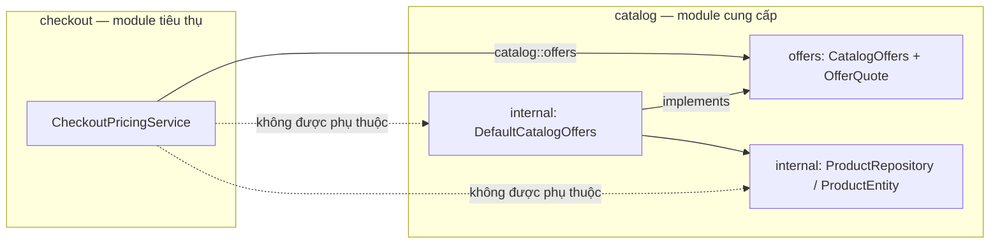

# Giới hạn kiểu được phép xuất qua API

Một application module trong Spring Modulith chỉ nên công bố **những kiểu thực sự cần cho module khác sử dụng**. Cách thiết kế này giảm phụ thuộc vào chi tiết triển khai, giữ hợp đồng ổn định khi thay database hoặc thuật toán nghiệp vụ, đồng thời tạo ranh giới có thể kiểm chứng bằng `ApplicationModules.verify()`.

Bài học thuộc chương **Named interfaces** của **SPRING_MODULITH_VERIFICATION_TESTING**: rèn kỹ năng kiểm chứng ranh giới kiến trúc với `ApplicationModules`, quy tắc phụ thuộc, `@ApplicationModuleTest`, kiểm thử sự kiện, database/tích hợp và quality gate trong CI. Trọng tâm ở đây là **hạn chế tập hợp kiểu được công bố** (*exported/public API types*) và bảo vệ tập hợp đó qua các lần thay đổi.

Trong ngữ cảnh này, “xuất qua API” nghĩa là **đưa kiểu Java vào phần giao diện kiến trúc mà module khác có thể phụ thuộc hợp lệ**. Nó không có nghĩa tự sinh REST endpoint, Java module descriptor `exports`, bean Spring hoặc cơ chế kiểm soát truy cập lúc chạy.

## 1. Vì sao cần giới hạn kiểu được công bố?

Giả sử hệ thống có hai application module:

- `catalog`: quản lý sản phẩm, giá và quy tắc tính ưu đãi.
- `checkout`: cần biết mức giá hiện hành và khả năng bán để tính đơn hàng.

Nếu `checkout` tham chiếu trực tiếp `catalog.internal.ProductEntity`, `ProductRepository` hoặc `DiscountCalculator`, thay đổi bảng dữ liệu hay thuật toán trong `catalog` sẽ kéo theo thay đổi ở `checkout`.

Mục tiêu tốt hơn là `catalog` chỉ công bố hai kiểu:

1. `CatalogOffers`: hợp đồng tra cứu báo giá theo SKU.
2. `OfferQuote`: bản dữ liệu đọc chứa các trường tối thiểu cho `checkout`.

Các kiểu persistence và triển khai được giữ trong `catalog.internal`, để `catalog` tự chuyển dữ liệu nội bộ thành `OfferQuote`.

| Kiểu | Có nên đưa vào API công bố? | Lý do |
| --- | --- | --- |
| `CatalogOffers` | **Có** | Module khác cần gọi một năng lực nghiệp vụ có ý nghĩa |
| `OfferQuote` | **Có** | Xuất hiện trong chữ ký public của hợp đồng, là dữ liệu tiêu thụ hợp lệ |
| `ProductEntity` (JPA entity) | **Không** | Gắn với persistence, quan hệ lazy loading và cấu trúc lưu trữ |
| `ProductRepository` | **Không** | Mở quyền thao tác dữ liệu và ràng buộc người gọi với Spring Data |
| `DiscountCalculator` | **Không** nếu chỉ được sử dụng nội bộ | Là thuật toán có thể thay đổi mà không đổi hợp đồng |
| `ProductController` | **Không** trong API module dùng nội bộ, nếu không có nhu cầu đặc biệt | Là adapter HTTP, không cần trở thành hợp đồng gọi chéo module |

Các quyết định này xuất phát từ **nhu cầu của module tiêu thụ**, không đơn thuần từ việc kiểu có modifier `public`.

## 2. Ba lớp kiểm soát khác nhau

Spring Modulith bổ sung một lớp quy tắc kiến trúc bên trên khả năng truy cập của Java:

| Lớp | Cấu hình/cơ chế | Câu hỏi được trả lời |
| --- | --- | --- |
| **Java** | `public`, `protected`, package-private, `private` | Mã Java có quyền tham chiếu tên kiểu theo luật ngôn ngữ không? |
| **API của module cung cấp** | Package gốc, `@NamedInterface`, phạm vi closed/open module | Module sở hữu đã công bố kiểu này như một phần API chưa? |
| **Quy tắc module tiêu thụ** | `@ApplicationModule(allowedDependencies = ...)` | Module gọi có được phụ thuộc vào API đã công bố đó không? |

Trong một **closed application module** (lựa chọn thông thường), các kiểu public ở **package gốc** thuộc API mặc định (*unnamed interface*). Các **subpackage** chưa được công bố là phần nội bộ theo quy tắc kiến trúc, dù có class `public`. Với subpackage muốn trở thành API, có thể đánh dấu bằng `@NamedInterface`.

Vì vậy, làm một kiểu `public` chỉ giải quyết mức **Java**. Việc công bố named interface chỉ giải quyết mức **module cung cấp**. Muốn mối phụ thuộc cụ thể được chấp nhận, module tiêu thụ còn phải thỏa các giới hạn `allowedDependencies` nếu đã khai báo.

## 3. Thiết kế package để chỉ công bố đúng kiểu cần thiết

Một cấu trúc rõ ràng:

```text
com.acme.shop
├── ShopApplication.java
├── catalog/                         ← application module: catalog
│   ├── api/
│   │   └── offers/
│   │       ├── package-info.java   ← @NamedInterface("offers")
│   │       ├── CatalogOffers.java  ← kiểu công bố #1
│   │       └── OfferQuote.java     ← kiểu công bố #2
│   └── internal/
│       ├── ProductEntity.java
│       ├── ProductRepository.java
│       ├── DiscountCalculator.java
│       └── JpaCatalogOffers.java
└── checkout/                        ← application module: checkout
    ├── package-info.java
    └── CheckoutPricingService.java
```

Chỉ đặt `CatalogOffers` và `OfferQuote` trong package `catalog.api.offers`. File `src/main/java/com/acme/shop/catalog/api/offers/package-info.java`:

```java
/**
 * API tra cứu báo giá và khả năng bán dành cho các module khác.
 *
 * <p>Chỉ công bố CatalogOffers và OfferQuote. Entity, repository,
 * chính sách chiết khấu và cơ chế lưu trữ thuộc catalog.internal.
 */
@org.springframework.modulith.NamedInterface("offers")
package com.acme.shop.catalog.api.offers;
```

Tên `offers` là tên **named interface**. Bên tiêu thụ có thể khai báo quyền đối với nó bằng chuỗi **`catalog::offers`**. Đây là tên module cộng tên giao diện, không phải đường dẫn Java package.

> **Lưu ý về phạm vi:** Khi đánh dấu một package bằng `@NamedInterface`, các kiểu đủ điều kiện nằm trong package đó được xem là API được công bố. Vì vậy, nếu sau này một người thêm class public `CatalogDebugHelper` vào chính package `catalog.api.offers`, họ đã có nguy cơ **mở rộng tập hợp kiểu API**, dù không sửa `package-info.java`. Không nên coi một package đã đánh dấu là nơi chứa tùy ý mọi lớp liên quan.

### Viết hợp đồng bằng kiểu dữ liệu ổn định

```java
// src/main/java/com/acme/shop/catalog/api/offers/OfferQuote.java
package com.acme.shop.catalog.api.offers;

import java.math.BigDecimal;
import java.util.Currency;

/** Dữ liệu báo giá tối thiểu được công bố cho các module tiêu thụ. */
public record OfferQuote(
        String sku,
        BigDecimal amount,
        Currency currency,
        boolean available
) {}
```

```java
// src/main/java/com/acme/shop/catalog/api/offers/CatalogOffers.java
package com.acme.shop.catalog.api.offers;

import java.util.Optional;

/** Tra cứu báo giá mà không tiết lộ cách catalog tính giá/lưu dữ liệu. */
public interface CatalogOffers {

    /** Không tìm thấy SKU thì trả về Optional.empty(). */
    Optional<OfferQuote> findBySku(String sku);
}
```

Đầu vào là `String`, đầu ra gồm `Optional` và `OfferQuote` cùng các kiểu JDK (`BigDecimal`, `Currency`). Không có tham số nào bắt buộc `checkout` import `ProductEntity` hoặc `ProductRepository`. Trong hệ thống thực tế, cần bổ sung quy tắc xác thực SKU, tính nhất quán giá và thời hạn hiệu lực báo giá, rồi viết test hành vi tương ứng.

Một implementation của `CatalogOffers` có thể nằm **hoàn toàn trong module cung cấp**:

```java
// src/main/java/com/acme/shop/catalog/internal/DefaultCatalogOffers.java
package com.acme.shop.catalog.internal;

import com.acme.shop.catalog.api.offers.CatalogOffers;
import com.acme.shop.catalog.api.offers.OfferQuote;
import java.math.BigDecimal;
import java.util.Currency;
import java.util.Optional;
import org.springframework.stereotype.Service;

@Service
class DefaultCatalogOffers implements CatalogOffers {

    @Override
    public Optional<OfferQuote> findBySku(String sku) {
        // Giá cố định để minh họa; thực tế module catalog tự dùng
        // repository và chính sách định giá của chính nó.
        return Optional.of(new OfferQuote(
                sku,
                new BigDecimal("149000"),
                Currency.getInstance("VND"),
                true
        ));
    }
}
```

Class implementation ở đây còn để **package-private**, nên Java cũng giảm khả năng tham chiếu trực tiếp từ ngoài package. Spring vẫn có thể quản lý bean với annotation `@Service`; module khác inject qua `CatalogOffers`. Trong thực tế, có thể phải dùng `public` cho một số kiểu nội bộ vì framework hoặc Java API yêu cầu; việc đặt chúng ở `catalog.internal` và kiểm chứng kiến trúc vẫn bảo vệ ranh giới module.

## 4. Chặn rò rỉ kiểu nội bộ qua chữ ký API

Đây là lỗi phổ biến hơn việc cố ý import repository: giao diện nhìn có vẻ công khai nhưng trả về kiểu thuộc phần nội bộ.

Ví dụ **sai về thiết kế**:

```java
// catalog/api/offers/CatalogOffers.java — KHÔNG NÊN DÙNG
package com.acme.shop.catalog.api.offers;

import com.acme.shop.catalog.internal.ProductEntity;
import java.util.Optional;

public interface CatalogOffers {
    Optional<ProductEntity> findBySku(String sku);
}
```

Dù `CatalogOffers` nằm ở package đã công bố, người tiêu thụ phải phụ thuộc vào `ProductEntity` để đọc kết quả. Điều này khiến API bị khóa vào JPA mapping, quan hệ entity và chi tiết lưu trữ.

Cách xử lý là **ánh xạ kết quả nội bộ sang DTO công bố**:

```java
public interface CatalogOffers {
    Optional<OfferQuote> findBySku(String sku);
}
```

Tương tự, kiểm tra mọi phần của chữ ký public:

| Vị trí có thể làm rò rỉ kiểu | Ví dụ cần cảnh giác | Hướng thiết kế phù hợp |
| --- | --- | --- |
| Tham số | `reserve(ProductEntity entity)` | Tham số công khai như `sku`, `quantity` hoặc command DTO |
| Kiểu trả về | `ProductEntity find(...)` | `OfferQuote`, `Optional<OfferQuote>` |
| Kiểu trong generic | `List<ProductEntity>`, `Page<ProductEntity>` | `List<OfferQuote>`, trang dữ liệu ở contract nếu thật sự cần |
| Ngoại lệ checked | `throws InternalPricingException` | Hợp đồng lỗi được công bố hoặc một kiểu lỗi nghiệp vụ ổn định |
| Inheritance/public method | API `extends InternalRepository` | Chỉ kế thừa các hợp đồng thực sự thuộc API |
| Event payload | `OrderPaid(ProductEntity entity)` | Sự kiện dạng giá trị, chỉ mang các trường cần thiết |

Tính “công khai” của một kiểu không kéo theo quyền sử dụng hợp lệ cho **mọi kiểu xuất hiện trong chữ ký** của nó. Những kiểu tùy chỉnh được dùng làm tham số, kết quả, payload hoặc kiểu generic cũng cần thuộc API thích hợp, hoặc là kiểu Java/thư viện dùng chung đã được lựa chọn có chủ đích.

Các kiểu `record` thường thuận tiện để biểu diễn DTO vì mang ngữ nghĩa dữ liệu rõ ràng. Tuy nhiên, `record` chỉ **bất biến nông**: nếu trường là collection hoặc đối tượng mutable thì vẫn phải bảo vệ trạng thái, chẳng hạn sao chép danh sách bằng `List.copyOf(...)` khi thiết kế hợp đồng.

## 5. Không đặt implementation vào package API chỉ vì nó cần được Spring quét

Một lầm tưởng là mọi `@Service` phải ở package công khai thì Spring mới inject được bean đó sang module khác. Spring quét bean theo cấu hình component scanning; **khả năng tạo/inject bean** và **tập hợp kiểu được công bố cho module khác** là hai việc khác nhau.

Thiết kế nên theo chiều:



`DefaultCatalogOffers` và repository được giữ ở phía `catalog`. Chỉ các kiểu `CatalogOffers`, `OfferQuote` là hợp đồng trao đổi. Khi đổi implementation từ JPA sang JDBC hoặc sang một adapter khác, `checkout` không phải sửa import.

Nếu một class có nhiều vai trò, hãy tách interface hợp đồng khỏi implementation thay vì di chuyển implementation lên package gốc hoặc package named interface.

## 6. Giới hạn quyền phụ thuộc của module tiêu thụ

Công bố kiểu ở `catalog::offers` mới xử lý **bên cung cấp**. Bên `checkout` có thể giới hạn chính xác API mình được sử dụng trong `src/main/java/com/acme/shop/checkout/package-info.java`:

```java
@org.springframework.modulith.ApplicationModule(
    allowedDependencies = "catalog::offers"
)
package com.acme.shop.checkout;
```

Một service tiêu thụ:

```java
// src/main/java/com/acme/shop/checkout/CheckoutPricingService.java
package com.acme.shop.checkout;

import com.acme.shop.catalog.api.offers.CatalogOffers;
import com.acme.shop.catalog.api.offers.OfferQuote;
import java.util.Optional;
import org.springframework.stereotype.Service;

@Service
public class CheckoutPricingService {

    private final CatalogOffers offers;

    public CheckoutPricingService(CatalogOffers offers) {
        this.offers = offers;
    }

    public Optional<OfferQuote> priceFor(String sku) {
        return offers.findBySku(sku);
    }
}
```

Bây giờ có hai câu hỏi kiểm tra mỗi khi `checkout` muốn import kiểu từ `catalog`: **kiểu đó có thuộc API của `catalog` không?** và **`checkout` có được phép phụ thuộc vào phần API ấy không?**

| Tham chiếu từ `checkout` | Kết quả với `allowedDependencies = "catalog::offers"` | Lý do |
| --- | --- | --- |
| `catalog.api.offers.CatalogOffers` | **Hợp lệ** | Thuộc named interface được công bố và được cho phép |
| `catalog.api.offers.OfferQuote` | **Hợp lệ** | Thuộc cùng named interface |
| `catalog.internal.ProductEntity` | **Vi phạm** | Kiểu nội bộ của closed module |
| `catalog.internal.ProductRepository` | **Vi phạm** | Repository không nằm trong API công bố |
| Một kiểu public ở package gốc `catalog` | **Vi phạm trong cấu hình này** | Thuộc API mặc định nhưng `checkout` chỉ được dùng `catalog::offers` |
| Một kiểu thuộc `catalog::events` (nếu có) | **Vi phạm trong cấu hình này** | Named interface khác không được liệt kê |

Không khai báo `allowedDependencies` thì module tiêu thụ thường vẫn được dùng **những API đã công bố** ở các module khác (miễn không vi phạm quy tắc khác), nhưng nó vẫn không được phép chọc vào các kiểu nội bộ của closed module. `allowedDependencies` là cách **thu hẹp tập hợp quyền phụ thuộc** của module tiêu thụ; nó không tự đưa kiểu nội bộ sang API của module cung cấp.

### Tránh mở rộng quyền bằng wildcard không cần thiết

Các lựa chọn như `catalog::*` hoặc `catalog::**` cho phép tham chiếu nhiều phần API hơn một named interface cụ thể. Nếu nhu cầu duy nhất là báo giá, khai báo `catalog::offers` rõ ràng hơn và khiến việc thêm phụ thuộc mới đòi hỏi quyết định thiết kế. Đừng đổi sang wildcard chỉ để một phép kiểm chứng kiến trúc hết báo lỗi.

Cũng cần giữ **package gốc** của module gọn gàng: public types ở package gốc thuộc API mặc định, nên đặt các implementation bên trong package gốc sẽ vô tình tăng phạm vi API dù không dùng `@NamedInterface`.

## 7. Kiểm chứng bằng `ApplicationModules.verify()`

Sau khi thiết kế API, viết một test kiến trúc JUnit:

```java
// src/test/java/com/acme/shop/ModulithArchitectureTest.java
package com.acme.shop;

import org.junit.jupiter.api.Test;
import org.springframework.modulith.core.ApplicationModules;

class ModulithArchitectureTest {

    @Test
    void modulesOnlyDependOnPublishedContracts() {
        ApplicationModules.of(ShopApplication.class).verify();
    }
}
```

`ShopApplication` là lớp `@SpringBootApplication` ở `com.acme.shop`, bao quanh các package module. Ví dụ giả định dự án đã thêm dependencies Spring Modulith và JUnit thích hợp.

`verify()` kiểm chứng những ràng buộc kiến trúc cốt lõi, trong đó có phụ thuộc hợp lệ qua API module, `allowedDependencies` và việc không có vòng phụ thuộc module. Nó hoạt động ở **mức cấu trúc**, không cần thực thi truy vấn database hay khởi tạo toàn bộ ứng dụng để kiểm tra hợp đồng lớp/package.

Để nhìn rõ cơ chế, làm một thí nghiệm có kiểm soát:

1. **Baseline:** chỉ dùng `CatalogOffers` và `OfferQuote` từ `checkout`. Test kiến trúc phải đạt nếu phần còn lại của hệ thống cũng tuân thủ quy tắc.
2. **Thử vi phạm nội bộ:** để một kiểu `catalog.internal.ProductRepository` là `public` nhằm cho phép Java import, rồi import trực tiếp từ `checkout`. Test kiến trúc phải phát hiện quyền phụ thuộc không hợp lệ.
3. **Thử rút quyền công bố:** tạm bỏ `@NamedInterface("offers")` khỏi package `catalog.api.offers`. Khi đó kiểu ở subpackage chưa được công bố sẽ không còn là API của closed module.
4. **Thử rút quyền tiêu thụ:** khôi phục annotation, nhưng đổi `allowedDependencies` của `checkout` thành chỉ `catalog::events` (giả sử named interface đó đã tồn tại). Import `CatalogOffers` lúc này vi phạm danh sách cho phép.
5. **Thử lộ DTO nội bộ:** cố tình thay chữ ký `CatalogOffers` để trả về `ProductEntity`. Đọc lại bề mặt API và xem các module tiêu thụ bị kéo theo phụ thuộc nội bộ ra sao; bổ sung kiểm tra chữ ký/hợp đồng khi cần.
6. **Khôi phục mã:** trả lại cấu trúc đúng và chạy lại test cho tới khi đạt.

Các dòng trên mô tả **kỳ vọng của bài thực hành**, không phải kết quả thực thi trong repository này. Khi thử vi phạm, phân biệt lỗi biên dịch do Java visibility với lỗi module boundary do Spring Modulith. Nếu `ProductRepository` là package-private thì Java sẽ chặn trước; muốn thử phép kiểm chứng kiến trúc, dùng một kiểu public nội bộ giả lập.

### Phép kiểm chứng không thay thế rà soát thiết kế API

`verify()` có thể phát hiện các tham chiếu chéo module sai, nhưng không tự quyết định `OfferQuote` có **quá nhiều trường**, một kiểu Java public có **thực sự cần xuất**, hay DTO có đáp ứng chính sách **bảo mật dữ liệu** không. Những quyết định này cần review mã, tài liệu hợp đồng và test hành vi. Khi dùng chữ ký API phức tạp hoặc generic, nên bổ sung các bài kiểm tra thích hợp nếu muốn kiểm soát toàn bộ hợp đồng đầu vào/đầu ra.

## 8. Kết hợp kiểm thử hành vi và quality gate CI

Trong lộ trình kiểm chứng kiến trúc, giới hạn tập hợp kiểu được công bố là một phần của bộ chất lượng hoàn chỉnh:

| Loại kiểm thử | Câu hỏi | Ví dụ gắn với `catalog::offers` |
| --- | --- | --- |
| `ApplicationModules.verify()` | Có module nào phụ thuộc sai vào kiểu nội bộ hay vượt `allowedDependencies` không? | `checkout` không được import `ProductEntity` |
| `@ApplicationModuleTest` | Module trong phạm vi kiểm thử có cung cấp đúng bean và hành vi dự kiến không? | `CatalogOffers` có bean hiện thực và trả dữ liệu đúng |
| Test database/repository | Ánh xạ dữ liệu có chính xác không? | Entity được chuyển sang `OfferQuote` mà không lộ persistence |
| Test sự kiện | Event công bố có payload phù hợp và được xử lý đúng không? | Kiểu event công khai chỉ gồm dữ liệu cần tiêu thụ |
| Test tích hợp | Các module phối hợp đúng qua hợp đồng được công bố không? | Checkout tính giá từ catalog qua interface |
| CI quality gate | Có thay đổi nào làm sai ranh giới hoặc hành vi không? | Chặn hợp nhất khi test kiến trúc hoặc test hành vi thất bại |

Nếu test JUnit ở trên được đưa vào test suite chính, lệnh ví dụ `./gradlew test` (hoặc `gradlew.bat test` trên Windows) có thể chạy cùng các bài test khác. Với Maven, có thể dùng `mvn test`. Pipeline CI phải coi bài test thất bại là **quality gate thất bại**, thay vì chỉ in cảnh báo.

Đối với event, cũng áp dụng nguyên tắc hạn chế kiểu: payload công khai nên chứa giá trị/định danh cần thiết; không gửi entity JPA hoặc adapter nội bộ qua ranh giới. `ApplicationModules.verify()` kiểm chứng **quan hệ phụ thuộc**; test event mới kiểm chứng việc phát/nhận, transaction và xử lý lại sự kiện.

## 9. Các sai lầm thường gặp

**“Chỉ cần để interface public, mọi kiểu liên quan sẽ hợp lệ.”** Sai. Người tiêu thụ còn phải xử lý các kiểu tham số, trả về, generic và ngoại lệ được công bố. Nếu chữ ký phụ thuộc `ProductEntity`, API bị rò rỉ phần nội bộ.

**“Đánh dấu package API một lần rồi thêm bao nhiêu class public cũng được.”** Sai về quản trị hợp đồng. Thêm kiểu public mới trong package đã công bố có thể vô tình mở rộng bề mặt phụ thuộc; cần xem thay đổi đó có đúng vai trò API không.

**“Đưa `ProductRepository` lên package gốc để test kiến trúc hết lỗi.”** Không giải quyết nguyên nhân. Package gốc là API mặc định; chuyển repository lên đó có thể vô tình biến chi tiết persistence thành hợp đồng công khai.

**“Chỉ cần `allowedDependencies` ở module tiêu thụ.”** Không đủ. `allowedDependencies` không biến một kiểu nằm trong package nội bộ thành kiểu đã được module cung cấp công bố.

**“Spring bean phải nằm trong package có `@NamedInterface`.”** Không đúng. Bean có thể ở `internal`; module tiêu thụ sử dụng nó thông qua interface công bố được Spring inject.

**“Đổi sang open module để không cần kiểm soát kiểu.”** Open module nới ranh giới truy cập cho trường hợp chuyển đổi hệ thống cũ. Nó không thích hợp làm cách né việc thiết kế hợp đồng chặt chẽ cho module mới.

**“`verify()` đạt là đủ để biết API an toàn và đúng nghiệp vụ.”** Không đúng. Cần review kiểu dữ liệu công bố, test behavior, quyền truy cập dữ liệu và các bài test tích hợp.

## 10. Checklist khi review một kiểu được đề xuất công bố

Trước khi đưa một kiểu Java vào named interface hoặc package gốc của module, trả lời:

1. **Ai sử dụng?** Có module tiêu thụ thực sự và một nhu cầu nghiệp vụ rõ ràng không?
2. **Nó thuộc trách nhiệm nào?** Tên và package API có thể hiện đúng một nhóm năng lực cụ thể không?
3. **Nó có làm lộ triển khai?** Chữ ký có tham chiếu entity JPA, repository, adapter, lớp cấu hình hoặc kiểu dữ liệu nội bộ không?
4. **Dữ liệu có tối thiểu không?** DTO/event có chứa thông tin thừa hoặc dữ liệu nhạy cảm không nên phân phối không?
5. **Có ổn định không?** Nếu đổi schema database hoặc thuật toán nội bộ, người tiêu thụ có phải đổi mã không?
6. **Quyền tiêu thụ có hẹp không?** Có thể chỉ cho phép `catalog::offers` thay vì toàn bộ `catalog` không?
7. **Có kiểm chứng hồi quy không?** Test kiến trúc, module, database, event và tích hợp liên quan đã bảo vệ hợp đồng chưa?

Nếu câu trả lời cho câu 1 là “không”, thường nên giữ kiểu ở `internal` cho tới khi có nhu cầu thật. Nếu câu 3 là “có”, hãy thiết kế một DTO hoặc interface ở API thay vì xuất implementation.

## 11. Bài thực hành: thu nhỏ API của `catalog`

Giả sử ban đầu package `catalog` có năm kiểu `public`: `ProductEntity`, `ProductRepository`, `DiscountCalculator`, `CatalogOffers`, `OfferQuote`. Do để cả năm ở package gốc, chúng đều có nguy cơ được nhìn nhận là API mặc định của module.

Thực hành một refactor kiến trúc:

1. **Phân loại trách nhiệm:** xác định hai kiểu phải được module khác sử dụng (`CatalogOffers`, `OfferQuote`); ba kiểu còn lại là chi tiết nội bộ.
2. **Sắp xếp lại package:** đưa hai kiểu hợp đồng vào `catalog.api.offers` và các kiểu còn lại vào `catalog.internal`. Đảm bảo chữ ký của hợp đồng không nhắc đến kiểu nội bộ.
3. **Công bố đúng package:** tạo `package-info.java` với `@NamedInterface("offers")`; thêm JavaDoc giải thích mục đích và giới hạn.
4. **Giới hạn người tiêu thụ:** trong `checkout`, đặt `allowedDependencies = "catalog::offers"`; bỏ các import `catalog.internal.*`.
5. **Chạy `verify()`:** kiểm tra baseline hợp lệ; sau đó cố tình import một kiểu public nội bộ để xem test phát hiện vi phạm.
6. **Thêm kiểm thử hành vi:** test một SKU tồn tại, SKU không tồn tại và ánh xạ giá/đơn vị tiền; nếu có database thật, xác minh mapping từ entity sang DTO.
7. **Khóa quy tắc trong CI:** đưa test vào pipeline. Trong code review, thử thêm một helper public vào `catalog.api.offers` và giải thích vì sao cần chuyển nó ra `internal` nếu người tiêu thụ không cần.

**Tiêu chí đạt:** `checkout` chỉ import `CatalogOffers` và `OfferQuote`; repository/entity không lộ qua chữ ký API; `ApplicationModules.verify()` nhận diện được phụ thuộc sai; việc sửa implementation nội bộ không buộc đổi mã ở module tiêu thụ.

## 12. Ghi nhớ

**Giới hạn kiểu xuất qua API** cần làm từ phía module cung cấp: chọn những kiểu hợp đồng thực sự cần thiết, đặt trong package được công bố bằng `@NamedInterface`, giữ entity/repository/adapter trong `internal`, và tránh để kiểu nội bộ rò rỉ qua tham số hoặc giá trị trả về. Phía module tiêu thụ tiếp tục hạn chế quyền bằng `allowedDependencies`. `ApplicationModules.verify()` giúp chặn phụ thuộc sai trong CI; `@ApplicationModuleTest`, test sự kiện, database và tích hợp bảo đảm hành vi của phần API được công bố.

### Tài liệu tham khảo

- [Spring Modulith Reference — Fundamentals, mục Named Interfaces](https://docs.spring.io/spring-modulith/reference/fundamentals.html)
- [Spring Modulith Reference — Verifying Application Module Structure](https://docs.spring.io/spring-modulith/reference/verification.html)
